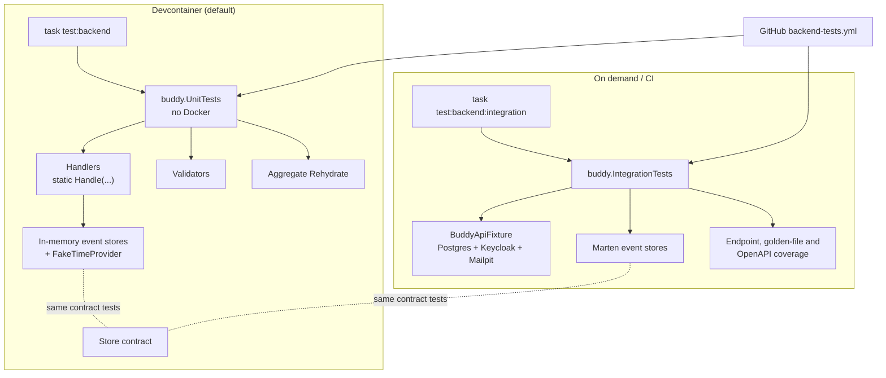

# Backend unit tests as the primary test source

Status: Proposed (not yet implemented)

## Context

Running the backend tests (`task test:backend`, which runs `dotnet test backend.slnx`) often makes
the devcontainer run out of memory. The suite is a single project,
[buddy.IntegrationTests](../../../src/backend/buddy.IntegrationTests), with about 1,490 test cases
(1,442 `[Fact]` and 50 `[Theory]`). It was built on purpose to test against real infrastructure;
see [integration-testing-strategy.md, Goals](integration-testing-strategy.md#goals). That choice
has served the project well: endpoint coverage, the authorization matrix and the persisted event
shapes are all checked mechanically. But every change to a backend file now pays for a full stack,
and the feedback loop gets slower as features are added.

What a run starts today:

- **Three containers per run.** [BuddyApiFixture.cs](../../../src/backend/buddy.IntegrationTests/Fixtures/BuddyApiFixture.cs)
  starts Postgres 18, Keycloak 26 (a JVM) and Mailpit through Testcontainers. These run alongside
  the devcontainer's own Postgres, Keycloak and Mailpit (`.devcontainer/docker-compose.yml`), so
  two Keycloak JVMs run at once.
- **One shared Alba host,** which 237 test classes share through `[Collection(BuddyApiCollection.Name)]`.
  The host registers 20 Marten stores (`AddMartenStore<...>`). Marten and Wolverine are left on
  their default runtime code generation: no `GeneratedCodeMode` or `TypeLoadMode` is set
  anywhere in `src/backend/buddy`. So each store and each handler chain is compiled with Roslyn
  in memory when the host starts or first uses it.
- **About 15 extra hosts** from `fixture.CreateHostAsync(...)`, each a full second copy of the app
  with its own Marten stores and generated code.
  - Some are scoped to one test and disposed (`await using`, in HealthChecks and DataProtection).
  - Others live for a whole test class: [FeatureFlagsTests](../../../src/backend/buddy.IntegrationTests/Common/FeatureFlags/FeatureFlagsTests.cs)
    caches two (`_allOff`, `_mealplanExtrasOff`), and RateLimiting, Observability, AuditLog,
    ExceptionHandling and UndoWindow each keep one.
  - Some are hosts that are expected to fail at startup (`A_misspelt_flag_fails_the_host_at_startup`,
    `A_non_positive_limit_fails_the_host_at_startup`). Their partly built service providers may
    never be disposed.

About 25 files in the project are already plain unit tests: they never touch the fixture. They
include all of `EventShapeTests/`, [RecurrenceExpansionTests](../../../src/backend/buddy.IntegrationTests/Features/Calendars/RecurrenceExpansionTests.cs),
`CalendarOccurrenceExpansionTests`, `WorkPatternTests`, `MealPlanImportParsingTests`,
`AiMealFilterTests`, `ValidatedOptionsTests`, `FeatureOptionsTests`, `EventReplayTests`,
`SleepEntryDateShiftTests` and `ValueTupleJsonConverterFactoryTests`. They are only slow and
memory-hungry because they live in a project that also references Testcontainers. Its `dotnet test`
run starts the containers as soon as any collection test runs.

The production code is already easy to unit-test, which makes this change affordable:

- Handlers are static `Handle(...)` methods whose dependencies are parameters, as in
  [RescheduleItem.Handler.cs](../../../src/backend/buddy/Features/Calendars/RescheduleItem/RescheduleItem.Handler.cs).
- Handlers depend on small event-store interfaces (27 `I*EventStore` interfaces with about 165
  methods between them, for example [ICalendarEventStore](../../../src/backend/buddy/Features/Calendars/ICalendarEventStore.cs)),
  never on `IDocumentSession` or `IQuerySession` directly. No handler file references Marten.
- Results are the [`Result<T>`](../../../src/backend/buddy/Common/Result.cs) union, so a test can check the
  outcome case (`NotFound`, `Forbidden`, `Validation`, `Success`) without HTTP.

This document answers six questions: what actually uses the memory, where unit tests live, what a
unit test fakes, how handlers get the time, what stays an integration test, and how each suite is
run.

## Question 1: is the number of tests the cause of the out-of-memory errors?

**Decision: no, most likely not. The memory goes on containers and extra app hosts. Fix those
first (phase 0 below), independently of the unit-test work, and measure before and after.**

The likely causes, with the largest first:

1. Extra hosts that live for a whole class, plus failed-startup hosts that may not be disposed.
   Each holds 20 Marten stores and its generated assemblies, and collectible Roslyn assemblies are
   not freed until the host's load context is released.
2. Runtime code generation for Marten and Wolverine in every host.
3. A second Keycloak JVM with no heap cap (the container's default is a share of the VM's RAM),
   next to the devcontainer's own Keycloak.
4. The test host process keeping every test class's fixture state for the whole run, because all
   237 classes share one collection.

Phase 0 fixes:

- **Measure first.** Run `docker stats` and `dotnet-counters monitor --process-id <testhost>
System.Runtime` during one full run, and record the peak of each in this doc.
- **Dispose every extra host.**
  - Hosts cached in a field get an `IAsyncLifetime.DisposeAsync`.
  - Startup-failure tests wrap `CreateHostAsync` so that a host that throws is still disposed.
  - Move every test that calls `CreateHostAsync` into a second collection,
    `IsolatedHostCollection`, so those hosts never coexist with each other's state.
- **Turn off runtime code generation for tests.** Use `TypeLoadMode.Auto` with pre-generated code
  (`dotnet run -- codegen write`, the standard Wolverine and Marten command), or at least set
  `GeneratedCodeMode` so code is generated once per type rather than once per host. Production
  startup time benefits as well.
- **Cap Keycloak's heap** in the fixture (`JAVA_OPTS_KC_HEAP="-Xms128m -Xmx512m"`) and give each
  container a memory limit through `WithCreateParameterModifier`.

Considered and rejected: running the integration suite in several smaller processes. That splits
the memory over time but starts the containers several times, so a run gets slower and the peak
barely changes.

## Question 2: a new project, or traits in the existing one?

**Decision: a new project, `src/backend/buddy.UnitTests`, which references `buddy` and xunit only:
no Alba, no Testcontainers, no Docker. The ~25 pure test files move into it first.**

- With no Testcontainers reference, a unit test cannot pull in `BuddyApiFixture` by accident.
  The compiler enforces the boundary; a naming rule would not.
- `dotnet test buddy.UnitTests` needs no Docker, so it also runs in a worktree while another
  worktree has the dev stack up.
- Stryker.NET can point its `test-projects` at the unit project alone. Mutants then run against
  millisecond tests instead of a full HTTP round trip (see
  [mutation-testing-strategy.md, Performance characteristics](mutation-testing-strategy.md#performance-characteristics):
  18 mutants took 14.5 minutes against the integration suite).
- `buddy.csproj` gains `<InternalsVisibleTo Include="buddy.UnitTests" />` next to the existing
  one for the integration project.

Considered and rejected: `[Trait("Category", "Unit")]` with a `--filter` in the same project. The
filter is easy to forget, the containers still start whenever a filtered-in class happens to use
the collection, and Stryker cannot exclude a trait as cleanly as a project.

The golden files used by `EventShapeTests/` (`GoldenFiles/**/*.json`) move with them, along with
their `CopyToOutputDirectory` item. The `BUDDY_UPDATE_*` regeneration switches keep working,
because they are read by the tests themselves, not by the fixture.

## Question 3: what does a unit test fake, and how?

**Decision: hand-written in-memory fakes, one per event-store interface, in
`buddy.UnitTests/Fakes/`. No mocking library. Each fake keeps a list of events per stream and
exposes `Appended` so tests can check exactly which events a handler wrote. A shared contract test
runs against both the fake and the Marten implementation, so the two stay in step.**

```csharp
public sealed class InMemoryCalendarEventStore : ICalendarEventStore
{
    private readonly Dictionary<CalendarId, List<CalendarEvent>> _streams = [];

    public List<(CalendarId Id, CalendarEvent Event)> Appended { get; } = [];

    // Arrange helper: a stream that already exists before the handler runs.
    public InMemoryCalendarEventStore With(CalendarId id, params CalendarEvent[] events) { ... }

    public Task<IReadOnlyCollection<CalendarEvent>> ReadAsync(CalendarId id, CancellationToken ct) => ...;
    public Task AppendAsync(CalendarId id, IReadOnlyCollection<CalendarEvent> events, CancellationToken ct) => ...;

    // Index lookups (ListForUserAsync, ListOwnedByGroupsAsync) are answered by rehydrating the
    // in-memory streams, not by a second copy of the Marten projection.
    ...
}
```

A handler test then reads like this:

```csharp
[Fact]
public async Task Rescheduling_a_task_with_event_timing_is_a_validation_error()
{
    var (calendars, items, groups) = Stores.WithCalendarOwnedBy(Alice, out var calendarId)
        .AndTask(out var itemId, due: new DateOnly(2026, 10, 20));

    var result = await RescheduleItemHandler.Handle(
        new RescheduleItem(Alice, calendarId, itemId, new ItemTiming.Event(...)),
        calendars, items, groups, CancellationToken.None);

    Assert.IsType<Result<CalendarItem>.Validation>(result);
    Assert.Empty(items.Appended);
}
```

Rationale:

- The interfaces are small (4–13 methods each), and the fakes are worth more than mocks. A mock
  setup asserts on how a handler called the store. A fake lets the test assert on the outcome:
  which events were written and what `Rehydrate` makes of them.
- There is precedent for hand-written test doubles of these interfaces:
  [ConcurrentWriterUserEventStore](../../../src/backend/buddy.IntegrationTests/Common/Concurrency/ConcurrentWriterUserEventStore.cs)
  already wraps `IUserEventStore` by hand.
- The risk with fakes is drift: an index lookup in the fake behaves differently from the inline
  Marten document. Contract tests catch it. An abstract `CalendarEventStoreContract` class holds
  the behaviour, and two subclasses run it: one in the unit project against the fake, and one in
  the integration project against `MartenCalendarEventStore`.

Considered and rejected:

- **NSubstitute or Moq.** Setups for `ReadAsync` returning event lists are verbose, and they test
  calls rather than outcomes.
- **Marten in a lightweight in-memory mode.** Marten has none; it needs Postgres.
- **One generic `InMemoryEventStore<TId, TEvent>`.** Each interface has its own index lookups
  (`FindInviteByTokenAsync`, `ListForUserAsync`), so a generic base class helps only for the
  `ReadAsync`/`CreateAsync`/`AppendAsync` core. Use it for that core and keep the lookups per fake.

Other dependencies get the same treatment: `IKeycloakAdminClient`, the mail sender and the AI
provider registry each get one recording fake.

## Question 4: how do handlers get the current time?

**Decision: inject `TimeProvider` into every handler that reads the clock, following the 25 files
that already do (the Feelings and VisitSummaries features). Do it one domain at a time, when that
domain gets its unit tests, not as one large rewrite.**

128 handler files call `DateTimeOffset.UtcNow` or `DateTime.UtcNow` directly. A unit test can work
around that by asserting that a timestamp falls between two readings of the clock, but every
undo-window, expiry, "today" and share-link-expiry rule needs a fixed clock to be tested at its
boundaries.

Before ([RescheduleItem.Handler.cs](../../../src/backend/buddy/Features/Calendars/RescheduleItem/RescheduleItem.Handler.cs)):

```csharp
public static async Task<Result<CalendarItem>> Handle(
    RescheduleItem command,
    ICalendarEventStore calendars,
    ICalendarItemEventStore items,
    IGroupEventStore groups,
    CancellationToken cancellationToken)
{
    ...
    var now = DateTimeOffset.UtcNow;
```

After:

```csharp
public static async Task<Result<CalendarItem>> Handle(
    RescheduleItem command,
    ICalendarEventStore calendars,
    ICalendarItemEventStore items,
    IGroupEventStore groups,
    TimeProvider time,
    CancellationToken cancellationToken)
{
    ...
    var now = time.GetUtcNow();
```

Blast radius: 128 handler files gain one parameter. Wolverine resolves it from the container, so
no endpoint changes. `TimeProvider.System` is registered once in `Program.cs` instead of in
`FeelingsFeature` (`services.TryAddSingleton(TimeProvider.System)`). Unit tests use
`Microsoft.Extensions.TimeProvider.Testing`'s `FakeTimeProvider`.

This changes production code. It changes no behaviour, but under the CLAUDE.md rule ("ask before
changing production code") it needs the user's go-ahead. See the open questions.

## Question 5: what stays an integration test?

**Decision: integration tests keep what only real infrastructure can prove. Handler logic and
edge cases move to unit tests. Each endpoint keeps at least one integration test.**

| Stays integration                                                                                     | Moves to (or starts in) unit tests                                        |
| ----------------------------------------------------------------------------------------------------- | ------------------------------------------------------------------------- |
| One happy path per endpoint (`EndpointCoverageTests` / `[CoversEndpoint]` still enforce this)         | Every `Result<T>` branch of a handler                                     |
| Auth wiring: real Keycloak tokens, `UserIdClaimsTransformation`, 401 vs 404                           | Authorization helpers (`CalendarAuthorization`, guardian `Manage`/`View`) |
| Marten persistence: snapshots, inline index documents, concurrency (`ConcurrentWriterUserEventStore`) | Aggregate `Rehydrate` / `Apply` folds                                     |
| HTTP concerns: idempotency keys, ETags, rate limiting, CORS, problem-details shape, OpenAPI contract  | Validators (93 FluentValidation classes)                                  |
| Email through Mailpit, health checks, data protection keys, feature-flag host startup                 | Pure domain helpers: recurrence, period, time-zone, import parsing        |
| The `Meta/` coverage tests and `KeycloakParityTests`                                                  | Event shape golden files (no container needed)                            |
| Store contract tests against the Marten implementations (Question 3)                                  | Store contract tests against the fakes                                    |

The integration suite gets smaller over time as edge-case tests that duplicate a unit test are
removed. Remove them per domain, once its unit tests are in place, never in bulk. Stryker on the
unit project shows whether the move lost coverage.

## Question 6: how is each suite run?

**Decision: `task test:backend` runs the unit tests only. A new `task test:backend:integration`
runs the integration project. `task test` keeps calling `test:backend`, so it no longer needs
Docker for the backend. CI runs both, because GitHub's runner has the memory and Docker.**

```yaml
test:backend:
  desc: Run backend unit tests (no Docker)
  dir: src/backend
  cmds:
    - dotnet test buddy.UnitTests

test:backend:integration:
  desc: Run backend integration tests (Testcontainers; needs Docker)
  dir: src/backend
  cmds:
    - dotnet test buddy.IntegrationTests
```

- `.github/workflows/backend-tests.yml` keeps `dotnet test backend.slnx`, which runs both projects,
  and merges the coverage of both.
- `task docs:openapi` keeps its filtered integration run (the OpenAPI document test needs the
  host).
- Skills: `backend-feature` writes unit tests for every handler branch and one integration test
  per endpoint. `claude-backend` describes both projects. `mutation-fix-backend` strengthens unit
  tests first. The `feature-from-analysis` step 4 command becomes `task test:backend` plus
  `task test:backend:integration` before calling a slice done. CLAUDE.md's Stack and Commands
  lines change to match.
- Stryker: `stryker-config.json` moves to `buddy.UnitTests` with
  `"test-projects": ["buddy.UnitTests.csproj"]`. Integration-only code (endpoints, Marten stores)
  is excluded from `mutate`, so it isn't reported as a survivor.

Considered and rejected: dropping integration tests from CI. They are the only check of auth,
persistence and HTTP wiring, and CI has the resources to run them.

## Phases

| Phase                            | Work                                                                                                                                                            | Done when                                                                      |
| -------------------------------- | --------------------------------------------------------------------------------------------------------------------------------------------------------------- | ------------------------------------------------------------------------------ |
| 0. Stop the out-of-memory errors | Measure; dispose every extra host; `IsolatedHostCollection`; pre-generated code; Keycloak heap cap and container limits                                         | A full integration run completes in the devcontainer, with peaks recorded here |
| 1. Split the projects            | `buddy.UnitTests`; move the ~25 pure files and golden files; `InternalsVisibleTo`; task, CI and CLAUDE.md changes                                               | `task test:backend` runs without Docker                                        |
| 2. Test infrastructure           | Generic in-memory store core, 27 fakes, store contract tests in both projects, event builders, recording fakes for Keycloak/mail/AI                             | Contract tests pass against fakes and Marten                                   |
| 3. Validators and pure domain    | 93 validator test classes; `Rehydrate` for each aggregate; authorization helpers                                                                                | Every validator rule has a passing and a failing case                          |
| 4. Handlers, domain by domain    | `TimeProvider` in that domain's handlers; one test class per handler covering each `Result<T>` branch and the events written; trim duplicated integration tests | All 19 feature folders covered                                                 |
| 5. Tooling                       | Stryker on the unit project; update `backend-feature`, `claude-backend`, `mutation-fix-backend`, `feature-from-analysis` and their description evals            | A Stryker run on one slice takes minutes, not a quarter of an hour             |

Phase 0 is independent of everything else and should land first. Phase 4 can run in parallel,
one worktree per domain, once phase 2 has landed.

## Failure and edge-case behavior

| Case                                                         | Behavior                                                                                                     |
| ------------------------------------------------------------ | ------------------------------------------------------------------------------------------------------------ |
| A fake's index lookup differs from the Marten document       | The shared store contract test fails in one of the two projects                                              |
| A new endpoint ships with unit tests only                    | `EndpointCoverageTests` still fails in the integration run (CI)                                              |
| A new event type ships without a golden file                 | `EventGoldenFileCoverageTests` still fails; it moves to the unit project                                     |
| A developer runs only `task test:backend` locally            | Wiring bugs are caught by CI's integration run, not locally; `feature-from-analysis` runs both before "done" |
| A handler is changed and still reads `DateTimeOffset.UtcNow` | A source test in the unit project fails for handlers in domains that already moved to `TimeProvider`         |
| Two worktrees run backend tests at once                      | Unit tests have no shared state; integration tests already get their own Testcontainers per run              |

## Estimate

|                  |                                                                                                                                                                                                     |
| ---------------- | --------------------------------------------------------------------------------------------------------------------------------------------------------------------------------------------------- |
| Complexity       | High -- 223 handlers and 93 validators to cover, 27 store fakes with contract tests, a 128-file `TimeProvider` refactor, and changes to tasks, CI, Stryker and four skills                          |
| Single developer | Phase 0: 1-2 days. Phases 1-3: 4-6 days. Phase 4: 3-4 weeks. Phase 5: 1 day. About 5-6 weeks in all                                                                                                 |
| AI agent         | Phase 0: 2-4 hours. Phases 1-3: about 1 day. Phase 4: 1-2 hours per domain across 19 domains in parallel worktrees, about 3-5 days of wall-clock time. Plus about 1 hour of human review per domain |

## Decisions made

| Question                      | Decision                                                                                         |
| ----------------------------- | ------------------------------------------------------------------------------------------------ |
| Cause of out-of-memory errors | Extra hosts, runtime code generation and Keycloak, not the test count; fix those first (phase 0) |
| Where unit tests live         | A new `buddy.UnitTests` project with no Docker dependency, so the compiler enforces the boundary |
| What a unit test fakes        | Hand-written in-memory event stores kept honest by contract tests; no mocking library            |
| The clock                     | `TimeProvider`, injected one domain at a time, following Feelings and VisitSummaries             |
| What stays integration        | One happy path per endpoint, auth, persistence, HTTP concerns, email and the meta coverage tests |
| How suites run                | `task test:backend` = unit; `task test:backend:integration` on demand; CI runs both              |

## Remaining open questions

- **May handlers be changed to take `TimeProvider`?** It's a production-code change across 128
  files, with no change in behaviour. Lean: yes, one domain at a time in phase 4.
- **Should pre-generated Wolverine and Marten code be committed?** Committing the generated code
  (`Internal/Generated/`) makes startup fast in tests and production, but it must be regenerated
  whenever a handler or document changes. `TypeLoadMode.Auto` regenerates missing code at
  runtime. Lean: `Auto` in Development and tests, `Static` in production, with a CI check that the
  committed code is current.
- **Should the pre-commit hook run the backend unit tests?** They should take seconds once moved.
  Lean: run them only when staged files include `src/backend/**`.
- **Coverage gate.** The integration suite has no coverage threshold today. Lean: none until phase
  4 is done, then set one on the unit project from the measured baseline, as
  [mutation-testing-strategy.md](mutation-testing-strategy.md) does for mutation scores.

## Diagram


