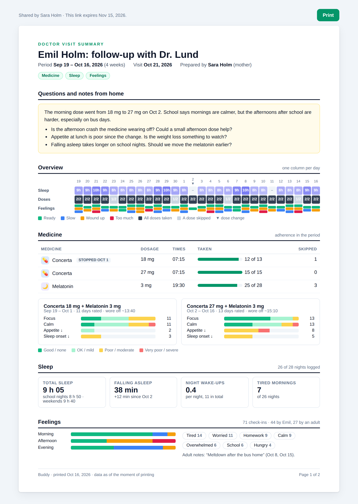
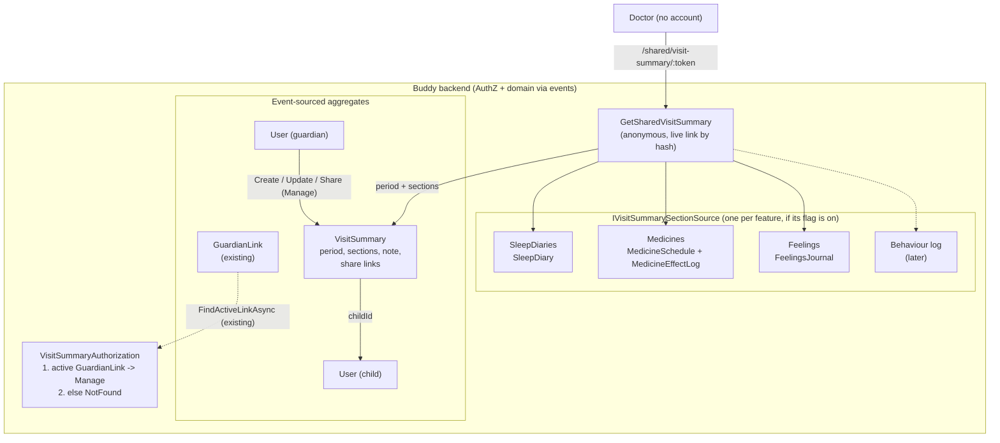

# Doctor Visit Summary

Status: Proposed (not yet implemented)

## Context

Before a follow-up with the child's doctor (a child psychiatrist, a paediatrician, the ADHD
nurse), a guardian today opens three screens and three share links: the sleep diary, the
feelings trend and the medicine effect notes. The doctor wants the opposite: one page that
answers "how has it gone since last time?" for a chosen period, ideally on paper in the file and
readable on screen before the visit.

The request (from [TODO.md](../../../TODO.md), "Insight for guardians and clinicians"):

- **One report** for a chosen period, combining sleep, doses, feelings and the behaviour log.
- **Printable** (A4, the doctor's file) and **shareable** through a revocable, expiring link,
  reusing the sleep diary's share link and print setup.

What a report holds, in the order a clinician reads it:

| Section | From | Content |
|---|---|---|
| Header | `User` | Child's name, period, "prepared by" guardian, the date printed |
| Questions and notes | new | The guardian's free text: what changed, what to ask about |
| Overview | all three | One row per day: sleep minutes, doses taken/skipped, feelings zones (the feelings trend strip) |
| Medicine | `MedicineSchedule`, `MedicineEffectLog` | Regimen in the period (incl. stopped medicines), adherence per medicine, effects and side effects grouped by dose period |
| Sleep | `SleepDiary` | Averages (total sleep, time to fall asleep, night wake-ups, tired mornings), weekday vs weekend, a nightly table |
| Feelings | `FeelingsJournal` | Zone counts by part of day, most used words, guardian-logged notes |
| Behaviour | `BehaviourLog` (not built yet) | Added when the ABC log ships (Question 7) |

What exists today (checked in the code):

- **Two anonymous share links, copied twice.** The sleep diary has
  [SleepDiaryShareToken.cs](../../../src/backend/buddy/Features/SleepDiaries/Types/SleepDiaryShareToken.cs)
  (its own aggregate, a hashed 32-byte token, optional expiry up to 365 days, revoke) and the
  anonymous
  [GetSharedSleepDiary.Endpoint.cs](../../../src/backend/buddy/Features/SleepDiaries/GetSharedSleepDiary/GetSharedSleepDiary.Endpoint.cs).
  Feelings copied it one-to-one
  ([FeelingsShareToken.cs](../../../src/backend/buddy/Features/Feelings/Types/FeelingsShareToken.cs)),
  and its comment already calls itself "the third copy" of the token helper. Medicine effect notes
  have no share link at all ([medicine-effect-notes.md](medicine-effect-notes.md)); the
  `Medicines` "share" routes are group sharing, not anonymous.
- **The trend is composed in the browser.** `/guardian/feelings` reads check-ins, sleep entries and
  doses through three authenticated endpoints and passes them to
  [feelings-trend.ts](../../../src/frontend/buddy/src/app/shared/feelings-trend/feelings-trend.ts)
  ([feelings-check-in.md, Question 7](feelings-check-in.md#question-7-the-guardians-trend-next-to-sleep-and-doses)).
  The dose-period grouping is frontend-only too:
  [medicine-effects.ts](../../../src/frontend/buddy/src/app/core/medicine-effects.ts)
  (`groupByDosePeriod`).
- **Print.** The shared pages print with `window.print()` and Tailwind `print:` variants, with no
  `@page` rule. The only `@page` is injected at runtime by
  [week-plan-print-page.ts](../../../src/frontend/buddy/src/app/features/guardian/print/sheet/week-plan-print-page.ts)
  (A3/A4 landscape, light scheme forced).
- **No behaviour log.** Nothing named Behaviour/ABC exists in `src`; it is the TODO item just above
  this one.
- **No birthdate** on `User` ([User.cs](../../../src/backend/buddy/Features/Users/Types/User.cs));
  the header can show the name only.

This document answers eight questions: a new feature or links bundled together, what is stored,
how the report reads data across features, live data or a snapshot, who can see it, the stopped
medicine gap, the behaviour log, and print.

## Question 1: a new feature, or a bundle of the existing share links?

**Decision: a new feature, `Features/VisitSummaries` (schema `visitsummaries`, flag
`Features:VisitSummaries`), with its own share links and one anonymous endpoint that returns the
whole report.**

- **The bundle doesn't cover the data.** A page that loads `/shared/sleep-diary/{t1}` and
  `/shared/feelings/{t2}` would still have no medicine section: doses and effect notes have no
  anonymous read. Adding a third share link to `Medicines` only to feed a bundle makes three links
  to create, expire and revoke for one visit.
- **One link is what the guardian hands over.** The doctor's secretary gets one URL in one
  e-mail; revoking it after the visit is one click.
- **The report has its own data**: the period, the chosen sections and the guardian's note
  (Question 2). None of the three source features is the right owner for that.
- Rejected: **extending `SleepDiaries`** ("the sleep diary's link, now with more"). It would make
  the sleep feature read medicine and feelings streams, and the report would vanish when an
  operator turns the sleep diary off.

## Question 2: what is stored

**Decision: a `VisitSummary` aggregate per prepared visit (UUIDv7 id, `VisitSummaryIndexDocument`
for listing by child), holding the period, the sections, the guardian's note and its share links.
The report content itself is never stored (Question 4).**

```
VisitSummary(
    VisitSummaryId Id,                     // UUIDv7, many per child
    UserId ChildId,
    string Title,                          // "Follow-up with Dr. Holm", max 100
    DateOnly? VisitDate,                   // optional, for the list and the header
    DateOnly From,                         // inclusive, the child's local dates
    DateOnly To,                           // To - From < 92 days (DateRangeRules)
    ImmutableHashSet<VisitSummarySection> Sections,   // Sleep, Medicine, Feelings (Behaviour later)
    string Note,                           // markdown-free plain text, max 4000
    ImmutableList<VisitSummaryShareLink> ShareLinks,
    UserId CreatedBy,
    UserId LastModifiedBy,
    bool IsDeleted)

VisitSummaryShareLink(
    VisitSummaryShareLinkId Id,            // UUIDv7
    string TokenHash,                      // ShareSecret.Hash, never the token
    UserId CreatedBy,
    DateTimeOffset CreatedAt,
    DateTimeOffset? ExpiresAt,             // max 365 days, as the sleep diary
    bool IsRevoked)
```

- **A saved summary, not a one-off print dialog.** The guardian writes the note over several
  evenings ("ask about the afternoon crash"), and next visit wants last time's period and note
  side by side. [week-plan-print-templates.md](week-plan-print-templates.md) made the same call
  for week plans: a saved, reopenable definition beats a form that forgets.
- **Many per child**, so not the `SleepDiaryId.ForChild` trick: UUIDv7 ids with an index document,
  as `MedicineSchedule` and `HouseRule` do.
- **Share links live on the summary stream, unlike the sleep diary and feelings**, which give each
  link its own aggregate. There, a link belongs to the child's whole log and outlives any one
  read; here, a link belongs to one summary, and deleting the summary must revoke every link in
  the same event. A `VisitSummaryShareLinkDocument(TokenHash, SummaryId, ChildId, ExpiresAt,
  IsRevoked)` keeps the anonymous lookup by hash a single indexed read, written in the same
  `SaveChangesAsync` as the event, as `SleepDiaryShareTokenDocument` is.
- **Live links per summary: at most 5.** The sleep diary has no cap; one doctor visit needs one or
  two (the clinic, a second opinion). A cap keeps a forgotten summary from collecting links.
- **Sections are a set**, so the guardian can leave feelings out of a report for the school doctor.
  A section whose feature is switched off is dropped from the set when read (Question 3).

### The share secret moves to `Common`

This would be the fifth copy of the same twelve lines. The feelings doc deferred promoting them as
"a separate refactor"; adding a fifth copy is the point where it pays.

Before ([SleepDiaryShareToken.cs:52](../../../src/backend/buddy/Features/SleepDiaries/Types/SleepDiaryShareToken.cs#L52),
identical in `FeelingsShareSecret` and both `IcalToken`s):

```csharp
public static class SleepDiaryShareSecret
{
    private const int TokenSizeInBytes = 32;
    public static (string Token, string Hash) Generate() { /* 32 random bytes, base64url */ }
    public static string Hash(string token) =>
        Convert.ToHexString(SHA256.HashData(Encoding.UTF8.GetBytes(token)));
}
```

After (`Common/Security/ShareSecret.cs`):

```csharp
public static class ShareSecret
{
    public static (string Token, string Hash) Generate() { ... }  // unchanged body
    public static string Hash(string token) { ... }
}
```

Blast radius: four static classes deleted, 8 call sites renamed, no event or stored hash changes
(the algorithm is byte-for-byte the same, so existing links and iCal feeds keep working). It can
land as its own commit before the feature.

### Events

```
VisitSummaryCreated(VisitSummaryId Id, UserId ChildId, string Title, DateOnly? VisitDate,
    DateOnly From, DateOnly To, IReadOnlyList<VisitSummarySection> Sections, string Note,
    UserId CreatedBy, DateTimeOffset OccurredAt)
VisitSummaryUpdated(VisitSummaryId Id, string Title, DateOnly? VisitDate, DateOnly From,
    DateOnly To, IReadOnlyList<VisitSummarySection> Sections, string Note,
    UserId ModifiedBy, DateTimeOffset OccurredAt)
    // Full overwrite of the editable fields, as UpdateMedicineSchedule. Identical content appends
    // nothing.
VisitSummaryShareLinkCreated(VisitSummaryId Id, VisitSummaryShareLinkId LinkId, string TokenHash,
    DateTimeOffset? ExpiresAt, UserId CreatedBy, DateTimeOffset OccurredAt)
VisitSummaryShareLinkRevoked(VisitSummaryId Id, VisitSummaryShareLinkId LinkId,
    UserId ModifiedBy, DateTimeOffset OccurredAt)
    // Revoking a revoked link: 204, no event.
VisitSummaryDeleted(VisitSummaryId Id, UserId ModifiedBy, DateTimeOffset OccurredAt)
    // Soft delete; Rehydrate marks every link revoked, and the link documents flip in the same
    // transaction.
```

### Rehydration

`Rehydrate` folds the five events with `EventReplay.Rehydrate(events, Start, Advance)`, and the
inline snapshot projection in the `snapshots` schema drives the same `Start`/`Advance`, as every
aggregate does ([event-stream-snapshots.md](event-stream-snapshots.md)).

## Question 3: how the report reads across features

**Decision: `VisitSummaries` defines one small port, `IVisitSummarySectionSource`, and each source
feature implements it inside its own folder. The anonymous handler asks every registered source for
its section; a feature that is switched off registers no source, so its section simply isn't
there.**

```csharp
// Features/VisitSummaries/IVisitSummarySectionSource.cs
public interface IVisitSummarySectionSource
{
    VisitSummarySection Section { get; }
    Task<object> ReadAsync(UserId childId, DateOnly from, DateOnly to, CancellationToken ct);
}

// Features/SleepDiaries/SleepDiaryVisitSummarySource.cs  -> SleepEntryResponse[] + hygiene notes
// Features/Medicines/MedicineVisitSummarySource.cs        -> schedules, dose occurrences, effect notes
// Features/Feelings/FeelingsVisitSummarySource.cs         -> FeelingCheckInResponse[]
```

- **Why not compose in the browser, as the feelings trend does?** The doctor is anonymous. The
  browser has nothing to call `/sleep-diary/children/{id}/entries` with, so the composition has to
  happen behind the one anonymous endpoint.
- **Why a port, not `VisitSummaries` reading three event stores?**
  [medicine-effect-notes.md, Question 1](medicine-effect-notes.md#question-1-a-new-feature-or-part-of-medicines)
  rejected a cross-feature store dependency. With the port, each feature keeps owning how its
  data is read and which response DTO it exposes. `VisitSummaries` only knows the interface, and the
  source's DTOs are the same ones the authenticated endpoints already return, so the frontend reuses
  its types and its existing components.
- **Feature flags for free.** `AddSleepDiariesFeature` registers its source only when
  `Features:SleepDiary` is on. A summary that lists `Sleep` on an installation where it's off shows
  no sleep section and no error. The behaviour log adds a fourth source later and touches nothing
  here (Question 7).
- **The backend returns data, the frontend summarizes.** Averages, adherence percentages and the
  dose-period grouping are computed in the browser from the same DTOs, with the existing
  `groupByDosePeriod` and `feelings-trend`. A second, server-side copy of those rules would drift.
  Rejected: **a `VisitSummaryReport` DTO of precomputed numbers**, for that reason.
- **Range limits.** The summary's period is at most 92 days, the same as sleep, feelings and
  effect notes. The 31-day cap on `/medicines/.../doses` is the endpoint's validator, not
  `MedicineDoseExpansion`'s, so the medicine source can expand 92 days (at most a few hundred
  occurrences).

## Question 4: live data or a snapshot at share time?

**Decision: live. The report is read from current data for the summary's fixed period every time
the link is opened, as the sleep diary and feelings links do. The period is fixed on the summary,
not chosen by the reader.**

- **Corrections should reach the doctor.** A guardian who fixes a mistyped bedtime after sharing
  wants the doctor to see the fixed one.
- **No second copy of health data.** A frozen snapshot would be a stored copy of sleep, dose and
  feelings data that erasure, export and the audit trail would all have to know about
  ([gdpr-data-protection.md](gdpr-data-protection.md)).
- **The fixed period is the difference from the sleep diary link.** That link lets the reader pick
  any 92-day window (`?from&to`); this one shows exactly what the guardian chose to share. A
  guardian who shares "September" doesn't expose August.
- The printed page carries "printed on <date>", so a paper copy is still dated.

## Question 5: who can see and change it

**Decision: guardians only. Manage = an active `GuardianLink` to the child: create, edit, delete,
read, print and share. The child has no access. The anonymous reader sees one summary through a
live link. Anything else is `NotFound`.**

| Tier | Who | Can |
|---|---|---|
| **Manage** | An active guardian of the child (`FindActiveLinkAsync`) | Everything, including summaries a co-guardian created |
| **Anonymous** | Holder of a live link (not revoked, not expired, summary not deleted) | Read that summary's report |

- Same as the sleep diary and effect notes, which are guardian-only. A child reading the
  doctor's report about them is a conversation for the family, not a screen.
- Group members (a grandparent, a group share of medicines) get no access: the report contains
  sleep and feelings data that isn't group-shared.
- **Child's own words.** A check-in note the child wrote (`IsSelfReport`) is never in the report,
  and there is no toggle to include it; only zones, words (tags) and guardian-logged notes are. The
  child wrote it for the family, not for the doctor.
- The anonymous endpoint gets a named rate-limit policy, `"visit-summary-share"` (30 requests per
  10 minutes per token hash, modelled on `"ical-feed"`), on top of the global anonymous bucket.
  It does several stores' reads per request, more than the sleep and feelings links, and 30 per
  10 minutes still lets a doctor reopen the page through a visit.
- Audit logs: `VisitSummariesLog`, EventIds 12001+: link created, link revoked, shared report read
  (summary id, link id, child id), report read by a guardian (`HealthDataAccessPath.Guardian`).
  Ids only, never content.

## Question 6: stopped medicines disappear from the dose history

**Decision: the medicine source includes stopped schedules, but only their recorded doses
(`Taken` / `Skipped` in `DoseLog`), never expanded `Pending` ones, and marks them "stopped".**

The gap: [MedicineDoseExpansion.cs:26](../../../src/backend/buddy/Features/Medicines/MedicineDoseExpansion.cs#L26)
skips every stopped schedule, so a medicine stopped during the period vanishes from the doses, yet
a dose change is exactly what the doctor wants to see. `MedicineScheduleStopped` carries no stop
date (only `OccurredAt`), so expanding a stopped schedule would invent pending doses up to `To`.

Before:

```csharp
if (MedicineSchedule.Rehydrate(events) is not { IsStopped: false } schedule)
{
    continue;
}
```

After:

```csharp
public static async Task<IReadOnlyCollection<MedicineDoseOccurrence>> ExpandAsync(
    UserId childId, DateOnly from, DateOnly to, IMedicineEventStore medicines,
    CancellationToken cancellationToken, bool includeStoppedHistory = false)
...
if (MedicineSchedule.Rehydrate(events) is not { } schedule) continue;
if (schedule.IsStopped && !includeStoppedHistory) continue;
// a stopped schedule yields only (date, time) pairs present in DoseLog
```

Blast radius: one method, two existing callers (`ListTodaysDoses`, `ListTodaysDosesForGroup`)
unchanged by the default, one new caller. The effect notes' `Regimen` already includes stopped
schedules ([medicine-effect-notes.md](medicine-effect-notes.md)), so the two agree.

## Question 7: the behaviour log doesn't exist yet

**Decision: ship without it. `VisitSummarySection.Behaviour` is not added until the ABC log ships;
the log's own analysis then adds the enum value and a `BehaviourVisitSummarySource`.**

The port in Question 3 makes it additive: one enum value, one source class, one frontend section
component. Waiting for the behaviour log would hold back the three sections that exist.

## Question 8: print

**Decision: A4 portrait, printed from both the guardian's report page and the shared page with
the same `VisitSummaryReport` component. The `@page` injection moves out of `WeekPlanPrintPage`
into a small `PrintPageStyle` helper in `core/` that both use.**

- Portrait, because the report is read top to bottom like a letter, not laid out like a week.
- The sleep table and the overview strip use `break-inside: avoid` per week, so a week never
  splits over two pages; every section starts with its heading on the same page as its first row.
- Black-and-white safe: zones print with their face and word as well as the colour, as the
  feelings trend already does for colour-blind readers.
- `WeekPlanPrintPage.applyPageStyle` ([week-plan-print-page.ts:207](../../../src/frontend/buddy/src/app/features/guardian/print/sheet/week-plan-print-page.ts#L207))
  becomes `this.pageStyle.apply({ size: 'A4', orientation: 'portrait', margin: '12mm' })`. One
  call site, and its spec's `@page` assertion moves to the helper's spec.

## Read models

```
VisitSummaryIndexDocument(Guid Id, Guid ChildId, string Title, DateOnly? VisitDate,
    DateOnly From, DateOnly To, DateTimeOffset LastModifiedAt, bool IsDeleted)
VisitSummaryShareLinkDocument(string TokenHash, Guid LinkId, Guid SummaryId, Guid ChildId,
    DateTimeOffset? ExpiresAt, bool IsRevoked)          // Id = TokenHash
```

Both written in the same `SaveChangesAsync` as the event.

## Command slices (`Features/VisitSummaries/`, same vertical-slice shape as `HouseRules`)

| Slice | Tier | Notes |
|---|---|---|
| `CreateVisitSummary` | Manage | Title, visit date, period, sections, note. Emits `VisitSummaryCreated` |
| `UpdateVisitSummary` | Manage | Full overwrite. Emits `VisitSummaryUpdated` |
| `DeleteVisitSummary` | Manage | Soft delete, revokes links. Emits `VisitSummaryDeleted` |
| `ListVisitSummaries` | Manage | Newest visit first, from the index |
| `GetVisitSummary` | Manage | The summary plus the report sections (what the doctor would see), and the live links |
| `CreateVisitSummaryShareLink` | Manage | Returns the token once. Max 5 live |
| `RevokeVisitSummaryShareLink` | Manage | Idempotent |
| `GetSharedVisitSummary` | Anonymous | Unknown, revoked, expired or deleted: `404` |

## Routes

```
POST   /visit-summaries/children/{childId}                                      CreateVisitSummary
GET    /visit-summaries/children/{childId}                                      ListVisitSummaries
GET    /visit-summaries/children/{childId}/{summaryId}                          GetVisitSummary
PUT    /visit-summaries/children/{childId}/{summaryId}                          UpdateVisitSummary
DELETE /visit-summaries/children/{childId}/{summaryId}                          DeleteVisitSummary
POST   /visit-summaries/children/{childId}/{summaryId}/share-links              CreateVisitSummaryShareLink
DELETE /visit-summaries/children/{childId}/{summaryId}/share-links/{linkId}     RevokeVisitSummaryShareLink
GET    /visit-summaries/shared/{token}                                          GetSharedVisitSummary (anonymous)
```

The report response (both `GetVisitSummary` and the shared read):

```
VisitSummaryReportResponse(
    string ChildGivenName, string ChildFamilyName,
    string Title, DateOnly? VisitDate, DateOnly From, DateOnly To, string Note,
    string PreparedBy,                                    // guardian's display name
    SleepDiaryEntriesResponse? Sleep,                     // null: not chosen, or feature off
    VisitSummaryMedicineSection? Medicine,                // schedules, doses, effect notes
    FeelingCheckInsResponse? Feelings,                    // self-report notes removed
    DateTimeOffset? ExpiresAt)                            // shared read only
```

## Frontend

A mockup of the shared report (demo data, not a screenshot of built code):



- `core/visit-summaries.service.ts`, with `postIdempotent` for create.
- `features/guardian/visit-summaries/`: the list page `/guardian/visit-summaries` (cards per
  visit with period and link count), the editor (title, visit date, period presets "last 4
  weeks" / "last 3 months" plus a custom range, section toggles, note), and the report page
  `/guardian/visit-summaries/:id` with Print, Share and the live links (copy of the sleep diary's
  `share-links` component, generalised to take a service).
- `shared/visit-summary-report/`: the report itself, one sub-component per section, reusing
  `feelings-trend` for the overview strip and `groupByDosePeriod` for the medicine section.
- `features/shared-visit-summary/` at `/shared/visit-summary/:token`, outside `authGuard`, behind
  `featureGuard('visitSummaries')`, as the two existing shared pages.
- Entry points: a "Prepare for a doctor's visit" link on the sleep diary, feelings and medicine
  effects pages, and the guardian navigation under Health.
- i18n in `translations/{en,da}/visit-summaries.ts`; the section components reuse the existing
  sleep, feelings and medicine keys.
- Language: the shared page renders in the reader's browser language (en/da), and a guardian's
  printout in the guardian's app language, through the existing `TranslationService`. Nothing is
  stored per summary.
- PDF: the print dialog's "Save as PDF" is the PDF; there is no server-side rendering and no
  download button.
- Screenshots: the list, the report page and the shared page in `screenshots/pages.ts`, with one
  demo summary over the demo family's seeded sleep, feelings and effect notes.

## Testing

Integration tests mirror
the sleep diary's [ShareLinks tests](../../../src/backend/buddy.IntegrationTests/Features/SleepDiaries/ShareLinks)
and the feelings share tests, plus:

- a report with all three sections; with one section left out; with a feature flag off (section
  `null`, no error);
- the period: 92 days accepted, 93 rejected, `From > To` rejected;
- a medicine stopped mid-period shows its taken and skipped doses and no pending ones;
- a child's self-report note is absent from the shared feelings section, a guardian's note present;
- links: expired, revoked, unknown and deleted-summary all `404`; the sixth live link `400`;
- a revoked `GuardianLink` turns every Manage route into `404`;
- the named rate limit returns `429` after 30 reads;
- `ShareSecret` produces the same hash as the old helpers for a fixed token (existing links survive).

e2e: a guardian creates a summary, shares it, and an anonymous browser context opens the link and
sees the child's name, a sleep row and a medicine.

## Failure and edge-case behavior

| Case | Behavior |
|---|---|
| A section with no data in the period | Shown with "No entries in this period", not hidden: absence is information for the doctor |
| A feature switched off after the summary was made | Its section is `null` and not rendered; the summary keeps the value, so switching it back on restores it |
| Period edited after sharing | The link shows the new period: it points at the summary, not at a frozen copy |
| Summary deleted | Every link revoked in the same event; shared read `404` |
| Guardian who created a link is erased | Their links are revoked, the summary stays for a co-guardian (sleep diary precedent) |
| Child erased | Summaries and link documents deleted with the child's other streams |
| Export | `VisitSummariesPersonalDataExporter`, section `"visitSummaries"`: summaries and link metadata (never the hash) |
| Two guardians edit at once | Last write wins on `UpdateVisitSummary`, `Before` kept in the stream |
| Child's time zone | Periods are the child's local dates, as every source already stores them |

## Estimate

| | |
|---|---|
| Complexity | Medium -- one new aggregate with 5 events and 8 slices, a port with 3 implementations across features, two small refactors (`ShareSecret`, dose expansion), 3 new screens plus one shared report component and print |
| Single developer | 7-10 days |
| AI agent | 4-6 hours, plus about 1.5 hours of human review and open-question time |

## Decisions made

| Question | Decision |
|---|---|
| New feature or bundle of links? | New `Features/VisitSummaries`, one link per report; medicines have no anonymous read to bundle |
| What is stored | A `VisitSummary` per visit (period, sections, note) with its share links on the same stream |
| Token helper | Promote the four copies to `Common/Security/ShareSecret`, same bytes |
| Reading across features | `IVisitSummarySectionSource` port, implemented by each source feature, registered only when its flag is on |
| Live or snapshot | Live data, fixed period chosen by the guardian |
| Access | Guardians only; anonymous link for one summary; no child, no group |
| Child's own check-in notes | Left out of the report |
| Stopped medicines | Recorded doses included, labelled stopped, no invented pending doses |
| Behaviour log | Added later as a fourth source, additively |
| Print | A4 portrait from one shared report component; `@page` helper extracted from the week plan print |
| Report language | The reader's: the browser language on the shared page, the guardian's app language when printed; no per-summary setting |
| PDF | The browser's "Save as PDF"; no server-side PDF rendering |
| Period presets | "Last 4 weeks" and "last 3 months" plus a custom range; no "since last visit" preset and no link between summaries |
| Rate limit | Named policy `"visit-summary-share"`, 30 reads per 10 minutes per token hash, on top of the global anonymous bucket |

## Remaining open questions

None for v1. All five were settled with the user on 2026-10-16 (see the table above). Later
additions, each additive: a per-summary report language, server-side PDF rendering, a "since
last visit" preset.

## Diagram


