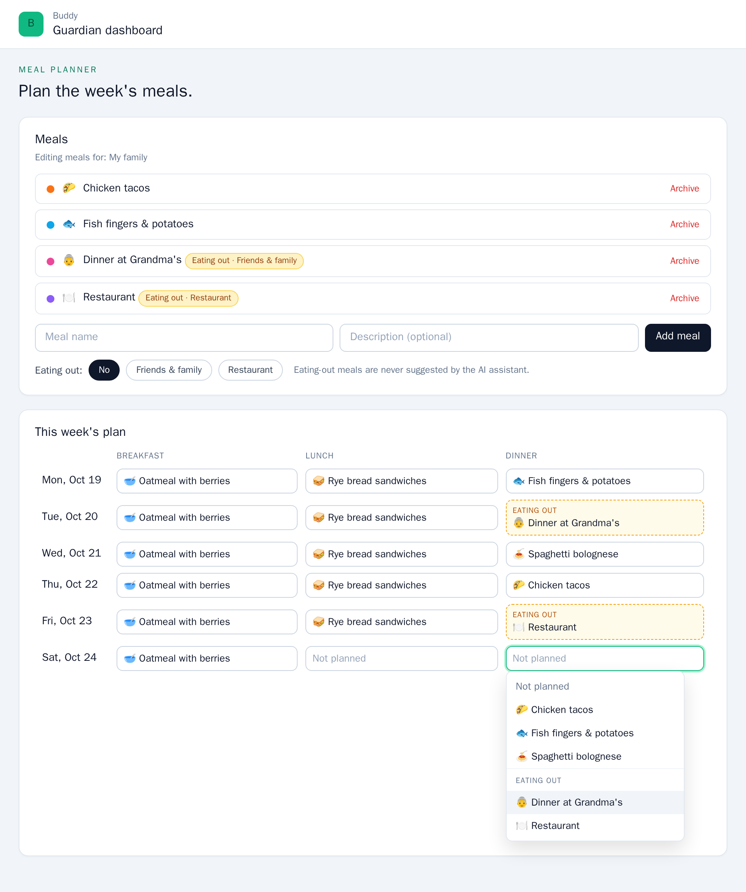
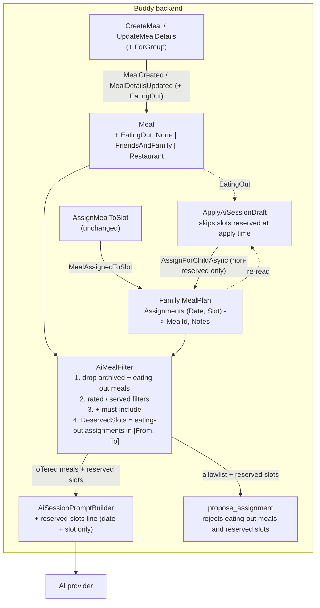

# Eating-out Meals

Status: Implemented. `MealEatingOut` on `MealCreated`, `MealDetails` and `Meal`, returned on `MealResponse` and `MealPlanEntry`; `AiMealFilter` drops eating-out meals and computes `ReservedSlots`, which the prompt lists, `propose_assignment` rejects and `ApplyAiSessionDraft` skips; `StartAiSession` rejects an eating-out must-include meal. On `/guardian/mealplan` the meal library has an eating-out choice when creating a meal and a per-meal select, the picker groups eating-out meals, and the grid marks eating-out slots; the child's meal plan shows a badge and the AI start form says eating-out meals are skipped.

## Context

Families don't eat every meal at home. Friday dinner may be at grandma's, and Saturday may be a
restaurant. A guardian wants to mark those meals as **eating out**, either at friends or family or
at a restaurant, so that:

- the meal plan shows the family is out, instead of an empty "Not planned" slot or a made-up home meal;
- the AI assistant leaves those meals alone. It shouldn't plan a home meal for Friday dinner, and it
  shouldn't suggest "Restaurant" as something to cook on a Tuesday.

The guardian asked for both sides of this: an eating-out mark on a **slot** in the plan, and an
eating-out flag on a **meal** in the library.

What exists today:

- The family has one `MealPlan`
  ([`MealPlan.cs`](../../../src/backend/buddy/Features/Mealplans/Types/MealPlan.cs)).
  - Its `Assignments` map `(DateOnly Date, MealSlot Slot)` to
    `MealPlanAssignment(MealId MealId, UserId AssignedBy, string Notes)`
    ([`MealPlanAssignment.cs`](../../../src/backend/buddy/Features/Mealplans/Types/MealPlanAssignment.cs)).
  - A slot is either empty or holds a library meal; there is no third state.
- A library `Meal` ([`Meal.cs`](../../../src/backend/buddy/Features/Mealplans/Types/Meal.cs)) has
  `Name`, `Description`, `Icon`, `Color`, `IsArchived` and per-child `Ratings`. It has no tags or
  categories.
- The AI assistant ([ai-assistant-meal-filter.md](ai-assistant-meal-filter.md)) offers the meals that
  [`AiMealFilter`](../../../src/backend/buddy/Features/Mealplans/AiAssistant/AiMealFilter.cs) selects.
  The same set is listed in the prompt and used as the `propose_assignment` allowlist.
- The AI **never sees the existing plan**, and
  [`ApplyAiSessionDraft.Handler.cs:45`](../../../src/backend/buddy/Features/Mealplans/AiAssistant/ApplyAiSessionDraft/ApplyAiSessionDraft.Handler.cs)
  overwrites whatever is in a drafted slot. Today a guardian who marks Friday dinner by hand loses
  it as soon as an AI draft for that week is applied.
- The prompt already tells the model to check `get_calendar_conflicts` and to flag things "like
  dining out" ([`AiSessionPromptBuilder.cs`](../../../src/backend/buddy/Features/Mealplans/AiAssistant/AiSessionPromptBuilder.cs)).
  That only works when the outing happens to be in a calendar, and the model has to ask about it.

This document answers five questions: whether the slot mark and the library flag are one concept or
two, how the flag is modelled, how the AI assistant treats eating-out meals and slots, what the
child sees, and what changes in the UI.

## Question 1: one concept or two?

**Decision: one concept. Eating out is a property of a library meal (`Meal.EatingOut`), and a slot
is "eating out" when the meal assigned to it is an eating-out meal. Details for a particular
occasion ("sushi with Mormor") go in the slot's existing `Notes`.**

The guardian sets up a few eating-out meals once, such as "Dinner at Grandma's" (friends and family)
and "Restaurant" (restaurant), and then assigns them to slots like any other meal, with the same
picker and drag-and-drop. Both of the guardian's asks are covered:

- **Slot:** Fri dinner holds "Restaurant", so the slot is eating out. The grid styles it as such,
  and the AI treats it as reserved (Question 3).
- **Library:** "Restaurant" carries the flag, so it is never offered to the AI as a meal to cook.

Why not a separate slot state:

- _Rejected:_ a third slot state, turning `MealPlanAssignment` into a union of
  `Meal(MealId, ...)` and `EatingOut(Kind, Place, ...)`. The value type of `Assignments` is read
  everywhere:
  - [`MealPlanExpansion`](../../../src/backend/buddy/Features/Mealplans/Types/MealPlanExpansion.cs)
  - the iCal feed
  - the child view and ratings
  - the import and its revert
  - `AiMealFilter`'s served window
  - `MealAssignedToSlot` and `MealSlotCleared`, plus their golden files

  Every one of those would need a "no meal here" branch. It would also give two ways to say the
  same thing: a library meal called "Grandma's" next to a slot marked eating out at friends or family.

- _Rejected:_ only the slot `Notes` ("eating out"). The AI would have to parse free text, and
  nothing would stop "Restaurant" from being proposed as a home meal.

What the single concept costs: an eating-out slot always names a library meal. In practice a family
needs about two or three of them, and the picker groups them (see Frontend).

## Question 2: how the flag is modelled

**Decision: a three-value enum, `MealEatingOut { None = 0, FriendsAndFamily = 1, Restaurant = 2 }`.
It is added as a trailing parameter with default `None` to `MealCreated` and `MealDetails`, so it
moves through the existing create and update-details paths and needs no new event.**

```csharp
// Types/MealEatingOut.cs (new). By member name over HTTP ("Restaurant"), like every enum in the
// API, and stored as a string in event JSON.
public enum MealEatingOut
{
    None = 0,
    FriendsAndFamily = 1,
    Restaurant = 2
}
```

Before ([`MealDetails.cs:5`](../../../src/backend/buddy/Features/Mealplans/Types/MealDetails.cs),
[`MealEvents.cs`](../../../src/backend/buddy/Features/Mealplans/Types/MealEvents.cs)):

```csharp
public sealed record MealDetails(string Name, string Description, Icon Icon, Color Color);

public sealed record MealCreated(
    MealId Id, UserId ChildId, UserId CreatedBy, string Name, string Description,
    Icon Icon, Color Color, DateTimeOffset OccurredAt);
```

After:

```csharp
public sealed record MealDetails(string Name, string Description, Icon Icon, Color Color,
    MealEatingOut EatingOut = MealEatingOut.None);

public sealed record MealCreated(
    MealId Id, UserId ChildId, UserId CreatedBy, string Name, string Description,
    Icon Icon, Color Color, DateTimeOffset OccurredAt,
    MealEatingOut EatingOut = MealEatingOut.None);
```

`Meal` gains `MealEatingOut EatingOut`, set in `Start` from `MealCreated` and in `Advance` from
`MealDetailsUpdated.After`.

- **Why on `MealDetails` and not a new `MealEatingOutChanged` event.** It's edited in the same form
  as name, icon and colour, and `MealDetailsUpdated` already carries a full `Before`/`After` pair.
  `UpdateMealDetails` is a full replace, like `MealAssignedToSlot`. The handler's no-op check
  compares `MealDetails` records, so it picks up the new field without any change.
- **Why an enum and not `bool IsEatingOut`.** The guardian named two kinds. The kind drives the
  badge text, and it lets a future feature tell them apart, for example totalling restaurant visits.
  _Rejected:_ a free-text place on the meal. The place belongs to the occasion, so it goes in the
  slot `Notes`.
- **Backward compatibility.** This is the same mechanism as
  [ai-assistant-meal-filter.md, Question 2](ai-assistant-meal-filter.md#question-2-where-is-the-filter-stored).
  `System.Text.Json` treats a defaulted constructor parameter as optional, so every existing
  `MealCreated` and `MealDetailsUpdated` deserializes as `None` and needs no upcaster. Meal
  snapshots are rebuilt from the projection, which handles them the same way.

Blast radius:

- 3 production constructions: `CreateMeal.Handler.cs`, `UpdateMealDetails.Handler.cs` and
  `CommitMealPlanImport.Handler.cs`. Imported meals stay `None`.
- The `ForGroup` twins go through the same handlers.
- 2 test files: `MealplanEventShapeTests.cs` and `MealPlanImportParsingTests.cs`. Both compile
  unchanged thanks to the defaults.
- Regenerate `MealCreated.json` and `MealDetailsUpdated.json`, and add a
  `MealCreated_EatingOut.json` golden file to pin the non-default shape.
- Request and response shapes:
  - `CreateMeal(+ForGroup)` and `UpdateMealDetails(+ForGroup)` commands and requests gain
    `MealEatingOut EatingOut = None`, and the validators add `IsInEnum()`.
  - `MealResponse` gains `EatingOut`, built by `FromMeal`, which has 8 callers and no signature
    change.
  - `MealPlanEntry` gains `EatingOut`, filled by
    [`MealPlanExpansion`](../../../src/backend/buddy/Features/Mealplans/Types/MealPlanExpansion.cs)
    from the meal it already loads (2 constructions). The grid and the child view can then style a
    slot without a second lookup.
- Run `task docs:openapi`.

## Question 3: how the AI assistant treats eating out

**Decision: two rules, both applied server-side on every turn.**

1. **Eating-out meals are never offered.** `AiMealFilter.Apply` drops them together with archived
   meals, before the rated and served filters run.
2. **Eating-out slots are reserved.** A slot inside the session's `[From, To]` and requested slots
   whose current assignment is an eating-out meal:
   - is listed in the prompt as taken;
   - is rejected by `propose_assignment`;
   - is skipped by `ApplyAiSessionDraft`.

### Rule 1: the meal list

- Eating-out meals are left out of the "matches" behind `FilterMatchedNothing`. A
  "served in the last 30 days" filter that only matches "Restaurant" returns the usual `400`.
- **Must-include:** a `MustIncludeMealIds` entry that is an eating-out meal is rejected by
  `StartAiSession` with `400` keyed on `MustIncludeMealIds`
  (`"Eating-out meals can't be planned by the assistant. Assign them to a slot yourself."`).
  - _Rejected:_ silently dropping it, which ignores what the guardian explicitly asked for.
  - _Rejected:_ offering it anyway. It would contradict the flag, and the guardian can assign it
    directly.
  - The current start form always sends `[]`, so this only defines the API.
- Unfiltered sessions keep today's semantics. Eating out isn't a "filter", and the prompt's filter
  line doesn't mention it.

### Rule 2: reserved slots

`AiMealSelection` gains the reserved set. That means `LoadAsync` now **always** loads the family
`MealPlan` snapshot, where today it does so only for a served window. It is one document read per
turn, the same cost the served filter already accepted.

```csharp
// Before (AiMealFilter.cs)
public sealed record AiMealSelection(IReadOnlyList<Meal> Meals, bool FilterMatchedNothing);

// After
public sealed record AiMealSelection(
    IReadOnlyList<Meal> Meals,
    bool FilterMatchedNothing,
    IReadOnlyCollection<(DateOnly Date, MealSlot Slot)> ReservedSlots);
```

`Apply` gains `DateOnly to` and `IReadOnlyCollection<MealSlot> requestedSlots`. The reserved set is
computed by `AiMealFilter.FindReservedSlots`, which `LoadReservedSlotsAsync` also exposes for
`ApplyAiSessionDraft`:

```csharp
familyPlan.Assignments
    .Where(a => a.Key.Date >= from && a.Key.Date <= to && requestedSlots.Contains(a.Key.Slot))
    .Where(a => eatingOutMealIds.Contains(a.Value.MealId))   // archived eating-out meals included
    .Select(a => a.Key)
```

The reserved set feeds three places:

- **Prompt** ([`AiSessionPromptBuilder.Build`](../../../src/backend/buddy/Features/Mealplans/AiAssistant/AiSessionPromptBuilder.cs)).
  After the slot line, when the set isn't empty, it adds:
  `The family is eating out for these meals; never propose a meal for them: 2026-10-23 Dinner, 2026-10-24 Dinner.`
  - Only the date and slot are sent. The meal name, the kind and the slot `Notes` ("Grandma's",
    "sushi with Mormor") stay in Buddy, following the minimization rule in
    [gdpr-data-protection.md, Question 6](gdpr-data-protection.md#question-6-the-ai-assistant).
- **Tool** ([`AiSessionToolExecutor.ExecuteProposeAssignment`](../../../src/backend/buddy/Features/Mealplans/AiAssistant/AiSessionToolExecutor.cs)).
  It receives the reserved set next to the allowlist. A reserved slot returns the tool error
  `"The family is eating out for <date> <slot>; leave it empty."`
  - The prompt alone isn't trusted. "The server only accepts what it offered" is the existing
    invariant
    ([ai-assistant-meal-filter.md, Question 5](ai-assistant-meal-filter.md#question-5-must-include-meals-and-the-tool-allowlist)).
- **Apply** (`ApplyAiSessionDraft`). The handler re-reads the plan snapshot and **skips** draft
  entries whose slot is reserved _now_. That covers a slot marked eating out after it was drafted
  (Edge cases).
  - _Rejected:_ failing the whole apply, which would throw away a week's draft because of one slot.
  - _Rejected:_ overwriting, which is the bug this feature exists to fix.

Blast radius:

- `AiMealFilter` (`Apply` and `LoadAsync` signatures, 2 handler callers plus `AiMealFilterTests`)
- `AiSessionPromptBuilder.Build`: one new `reservedSlots` parameter (callers: the handler,
  `AiDataMinimizationTests` and `AiMealFilterTests`)
- `AiSessionToolExecutor.ExecuteAsync`: one new parameter, passed through `RunToolLoopAsync`
- `ApplyAiSessionDraftHandler`: one snapshot read and one `continue`
- Not affected: events, the `MealplanAiSession` aggregate and golden files.

**Out of scope:** protecting _all_ already-planned slots from an AI draft. Apply overwriting a
home-meal slot the guardian filled by hand is today's behaviour. It is a separate decision (see
Remaining open questions).

## Question 4: what the child sees

**Decision: the slot shows the meal as usual, plus a small "Eating out" badge. Ratings work
unchanged.**

A child can rate "Dinner at Grandma's" like any other meal. That's harmless, and it is a nice
signal for the family. _Rejected:_ hiding eating-out meals from the child's plan. "We're going to
Grandma's for dinner" is exactly the kind of predictability the child view exists for.

The iCal feed is unchanged: the event title is the meal name, which already reads well
("Restaurant").

## Routes

No new routes. Changed shapes:

```text
POST  /mealplans/children/{childId}/meals                     CreateMeal         body += eatingOut: "None"|"FriendsAndFamily"|"Restaurant" (default "None")
PATCH /mealplans/children/{childId}/meals/{mealId}/details    UpdateMealDetails  body += eatingOut (default "None")
      (and the /groups/{groupId}/... twins)
GET   .../meals, .../plan                                      response += eatingOut on MealResponse / MealPlanEntry
POST  /mealplans/children/{childId}/ai/sessions                StartAiSession     400 when a must-include meal is eating out
```

Update `Mealplans.http` with an eating-out create.

## Frontend

A mockup of the meal planner with eating-out meals and slots (demo data, not a screenshot of built
code):



- [`core/mealplans.service.ts`](../../../src/frontend/buddy/src/app/core/mealplans.service.ts):
  the generated `MealResponse`, `MealPlanEntry` and `UpdateMealDetailsRequest` types gain
  `eatingOut`. `createMeal` and `updateMealDetails` pass it through.
- `manage-meals/`:
  - The create form gets an "Eating out" `app-segmented-control` (No / Friends & family /
    Restaurant).
  - The library has no edit form, so each meal row gets a small select (At home / Friends & family /
    Restaurant) that sends a full `updateMealDetails` with the meal's other details unchanged.
  - A one-line hint says eating-out meals are never suggested by the AI assistant.
  - Eating-out meals in the list get an amber badge with the kind.
- `meal-picker/`: eating-out meals are listed under their own "Eating out" heading below the home
  meals, so that picking "Restaurant" is a quick, deliberate choice. When the family has none, the
  group shows a one-line hint (`mealplan.eatingOut.pickerEmptyHint`) saying how to mark a meal as
  eating out in the meal library.
- `assign-mealplan/`: a slot whose entry has `eatingOut !== 'None'` passes `[eatingOut]` to its
  picker, which draws a dashed amber border and an "Eating out" label above the meal name. It reads
  the entry, not the library, so an archived eating-out meal still shows. Drag-and-drop is
  unchanged.
- `ai-assistant/`: one static hint under the slot pills: "Meals marked as eating out are skipped."
  The session panel needs no change.
- Child: `features/child/mealplan/child-mealplan` shows the same badge on eating-out entries.
- i18n:
  - `mealplan.eatingOut.{label, none, friendsAndFamily, restaurant, atHome, badge, aiHint, rowLabel, updateError, pickerGroup, pickerEmptyHint}`
  - `mealplan.aiAssistant.start.eatingOutSkipped`
  - Add en and da together, then run the parity check.
- Screenshots: no new route. The meal planner, AI assistant and child meal plan pages change
  visibly. Seed one eating-out meal per kind in
  [`screenshots/demo-family.ts`](../../../src/frontend/buddy/screenshots/demo-family.ts), assigned to
  a dinner slot in the demo week, and re-run `task docs:screenshots`.

## Testing

- **Event shape:** regenerate `MealCreated.json` and `MealDetailsUpdated.json`. Add
  `MealCreated_EatingOut.json` (`"EatingOut": "Restaurant"`). Also add a case asserting that an
  old-shape payload without the field deserializes as `None`.
- **Snapshot:** `MealSnapshotTests` covers create-with-kind, then update to `None`, giving
  `Meal.EatingOut` in the snapshot.
- **Alba, `CreateMealTests` / `UpdateMealDetailsTests`:**
  - `eatingOut` is echoed in the response;
  - omitting it gives `0`;
  - `eatingOut: 7` returns `400`;
  - the group twins have one case each.
- **Alba, `ListMealPlanTests`:** an entry with an eating-out meal has `eatingOut` set.
- **Unit, `AiMealFilterTests`:**
  - eating-out meals are never offered, with and without filters;
  - they don't count towards `FilterMatchedNothing`;
  - the reserved set honours `[From, To]` edges and requested slots only;
  - an archived eating-out meal still reserves its slot.
- **Unit, `AiSessionToolExecutorTests`:** `propose_assignment` on a reserved slot is a tool error
  and produces no draft event.
- **Unit, prompt builder:** the reserved line appears only when the set isn't empty, and contains no
  meal names or notes. Extend `AiDataMinimizationTests` for the names and notes.
- **Alba, `StartAiSessionTests`:** a must-include eating-out meal returns `400` keyed on
  `MustIncludeMealIds`.
- **Alba, `ApplyAiSessionDraftTests`:** a drafted slot that has since been assigned an eating-out
  meal keeps the eating-out meal after apply, and the other drafted slots are applied.
- **Frontend specs:**
  - the manage-meals form sends `eatingOut`;
  - the picker groups eating-out meals under the "Eating out" heading;
  - the grid cell gets the eating-out styling;
  - the child view shows the badge.
- **E2E (`e2e/mealplan.spec.ts`):** create "Restaurant" as eating out, assign it to a dinner, and
  see the "Eating out" label in the grid.

## Failure and edge-case behavior

| Case                                                    | Behavior                                                                                    |
| ------------------------------------------------------- | ------------------------------------------------------------------------------------------- |
| Existing meals and events written before the change     | Deserialize as `EatingOut = None`; no upcaster                                              |
| `eatingOut` omitted on create                           | `None`                                                                                      |
| `eatingOut` omitted on update details                   | `None`: full replace, like name and colour. The frontend always sends the current value     |
| `eatingOut` an unknown number (e.g. `7`)                | `400` from the validator (`IsInEnum`); an unknown name fails JSON binding                   |
| Meal changed from eating out to `None` after assignment | Its slots are home meals again; the AI may draft over them on the next turn                 |
| Slot marked eating out after the AI drafted it          | Draft entry skipped on apply; the eating-out meal stays                                     |
| Eating-out meal archived                                | Still shows on existing slots, which stay reserved; can't be newly assigned (existing rule) |
| Must-include id is an eating-out meal                   | `400` keyed on `MustIncludeMealIds` at start                                                |
| Model proposes an eating-out meal                       | Tool error "not in the family's available meal library" (not in the allowlist)              |
| Model proposes into a reserved slot                     | Tool error "the family is eating out ..."; no draft event                                   |
| Every requested slot in the range is reserved           | Session starts; the model is told every slot is taken, and replies without proposing        |
| Library holds only eating-out meals, no filter          | Offered list is empty, same as an empty library today                                       |
| Served-within filter only matched eating-out meals      | `FilterMatchedNothing`, `400` as today                                                      |
| Group-shared plan                                       | Same rules: the `ForGroup` slices share the handlers, and group members see the same badge  |
| Guardian's `GuardianLink` is revoked                    | Unchanged: `404` before anything else runs                                                  |

## Estimate

|                  |                                                                                                                                                                                                        |
| ---------------- | ------------------------------------------------------------------------------------------------------------------------------------------------------------------------------------------------------ |
| Complexity       | Medium -- no new aggregate, event or route, but 2 events gain a defaulted field, 4 meal slices and 3 AI slices change, and 5 frontend components (meals form, picker, grid, AI start form, child view) |
| Single developer | 3-5 days                                                                                                                                                                                               |
| AI agent         | 2-3 hours, plus about 1 hour of human review                                                                                                                                                           |

## Decisions made

| Question                        | Decision                                                                                                        |
| ------------------------------- | --------------------------------------------------------------------------------------------------------------- |
| Slot mark or library flag       | One concept: a flag on the library meal, and a slot is eating out when it holds such a meal                     |
| Where the occasion's details go | The slot's existing `Notes`                                                                                     |
| Flag shape                      | `MealEatingOut { None, FriendsAndFamily, Restaurant }` on `MealCreated` and `MealDetails`, defaulting to `None` |
| New event?                      | No; it moves through `MealDetailsUpdated`, a full replace like the other details                                |
| AI meal list                    | Eating-out meals never offered; they don't count as filter matches; must-include of one is a `400`              |
| AI slots                        | Eating-out slots in the range are reserved: prompt line, tool rejection, skipped on apply                       |
| Data sent to the provider       | Only date and slot of reserved slots; never meal names, kinds or notes                                          |
| Child view                      | Shown with a badge; rateable as usual                                                                           |
| Back-compat                     | Constructor defaults, no upcaster                                                                               |
| Slot notes editor               | Separate frontend-only follow-up; notes apply to every slot, not just eating out (decided 2026-10-18)           |
| Default eating-out meals        | Not seeded; the picker's empty "Eating out" group shows a hint on how to add one (decided 2026-10-18)           |
| Which slots apply protects      | Only eating-out slots; other filled slots are still overwritten by a draft, as today (decided 2026-10-18)       |
| Skipped slots after apply       | Skipped silently; the eating-out meal stays visible in the plan (decided 2026-10-18)                            |

## Remaining open questions

None for v1. Follow-ups, each additive:

- **Edit slot notes in the grid.** The backend already stores and returns `Notes`, but the UI never
  shows or edits them, and every call sends `''`
  ([`assign-mealplan.ts`](../../../src/frontend/buddy/src/app/features/guardian/mealplan/assign-mealplan/assign-mealplan.ts)).
  A small notes editor would show "sushi with Mormor" under an eating-out slot, and help every
  other slot too.
- **Protect every manually filled slot from AI drafts.** A general "only fill empty slots" option on
  `StartAiSession`. It changes what existing users get from the assistant, so it needs its own
  decision.
- **Report skipped slots after apply.** If silent skips turn out to confuse people,
  `AiSessionView` could gain a `SkippedSlots` list.

## Diagram


