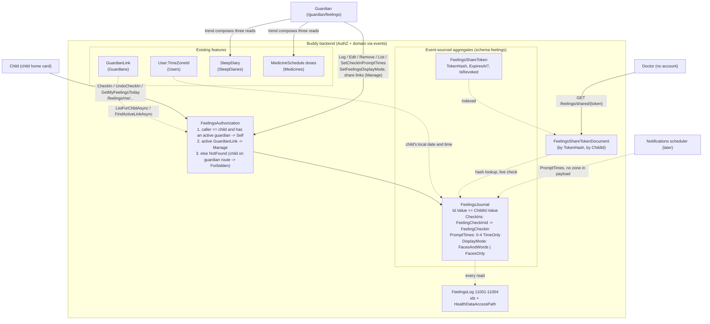

# Feelings Check-in

Status: Implemented. `Features/Feelings` (schema `feelings`, flag `Features:Feelings`) with the
`FeelingsJournal` and `FeelingsShareToken` aggregates, eight events and thirteen slices: the child's
`CheckIn`, `UndoCheckIn` and `GetMyFeelingsToday`; a guardian's `LogFeelingCheckIn`,
`EditFeelingCheckIn`, `RemoveFeelingCheckIn`, `ListFeelingCheckIns`, `SetCheckInPromptTimes`,
`SetFeelingsDisplayMode` (faces only) and the share links; the anonymous `GetSharedFeelings`. GDPR
eraser, exporter and audit logs 11001-11004. Frontend: the check-in card on the child home page,
`/guardian/feelings`, the dashboard's "Feelings today", `/shared/feelings/:token` and a help topic.

## Context

Children with ADHD often struggle to notice and name how they feel, and the adults around them
struggle to see patterns: is the afternoon meltdown about the medicine wearing off, a short night,
or the walk home from school? Families and schools already use simple self-report tools for this.
The most common in Danish and English schools is the four-colour "zones" model (blue = low energy,
green = ready, yellow = wound up, red = out of control); the other is a row of faces from very sad
to very happy.

The request:

- **The child** taps a colour or a face a few times a day, optionally with a word ("worried") or a
  short note, from the same day view where they already see meals, tasks and doses.
- **A guardian** can log on the child's behalf ("he was red at pickup") and sees the trend over
  days and weeks, next to sleep and doses.
- **A doctor** gets a read-only view through a revocable, expiring link, the same way the sleep
  diary is shared today.
- The child is reminded to check in: in the app now, as a push notification later.

What exists today (checked in the code):

- **[sleep-diary.md](sleep-diary.md)**, shipped as
  [Features/SleepDiaries](../../../src/backend/buddy/Features/SleepDiaries), is the closest
  precedent by far. It's a 1:1 per-child health log (`SleepDiaryId.ForChild`,
  [SleepDiaryId.cs](../../../src/backend/buddy/Features/SleepDiaries/Types/SleepDiaryId.cs)), with
  a second small aggregate for hashed, expiring share links
  ([SleepDiaryShareToken.cs](../../../src/backend/buddy/Features/SleepDiaries/Types/SleepDiaryShareToken.cs)),
  an anonymous share view
  ([GetSharedSleepDiary.Endpoint.cs](../../../src/backend/buddy/Features/SleepDiaries/GetSharedSleepDiary/GetSharedSleepDiary.Endpoint.cs)),
  audit logs for every read
  ([SleepDiariesLog.cs](../../../src/backend/buddy/Features/SleepDiaries/SleepDiariesLog.cs)) and a
  GDPR eraser and exporter. It is guardian-only, though: the child has no tier at all.
- **[medicine-schedules.md](medicine-schedules.md)** is the precedent for a child writing their own
  health data: the child marks their own doses through the `Mark` tier
  ([MedicineAuthorization.cs](../../../src/backend/buddy/Features/Medicines/MedicineAuthorization.cs),
  `callerId == childId`), and every read is logged with `HealthDataAccessPath.Self` or `Guardian`
  ([ListTodaysDoses.Handler.cs](../../../src/backend/buddy/Features/Medicines/ListTodaysDoses/ListTodaysDoses.Handler.cs)).
- **[reward-redemption.md](reward-redemption.md)** is the precedent for child-only `/me` routes
  that can only ever reach the caller's own stream
  ([RequestReward.Command.cs](../../../src/backend/buddy/Features/Progress/RequestReward/RequestReward.Command.cs)).
- **[gdpr-data-protection.md](gdpr-data-protection.md)** and [PRIVACY.md](../../../PRIVACY.md) list
  medicines and the sleep diary as Article 9 health data, with erasure, export and read audit logs
  for each. A child's feelings are health data too (mental health), so this feature takes on every
  one of those duties.
- **[feature-flags.md](feature-flags.md)**: every optional domain has a flag in
  [FeatureOptions.cs](../../../src/backend/buddy/Common/FeatureFlags/FeatureOptions.cs).
- **[mobile-app-and-notifications.md](mobile-app-and-notifications.md)** (proposed) designs push
  reminders as a per-minute scan of current state. Feelings prompts slot into it later as one more
  kind.
- **[transition-warnings.md, Question 9](transition-warnings.md#question-9-whose-today-do-the-child-pages-use)**
  (shipped after this doc was first written) added `ChildClockService`
  ([child-clock.service.ts](../../../src/frontend/buddy/src/app/core/child-clock.service.ts)): every
  child page takes "today" and the time of day from the child's profile time zone, not the device.
  The check-in card does the same, for its prompt state and its undo countdown.
- **[visual-time-left-timer.md](../../frontend/analysis/visual-time-left-timer.md)** (shipped) added
  the first per-child display switch a guardian sets, `User.ShowVisualTimers`
  ([UpdateChildVisualTimers](../../../src/backend/buddy/Features/Guardians/UpdateChildVisualTimers)).
  It's the precedent Question 9 weighs for the faces-only mode.

This document answers nine questions: does this need a new feature, which scale to store, how the
aggregate is shaped, how one check-in is modelled, who can log, see, change and remove a check-in,
how prompts work, how the trend combines sleep and doses, how sharing and GDPR work, and how a
young child can use it without reading (faces-only).

## Question 1: extend `SleepDiaries`, or a new feature?

**Decision: a new feature, `Features/Feelings`, with its own aggregate, Marten schema `feelings`
and feature flag `Features:Feelings`.**

- **Different principals.** A sleep diary is the guardian's clinical observation; the child has no
  access ([SleepDiaryAuthorization.cs](../../../src/backend/buddy/Features/SleepDiaries/SleepDiaryAuthorization.cs)).
  A feelings check-in is first of all the _child's_ self-report. Adding a child tier to
  `SleepDiaryAuthorization` would loosen a decision the sleep diary made deliberately
  ([sleep-diary.md, Question 4](sleep-diary.md#question-4-who-can-see-and-log-entries)).
- **Different shape.** A sleep entry is one per date, overwritten in full. Check-ins are several
  per day, each with its own identity, and a child can undo one.
- **Different on/off decision.** A family may want a sleep diary for a clinic and never want their
  child rating feelings in an app, or the other way round. One flag per optional domain is the
  existing rule ([feature-flags.md, Question 2](feature-flags.md#question-2-which-features-get-a-flag)).

The sleep diary is still the template: the same 1:1 identity trick, the same share-token aggregate,
the same erasure and export shape, copied rather than referenced, as vertical slices here prefer.

## Question 2: which scale -- five faces or four zones?

**Decision: store one of four zones (`Blue`, `Green`, `Yellow`, `Red`). Each zone is always shown
with a face, its colour and a word, so a child who can't read or doesn't know the zones model
still picks a face. There is no separate face scale in the data.**

```text
enum FeelingZone { Blue, Green, Yellow, Red }   // persisted as strings (EnumStorage.AsString)
```

| Zone     | Face (display only) | Child-facing label (en / da) | Meaning                               |
| -------- | ------------------- | ---------------------------- | ------------------------------------- |
| `Blue`   | 😔                  | "Slow" / "Langsom"           | low energy: tired, sad, bored, unwell |
| `Green`  | 🙂                  | "Ready" / "Klar"             | calm, focused, okay                   |
| `Yellow` | 😬                  | "Wound up" / "Oppe at køre"  | worried, frustrated, silly, restless  |
| `Red`    | 😡                  | "Too much" / "For meget"     | angry, scared, overwhelmed            |

Why zones over a five-face valence scale:

- **ADHD is about regulation, not only mood.** A five-face scale is one axis, sad to happy. It puts
  "tired and flat" (often the medicine wearing off, or a short night) and "wound up and frustrated"
  (often a rebound or an overloaded afternoon) on the same "unhappy" face. Those two need opposite
  responses from a guardian and mean different things to a doctor adjusting a dose. Zones keep
  them apart.
- **No "good" or "bad" answer.** Zones are taught as states everyone passes through, not grades. A
  face scale invites a child to pick the happy face to please the adult reading it, which makes
  the record worthless.
- **Children already know it.** Many Danish and English schools and child psychiatry services use
  four colours, so the child and the doctor read the same language.
- **One tap.** Storing both a face and a zone would mean two taps, or a mapping that loses
  information in one direction (five faces don't map onto four zones without guessing). Showing
  the face _on_ the zone button gives the face's accessibility without a second dimension.

Rejected: a five-face ordinal scale (one axis, see above); storing both a face and a zone
(double the friction, and the two could contradict each other); a 0-10 slider (too abstract for a
6-year-old, and fiddly on an iPad for a child with motor-planning difficulties).

The trade-off is that zones have no natural order, so the trend is a distribution per day (how
many check-ins in each zone, and when), not a line. See Question 7.

"The Zones of Regulation" is a published curriculum and a trademark. Buddy uses only the generic
idea of four colours, its own labels, and no material from the curriculum, and never uses that
name: the feature is "Feelings" / "Følelser" (settled by the user 2026-10-13).

## Question 3: aggregate shape and identity

**Decision: one `FeelingsJournal` stream per child, with `FeelingsJournalId.Value ==
ChildId.Value` and no index document, exactly as `SleepDiary` and `ChildProgress` do. Check-ins
live in it keyed by a UUIDv7 `FeelingCheckInId`.**

```text
FeelingsJournal(
    FeelingsJournalId Id,                                  // Id.Value == ChildId.Value
    UserId ChildId,
    ImmutableDictionary<FeelingCheckInId, FeelingCheckIn> CheckIns,
    ImmutableList<TimeOnly> PromptTimes,                   // 0-4, the child's local wall clock; see Question 6
    FeelingsDisplayMode DisplayMode)                       // FacesAndWords (default) or FacesOnly; see Question 9

public sealed record FeelingsJournalId(Guid Value)
{
    public static FeelingsJournalId ForChild(UserId childId) => new(childId.Value);
}

public sealed record FeelingCheckInId(Guid Value)
{
    public static FeelingCheckInId New() => new(Guid.CreateVersion7());
}
```

- **1:1 with the child**, so "this child's journal" costs no lookup. The reasoning is
  [sleep-diary.md, Question 2](sleep-diary.md#question-2-aggregate-shape-and-identity) word for
  word: no family-sharing axis, no "which one" to resolve.
- **Keyed by check-in id, not by date.** Unlike `SleepDiary.Entries` (`DateOnly` key, one per
  night), there are several check-ins a day, and edit, undo and remove each address one.
- **Stream growth.** About four check-ins a day is roughly 1,500 events a year, and every write
  replays the stream through `ReadAsync` for optimistic concurrency. That is the same growth as a
  medicine schedule's dose log, which keeps every `DoseStatusChanged` in one stream
  ([MedicineSchedule.cs](../../../src/backend/buddy/Features/Medicines/Types/MedicineSchedule.cs),
  `DoseLog`), and reads use the snapshot. It's fine at family scale; see the open question on
  splitting by year if it ever isn't.
- Rejected: **one stream per check-in** with an index document by child. Every read would become an
  index query plus N stream loads, and a list would need a projection of its own. The 1:1 stream
  is simpler, and the daily cap (Question 4) keeps it bounded.

### Events

```text
FeelingsJournalStarted(FeelingsJournalId Id, UserId ChildId, DateTimeOffset OccurredAt)
    // Lazily, by the first CheckIn / LogFeelingCheckIn / SetCheckInPromptTimes /
    // SetFeelingsDisplayMode for the child, in the same CreateAsync -- like SleepDiaryStarted.

FeelingCheckedIn(FeelingsJournalId Id, FeelingCheckIn CheckIn, DateTimeOffset OccurredAt)
    // CheckIn.LoggedBy == ChildId for a self-report.

FeelingCheckInEdited(FeelingsJournalId Id, FeelingCheckIn Before, FeelingCheckIn After,
    UserId ModifiedBy, DateTimeOffset OccurredAt)
    // Full overwrite of a guardian-logged check-in. Same id, same LoggedBy and RecordedAt.

FeelingCheckInRemoved(FeelingsJournalId Id, FeelingCheckIn Before, UserId ModifiedBy,
    DateTimeOffset OccurredAt)
    // The child's undo, or a guardian removing a check-in. ModifiedBy says which.

CheckInPromptTimesSet(FeelingsJournalId Id, IReadOnlyList<TimeOnly> Before,
    IReadOnlyList<TimeOnly> After, UserId ModifiedBy, DateTimeOffset OccurredAt)

FeelingsDisplayModeSet(FeelingsJournalId Id, FeelingsDisplayMode Before,
    FeelingsDisplayMode After, UserId ModifiedBy, DateTimeOffset OccurredAt)
    // Question 9. Like CheckInPromptTimesSet, it may start the journal.

FeelingsShareTokenCreated(FeelingsShareTokenId Id, UserId ChildId, string TokenHash,
    UserId CreatedBy, DateTimeOffset? ExpiresAt, DateTimeOffset OccurredAt)

FeelingsShareTokenRevoked(FeelingsShareTokenId Id, UserId ModifiedBy, DateTimeOffset OccurredAt)
```

Two unions, `FeelingsJournalEvent` and `FeelingsShareTokenEvent`, as `SleepDiaryEvent` and
`SleepDiaryShareTokenEvent` are
([SleepDiaryEvents.cs](../../../src/backend/buddy/Features/SleepDiaries/Types/SleepDiaryEvents.cs)).
Every write that changes nothing appends nothing (an identical edit, removing a check-in that is
already gone, the same prompt times), which is what keeps the `PUT`s and `DELETE`s idempotent, as
in `LogSleepEntryHandler`'s `HasSameContentAs` check
([LogSleepEntry.Handler.cs](../../../src/backend/buddy/Features/SleepDiaries/LogSleepEntry/LogSleepEntry.Handler.cs)).

### Rehydration

`FeelingsJournal.Start` seeds an empty journal from `FeelingsJournalStarted`.
`FeelingsJournal.Advance` sets `CheckIns[id]` on `FeelingCheckedIn`/`FeelingCheckInEdited`, removes
it on `FeelingCheckInRemoved`, replaces `PromptTimes` on `CheckInPromptTimesSet` and `DisplayMode` on
`FeelingsDisplayModeSet`. The started
event is `EventReplay.AlreadyStarted` in `Advance`, so CS8509 flags any new event the fold forgets,
the same layout as [SleepDiary.cs](../../../src/backend/buddy/Features/SleepDiaries/Types/SleepDiary.cs).
`FeelingsJournalSnapshotProjection` and `FeelingsShareTokenSnapshotProjection` delegate to
`Start`/`Advance` and are registered `Inline` in the `snapshots` schema, as
[SleepDiariesFeature.cs](../../../src/backend/buddy/Features/SleepDiaries/SleepDiariesFeature.cs)
does. `FeelingsShareToken` is a copy of `SleepDiaryShareToken` with its own id type.

## Question 4: modelling one check-in

**Decision: a flat record: zone, up to three tags from a fixed catalog, an optional short note, the
moment it describes in the child's local time, who logged it and when it was saved.**

```text
FeelingCheckIn(
    FeelingCheckInId Id,
    FeelingZone Zone,
    IReadOnlyList<FeelingTag> Tags,   // 0-3; empty = none
    string Note,                      // "" = none (FreeText); at most 280 characters
    DateOnly LocalDate,               // the child's wall clock (User.TimeZoneId) at the moment described
    TimeOnly LocalTime,
    UserId LoggedBy,                  // == ChildId: the child's self-report; otherwise a guardian's observation
    DateTimeOffset RecordedAt)        // when it was saved; drives the child's undo window
```

- **Tags are a fixed, translated catalog, not free text.** Feeling words belong to one zone, and
  situation tags fit any zone:

  | Group                 | Tags                                                                          |
  | --------------------- | ----------------------------------------------------------------------------- |
  | `Blue` words          | `Tired`, `Sad`, `Bored`, `Unwell`, `Lonely`                                   |
  | `Green` words         | `Happy`, `Calm`, `Focused`, `Proud`, `Okay`                                   |
  | `Yellow` words        | `Worried`, `Frustrated`, `Silly`, `Excited`, `Restless`                       |
  | `Red` words           | `Angry`, `Scared`, `Overwhelmed`                                              |
  | Situations (any zone) | `School`, `Home`, `Friends`, `Homework`, `Screens`, `Food`, `Bedtime`, `Body` |

  A fixed list is translatable (en/da in the frontend, one enum on the wire), countable in the
  trend ("worried, mostly on school days"), and keeps personal free text out of the tags. The
  validator rejects a feeling word from another zone than the one picked. That's a teaching
  choice: a child who taps yellow sees the yellow words. Custom per-family tags are an open
  question.

- **The tag list is a plain list of an enum**, not a union, so it round-trips through
  System.Text.Json the way `MedicineSchedule.Times` does (the failure mode
  [pickup-schedules.md, Question 3](pickup-schedules.md#question-3-modeling-who--a-flat-kind-discriminator-not-a-union)
  hit doesn't apply). Enums are persisted as strings, so a tag is never renamed, only added.
- **`Note` follows the `FreeText` convention** ([FreeText.cs](../../../src/backend/buddy/Common/FreeText.cs)):
  non-null, `""` means none, normalized once in the endpoint. 280 characters is a sentence or two:
  this isn't a diary, and a long note from a child is better said out loud.
- **Local date and time, not an instant.** The trend asks "what time of day", in the child's day.
  `User.TimeZoneId` is required since [child-timezone-settings.md](child-timezone-settings.md), so
  the handler converts "now" to the child's wall clock through `IUserEventStore.FindSnapshotAsync`,
  the same store `GetSharedSleepDiaryHandler` already reads
  ([GetSharedSleepDiary.Handler.cs](../../../src/backend/buddy/Features/SleepDiaries/GetSharedSleepDiary/GetSharedSleepDiary.Handler.cs)).
  `RecordedAt` keeps the real instant for the undo window. Unlike the sleep diary's open question,
  the time zone is settled here. "Now" comes from an injected `TimeProvider` (registered once as
  `TimeProvider.System` in `Program.cs`, like every other handler's clock), so
  the undo-window tests run on a fake clock instead of sleeping.
- **Self-report or observation is derived, not stored**: `LoggedBy == ChildId`. The trend and the
  share view draw the two differently (filled vs outlined). A doctor needs to know whether the child
  said "red" or a parent saw it.
- **At most 20 check-ins per child per local day.** It stops a child hammering the buttons from
  flooding the journal and the stream. The 21st is `400 validation_error`, the house rules'
  "51st rule" precedent ([house-rules.md, Failure and edge-case behavior](house-rules.md#failure-and-edge-case-behavior)).

## Question 5: who can log, see, change and remove a check-in

**Decision: two tiers. `Self`: the child, on `/feelings/me/...` routes, who can check in, see their
own self-reports for today and undo one within 10 minutes. `Manage`: an active guardian, on
`/feelings/children/{childId}/...`, who can do everything else. Anyone else gets `NotFound`.**

```text
enum FeelingsAccessTier { None, Self, Manage }
enum FeelingsAccess { Allowed, NotFound, Forbidden }
```

| Tier       | Who                                                                                                                                                                                                                                                                  | Actions                                                                                                                                                                                                                    |
| ---------- | -------------------------------------------------------------------------------------------------------------------------------------------------------------------------------------------------------------------------------------------------------------------- | -------------------------------------------------------------------------------------------------------------------------------------------------------------------------------------------------------------------------- |
| **Self**   | The caller is the child: `callerId == childId` _and_ the caller has at least one active guardian link (`IGuardianLinkEventStore.ListForChildAsync(...)` non-empty, as [ChildVisibility.cs](../../../src/backend/buddy/Features/Calendars/ChildVisibility.cs) checks) | Check in now; see today's own self-reports, the prompt times and the display mode; undo an own check-in within 10 minutes                                                                                                  |
| **Manage** | An active guardian of the child (`FindActiveLinkAsync`)                                                                                                                                                                                                              | Log on the child's behalf (any past moment); edit or remove guardian-logged check-ins; remove (not edit) a child's self-report; list any range; set prompt times and the display mode; create, list and revoke share links |

`FeelingsAuthorization` has the shape of `MedicineAuthorization`, with `CheckSelf` and
`CheckManage` over one private `ResolveTier`. The differences:

- **The extra "is a child" check on `Self`.** Without it, a guardian calling `/feelings/me` would
  start a journal about themselves. `MedicineAuthorization` doesn't need this, since a guardian
  has no doses, but here the first write creates the stream.
- **The child on a guardian route gets `403`**, as a child calling `CreateMedicineSchedule` does
  (`MedicineAccess.Forbidden`). The child knows their own journal exists, so hiding it behind
  `404` would protect nothing.

Change and removal rules:

- **The child can undo, not edit.** A mis-tap is the realistic mistake, so the saved state shows
  "Thanks! Undo" for 10 minutes after `RecordedAt`. After that the check-in is a record, and undo
  answers `409 check_in_undo_window_closed`. A child can't go back and delete yesterday's red: the
  point is a truthful record, and a child embarrassed by a red day is a conversation for the
  guardian, not a delete button. A new check-in is always possible ("I'm green now").
- **A guardian can't edit a child's self-report**: `409 check_in_is_self_report`. The child's words
  stay the child's. A guardian _can_ remove one (a sibling grabbed the iPad, a test tap), and
  `FeelingCheckInRemoved.ModifiedBy` records which guardian did (settled by the user 2026-10-11).
- **Guardian-logged check-ins** can be edited (full overwrite, `Before`/`After`, as
  `SleepEntryLogged`) and removed by any active guardian, the sleep diary's rule that either
  guardian may correct a night.
- **A guardian can backdate but not post-date.** A moment later than "now" in the child's time zone
  (with 5 minutes of clock slack) is `400`. There's no lower bound, matching the sleep diary's
  "fill it in retroactively" stance.
- **No group tier.** Unlike medicine schedules, this isn't shared with a household group
  ([medicine-schedules.md, Group sharing](medicine-schedules.md#group-sharing-added-later-additive)).
  A grandparent or the other household can't see a child's feelings unless they are a guardian.
  If a real need appears, it's additive later.

What the child sees: only their own self-reports, and only today's. They don't see guardian
observations about them (the sleep diary's argument that a parent's clinical note isn't written
for the child), and no history or trend (a 9-year-old reviewing a week of red days isn't the
point; the guardian has that conversation). The child UI says plainly, "Your grown-ups can see
your check-ins." Today only, with no history, was settled by the user on 2026-10-11; not seeing
guardian observations was settled by the user on 2026-10-13. `GetMyFeelingsToday` filters on
`LoggedBy == ChildId`, so an observation never reaches the child's browser at all.

## Question 6: prompts and reminders

**Decision: a guardian sets 0-4 prompt times per child (for example 07:30, 15:00, 19:30), stored
on the journal. The child's home page shows a highlighted "How are you feeling?" card from each
prompt time until the child checks in, or the next prompt time comes. Push
reminders reuse the same prompt times once
[mobile-app-and-notifications.md](mobile-app-and-notifications.md) ships, and need no change to
this feature.**

- **Without prompt times**, the check-in card is still on the child's home page, just not
  highlighted. A child can check in any time. Prompts only make it stand out.
- **The prompt state is computed in the browser**, from `GetMyFeelingsToday`'s `date`,
  `promptTimes` and today's check-ins, with a pure function and its own spec. "Now" is the child's
  clock (`ChildClockService.minutesOfDay()`), and the page compares `date` with
  `ChildClockService.today()`, refetching when the child's day has turned. The server returns
  data only, so the response stays deterministic for the same data, as the ETag middleware needs
  ([conditional-get-etags.md](conditional-get-etags.md)). A body with "prompt open" would change by
  the clock alone.
- **A prompt is answered** by the child's own check-in on that date with `LocalTime` at or after
  the prompt time. A guardian's observation doesn't answer it: the child never receives
  observations (Question 5), and leaking even their times to the child's browser would tell the
  child "someone wrote about you at 15:10". A missed prompt simply closes when the next one opens, with no
  "overdue" state and no lost stars. A check-in tool that punishes the child for forgetting gets
  ignored.
- **Stored on the journal**, not on a separate settings aggregate, because it's part of this
  child's check-in routine and nothing else reads it (the display mode of Question 9 sits next to
  it for the same reason). `SetCheckInPromptTimes` may create the
  journal, as `UpdateSleepHygieneNotes` may create the diary.
- **Push, later.** The notifications design's scheduler
  ([Question 5 there](mobile-app-and-notifications.md#question-5-how-are-time-driven-reminders-scheduled))
  gains one more pass: for each prompt time in `(now - 5 min, now]` in the child's `TimeZoneId`,
  with no check-in since, notify the child. Dedup key `FeelingsPrompt:{childId}:{date}:{time}`.
  The text is "How are you feeling?" and never mentions a zone or a past check-in, under that doc's
  "no health data on the lock screen" rule
  ([Question 7 there](mobile-app-and-notifications.md#question-7-what-goes-in-a-notification)).
- **No guardian notification on a red check-in in v1** (settled by the user 2026-10-11). A red
  push during school hours can do more harm than good, and it would be the first
  health-data-driven notification. When push ships it may be added as an opt-in, off by default,
  which needs a new event-driven kind in the scheduler.

## Question 7: the guardian's trend, next to sleep and doses

**Decision: the guardian page shows a 14-day grid (one row per day, check-ins placed on a
time-of-day axis, dose times marked on the same axis, and the previous night's sleep in its own
column) and an 8-week summary (zone counts per week). The frontend composes it from three existing
APIs; there's no cross-feature backend endpoint.**

- **Three reads, three audit logs.** `ListFeelingCheckIns` (this feature),
  `GET /sleep-diary/children/{childId}/entries` (`SleepDiaryService.listEntries`) and
  `GET /medicines/children/{childId}/doses` (`MedicinesService.listDoses`). Each feature already
  logs its own health-data read with the reader and access path, so a composite endpoint would
  either log on behalf of other features or skip their logs. It would also make Feelings depend on
  two other features' stores, against the "cross-feature needs go through the other domain's
  event store" rule, for a view the browser can assemble.
- **Flags degrade, as [feature-flags.md, Question 6](feature-flags.md#question-6-features-that-depend-on-each-other)
  says.** With `sleepDiary` or `medicines` off, that column or those markers just aren't drawn.
- **Range limits match.** The 14-day view fits `ListTodaysDosesHandler.MaxRangeDays` (31) and
  `ListSleepDiaryEntriesHandler.MaxRangeDays` (92). The 8-week view (56 days) shows feelings only,
  so it never asks for 56 days of doses. `ListFeelingCheckIns` allows 92 days, the sleep diary's
  limit.
- **Day D pairs with the night of D-1.** The sleep diary keys a night by its evening ("Night of" in
  [sleep-diary.ts](../../../src/frontend/buddy/src/app/core/i18n/translations/en/sleep-diary.ts)),
  and the sleep that shapes Tuesday is Monday night's.
- **No chart library.** Buddy has none (`package.json`), and the grid is really a table: an HTML
  `<table>` with one row per day, zone dots absolutely positioned on a CSS time axis, and the
  printed values available to a screen reader ("14:30, yellow, worried, logged by Emil"). The
  week-plan print pages already draw with plain HTML/SVG
  ([week-plan-sheet.html](../../../src/frontend/buddy/src/app/features/guardian/print/sheet/week-plan-sheet.html)).
  The weekly summary is a stacked bar per week (four flex segments with counts as text).
- **Colour is never the only signal** (WCAG 1.4.1): every dot also carries its face and a text
  label, and self-reports vs observations differ in shape (filled vs outlined).

## Question 8: sharing with a doctor, and GDPR

**Decision: copy the sleep diary's share links one-to-one: a `FeelingsShareToken` aggregate,
`FeelingsShareTokenDocument` indexed by hash, a random token shown once, SHA-256 stored, optional
`ExpiresAt` (future, at most 365 days, the UI defaulting to 30), revocable, and an anonymous
`GET /feelings/shared/{token}`. The view shows feelings only.**

- **Same mechanics, copied.** `FeelingsShareSecret` is a third copy of the dozen lines in
  `SleepDiaryShareSecret`, the sleep diary's own settled choice ("local duplication over a
  cross-feature dependency"). Promoting all three to `Common` is an open question, not a blocker.
  The route parameter is named `token`, so `ObservabilityFeature`'s `SecretRouteParameter`
  scrubbing ([ObservabilityFeature.cs](../../../src/backend/buddy/Common/Observability/ObservabilityFeature.cs))
  keeps it out of traces with no change.
- **Feelings only, not a combined packet.** A doctor reviewing ADHD medication would like doses
  next to feelings, but medicines have no share link today, and adding dose data to this link would
  share a second feature's health data under the first's consent. The guardian can send the sleep
  diary link alongside. A combined "clinician packet" is an open question.
- **The shared view shows the 14-day grid** (like the guardian's, without dose markers or sleep),
  the child's name, the range and the link's expiry. It's printable, with the reader paging by 14
  days, the sleep diary's decision for its shared view. Notes are included: a guardian who doesn't
  want the doctor to read a note can remove that check-in. The share dialog says notes are
  included.

### GDPR and privacy

| Duty                     | How                                                                                                                                                                                                                                                                                                                                                                                                 |
| ------------------------ | --------------------------------------------------------------------------------------------------------------------------------------------------------------------------------------------------------------------------------------------------------------------------------------------------------------------------------------------------------------------------------------------------- |
| Lawful basis             | Health data about a child (Art. 9 + Art. 8). The operator's privacy notice must list it. When this ships, [PRIVACY.md](../../../PRIVACY.md)'s "Health data" bullet and "Every read of health data is logged" line gain "feelings check-ins"                                                                                                                                                         |
| Erasure: child erased    | `FeelingsPersonalDataEraser.EraseChildAsync` deletes the journal stream (`FeelingsJournalId.ForChild`) with its snapshot, and every share-token stream with its document, as [SleepDiariesPersonalData.cs](../../../src/backend/buddy/Features/SleepDiaries/SleepDiariesPersonalData.cs) does                                                                                                       |
| Erasure: guardian erased | Revokes the share links that guardian created for children who stay with a co-guardian (same as the sleep diary). Their check-ins stay with the child's journal; `LoggedBy` is a pseudonym once the user is erased, as `AddedBy` on house rules ([house-rules.md, Privacy](house-rules.md#privacy-gdpr)). Notes they wrote stay: they are about the child and belong to the child's record          |
| Export                   | `FeelingsPersonalDataExporter`, section `"feelings"`: every check-in of each child (newest last), the prompt times and share links (id, created, expiry, revoked; never the hash), built from the response DTOs. A child account exports only `account`, as for every feature ([gdpr-data-protection.md, Question 5](gdpr-data-protection.md#question-5-what-does-an-export-contain))               |
| Coverage tests           | `PersonalDataEraserCoverageTests` and `PersonalDataExporterCoverageTests` fail until both exist; `PostgresDataSourceHostTests` gets `IFeelingsStore`                                                                                                                                                                                                                                                |
| Read audit logs          | `FeelingsLog`, EventIds 11001+ (the next free thousand, [observability.md](../observability.md)): 11001 share link created, 11002 revoked, 11003 shared view read (child, link id), 11004 check-ins read (`ChildId`, `From`, `To`, `UserId`, `HealthDataAccessPath.Guardian` or `Self`). Written after a successful read only, ids only, never a zone, tag or note. `AuditLogTests` gains the cases |
| Minimization             | No free-text tags; a 280-character note; no zone or note in logs, push payloads or URLs                                                                                                                                                                                                                                                                                                             |
| Retention                | Kept until the child or the family deletes it, like the sleep diary. Automatic expiry of old check-ins is an open question                                                                                                                                                                                                                                                                          |

## Question 9: a faces-only display mode for young children

**Decision: include it in v1 (settled by the user 2026-10-13; the doc's earlier lean was "not in
v1"). A per-child guardian setting, `FeelingsDisplayMode { FacesAndWords, FacesOnly }`, stored on
the child's `FeelingsJournal` next to the prompt times, default `FacesAndWords`. `FacesOnly` hides
the zone words ("Ready", "Too much") on the child's four buttons and drops the colour and zone names
from what a screen reader announces; the buttons keep their face and their colour. The stored data
is unchanged: the same four zones, the same tags.**

```text
enum FeelingsDisplayMode { FacesAndWords, FacesOnly }    // persisted and sent by name

FeelingsDisplayModeSet(FeelingsJournalId Id, FeelingsDisplayMode Before,
    FeelingsDisplayMode After, UserId ModifiedBy, DateTimeOffset OccurredAt)

PUT /feelings/children/{childId}/display-mode   { "displayMode": "FacesOnly" }
    200 { "displayMode": "FacesOnly" } | 400 (unknown value) | 403 (the child) | 404
```

- **Why a mode at all.** Some 5- and 6-year-olds can't read "Wound up" and don't yet think of a
  colour as a state; for them a face is the whole question. Words on the button then become noise,
  and a screen reader reading "Yellow, wound up" to a child who knows only faces is worse than
  "Worried face".
- **On the journal, not on `User`.** `User.ShowVisualTimers` is the one per-child display switch
  that exists, and it lives on `User` because visual timers have no aggregate of their own. Feelings
  does: the mode is read only by this feature's child card, travels with the feature flag (off
  hides the setting with the rest), is erased and exported with the journal, and needs no change to
  the Users feature or its events. The prompt times are on the journal for the same reasons.
- **Its own slice and event**, not a field on `SetCheckInPromptTimes`. The two are set from
  different controls on the guardian page, and one event per setting keeps the history readable
  ("who switched Ida to faces only?"). `SetFeelingsDisplayMode` follows `SetCheckInPromptTimes`:
  `Manage` tier, the same mode appends nothing, and it may start the journal.
- **Who reads it.** `GetMyFeelingsToday` returns `displayMode` so the child's card can draw itself;
  `ListFeelingCheckIns` returns it so the guardian's settings section shows the current value.
  There's no separate GET.
- **What changes in faces-only.** The child's four buttons show the face (larger) and the colour,
  with no word; each button's accessible name is the face's description ("Tired face", "Smiling
  face", "Worried face", "Angry face") instead of "Ready -- calm, focused, okay"; the saved
  announcement says "Saved" with no zone name; the "What do the colours mean?" disclosure is hidden.
  The feeling-word and situation chips after a tap stay (they're optional, and a guardian can read
  them with the child). The guardian views, the trend and the shared page always show words: the
  mode is about the child's own screen.
- Rejected: **a global (per-installation) switch** (it's about one child's age, and siblings
  differ); **storing a face instead of a zone in faces-only** (two scales in the data, the very
  thing Question 2 rejected); **an age threshold from a birth date** (Buddy stores no birth date,
  and readiness isn't age).

## Read models

- **None for the journal.** `FeelingsJournalId.Value == ChildId.Value`, and reads go through the
  inline snapshot (`FindSnapshotAsync`), as `ListSleepDiaryEntriesHandler` does.
- **`FeelingsShareTokenDocument(Guid Id, Guid ChildId, string TokenHash, DateTimeOffset? ExpiresAt,
bool IsRevoked, DateTimeOffset CreatedAt)`**, written in the same `SaveChangesAsync` as the token
  events, looked up by hash for the shared view and by child for the list and erasure, as
  `SleepDiaryShareTokenDocument`.
- **No expansion helper.** There's no schedule to expand: a range read filters `CheckIns` by
  `LocalDate`, sorted by date and time.

## Command slices (`Features/Feelings/`, same vertical-slice shape as `SleepDiaries`)

| Slice                     | Tier                       | Notes                                                                                                                                                                                                               |
| ------------------------- | -------------------------- | ------------------------------------------------------------------------------------------------------------------------------------------------------------------------------------------------------------------- |
| `CheckIn`                 | Self                       | Zone, tags, note. The moment is now in the child's time zone. Creates the journal lazily. Emits `FeelingCheckedIn`                                                                                                  |
| `UndoCheckIn`             | Self                       | Own self-report only, within 10 minutes of `RecordedAt`, else `409 check_in_undo_window_closed`. Already gone: `204`, no event. Emits `FeelingCheckInRemoved`                                                       |
| `GetMyFeelingsToday`      | Self                       | Today's date in the child's zone, the prompt times, the display mode, and the child's own self-reports for today. Logs 11004 as `Self`                                                                              |
| `LogFeelingCheckIn`       | Manage                     | Like `CheckIn`, plus an optional `date`/`time` (both or neither; default now; not more than 5 minutes in the future). Emits `FeelingCheckedIn` with `LoggedBy` = the guardian                                       |
| `EditFeelingCheckIn`      | Manage                     | Full overwrite of a guardian-logged check-in; a self-report is `409 check_in_is_self_report`. Identical content: no event. Emits `FeelingCheckInEdited`                                                             |
| `RemoveFeelingCheckIn`    | Manage                     | Any check-in of the child. Already gone: `204`, no event. Emits `FeelingCheckInRemoved`                                                                                                                             |
| `ListFeelingCheckIns`     | Manage                     | `[from, to]`, at most 92 days, with the prompt times and the display mode. Logs 11004 as `Guardian`                                                                                                                 |
| `SetCheckInPromptTimes`   | Manage                     | 0-4 distinct whole-minute times, stored sorted. Same list: no event. Emits `CheckInPromptTimesSet`                                                                                                                  |
| `SetFeelingsDisplayMode`  | Manage                     | `FacesAndWords` or `FacesOnly` (Question 9). Same mode: no event. Emits `FeelingsDisplayModeSet`                                                                                                                    |
| `CreateFeelingsShareLink` | Manage                     | Optional `expiresAt`. Returns the plaintext token once. Emits `FeelingsShareTokenCreated`; logs 11001                                                                                                               |
| `ListFeelingsShareLinks`  | Manage                     | Live links only (not revoked, not expired), as `ListSleepDiaryShareLinks`                                                                                                                                           |
| `RevokeFeelingsShareLink` | Manage                     | Emits `FeelingsShareTokenRevoked`; logs 11002                                                                                                                                                                       |
| `GetSharedFeelings`       | _(anonymous, token-gated)_ | Unknown, revoked, expired or erased child: all `404`. Optional `from`/`to`; the default is the last 14 days ending today on the child's own clock (a missing end is 14 days from the other), at most 92. Logs 11003 |

`UndoCheckIn` and `EditFeelingCheckIn` return feature-specific outcome unions
(`UndoCheckInOutcome`, `EditFeelingCheckInOutcome`) for their `409`s rather than adding cases to
`Result<T>`, the `RewardRequestOutcome` precedent
([RewardRequestOutcome.cs](../../../src/backend/buddy/Features/Progress/Types/RewardRequestOutcome.cs)).
The daily cap is a plain `400 validation_error`, so `CheckIn` keeps `Result<T>`.

## Routes

| Route                                                    | Method | Slice                     | Success            | Other statuses                                                           |
| -------------------------------------------------------- | ------ | ------------------------- | ------------------ | ------------------------------------------------------------------------ |
| `/feelings/me/check-ins`                                 | POST   | `CheckIn`                 | `200` check-in     | `400`, `404` (caller isn't a child with an active guardian)              |
| `/feelings/me/check-ins/{checkInId}`                     | DELETE | `UndoCheckIn`             | `204`              | `404` (not a child / guardian-logged), `409 check_in_undo_window_closed` |
| `/feelings/me/today`                                     | GET    | `GetMyFeelingsToday`      | `200`              | `404`                                                                    |
| `/feelings/children/{childId}/check-ins`                 | POST   | `LogFeelingCheckIn`       | `200` check-in     | `400`, `403` (the child), `404`                                          |
| `/feelings/children/{childId}/check-ins`                 | GET    | `ListFeelingCheckIns`     | `200`              | `400`, `403`, `404`                                                      |
| `/feelings/children/{childId}/check-ins/{checkInId}`     | PUT    | `EditFeelingCheckIn`      | `200` check-in     | `400`, `403`, `404`, `409 check_in_is_self_report`                       |
| `/feelings/children/{childId}/check-ins/{checkInId}`     | DELETE | `RemoveFeelingCheckIn`    | `204`              | `403`, `404`                                                             |
| `/feelings/children/{childId}/prompt-times`              | PUT    | `SetCheckInPromptTimes`   | `200` prompt times | `400`, `403`, `404`                                                      |
| `/feelings/children/{childId}/display-mode`              | PUT    | `SetFeelingsDisplayMode`  | `200` display mode | `400`, `403`, `404`                                                      |
| `/feelings/children/{childId}/share-links`               | POST   | `CreateFeelingsShareLink` | `200` link + token | `400`, `403`, `404`                                                      |
| `/feelings/children/{childId}/share-links`               | GET    | `ListFeelingsShareLinks`  | `200`              | `403`, `404`                                                             |
| `/feelings/children/{childId}/share-links/{shareLinkId}` | DELETE | `RevokeFeelingsShareLink` | `204`              | `403`, `404`                                                             |
| `/feelings/shared/{token}`                               | GET    | `GetSharedFeelings`       | `200`              | `400`, `404` (anonymous)                                                 |

Notes, following [http-status-codes.md](../http-status-codes.md):

- Creates answer `200` with the created resource, and the POSTs go through
  `IdempotencyKeyMiddleware`, so a child double-tapping on a flaky connection logs one check-in
  (the frontend uses `postIdempotent`).
- Every group ends with `.WithETag()`; the anonymous shared route has `.AllowAnonymous()`, as
  `GetSharedSleepDiary`, and sits on the global per-IP rate limit only (it's opened by a person,
  not polled), listed in `RateLimitingCoverageTests`.
- `404` on the guardian routes for a stranger, `403` for the child, per Question 5. The `/me`
  routes can't reach another child at all: a sibling's check-in id is simply not in the caller's
  journal, so undoing it is the "already gone" `204`.
- Any command can also return `409 concurrency_conflict` (`ConcurrencyConflictMiddleware`), for
  example two guardians editing the same check-in at once.
- New error codes: `check_in_undo_window_closed`, `check_in_is_self_report`. `task docs:openapi`
  regenerates `buddy.json` and `buddy-api.ts`.

Request bodies. Enums go over the wire by name and bind straight to the enum types, as
`InviteGuardianRequest.Kind` does; an unknown name is the binding failure's `400`, and a number
outside the enum fails the validator's `IsInEnum`:

```text
CheckInRequest(FeelingZone Zone, IReadOnlyList<FeelingTag>? Tags = null, string? Note = null)
LogFeelingCheckInRequest(FeelingZone Zone, IReadOnlyList<FeelingTag>? Tags = null, string? Note = null,
    DateOnly? Date = null, TimeOnly? Time = null)       // both or neither
EditFeelingCheckInRequest(FeelingZone Zone, DateOnly Date, TimeOnly Time,
    IReadOnlyList<FeelingTag>? Tags = null, string? Note = null)
SetCheckInPromptTimesRequest(IReadOnlyList<TimeOnly> Times)
SetFeelingsDisplayModeRequest(FeelingsDisplayMode DisplayMode)
CreateFeelingsShareLinkRequest(DateTimeOffset? ExpiresAt = null)
```

## Wiring and feature flag

- `AddFeelingsFeature` after `AddUsersFeature` and `AddGuardiansFeature` (it reads both stores),
  with its own OpenAPI document `feelings`, Marten schema `feelings`, and the eraser and exporter.
  `TimeProvider.System` is registered in `Program.cs`, not here (a test host can swap in a fake clock).
  `MapFeelingsFeature` inside `if (features.Feelings) { ... }` in
  [Program.cs](../../../src/backend/buddy/Program.cs), next to the `SleepDiary` block.
- `FeatureOptions.Feelings` (default on), a `Feelings` argument in `Effective()` and a field on
  `InstallationFeatures`. Top-level, no parent. Off hides endpoints and screens; data, snapshots
  and GDPR coverage stay ([feature-flags.md, Question 3](feature-flags.md#question-3-what-does-off-mean-for-data-and-wiring)).
- Frontend: `feelings: true` in `ALL_ON` ([features.service.ts](../../../src/frontend/buddy/src/app/core/features.service.ts)),
  `featureGuard('feelings')` on `/guardian/feelings` and `/shared/feelings/:token`, the child-home
  card and the dashboard card aren't rendered (and so don't load) when off, and the help topic gets
  `feature: 'feelings'`. `feature-routes.spec.ts` gets both routes.
- `MARTEN_SCHEMAS` in `taskfile.dist.yml` gains `feelings`; `Feelings.http` covers every route.

## Frontend

- **Service.** `core/feelings.service.ts` with types from the generated OpenAPI schemas, and
  `postIdempotent` for the POSTs; it trims the API's "HH:mm:ss" times to "HH:mm". The zone and tag
  catalog, `promptState` and `undoMsLeft` are pure functions in `core/feelings.ts`. Strings in
  `core/i18n/translations/{en,da}/feelings.ts` (Danish name: "Følelser"; zone labels, tag words,
  prompts, the "your grown-ups can see this" line). Tag words get a native-speaker review, as the
  `i18n` skill asks; children's vocabulary is easy to get wrong.
- **Shared controls.** `shared/feeling-zone-buttons` (the four buttons, `size="child"` or
  `"guardian"`, faces-only aware), `shared/feeling-tag-chips` (the chosen zone's words and the
  situations as `aria-pressed` chips, at most three) and `shared/feelings-trend` (the 14-day grid,
  drawn by the guardian page and the shared page).
- **Child: a check-in card on the home page** (`features/child/home/feelings-check-in/`), not a new
  route, because the home page _is_ the child's day view and the prompt belongs there
  ([home.html](../../../src/frontend/buddy/src/app/features/child/home/home.html)).
  - Four large buttons in a 2x2 grid (one row on wide screens), each at least 64px tall, with the
    face, the zone's colour and its word: real `<button>`s with `aria-pressed`, labelled "Ready –
    calm, focused, okay" (in faces-only mode: the face's name, Question 9).
  - After a tap: the zone's feeling words and the situation tags as toggle chips (up to three), a
    collapsed "Add a note", and "Done". "Done" with nothing chosen is fine: one tap plus Done is
    the whole flow.
  - Saved state: "Thanks, Emil!" plus "Undo" with the minutes left, for 10 minutes, then the four
    buttons again; today's own check-ins as small face chips underneath. A `role="status"` line
    announces "Saved: Wound up (yellow)." ("Saved." in faces-only mode). No stars: rewarding
    check-ins would reward checking in, not honesty.
  - "Today" and "now" come from `ChildClockService` (the child's profile time zone), re-read every
    15 seconds: the undo countdown, the prompt state, and one reload when the child's day turns
    over. The countdown runs from when the save came back on the device, not from the server's
    `recordedAt`, so a device clock that is off neither hides Undo at once nor stretches it; if the
    server's window closed first, its `409` reads "It's too late to undo that one".
  - Prompt open: the card gets the amber "needs you" frame the "rules to read" card uses, and
    "Time for a check-in!". A "What do the colours mean?" disclosure explains the zones in a
    sentence each (hidden in faces-only mode).
  - No animation is needed to understand anything (`motion-safe:` only on a hover scale).
- **Guardian page `/guardian/feelings`** (`features/guardian/feelings/`), the child picker from
  `GuardianSleepDiary` ([sleep-diary.ts](../../../src/frontend/buddy/src/app/features/guardian/sleep-diary/sleep-diary.ts)).
  One feelings read covers eight weeks ending on the shown day; sleep and doses are read for the 14
  days drawn only, each skipped when its feature is off. Then one subfolder per capability:
  - the 14-day grid (`shared/feelings-trend`) with previous/next paging, or `feelings-weeks/` (zone
    counts per week as a stacked bar with the counts written out), switched by
    `shared/segmented-control`.
  - `check-in-form/`: log on the child's behalf now or earlier, or edit an observation, with the
    zone buttons at guardian size plus `shared/date-select` and `shared/time-select`.
  - `day-detail/`: a selected day's check-ins with edit and remove (edit hidden on self-reports).
  - `check-in-settings/`: up to four `app-time-select`s in `shared/repeatable-row`, and the
    faces-only `app-toggle` (Question 9).
  - `share-links/`: a copy of the sleep diary's `share-links` component on `FeelingsService`.
- **Dashboard card** `app-feelings-today` in
  [dashboard.html](../../../src/frontend/buddy/src/app/features/guardian/dashboard.html): each
  child's check-ins today as face chips (dashed for an observation), linking to the page. Reading
  it is a logged health read, like `app-doses-today`.
- **Shared page `/shared/feelings/:token`** (`features/shared-feelings/`), outside `authGuard`,
  printable, modelled on `features/shared-sleep-diary/`: the grid without sleep or doses, and a
  table of every check-in with its words and note.
- **Navigation and help.** A profile-menu link next to the sleep diary's, and a help topic in
  [help-topics.ts](../../../src/frontend/buddy/src/app/core/help/help-topics.ts).
- **Screenshots.** `screenshots/pages.ts` gets `/guardian/feelings` and `/shared/feelings/:token`;
  `demo-family.ts` seeds two weeks of Sara's observations of `demo.emil` (green mornings, yellow
  afternoons on school days, a red Thursday, tired evenings), reminder times and a share token, so
  neither page is empty. Emil hasn't checked in himself today, so the child home screenshot (fixed
  at 07:10) shows the card with the 07:00 prompt open. `demo.ida` is faces-only and has checked in
  herself, so the dashboard card shows both kinds.

## Testing

Backend, mirroring
[Features/SleepDiaries](../../../src/backend/buddy.IntegrationTests/Features/SleepDiaries) tests
and the `Self`/`Manage` matrix of the medicine tests:

- every slice x child / guardian / co-guardian / stranger / unrelated child, with
  `[CoversEndpoint]` on each endpoint;
- a guardian calling the `/me` routes gets `404` and no stream is created; a child whose last
  guardian link is revoked gets `404`;
- the child's local date comes from `User.TimeZoneId` (checked in two zones 23 hours apart, so one
  of them is always on another date than UTC);
- undo at 9 and at 11 minutes on a host with a fake `TimeProvider` (`UndoWindowTests`, the test
  needn't sleep); undo of a guardian-logged check-in is `404`;
- editing a self-report is `409`; identical edits, repeated removes, identical prompt times and the
  same display mode append nothing;
- a feeling word from another zone, a fourth tag, a duplicate tag, a 281-character note, an
  unknown zone, a future time, a date without a time and the 21st check-in of a day are each `400`;
- share links: expired, revoked and unknown are all `404`; a link survives its creator's guardian
  link being revoked; the token never appears in a log line;
- `AuditLogTests`: 11004 with `Self` and `Guardian`, nothing on a denied read, 11001-11003 without
  the token, and no zone or note in a log line;
- erasure and export in `AccountErasureTests` / `ExportPersonalDataTests` (a note's text is gone
  after erasure, a co-guardian keeps the erased guardian's observation, the erased guardian's
  link stops working);
- golden files for the eight events, and `SnapshotTests` for both aggregates.

Frontend: specs for the service (exact URLs and bodies), the prompt-state function (before the
first prompt, answered, a check-in before the prompt doesn't answer it, missed then the next
opens), the check-in card (one tap plus Done, chips, three-tag limit, note, `aria-pressed`, the undo
countdown on a faked interval, faces-only labels and announcement, the day turning over), the trend
grid (D pairs with night D-1, sleep and doses only when given, filled vs outlined), the 8-week
summary, the day detail, the form, the settings, the page (windows, flags off, paging), the shared
page, the dashboard card and the flag cases. e2e (`feelings-check-in.spec.ts`): the child checks in
"Wound up" with "Worried", the guardian sees it in that day's row and detail, switches the child to
faces only and creates a share link, an anonymous reader sees the check-in, and the child's buttons
then show faces only.

## Failure and edge-case behavior

| Case                                                      | Behavior                                                                                                                       |
| --------------------------------------------------------- | ------------------------------------------------------------------------------------------------------------------------------ |
| Child taps a zone and Done with no tags or note           | Allowed: zone is the only required field                                                                                       |
| Child double-taps on a slow connection                    | One check-in: the same `Idempotency-Key` replays the first response                                                            |
| Child undoes after 10 minutes                             | `409 check_in_undo_window_closed`; the UI already hid Undo, so this is only a race                                             |
| Child undoes a check-in that's already gone               | `204`, no event                                                                                                                |
| Child tries to undo a guardian's check-in                 | `404`: the `/me` routes only see the child's own self-reports                                                                  |
| Guardian edits a child's self-report                      | `409 check_in_is_self_report`; removing it is allowed                                                                          |
| Guardian logs a moment in the future                      | `400` (5 minutes of clock slack)                                                                                               |
| Guardian logs last week                                   | Allowed; no lower bound, as the sleep diary                                                                                    |
| 21st check-in on one local day                            | `400 validation_error`                                                                                                         |
| Child's time zone changes                                 | Existing check-ins keep the local date and time they were saved with; new ones use the new zone                                |
| Prompt times or the display mode set before any check-in  | Creates the journal (`FeelingsJournalStarted` + the setting's event)                                                           |
| A guardian logs an observation after a prompt time        | The prompt stays open for the child: only the child's own check-in answers it                                                  |
| Faces-only switched on                                    | The child's next load shows faces only; stored check-ins and every guardian or doctor view are unchanged                       |
| Two guardians edit the same check-in at once              | One wins; the other gets `409 concurrency_conflict` and reloads. Both edits stay in history if both land in turn               |
| Guardian's `GuardianLink` is revoked                      | Drops to `NotFound` at once; the check-ins and share links stay                                                                |
| Child's last guardian link revoked (but child not erased) | The child gets `404` on `/feelings/me`: no `Self` tier without a guardian, so nobody is writing into a journal no one can read |
| Share link used after revoke or expiry                    | `404`, indistinguishable from an unknown token                                                                                 |
| New check-ins after a link was shared                     | Shown: the shared view reads current data on every request                                                                     |
| `Features:Feelings = false`                               | Routes unmapped (`404`), card and page hidden; data and GDPR coverage stay                                                     |
| `Features:SleepDiary` or `Medicines` off                  | The trend just omits the sleep column or dose markers                                                                          |

## Estimate

|                  |                                                                                                                                                                                                                                                                                                                                                                                                                                                                                        |
| ---------------- | -------------------------------------------------------------------------------------------------------------------------------------------------------------------------------------------------------------------------------------------------------------------------------------------------------------------------------------------------------------------------------------------------------------------------------------------------------------------------------------- |
| Complexity       | High -- a new feature and Marten schema with two aggregates and eight events, thirteen slices over child `/me` and guardian routes with a two-tier authorization, time-zone-aware local dates, an undo window on an injected clock, GDPR erasure, export and audit logs, a feature flag, and six frontend pieces (child card with a faces-only mode, guardian page with five parts, dashboard card, shared page, shared zone/tag/trend controls, help topic) plus en/da tag vocabulary |
| Single developer | 12-16 days (backend and tests 5-6, child card with faces-only 1.5-2, guardian page and trend 3-4, shared page, dashboard, i18n, e2e, screenshots and docs 2.5-3.5)                                                                                                                                                                                                                                                                                                                     |
| AI agent         | 8-11 hours, plus 3-4 hours of human time: the Danish children's vocabulary, the zone colours in both themes on a real iPad, whether faces-only fits a 5-year-old, and the authorization matrix                                                                                                                                                                                                                                                                                         |

## Decisions made

| Question                              | Decision                                                                                                                                                                                                                                                                         |
| ------------------------------------- | -------------------------------------------------------------------------------------------------------------------------------------------------------------------------------------------------------------------------------------------------------------------------------- |
| New feature or extend the sleep diary | New `Features/Feelings`, schema `feelings`, flag `Features:Feelings`: different principals (the child writes), a different shape (many per day) and its own on/off choice                                                                                                        |
| Scale                                 | Four zones stored; each zone shown with a face, colour and word. Five faces rejected: one axis, mixes "flat" with "wound up", invites the "right" answer                                                                                                                         |
| Naming and the trademark              | "Feelings" / "Følelser" and Buddy's own colour labels; never the "Zones of Regulation" name or its material (settled by the user 2026-10-13)                                                                                                                                     |
| Aggregate identity                    | `FeelingsJournalId.Value == ChildId.Value`, no index document, like `SleepDiary`/`ChildProgress`; check-ins keyed by UUIDv7; one stream per child, not split by year (settled by the user 2026-10-13)                                                                            |
| Tags                                  | A fixed, translated catalog; feeling words tied to the chosen zone, situation tags for any zone; at most three. No custom per-family tags (settled by the user 2026-10-13)                                                                                                       |
| Note                                  | `FreeText`, at most 280 characters                                                                                                                                                                                                                                               |
| Time                                  | Local date and time in the child's `User.TimeZoneId`, plus `RecordedAt`; "now" from an injected `TimeProvider`. The child's card uses `ChildClockService`                                                                                                                        |
| Who logs                              | The child (`Self`, now only) and any active guardian (`Manage`, now or backdated)                                                                                                                                                                                                |
| Self-report vs observation            | Derived from `LoggedBy == ChildId`, drawn differently everywhere                                                                                                                                                                                                                 |
| Child's changes                       | Undo within 10 minutes, no edit, no later delete (the 10 minutes settled by the user 2026-10-13)                                                                                                                                                                                 |
| Guardian's changes                    | Edit and remove guardian-logged check-ins; remove but never edit a self-report, with `FeelingCheckInRemoved.ModifiedBy` recording which guardian removed it, because sibling and test taps are real (removing a self-report settled by the user 2026-10-11)                      |
| Child's view                          | Today's own self-reports only, no history, with a visible "your grown-ups can see this" (no history settled by the user 2026-10-11); never a guardian's observation about them (settled by the user 2026-10-13)                                                                  |
| Faces-only mode                       | Included in v1: a per-child `FeelingsDisplayMode` on the journal, set by a guardian through `SetFeelingsDisplayMode`; hides the words and colour names on the child's own buttons and announcements; the stored zones are unchanged (settled by the user 2026-10-13; Question 9) |
| Group sharing                         | None; guardians only                                                                                                                                                                                                                                                             |
| Guardian notification on red          | None in v1; later, with push, an opt-in that is off by default, because a red push during school hours can do more harm than good (settled by the user 2026-10-11)                                                                                                               |
| Sound                                 | None (settled by the user 2026-10-11)                                                                                                                                                                                                                                            |
| Prompts                               | 0-4 guardian-set times per child on the journal; an in-app highlighted card, computed client-side and answered only by the child's own check-in; push later through the notifications scheduler, with no zone in the payload                                                     |
| Trend                                 | A 14-day grid with dose markers and the previous night's sleep, and an 8-week zone summary; composed in the frontend from three APIs, each logging its own read                                                                                                                  |
| Charting                              | Plain HTML table and CSS, no chart library                                                                                                                                                                                                                                       |
| Doctor sharing                        | A copy of the sleep diary's share links (hashed, optional expiry up to 365 days, revocable, anonymous view); feelings only, no combined clinician packet (settled by the user 2026-10-13)                                                                                        |
| Share-secret helper                   | A third local copy (`FeelingsShareSecret`); promoting the three to `Common` is not part of this build (settled by the user 2026-10-13)                                                                                                                                           |
| Retention                             | Check-ins are kept until the child or the family deletes them, like the sleep diary (settled by the user 2026-10-13)                                                                                                                                                             |
| Audit logs                            | `FeelingsLog` 11001-11004, ids only, `HealthDataAccessPath` on every read                                                                                                                                                                                                        |
| Privacy notice                        | `PRIVACY.md` lists feelings check-ins as health data and their reads as logged, shipped with this build (settled by the user 2026-10-13)                                                                                                                                         |
| Daily cap                             | 20 check-ins per child per local day                                                                                                                                                                                                                                             |

## Remaining open questions

None. Every question was settled by the user on 2026-10-11 or 2026-10-13 (see the table above).
Later, additive ideas recorded in the decisions: a red-check-in notification once push ships,
custom tags, a combined clinician packet, a shared share-secret helper, a retention sweep, and
splitting the journal by year if a write's replay ever shows up in traces.

## Diagram


