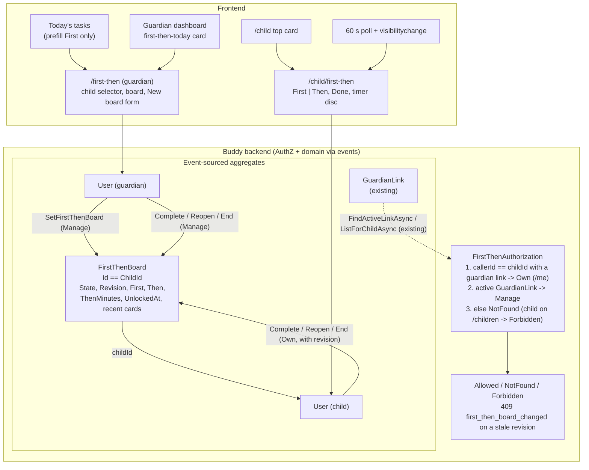

# First–Then Board

Status: Implemented. The `FirstThenBoard` aggregate (one stream per child in the `firstthen`
schema, with its snapshot, GDPR eraser and exporter, and the `Features:FirstThen` flag), the
`GetFirstThenBoard`, `SetFirstThenBoard`, `CompleteFirstThenFirst`, `ReopenFirstThenFirst`,
`EndFirstThenBoard` and `GetMyFirstThenBoard` slices on the nine routes below, the guardian page
`/guardian/first-then` with the board form and a dashboard card, and the child page
`/child/first-then` with a card at the top of `/child`. See
[first-then/flow.md](../first-then/flow.md).

## Context

"First homework, then iPad." A First–Then board is one of the most used visual supports for
children with ADHD or autism. It is two cards side by side: on the left the thing the child doesn't
want to do (the _First_), on the right the thing they look forward to (the _Then_). It turns an
open-ended demand ("do your homework") into a short, finite sequence with a visible end, and it
replaces the argument with a picture the adult can point to. Occupational therapists and
special-needs teachers use paper or laminated versions with Velcro pictures. They work best when:

- there is only one board at a time, and it is about _now_, not the whole day;
- the _Then_ is something the child actually wants, and often something the child picked;
- the _First_ is short and concrete ("Maths p. 12", "Shoes on"), not "be good";
- ticking off the _First_ visibly unlocks the _Then_, straight away, with no second negotiation;
- the _Then_ has a clear end when it is screen time ("20 minutes of iPad").

The TODO entry ([TODO.md](../../../TODO.md), "In-the-moment help for the child") asks to "pair a
non-preferred task with a preferred activity ('first homework, then iPad')".

Nothing like this exists in Buddy today. The closest existing precedents are:

- **The homework splitter** ([homework-splitter.md](../../frontend/analysis/homework-splitter.md)),
  which keeps a child's session entirely in the browser. That works because the child plans their
  own homework on their own tablet. A First–Then board is usually set by a guardian, often from
  their own phone ("I'm on my way home; first homework, then iPad"), so it has to live on the
  server. The user settled this (Question 1).
- **`SleepDiary` and `ChildProgress`**, one stream per child with `Id.Value == ChildId.Value`
  ([SleepDiaryId.cs](../../../src/backend/buddy/Features/SleepDiaries/Types/SleepDiaryId.cs)),
  which is the identity this board copies.
- **The Feelings check-in and house-rule acknowledgement**, where a child writes to their own
  stream (`FeelingsAuthorization.CheckSelf`,
  [FeelingsAuthorization.cs:40](../../../src/backend/buddy/Features/Feelings/FeelingsAuthorization.cs);
  `AcknowledgeRule` with its `house_rule_revision_changed` 409,
  [AcknowledgeRule.Command.cs:12](../../../src/backend/buddy/Features/HouseRules/AcknowledgeRule/AcknowledgeRule.Command.cs)).
- **The reward catalog** (`Reward(RewardId Id, string Name, string Icon, int Cost)` on
  `ChildProgress`, [reward-redemption.md](reward-redemption.md)), the only place Buddy stores
  "things the child likes". It is paid for with stars, which a _Then_ is not (Question 3).
- **The visual time-left timer** (`shared/visual-timer`,
  [visual-time-left-timer.md](../../frontend/analysis/visual-time-left-timer.md)), which counts down
  the _Then_ when it has a length.

This document answers eight questions: where the board lives; its aggregate and identity; what
a card is and where suggestions come from; the board's lifecycle; who can do what; how the
child's device notices a new board; where it appears; and how it relates to tasks and stars.

## Question 1: a server aggregate, or the browser?

**Decision (settled by the user 2026-10-14): a new feature, `Features/FirstThen`, with one small
aggregate per child, `FirstThenBoard`, its own Marten schema `firstthen` and its own flag
`Features:FirstThen`.**

- **Set from anywhere, seen on the child's device.** The guardian sets the board on their phone;
  the child sees it on the kitchen tablet. The homework splitter's browser-only model
  ([homework-splitter.md, Question 1](../../frontend/analysis/homework-splitter.md#question-1-a-new-aggregate-the-task-library-or-the-browser))
  can't do that, and two guardians (separated parents included) see the same board. Considered
  and rejected: `localStorage` on the child's device.
- **Not on an existing aggregate.**
  - _Calendars._ A board isn't scheduled, has no date range or recurrence, and a child is only a
    calendar `Viewer`. Adding a "then" field to `CalendarItem` would touch the busiest aggregate in
    the app for something that lasts half an hour. Rejected (see also Question 8).
  - _`ChildProgress`._ The board shares the child, but nothing else: no stars, no catalog, no
    approval. Reward requests went onto that stream because they spend its stars
    ([reward-redemption.md, Question 1](reward-redemption.md#question-1-a-new-aggregate-or-the-childprogress-stream));
    a board doesn't. Putting it there would also make every board change a concurrency conflict
    for a star being awarded at the same moment. Rejected.
  - _`User`._ Per-child settings such as `ShowVisualTimers` live on `User`, but those are settings.
    A board changes several times a day and has a lifecycle (Question 4). Rejected.
- **Its own flag**, `Features:FirstThen`, on by default, wired like `Features:Homework`
  ([feature-flags.md](feature-flags.md)), because it is an optional domain that some families
  won't use.

## Question 2: aggregate shape and identity

**Decision: one stream per child, `FirstThenBoardId.ForChild(childId)` with
`Id.Value == ChildId.Value`, started lazily by the first `SetFirstThenBoard`. The stream holds at
most one current board plus a short list of recently used cards. No index document.**

```text
FirstThenBoard(
    FirstThenBoardId Id,                     // == ChildId.Value, like SleepDiaryId.ForChild
    UserId ChildId,
    FirstThenState State,                    // None | Waiting | Unlocked (Question 4)
    int Revision,                            // +1 on every SetFirstThenBoard; 0 before the first
    FirstThenCard First,                     // FirstThenCard.Empty when State == None
    FirstThenCard Then,
    int? ThenMinutes,                        // 5--120, null = no countdown
    DateTimeOffset? UnlockedAt,              // when First was ticked; drives the Then countdown
    ImmutableList<FirstThenCard> RecentFirsts,   // newest first, distinct by title, max 8
    ImmutableList<FirstThenCard> RecentThens,    // newest first, distinct by title, max 8
    UserId LastModifiedBy,
    DateTimeOffset LastModifiedAt)
```

- **One stream per child, not per board.** Social stories took a stream per story because
  stories are independent and pile up
  ([social-stories.md, Question 2](social-stories.md#question-2-aggregate-shape-and-identity)).
  Boards are the opposite: exactly one is current, a new one replaces the old one, and "the
  child's board" is the only lookup. That is the `SleepDiary` / `ChildProgress` shape, and
  `Id == ChildId` means no index document and no "which board is current" query.
- **The stream grows slowly.** A family that sets three boards a day appends about ten events a
  day. The inline snapshot projection
  ([event-stream-snapshots.md](event-stream-snapshots.md)) makes loading it constant-time, as for
  `SleepDiary`.
- **`Revision`** lets a child's tick name the board it was meant for (Question 5), the same trick
  house rules use for acknowledgements.
- **`RecentFirsts` / `RecentThens`** are derived from `FirstThenBoardSet` events when they are
  folded, not stored by a separate command (Question 3).
- `FirstThenCard.Empty` and `State == None` follow [eliminate-nulls.md](eliminate-nulls.md)
  instead of a nullable "current board". `ThenMinutes` and `UnlockedAt` stay nullable because
  "no countdown" and "not unlocked yet" are real absent values, as `SleepEntry`'s times are.

## Question 3: what is a card, and where do suggestions come from?

**Decision: a card is a short title plus one emoji, the same shape as a reward or a task. The
guardian's form suggests cards from three places: the child's recently used cards, the child's
tasks for today (_First_ only; title and icon are copied), and a small built-in starter list in
English and Danish. Nothing is linked: a card is a copy.**

```text
FirstThenCard(
    string Title,     // 1--60 chars, plain text, trimmed
    Icon Icon)        // the existing Calendars Icon type (an emoji); required
```

- **Same shape as `Reward`.** Name plus emoji is what guardians already type in the reward
  catalog (`manage-rewards`, a free-text emoji input). Reusing `Icon` from
  [Icon.cs](../../../src/backend/buddy/Features/Calendars/Types/Icon.cs) means pictogram support
  (TODO, "Pictogram support") upgrades boards along with tasks and routine steps.
- **The icon is required.** A First–Then board is a _visual_ support; many children who need one
  don't read yet. A card with no picture is half a board.
- **Recent cards**, eight of each, newest first, distinct by case-insensitive title. They come
  free from the event fold, so "first homework, then iPad" is two taps the second time. This is
  where a family's own "preferred activities" list grows, without a catalog screen to maintain.
- **Today's tasks as _First_ suggestions** (settled by the user 2026-10-14: prefill only). The
  form lists the child's open tasks and routines for today from
  `CalendarsService.listOccurrences` and copies the title and icon when one is picked. The board
  keeps no reference to the task (Question 8).
- **Starter cards** ship in the frontend translations, as social stories ship starter stories
  ([social-stories.md, Question 5](social-stories.md#question-5-ready-made-stories)). _First_:
  Homework 📚, Tidy your room 🧹, Shower 🚿, Brush teeth 🪥, Get dressed 👕, Shoes on 👟, Eat
  dinner 🍽️. _Then_: iPad 📱, TV 📺, Play outside ⚽, Lego 🧱, Snack 🍎, Read together 📖, Game
  🎮. Once picked they are plain text in the child's language, like a starter story.
- **Rejected: _Then_ cards from the reward catalog.** Rewards cost stars and need approval. If an
  iPad session appeared both as a 30-star reward and as a free _Then_, the child would
  reasonably ask why it sometimes costs stars. The two stay separate; see the open questions for
  a "copy from rewards" shortcut.
- **Rejected: a guardian-managed "preferred activities" catalog** with its own add/edit/remove
  slices. The recent list covers the same need with no extra screen. If families ask for a pinned
  list, it is an additive `FirstThenFavouritesConfigured` event.

## Question 4: the board's lifecycle

**Decision: three states. `None` (no board), `Waiting` (the _First_ is still to do) and `Unlocked`
(the _First_ is done, and it is time for the _Then_). Setting a board always starts it in
`Waiting` and replaces whatever was there. Ending a board, by the child or a guardian, goes back
to `None`.**

```text
None ──Set──▶ Waiting ──CompleteFirst──▶ Unlocked ──End──▶ None
               ▲  │                         │
               │  └─────────End─────────────┼──▶ None
               └──────ReopenFirst───────────┘
   Set from any state replaces the board (Revision + 1) and goes to Waiting
```

### Events

```text
FirstThenBoardStarted(FirstThenBoardId Id, UserId ChildId, DateTimeOffset OccurredAt)
    // appended once, with the first FirstThenBoardSet, as SleepDiaryStarted is
FirstThenBoardSet(FirstThenBoardId Id, int Revision, FirstThenCard First, FirstThenCard Then,
    int? ThenMinutes, UserId SetBy, DateTimeOffset OccurredAt)
FirstThenFirstCompleted(FirstThenBoardId Id, int Revision, UserId CompletedBy,
    DateTimeOffset OccurredAt)
FirstThenFirstReopened(FirstThenBoardId Id, int Revision, UserId ReopenedBy,
    DateTimeOffset OccurredAt)
FirstThenBoardEnded(FirstThenBoardId Id, int Revision, UserId EndedBy,
    DateTimeOffset OccurredAt)
```

- **Set is a full overwrite.** A guardian who changes their mind ("first homework, then _TV_")
  sets a new board; there is no edit-in-place slice. The same full-overwrite rule as
  `SleepEntryLogged` and `MealAssignedToSlot`. A set on an `Unlocked` board starts over in
  `Waiting`, because the new _First_ hasn't been done.
- **Reopen exists for the mis-tap.** A child who taps _Done_ by accident, or a guardian who
  finds that the homework isn't actually done, can put the board back to `Waiting`. Allowed for
  both tiers (Question 5). It is the counterpart of unticking a task.
- **End has one event for both "we're finished" and "never mind".** `EndedBy` says who, and the
  previous state is in the stream. A separate `Cancelled` event was considered and rejected: no
  screen treats the two differently, and a guardian history screen is not planned (each family
  runs its own instance and prefers logs to oversight screens).
- **No automatic end.** When the _Then_ countdown runs out, the board stays `Unlocked` and the
  child's page says "Time's up" quietly (as the visual timer does,
  [visual-time-left-timer.md, Question 5](../../frontend/analysis/visual-time-left-timer.md#question-5-what-happens-when-time-runs-out)).
  The server has no scheduler, and "time's up" on an iPad session is a moment for an adult, not a
  background job. A board left `Unlocked` overnight is shown as ended to the child (see "Failure
  and edge-case behavior").
- **Idempotency.** `CompleteFirst` on an `Unlocked` board, `ReopenFirst` on a `Waiting` board and
  `End` on `None` succeed without appending an event, as the idempotent clears elsewhere do.

### Rehydration

`Rehydrate` folds the events in order. `FirstThenBoardSet` sets the cards, `ThenMinutes`,
`Revision`, `State = Waiting`, `UnlockedAt = null`, and pushes both cards onto the front of the
recent lists (dropping an older card with the same title, then trimming to eight).
`FirstThenFirstCompleted` sets `Unlocked` and `UnlockedAt = OccurredAt`. `FirstThenFirstReopened`
sets `Waiting` and clears `UnlockedAt`. `FirstThenBoardEnded` sets `None` and the cards to
`Empty`, but keeps `Revision` and the recent lists. The snapshot projection applies the same fold.

## Question 5: who can see and change a board

**Decision: two tiers, as for social stories. `Manage` is any active guardian of the child
(`FindActiveLinkAsync`). `Own` is the child themself, who can read their board, tick the
_First_ (settled by the user 2026-10-14: the child ticks it, no approval), reopen it, and end
the board. Everyone else gets `NotFound`. A child calling a guardian route gets `Forbidden`.**

```text
enum FirstThenAccess { Allowed, NotFound, Forbidden }
```

| Action                          | Manage (guardian) | Own (child, `/me` routes)                         |
| ------------------------------- | ----------------- | ------------------------------------------------- |
| Read the board and recent cards | yes               | board only (recent cards are the guardian form's) |
| Set a board                     | yes               | no                                                |
| Complete the _First_            | yes               | yes                                               |
| Reopen the _First_              | yes               | yes                                               |
| End the board                   | yes               | yes                                               |

- **`FirstThenAuthorization`** copies
  [TransitionWarningsAuthorization.cs](../../../src/backend/buddy/Features/TransitionWarnings/TransitionWarningsAuthorization.cs)
  for `CheckManage` and `FeelingsAuthorization.CheckSelf` for the child: a caller is a child of
  their own board if they have at least one active guardian link. A `ToDeniedResult<T>()`
  extension maps the enum to the endpoint results.
- **Why the child may end the board.** It is their board, and ending it only hides it. The worst
  case of a child ending a board too early is the same as of them ignoring a paper board, and
  the guardian sees it ended on their page.
- **Why the child can't set one.** A First–Then board is an adult's promise. A child-made "first
  iPad, then iPad" would be harmless but would hollow out the tool. A child _choosing_ the _Then_
  from options the guardian offers is a common variation; see the open questions.
- **Stale ticks.** The child's `CompleteFirst`, `ReopenFirst` and `End` carry the `Revision` they
  were shown. If a guardian has set a new board since then, the request returns `409` with
  `first_then_board_changed` (the client re-reads the current board), so a child ticking "homework" can't
  accidentally complete the "tidy your room" board a guardian just set. This is
  `AcknowledgeRule`'s `RevisionChanged` outcome, copied. The guardian's routes also carry the
  revision, for the same reason between two guardians. The central `concurrency_conflict` 409
  still covers two writes racing on the same version.

## Question 6: how does the child's device notice a new board?

**Decision: by polling, as the transition-warning banner does: `GET /first-then/me` every 60
seconds while the page is visible, and again on `visibilitychange`. No new push channel.**

- **There is no push in Buddy.** No SignalR, SSE or WebSocket exists. Web Push is only proposed
  ([mobile-app-and-notifications.md](mobile-app-and-notifications.md)). The banner already
  polls on `REFRESH_CHECK_MS` and on `visibilitychange`
  ([transition-warning-banner.ts](../../../src/frontend/buddy/src/app/features/child/transition-warning-banner/transition-warning-banner.ts)),
  so a minute's delay is what child pages already accept.
- **The response is tiny** (two cards, a state and a revision), and it uses the conditional-GET
  ETags all GETs have ([conditional-get-etags.md](conditional-get-etags.md)), so an unchanged
  board costs a `304`.
- **The guardian page refreshes after its own writes**, and polls the same way while open, so a
  guardian sees the child's tick within a minute.
- **When Web Push lands**, "Your board changed" is a natural first notification. That is
  additive; the poll stays as the fallback.

## Question 7: where does it appear?

**Decision: for the child, a large card at the top of `/child` while a board is current, opening a
full-screen page `/child/first-then`. For the guardian, a page `/first-then` with the usual child
selector and a small card per child on the guardian dashboard while a board is current.**

### Child

- **The card on `/child`** sits above everything else, next to the progress badge
  ([`home.html:4`](../../../src/frontend/buddy/src/app/features/child/home/home.html)), and shows
  both pictures small with the state ("First 📚 Homework → then 📱 iPad"). A board is the most
  "now" thing on the page, so it goes first.
- **The page `/child/first-then`** uses the `ChildPage` frame with a back link, and nothing else,
  like the focus view and the proposed `/child/now`. Two very large cards: side by side on a
  tablet or in landscape, stacked on a phone, _First_ above _Then_. Each card has a visible
  heading (_First_, _Then_), the emoji at about 6rem and the title.
  - `Waiting`: the _First_ card is in colour with a large _Done_ button; the _Then_ card is
    shown in full colour too (the child must see what's coming) with a small lock icon and
    "after {first}".
  - `Unlocked`: the _First_ card is greyed with a check mark; the _Then_ card is highlighted, with
    the `shared/visual-timer` disc counting down from `UnlockedAt + ThenMinutes` when there is a
    length and `showVisualTimers` is on for the child. There is an _Undo_ link under the check
    and an _All done_ button on the _Then_ card.
  - `None`: the page reads "No board right now" with a link back to `/child`.
- **The countdown is derived, not stored.** `UnlockedAt` comes from the server, so the tablet and
  a guardian's phone show the same remaining time, and a reload doesn't restart it. This is
  simpler than the visual timer's `localStorage` anchor because the anchor is already on the
  server.
- **Unlocking is a moment**: a single short scale-in of the _Then_ card and a polite
  `aria-live` announcement ("Now: iPad!"). Under `prefers-reduced-motion`, no animation; the
  highlight and announcement stay. No sound, no confetti; a calm board is the point.
- **Not part of Now/Next/Later in v1.** The proposed strip
  ([now-next-later.md](../../frontend/analysis/now-next-later.md)) is built from timed items, and
  a board has no time. See the open questions.

### Guardian

- **`/first-then`**, a new guardian route behind `featureGuard('firstThen')`, laid out like
  `/feelings`: the child selector (`selectedChildId` as a `linkedSignal`, as in
  [`feelings.ts:79`](../../../src/frontend/buddy/src/app/features/guardian/feelings/feelings.ts)),
  then:
  - the current board as the child sees it, with the state, _Mark done_ / _Undo_ and _End_;
  - a "New board" form: two card pickers (recent, today's tasks for _First_, starters, or type a
    title and an emoji), an optional _Then_ length (none, 5, 10, 15, 20, 30, 45, 60 minutes), and
    _Show to {child}_. Setting a board while one is current asks "Replace the current board?".
- **A dashboard card** in the guardian dashboard's child section while a board is current, showing
  the two cards and the state, linking to `/first-then`. Nothing when no board is current.
- **Navigation**: an entry in the guardian menu next to _Feelings_ and _Transition warnings_, with
  a help topic `firstThen`, as every feature page has.

## Question 8: tasks, stars and the reward catalog

**Decision: a board is independent of tasks and stars. Ticking the _First_ doesn't complete a
calendar task, completing a task doesn't unlock a board, and nothing earns or spends stars.**

- **The user chose "prefill only"** (2026-10-14). A real link would have the board's _Done_ call
  `SetTaskCompletion` (and through it `RecordStarChange`), and a task completed on `/child` unlock
  the board. That couples the board to `CalendarAuthorization`, to subtask-only completion for
  routines (`ValidateSubtaskAsync` rejects whole-task completion of a template task), and to
  occurrence dates. It would also mean two ways to tick the same thing that must agree.
- **What this means for the child.** If the _First_ was copied from a task, the child ticks it on
  the board, and the task stays open on `/child` until they tick it there too. The board page
  says nothing about it; the guardian chose to put that task on a board. If families find the
  double tick annoying, the real link is the first follow-up (open questions).
- **No stars for a board.** The _Then_ is the reward. Giving stars too would pay twice for the
  same homework, which goal posts and rewards were carefully balanced to avoid
  ([configurable-goal-posts.md](configurable-goal-posts.md)).

## Read models

None beyond the snapshot. Both reads are by child id, which is the stream id.

```text
FirstThenBoardResponse(
    int Revision,
    string State,                 // "none" | "waiting" | "unlocked"
    FirstThenCardResponse? First, // null when State == "none"
    FirstThenCardResponse? Then,
    int? ThenMinutes,
    DateTimeOffset? UnlockedAt,
    DateTimeOffset? LastModifiedAt,
    string? LastModifiedByName)   // guardian route only: the given name (the reader is another
                                  // guardian, so not the CallingName children see)

FirstThenCardResponse(string Title, string Icon)

GuardianFirstThenResponse(
    FirstThenBoardResponse Board,
    IReadOnlyList<FirstThenCardResponse> RecentFirsts,
    IReadOnlyList<FirstThenCardResponse> RecentThens)
```

A child with no stream yet gets `Revision = 0, State = "none"`, not `404`, as `GetMyFeelingsToday`
returns an empty day.

## Command slices (`Features/FirstThen/`, same vertical-slice shape as `SleepDiaries`)

| Slice                    | Tier         | Notes                                                                                                                                                                                             |
| ------------------------ | ------------ | ------------------------------------------------------------------------------------------------------------------------------------------------------------------------------------------------- |
| `SetFirstThenBoard`      | Manage       | Body: `revision` (the one the guardian saw; 0 for a first board), `first`, `then`, `thenMinutes`. Appends `FirstThenBoardStarted` on the first call, then `FirstThenBoardSet` with `Revision + 1` |
| `CompleteFirstThenFirst` | Manage / Own | Body: `revision`. `Waiting` → `Unlocked`. Idempotent when already `Unlocked`; `409` on a stale revision; `404` when `None`                                                                        |
| `ReopenFirstThenFirst`   | Manage / Own | Body: `revision`. `Unlocked` → `Waiting`. Idempotent when already `Waiting`                                                                                                                       |
| `EndFirstThenBoard`      | Manage / Own | Body: `revision`. Any state → `None`. Idempotent when `None`                                                                                                                                      |
| `GetFirstThenBoard`      | Manage       | The board plus recent cards (`GuardianFirstThenResponse`)                                                                                                                                         |
| `GetMyFirstThenBoard`    | Own          | The board only (`FirstThenBoardResponse`)                                                                                                                                                         |

Validation (FluentValidation, as in [validation-rules.md](validation-rules.md)): titles 1–60
characters after trimming, icon 1–16 characters (one emoji, possibly with modifiers), a _First_
and _Then_ with the same title are allowed (rare, but "first Lego tidy-up, then Lego" is real),
`thenMinutes` null or 5–120, `revision` ≥ 0.

## Routes

```text
GET    /first-then/children/{childId}                  GetFirstThenBoard
PUT    /first-then/children/{childId}                  SetFirstThenBoard
POST   /first-then/children/{childId}/first/complete   CompleteFirstThenFirst
POST   /first-then/children/{childId}/first/reopen     ReopenFirstThenFirst
POST   /first-then/children/{childId}/end              EndFirstThenBoard

GET    /first-then/me                                  GetMyFirstThenBoard
POST   /first-then/me/first/complete                   CompleteFirstThenFirst (child)
POST   /first-then/me/first/reopen                     ReopenFirstThenFirst (child)
POST   /first-then/me/end                              EndFirstThenBoard (child)
```

The state changes are `POST` actions rather than a `PATCH` of `state`, because each one has its own
rule about which states it accepts. They return the updated `FirstThenBoardResponse`. They are
idempotent by design (Question 4), so they don't need the `Idempotency-Key` that create-style
POSTs carry, and the frontend calls them with plain `post`, not `postIdempotent`. The `/me`
routes resolve the child from the token, as the Feelings check-in does; the `/children/{childId}`
routes return `Forbidden` to a child caller.

Status codes per [http-status-codes.md](../http-status-codes.md): `200` with the board, `400` on
validation, `403` for a child on a guardian route, `404` for no access or (for complete/reopen) no
current board, `409` `first_then_board_changed` on a stale revision.

## Privacy (GDPR)

A board says what a child finds hard and what they like, so it is personal data about the child.
`FirstThenPersonalData` registers an `IPersonalDataEraser` and an `IPersonalDataExporter`
([IPersonalDataEraser.cs](../../../src/backend/buddy/Common/Erasure/IPersonalDataEraser.cs)),
which `PersonalDataEraserCoverageTests` and `PersonalDataExporterCoverageTests` require.

- **Child erased.** The child's stream is deleted with `DeleteStreamAsync<FirstThenBoardSnapshot>`.
- **Guardian erased.** The board stays, because it is the child's. `SetBy`, `CompletedBy`,
  `ReopenedBy`, `EndedBy` and `LastModifiedBy` become pseudonyms, as for sleep diary entries.
- **Export.** A `firstThen` section per child of the guardian: the current board and the recent
  cards, through the response DTOs. The past boards stay in the event stream (they are in the
  `firstthen` schema for a family's technical member to inspect) but are not exported one by one;
  that matches the sleep diary's export of current state.

## Feature flag

`Features:FirstThen`, on by default, wired like `Features:Homework` and `Features:Feelings`:

- **Backend.** A property, `Effective()` argument and `InstallationFeatures` field in
  [FeatureOptions.cs](../../../src/backend/buddy/Common/FeatureFlags/FeatureOptions.cs);
  `AddFirstThenFeature` always runs, `MapFirstThenFeature` sits behind `if (features.FirstThen)`
  in [Program.cs](../../../src/backend/buddy/Program.cs); `FeatureFlagsTests` gets a `404` case;
  `task docs:openapi` regenerates the types.
- **Frontend.** `firstThen: true` in `ALL_ON`, `featureGuard('firstThen')` on `/first-then` and
  `/child/first-then` (checked by `feature-routes.spec.ts`), `feature: 'firstThen'` on the nav
  item and help topic. The child home and guardian dashboard skip the board load when off.

## Frontend

All paths are under `src/frontend/buddy/src/app/`.

| File                                                          | Change                                                                                                                                                                                                                                    |
| ------------------------------------------------------------- | ----------------------------------------------------------------------------------------------------------------------------------------------------------------------------------------------------------------------------------------- |
| `core/first-then.service.ts` + spec                           | **New.** `getBoard(childId)`, `setBoard(childId, body)`, `completeFirst` / `reopenFirst` / `end` for both route families, `getMyBoard()`. Types from the generated `buddy-api.ts`                                                         |
| `core/first-then.ts` + spec                                   | **New, pure.** `thenRemaining(board, nowMs)` for the countdown, `isStale(board, today, timeZone)` (Failure table), `starterCards(lang)`                                                                                                   |
| `features/child/first-then/child-first-then.{ts,html}` + spec | **New page.** The two big cards, _Done_ / _Undo_ / _All done_, the timer disc, the 60-second poll and `visibilitychange` refresh, the live region, the `409` reload                                                                       |
| `features/child/home/home.{ts,html}` + spec                   | The board card at the top while a board is current (one extra GET, skipped when the flag is off)                                                                                                                                          |
| `features/child/child.routes.ts`                              | `{ path: 'first-then', component: ChildFirstThen, canActivate: [featureGuard('firstThen')] }`                                                                                                                                             |
| `features/guardian/first-then/first-then.{ts,html}` + spec    | **New page.** Child selector, current board with actions, and the `board-form/` subfolder: card pickers (recent, today's tasks, starters, custom), length select, replace confirmation                                                    |
| `features/guardian/first-then-today/`                         | **New dashboard card** listing children with a current board                                                                                                                                                                              |
| `features/guardian/guardian.routes.ts`, shell nav, help topic | `/first-then` route, menu entry, `firstThen` help content                                                                                                                                                                                 |
| `core/i18n/translations/{en,da}/first-then.ts`                | New dictionaries (below); `help.ts` gains the topic                                                                                                                                                                                       |
| `screenshots/pages.ts`, `screenshots/demo-family.ts`          | `guardian-first-then` and `child-first-then` entries. Seed one `Unlocked` board for Emil ("Homework 📚 → iPad 📱, 20 min") so the child page shows the countdown, and the recent list so the guardian form isn't empty                    |
| `e2e/first-then.spec.ts`                                      | **New.** A guardian sets "Homework → iPad" for a child; the child sees it on `/child`, opens it, taps _Done_; the _Then_ is unlocked; the guardian sees "unlocked" after a reload and ends it; the child's page says "No board right now" |

### i18n (main keys)

| Key                            | en                           | da                            |
| ------------------------------ | ---------------------------- | ----------------------------- |
| `firstThen.title`              | `First – Then`               | `Først – Så`                  |
| `firstThen.first` / `then`     | `First` / `Then`             | `Først` / `Så`                |
| `firstThen.child.done`         | `Done!`                      | `Færdig!`                     |
| `firstThen.child.undo`         | `Not done yet`               | `Ikke færdig endnu`           |
| `firstThen.child.allDone`      | `All done`                   | `Helt færdig`                 |
| `firstThen.child.locked`       | `After {first}`              | `Efter {first}`               |
| `firstThen.child.unlocked`     | `Now: {then}!`               | `Nu: {then}!`                 |
| `firstThen.child.timeUp`       | `Time's up`                  | `Tiden er gået`               |
| `firstThen.child.none`         | `No board right now`         | `Ingen tavle lige nu`         |
| `firstThen.guardian.newBoard`  | `New board`                  | `Ny tavle`                    |
| `firstThen.guardian.show`      | `Show to {name}`             | `Vis til {name}`              |
| `firstThen.guardian.replace`   | `Replace the current board?` | `Erstat den nuværende tavle?` |
| `firstThen.guardian.length`    | `How long?`                  | `Hvor længe?`                 |
| `firstThen.guardian.noLength`  | `No time limit`              | `Ingen tidsgrænse`            |
| `firstThen.guardian.fromToday` | `From today`                 | `Fra i dag`                   |
| `firstThen.guardian.recent`    | `Used before`                | `Brugt før`                   |
| `firstThen.starters.*`         | the 14 starter cards         | the same in Danish            |

Check parity with `node .claude/skills/i18n/check-parity.mjs`.

## Testing

Integration tests under `buddy.IntegrationTests/Features/FirstThen/`, one folder per slice as
for SleepDiaries, plus:

- **EventShapeTests**: golden files for the five events.
- **SnapshotTests**: `FirstThenBoardSnapshotTests` (set → complete → reopen → set → end folds to
  the same state as `Rehydrate`; recent lists de-duplicate and cap at eight).
- **Authorization matrix**: guardian with an active link (`200`), revoked link (`404`), unrelated
  user (`404`), child on a `/children` route (`403`), child on `/me` (`200`), an adult with no
  guardian links on `/me` (`404`).
- **Lifecycle**: every row of the state diagram, including the three idempotent no-ops (no event
  appended), complete/reopen on `None` (`404`), and set on `Unlocked` resetting to `Waiting`.
- **Revision**: a stale child tick returns `409 first_then_board_changed` (the error envelope, as
  `AcknowledgeRule`'s; the client re-reads the board);
  two guardians setting from the same revision, the second gets `409`.
- **Validation**: empty or 61-character titles, missing icon, `thenMinutes` 4 and 121.
- **GDPR**: erasure of the child deletes the stream; erasure of a guardian pseudonymises
  `SetBy`; export includes the board and recent cards. The coverage tests pass.
- **Feature flag**: routes `404` when `Features:FirstThen` is off.

Frontend specs: the service (exact URLs and bodies), `first-then.ts` (countdown, stale board,
starters), the child page (each state, _Done_ → unlocked, `409` reloads and shows the new board,
no disc when `showVisualTimers` is off, the poll and its cleanup), the home card, the guardian
page and form (pickers prefill, replace confirmation), and the dashboard card. One e2e journey
(above).

## Failure and edge-case behavior

| Case                                             | Behavior                                                                                                                                                                                                     |
| ------------------------------------------------ | ------------------------------------------------------------------------------------------------------------------------------------------------------------------------------------------------------------ |
| Child has no board yet (no stream)               | `GET` returns `State = none, Revision = 0`; no `404`                                                                                                                                                         |
| Guardian sets a board while one is current       | The form asks to confirm; the new board replaces it (`Revision + 1`, `Waiting`)                                                                                                                              |
| Child ticks a board a guardian has just replaced | `409 first_then_board_changed`; the page re-reads, shows the new board and announces it                                                                                                                      |
| Child taps _Done_ by mistake                     | _Not done yet_ reopens it (`FirstThenFirstReopened`)                                                                                                                                                         |
| Complete/reopen when no board is current         | `404`                                                                                                                                                                                                        |
| End when no board is current                     | `200`, no event (idempotent)                                                                                                                                                                                 |
| _Then_ countdown runs out                        | The disc empties and the card reads "Time's up"; the board stays `Unlocked` until someone ends it                                                                                                            |
| Board left current overnight                     | The child's pages treat a board last changed before today (child's clock) as ended and don't show it; the guardian page shows it with "from yesterday" and an _End_ button. Nothing is written automatically |
| Guardian's `GuardianLink` is revoked             | Immediately drops to `NotFound` on that child's routes; the board stays for the other guardians                                                                                                              |
| Two guardians set at the same moment             | The second gets `409` (revision, or the central `concurrency_conflict`) and reloads                                                                                                                          |
| `showVisualTimers` is off for the child          | No disc and no minutes on the _Then_ card; "Time's up" still appears when the length has passed                                                                                                              |
| Feature flag off                                 | Routes not mapped (`404`); the home card, dashboard card, menu entry and pages are hidden; existing streams stay                                                                                             |
| Child's device is offline                        | The last loaded board stays on screen; _Done_ fails with the shared translated error and can be retried                                                                                                      |

## Estimate

|                  |                                                                                                                                                                                                                                                                                                                           |
| ---------------- | ------------------------------------------------------------------------------------------------------------------------------------------------------------------------------------------------------------------------------------------------------------------------------------------------------------------------- |
| Complexity       | Medium -- a new 1:1 aggregate with five events, snapshot, GDPR eraser/exporter and a flag; six slices on nine routes with a revision check; a new child page and home card, a new guardian page with a card-picker form and a dashboard card; about 40 en+da keys; two screenshot entries with seed data and one e2e spec |
| Single developer | 5-7 days                                                                                                                                                                                                                                                                                                                  |
| AI agent         | 3-4 hours, plus about 1.5 hours of human review (try it on a tablet and a phone at once, check the wording with a child) and settling the open questions                                                                                                                                                                  |

## Decisions made

| Question                      | Decision                                                                                                                |
| ----------------------------- | ----------------------------------------------------------------------------------------------------------------------- |
| Server or browser             | Server: one `FirstThenBoard` stream per child in a new `firstthen` schema, its own flag (user, 2026-10-14)              |
| Identity                      | `Id.Value == ChildId.Value`, started lazily; no index document                                                          |
| A card                        | Title (1–60) plus a required emoji `Icon`; a copy, never a reference                                                    |
| Suggestions                   | Recent cards from the event fold (8 each), today's tasks for _First_ (prefill only, user 2026-10-14), built-in starters |
| Lifecycle                     | `None → Waiting → Unlocked → None`; set replaces; reopen for mis-taps; no automatic end                                 |
| Who ticks _First_             | The child, no approval (user, 2026-10-14); guardians can too                                                            |
| Child's other powers          | Reopen and end their own board; can't set one                                                                           |
| Stale writes                  | Every state change carries `revision`; mismatch is `409 first_then_board_changed`                                       |
| Updates on the child's device | 60-second poll plus `visibilitychange`, as the warning banner; no push                                                  |
| Where                         | `/child` top card + `/child/first-then`; guardian `/first-then` + dashboard card                                        |
| Tasks and stars               | Independent: no task completion, no stars, no reward-catalog link                                                       |
| History                       | Kept in the stream, not shown on a screen; export has the current board and recent cards                                |

## Remaining open questions

- **The child chooses the _Then_.** A common variation offers two or three _Then_ cards and lets
  the child pick when the board is set or when it unlocks. Lean: not in v1. Adding it is a list
  `ThenChoices` on `FirstThenBoardSet` and a `FirstThenThenChosen` event; existing boards are a
  choice of one, so it is additive.
- **Real link to a calendar task.** Lean: not in v1 (the user chose prefill only). If the double
  tick annoys families, `FirstThenCard` gains an optional `TaskLink(CalendarItemId, DateOnly,
CompletionTarget)` and the child page's _Done_ also calls `completeChildTask()`. The reverse
  direction (a task ticked on `/child` unlocks the board) is a frontend check against today's
  occurrences, not a backend subscription.
- **"Copy from rewards" in the _Then_ picker.** Lean: no, to keep stars and *Then*s apart
  (Question 3). Cheap to add later as a fourth suggestion source if guardians ask.
- **A board as Now on the Now/Next/Later strip.** Lean: when both exist, a current board should
  probably _be_ the Now card, since it is what the child should be doing. It is a frontend-only
  change to `nowNextLater()` once both have shipped.
- **More than two steps ("first, then, then").** Lean: no. That is a mini-schedule, which routines
  already are. Keep the board two cards.
- **Guardian notification when the child ticks _First_.** Lean: wait for Web Push
  ([mobile-app-and-notifications.md](mobile-app-and-notifications.md)); the guardian page and
  dashboard card show it on the next refresh.

## Diagram


