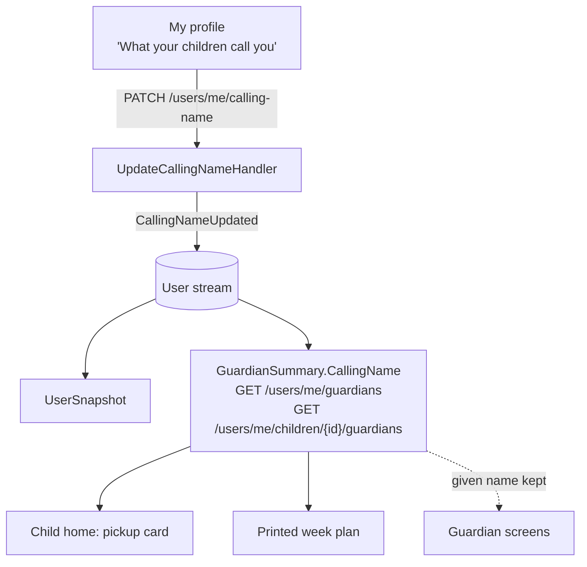

# Calling Names for Guardians

Status: Implemented. `User.CallingName` (default `""`) set through `PATCH /users/me/calling-name`
(`UpdateCallingName`, event `CallingNameUpdated`); returned as `callingName` on `UserResponse` and
`GuardianSummary`; edited under "What your children call you" in My profile (`/guardian/admin`);
shown instead of the given name on the child's home page pickups and on the printed week plan.

## Context

A child doesn't call their parent "Sara", they call her "Mor" or "Mom". Buddy showed a guardian to
a child by `Name.GivenName` everywhere: the "who picks you up" card on the child home page
(`features/child/home/home.ts`, `assigneeName`) and the printed week plan that hangs on the fridge
(`features/guardian/print/week-plan-loader.ts` for task and pickup names,
`print/template-rows.ts` for the "<guardian> at <work location>" row labels). The TODO asked for
guardians to be identifiable by a calling name instead of only their first name.

What already exists:

- `User` ([Types/User.cs](../../../src/backend/buddy/Features/Users/Types/User.cs)) holds
  `Name(GivenName, FamilyName)`. Keycloak seeds it once, at provisioning; afterwards only
  `PATCH /users/me/name` (`UpdateName`, `NameUpdated`) changes it.
- Self-service profile fields follow one pattern: `PATCH /users/me/<field>`, a `<Field>Updated`
  event with `Before`/`After`, append only on change, return `UserResponse`
  (`UpdateLanguage`, `UpdateTimeZone`).
- `GuardianKind { Parent, Guardian }` on the `GuardianLink` is the only per-relationship label, and
  it is descriptive, not a display name.
- Pickups and task assignees carry only ids; the frontend resolves names from
  `GET /users/me/guardians` (the child) and `GET /users/me/children/{childId}/guardians` (a
  guardian), both returning `GuardianSummary`.

## Question 1: one calling name per guardian, or one per guardian-child link?

**Decision: one per guardian, on the guardian's own `User`.**

Most guardians are called the same thing by every child in the household ("Mor", "Far",
"Mormor"), and the place a guardian edits their own details is My profile. Storing it on `User`
reuses the existing self-service slice pattern exactly: one event, one route, no new aggregate.

Considered and rejected: a calling name on each `GuardianLink`, so a step-parent can be "Far" to
one child and "Anders" to another. It is more accurate for blended families, but it needs
`GuardianLink` events, a per-child editor, and every child-facing lookup would have to resolve the
name per child. It can be added later without a redesign: a link-level value would override the
user-level one in `GuardianSummary.CallingName` (see open questions).

## Question 2: where does the calling name replace the given name?

**Decision: only in child-facing views.** The child home page's pickup card and the printed week
plan (its name map and the work-location row labels) use `callingName`, falling back to
`name.givenName` when it is `""` (`childFacingName` in `core/guardians.service.ts`).

Guardian screens (pickup editor, dashboard widgets, agenda assignees, group members, house rules,
delete-account preview) keep real names. Co-parents, grandparents and babysitters share those
screens, and "Mor" is ambiguous to all of them. Considered and rejected: replacing the name
everywhere, and showing "Sara (Mor)" on guardian screens. Neither helps the adults who use those
screens.

## Question 3: free text or a translated role?

**Decision: free text, trimmed, at most 50 characters; `""` clears it.** The guardian types exactly
what the child says ("Mor", "Mom", "Mutti", "Bonusmor"). It is not translated.

Considered and rejected: picking a role (Mom, Dad, Grandma, ...) from a list and translating it into
the child's language. That can't express nicknames or "Bonusmor", and Buddy's children each have
one language anyway (`User.Language`), so a guardian typing the word that child uses is both
simpler and more accurate.

## Question 4: who can see and change it

- Only the user themself sets it (`/users/me/calling-name`). The route isn't restricted to
  guardians: a child setting one is harmless, because nothing reads a child's calling name.
- It is returned on `GET /users/me` (`UserResponse.CallingName`) and on both guardian lists
  (`GuardianSummary.CallingName`). Those lists already expose the guardian's name to the same
  callers, so no new access check is needed.

### Events

```csharp
// "" clears it. Never appended when the value doesn't change.
public sealed record CallingNameUpdated(UserId UserId, string Before, string After, DateTimeOffset OccurredAt);
```

Added to the `UserEvent` union, `FromPayload`, `EventType`, `User.Advance`, the
`UserSnapshotProjection` and `UsersFeature.EventTypes`, with a golden file
(`EventShapeTests/GoldenFiles/Users/CallingNameUpdated.json`).

### Rehydration

`User` gains an optional `string? CallingName = null` constructor parameter backed by a
non-null `CallingName` property (`?? ""`), the same pattern as `HomeworkChunks`, so snapshot rows
written before the field existed read as "no calling name".

## Command slices (`Features/Users/UpdateCallingName/`, same shape as `UpdateLanguage`)

- `UpdateCallingName(UserId, string CallingName)`: the endpoint trims the request value and maps
  `null` to `""`. The validator allows empty and enforces `MaximumLength(50)`. The handler loads the
  stream, returns `NotFound` for a missing or deleted user, and appends `CallingNameUpdated` only
  when the value changes.

## Routes

| Method | Route | Result |
|---|---|---|
| `PATCH` | `/users/me/calling-name` | `200` with `UserResponse`; `400 validation_error` over 50 characters; `404` when no local user exists |

## Personal data

`CallingNameUpdated` is masked on erasure (`UsersPersonalData`: `Before`/`After` become the erased
marker), and `AccountErasureTests` asserts that the PersonalDataScanner finds no calling name after
an account is deleted. The personal data export already includes the full `User` snapshot.

## Frontend

- `UsersService.updateCallingName` (`PATCH`, re-memoizes the current user).
- My profile (`features/guardian/admin/my-profile/`): a "What your children call you" field below
  the name, with a hint, `maxlength="50"`, and a save button that stays enabled for an empty value
  so the guardian can clear it.
- `childFacingName(guardian)` in `core/guardians.service.ts`, used by the child home page pickup
  card, `WeekPlanLoader`'s name map and `exampleRows`' work-location labels. The print template
  editor's "self" guardian carries the current user's calling name too.
- i18n: `profile.callingName.*` in en and da.

## Testing

- Backend: `UpdateCallingNameTests` (set and trim, clear with `""`, whitespace or `null`, no event on
  an unchanged value, exactly 50 accepted, 51 rejected, unprovisioned `403`), a
  `ListMyGuardiansTests` case for the child seeing the calling name, the golden file, the
  `UserSnapshotTests` sequence and `AccountErasureTests`.
- Frontend: `UsersService`, `childFacingName`, `MyProfile` (save, clear, error message fallback),
  child home (calling name instead of given name), `WeekPlanLoader` and `exampleRows`.
- e2e: `guardian-calling-name.spec.ts`. A guardian sets "Mor" and assigns themself to today's
  drop-off. The pickup editor still shows their given name, and the child's home page shows "Mor".

## Failure and edge-case behavior

| Situation | Behavior |
|---|---|
| No calling name set | `callingName` is `""`; children see the given name |
| Value with surrounding spaces | Trimmed before validation and storage |
| Empty, whitespace-only or `null` | Clears the calling name |
| Same value saved again | `200`, no event appended |
| Over 50 characters (after trimming) | `400 validation_error` on `CallingName` |
| Snapshot written before this feature | Reads as `""` |
| Account erased | Calling name masked in the event stream |

## Estimate

| | |
|---|---|
| Complexity | Low -- one event on an existing aggregate, one PATCH route, one form field, three child-facing read sites |
| Single developer | 1-1.5 days |
| AI agent | 1-2 hours, plus about 30 minutes of human review |

## Decisions made

| Question | Decision |
|---|---|
| Where is it stored? | On the guardian's `User`, one per guardian, set in My profile |
| Where is it shown? | Child-facing views only (child home pickups, printed week plan); guardian screens keep real names |
| Free text or translated role? | Free text, trimmed, max 50 characters, not translated; `""` clears it |

## Remaining open questions

- **Per-child calling names.** A step-parent may be "Far" to one child and a first name to another.
  Lean: wait for a family to ask. Adding it later is additive: an optional calling name on
  `GuardianLink` that overrides the user-level one when the summaries are built.
- **More child-facing places.** If the child gets new views that name guardians (a "who is home
  today" strip, chat), they should use `childFacingName` too.

## Diagram


