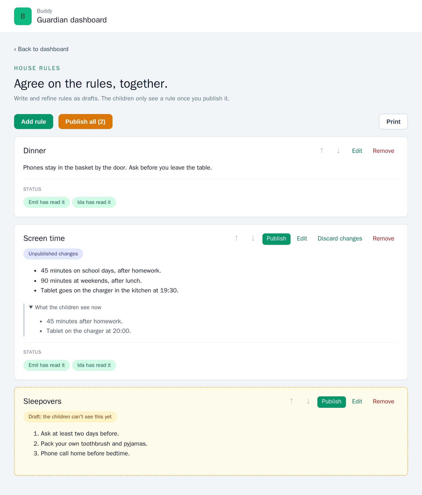
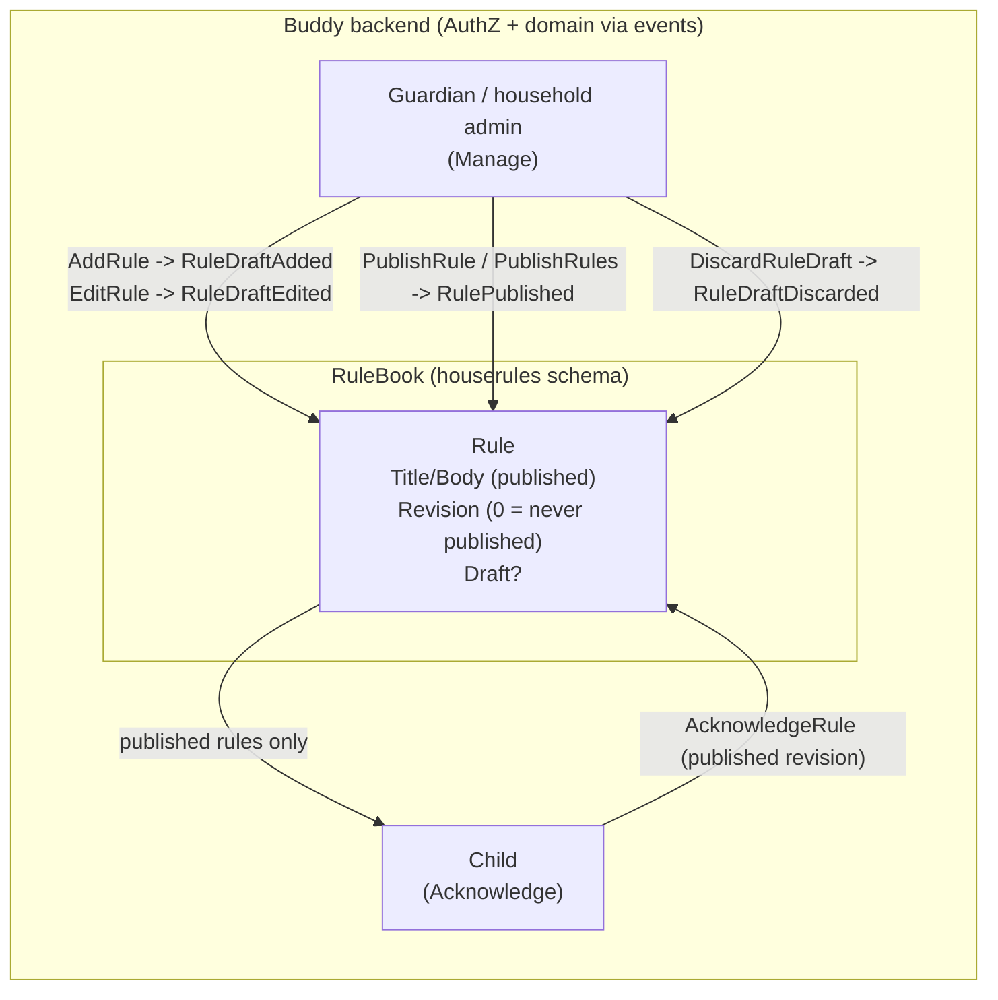

# House Rules Publishing

Status: Implemented. Extends [house-rules.md](house-rules.md): `Rule.Draft` with the events
`RuleDraftAdded`, `RuleDraftEdited`, `RuleDraftDiscarded` and `RulePublished`; `AddRule`/`EditRule`
write drafts; the new slices `PublishRule`, `PublishRules` and `DiscardRuleDraft` on the child and
group routes; drafts hidden from every tier but Manage, from `GetChildRules` and from the
printouts. Frontend: draft chips, Publish, Publish all, Discard changes and "What the children see
now" on `/guardian/house-rules`, and "Save draft" / "Save and publish" in the rule editor.

## Context

[House rules](house-rules.md) shipped with no draft state. Every `AddRule` and every `EditRule`
reaches the children at once: the rule shows up on `/child/rules`, the child home says "1 rule to
read", and a normal edit asks the children to read it again. Guardians want to write a rule, read
it again tomorrow, agree on the wording with the other parent, and only then show it to the
children. A half-written "Screen time" rule that a child reads (and taps "I've read this" on) is
worse than no rule. A child with ADHD who sees the rule change three times in an evening learns
that the rules aren't settled.

So a rule gets a **draft** next to its **published** version:

- Guardians with `Manage` write and refine the draft. The children and adult `View` members
  never see it.
- **Publish** makes the draft the version the children read. That is the moment the rule is
  "new" or "changed" for them.
- A guardian can publish one rule, or press **Publish all** to release every draft in the book
  together ("the summer holiday rules, all at once").

Settled with the product owner before this doc was written:

| Question                                        | Answer                                                                         |
| ----------------------------------------------- | ------------------------------------------------------------------------------ |
| What is published: one rule or the whole book?  | Per rule, plus a "Publish all" for every draft in the book                     |
| Do removing and reordering wait for publishing? | No. Both take effect at once. Only new text (added or edited rules) is drafted |

Nothing like a draft exists in Buddy today. The closest precedents are the
[house rules](house-rules.md) design itself (revisions, `RequiresReacknowledgement`, the
`Before`/`After` events) and the meal plan AI assistant's draft assignments
([AiSessionToolExecutor.cs](../../../src/backend/buddy/Features/Mealplans/AiAssistant/AiSessionToolExecutor.cs)),
which are applied in one step after review.

This document answers five questions: where the draft lives, which events record it, what each
existing slice now does, who sees what, and how existing books carry over.

## Question 1: where does the draft live?

**Decision: on the `Rule` itself, as an optional `RuleDraft`. The published content stays in
`Title`/`Body`. A rule that has never been published has `Revision == 0`.**

Before ([Rule.cs](../../../src/backend/buddy/Features/HouseRules/Types/Rule.cs)):

```csharp
public sealed record Rule(
    RuleId Id,
    string Title,
    string Body,
    int Revision,
    int AcknowledgementRevision,
    UserId LastEditedBy,
    DateTimeOffset LastEditedAt)
{
    public RuleContent Content => new(Title, Body);
}
```

After:

```csharp
public sealed record Rule(
    RuleId Id,
    string Title,                    // published title; "" until first published
    string Body,                     // published body
    int Revision,                    // 0 = never published, 1 on first publish, +1 per publish
    int AcknowledgementRevision,
    UserId LastEditedBy,             // who last published (what the children read)
    DateTimeOffset LastEditedAt,     // when it was last published
    RuleDraft? Draft = null)         // unpublished changes; never null when Revision == 0
{
    public bool IsPublished => Revision > 0;
    public RuleContent Content => new(Title, Body);
    public RuleContent WorkingContent => Draft?.Content ?? Content;   // what the editor shows
}

// RequiresReacknowledgement is the editor's "small fix" switch, kept with the draft until it is
// published. It's ignored on a first publish, which always asks the children to read the rule.
public sealed record RuleDraft(
    RuleContent Content,
    bool RequiresReacknowledgement,
    UserId EditedBy,
    DateTimeOffset EditedAt);
```

- **Why on the rule, not a second "draft book".** Acknowledgement, ordering and the 50-rule cap
  are all per rule ([house-rules.md, Question 3](house-rules.md#question-3-modelling-one-rule)).
  One rule with two versions keeps the order list, the cap and removal in one place. A separate
  `DraftRuleBook` stream was considered and rejected: publishing would be a cross-stream move,
  and removing a published rule would have to touch both streams.
- **Why `Revision == 0` and not a nullable published part.** `Title`/`Body`/`Revision` are
  already in every inline snapshot document. A rule in an existing snapshot has `Revision >= 1`
  and no `Draft` property, so it deserializes as "published, no draft" without rebuilding the
  snapshots. Making the published part a nullable `RuleContent? Published` would turn every
  existing snapshot rule into an unpublished one.
- **`Draft` is a domain "absent" value** in the sense of
  [eliminate-nulls.md](eliminate-nulls.md#what-stays-nullable): "no unpublished changes", the
  same kind as `MedicineSchedule.EndDate`. The default `= null` keeps the one place that
  constructs `Rule` from `RuleAdded` unchanged.
- **Removal and order are not drafted** (product decision). A removed rule is gone for everyone
  at once, its draft with it. A reorder moves draft and published rules alike; the children see
  the published rules in that order.
- **The cap counts drafts.** A book holds at most 50 rules, published or not.

## Question 2: events

**Decision: four new events. `RuleAdded` and `RuleEdited` stay in the union so existing streams
replay, but no handler appends them any more.**

```text
RuleDraftAdded(RuleBookId Id, RuleId RuleId, RuleContent Content,
    UserId AddedBy, DateTimeOffset OccurredAt)
    // a new rule at the end of the list: Revision 0, Draft = Content
RuleDraftEdited(RuleBookId Id, RuleId RuleId, RuleContent Before, RuleContent After,
    bool RequiresReacknowledgement, UserId EditedBy, DateTimeOffset OccurredAt)
    // Before is the working content (the draft, or the published text when there was no draft)
RuleDraftDiscarded(RuleBookId Id, RuleId RuleId, RuleContent Discarded,
    UserId DiscardedBy, DateTimeOffset OccurredAt)
    // a published rule goes back to its published text
RulePublished(RuleBookId Id, RuleId RuleId, RuleContent Content, int Revision,
    bool RequiresReacknowledgement, UserId PublishedBy, DateTimeOffset OccurredAt)
    // Title/Body = Content, Revision as given, Draft = null;
    // AcknowledgementRevision = Revision when RequiresReacknowledgement
```

- **Legacy events.** In existing streams, `RuleAdded` still folds to a published rule at
  revision 1 and `RuleEdited` to a published edit. Streams are append-only, so these events stay
  readable for good. The golden files for both stay as they are.
- **History is kept.** `RuleDraftEdited` carries `Before`/`After` like `RuleEdited` did, and
  `RulePublished` carries the published text. Every version a guardian saved is in the stream.
- **`RulePublished` carries the decided `RequiresReacknowledgement`,** not the draft's flag: the
  handler sets it to `true` on a first publish. The fold then needs no special case, and the event
  says what happened to the children.
- **Publish all** appends one `RulePublished` per rule with a draft, in book order, in one append.
  That is one transaction, so the children never see half a release.
- **`RuleBookStarted`** is still appended with the first rule of a scope, now together with
  `RuleDraftAdded`.

## Question 3: what each slice does now

**Decision: `AddRule` and `EditRule` write drafts. Three new slices publish one rule, publish all
and discard a draft. `RemoveRule` and `ReorderRules` are unchanged. `AcknowledgeRule` only finds
published rules.**

| Slice                    | Tier                             | Behavior                                                                                                                                                                                                                                                            |
| ------------------------ | -------------------------------- | ------------------------------------------------------------------------------------------------------------------------------------------------------------------------------------------------------------------------------------------------------------------- |
| `AddRule`                | Manage                           | Appends `RuleDraftAdded`. The rule is invisible to children until published. Returns the book                                                                                                                                                                       |
| `EditRule`               | Manage                           | Saves the draft (`RuleDraftEdited`). Content and switch equal to the working version append nothing. On a published rule, content equal to the published text discards the draft (`RuleDraftDiscarded`), or appends nothing when there's no draft. Returns the book |
| `PublishRule` (new)      | Manage                           | Appends `RulePublished` for a rule with a draft. A rule with no draft appends nothing (idempotent). Returns the book                                                                                                                                                |
| `PublishRules` (new)     | Manage                           | Publishes every rule with a draft, in book order. No drafts appends nothing. Returns the book                                                                                                                                                                       |
| `DiscardRuleDraft` (new) | Manage                           | Drops the draft of a published rule (`RuleDraftDiscarded`), `204`. No draft is `204` with nothing appended. A never-published rule is `400`: delete it instead                                                                                                      |
| `RemoveRule`             | Manage                           | Unchanged: removes the rule, draft or not, at once. `RuleRemoved.Before` is the working content                                                                                                                                                                     |
| `ReorderRules`           | Manage                           | Unchanged: the permutation covers draft and published rules                                                                                                                                                                                                         |
| `AcknowledgeRule`        | Acknowledge, or Manage on behalf | A never-published rule is `404`, as if it didn't exist. The revision checks run against the published revision, as today                                                                                                                                            |
| `ListRules`              | any                              | `Manage` gets every rule with its draft. `Acknowledge` and `View` get published rules only, and no drafts                                                                                                                                                           |
| `GetChildRules`          | the child, or a guardian         | Published rules only, published text. `PendingAcknowledgements` counts published rules only                                                                                                                                                                         |

- **Why the "small fix" switch is saved with the draft.** The editor already asks it
  ([rule-editor.html](../../../src/frontend/buddy/src/app/features/guardian/house-rules/rule-editor/rule-editor.html)),
  and the guardian knows whether a change is a typo fix while making it. Asking again at publish
  time was rejected: "Publish all" would need one answer per rule. The switch now only matters
  for a published rule; a never-published rule is always "new" to the children.
- **Why an edit that restores the published text discards the draft.** Otherwise a guardian who
  undoes their change by hand leaves a draft that, once published, bumps the revision of an
  unchanged rule.
- **Why `400` for discarding a never-published rule's draft, not a silent removal.** A discard
  that deletes the whole rule would surprise a guardian; the UI offers "Remove" for those rules
  and "Discard changes" only for published ones.
- **Why `POST` for publishing.** It's an action, not a resource replacement, like
  `POST /me/email/verify` and `POST /children/{childId}/password-reset`. It's still idempotent:
  publishing a rule with no draft appends nothing and returns the book.

## Question 4: who sees what

**Decision: drafts are visible to `Manage` only. Every other reader sees published rules only, as
if the drafts didn't exist.**

| Reader                                     | Sees                                                                         |
| ------------------------------------------ | ---------------------------------------------------------------------------- |
| `Manage` (guardian, household Owner/Admin) | All rules; `title`/`body` published (empty until first publish) plus `draft` |
| `Acknowledge` (the child)                  | Published rules, published text                                              |
| `View` (other adult group members)         | Published rules, published text                                              |
| `GetChildRules` (child or guardian)        | Published rules, published text: what the child sees                         |
| Print pages                                | Published rules only (the fridge copy is what the children read)             |
| GDPR export                                | Every rule, with its draft (the guardian wrote it)                           |

`RuleResponse` gains two fields:

```text
RuleResponse(Guid Id, string Title, string Body, int Revision, int AcknowledgementRevision,
             DateTimeOffset LastEditedAt, IReadOnlyList<RuleAcknowledgementResponse> Acknowledgements,
             bool IsPublished,                // new
             RuleDraftResponse? Draft)        // new; null when no draft, and always for non-Manage

RuleDraftResponse(string Title, string Body, bool RequiresReacknowledgement, DateTimeOffset EditedAt)
```

`ChildRuleResponse` doesn't change: it only ever holds published rules. A never-published rule's
`Acknowledgements` list stays empty, since there is nothing to read yet.

- **Co-guardians see each other's drafts.** Both parents of a child have `Manage`, and refining
  the wording together is the point. Private per-author drafts were rejected: two guardians
  could then hold conflicting drafts of one rule, and "Publish all" couldn't say whose to
  publish.
- **A child who is also a group Owner/Admin** is already excluded from `Manage`
  ([house-rules flow, Access](../house-rules/flow.md#access)), so no child can see a draft.

## Question 5: existing books

**Decision: no migration. Every rule in an existing book is published, because the legacy events
fold that way and existing snapshots have `Revision >= 1` and no `Draft`.**

`RuleBookSnapshotProjection` gets one `Apply` per new event. The `RuleBookSnapshotTests` replay
check covers both the old and the new events.

## Routes

The new routes exist under `children/{childId}` and `groups/{groupId}`, like every book route; the
group operation ids end in `ForGroup`.

```text
POST   .../rules/{ruleId}/publish   PublishRule        -> 200 RuleBookResponse
POST   .../rules/publish            PublishRules       -> 200 RuleBookResponse
DELETE .../rules/{ruleId}/draft     DiscardRuleDraft   -> 204
```

`.../rules/publish` doesn't clash with `.../rules/{ruleId}` because of the `:guid` constraint, the
same way `.../rules/order` doesn't today.

## Frontend

A mockup of the guardian's house rules page with drafts (demo data, not a screenshot of built
code):



Changes to [house-rules.ts](../../../src/frontend/buddy/src/app/features/guardian/house-rules/house-rules.ts)
and its template:

- Each card shows the **working** content (`draft ?? published`).
- A never-published rule gets a "Draft: the children can't see this yet" chip. A published rule
  with a draft gets "Unpublished changes", and a "What the children see now" disclosure with the
  published text.
- A rule with a draft gets **Publish**. A published rule with a draft gets **Discard changes**.
- The toolbar gets **Publish all (N)** while N rules have drafts.
- The "read it" status chips appear only on published rules, and describe the published version.

[rule-editor](../../../src/frontend/buddy/src/app/features/guardian/house-rules/rule-editor/rule-editor.ts):

- It opens with the working content and, for a draft, the draft's "small fix" switch.
- The switch appears only for a published rule.
- The save button reads **Save draft**. A second button, **Save and publish**, saves and then
  publishes in one go for a guardian who doesn't need to refine.

[house-rules-print-page.ts](../../../src/frontend/buddy/src/app/features/guardian/house-rules/print/house-rules-print-page.ts):
the group printout filters `listRules` to published rules. The child printout already reads
`GetChildRules`, which only holds published rules.

`HouseRulesService` gains `publishRule`, `publishAll` and `discardDraft`. The child pages
(`/child/rules`, the home card) don't change.

i18n (`translations/{en,da}/house-rules.ts`): the chips, the three buttons, the disclosure, the
editor's two save labels and the publish/discard error messages.

## Testing

- New integration test classes `PublishRuleTests`, `PublishRulesTests` and
  `DiscardRuleDraftTests`, shaped like
  [EditRuleTests.cs](../../../src/backend/buddy.IntegrationTests/Features/HouseRules/EditRule/EditRuleTests.cs),
  covering every row of the edge-case table below and both routes.
- Existing tests that expect an added rule to reach the child publish it first. The
  `AddOneRuleAsync` helper publishes by default; a test of drafts passes `publish: false`.
- Golden files for the four new events. The `RuleBookSnapshotTests` replay covers them.
- Frontend: service specs for the three calls; page specs for the chips, Publish, Publish all
  and Discard; editor specs for the switch on drafts and "Save and publish"; a print-page spec
  that drafts don't print.
- e2e: extend `house-rules-acknowledge.spec.ts`. A guardian adds a rule, and the child doesn't
  see it. The guardian publishes it, and the child reads and acknowledges it.

## Failure and edge-case behavior

| Case                                                 | Behavior                                                                            |
| ---------------------------------------------------- | ----------------------------------------------------------------------------------- |
| Child lists rules while a new rule is a draft        | Not in the list; `PendingAcknowledgements` doesn't count it                         |
| Child acknowledges a never-published rule id         | `404`                                                                               |
| Guardian edits a published rule                      | The child keeps seeing the published text and their status doesn't change           |
| Draft published with "small fix" on                  | Revision +1, `AcknowledgementRevision` unchanged, the child stays up to date        |
| Draft published normally                             | Revision +1, the child sees "Changed"                                               |
| First publish with "small fix" on                    | Ignored: revision 1, the child sees "New"                                           |
| Publish a rule with no draft                         | `200`, nothing appended                                                             |
| Publish all with no drafts                           | `200`, nothing appended                                                             |
| Discard on a published rule without a draft          | `204`, nothing appended                                                             |
| Discard on a never-published rule                    | `400`                                                                               |
| Edit restores the published text                     | `RuleDraftDiscarded`                                                                |
| Remove a rule with a draft                           | Removed at once, draft included                                                     |
| Child or adult `View` member calls publish/discard   | `403`                                                                               |
| Anyone else, or a revoked `GuardianLink`             | `404`                                                                               |
| Two guardians edit the same draft                    | Last write wins; both versions are in the stream (`RuleDraftEdited.Before`/`After`) |
| 50 rules, some of them drafts, and another `AddRule` | `400`: drafts count towards the cap                                                 |
| Existing book from before this change                | Every rule published, no drafts                                                     |

## Estimate

|                  |                                                                                                                                                                                       |
| ---------------- | ------------------------------------------------------------------------------------------------------------------------------------------------------------------------------------- |
| Complexity       | Medium -- four new events on an existing aggregate, three new slices on dual routes, changed semantics for two slices and their ~70 test call sites, one page and its editor reworked |
| Single developer | 4-6 days                                                                                                                                                                              |
| AI agent         | 3-5 hours, plus about 1 hour of human review                                                                                                                                          |

## Decisions made

| Question                        | Decision                                                                                  |
| ------------------------------- | ----------------------------------------------------------------------------------------- |
| Publish granularity             | Per rule, plus "Publish all" for every draft in the book                                  |
| Remove and reorder              | Take effect at once; not drafted                                                          |
| Where the draft lives           | `Rule.Draft`, next to the published `Title`/`Body`; `Revision == 0` means never published |
| Legacy `RuleAdded`/`RuleEdited` | Kept in the union and folded as published; no longer appended                             |
| "Small fix" switch              | Saved with the draft, applied on publish; ignored on a first publish                      |
| Who sees drafts                 | `Manage` only; co-guardians share one draft per rule                                      |
| Existing books                  | No migration; all their rules are published                                               |
| Print                           | Published rules only                                                                      |

## Remaining open questions

- **Should the children be told when rules are published?** Lean: not in v1. The child home
  already shows "N rules to read" once a rule is published. A push notification can follow the
  [mobile app and notifications](mobile-app-and-notifications.md) work.
- **Should a guardian see a diff between the draft and the published text?** Lean: no for v1;
  the disclosure shows the published text next to the draft. The events hold both, so a diff
  view is additive.
- **Scheduled publishing** ("publish on Monday")? Lean: no. It would need a scheduled job; the
  guardian can publish on the day.

## Diagram


