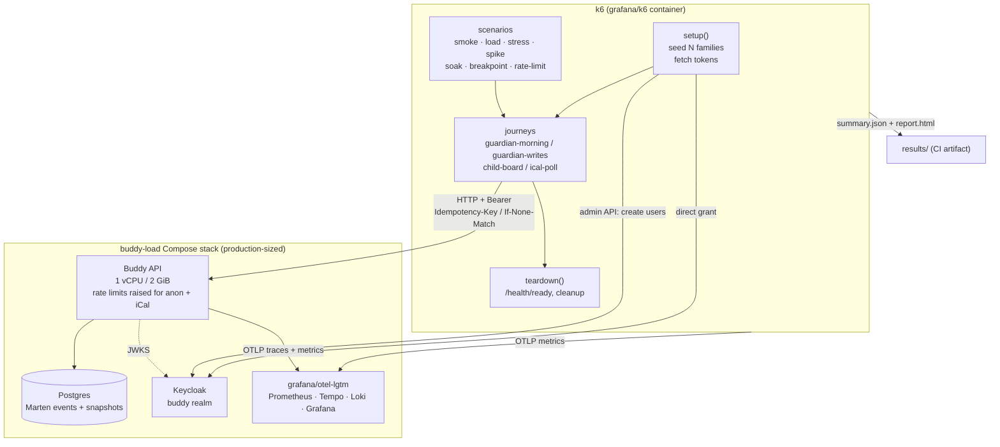

# Performance and load testing with k6

Status: Implemented (scripts, stack, tasks and CI; the VU levels and thresholds are still the
proposed values, not yet calibrated). `src/load-tests/`: 4 journeys and 7 profiles, typed against
the generated OpenAPI contract; the `buddy-load` Compose stack with `grafana/otel-lgtm`
(`stack.sh`); `task load:stack:up|down`, `task test:load`, `task test:load:typecheck`; nightly and
on-demand `.github/workflows/load-tests.yml`; typecheck + smoke in `e2e-tests.yml`; a pre-commit
check. See [src/load-tests/README.md](../../../src/load-tests/README.md).

## Context

Buddy has unit specs, Alba integration tests, Playwright e2e and mutation testing (see
[integration-testing-strategy.md](integration-testing-strategy.md) and
[mutation-testing-strategy.md](mutation-testing-strategy.md)). None of them say how the API behaves
when many families use it at once. Each test sends one request and checks the answer.

We know load is a real risk because it has already caused one incident. A guardian dashboard sent
one request per child per widget and used up the Postgres pools (`53300: too many clients`). Two
fixes came out of it:
[`map-with-concurrency.ts`](../../../src/frontend/buddy/src/app/core/map-with-concurrency.ts)
(`PER_ITEM_REQUEST_CONCURRENCY = 4`) and one shared, capped pool in
[`PostgresDataSource.cs`](../../../src/backend/buddy/Common/Postgres/PostgresDataSource.cs)
(`DefaultMaxPoolSize = 50`). Neither fix has been measured. Nothing tells us how many families the
production sizes can serve:

- **Azure**: one API replica at 1 vCPU / 2 GiB, and Keycloak at 0.5 vCPU / 1 GiB
  ([`deploy/azure/deploy.sh`](../../../deploy/azure/deploy.sh)).
- **Oracle**: one always-free arm64 VM (2 OCPU / 12 GB) running the whole stack
  ([`deploy/README.md`](../../../deploy/README.md)).

Some things we already have make a load test easier to build, and some get in its way:

- **Rate limiting** ([rate-limiting.md](rate-limiting.md),
  [`RateLimitingOptions.cs`](../../../src/backend/buddy/Common/RateLimiting/RateLimitingOptions.cs)).
  Each user gets a token bucket of 200 tokens that refills at 5 per second. Each anonymous IP gets
  60 tokens at 1 per second, and each iCal link gets 10 per 5 minutes. A load generator sends all
  its traffic from one IP, so it needs to know about these limits. The limits are configuration
  values, so a test stack can override them.
- **Observability** ([observability.md](../observability.md),
  [`ObservabilityFeature.cs`](../../../src/backend/buddy/Common/Observability/ObservabilityFeature.cs)).
  The API already collects OpenTelemetry traces and metrics for ASP.NET Core, Npgsql (every Marten
  query) and Wolverine (every handler). It exports them when `OTEL_EXPORTER_OTLP_ENDPOINT` is set.
  So server-side numbers cost no new code.
- **Health checks** (`/health`, `/health/ready`,
  [`HealthChecksFeature.cs`](../../../src/backend/buddy/Common/Health/HealthChecksFeature.cs)).
  A run can wait for readiness before it starts and check it again at the end.
- **ETags** ([conditional-get-etags.md](conditional-get-etags.md)) and **idempotency keys**
  ([`IdempotencyKeyMiddleware`](../../../src/backend/buddy/Common/Idempotency/IdempotencyKeyMiddleware.cs)).
  Real clients send `If-None-Match` and `Idempotency-Key`. A realistic script must send them too,
  or it measures a different workload from the one production sees.
- **Seeding through the real API with direct-grant tokens.** The e2e support code
  ([`keycloak-client.ts`](../../../src/frontend/buddy/e2e/support/keycloak-client.ts)) and the
  screenshot demo family
  ([`demo-family.ts`](../../../src/frontend/buddy/screenshots/demo-family.ts)) already create
  Keycloak users through the admin API and build families through the API. They use the
  `buddy-frontend` client, which has `directAccessGrantsEnabled`.

This document answers eight questions: which tool to use, where the scripts live, what traffic they
model, which environment they run against, how test data and tokens are created, how rate limiting
is handled, what counts as passing, and when the tests run.

## Decision: k6, with scripts in TypeScript

**Decision: [Grafana k6](https://grafana.com/docs/k6/latest/), run from its pinned official Docker
image (`grafana/k6`), with scripts written in TypeScript.** k6 1.x runs `.ts` files directly, so
there is no build step.

- **Scripts are code, reviewed in the same PR as the feature.** A scenario is a TypeScript module
  that imports shared helpers. It has the same shape as a Playwright spec, which the team already
  writes every day.
- **It can share types with the frontend.** The scripts can `import type` the paths and schemas
  from the generated
  [`buddy-api.ts`](../../../src/frontend/buddy/src/app/core/api/buddy-api.ts) (see
  [openapi-client-contract.md](openapi-client-contract.md)). When a DTO changes shape, the load
  scripts stop compiling under `tsc --noEmit`, so they can't quietly drift from the API.
- **Pass/fail is built in.** `thresholds` (for example `http_req_duration{group:dashboard}: p(95)<300`)
  make k6 exit non-zero, so a CI job fails without any extra tooling.
- **No new runtime in the devcontainer.** `docker run grafana/k6` is enough. It works the same way
  locally and on a GitHub runner. The image is pinned by digest, the same way the workflows pin
  actions by SHA.
- **Its output fits what we already run.** It writes a JSON summary and an HTML web-dashboard
  report, and it can send metrics over OTLP or Prometheus remote-write into the same backend as the
  API's traces (see [Observability during a run](#decision-observability-during-a-run-uses-the-apis-existing-opentelemetry)).

We considered and rejected these alternatives:

- **NBomber (C#).** It would keep everything in .NET. But scenarios would live in a second test
  project with its own runner, and the generated TypeScript contract couldn't be reused. It is also
  licensed commercially for organisational use.
- **JMeter.** Its test plans are XML that is written in a GUI, which makes them hard to review in a
  diff. It also needs a JVM.
- **Gatling.** It is a good tool, but it adds a JVM, and scripts are written in Scala, Java or
  Kotlin. The team writes C# and TypeScript.
- **Locust (Python).** It would add Python only for this. Each worker can also generate less load
  than k6.
- **Artillery.** It is Node-based and uses YAML scenarios. Logic that goes beyond a plain request
  sequence gets clumsy, for example "for each child, call these five endpoints, at most four at a
  time".
- **Azure Load Testing as the runner.** It only exists on the Azure deployment path and costs
  money. It runs JMeter and Locust, not k6 scripts. If we ever need distributed load, Grafana Cloud
  k6 runs the same scripts unchanged (see open questions).

## Decision: scripts live in `src/load-tests/`, with one module per journey

**Decision: a new `src/load-tests/` folder, next to `src/backend` and `src/frontend`, with this
layout:**

```text
src/load-tests/
  package.json            # devDependencies only: typescript, @types/k6, prettier (type check, format, editor)
  tsconfig.json
  docker-compose.load.yml # the isolated load stack (see "Environment")
  stack.sh                # builds the API image and starts/stops the stack (task load:stack:*)
  run.sh                  # runs one profile, then the Docker-side checks (task test:load)
  lib/
    config.ts             # BASE_URL, KEYCLOAK_URL, FAMILIES ... from __ENV; the target allowlist; thresholds
    contract.ts           # route and body types from the generated buddy-api.ts
    auth.ts               # direct-grant token fetch and refresh, cached per VU
    api.ts                # typed get/post/put wrappers: Idempotency-Key, If-None-Match, tags
    seed.ts               # creates N families through the Keycloak admin API + the Buddy API
    checks.ts             # the shared 2xx/304 check and the server_errors counter
    run.ts                # setup()/teardown() and the weighted journey mix
  journeys/
    guardian-morning.ts   # the dashboard fan-out (see "Workload model")
    guardian-writes.ts
    child-board.ts
    ical-poll.ts
  scenarios/
    smoke.ts  load.ts  stress.ts  spike.ts  soak.ts  breakpoint.ts  rate-limit.ts
  scripts/summarize.mjs   # the p95 table for the nightly job summary
  results/                # git-ignored: summary.json, report.html per run
```

A journey is a function that does one user's work. A scenario file is configuration only: it
imports journeys and sets `options.scenarios`, `executor`, stages and thresholds. So "how a guardian
uses the dashboard" is written once, and the six test types reuse it. This is the same split as the
e2e support code (`e2e/support/*`) and the specs that use it.

We rejected putting the scripts in `src/frontend/buddy/load/`. k6 is not Node, and its modules
(`k6/http`, `k6/metrics`) don't resolve in the Angular workspace's `tsconfig`. It would also make the
backend's load tests look like a frontend concern.

## Decision: the workload model follows what the frontend actually calls

**Decision: four journeys, each one copying the requests a real screen makes, weighted by how often
families use them.** Hand-picked endpoints would miss the fan-out that caused the incident, so the
calls are read from the frontend code.

| Journey            | What it does (per iteration)                                                                                                                                                                                                                                                                                                                                                                                                                                                       | Weight |
| ------------------ | ---------------------------------------------------------------------------------------------------------------------------------------------------------------------------------------------------------------------------------------------------------------------------------------------------------------------------------------------------------------------------------------------------------------------------------------------------------------------------------- | ------ |
| `guardian-morning` | Opens the guardian dashboard. `GET /users/me/children` once. Then for each child, at most 4 in flight (the same limit as `mapWithConcurrency`): `GET /medicines/children/{id}/doses`, `GET /feelings/children/{id}/check-ins`, `GET /first-then/children/{id}`, `GET /pickups/children/{id}/schedule`, `GET /users/me/children/{id}/guardians`, the meal plan. Plus `GET /calendars` and `GET /calendars/{id}/occurrences` for each calendar. A second load sends `If-None-Match`. | 50 %   |
| `guardian-writes`  | Ticks off a dose (`PUT .../doses/{medicineId}`), completes a task (`.../items/{itemId}/completion`), logs a sleep-diary night, adds a calendar item (`POST` with `Idempotency-Key`). Each one appends events and updates the inline snapshot.                                                                                                                                                                                                                                      | 20 %   |
| `child-board`      | A child's today view: their occurrences, First-Then board, meal plan, then a task completion and a feelings check-in that it deletes again (the daily limit is 20).                                                                                                                                                                                                                                                                                                                | 25 %   |
| `ical-poll`        | A calendar app polling the calendar, meal-plan and pickup feeds, anonymously, with `If-None-Match` after the first fetch. The most expensive read per request (rate-limiting.md: expands occurrences from 90 days back to 365 days ahead).                                                                                                                                                                                                                                         | 5 %    |

- **Think time** between actions is 3-10 s, randomised. A virtual user (VU) stands for a person,
  not a busy loop. So "N VUs" reads as "N families active at the same moment", which a non-engineer
  can follow.
- **Every request carries a `name` tag** with the route template
  (`/medicines/children/{childId}/doses`), not the raw URL. Otherwise each child id becomes its own
  metric series. Thresholds and reports group by journey (`group`), by route and by `kind`
  (`read`, `write`, `ical`). The route template is the OpenAPI path itself (`lib/contract.ts`), so
  a journey that names a route the API no longer has fails the type check.
- **The AI assistant, Mealie and outbound email are left out of the default mix.** They call
  third-party services (the family's LLM provider, the family's Mealie server, SMTP) and have
  strict rate limits of their own. A load test would measure those services, not Buddy. They get no
  scenario in v1.
- **Keycloak's login is left out.** Tokens are fetched in `setup()`, outside the measured
  iterations (see [Test data and tokens](#decision-test-data-and-tokens-are-seeded-per-run-in-setup)).
  rate-limiting.md treats Keycloak as a separate service with its own brute-force protection, and
  we do the same here. The `spike` profile is the exception: each VU gets a fresh token from
  Keycloak as it starts, because a 07:00 rush is also a burst of logins.

When a feature adds a screen that guardians visit often, its requests are added to the matching
journey in the same PR. This is a checklist item, the same as adding the page to `pages.ts` for the
screenshots.

## Decision: six test profiles, all built from the same journeys

**Decision: one scenario file per test type.** The VU counts below are starting points. The first
real runs will set them (see open questions).

| Profile      | Shape                                                                       | Question it answers                                                                                                        |
| ------------ | --------------------------------------------------------------------------- | -------------------------------------------------------------------------------------------------------------------------- |
| `smoke`      | 1-2 VUs, 1 min, every journey once                                          | Do the scripts still match the API? Run before every other profile, and in CI.                                             |
| `load`       | Ramp to the expected peak (start: 50 families), hold 10 min                 | Does a normal busy morning meet the thresholds?                                                                            |
| `stress`     | Steps of 50, 100, 200, 300 VUs, 5 min each                                  | Where does p95 start to bend, and what gives out first: CPU, the 50-connection pool, or Marten append latency?             |
| `spike`      | 0 to 200 VUs in 30 s (the 07:00 school-morning rush), hold 3 min, back to 0 | Does the API recover without `53300`, without leaked connections, and without a restart?                                   |
| `soak`       | The `load` level for 2 h                                                    | Do memory, the connection count or latency creep up? Do event streams grow long enough to slow down rehydration?           |
| `breakpoint` | `ramping-arrival-rate` that keeps rising until a threshold aborts the run   | How many requests per second does the stack handle at its current size? This is the number to compare Azure and Oracle on. |
| `rate-limit` | 1 VU sending one user's requests as fast as it can                          | Does the limiter answer `429 rate_limited` with `Retry-After`, never a `5xx`, and does it recover when the bucket refills? |

`stress`, `breakpoint` and `rate-limit` use `abortOnFail` thresholds. When one of them crosses its
limit, it records where and stops, instead of overloading a dying stack for the rest of the run.

## Decision: an isolated, production-sized load stack; never production

**Decision: load runs against a stack of their own, `src/load-tests/docker-compose.load.yml`
(Compose project `buddy-load`).** `stack.sh up` builds the API image from the working tree, so a
run measures the current code (`BUDDY_API_IMAGE=<image>` runs a published image instead). The
stack has its own Postgres, its own Keycloak (importing `.devcontainer/keycloak/buddy-realm.json`)
and a `grafana/otel-lgtm` container. It has no Mailpit, because no journey sends mail. The API
container gets the same `cpus: 1.0` / `mem_limit: 2g` as the Azure Container App, and Keycloak
gets the Azure Keycloak app's 0.5 vCPU / 1 GiB. Postgres gets 1 vCPU / 2 GiB. That way a run
measures the size we actually deploy, not the dev machine. `task load:stack:down` runs
`docker compose down -v`, so cleaning up is just deleting the volume.

Why not the other environments:

- **The dev stack (`db:5432`, `keycloak:8080`).** All worktrees share it (CLAUDE.md). A soak run
  would leave thousands of throwaway families in the dev database, and it would slow down whatever
  else is running, including the e2e tests and `task docs:screenshots`. The only thing that may
  target it is the `smoke` profile (`TARGET=dev`). Every seeded username starts with
  `load.<run id>.`, and `teardown()` removes the run's children, groups and accounts, then any
  Keycloak user left with that prefix. `smoke` is small enough to share the stack.
- **Production.** Rejected for v1. The Oracle VM runs everything on one free host, so a stress run
  would take down real families' mornings. The load users' health data (doses, sleep, feelings)
  would land in the same database as real data, which raises GDPR record-keeping questions
  ([gdpr-data-protection.md](gdpr-data-protection.md)). A meaningful run would also have to loosen
  the production rate limits. The scripts don't refuse a production URL on technical grounds, but
  `config.ts` refuses any `BASE_URL` that isn't on an allowlist (`localhost`, the load stack, an
  explicit `ALLOW_TARGET`). That makes it hard to point a run at production by mistake.
- **A dedicated Azure staging environment.** It is the most realistic option (real network, real
  managed Postgres). But it costs money all the time, and nothing else needs it yet. It is listed
  under open questions.

The local stack shares the machine with k6, so its absolute numbers are a floor, not the
production ceiling. They are still good for comparing commits, which is what the CI job does.

## Decision: test data and tokens are seeded per run in `setup()`

**Decision: `setup()` creates the families, and the VUs share them read-only by index.**

1. Through the Keycloak admin API (master `admin-cli`, as
   [`keycloak-admin-client.ts`](../../../src/frontend/buddy/e2e/support/keycloak-admin-client.ts)
   does), create `FAMILIES` guardians (`load.<run id>.g0001`, ...) in `buddy-guardian`. Each gets
   1-3 children through `CreateChild`, then a permanent password through the admin API, as
   `demo-family.ts` does. The child count is weighted towards 2, because the per-child fan-out is
   what we want to measure.
2. Through the Buddy API, as each guardian, create the same shape of data as `demo-family.ts`: a
   family group and calendar, a weekly event, a daily task per child, a medicine schedule, a meal
   plan for 11 days, a week of pickups, a First-Then board, and the calendar, meal-plan and pickup
   iCal tokens. Writing through the API means every event, snapshot and index document exists
   exactly as production would write it.
3. Fetch one direct-grant token per user and return
   `{ families: [{ guardian, tokens, calendarId, children: [{ id, username, tokens, taskItemId,
medicineId }], icalPaths }] }`. Each VU picks `families[(vu.idInTest - 1) % families.length]`.
4. `lib/auth.ts` refreshes a token when less than 60 s of its lifetime remains. Soak runs last
   longer than the realm's access-token lifetime, and a wave of `401`s would hide the real results.

Seeding happens before the measured stages and isn't part of the thresholds. With 300 families it
takes a few minutes. That's acceptable for the profiles that need that many, and `smoke` seeds 2.

**Large histories.** A family that has used Buddy for a year has long event streams. Inline
snapshots should keep rehydration flat as streams grow
([event-stream-snapshots.md](event-stream-snapshots.md)), and the soak profile is what tests that
claim. Seeding a year of history through the API is too slow for each run. A `SEED_HISTORY_DAYS`
option backfills dated events for a subset of the families (dose statuses, sleep entries) through
the same endpoints, with the date in the path. Writing events straight into Marten was considered
and rejected: it would skip the projections and validators we want to measure.

## Decision: rate limits stay on, raised to the level of one real person

**Decision: the load stack keeps `UseRateLimiter` and overrides the limits through configuration.**
It doesn't switch the limiter off, because the limiter is part of the request pipeline we are
measuring.

- `RateLimiting__Authenticated__*` keeps its defaults. Each VU is one person with its own Keycloak
  subject and its own bucket. A dashboard load is about 6 requests per child, and the refill is
  5 per second, so a journey with think time never reaches the limit. If a `429` shows up in the
  `load` profile, it is a finding: either the workload model is wrong or the limit is too tight for
  a real family.
- `RateLimiting__Anonymous__TokenLimit` and `RateLimiting__IcalFeed__TokenLimit` are raised in
  `docker-compose.load.yml`. Every anonymous request from k6 comes from one IP. In production those
  requests come from many calendar servers, so here they would trip a per-IP limit that real
  traffic never shares. This is the same move as the separate low-limit host in `RateLimitingTests`
  (rate-limiting.md, "limits come from configuration"), the other way round.
- The `rate-limit` profile runs with the production defaults and checks that the flood is answered
  only with `429` responses that carry `Retry-After`.
- The `breakpoint` profile is the exception to the per-user default. It measures the stack's
  capacity with no think time, so `run.sh` restarts the API with
  `LOAD_AUTHENTICATED_TOKEN_LIMIT` raised for that run. Otherwise the per-user limiter, not the
  stack, would end the run.

`429`s are tagged `expected_response:false` like any other error, and they count against the
error-rate threshold in every profile except `rate-limit`.

## Decision: thresholds are the pass/fail contract

**Decision: every profile shares one set of thresholds in `lib/config.ts`.** The numbers below are
proposals. The first `load` runs on the load stack will confirm them or set them (see open
questions).

```ts
export const thresholds = {
  http_req_failed: ['rate<0.005'], // < 0.5 % non-2xx/304
  'http_req_duration{kind:read}': ['p(95)<300', 'p(99)<800'],
  'http_req_duration{kind:write}': ['p(95)<500', 'p(99)<1200'],
  'http_req_duration{kind:ical}': ['p(95)<800'], // the full-range expansion
  'group_duration{group:::guardian-morning}': ['p(95)<1500'], // the whole dashboard, fan-out included
  checks: ['rate>0.99'],
  server_errors: ['count==0'], // any 5xx or connection failure
};
```

- **`smoke` keeps only the correctness thresholds** (checks, failures, 5xx). Its eight
  iterations, often against an API that has only just started, are too few and too cold for
  latency numbers to mean anything. A first build showed reads at a p95 of 412 ms right after an
  API restart, against 210 ms warm.
- **`group_duration` for the dashboard** is the number a guardian actually feels. A 50 ms endpoint
  called 15 times through a concurrency limit of 4 can still give a slow screen. It's the only
  journey with no think time inside its group, so it's the only whole-screen number.
- **A `5xx` fails the run in every profile**, `breakpoint` included (`server_errors`). A `5xx`
  means the API broke. It never means "busy", which the API answers with `429`.
- **Server-side checks at the end of a run:** `teardown()` checks that `/health/ready` still
  answers `200`. k6 can't see Docker, so `run.sh` checks the rest after k6 exits. It fails the run
  when the API logged `53300`, or when its container restarted or was OOM-killed during the run.

## Decision: observability during a run uses the API's existing OpenTelemetry

**Decision: the load stack runs `grafana/otel-lgtm` (Grafana, Tempo, Loki, Prometheus/Mimir in one
container), and the API's `OTEL_EXPORTER_OTLP_ENDPOINT` points at it.** k6 sends its own metrics to
the same backend over OTLP (`--out opentelemetry`, `K6_OTEL_GRPC_EXPORTER_ENDPOINT`). One
Grafana dashboard then shows k6's request rate and latency next to the API's request duration, the
Npgsql pool usage and command time, Wolverine handler time and process CPU and memory, on one time
axis. When p95 bends in `stress`, the trace of a slow request shows whether the time went into
Postgres, a handler or the thread pool. The API needs no code change for this. It is exactly what
observability.md built the OTLP export for.

Every run also writes `results/<profile>-<timestamp>/summary.json` (`--summary-export`, with p99
added to the trend stats) and `report.html` (`K6_WEB_DASHBOARD_EXPORT`; k6 skips it for runs too
short to chart, such as `smoke`). CI uploads these as artifacts.

Rejected: InfluxDB plus a hand-built Grafana dashboard (a second metrics store for k6 only), and the
Aspire dashboard. Aspire is great for traces, but it doesn't keep metrics over a two-hour soak, and
k6 can't write to it.

## Decision: Taskfile entry points, a nightly CI run, and no load tests on PRs

**Decision: these `taskfile.dist.yml` tasks, and a `.github/workflows/load-tests.yml` that runs
nightly and on `workflow_dispatch`.**

```text
task load:stack:up       # stack.sh up: build the API image, compose up --wait (until /health/ready)
task load:stack:down     # stack.sh down: compose down -v
task test:load PROFILE=smoke|load|stress|spike|soak|breakpoint|rate-limit [TARGET=stack|dev] [FAMILIES=n VUS=n HOLD=10m ...]
task test:load:typecheck # tsc --noEmit in src/load-tests (the pre-commit hook also runs it, plus Prettier, on staged files there)
```

- **On pull requests:** only `test:load:typecheck`, plus `smoke` against the dev-sized services in
  the existing e2e workflow, which starts the API and Keycloak anyway. This catches a script that
  no longer matches the API, at almost no cost. Real load numbers from a shared GitHub runner on a
  PR would mostly measure the runner.
- **Nightly on `master`:** `load:stack:up`, then `smoke`, then `load` (10 min), then
  `rate-limit`. A broken threshold fails the job. The summary and report are uploaded, and the
  job's step summary shows p95 per journey next to the previous night's numbers, taken from the last
  successful run's artifact.
- **`stress`, `spike`, `soak` and `breakpoint` run on demand only** (`workflow_dispatch` with a
  profile input), before a release or after a change to the data access layer. They take too long,
  and their absolute numbers vary too much from runner to runner, to gate anything automatically.

There is a gap here: the nightly job compares numbers from GitHub-hosted runners, and those vary.
A trend alert is more useful than a hard gate on the comparison. The open questions cover a
self-hosted runner.

## Testing the load tests

- `test:load:typecheck` compiles every script against `@types/k6` and the generated
  `buddy-api.ts`. An API contract change that breaks a journey fails at compile time.
- `smoke` is the scripts' own integration test. Every journey runs once, and every `check()` must
  pass.
- The `seed.ts` helpers get no unit specs. They are exercised by every run, and a seeding failure
  aborts `setup()` with the API's error envelope in the log.

## Failure and edge-case behavior

| Case                                                 | Behavior                                                                                                                                                                       |
| ---------------------------------------------------- | ------------------------------------------------------------------------------------------------------------------------------------------------------------------------------ |
| Load stack not ready                                 | `load:stack:up` waits on `/health/ready`. `setup()` checks it again and aborts before seeding.                                                                                 |
| `BASE_URL` not on the allowlist                      | `config.ts` throws in the init stage, so no request is sent.                                                                                                                   |
| Seeding fails partway                                | `setup()` throws, and the run aborts. On the load stack, `down -v` cleans up. On `TARGET=dev`, delete the `load.<run id>.*` Keycloak users by hand.                            |
| Access token expires in a long run                   | `auth.ts` refreshes it 60 s before expiry. A `401` in a measured iteration is a failed check, not a retry.                                                                     |
| `429` during `load`                                  | Counts as an error, and the run fails. Either the workload model or the default limit is wrong, and we decide which.                                                           |
| `53300` / pool exhaustion during `spike`             | Requests fail with `5xx`, `server_errors` fails, and `run.sh` reports the log match. This is the incident regression the suite exists to catch.                                |
| API container OOM-killed or restarted                | `run.sh` checks the API container's `RestartCount` / `StartedAt` / `OOMKilled` (`docker inspect`) after the run and fails it; `teardown()` also sees a failed readiness check. |
| An endpoint renamed or a DTO reshaped                | `test:load:typecheck` fails on the PR.                                                                                                                                         |
| A new screen added without its requests in a journey | Not caught automatically. It is a review checklist item (see "Workload model").                                                                                                |

## Estimate

|                  |                                                                                                                                                                                                 |
| ---------------- | ----------------------------------------------------------------------------------------------------------------------------------------------------------------------------------------------- |
| Complexity       | Medium: no production code changes, but a new tool, a new isolated Compose stack with OTLP/Grafana, a seeding module that builds whole families, 4 journeys, 7 profiles, 4 tasks and a workflow |
| Single developer | 5-8 days, including the first calibration runs that set the VU levels and thresholds                                                                                                            |
| AI agent         | 4-6 hours for the scripts, stack, tasks and workflow, plus about 2 hours of human review and calibration runs                                                                                   |

## Decisions made

| Question                 | Decision                                                                                                                                             |
| ------------------------ | ---------------------------------------------------------------------------------------------------------------------------------------------------- |
| Which tool               | k6 from its pinned Docker image, TypeScript scripts. Reviewable code, built-in thresholds, shares the generated API types                            |
| Where the scripts live   | `src/load-tests/`: `lib/`, `journeys/`, `scenarios/`. Journeys are written once and reused by every profile                                          |
| What traffic is modelled | 4 journeys copied from the real frontend calls (the dashboard fan-out included). AI, Mealie, email and Keycloak login left out                       |
| Which test types         | smoke, load, stress, spike, soak, breakpoint, rate-limit                                                                                             |
| Which environment        | An isolated `buddy-load` Compose stack at production sizes. Smoke only on the dev stack. Never production in v1                                      |
| Test data                | Seeded per run in `setup()` through Keycloak admin + the Buddy API, as `demo-family.ts` does. Optional history backfill                              |
| Rate limiting            | Kept on. Per-user defaults unchanged. Per-IP and per-feed limits raised on the load stack. A dedicated `rate-limit` profile                          |
| Pass/fail                | Shared k6 thresholds (p95/p99 per read/write, dashboard group duration, < 0.5 % errors, no 5xx) plus the post-run health, `53300` and restart checks |
| Server-side visibility   | The existing OTLP export into `grafana/otel-lgtm`. k6 sends its metrics there over OTLP too                                                          |
| When it runs             | Typecheck + smoke on PRs. Smoke + load + rate-limit nightly. The heavy profiles on demand                                                            |
| Expected peak            | Defend about 17 dashboard loads/s (about 290 requests/s, roughly 450 families active at once): the lowest of four `breakpoint` runs divided by 3     |

## Implementation notes

Things found while building it that aren't obvious from the code:

- **k6 2.3's TypeScript loader hangs on a generic arrow function in a class field**
  (`post = <P>(…) => …`): `k6 run` never gets past loading the module and prints nothing. Plain
  generic methods, functions and top-level arrows are fine. `lib/api.ts` and `lib/seed.ts` use
  methods for that reason.
- **The devcontainer's nested Docker has no DNS on bridge networks.** Containers resolve each
  other's service names, but not `nuget.org`. So `stack.sh` builds the API image with
  `docker build --network host`; compose's own build would need a buildx entitlement grant for
  that. `TARGET=dev` runs k6 with `--network host`, which reaches `localhost:5193` and the
  devcontainer's `keycloak` hostname.
- **k6's TypeScript sees no `crypto` or `console` in `@types/k6`.** `globals.d.ts` declares the two
  runtime globals the scripts use, instead of pulling in `lib: ["dom"]`.

## Measured results

Runs of `load-tests.yml` on GitHub-hosted `ubuntu-latest` runners (4 vCPU, shared by k6 and the
whole stack), 2026-10-24 to 2026-10-26. All on the same API code and the same runner image
(`ubuntu-24.04`, 20261021.618).

### `load`: 50 families, 10-minute hold

| p95 / p99                | [10-24 a](https://github.com/kimipsen/buddy/actions/runs/40090760839) | [10-24 b](https://github.com/kimipsen/buddy/actions/runs/40092907141) | [10-25 nightly](https://github.com/kimipsen/buddy/actions/runs/40166537406) | [10-26 nightly](https://github.com/kimipsen/buddy/actions/runs/40276087363) |
| ------------------------ | --------------------------------------------------------------------- | --------------------------------------------------------------------- | --------------------------------------------------------------------------- | --------------------------------------------------------------------------- |
| Dashboard (whole screen) | 33 / 42 ms                                                            | 39 / 47 ms                                                            | 33 / 40 ms                                                                  | 51 / 63 ms                                                                  |
| Reads                    | 4 / 6 ms                                                              | 4 / 7 ms                                                              | 4 / 6 ms                                                                    | 7 / 9 ms                                                                    |
| Writes                   | 8 / 80 ms                                                             | 11 / 85 ms                                                            | 31 / 150 ms                                                                 | 10 / 16 ms                                                                  |
| iCal feeds               | 18 / 24 ms                                                            | 23 / 33 ms                                                            | 30 / 36 ms                                                                  | 28 / 35 ms                                                                  |
| Requests, failed         | 22,190, 0 %                                                           | 22,733, 0 %                                                           | 22,286, 0 %                                                                 | 21,732, 0 %                                                                 |

- On the same code, the dashboard p95 ranges from 33 to 51 ms and the write p99 from 16 to
  150 ms. That is runner variance, and it's why the nightly comparison is a trend report, not a
  gate.
- 50 families drive about 25-32 requests/s (about 0.5-0.65 requests/s per family).
- Reads are fast partly because most repeat reads answer `304 Not Modified`. That saves the
  transfer, not the server work: the API renders and hashes the body before it can answer `304`.
- Every proposed threshold is an order of magnitude above these numbers, so as they stand they
  would only catch a large regression.

### `breakpoint`

100 seeded families, arrival rate rising by 5 dashboard loads/s per minute. Every run stopped on
the dashboard's whole-screen p95 passing 1.5 s (the first also on read p99 passing 800 ms):

| Run                                                                       | Stopped after | Arrival rate at the stop | Requests | Failed, 5xx | Dropped iterations, peak VUs |
| ------------------------------------------------------------------------- | ------------- | ------------------------ | -------- | ----------- | ---------------------------- |
| [10-24 12:38](https://github.com/kimipsen/buddy/actions/runs/40094760768) | 16m48s        | ~84 loads/s              | 709,623  | 0, 0        | 491, 532                     |
| [10-24 21:41](https://github.com/kimipsen/buddy/actions/runs/40135321613) | 14m37s        | ~73 loads/s              | 539,449  | 0, 0        | 357, 398                     |
| [10-25 07:20](https://github.com/kimipsen/buddy/actions/runs/40172408972) | 10m32s        | ~53 loads/s              | 285,389  | 0, 0        | 92, 142                      |
| [10-25 19:44](https://github.com/kimipsen/buddy/actions/runs/40227479002) | 10m29s        | ~52 loads/s              | 281,858  | 0, 0        | 86, 136                      |

- **It always degrades without failing:** no failed requests, no 5xx, no `53300`, no API restart.
  Only the latency tail grows; the read median stays in single-digit milliseconds.
- **The spread (52-84 loads/s) is the runner, not the code.** Same commit, same image: GitHub
  hands out different hardware from run to run. A capacity number from one hosted run is
  unreliable by more than half.
- **Each figure is a lower bound** for one 1-vCPU API container: k6 shares the 4 CPUs with the
  API, Postgres and Keycloak, and dropped iterations it couldn't schedule in every run.

The number to defend uses the lowest run, divided by the safety factor of 3: about 17 dashboard
loads/s (about 17 requests each, so about 290 requests/s), or roughly 450 families active at the
same moment at the `load` profile's mix. The nightly `load` run stays at 50 families: it's a
trend check, not a capacity test.

### `spike` and `soak`

| p95 / p99                | [`spike`](https://github.com/kimipsen/buddy/actions/runs/40229421781): 0 → 200 families in 30 s | [`soak`](https://github.com/kimipsen/buddy/actions/runs/40229399049): 50 families for 2 h |
| ------------------------ | ----------------------------------------------------------------------------------------------- | ----------------------------------------------------------------------------------------- |
| Dashboard (whole screen) | 49 / 88 ms                                                                                      | 45 / 55 ms                                                                                |
| Reads                    | 6 / 9 ms                                                                                        | 6 / 8 ms                                                                                  |
| Writes                   | 9 / 15 ms                                                                                       | 9 / 12 ms                                                                                 |
| iCal feeds               | 41 / 86 ms                                                                                      | 25 / 28 ms                                                                                |
| Requests, failed         | 36,474, 0 %                                                                                     | 211,773, 0.28 %                                                                           |

- **`spike`:** the 07:00 rush, logins included, passed with room to spare: no failures, no 5xx,
  no `53300`, no restart, and the p99 stayed under 100 ms.
- **`soak`:** passed. Its 2-hour p95/p99 match the 10-minute `load` runs, and it had no 5xx and
  no restart. The 0.28 % failures were all the load script's fault, not the API's: the
  `child-board` journey logged a feelings check-in every third iteration, and each child reached
  the API's limit of 20 check-ins a day (`400 validation_error`). The journey now deletes each
  check-in after logging it, which keeps the write load and stays under the limit. The summary
  can't show a creep inside the 2 hours; for that, watch Grafana during a local soak, since the
  CI stack is thrown away after each run.

## Remaining open questions

- **Should the thresholds be stricter?** The p95 numbers are proposals, and the four `load` runs
  so far came in far below them (see [Measured results](#measured-results)). Lean: one more
  `load` run, then set each threshold at about 1.5 times the worst observed p95 (the dashboard's
  worst so far is 51 ms, so about 75 ms) and record it here as a decision. The spread between
  runs is wide (writes p99 16-150 ms), so leave headroom for runner noise before making them a
  gate.
- **Revisit the expected peak with real numbers.** It now comes from the breakpoint result (see
  Decisions made). Lean: once production has registered families, compare their real morning
  peak with it, and re-run `breakpoint` after changes to the data access layer.
- **Self-hosted runner or Grafana Cloud k6 for stable numbers?** GitHub runners vary too much for
  a hard regression gate. Lean: start with trend reporting only. If a regression gate becomes
  wanted, add a small self-hosted runner (the Oracle free tier has room for a second VM), or run
  the same scripts in Grafana Cloud k6, which needs no script changes. Both are additive.
- **A staging environment on Azure?** It is the only way to measure managed Postgres and real
  network latency. Lean: not until there is a release cadence that justifies the cost. The load
  stack's `BASE_URL` allowlist already supports it via `ALLOW_TARGET`.
- **Front-end performance (Web Vitals).** k6's browser module could load the dashboard and
  measure LCP and INP. Lean: out of scope here. Playwright already drives the real UI, so a
  page-performance check fits better as a Lighthouse or Playwright trace step in its own doc.
- **Keycloak capacity.** At 0.5 vCPU, Keycloak may be the first thing to give out during a login
  rush. The `spike` profile will show whether it is. Lean: if it is, write a separate doc for
  Keycloak sizing and token lifetimes. It isn't Buddy code.

## Diagram


