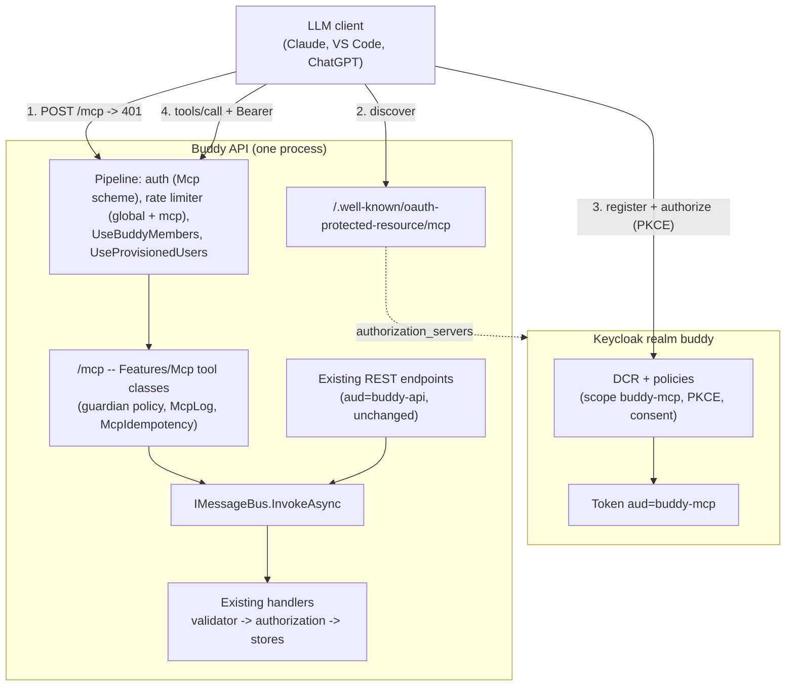

# MCP Server

Status: Proposed (not yet implemented)

## Context

[Issue #82](https://github.com/kimipsen/buddy/issues/82) asks for a
[Model Context Protocol](https://modelcontextprotocol.io) (MCP) server, so a guardian can use an
LLM client (Claude, Copilot, ChatGPT and others) to read and manage family data in plain language:

- "What's on the meal plan this week?"
- "Who has night duty on Friday?"
- "Add 'pack school bag' to Emil's morning routine."

The issue proposes the scope below. Each point gets a decision in this document.

- An HTTP (streamable) MCP server, optionally also stdio, that wraps the existing API and doesn't
  touch Marten directly.
- Sign-in through Keycloak (realm `buddy`) with the user's own account, with no shared service
  accounts.
- Read-only tools first. Write tools come later, behind explicit confirmation.
- Tools kept in sync with `docs/backend/openapi/buddy.json`.
- Privacy: log tool calls, rate-limit them, and expose nothing beyond what the UI shows.

Nothing like this exists in Buddy today. The closest precedents:

- **The meal-plan AI assistant**
  ([ai-assistant-meal-filter.md](ai-assistant-meal-filter.md),
  [gdpr-data-protection.md, Question 6](gdpr-data-protection.md#question-6-the-ai-assistant)).
  It is the only place where Buddy data goes to an LLM. There the model's tools
  (`propose_assignment`, `get_calendar_conflicts`) only draft changes. The guardian applies the
  draft in the UI (`ApplyAiSessionDraft`). The roles are reversed in the MCP case: there, the LLM
  is the guardian's own client, and Buddy is the tool server.
- **iCal feeds** ([mealplan-ical-feed.md](mealplan-ical-feed.md),
  [night-duty-ical-feed.md](night-duty-ical-feed.md)). These are the other way third-party clients
  read family data. They have their own rate-limit policy and a token that can be revoked.
- **Feature flags** ([feature-flags.md](feature-flags.md)). Each installation turns on or off what
  it offers.

Buddy is hosted per family ([feature-flags.md](feature-flags.md#context)). Each installation has
its own API domain, Keycloak and operator. So "the MCP server" means one MCP endpoint per
installation, not a central service.

This document answers seven questions:

1. Where the server runs.
2. What a tool calls.
3. How the tool catalogue is defined and kept in sync.
4. How clients authenticate.
5. Who may use it.
6. Which writes are exposed and how.
7. What it means for privacy and rate limiting.

## Question 1: in the API process, a separate service, or a local stdio process?

**Decision: in the API process, as a new feature `Features/Mcp`. It serves the streamable HTTP
transport at `/mcp`, is stateless, is built on the official C# SDK
(`ModelContextProtocol.AspNetCore`), and is off unless the installation sets `Features:Mcp=true`.**

- **Nothing new to operate.** The family's operator already runs the API behind Caddy
  ([deploy/Caddyfile](../../../deploy/Caddyfile)) or on Azure Container Apps. `/mcp` is one more
  route on `{$API_DOMAIN}`. A separate service would be a fourth image to publish
  ([publish-docker-images.md](publish-docker-images.md)), a fourth container, and one more
  Caddy/Azure route for every installation.
- **The whole request pipeline still applies.** Forwarded headers, security headers, exception
  handling, authentication, the rate limiter, `UseBuddyMembers` and `UseProvisionedUsers`
  ([Program.cs](../../../src/backend/buddy/Program.cs)) all run before an endpoint with
  authorization metadata. `/mcp` is such an endpoint. A tool call is just another authorized
  request.
- **Stateless.** The SDK's `Stateless = true` mode keeps no server-side session between requests.
  So Azure Container Apps can run several replicas without session affinity, the same way the
  per-replica rate limiter already assumes
  ([RateLimitingFeature.cs](../../../src/backend/buddy/Common/RateLimiting/RateLimitingFeature.cs)).
  v1 needs no server-to-client features (sampling, progress notifications) that would need a
  session.
- **Off by default.** This breaks the "every flag defaults to on" rule in
  [`FeatureOptions`](../../../src/backend/buddy/Common/FeatureFlags/FeatureOptions.cs). Unlike
  Mealie, which stays inert until a guardian connects a server, turning MCP on changes the
  installation's attack surface: a new public endpoint and, in Keycloak, a client-registration
  path (Question 4). The operator should decide that deliberately. When the flag is off, `/mcp`
  and its metadata route aren't mapped, so they answer routing's 404, like any other disabled
  feature.

Considered and rejected:

- **A separate service (sidecar or container).** It would have to call the API over HTTP with the
  user's token. The MCP spec forbids token passthrough: the server must not forward the token the
  client gave it. So it would need an RFC 8693 token exchange in Keycloak and a second service
  identity, which means more moving parts for a per-family install. Every call would also pay
  for a second auth and a second rate-limit check.
- **A local stdio process.** The guardian would run a binary that holds a refresh token on their
  machine. That doesn't work for web clients (claude.ai connectors, ChatGPT), puts long-lived
  credentials on laptops, and would be a second distribution channel to maintain. Remote HTTP
  covers every current client. Clients that only speak stdio can use a generic stdio-to-HTTP
  bridge (`mcp-remote`). Revisit only if a real need shows up.

## Question 2: what does a tool call -- HTTP endpoints, Wolverine handlers, or Marten?

**Decision: each tool builds the slice's existing command or query record and sends it with
`IMessageBus.InvokeAsync<Result<T>>`, exactly as the endpoint does. It then maps the `Result<T>`
to an MCP tool result. Tools never touch a store or Marten.**

The issue says "wrap the endpoints so validation, authorization and `Result<T>` are reused". In
this codebase, all three live in the handler, not the endpoint. The endpoint only maps HTTP to a
command and a `Result` to a status code. From
[`ListNights.Endpoint.cs`](../../../src/backend/buddy/Features/NightDuty/ListNights/ListNights.Endpoint.cs)
and
[`ListNights.Handler.cs`](../../../src/backend/buddy/Features/NightDuty/ListNights/ListNights.Handler.cs):

```csharp
// Endpoint: HTTP in, Result -> status code out
var query = ListNights.FromClaims(principal, new UserId(childId), from, to);
var result = await bus.InvokeAsync<Result<IReadOnlyCollection<Night>>>(query, cancellationToken);

// Handler: validation, then authorization, then work
if (await validator.ValidateCommandAsync(query, cancellationToken) is { } problem) { ... }
var access = await NightDutyAuthorization.CheckView(query.ChildId, query.UserId, guardians, cancellationToken);
```

A tool is therefore a second, thin adapter over the same handler:

```csharp
[McpServerToolType]
public sealed class NightDutyTools(IMessageBus bus, IHttpContextAccessor http)
{
    [McpServerTool(Name = "list_night_duty", ReadOnly = true, Idempotent = true),
     Description("Who is on night duty for a child, night by night, between two dates (inclusive, max 92 days).")]
    public async Task<CallToolResult> ListNightDuty(Guid childId, DateOnly from, DateOnly to, CancellationToken ct)
    {
        var query = ListNights.FromClaims(http.HttpContext!.User, new UserId(childId), from, to);
        var result = await bus.InvokeAsync<Result<IReadOnlyCollection<Night>>>(query, ct);
        return McpResults.From(result);   // Success -> structured content; Validation -> isError with the field errors;
                                          // NotFound/Forbidden -> isError "not found" (same collapse as the endpoint)
    }
}
```

These come for free:

- the validators;
- the `NotFound` collapse ("can't tell private from missing");
- optimistic concurrency (`StreamVersionScopeMiddleware` is Wolverine middleware, not HTTP);
- the health-data read audit logs, which the handlers write
  ([`HealthDataAccessPath`](../../../src/backend/buddy/Common/Observability/HealthDataAccessPath.cs),
  for example in `ListSleepDiaryEntries.Handler.cs`).

One shared `McpResults.From<T>` does the mapping. Error results reuse the `ErrorEnvelope` codes,
so the model sees `validation_failed` with field errors, not prose it has to parse.

Considered and rejected:

- **Loopback HTTP calls to our own endpoints.** This means token passthrough again (Question 1),
  a second auth check and a second rate-limit check for each call, and request bodies built by
  hand. It reuses nothing that `InvokeAsync` doesn't already reuse.
- **Reading Marten from tools.** This skips validation and authorization, which the issue
  explicitly rules out.

## Question 3: a generated or a curated tool catalogue?

**Decision: a curated, hand-written catalogue. About 15 read tools in v1, with snake_case names,
one tool class per feature, and descriptions written for a model. Drift is caught by the
compiler, by a feature-flag test and by a golden-file snapshot of `tools/list`, not by generating
tools from the OpenAPI document.**

- **The API is too big to expose as it is.** It has 253 `*.Endpoint.cs` slices. Clients degrade
  well before that many tools: tool selection gets worse, and every tool's schema costs context
  tokens on every turn. Many slices are UI plumbing that an assistant should never call:
  onboarding progress, iCal tokens, AI provider keys, share links, Mealie image proxying.
- **Endpoints are shaped for the UI, not for a model.** The frontend resolves "Emil" to a
  `childId` and "this week" to dates. A model needs `list_children` and `get_today` to do the
  same, and descriptions that say what the dates mean, what the limits are and which ids come
  from which tool.
- **Drift is already a compile error.** Tools construct the same command records as the
  endpoints. Renaming or re-signing `ListNights` breaks the tool's build, which is stronger than
  an OpenAPI diff.
- **A golden-file test** (same idea as the `EventShapeTests`) snapshots `tools/list`: names,
  descriptions, input schemas and annotations. Every change to what clients see becomes a
  reviewed diff.
- **A feature-flag test** checks that turning a feature off removes its tools. Tools register per
  feature, from `features`, the same way `Map*Feature` calls are skipped
  ([feature-flags.md](feature-flags.md)).

### v1 tool catalogue (read-only)

| Tool                        | Wraps                                                 | Flag          |
| --------------------------- | ----------------------------------------------------- | ------------- |
| `whoami`                    | `GetCurrentUser` (name, language, time zone)          | --            |
| `get_today`                 | the caller's local date and time from their time zone | --            |
| `list_children`             | `ListMyChildren`                                      | --            |
| `list_groups`               | `ListGroups`                                          | --            |
| `list_calendars`            | `ListCalendars`                                       | --            |
| `list_calendar_occurrences` | `ListOccurrences` (per calendar, `from`/`to`)         | --            |
| `list_meal_plan`            | `ListMealPlan` / `ListMealPlanForGroup`               | Mealplans     |
| `list_meals`                | `ListMeals` (library, ratings)                        | Mealplans     |
| `list_night_duty`           | `ListNights`                                          | NightDuty     |
| `list_pickups`              | `ListPickupSchedule`                                  | Pickups       |
| `list_task_templates`       | `ListTaskTemplates`                                   | TaskLibrary   |
| `list_house_rules`          | `ListRules`                                           | HouseRules    |
| `list_sleep_diary`          | `ListSleepDiaryEntries`                               | SleepDiary    |
| `list_work_days`            | `ListWorkDays`                                        | WorkLocations |
| `get_child_progress`        | `GetChildProgress`                                    | Progress      |

Medicines, effect notes, feelings and visit summaries are left out of v1 on purpose (Question 7).
`list_sleep_diary` is the one health-data tool in v1, because the issue names it. See
[Remaining open questions](#remaining-open-questions).

## Question 4: how does a client authenticate?

**Decision: OAuth 2.1 against the installation's own Keycloak, as the MCP authorization spec
requires. The API serves RFC 9728 protected-resource metadata that points at the `buddy` realm.
Tokens for `/mcp` must carry a dedicated audience, `buddy-mcp`, which is validated by a second
JwtBearer scheme that only `/mcp` accepts. Clients register through Keycloak's anonymous dynamic
client registration (RFC 7591), limited by client-registration policies. A pre-registered public
client, `buddy-mcp`, covers clients that let the user enter a client id.**

### Discovery

The SDK's `AddMcp()` authentication handler answers an unauthenticated call with
`401 WWW-Authenticate: Bearer resource_metadata=...`. It also serves
`/.well-known/oauth-protected-resource/mcp` with
`authorization_servers: ["https://{AUTH_DOMAIN}/realms/buddy"]` and `scopes_supported: ["buddy-mcp"]`.
The issuer comes from `KeycloakOptions.ValidIssuer ?? Authority`, the same public URL that
[`OpenApiFeature.cs`](../../../src/backend/buddy/Common/OpenApi/OpenApiFeature.cs) already uses.

### A separate audience

Today one JwtBearer scheme validates `aud = buddy-api` for everything
([`UsersFeature.cs:70-88`](../../../src/backend/buddy/Features/Users/UsersFeature.cs)):

```csharp
services.AddAuthentication(JwtBearerDefaults.AuthenticationScheme)
    .AddJwtBearer();
// ... Audience = keycloak.Audience
```

It becomes:

```csharp
services.AddAuthentication(JwtBearerDefaults.AuthenticationScheme)
    .AddJwtBearer()                                   // unchanged: aud = buddy-api
    .AddJwtBearer(McpAuth.Scheme, /* same authority, aud = buddy-mcp */)
    .AddMcp(McpAuth.MetadataScheme, o => o.ResourceMetadata = ...);

app.MapMcp("/mcp").RequireAuthorization(McpAuth.Policy);  // policy: scheme Mcp, buddy-guardian group
```

The MCP spec says a server must only accept tokens issued for itself. With a separate audience:

- a token minted for an LLM client can't be replayed against the REST API;
- a frontend token can't be used against `/mcp`;
- revoking the LLM client's grant in Keycloak doesn't touch the guardian's browser session.

`UserIdClaimsTransformation` and the claim types are shared, so `GetRequiredUserId()` works
unchanged. Blast radius: one registration method plus the realm files. No endpoint changes,
because every existing endpoint keeps the default scheme.

Keycloak's support for RFC 8707 resource indicators is still experimental. So `buddy-mcp` is
added through an audience mapper on a `buddy-mcp` client scope, not from the `resource`
parameter. Clients send `resource` anyway, and Keycloak ignores it.

### Client registration

MCP clients have no client id for a self-hosted Buddy until they register.

- **DCR with policies.** Keycloak supports anonymous DCR. The realm gets client-registration
  policies that:
  - allow only the `buddy-mcp` scope;
  - force public clients with PKCE (S256);
  - require consent;
  - cap the number of registered clients.

  The consent screen shows the client's name, so the guardian sees _which_ app they are letting
  in.

- **CIMD (client ID metadata documents)** is now the spec's preferred mechanism, but it is
  experimental in Keycloak (`--features=cimd`). Planned as the replacement once Keycloak marks it
  supported (open question).
- **The pre-registered public `buddy-mcp` client** (PKCE, loopback redirect URIs) serves
  CLI/IDE clients that accept a configured client id, and the integration tests.

All three realm files change together, and
[`KeycloakParityTests`](../../../src/backend/buddy.IntegrationTests/Meta/KeycloakParityTests.cs)
keeps them in step:

- [`.devcontainer/keycloak/buddy-realm.json`](../../../.devcontainer/keycloak/buddy-realm.json)
- [`TestRealm.json`](../../../src/backend/buddy.IntegrationTests/Fixtures/TestRealm.json)
- the deploy Keycloak image ([`deploy/azure/keycloak/Dockerfile`](../../../deploy/azure/keycloak/Dockerfile))

Considered and rejected:

- **Reusing `aud = buddy-api`.** Simpler, but one stolen token would then work on both surfaces,
  and it breaks the spec's audience rule.
- **API keys or personal access tokens issued by Buddy.** That means a new secret type to hash,
  revoke and rotate. It isn't how MCP clients authenticate, and it bypasses Keycloak's session
  and consent model.
- **A shared service account.** The issue rules it out: every call must run as the signed-in
  guardian.

## Question 5: who may use it?

**Decision: guardians only. The `/mcp` policy requires the `buddy-guardian` group. A child
account gets `403 not_a_buddy_guardian` before any tool runs.**

- Child accounts belong to children with ADHD, often young. The child UI is deliberately reduced
  ([child-day-dashboard.md](../../frontend/analysis/child-day-dashboard.md)). An LLM that can list
  everything the child's token can see is not "no more than the UI shows", which is the issue's
  own rule.
- Guardian-level access needs no new rules. Every handler already decides `Manage`/`View`/
  `NotFound` from `GuardianLink`s and group membership. A guardian sees through MCP exactly what
  they see in the app, and a revoked link drops to `NotFound` at once.
- `UseBuddyMembers` and `UseProvisionedUsers` run first, as they do for every authorized
  endpoint. An account in neither Keycloak group is still turned away with
  `403 not_a_buddy_member`.

Adding child access later is additive: a second policy and a separate, smaller tool list, if a
family asks for it.

## Question 6: which writes, and how are they made safe?

**Decision: v1 ships read-only. Phase 2 adds a short allowlist of write tools.**

- Each write tool is annotated `destructiveHint`/`idempotentHint`, so clients ask the guardian
  before calling it.
- Create-style tools take a required `idempotencyKey` argument, which goes through the existing
  `IdempotencyKeyRepository`.
- Some operations are never exposed (listed below).

MCP clients already show and confirm tool calls. Claude, VS Code and ChatGPT ask before a
non-read-only tool runs, and the annotations are how a server asks for that. That is the
"explicit confirmation" the issue wants, without inventing a draft/apply flow per feature, as the
AI assistant needed. MCP _elicitation_ (a server-initiated "are you sure?") would need a stateful
session (Question 1) and isn't supported by every client yet, so it isn't used.

### Phase 2 allowlist

| Tool                   | Wraps               | Why it is safe                                                                        |
| ---------------------- | ------------------- | ------------------------------------------------------------------------------------- |
| `assign_meal`          | `AssignMealToSlot`  | Full overwrite of one slot; idempotent by construction                                |
| `clear_meal_slot`      | `ClearMealSlot`     | Idempotent no-op when already empty                                                   |
| `set_night_duty`       | `SetNightOverrides` | Per-night overwrite; the pattern stays                                                |
| `log_sleep_night`      | `LogSleepEntry`     | Full overwrite of one date ([sleep-diary.md](sleep-diary.md))                         |
| `set_task_completion`  | `SetTaskCompletion` | Sets a boolean                                                                        |
| `create_calendar_item` | `CreateItem`        | Create-style: needs `idempotencyKey`                                                  |
| `add_subtask`          | `AddSubtask`        | Create-style: needs `idempotencyKey` ("add 'pack school bag' to the morning routine") |

### Idempotency

[`IdempotencyKeyMiddleware`](../../../src/backend/buddy/Common/Idempotency/IdempotencyKeyMiddleware.cs)
only looks at POSTs with an `Idempotency-Key` header. Every MCP call is a `POST /mcp` with no such
header, so the middleware passes it through, which is correct. Create-style tools use the same
[`IdempotencyKeyRepository`](../../../src/backend/buddy/Common/Idempotency/IdempotencyKeyRepository.cs)
(`TryReserveAsync` / `CompleteAsync` / `ReleaseAsync`) inside a small `McpIdempotency` helper:

- the key is `mcp:{tool}:{idempotencyKey}`, under the caller's `UserId`;
- the fingerprint is the tool name plus the canonical JSON of the arguments;
- the stored response is the tool result.

A model retrying after a timeout gets the first result back. Reusing a key with different
arguments gets `idempotency_key_reused`, the same code the HTTP API returns.

### Never exposed

- Deleting a child, an account, a calendar or a group; erasure; export.
- Resetting a child's password; invitations (guardian, group) and accepting them.
- Anything that mints a secret: iCal tokens, sleep-diary, feelings and visit-summary share links.
  The secret would end up in the LLM provider's transcript.
- AI provider keys, the Mealie connection, the meal-plan import, feature settings.
- Medicine schedule changes and dose status. These are health actions with real-world
  consequences, so they stay in the app.

## Question 7: privacy, auditing and rate limits

**Decision: tell the guardian and the operator that MCP sends family data to the guardian's own
LLM provider. Log one structured line per tool call. Rate-limit tool calls with a new `mcp`
policy on top of the global per-user bucket.**

- **Disclosure, not acknowledgement.** The AI assistant records `AiDataSharingAcknowledged`
  because _Buddy_ sends the data to a provider on the family's key
  ([gdpr-data-protection.md, Question 6](gdpr-data-protection.md#question-6-the-ai-assistant)).
  With MCP, the guardian's own client fetches the data under the guardian's own consent in
  Keycloak, so the guardian is the one who shares it. The setup guide (`docs/mcp-setup.md`) and
  [PRIVACY.md](../../../PRIVACY.md) say what each tool returns and that it ends up with whichever
  LLM provider the client uses. The Keycloak consent screen names the `buddy-mcp` scope with a
  description of the same.
- **Health data minimization.** Medicines, effect notes, feelings and visit summaries stay out of
  v1, and `list_sleep_diary` is the only health tool. The handlers' existing health-data read logs
  apply unchanged. The tool log line adds the channel (below), so the operator can tell an MCP
  read from an app read.
- **Audit log.** `McpLog.ToolCalled(tool, userId, outcome, durationMs)` is a source-generated
  `LoggerMessage`, as in `NightDutyLog`, plus an `mcp.tool` activity tag so the existing
  OpenTelemetry pipeline ([ObservabilityFeature.cs](../../../src/backend/buddy/Common/Observability/ObservabilityFeature.cs))
  carries it. Argument _values_ are never logged. They hold free text and health data.
- **Rate limiting.** Each tool call is its own HTTP request, so the global authenticated token
  bucket already applies. A new `McpPolicy` (fixed window, `mcp:{CallerKey}`, configurable under
  `RateLimiting:Mcp`) caps how fast an agent loop can fire calls, like `AiAssistantPolicy` does.
  [rate-limiting.md](rate-limiting.md) gets a row.
- **Revocation.** The guardian removes the client's grant in the Keycloak account console, under
  "Applications". The operator can delete dynamically registered clients in the admin console.
  The setup guide documents both.

## Routes

```text
POST   /mcp                                        MCP streamable HTTP (JSON-RPC: initialize, tools/list, tools/call)
GET    /mcp                                        405 (stateless: no server-to-client stream)
DELETE /mcp                                        405 (stateless: no session to end)
GET    /.well-known/oauth-protected-resource/mcp   RFC 9728 metadata (anonymous)
```

`/mcp` is excluded from the OpenAPI client contract
([openapi-client-contract.md](openapi-client-contract.md)). The MCP protocol describes it, and
the generated TypeScript client has no use for it.

## Frontend

None in v1. Connecting is done in the LLM client, with the API's `/mcp` URL from the setup guide.
A "Connected AI apps" card on the profile page (listing and revoking grants through Keycloak) is
an open question below. If it is accepted, it will need a mockup and screenshots.

## Testing

Alba integration tests in `buddy.IntegrationTests/Features/Mcp/`, against the real Keycloak
container ([BuddyApiFixture.cs](../../../src/backend/buddy.IntegrationTests/Fixtures/BuddyApiFixture.cs)),
with tokens from the `buddy-mcp` test client:

- **Discovery:** an unauthenticated `POST /mcp` returns 401 with `resource_metadata`, and the
  metadata document names the realm.
- **Audience:** a `buddy-api` token on `/mcp` gets 401, and a `buddy-mcp` token on a REST
  endpoint gets 401.
- **Role:** a child token gets 403. A non-member gets `403 not_a_buddy_member`.
- **Read:** `list_night_duty` for the caller's child returns the nights. For a child they aren't
  linked to, it returns an `isError` "not found", and the same after a revoked `GuardianLink`.
- **Validation:** `from > to` returns `isError` with `validation_failed` field errors.
- **Write (phase 2):** `create_calendar_item` with the same `idempotencyKey` twice creates one
  item and returns the same result. The same key with different arguments returns
  `idempotency_key_reused`.
- **Feature flags:** `Features:Mcp=false` makes `/mcp` 404. `Features:NightDuty=false` removes
  `list_night_duty` from `tools/list`.
- **Golden file:** a `tools/list` snapshot.

The issue's acceptance criteria map one to one onto these: connect, authenticate and list tools;
family-scoped reads; guardian-only idempotent writes; at least one read and one write tested; a
setup doc.

## Failure and edge-case behavior

| Case                                                  | Behavior                                                                                         |
| ----------------------------------------------------- | ------------------------------------------------------------------------------------------------ |
| `Features:Mcp` off                                    | `/mcp` and the metadata route are not mapped and return 404                                      |
| No or expired token                                   | 401 with `WWW-Authenticate: Bearer resource_metadata=...`; the client refreshes or re-authorizes |
| Token for `buddy-api`                                 | 401 (wrong audience)                                                                             |
| Child account                                         | 403 `not_a_buddy_guardian`; no tool runs                                                         |
| Child or calendar not linked to the caller            | Tool result `isError`, "not found": the same `NotFound` collapse as the endpoint                 |
| Guardian's `GuardianLink` revoked mid-conversation    | The next call returns not found; nothing is cached                                               |
| Validator failure                                     | `isError` with the `ErrorEnvelope` code and field errors, so the model can correct and retry     |
| Concurrency conflict                                  | `isError` `concurrency_conflict`; the model can re-read and retry                                |
| Feature turned off after a client cached `tools/list` | The tool is no longer registered, and the call returns the JSON-RPC "unknown tool" error         |
| Rate limited                                          | HTTP 429 with `Retry-After`, as for every endpoint                                               |
| Retried create with the same `idempotencyKey`         | First result replayed; nothing created twice                                                     |
| Same key, different arguments                         | `isError` `idempotency_key_reused`                                                               |
| Account erased                                        | The token's subject no longer resolves, and `UseProvisionedUsers` rejects it as for the app      |

## Estimate

|                  |                                                                                                                                                                                                             |
| ---------------- | ----------------------------------------------------------------------------------------------------------------------------------------------------------------------------------------------------------- |
| Complexity       | Medium -- no aggregate or events, but a second auth scheme, Keycloak realm and DCR policy changes in three realm files, a new protocol surface, 15 read tools (7 write tools in phase 2), and a setup guide |
| Single developer | 6-9 days (v1 read-only: 4-6 days; phase 2 writes: 2-3 days)                                                                                                                                                 |
| AI agent         | 4-6 hours, plus 2-3 hours of human review and hands-on testing with real MCP clients (Claude, VS Code), which the agent can't do end to end                                                                 |

## Decisions made

| Question          | Decision                                                                                                                                                                     |
| ----------------- | ---------------------------------------------------------------------------------------------------------------------------------------------------------------------------- |
| Where it runs     | In the API process, `Features/Mcp`, stateless streamable HTTP at `/mcp`, behind `Features:Mcp` (default off)                                                                 |
| What a tool calls | The slice's command/query via `IMessageBus`, reusing validation, authorization, audit logs and `Result<T>`                                                                   |
| Tool catalogue    | Hand-written and curated (~15 read tools), with golden-file and feature-flag tests; not generated from 253 endpoints                                                         |
| Authentication    | Keycloak OAuth 2.1 + PKCE, RFC 9728 metadata, dedicated `buddy-mcp` audience and JwtBearer scheme, DCR with policies plus a pre-registered client                            |
| Who               | Guardians only; children get 403                                                                                                                                             |
| Writes            | Read-only v1; phase 2 allowlist with MCP annotations and `idempotencyKey` through `IdempotencyKeyRepository`; destructive, secret-minting and medicine actions never exposed |
| Privacy           | Disclosure in the setup guide and PRIVACY.md; per-call log without argument values; `mcp` rate-limit policy; health tools limited to the sleep diary                         |

## Remaining open questions

- **Should `Features:Mcp` default to off?** Lean: yes, because it opens a client-registration
  path in Keycloak. Defaulting to on would match every other flag, but would expose DCR on every
  installation that upgrades.
- **Which health data, if any, belongs in v1?** Lean: the sleep diary only, as the issue lists.
  Medicines (today's doses, read-only) are the most likely next request ("did Emil get his
  morning dose?"). Adding them is one tool, but it widens what reaches an LLM provider, so it
  should be a decision, not a default.
- **DCR now, or wait for CIMD?** Lean: DCR with policies now, because every current client
  supports it. Move to CIMD when Keycloak marks the `cimd` feature supported. That is a realm
  change, not a code change.
- **Phase 2 allowlist.** Is the write list above the right first set? `add_subtask` changes a
  template that every scheduled copy uses, so it may need a narrower scope.
- **A "Connected AI apps" card on the profile page?** Lean: not in v1. The Keycloak account
  console already lists and revokes grants. A Buddy-side card would need the Keycloak admin API
  (`IKeycloakAdminClient`), i18n, a mockup and screenshots.
- **Child access.** Lean: never by default. If wanted, it would be a separate, minimal tool list
  ("what's my day?") behind its own flag.

## Diagram


