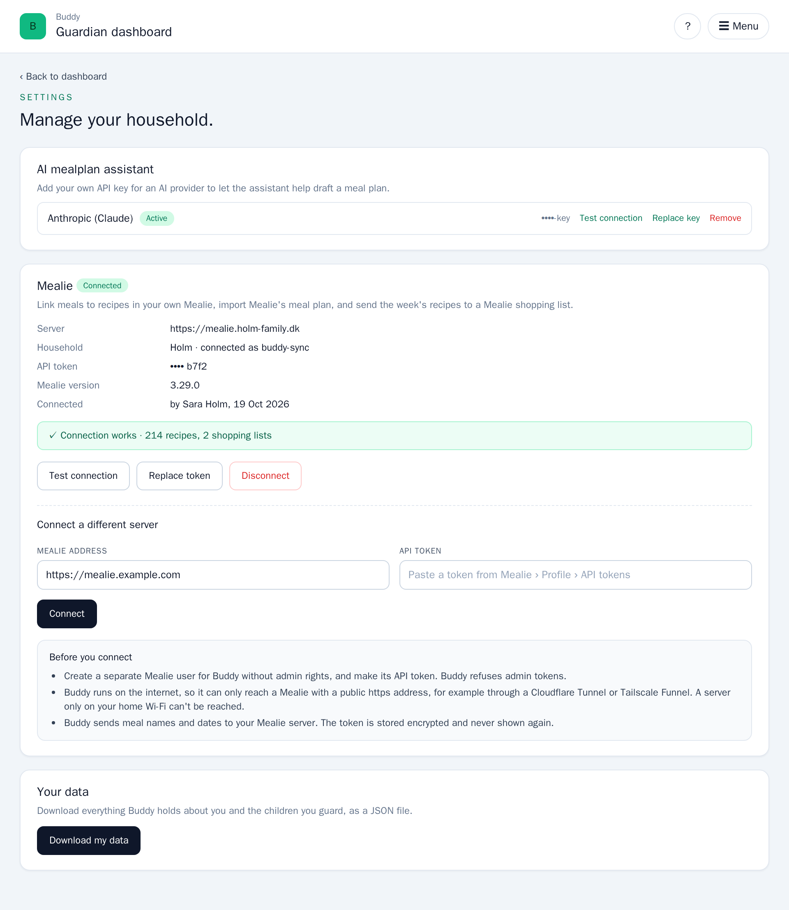
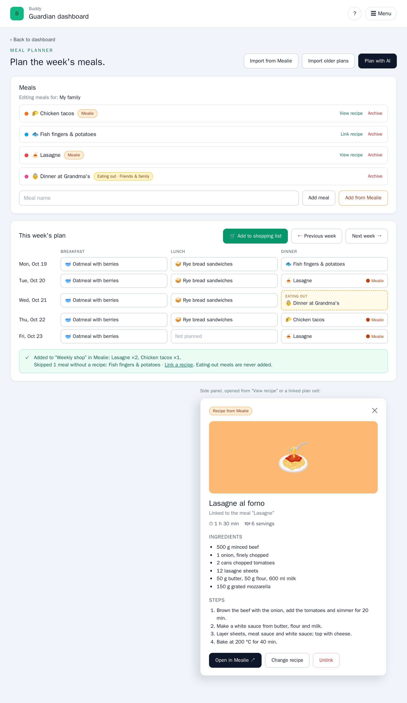
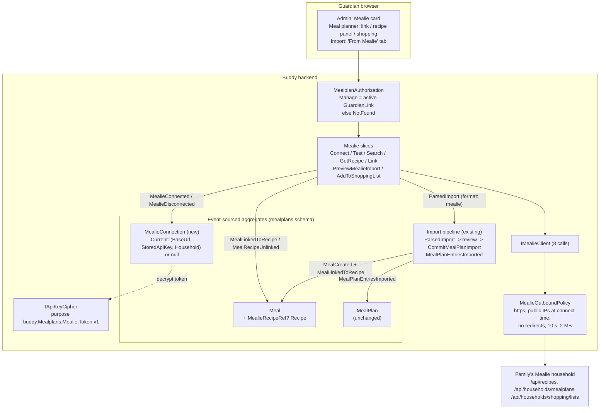

# Mealie integration

Status: Implemented. `Features/Mealplans/Mealie/` ships the `MealieConnection` aggregate
(`MealieConnectionInitialized`, `MealieConnected`, `MealieDisconnected`), the `MealLinkedToRecipe` /
`MealRecipeUnlinked` events on `Meal`, `IMealieClient` behind `MealieOutboundPolicy`, and 13 slices
(`GetMealieConnection`, `ConnectMealie`, `DisconnectMealie`, `TestMealieConnection`,
`SearchMealieRecipes`, `GetMealieRecipe`, `GetMealieRecipeImage`, `LinkMealToRecipe`,
`UnlinkMealRecipe`, `CreateMealFromRecipe`, `PreviewMealieImport`, `ListMealieShoppingLists`,
`AddMealPlanToMealieShoppingList`), plus `CommitMealPlanImport` accepting `format: "mealie"`. The
frontend has the Mealie card on `/guardian/admin`, recipe links and the recipe panel in the meal
library, "Add to shopping list" in the week plan and a Mealie source on `/guardian/mealplan/import`.
Family routes only; the phase 2 mirror is not built.

## Context

[Mealie](https://mealie.io/) is a self-hosted recipe manager. Many families who cook from a recipe
collection run it at home (Docker on a NAS or a small server). It holds the family's recipes
(ingredients, steps, photos, scraped from any recipe site), has its own meal planner and builds
shopping lists from recipes. A family that uses both Mealie and Buddy keeps two meal plans today:
the cooking one in Mealie and the child-facing one in Buddy. The question is what it would take to
connect the two so a guardian doesn't type the same week twice and Buddy's meals can point at a
real recipe.

What Mealie offers, verified against the v3.29.0 OpenAPI spec (`/openapi.json` on
`demo.mealie.io`, released 2026-10-17) and its source on the `mealie-next` branch:

| Area                | What Mealie has                                                                                                                                                                                                                                                                                                                                       |
| ------------------- | ----------------------------------------------------------------------------------------------------------------------------------------------------------------------------------------------------------------------------------------------------------------------------------------------------------------------------------------------------- |
| Tenancy             | A **group** is an isolated tenant. A **household** (since v2) is part of a group: it shares the group's recipes but has its own meal plans, shopping lists, webhooks and notifiers. A user belongs to one household, and `/api/households/*` acts on the caller's household.                                                                          |
| Auth                | Long-lived API token per user (`/user/profile/api-tokens`, or `POST /api/users/api-tokens`), sent as `Authorization: Bearer <token>`. A JWT valid for 5 years, checked against the database, so revoking it works. **No scopes**: a token can do everything its user can. OIDC exists, but only for logging in to Mealie itself.                      |
| Meal plan           | `GET/POST /api/households/mealplans` (`start_date`, `end_date`, paginated), `GET/PUT/DELETE /api/households/mealplans/{id}` with an **integer** id. Entry: `date`, `entryType` (`breakfast, lunch, dinner, side, snack, drink, dessert`), `title`, `text`, `recipeId` (uuid or null). `ReadPlanEntry` has **no `updatedAt`**.                         |
| Recipes             | `GET /api/recipes?search=&page=&perPage=` returns `RecipeSummary` (`id` uuid, `slug`, `name`, `image`, `totalTime`, `recipeYield`, `tags`, `recipeCategory`, `updatedAt`, ...). `GET /api/recipes/{slug}` adds `recipeIngredient[].display`, `recipeInstructions[].text` and `nutrition`. Images: `/api/media/recipes/{id}/images/min-original.webp`. |
| Shopping            | `GET /api/households/shopping/lists`. `POST /api/households/shopping/lists/{id}/recipe` takes a bulk array of `{recipeId, recipeIncrementQuantity}` and adds every ingredient of those recipes, merging equal foods.                                                                                                                                  |
| Change notification | Household **webhooks** run on a daily schedule and post that day's meal plan, so they can't drive a sync. **Notifiers** (Apprise, `json://` URL) fire on `mealplan_entry_created/updated/deleted` with ids only, unsigned and best-effort.                                                                                                            |
| Other               | Pagination is `{page, per_page, total, total_pages, items}`. No rate limit, **no CORS in production** (a browser can't call it), no ETags. Breaking changes ship in minor releases, every 1-3 weeks (v3.25 changed the auth refresh, v3.26 restricted Mealie's own outbound calls). Licence AGPL-3.0. Danish UI translation exists.                   |

The [AGPL](https://github.com/mealie-recipes/mealie/blob/mealie-next/LICENSE) has no effect on a
program that only calls Mealie's HTTP API, so Buddy can integrate as long as it doesn't copy or
bundle Mealie's code. There's a community .NET client (`MealieSharp` on NuGet, Kiota-generated),
but it targets Mealie 3.14 and has a few hundred downloads.

What Buddy has today
([mealplans.md](mealplans.md), [docs/backend/mealplans/flow.md](../mealplans/flow.md)):

- A family-wide **meal library** of `Meal` aggregates: name, description, icon, colour,
  `EatingOut`, per-child ratings
  ([`Meal.cs`](../../../src/backend/buddy/Features/Mealplans/Types/Meal.cs)). A meal has **no
  recipe, ingredients, servings or external id**, and Buddy has no shopping list.
- One `MealPlan` per family: `(DateOnly, MealSlot) -> MealPlanAssignment(MealId, AssignedBy,
Notes)` with four slots (`Breakfast, Lunch, Dinner, Snack`).
- Children see the plan (`/child/mealplan`, interleaved in their calendar) and rate meals. Guardians
  get the AI assistant ([eating-out-meals.md](eating-out-meals.md),
  [ai-assistant-meal-filter.md](ai-assistant-meal-filter.md)), the iCal feed
  ([mealplan-ical-feed.md](mealplan-ical-feed.md)) and the history import
  ([mealplan-import.md](mealplan-import.md)).
- The closest precedents:
  - [`AiProviderCredential`](../../../src/backend/buddy/Features/Mealplans/AiAssistant/Types/AiProviderCredential.cs):
    a family-wide, lazily created stream holding a secret encrypted with `IApiKeyCipher`
    (Data Protection), resolved for the family by
    [`MealFamilyResolution`](../../../src/backend/buddy/Features/Mealplans/MealFamilyResolution.cs).
  - The **import** pipeline: `IMealPlanImportFormat`, a stateless preview and commit,
    `MealPlanEntriesImported` with provenance and revert, and "an import never overwrites"
    ([mealplan-import.md, Question 5](mealplan-import.md#question-5-how-the-plan-is-written)).
  - The AI provider adapters: raw `HttpClient` typed clients, no SDK
    ([`Providers/`](../../../src/backend/buddy/Features/Mealplans/AiAssistant/Providers)).

Nothing in Buddy calls a URL that a user typed in. Every outbound host today (Anthropic, OpenAI,
Gemini, Keycloak, SMTP) is fixed in configuration. A Mealie base URL is the first user-supplied
outbound target, which brings server-side request forgery (SSRF) with it.

This document answers eight questions: what to integrate (and in which direction), where the
connection lives, how Buddy reaches the instance safely, how a meal points at a recipe, how a
Mealie plan gets into Buddy, how shopping works, who may do what, and how the client is built and
tested.

## Question 1: what to integrate, and in which direction?

**Decision: Buddy stays the source of truth for the family's meal plan. v1 is four one-shot,
guardian-triggered capabilities, and nothing syncs in the background:**

1. **Connect** a family to one Mealie household (base URL and API token).
2. **Link** a Buddy meal to a Mealie recipe, create a meal from a recipe, and show the recipe
   (photo, ingredients, steps) on the meal.
3. **Import** a Mealie meal plan date range into Buddy, through the existing import preview and
   commit.
4. **Shop:** add the recipes of a Buddy plan date range to a Mealie shopping list.

**A one-way mirror of Buddy's plan into Mealie (Buddy → Mealie, in the background) is phase 2.**
**Two-way sync is rejected.**

Possible scopes, smallest first:

| Scope                             | What a family gets                                                                    | Cost                                                                                                                      |
| --------------------------------- | ------------------------------------------------------------------------------------- | ------------------------------------------------------------------------------------------------------------------------- |
| Recipe links only                 | "Open recipe" on a meal                                                               | Small, but no time saved                                                                                                  |
| **v1: links + import + shopping** | No double typing in either direction, recipes on meals, a shopping list from the week | One connection aggregate, two meal events, a typed client, no background work                                             |
| Phase 2: mirror Buddy → Mealie    | Mealie's own planner, "today" view and iCal show Buddy's plan                         | An outbound job with retries, an id map (Mealie ids are integers Buddy can't choose), handling for deletes made in Mealie |
| Two-way sync                      | Plan in either app                                                                    | Rejected (below)                                                                                                          |

Why Buddy stays the source of truth:

- Buddy's plan carries things Mealie has no place for: per-child ratings, `EatingOut`, slot times,
  group sharing, the child's view. Mealie's carries things Buddy has no slot for (`side`, `drink`,
  `dessert`, several entries per slot).
- The child-facing plan is what Buddy exists for. If a guardian edits Mealie and a sync job then
  silently changes what the child sees, that's a predictability problem for a child with ADHD. A
  previewed import keeps a guardian in the loop.

Two-way sync is **considered and rejected**, because:

- Mealie leaves no trace of deletes, and `ReadPlanEntry` has no `updatedAt`, so Buddy can't tell
  "deleted in Mealie" from "never synced" without keeping a full shadow copy.
- The only push channel is an unsigned, best-effort Apprise notifier that every family would have
  to configure by hand in their own Mealie.
- The slot models differ (4 vs 7 entry types, one vs many per slot), so a round trip loses data.
- Every conflict needs a rule ("who wins when both changed Tuesday's dinner?"), and each rule is a
  surprise for somebody.

The import and shopping actions are pull-on-demand. A guardian can run them weekly ("Import next
week from Mealie", "Add this week to the shopping list") and get most of the value of a sync,
without any of its failure modes.

## Question 2: where the connection lives

**Decision: a new family-wide aggregate, `MealieConnection`, in the `mealplans` schema, the same
shape as `AiProviderCredential`: created by the first connect, indexed under the connecting
child, and resolved for the family by `MealFamilyResolution` ("most recently connected wins").
The token is stored encrypted with Data Protection under its own purpose string.**

Unlike an AI key, a connection is only resolved within the requested child's current family: a
guardian's unlinked children don't count, even when that guardian made the connection. A Mealie
token is a whole Mealie user, so a guardian who leaves a family must not keep using its Mealie, or
overwrite it by reconnecting (found in review; `MealieFamilyAndErasureTests`).

```text
MealieConnection(
    MealieConnectionId Id,                 // UUIDv7, like AiCredentialId
    MealieConnectionDetails? Current)      // null while disconnected (never connected, or since)

MealieConnectionDetails(
    string BaseUrl,                        // normalized: scheme + host (+ port), no path
    StoredApiKey Token,                    // reused record: CipherText + Last4 + AddedBy + AddedAt
    MealieHousehold Household,             // (HouseholdId, HouseholdName, GroupId, GroupSlug)
    string MealieUserName,                 // shown in settings: "connected as buddy-sync"
    string MealieVersion,                  // from GET /api/app/about at connect time
    UserId ConnectedBy,
    DateTimeOffset ConnectedAt)
```

`Current` is one nullable record, a domain "absent" value like `AiProviderCredential.ActiveProvider`
([eliminate-nulls.md, What stays nullable](eliminate-nulls.md#what-stays-nullable)); there are no
correlated nullable fields for a union to replace.

### Events

```text
MealieConnectionInitialized(MealieConnectionId Id, UserId ChildId, DateTimeOffset OccurredAt)
    // starts the stream with the family's first connect; ChildId seeds the index document
    // (the AiCredentialsInitialized pattern)
MealieConnected(MealieConnectionId Id, string BaseUrl, StoredApiKey Token,
    MealieHousehold Household, string MealieUserName, string MealieVersion,
    UserId ConnectedBy, DateTimeOffset OccurredAt)
    // reconnecting (new URL or rotated token) appends another MealieConnected -- a full
    // overwrite, like ProviderApiKeySet
MealieDisconnected(MealieConnectionId Id, UserId DisconnectedBy, DateTimeOffset OccurredAt)
    // idempotent: disconnecting a disconnected family is Success with no event
```

`MealieConnected` is only appended after a **live check**. `ConnectMealie` calls
`GET /api/app/about` (version) and `GET /api/users/self` (user name, household and group, refusing
admin users; see Question 7), and fails with a validation problem on the field to fix if either
fails. A connection in Buddy is therefore a connection that worked at least once.

Rationale:

- **Not extending `AiProviderCredential`.** It's an AI credential with an active-provider concept
  and a data-sharing acknowledgement. Mealie has neither, and folding it in would change the shape
  of every stored `AiProviderCredentialSnapshot`.
- **Not a field on `MealPlan`.** The plan is written on every slot change. A token there would end
  up in every `MealPlanSnapshot` read, and token rotation would show up in the plan's history.
- **Reusing `StoredApiKey` and `IApiKeyCipher`.** The cipher is "the single seam every write/read
  of a stored key goes through"
  ([`IApiKeyCipher.cs`](../../../src/backend/buddy/Features/Mealplans/AiAssistant/IApiKeyCipher.cs)).
  Mealie gets its own purpose (`buddy.Mealplans.Mealie.Token.v1`), so a leaked AI ciphertext
  can't be unprotected as a Mealie token or the other way round. As built, that's a separate
  `IMealieTokenCipher : IApiKeyCipher` service (`DataProtectionMealieTokenCipher`), so
  `StoredApiKey.Create` takes it and the AI handlers don't change.
- **One household per family.** Mealie scopes meal plans and shopping lists to the token user's
  household, so the token decides the household. Picking among several isn't a choice Buddy has.

## Question 3: reaching a self-hosted instance safely

**Decision: every Mealie call goes through Buddy's backend, through one named `HttpClient`
(`mealie`) whose handler enforces an outbound policy. In production that means `https` only,
connections only to public IP addresses (checked after DNS resolution, at connect time), no
redirects, a 10-second timeout and a 2 MB response cap. A self-hosted Buddy can relax this with
`Mealie:AllowPrivateNetworks`.**

The browser can't call Mealie directly (no CORS in production, and the token must not reach the
browser), so the backend has to proxy. That gives a guardian a way to make Buddy's server send a
request to a URL of their choice. Without a guard, a base URL such as `http://db:5432`,
`http://keycloak:8080` or `http://169.254.169.254/` (cloud metadata) turns Buddy into a probe of
its own network.

The guard, in `MealieOutboundPolicy`:

- **Scheme:** `https` only, unless `Mealie:AllowHttp` is on (development and self-hosted only).
- **Address:** a `SocketsHttpHandler.ConnectCallback` resolves the host itself and refuses
  loopback, private (RFC 1918, `fc00::/7`), link-local (`169.254/16`, `fe80::/10`), CGNAT
  (`100.64/10`), multicast and unspecified addresses. It then connects to the address it checked.
  Checking at connect time, not when the URL is saved, defeats DNS rebinding, where a name
  resolves to a public address when the URL is saved and to an internal one later.
- **No redirects** (`AllowAutoRedirect = false`). A `3xx` is reported as an error.
- **No proxy** (`UseProxy = false`). Through an `HTTPS_PROXY`, `ConnectCallback` would only see
  the proxy's address while the proxy reached any host.
- **IPv6 forms that embed IPv4** (`::a.b.c.d`, NAT64 `64:ff9b::/96`, 6to4 `2002::/16`) are judged
  by the embedded IPv4 address.
- **Limits:** a 10 s timeout and a 2 MB `MaxResponseContentBufferSize`, so a hostile "Mealie"
  can't stall a request thread or fill memory.
- **Errors** are mapped to fixed codes (Question 8). The upstream body is never echoed back, so the
  proxy can't be used to read internal pages.

**Reachability is the integration's real limit.** A Mealie on a home network is invisible to a
cloud-hosted Buddy (the Oracle VM or Azure Container Apps deployments). A family has three
options, and the settings page explains each in one line:

1. Expose Mealie on a public HTTPS name, for example through a Cloudflare Tunnel or Tailscale
   Funnel. This is the common self-hosting setup.
2. Run Mealie somewhere that already has a public HTTPS name (a VPS or a hosted instance).
3. Self-host Buddy on the same network and turn on `Mealie:AllowPrivateNetworks`.

**Mealie is an option, not a requirement (decided 2026-10-19).** A family whose Mealie Buddy can't
reach, or that has no Mealie, loses nothing: the meal library, plan, child views, AI assistant,
iCal feed and text import work exactly as today, and nothing in them reads `MealieConnection`.
Outside the settings card, every Mealie control (the "Mealie" chips, "Link recipe", "Add from
Mealie", "Add to shopping list", the import tab) is only shown while the family is connected. No
relay agent is built for families behind NAT.

Rejected:

- **An allowlist of Mealie hosts in configuration.** It's safe, but every family's hostname
  would need an operator change. It stays available as an extra knob
  (`Mealie:AllowedHosts`, empty = any public host).
- **A browser-side call with the token held in the browser.** Mealie sends no CORS headers, and
  the token would sit in `localStorage`, which XSS could read.
- **A relay agent the family runs at home.** It would work behind NAT, but it's a second piece of
  software to ship, update and secure. It's out of proportion for v1.

## Question 4: how a meal points at a recipe

**Decision: a nullable `MealieRecipeRef? Recipe` on `Meal`, set by two new events,
`MealLinkedToRecipe` and `MealRecipeUnlinked`. Buddy stores the reference (id, slug, name at link
time) and nothing else. Ingredients, steps and the photo are fetched from Mealie when shown.**

```text
MealieRecipeRef(Guid RecipeId, string Slug, string Name)   // id is stable; slug and name can drift

MealLinkedToRecipe(MealId Id, MealieRecipeRef Recipe, UserId LinkedBy, DateTimeOffset OccurredAt)
    // relinking to another recipe is another MealLinkedToRecipe (full overwrite)
MealRecipeUnlinked(MealId Id, UserId UnlinkedBy, DateTimeOffset OccurredAt)
    // idempotent: unlinking an unlinked meal is Success with no event
```

`Recipe` is a domain "absent" value, like `AiProviderCredential.ActiveProvider` ("none configured
yet"), so it may stay nullable under
[eliminate-nulls.md, What stays nullable](eliminate-nulls.md#what-stays-nullable). It has a
constructor default, like `EatingOut`, so existing snapshots load unchanged.

```csharp
// Meal.cs today (Types/Meal.cs:12)
public sealed record Meal(
    MealId Id, UserId CreatedBy, string Name, string Description, Icon Icon, Color Color,
    bool IsArchived, ImmutableDictionary<UserId, MealRating> Ratings, UserId LastModifiedBy,
    MealEatingOut EatingOut = MealEatingOut.None)

// proposed: one field, two Advance cases
public sealed record Meal(
    ..., MealEatingOut EatingOut = MealEatingOut.None,
    MealieRecipeRef? Recipe = null)

MealLinkedToRecipe linked => meal with { Recipe = linked.Recipe, LastModifiedBy = linked.LinkedBy },
MealRecipeUnlinked unlinked => meal with { Recipe = null, LastModifiedBy = unlinked.UnlinkedBy },
```

The blast radius is additive:

- two cases in the `MealEvent` union and its `FromPayload`/`EventType`
  ([`MealEvents.cs`](../../../src/backend/buddy/Features/Mealplans/Types/MealEvents.cs));
- two `Advance` cases and two `Apply` calls in `MealSnapshotProjection`;
- registration in `MealplansFeature.cs`;
- two golden files;
- one new field on the `MealResponse` DTO, plus the regenerated OpenAPI types.

No existing event or slice changes shape.

Why separate events and not a field on `MealDetails`:

- `MealDetailsUpdated` is the full replace of what the guardian edits in the meal form, and every
  `UpdateMealDetails` body would have to carry the recipe reference just to keep it. A link also
  has its own lifecycle: it's made from the recipe picker, can be broken by a Mealie disconnect, and
  is shown with a different action ("Open in Mealie"). `MealRated` is the precedent for a
  separately written part of a meal.

Why the reference only, and not a copy of the recipe:

- Recipes change in Mealie. Copying ingredients into events would freeze them at link time and put
  hundreds of lines of a third-party document into Buddy's event store, its personal-data export
  and its erasure.
- A live fetch is one call per open recipe, so caching it in memory (`IMemoryCache`, 10 minutes per
  connection and recipe id) is enough.
- `Name` is kept so the meal list can show "linked to Mealie: Lasagne al forno" without a call,
  and so a recipe deleted in Mealie still shows a sensible label ("recipe no longer in Mealie").

**A disconnect doesn't unlink meals.** The links stay, but nothing shows them while the family
has no connection. Reconnecting to the same household brings them back. Reconnecting to a
**different** household (another `GroupId`) shows the same "recipe not found" state as a deleted
recipe, and the guardian can relink or unlink. Clearing every link on reconnect was considered and
rejected: it appends hundreds of events because of a URL typo.

## Question 5: getting a Mealie plan into Buddy

**Decision: a third import source, `mealie`, on the existing import pipeline. A new preview slice
(`PreviewMealieImport`) fetches the household's plan for a date range and turns it into the same
`ParsedImport` the text formats produce. The guardian reviews it on the existing import screen and
commits through the existing `CommitMealPlanImport`, with `format: "mealie"`.**

Everything that makes the import safe applies unchanged: a review before writing, one
`MealPlanEntriesImported` event with provenance, never overwriting an occupied slot, a revert
([mealplan-import.md, Questions 2-5](mealplan-import.md#question-2-one-step-or-preview-then-commit)).
A weekly "import next week from Mealie" is a re-run of the same import. Slots already planned are
skipped as `occupied`, so a re-run is a no-op for days already imported.

Mapping a Mealie entry to a `ParsedImportLine`:

| Mealie `entryType`                      | Buddy                                                                                                                                       |
| --------------------------------------- | ------------------------------------------------------------------------------------------------------------------------------------------- |
| `breakfast`, `lunch`, `dinner`, `snack` | the slot of the same name                                                                                                                   |
| `side`, `drink`, `dessert`              | appended to the `Notes` of the same day's dinner (`+ side: Green salad`), with warning `mealie_entry_merged`; skipped if no dinner that day |
| Two entries in one slot                 | the first becomes the meal, the rest go to `Notes` (the import's `Alternatives` rule), warning `duplicate_slot`                             |

How an entry finds a meal, in order:

1. `recipeId` set and a library meal is linked to that recipe → `Existing(mealId)`.
2. Otherwise, the existing normalized-name match on the recipe name (or `title` for a note-only
   entry) → `Existing(mealId)`, plus a suggestion to link it.
3. Otherwise `New(name)`. A new meal created from an entry with a `recipeId` is **linked to that
   recipe in the same commit**.

Step 3 needs one additive field on the commit body: `entries[].mealieRecipeId?`. Entries whose
new meal shares a normalized key share one meal and one link. `IMealPlanEventStore.ImportAsync`
appends `[MealCreated, MealLinkedToRecipe]` to each new meal's stream, in the same transaction as
today. `RevertMealPlanImport` already archives the meals an import created, and the link goes with
them.

Why not an `IMealPlanImportFormat` implementation: that interface is `Parse(string text, ...)`, a
pure function over pasted text, and it's auto-detected. A Mealie source does network I/O, needs the
family's connection and takes a date range, not text. It shares the **output** type
(`ParsedImport`) and everything after it, which is the part worth sharing. The new code is a
`MealieImportSource` class and one slice.

Range limit: at most 92 days per preview (one quarter, about 3 Mealie pages at `perPage=100`).
Older history goes through several previews, which matches the import's "a longer history is
several separate imports" rule.

## Question 6: shopping

**Decision: one action, `AddMealPlanToMealieShoppingList(from, to, slots, listId)`. It collects the
linked recipes of every assignment in the range (skipping eating-out meals and unlinked meals),
counts repeats, and makes one bulk call to
`POST /api/households/shopping/lists/{listId}/recipe` with
`[{recipeId, recipeIncrementQuantity: <times planned>}]`. Buddy writes no event and keeps no
shopping list of its own.**

- Mealie already merges ingredients across recipes and handles units. Buddy re-implementing a
  shopping list would be a second, worse copy.
- **No Buddy event.** Nothing in Buddy's state changes. The effect lives in Mealie, which keeps its
  own record of which recipes fed the list (`recipeReferences`). This is a deliberate exception to
  "every write is an event": it's an outbound command, like sending an invitation email.
- **Idempotency.** Mealie _adds_ quantities on every call, so a double click would double the
  shopping. The endpoint takes the house `Idempotency-Key` (`IdempotencyKeyMiddleware`,
  `postIdempotent` on the frontend), and a replay returns the stored response.
- The response says what happened:
  `{ added: [{recipeName, times}], skippedUnlinked: [mealName], skippedEatingOut: n }`. The UI shows
  "5 recipes added, 2 meals have no recipe" with links to fix them.
- `ListMealieShoppingLists` feeds the picker. The last-used list id is remembered in the browser
  (`localStorage`), not as a Buddy event; it's a convenience, like the child calendar's meal
  toggle.

## Question 7: who can do what

**Decision: every Mealie route is guardian `Manage` on the family, exactly like the AI assistant's
credential routes (`MealplanAuthorization.CheckManage`): the family's child gets `403`, anyone
else `NotFound`. Children can't use any Mealie route. v1 has family routes only, no `ForGroup`
siblings.**

- The token acts as a full Mealie user with no scopes, so who can **use** the connection matters as
  much as who sees the token. Guardians with `Manage` can already rewrite the whole plan, so letting
  them read recipes and fill the shopping list adds no new power inside Buddy.
- **Advise a dedicated, non-admin Mealie user.** `ConnectMealie` rejects a token whose user is a
  Mealie admin (`GET /api/users/self` → `admin: true`) with a validation message saying why. An
  admin token stored in Buddy could manage every user on the instance. This is the one place Buddy
  can narrow a scope-less token.
- **The token is never returned.** `GetMealieConnection` returns `{ baseUrl, householdName,
mealieUserName, mealieVersion, tokenLast4, connectedAt, connectedBy }`, the same masking as
  `AiProviderSettings`.
- **Children** see the result of an import as ordinary plan entries. Showing a recipe photo on the
  child's meal card is a good fit for a child who reads pictures better than text, but it means a
  child-tier route that proxies images. It's a later follow-up, opt-in per meal (decided
  2026-10-19).
- **Group routes** (`/mealplans/groups/{groupId}/mealie/...`) are additive later, the same pattern
  as `ImportForGroup`. The import page already works on the family scope of the guardian's first
  child ([mealplan-import.md, Frontend](mealplan-import.md#frontend)).
- **Personal data.** The connection holds a URL, a Mealie user name and the ciphertext of a token.
  `PersonalDataExport` lists the connection without the ciphertext. `UserErasure` treats the stream
  like `AiProviderCredential`, and `DeleteChild` drops it with the family when nobody is left
  ([gdpr-data-protection.md](gdpr-data-protection.md)). No AI-style data-sharing acknowledgement is
  needed: the data goes to the family's own server. The settings card states it in one line ("Buddy
  sends meal names and dates to your Mealie server").

## Question 8: the client, errors and tests

**Decision: a small hand-written typed client, `IMealieClient`, covering the 8 calls Buddy makes,
with wire DTOs holding only the fields Buddy reads (checked against the v3.20 and v3.29 specs).
Buddy supports a minimum Mealie version (`3.20`), checked at connect time. Upstream failures map to
three new error codes.**

```csharp
public interface IMealieClient
{
    Task<MealieResponse<MealieAboutDto>> GetAboutAsync(MealieEndpoint endpoint, CancellationToken ct);
    Task<MealieResponse<MealieUserDto>> GetSelfAsync(MealieEndpoint endpoint, CancellationToken ct);
    Task<MealieResponse<MealiePageDto<MealieRecipeSummaryDto>>> SearchRecipesAsync(MealieEndpoint endpoint, string search, int page, int perPage, CancellationToken ct);
    Task<MealieResponse<MealieRecipeDto>> GetRecipeAsync(MealieEndpoint endpoint, Guid recipeId, CancellationToken ct);
    Task<MealieResponse<MealieImage>> GetRecipeImageAsync(MealieEndpoint endpoint, Guid recipeId, CancellationToken ct);
    Task<MealieResponse<IReadOnlyList<MealiePlanEntryDto>>> ListMealPlanAsync(MealieEndpoint endpoint, DateOnly from, DateOnly to, CancellationToken ct);
    Task<MealieResponse<IReadOnlyList<MealieShoppingListDto>>> ListShoppingListsAsync(MealieEndpoint endpoint, CancellationToken ct);
    Task<MealieResponse<Unit>> AddRecipesToShoppingListAsync(MealieEndpoint endpoint, Guid listId, IReadOnlyList<MealieShoppingListRecipeDto> recipes, CancellationToken ct);
}

// MealieResponse<T> = Ok(T) | Failed(MealieFailure(Kind: Unreachable | TokenRejected | NotFound | Error, Message))
// built by the handler from the decrypted connection; never logged
public sealed record MealieEndpoint(string BaseUrl, string Token);
```

`GET /api/users/self` already carries the household and group, so there is no separate household
call. Mealie's `GET /api/recipes/{slug}` also takes the recipe id, which the client uses.

- **Hand-written, not `MealieSharp`.** That package is 15 minor versions behind and little used,
  and Mealie breaks things in minor releases. Eight calls are about 300 lines, and the provider
  adapters set the house style (raw `HttpClient`, wire DTOs nullable,
  [eliminate-nulls.md](eliminate-nulls.md#what-stays-nullable)). Generating a full Kiota client was
  considered and rejected, because it drags in hundreds of unused types.
- **Version.** `ConnectMealie` stores `MealieVersion`. If the instance is older than the minimum,
  connecting fails with a validation problem on `baseUrl` naming the required version. A newer
  version, or a build that names none (`nightly`), is allowed. Buddy reads JSON tolerantly (unknown
  fields ignored), and the contract test below catches renames.
- **Registration.** `AddHttpClient<IMealieClient, MealieClient>("mealie")` with a
  `SocketsHttpHandler` whose `ConnectCallback` is `MealieOutboundPolicy.ConnectAsync`, plus
  `AlwaysUseServiceLocationFor<IMealieClient>()` in `Program.cs` (the Wolverine typed-client rule).
- **Feature flag.** `Features:MealplanMealie`, a sub-flag of `Mealplans` like `MealplanImport` and
  `MealplanAiAssistant` in
  [`FeatureOptions.cs`](../../../src/backend/buddy/Common/FeatureFlags/FeatureOptions.cs). It
  defaults to **on**, as every flag there does: each family opts in by connecting, and nothing
  Mealie-related shows before that (Question 3). The import preview also needs `MealplanImport`.
- **Rate limit.** A new `mealie` policy (per user, 60/min) on the routes that call Mealie. It
  protects the family's server from a stuck client, not Buddy itself
  ([rate-limiting.md](rate-limiting.md)).

Errors ([http-status-codes.md](../http-status-codes.md)):

| Situation                                                    | Status and code                                                                  |
| ------------------------------------------------------------ | -------------------------------------------------------------------------------- |
| Family has no connection                                     | `409 mealie_not_connected`                                                       |
| URL refused by the outbound policy (private address, `http`) | `400` validation problem on `baseUrl` at connect; `502 mealie_unreachable` later |
| Timeout, DNS or TLS failure, connection refused, `3xx`       | `502 mealie_unreachable`                                                         |
| Mealie answers `401`/`403` (token revoked, password changed) | `502 mealie_token_rejected`; the UI offers "Reconnect"                           |
| Mealie answers `404` for a linked recipe                     | `404` on the recipe route; the meal shows "recipe no longer in Mealie"           |
| Any other non-2xx, or a body Buddy can't parse               | `502 mealie_error`                                                               |
| Shopping list deleted in Mealie (Mealie answers `500`)       | `502 mealie_error` "That shopping list no longer exists in Mealie"               |

Mealie being down isn't one of Buddy's dependencies being down, so this deliberately doesn't use
the `503 dependency_unavailable` + `Retry-After: 5` mapping. Retrying in 5 seconds won't fix a
revoked token or a home server that's off. Each of these codes is part of the OpenAPI contract
(`task docs:openapi`).

Tests:

- **Alba integration tests** run on a second shared host (`MealieTestHost`) whose `IMealieClient`
  is `FakeMealieClient`: one fake server per test, under its own base URL, with recipes, plan,
  lists and a switch for each failure. They cover every slice and every row of the error table,
  the same status-per-case style as the AI assistant tests.
- **`MealieOutboundPolicyTests`:** each blocked address range (IPv4, IPv6, mapped), the URL
  normalization, the self-hosted switches, and the real client refusing a loopback address.
- **`MealieContractTests`** run the real client against `ghcr.io/mealie-recipes/mealie:v3.29.0` in
  Testcontainers: they create a non-admin user and token, a recipe, plan entries and a list, then
  exercise all 8 calls and the live check. Opt-in (`task test:contract:mealie`, which sets
  `MEALIE_CONTRACT_TESTS=1`; `MEALIE_IMAGE` picks another version), because pulling and starting the
  image is slow. They found the one behaviour the fake had wrong: Mealie answers an unknown shopping
  list with a `500`, not a `404`.
- **Golden files** for the 5 new events.

## Command slices (`Features/Mealplans/Mealie/`, same shape as `AiAssistant/`)

| Slice                             | Tier   | Notes                                                                                                                                                         |
| --------------------------------- | ------ | ------------------------------------------------------------------------------------------------------------------------------------------------------------- |
| `GetMealieConnection`             | Manage | Masked view `{ kind: 1, ... }`, or `{ kind: 0 }`. Makes no Mealie call                                                                                        |
| `ConnectMealie`                   | Manage | Body `{ baseUrl, apiToken }`. Normalizes the URL, checks the policy, makes the 2 live calls, rejects admin users and old versions. Emits `MealieConnected`    |
| `DisconnectMealie`                | Manage | Emits `MealieDisconnected`. Idempotent                                                                                                                        |
| `TestMealieConnection`            | Manage | Re-runs the live calls with the stored token. Returns `Succeeded \| Failed(code, message)`, like `TestProviderConnectionResult`                               |
| `SearchMealieRecipes`             | Manage | `?search=&page=`, 20 per page. Returns `id, slug, name, totalTime, hasImage`, plus `linkedMealId` when a library meal already links it                        |
| `GetMealieRecipe`                 | Manage | Ingredients (`display`), steps, yield, total time, `orgURL`, and the Mealie web URL for "Open in Mealie". Cached 10 min                                       |
| `GetMealieRecipeImage`            | Manage | Proxies `min-original.webp` (`image/webp` only, max 2 MB, `Cache-Control: private, max-age=3600`)                                                             |
| `LinkMealToRecipe` (+ `Unlink`)   | Manage | Body `{ recipeId }`. Fetches the recipe to fill `Slug`/`Name` (so a typo'd id is a `404`, not a dead link). Emits `MealLinkedToRecipe` / `MealRecipeUnlinked` |
| `CreateMealFromRecipe`            | Manage | Body `{ recipeId, icon, color }`. One transaction: `[MealCreated, MealLinkedToRecipe]`, name and description taken from the recipe. `Idempotency-Key`         |
| `PreviewMealieImport`             | Manage | Body `{ from, to }` (at most 92 days). Returns `{ preview, recipes }`: the existing `MealPlanImportPreview` with `format: "mealie"`, plus each group's recipe |
| `CommitMealPlanImport` (existing) | Manage | Accepts `format: "mealie"` and the new optional `entries[].mealieRecipe` (`{ recipeId, slug, name }`, new meals only)                                         |
| `ListMealieShoppingLists`         | Manage | `id, name`                                                                                                                                                    |
| `AddMealPlanToMealieShoppingList` | Manage | Body `{ from, to, slots }` (at most 31 days). One bulk Mealie call. `Idempotency-Key`. Returns added and skipped                                              |

## Routes

```text
GET    /mealplans/children/{childId}/mealie                                  GetMealieConnection
PUT    /mealplans/children/{childId}/mealie                                  ConnectMealie
DELETE /mealplans/children/{childId}/mealie                                  DisconnectMealie
POST   /mealplans/children/{childId}/mealie/test-connection                  TestMealieConnection
GET    /mealplans/children/{childId}/mealie/recipes                          SearchMealieRecipes     (search, page)
GET    /mealplans/children/{childId}/mealie/recipes/{recipeId}               GetMealieRecipe
GET    /mealplans/children/{childId}/mealie/recipes/{recipeId}/image         GetMealieRecipeImage
PUT    /mealplans/children/{childId}/meals/{mealId}/recipe                   LinkMealToRecipe
DELETE /mealplans/children/{childId}/meals/{mealId}/recipe                   UnlinkMealRecipe
POST   /mealplans/children/{childId}/meals/from-recipe                       CreateMealFromRecipe    (Idempotency-Key)
POST   /mealplans/children/{childId}/imports/mealie/preview                  PreviewMealieImport
GET    /mealplans/children/{childId}/mealie/shopping-lists                   ListMealieShoppingLists
POST   /mealplans/children/{childId}/mealie/shopping-lists/{listId}/recipes  AddMealPlanToMealieShoppingList (Idempotency-Key)
```

All of them are behind `Features:MealplanMealie` (the preview also behind `MealplanImport`). All
but the three that make no Mealie call
(`GetMealieConnection`, `DisconnectMealie`, `UnlinkMealRecipe`) are on the `mealie` rate-limit
policy.

## Frontend

A mockup of the Mealie card on the admin page (demo data, not a screenshot of built code):



A mockup of the meal planner with recipe links, the recipe panel and the shopping action (demo
data, not a screenshot of built code):



- **Settings.** A `mealie-settings` card on the guardian admin page next to
  [`ai-provider-settings`](../../../src/frontend/buddy/src/app/features/guardian/admin/ai-provider-settings/),
  with the same structure: connected/not connected, URL and token inputs (token as a password
  field, shown as `••••ab12` afterwards), "Test connection", "Disconnect". A short help text covers
  the dedicated non-admin user and how a home server can be reached.
- **Meals** (`manage-meals`): a "Mealie" chip on linked meals. "Link recipe" opens the recipe
  search, `mealie-recipe-picker`, inline below the meal list (not a dialog). An "Add from Mealie"
  button next to "Add meal" opens the same picker in create mode.
- **Recipe panel** (`mealie-recipe-panel`): opened inline from "View recipe" on a linked meal. It
  shows the photo (fetched as a blob from the image proxy, since the route needs the bearer
  token), total time, yield, ingredients and steps, plus "Open in Mealie" (a new tab on the
  family's Mealie), "Change recipe" and "Unlink". Plan cells don't open it in v1.
- **Week plan:** an "Add to shopping list" button in the week header (`mealie-shopping`), with a
  list picker (the last list used is remembered per browser) for every slot of the shown week. Its
  result names the meals that had no recipe.
- **Import page** (`mealplan/import`): a source choice "Text or file" / "Mealie", shown only while
  connected, with a date range (default next Monday to Sunday) in place of the textarea. The
  review step is unchanged. The meal planner's header gets an "Import from Mealie" link
  (`?source=mealie`) that opens it on the Mealie source.
- **Services and i18n:** `core/mealie.service.ts` (new, using `postIdempotent` for the two
  create-style POSTs), types from the regenerated `buddy-api.ts`, and strings in
  `translations/{en,da}/mealie.ts`. Mealie's slot names already have Danish translations in Mealie
  itself, but Buddy shows its own slot names.
- **Not connected:** only the settings card is shown. The meal planner, meal library and import
  page look exactly as today (Question 3).
- **Child side:** no change in v1. The recipe photo for children is a later, opt-in follow-up.
- **Dev stack, e2e and screenshots:** a pinned `ghcr.io/mealie-recipes/mealie` container joins the
  devcontainer compose (decided 2026-10-19), with the hostname `mealie` like `db`, `keycloak` and
  `mailpit`. The screenshot script (`screenshots/demo-family.ts`) seeds it through Mealie's own API
  (a non-admin user and token, a few recipes, a shopping list) and connects the demo family, so the
  admin page and meal planner screenshots show the connected state. The dev settings turn on
  `Mealie:AllowPrivateNetworks` and `Mealie:AllowHttp`, since the container is on the private
  compose network. The same container serves the Playwright journey (connect, link a recipe,
  import a week, add to a shopping list).

## Phase 2: mirror Buddy's plan into Mealie (outline, not decided in detail)

The shape is recorded so v1 doesn't block it:

- A `MealieMirror` `BackgroundService` (the `AiSessionRetentionService` pattern: `PeriodicTimer`,
  `IServiceScopeFactory`, a try/catch per sweep) every 5 minutes. For each connected family with
  mirroring on, it reads the plan from today to 4 weeks ahead and diffs it against a
  `MealieMirrorDocument` (Buddy `(date, slot)` → Mealie integer entry id plus a content hash).
  It then creates, updates or deletes Mealie entries. Only entries Buddy created are touched,
  identified by the id map, so entries the family adds in Mealie by hand stay.
- `title` = meal name, `recipeId` = the link, `text` = slot notes. Eating-out meals are written as
  `title` only.
- A new opt-in `MealieMirrorEnabled` event pair on `MealieConnection`.
- Cost: about 3-5 developer days on top of v1. The real work is the id map, a Mealie entry deleted
  by hand (re-create it or respect the delete?) and the backoff when the server is off.

## Failure and edge-case behavior

| Case                                                          | Behavior                                                                                                                               |
| ------------------------------------------------------------- | -------------------------------------------------------------------------------------------------------------------------------------- |
| Base URL points at a private or loopback address              | `400` on connect (production default), with a message on how to expose Mealie. Allowed when `Mealie:AllowPrivateNetworks` is on        |
| Hostname resolves to a public address, later to a private one | Blocked at connect time by `ConnectCallback`: `502 mealie_unreachable`                                                                 |
| Token belongs to a Mealie admin                               | `400` on `apiToken`: "Use a Mealie user without admin rights"                                                                          |
| Mealie older than the minimum version                         | `400` validation problem on `baseUrl`, naming the required version                                                                     |
| Token revoked in Mealie, or the Mealie user changed password  | Next call: `502 mealie_token_rejected`. The connection stays stored, and the card shows "Reconnect"                                    |
| Mealie server off                                             | `502 mealie_unreachable`. Buddy's own plan, child views and AI are unaffected                                                          |
| Reconnect to the same household with a new token              | Another `MealieConnected`, full overwrite. Links keep working                                                                          |
| Reconnect to a different household or group                   | Allowed. Links to recipes the new group doesn't have show "recipe no longer in Mealie" until relinked                                  |
| Two guardians connect different Mealie servers                | Most recently connected wins (the `AiProviderCredential` rule). The card shows who connected it and when                               |
| Linked recipe deleted in Mealie                               | Recipe route `404`. The meal keeps its stored `Name` with a "no longer in Mealie" hint, and unlinking is one click                     |
| Recipe renamed in Mealie                                      | The link works (by id); the panel shows Mealie's current name. The stored `Name` is refreshed by linking again (a GET writes no event) |
| Link an archived meal                                         | `404`, the same rule as editing its details (`UpdateMealDetails`)                                                                      |
| Same recipe linked to two meals                               | Allowed ("Lasagne" and "Lasagne (freezer portion)"). Import step 1 picks the most recently linked active meal                          |
| Import range with nothing in Mealie                           | Preview with zero lines and a warning `mealie_range_empty`                                                                             |
| Mealie `side`/`drink`/`dessert` entries                       | Merged into the same day's dinner notes, or skipped with a warning                                                                     |
| Import re-run for the same week                               | Occupied slots skipped, so a no-op for days already imported                                                                           |
| Shopping: range has unlinked or eating-out meals              | Skipped and listed in the response. `200` even when nothing was added                                                                  |
| Shopping: double click                                        | `Idempotency-Key` replay. Mealie is called once                                                                                        |
| Shopping: list deleted in Mealie meanwhile                    | `502 mealie_error` with "list not found". The picker reloads                                                                           |
| Guardian's `GuardianLink` revoked                             | Every route drops to `NotFound` immediately, as with all mealplan routes                                                               |
| Child calls any Mealie route                                  | `403`, as with the AI credential routes (`CheckManage` on the child's own tier)                                                        |
| Feature flag off                                              | Routes not mapped (`404`), frontend entries hidden. Stored connections and links stay                                                  |

## Estimate

v1 (Questions 1-8, without phase 2):

|                  |                                                                                                                                                                                                                                                                                                           |
| ---------------- | --------------------------------------------------------------------------------------------------------------------------------------------------------------------------------------------------------------------------------------------------------------------------------------------------------- |
| Complexity       | High -- a new aggregate (2 events) and 2 new `Meal` events, 12 new routes plus one extended, the first user-supplied outbound URL (SSRF policy), a typed client with a Testcontainers contract test, 4 frontend surfaces (settings card, recipe picker, recipe panel, import tab) and the shopping action |
| Single developer | 9-13 days                                                                                                                                                                                                                                                                                                 |
| AI agent         | 6-9 hours, plus about 3 hours of human review (the outbound policy deserves a careful read) and a real Mealie instance to try it against                                                                                                                                                                  |

Phase 2 (mirror) adds about 3-5 developer days, or 2-3 agent hours plus 1 hour of review.

## Decisions made

| Question                   | Decision                                                                                                                                             |
| -------------------------- | ---------------------------------------------------------------------------------------------------------------------------------------------------- |
| Source of truth            | Buddy. Mealie is a recipe source and a shopping list, not a second plan                                                                              |
| v1 scope                   | Connect, link recipes, import a Mealie plan, add a week to a shopping list. Guardian-triggered, no background sync                                   |
| Two-way sync               | Rejected: no delete trail or `updatedAt` on plan entries, an unsigned push channel, slot models that don't round-trip                                |
| Where the connection lives | New `MealieConnection` aggregate, family-wide like `AiProviderCredential`, most recently connected wins                                              |
| Token storage              | `StoredApiKey` + `IApiKeyCipher` under a new Data Protection purpose. Never returned, only `Last4`                                                   |
| Calls to Mealie            | Backend only, through `MealieOutboundPolicy`: https, public addresses checked at connect time, no redirects, 10 s, 2 MB                              |
| Self-hosted Buddy on a LAN | `Mealie:AllowPrivateNetworks` / `Mealie:AllowHttp`, off by default                                                                                   |
| Recipe on a meal           | `MealieRecipeRef? Recipe` (id, slug, name) via `MealLinkedToRecipe` / `MealRecipeUnlinked`. Recipe content fetched live, cached 10 min               |
| Mealie plan into Buddy     | A `mealie` source on the import pipeline: new preview slice, existing commit (plus `mealieRecipeId`), revert and never-overwrite unchanged           |
| Extra Mealie entry types   | `side`/`drink`/`dessert` merged into dinner notes                                                                                                    |
| Shopping                   | One bulk Mealie call, no Buddy event, `Idempotency-Key`; unlinked and eating-out meals skipped and reported                                          |
| Access                     | Guardian `Manage` only. Children get nothing new. Family routes only in v1                                                                           |
| Admin tokens               | Rejected at connect                                                                                                                                  |
| Client                     | Hand-written `IMealieClient` (8 calls), minimum Mealie 3.20 (checked against its spec), opt-in contract test against a pinned image                  |
| Errors                     | `409 mealie_not_connected`, `502 mealie_unreachable` / `mealie_token_rejected` / `mealie_error`; connect failures are `400` on the field to fix      |
| Rollout                    | `Features:MealplanMealie`, default on like every flag; per family it's opt-in by connecting                                                          |
| Unreachable Mealie         | Mealie is an option, not a requirement: Buddy works fully without it, Mealie controls only show while connected, no relay agent (decided 2026-10-19) |
| Recipe photo for children  | Not in v1; a later follow-up, opt-in per meal (decided 2026-10-19)                                                                                   |
| Minimum Mealie version     | 3.20, confirmed against the v3.20 spec before building (decided 2026-10-19)                                                                          |
| Mealie in dev              | A pinned Mealie container in the devcontainer compose for e2e and screenshots, seeded through Mealie's API (decided 2026-10-19)                      |
| Extra v1 scope             | None: group connections, the phase 2 mirror and a scheduled Mealie import are all left out of v1 (decided 2026-10-19)                                |

## Remaining open questions

None for v1 (the 8 calls were confirmed against the v3.20 spec before building). Follow-ups, each
additive:

- **Recipe photo for children.** A child-tier image route (`Rate`/`View` on the family, image
  only, never the token or ingredients) and a per-meal choice between the photo and the meal's
  icon or pictogram.
- **Group connections.** `ForGroup` siblings (`/mealplans/groups/{groupId}/mealie/...`) so a group
  such as the grandparents' house gets its own Mealie, when someone asks.
- **Phase 2 mirror or a scheduled import.** Decide after v1 has been used for a while. If
  guardians run "Import from Mealie" every week, the plan really lives in Mealie, and a scheduled
  Mealie → Buddy import with review would serve them better than a Buddy → Mealie mirror.

## Diagram


