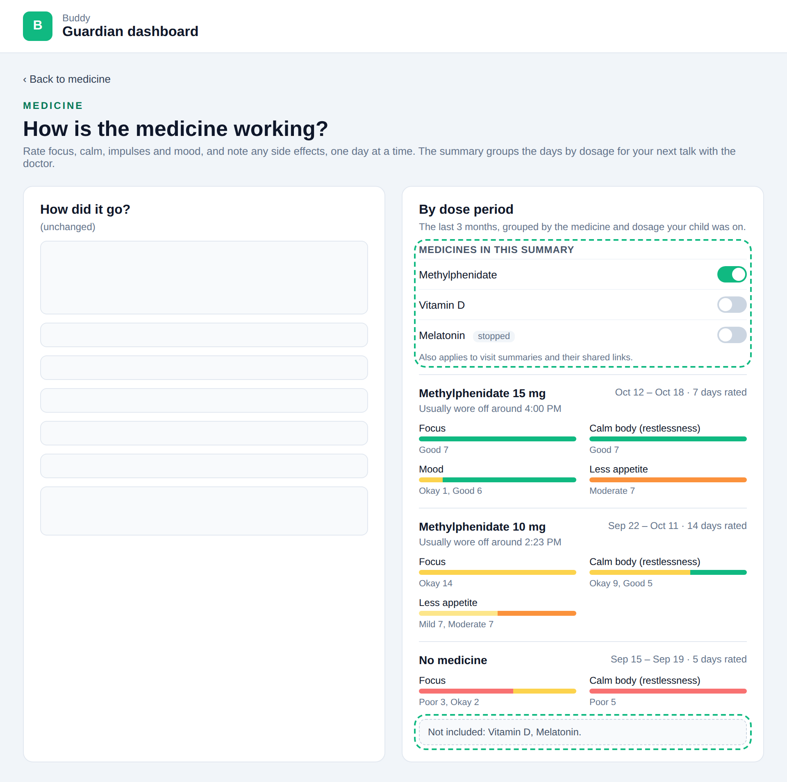
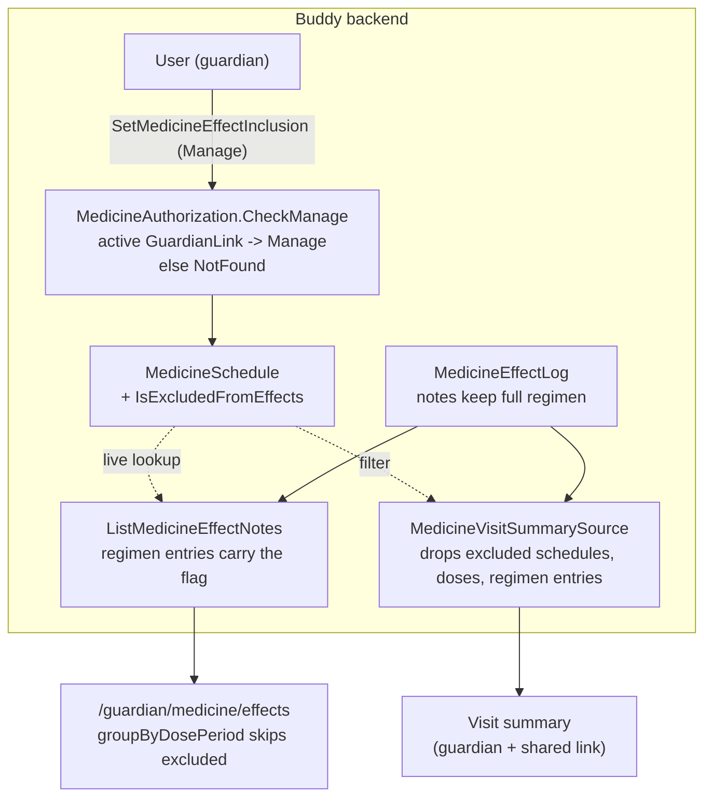

# Leaving Medicines Out of the Effect Summary

Status: Proposed (not yet implemented)

## Context

A child often has more schedules in Buddy than the medicine being evaluated: vitamin D, melatonin,
an allergy tablet. [medicine-effect-notes.md](medicine-effect-notes.md) (Question 4) snapshots the
**whole** day's regimen onto every effect note, and the dose-period summary starts a new period
whenever that regimen changes
([medicine-effects.ts](../../../src/frontend/buddy/src/app/core/medicine-effects.ts),
`groupByDosePeriod`). That causes two problems for a doctor's appointment about ADHD medication:

- **Periods split for the wrong reason.** Starting melatonin, or changing its dosage, cuts
  "Methylphenidate 10 mg" into two periods with half the days each, so the counts the doctor reads
  get thinner.
- **Noise.** Period headings, the visit summary's adherence table and its week overview list
  medicines the doctor didn't ask about.

The guardian wants to switch a medicine off in the effect overview, and have it stay off in the
printout and in the doctor visit summary
([doctor-visit-summary.md](doctor-visit-summary.md)), whose medicine section reuses `EffectPeriods`
as is and is read live (its Question 4).

What exists today (checked in the code):

- `MedicineSchedule`
  ([MedicineSchedule.cs](../../../src/backend/buddy/Features/Medicines/Types/MedicineSchedule.cs))
  has no flag of this kind. `IsStopped` is the precedent for a `bool` added with a default.
- `RegimenMedicine(MedicineId, Name, Dosage)` on each note keeps the `MedicineId`, so a note can be
  matched to its schedule's current settings, as `MedicineEffectNoteResponse.From` already does for
  live dose statuses
  ([MedicineEffectNoteResponses.cs](../../../src/backend/buddy/Features/Medicines/MedicineEffectNoteResponses.cs)).
- `MedicineVisitSummarySource`
  ([MedicineVisitSummarySource.cs](../../../src/backend/buddy/Features/Medicines/MedicineVisitSummarySource.cs))
  returns every schedule with a dose in the period, every dose, and every note.

This document answers five questions: where the setting lives, whether it changes stored data, who
does the filtering, who may change it, and what it hides on each page.

## Question 1: where does the setting live?

**Decision: on the medicine schedule, as `IsExcludedFromEffects` (default `false`), changed by a
new `MedicineEffectInclusionChanged` event.**

- Whether a medicine matters to the effect summary is a property of the medicine ("melatonin is
  not what we're evaluating"), not of one visit. Set once, the medicine page, the printout and
  every visit summary agree.
- The negative polarity is deliberate: existing streams and `snapshots` documents have no value,
  and a missing `bool` reads as `false` = included, which is today's behaviour. No snapshot rebuild
  is needed, the same as when `IsStopped` was added.
- Considered and rejected: **a per-summary exclusion set on `VisitSummary`**, next to `Sections`.
  It would let the school doctor and the psychiatrist see different medicines, but the guardian
  would have to repeat the choice for every summary, and the medicine page would still split
  periods. It stays possible later (see the open questions).
- Considered and rejected: **a page-only toggle** (a signal, or `localStorage`). It's cheap, but it
  never reaches the doctor's shared link, which is where the noise matters most.

## Question 2: does it change the notes?

**Decision: no. Notes keep the full regimen snapshot; the flag is applied when reading.**

- Switching a medicine back on restores the original periods exactly. If the medicine were dropped
  from the regimen at log time, the choice would be irreversible for notes already written, and a
  later "actually, melatonin matters" couldn't be answered.
- Effect notes stay a faithful record of the day ([medicine-effect-notes.md](medicine-effect-notes.md),
  Question 4: "the doctor reads the day against the whole regimen"). The day-by-day list and the
  note form's "Medicine that day" box keep showing every medicine.

## Question 3: who filters, the server or the frontend?

**Decision: both, for different readers. The guardian's own page gets the flag and filters
client-side; the visit summary is filtered on the server.**

- **Guardian page** (`/guardian/medicine/effects`): `RegimenMedicineResponse` gains
  `IsExcludedFromEffects`, resolved live from the schedule, the same way its `Doses` already are.
  The page needs the excluded medicines anyway, to draw their toggles and the "Not included" line,
  so it can't receive them pre-filtered.
- **Visit summary** (guardian's page and the doctor's anonymous `/shared/visit-summary/...` page):
  `MedicineVisitSummarySource` drops excluded medicines from `Schedules`, `Doses` and each note's
  `Regimen`. That is data minimization: an anonymous link holder never receives a medicine the
  guardian marked as irrelevant, which matters because the section is health data
  ([gdpr-data-protection.md](gdpr-data-protection.md)).
- `groupByDosePeriod` ignores excluded entries in both cases, so the shared `EffectPeriods`
  component behaves the same whether the server already removed them or not.

Before, [medicine-effects.ts](../../../src/frontend/buddy/src/app/core/medicine-effects.ts)
(`regimenOf`):

```ts
function regimenOf(note: MedicineEffectNote): PeriodMedicine[] {
  return note.regimen
    .map(({ name, dosage }) => ({ name, dosage }))
    .sort((a, b) => a.name.localeCompare(b.name) || a.dosage.localeCompare(b.dosage));
}
```

After:

```ts
function regimenOf(note: MedicineEffectNote): PeriodMedicine[] {
  return note.regimen
    .filter((m) => !m.isExcludedFromEffects)
    .map(({ name, dosage }) => ({ name, dosage }))
    .sort((a, b) => a.name.localeCompare(b.name) || a.dosage.localeCompare(b.dosage));
}
```

Before, [MedicineVisitSummarySource.cs](../../../src/backend/buddy/Features/Medicines/MedicineVisitSummarySource.cs)
(`ReadAsync`):

```csharp
var schedules = await MedicineEffectNotes.LoadSchedulesAsync(childId, medicines, cancellationToken);
var doses = MedicineDoseExpansion.Expand(schedules.Values, from, to, includeStoppedHistory: true);
```

After:

```csharp
var all = await MedicineEffectNotes.LoadSchedulesAsync(childId, medicines, cancellationToken);
var schedules = all.Where(s => !s.Value.IsExcludedFromEffects).ToDictionary();
var doses = MedicineDoseExpansion.Expand(schedules.Values, from, to, includeStoppedHistory: true);
// ...and each note's Regimen is filtered to medicines in `schedules` before mapping.
```

Blast radius: `MedicineScheduleResponse` and `RegimenMedicineResponse` each gain one field, built in
one place each (`MedicineScheduleResponse.FromSchedule`, `MedicineEffectNoteResponse.From`);
`regimenOf` has one caller. The `medicine-effects` and `visit-summary-stats` specs and the
`MedicineVisitSummarySource` integration tests gain cases; existing fixtures need the new field.

## Question 4: who may change it, and when?

**Decision: `Manage` (an active `GuardianLink`), guardians only, on active and stopped schedules
alike. No group-share variant.**

- Effect notes are guardian-only with no child or group tier
  ([medicine-effect-notes.md](medicine-effect-notes.md), Question 5), so a setting that only
  affects them follows the same tier. Unlike `UpdateMedicineDetails`, there is no
  `...ForGroup` slice.
- **Stopped schedules must be allowed**, unlike `UpdateMedicineDetailsHandler.UpdateForChildAsync`,
  which returns `NotFound` for `IsStopped`. A stopped melatonin schedule still appears in three
  months of old regimens, and those are exactly the periods the guardian wants merged.
- Setting the value it already has is `204` with no event, like an identical re-log.

### Events

```text
MedicineEffectInclusionChanged(MedicineId Id, bool Before, bool After,
    UserId ModifiedBy, DateTimeOffset OccurredAt)
    // After == IsExcludedFromEffects; Advance sets it and LastModifiedBy
```

Added to the `MedicineEvent` union, `FromPayload`, `EventType`, the Marten event types and the
golden-file `EventShapeTests`. `MedicineScheduleSnapshotProjection` needs no change: it drives
`Advance`.

## Question 5: what does an excluded medicine disappear from?

**Decision: from the summaries, not from the record.**

| Place                                                     | Excluded medicine                                                      |
| --------------------------------------------------------- | ---------------------------------------------------------------------- |
| Effects page: "By dose period" (screen and print)         | Not in headings, doesn't split periods; a "Not included: ..." line     |
| Effects page: day-by-day list, note form                  | Still shown (the day's full record)                                    |
| Visit summary: adherence table, week overview dose boxes  | Gone (filtered on the server)                                          |
| Visit summary: dose-change markers in the week overview   | Computed without it, so starting melatonin no longer marks a change    |
| Medicine page, today's doses, child's view, group sharing | Unchanged                                                              |
| A day where only excluded medicines were active           | Reads as "No medicine", the baseline, which is what it is for ADHD use |

## Command slices (`Features/Medicines/`, same shape as `StopMedicineSchedule`)

| Slice                        | Tier   | Notes                                                                                                                        |
| ---------------------------- | ------ | ---------------------------------------------------------------------------------------------------------------------------- |
| `SetMedicineEffectInclusion` | Manage | `{ included: bool }`. Active or stopped schedule of this child. Same value: no event. Emits `MedicineEffectInclusionChanged` |

Changed read slices: `ListMedicineSchedules` and the other `MedicineScheduleResponse` routes show
`isExcludedFromEffects`; `ListMedicineEffectNotes` returns it on each regimen entry;
`MedicineVisitSummarySource` filters (Question 3).

## Routes

| Route                                                                   | Method | Slice                        | Success | Other statuses                  |
| ----------------------------------------------------------------------- | ------ | ---------------------------- | ------- | ------------------------------- |
| `/medicines/children/{childId}/schedules/{medicineId}/effect-inclusion` | PUT    | `SetMedicineEffectInclusion` | `204`   | `400`, `403` (the child), `404` |

## Frontend

A mockup of the effects page with the new toggles (demo data, not a screenshot of built code):



- `core/medicines.service.ts`: `setEffectInclusion(childId, medicineId, included)`, a plain `PUT`
  (not `postIdempotent`; it's idempotent by nature).
- A new `effects/effect-inclusion/` component inside the "By dose period" card: one switch per
  medicine found in the period notes' regimens (distinct by `medicineId`, newest name, stopped ones
  tagged), `print:hidden`, `role="switch"` buttons like the existing toggles in `warning-exceptions`. On
  change it calls the service, then `periodNotes.reload()`. It hides itself when the regimens hold
  fewer than two medicines.
- `EffectPeriods` adds the "Not included: Vitamin D, Melatonin." line (it prints, so the paper
  copy says what was left out). In the visit summary there is nothing to list, since the server
  already removed them.
- i18n in `translations/{en,da}/medicine.ts`: the list heading, the "also applies to visit
  summaries" hint, the "Not included" line, the stopped tag and a save error.
- Screenshots: `guardian-medicine-effects` shows the toggles; `demo-family.ts` marks Vitamin D as
  excluded so the "Not included" line is visible.

## Testing

- **Integration** (a `SetMedicineEffectInclusion/` folder, mirroring `StopMedicineSchedule/`):
  `204` and the event; same value, no event; stopped schedule allowed; another child's medicine
  `404`; revoked `GuardianLink` `404`; the child `403`; snapshot reflects the flag.
- `ListMedicineEffectNotes` returns the live flag on regimen entries, including for a note written
  before the flag changed.
- `MedicineVisitSummarySource`: excluded schedule absent from `Schedules`, `Doses` and note
  regimens, both on the guardian's `GetVisitSummary` and the anonymous shared route.
- `EventShapeTests` golden file; snapshot tests; export contains the field.
- **Frontend**: `groupByDosePeriod` merges periods that differ only by an excluded medicine and
  treats an all-excluded day as baseline; `EffectInclusion` spec (toggle, reload, error, hidden
  with one medicine); `EffectPeriods` "Not included" line; `overviewWeeks` no dose-change marker.
- **e2e**: switch a medicine off on the effects page and see two periods become one.

## Failure and edge-case behavior

| Case                                                     | Behavior                                                       |
| -------------------------------------------------------- | -------------------------------------------------------------- |
| Set to the value it already has                          | `204`, no event                                                |
| Stopped schedule                                         | Allowed                                                        |
| Schedule of another child, or unknown id                 | `404`                                                          |
| Guardian's `GuardianLink` is revoked                     | `404`, the "can't tell private from missing" collapse          |
| The child calls it                                       | `403`, like the other `Manage` medicine routes                 |
| Note whose regimen names a schedule that no longer loads | Treated as included (`false`), so nothing silently vanishes    |
| Medicine excluded while a visit summary link is live     | The doctor's next load no longer has it (live report)          |
| Every medicine in the period excluded                    | One "No medicine" period; the toggles stay so it can be undone |
| Two guardians toggle at once                             | Last write wins; both events kept                              |

## Estimate

|                  |                                                                                                          |
| ---------------- | -------------------------------------------------------------------------------------------------------- |
| Complexity       | Low–Medium -- one event, one command slice, two response fields, a server-side filter, one new component |
| Single developer | 1.5–2.5 days                                                                                             |
| AI agent         | 1.5–2.5 hours, plus about 45 minutes of human review                                                     |

## Decisions made

| Question                | Decision                                                                        |
| ----------------------- | ------------------------------------------------------------------------------- |
| Where the setting lives | `MedicineSchedule.IsExcludedFromEffects`, one choice for every page and summary |
| Stored notes            | Unchanged; filtered when read, so it's reversible                               |
| Who filters             | Frontend on the guardian's page; server for the visit summary (minimization)    |
| Who may change it       | `Manage`, guardians only, active and stopped schedules                          |
| What it hides           | Summaries only; the day list and note form keep the full record                 |

## Remaining open questions

- **Should the shared visit summary say that medicines were left out?** The server removes them,
  so the doctor can't tell. Melatonin, for one, matters to a sleep discussion. Lean: a neutral line
  without names ("The guardian left 2 medicines out of this summary") so the doctor can ask;
  additive either way.
- **A per-summary override.** If families ask for different medicines per doctor, add an
  `ExcludedMedicines` set to `VisitSummary` that defaults to the schedule flags. Additive.
- **Where else to offer the toggle.** Lean: only on the effects page, where its effect is visible.
  A copy in the manage-medicines edit form is additive.

## Diagram


