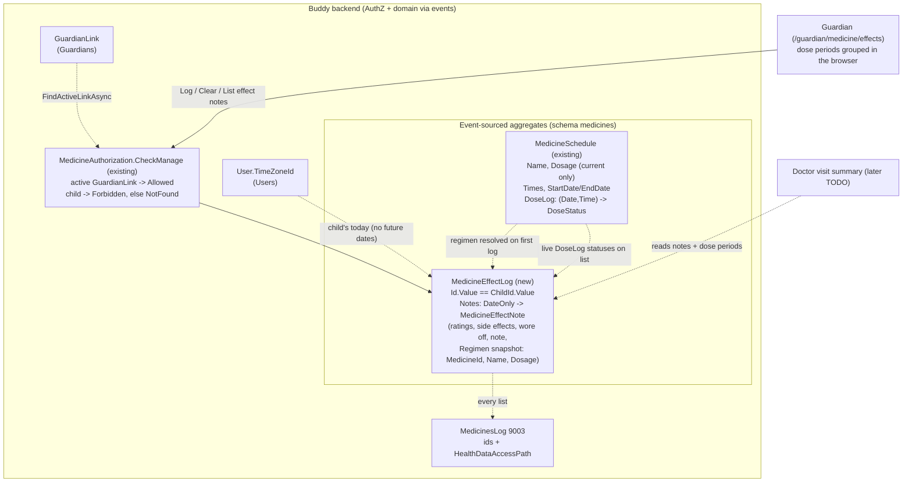

# Medicine Effect and Side-Effect Notes

Status: Implemented. A `MedicineEffectLog` aggregate per child in `Features/Medicines` (events
`MedicineEffectLogStarted`, `MedicineEffectNoteLogged`, `MedicineEffectNoteCleared`, inline snapshot),
the `LogMedicineEffectNote`, `ClearMedicineEffectNote` and `ListMedicineEffectNotes` slices on
`/medicines/children/{childId}/effect-notes`, audit event 9003, erasure and export, and the guardian
page `/guardian/medicine/effects` (form, day-by-day list, printable dose-period summary) linked from
the medicine page and the dashboard's "Today's medicine" card.

## Context

ADHD medication is adjusted in small steps: a doctor starts a child on a low dose, and the family
reports back a few weeks later on how it went before the dose is raised, lowered, re-timed or
switched. Those conversations go badly on memory alone ("I think his appetite was worse? Maybe the
second week?"). Doctors ask families to keep a simple record instead, usually a paper form with:

- **Effects**: did the medicine help with focus, restlessness, impulsivity and mood today?
- **Side effects**: reduced appetite, trouble falling asleep, stomach ache, headache, irritability,
  a "crash" when it wears off, tics, the child seeming flat or not themselves. Usually rated none /
  mild / moderate / severe, the shape of the Barkley side-effect rating scale.
- **When it wore off**, because a 15:00 wear-off and a 19:00 wear-off lead to different changes
  (an afternoon top-up dose vs a later first dose).
- **A free note** ("school said he was great in maths, but didn't eat lunch").

The TODO item ([TODO.md](../../../TODO.md), "Insight for guardians and clinicians") asks for exactly
this: "Ratings ('focus good / appetite poor') linked to doses, for dose-adjustment conversations."

What exists today (checked in the code):

- **[medicine-schedules.md](medicine-schedules.md)**, shipped as
  [Features/Medicines](../../../src/backend/buddy/Features/Medicines). A `MedicineSchedule`
  ([MedicineSchedule.cs](../../../src/backend/buddy/Features/Medicines/Types/MedicineSchedule.cs))
  has a free-text `Dosage`, daily `Times`, a date window and a sparse `DoseLog` of
  `(Date, Time) -> DoseStatus` (`Taken`/`Skipped`). Nothing records how a dose *worked*.
  Its own open question "Should a skip require a reason?" is the nearest thing to a note, and was
  left out.
- **The aggregate keeps only the current dosage.** `MedicineDetailsUpdated` carries `Before`/`After`
  ([MedicineEvents.cs](../../../src/backend/buddy/Features/Medicines/Types/MedicineEvents.cs)), but
  `MedicineSchedule.Advance` overwrites `Dosage`, and `MedicineDoseExpansion`
  ([MedicineDoseExpansion.cs](../../../src/backend/buddy/Features/Medicines/MedicineDoseExpansion.cs))
  stamps every past occurrence with today's dosage. It also skips stopped schedules entirely, past
  doses included. For a dose-adjustment conversation, "which dosage was the child on that day?" is
  the whole point, so this doc has to answer it (Question 4).
- **[sleep-diary.md](sleep-diary.md)** ([Features/SleepDiaries](../../../src/backend/buddy/Features/SleepDiaries))
  is the precedent for a guardian-only, one-entry-per-date health log: `SleepDiaryId.ForChild`
  ([SleepDiaryId.cs](../../../src/backend/buddy/Features/SleepDiaries/Types/SleepDiaryId.cs)), a
  `PUT .../{date}` full overwrite with `Before`/`After`, an idempotent clear, no child tier.
- **[feelings-check-in.md](feelings-check-in.md)** ([Features/Feelings](../../../src/backend/buddy/Features/Feelings))
  is the precedent for a fixed, translated catalog stored as enum names (its tags), for local dates
  resolved through `User.TimeZoneId`, and for the guardian trend that already draws taken doses next
  to feelings ([feelings-trend.ts](../../../src/frontend/buddy/src/app/shared/feelings-trend/feelings-trend.ts)).
  The child's own "tired", "unwell" and "body" tags already cover the child's side of "how do I feel".
- **Two later TODO items build on this one**: the behaviour (ABC) log correlates with doses, and the
  doctor visit summary combines sleep, doses, feelings and the behaviour log in one shared report.
  This feature should give the summary something clean to read, not ship its own share link.

This document answers six questions: whether this is a new feature, how the notes are stored,
what one note holds, how a note is "linked to doses" (and which dosage it records), who can see and
write notes, and how the guardian reads them for a doctor's appointment.

## Question 1: a new feature, or part of `Medicines`?

**Decision: part of `Features/Medicines`, as a second per-child aggregate next to
`MedicineSharing`, in the same `medicines` Marten schema, behind the existing `Medicines` flag.
No new feature flag.**

- **It is about the medicine.** A note is meaningless without the doses it rates, and the handler
  has to read the child's `MedicineSchedule`s to link them (Question 4). Inside the feature that is
  a direct `IMedicineEventStore` call; from another feature it would be a cross-feature store
  dependency, which the feelings trend deliberately avoided by composing in the browser
  ([feelings-check-in.md, Question 7](feelings-check-in.md#question-7-the-guardians-trend-next-to-sleep-and-doses)).
- **Same principals and erasure.** Guardians manage, the data is the child's, erasing the child
  deletes it. `MedicinesPersonalDataEraser` and the exporter already exist and gain one stream each.
- **No flag of its own.** [feature-flags.md, Question 2](feature-flags.md#question-2-which-features-get-a-flag)
  gives sub-flags only where there is a named reason to switch a capability off alone (the AI
  assistant sending data to a third party, a one-off import tool). Effect notes send nothing
  anywhere and appear only when a guardian writes one; group sharing and dose status stay under
  their parent flag in the same way.
- Rejected: **a new `Features/MedicineEffects` with its own schema**, as Feelings is beside the sleep
  diary. Feelings had different principals (the child writes) and a different on/off decision.
  Neither applies here, and a separate feature would need to read medicine streams across a
  feature boundary.
- Rejected: **storing notes on the `MedicineSchedule` stream**, next to `DoseLog`. See Question 2.

## Question 2: aggregate shape and identity

**Decision: one `MedicineEffectLog` stream per child, with `MedicineEffectLogId.Value ==
ChildId.Value` and no index document, the `SleepDiary` trick. Notes are keyed by the child's local
`DateOnly`: at most one note per child per day, overwritten in full.**

```
MedicineEffectLog(
    MedicineEffectLogId Id,                                // Id.Value == ChildId.Value
    UserId ChildId,
    ImmutableDictionary<DateOnly, MedicineEffectNote> Notes)

public sealed record MedicineEffectLogId(Guid Value)
{
    public static MedicineEffectLogId ForChild(UserId childId) => new(childId.Value);
}
```

- **Per child, not per schedule.** A child on a morning stimulant and an evening melatonin, or a
  long-acting dose plus an afternoon top-up, has one day. "Appetite poor" can't honestly be pinned
  on one of two medicines; the doctor reads the day against the whole regimen. Keying notes by
  `(MedicineId, Date)` on each `MedicineSchedule` stream would make the guardian pick a medicine
  for every rating, and the summary would have to merge them back. A per-schedule note also dies
  with `StopMedicineSchedule`'s soft delete as far as expansion is concerned, while notes from
  before a switch are exactly what the doctor compares against.
- **Per day, not per dose.** Effects are watched over a school day and side effects show at lunch
  or bedtime, not at a dose time. The wear-off time (Question 3) carries the "when". A per-dose
  note would also have no home on a baseline day with no medicine (Question 4).
- **One note per day, full overwrite**, as `SleepEntryLogged`: two guardians fill in one shared
  form for the day (the morning parent rates focus, the evening parent adds "slow to fall
  asleep"), and the form loads what's there. The overwrite keeps `Before`/`After` in the event, so
  nothing is lost.
- **Stream id collision.** The `medicines` schema's other per-child stream, `MedicineSharing`, has a
  UUIDv7 `MedicineSharingId` with an index document
  ([MedicineSharingId.cs](../../../src/backend/buddy/Features/Medicines/Types/MedicineSharingId.cs)),
  and `MedicineId`s are UUIDv7 too, so using the child's id as this stream's id collides with
  nothing.
- **Growth.** At most 365 notes a year per child, most days far fewer. Smaller than a
  `MedicineSchedule`'s dose log.

### Events

```
MedicineEffectLogStarted(MedicineEffectLogId Id, UserId ChildId, DateTimeOffset OccurredAt)
    // Lazily, by the first LogMedicineEffectNote for the child, in the same CreateAsync,
    // as SleepDiaryStarted.

MedicineEffectNoteLogged(MedicineEffectLogId Id, DateOnly Date, MedicineEffectNote? Before,
    MedicineEffectNote After, DateTimeOffset OccurredAt)
    // Full overwrite; who logged it is After.LoggedBy. Identical content appends nothing
    // (HasSameContentAs, as LogSleepEntryHandler).

MedicineEffectNoteCleared(MedicineEffectLogId Id, DateOnly Date, MedicineEffectNote Before,
    UserId ModifiedBy, DateTimeOffset OccurredAt)
    // Clearing a date with no note: 204, no event.
```

A new union `MedicineEffectLogEvent`, beside `MedicineEvent` and `MedicineSharingEvent`.

### Rehydration

`MedicineEffectLog.Start` seeds an empty log from `MedicineEffectLogStarted`; `Advance` sets
`Notes[date]` on `MedicineEffectNoteLogged` and removes it on `MedicineEffectNoteCleared`; the start
event is `EventReplay.AlreadyStarted` in `Advance`, as in
[SleepDiary.cs](../../../src/backend/buddy/Features/SleepDiaries/Types/SleepDiary.cs).
`MedicineEffectLogSnapshotProjection` delegates to `Start`/`Advance`, registered `Inline` in the
`snapshots` schema.

The changes to existing code are registration only:

```csharp
// MedicinesFeature.cs:22, today
private static readonly Type[] EventTypes =
[
    typeof(MedicineScheduleCreated),
    ...
    typeof(MedicineUnsharedFromGroup)
];
```

```csharp
// proposed: three more event types, one more inline snapshot, one more store
    typeof(MedicineUnsharedFromGroup),
    typeof(MedicineEffectLogStarted),
    typeof(MedicineEffectNoteLogged),
    typeof(MedicineEffectNoteCleared)
];
...
options.Projections.Register(new MedicineEffectLogSnapshotProjection(), ProjectionLifecycle.Inline);
options.Schema.For<MedicineEffectLogSnapshot>().DatabaseSchemaName(SnapshotSchema.Name);
...
services.AddSingleton<IMedicineEffectLogEventStore, MartenMedicineEffectLogEventStore>();
```

Blast radius: `MedicinesFeature.cs`, the eraser and exporter (one stream each), three `Map...`
lines. No existing event, aggregate, handler or response changes shape.

## Question 3: what one note holds

**Decision: a fixed, translated catalog of effect areas (rated poor / okay / good) and side effects
(rated none / mild / moderate / severe), an optional wear-off time, an optional note, and the
regimen of that day (Question 4). Only what the guardian rated is stored: an unrated area is
"not observed", never "fine".**

```
MedicineEffectNote(
    DateOnly Date,                              // the child's local date (User.TimeZoneId)
    IReadOnlyList<EffectRating> Effects,        // 0-4, at most one per area
    IReadOnlyList<SideEffectRating> SideEffects,// 0-9, at most one per kind
    TimeOnly? WoreOffAt,                        // child's local wall clock; null = not noticed
    string Note,                                // FreeText, "" = none, at most 500 characters
    IReadOnlyList<RegimenMedicine> Regimen,     // resolved by the server, Question 4
    UserId LoggedBy)                            // the guardian who saved this version

EffectRating(EffectArea Area, EffectLevel Level)
SideEffectRating(SideEffect Kind, SideEffectSeverity Severity)

enum EffectArea { Focus, Calm, ImpulseControl, Mood }
enum EffectLevel { Poor, Okay, Good }
enum SideEffect { ReducedAppetite, TroubleFallingAsleep, Stomachache, Headache, Irritability,
                  ReboundWhenWearingOff, Tics, FlatOrNotThemselves, Other }
enum SideEffectSeverity { None, Mild, Moderate, Severe }
```

| Area / kind | Guardian-facing label (en) | Why it's on the list |
|---|---|---|
| `Focus` | Focus | The core target of ADHD medication |
| `Calm` | Calm body (restlessness) | Hyperactivity, the second core target |
| `ImpulseControl` | Impulse control | The third core target |
| `Mood` | Mood | Stimulants can lift or flatten it, so it's both an effect and a warning |
| `ReducedAppetite` | Less appetite | The most common stimulant side effect; "appetite poor" in the TODO |
| `TroubleFallingAsleep` | Trouble falling asleep | Common, and the main reason to move a dose earlier |
| `Stomachache`, `Headache` | Stomach ache, Headache | Common early side effects that often fade |
| `Irritability` | Irritable | Common, often at wear-off |
| `ReboundWhenWearingOff` | Crash when it wears off | Drives the "afternoon top-up" decision; paired with `WoreOffAt` |
| `Tics` | Tics | Rarer, but one a doctor always asks about |
| `FlatOrNotThemselves` | Flat / not themselves | The "zombie" complaint, a sign the dose is too high |
| `Other` | Something else (write in the note) | A severity for anything else, with the note saying what |

- **Why a fixed catalog, not free text** (the Feelings tags' argument): it translates (one enum on
  the wire, en/da in the frontend), it can be counted per dose period (Question 6), and the doctor
  reads the same words every time. The catalog follows the common rating-scale items; it is not a
  validated clinical instrument and the UI doesn't claim to be one. Enums are stored as names, so
  items are only ever added, never renamed.
- **Two scales, not one.** "Focus good" and "appetite: moderate" are different questions: one asks
  how well the medicine worked, the other how much harm it did. A single good/bad scale for both
  would read "appetite good" as either "ate well" or "no appetite loss", and the TODO's own example
  already mixes them. `None` is a real answer for a side effect ("we watched for stomach ache and
  there was none"), which is why unrated and `None` are kept apart.
- **Lists of records, not dictionaries**, so they round-trip through System.Text.Json the way
  `FeelingCheckIn.Tags` and `MedicineSchedule.Times` do; the validator rejects duplicates.
- **At least one thing.** A note with no rating, no wear-off time and an empty note is `400`; to
  remove a day, clear it.
- **No numeric score or total.** Summing side effects into a number invites reading it as a
  diagnosis. The summary (Question 6) counts days per level instead.

## Question 4: "linked to doses", and which dosage

**Decision: the note stores the day's regimen as a snapshot, `RegimenMedicine(MedicineId, Name,
Dosage)`, resolved by the server from the child's active schedules when the date's note is first
logged and kept unchanged by later edits. Taken/skipped status is not copied: the list response
joins it live from each schedule's `DoseLog`.**

```
RegimenMedicine(MedicineId MedicineId, string Name, string Dosage)
```

- **Why a snapshot.** The schedule keeps only today's `Dosage` (see Context). If notes pointed at
  `MedicineId` alone, raising "10 mg" to "15 mg" next month would silently relabel every old note
  as 15 mg, and the before/after comparison the feature exists for would be wrong. Copying name and
  dosage into the note at the time is the one place that knows what the child was on.
- **Resolved by the server, not sent by the client.** The handler lists the child's schedules
  (`ListIdsForChildAsync` + `FindSnapshotAsync`) and keeps those with `StartDate <= date <=
  EndDate` that aren't stopped, the same rule as `MedicineDoseExpansion`. The guardian can't type a
  dosage that never existed, and two guardians writing the same day get the same regimen.
- **Kept on edits.** Re-logging an existing date reuses its stored `Regimen`, so correcting a typo in
  next week's note doesn't swap in a dosage changed in between. Clearing the day and logging again
  resolves it afresh.
- **Baseline days are allowed.** A note on a day with no active schedule has an empty regimen.
  That's useful, not an error: a doctor wants a week of "before medication" ratings to compare
  against.
- **Taken/skipped joined live.** A dose can be marked after the note is written (the evening dose,
  or a late "she did take it at school"). `ListMedicineEffectNotes` reads each regimen schedule's
  `DoseLog` for the note dates (a lookup, not an expansion) and returns the statuses beside the
  note, so "focus poor" on a day the morning dose was skipped is visible.
- **The known gap: backdating across a change.** A note logged today *for* a day before a dosage
  change gets today's dosage, and one logged after a schedule was stopped misses that medicine,
  because the aggregate has no dosage history or stop date to ask. Most notes are written the same
  evening or the next day, so this is rare; the form shows the resolved regimen before saving and
  says so. A proper fix is effective-dated dosage on `MedicineSchedule`, left to its own analysis
  (settled by the user 2026-10-14), which the doctor visit summary would want anyway.
- Rejected: **deriving the dosage from `MedicineDetailsUpdated` events** on every read. The events
  carry a UTC `OccurredAt`, not the child's local date, a guardian often edits the dosage the
  evening before it takes effect, and the read would replay every schedule's full stream. The
  snapshot is simpler and right for same-day notes.
- Rejected: **letting the guardian edit the regimen**. It would fix the backdating gap, but turns a
  record of fact into a field anyone can retype; effective-dated dosage solves it at the source.

## Question 5: who can see and write notes

**Decision: guardians only. `Manage` (an active `GuardianLink`) logs, edits, clears and lists notes;
the child gets `403`, anyone else `404`. No group axis in v1.**

- **Not the child.** These are a parent's clinical observations for a doctor, the sleep diary's
  reasoning ([sleep-diary.md, Question 4](sleep-diary.md#question-4-who-can-see-and-log-entries)).
  A 9-year-old reading "irritable: severe" about themselves helps no one. The child's own
  experience already has a channel: Feelings check-ins with `Unwell`, `Tired` and `Body`. The child
  gets `403`, not `404`, as on every Manage-only medicine route (`MedicineAccess.Forbidden`), since
  they know their medicines exist.
- **Reuses `MedicineAuthorization.CheckManage`** ([MedicineAuthorization.cs](../../../src/backend/buddy/Features/Medicines/MedicineAuthorization.cs))
  unchanged. No new tier.
- **No group axis yet.** Medicines can be shared with a group with all-or-nothing `Manage`
  ([medicine-schedules.md, Group sharing](medicine-schedules.md#group-sharing-added-later-additive)),
  so a grandparent who gives the morning dose can mark it. That grandparent does not read or write effect
  notes in v1 (settled by the user 2026-10-14). Adding the
  `/medicines/groups/{groupId}/children/{childId}/effect-notes` routes later is additive, the way
  group sharing itself was added.
- **Any guardian may correct any day**, the sleep diary's rule; `LoggedBy` on the event records who.

## Question 6: how the guardian reads it for a doctor's appointment

**Decision: one guardian page, `/guardian/medicine/effects`, with a day-by-day list and a "by dose
period" summary that groups consecutive days with the same regimen. It is printable with the
browser's print. No share link: the doctor visit summary (a separate TODO item) is where notes are
shared.**

- **Dose periods are the point.** The summary walks the notes in date order and starts a new period
  whenever the regimen (the set of `(Name, Dosage)` pairs) changes: "No medicine, 1-7 Sep (5
  notes)", "Ritalin 10 mg, 8-28 Sep (16 notes)", "Ritalin 15 mg, 29 Sep - today (9 notes)". For
  each period, each rated area and side effect shows its count per level as a short stacked bar
  with the numbers written out ("Focus: good 9, okay 5, poor 2"), plus the median wear-off time.
  That answers the doctor's question ("what changed when we went up?") without a chart library,
  the Feelings trend's approach.
- **Computed in the browser**, from `ListMedicineEffectNotes` over up to 92 days. The server returns
  data only, so the response stays deterministic for the ETag middleware
  ([conditional-get-etags.md](conditional-get-etags.md)), and the grouping is a pure function with
  its own spec.
- **No share link of its own.** The sleep diary and Feelings each copied the share-token aggregate;
  a third medicine-specific copy would be overtaken by the doctor visit summary, which is meant to
  combine all of these under one link and one consent. Until then, the page prints cleanly (a
  `print:` stylesheet hiding the form and navigation, as the shared sleep diary does).
- **Not merged into the Feelings trend in v1.** The trend already shows taken doses; adding a
  side-effect marker there is a small follow-up once both exist, not a blocker.

## Read models

- **None for the log.** `MedicineEffectLogId.Value == ChildId.Value`; reads use the inline snapshot
  (`FindSnapshotAsync`), as `ListSleepDiaryEntriesHandler` does.
- **No expansion helper.** The live dose statuses are `DoseLog` lookups for the regimen's
  `(MedicineId, date, time)` keys; the schedule's current `Times` say which times to look up, the
  same thing `MedicineDoseExpansion` assumes.

## Command slices (`Features/Medicines/`, same vertical-slice shape as `SetDoseStatus`)

| Slice | Tier | Notes |
|---|---|---|
| `LogMedicineEffectNote` | Manage | Full overwrite of one date. The date may not be after today on the child's clock (`User.TimeZoneId`); no lower bound. Resolves the regimen on first log (Question 4). Identical content: no event. Starts the log lazily. Emits `MedicineEffectNoteLogged` |
| `ClearMedicineEffectNote` | Manage | No note on that date: `204`, no event. Emits `MedicineEffectNoteCleared` |
| `ListMedicineEffectNotes` | Manage | `[from, to]`, at most 92 days (the sleep diary's limit); each note with the live statuses of its regimen's doses. Logs 9003 |

Responses, from the handler's DTOs:

```
MedicineEffectNoteResponse(DateOnly Date, IReadOnlyList<EffectRating> Effects,
    IReadOnlyList<SideEffectRating> SideEffects, TimeOnly? WoreOffAt, string Note,
    IReadOnlyList<RegimenMedicineResponse> Regimen, Guid LoggedBy)
RegimenMedicineResponse(Guid MedicineId, string Name, string Dosage,
    IReadOnlyList<RegimenDoseResponse> Doses)       // live, from DoseLog
RegimenDoseResponse(TimeOnly Time, DoseStatus Status)
```

## Routes

| Route | Method | Slice | Success | Other statuses |
|---|---|---|---|---|
| `/medicines/children/{childId}/effect-notes/{date}` | PUT | `LogMedicineEffectNote` | `200` note | `400`, `403` (the child), `404` |
| `/medicines/children/{childId}/effect-notes/{date}` | DELETE | `ClearMedicineEffectNote` | `204` | `403`, `404` |
| `/medicines/children/{childId}/effect-notes` | GET | `ListMedicineEffectNotes` | `200` | `400`, `403`, `404` |

- `PUT` on a date key is idempotent by itself, as `LogSleepEntry`, so the frontend needs no
  `postIdempotent`. Any command can also return `409 concurrency_conflict`.
- The group already ends with `.WithETag()` and the per-user rate limit; no new error codes.
  `task docs:openapi` regenerates the contract.

```
LogMedicineEffectNoteRequest(IReadOnlyList<EffectRating>? Effects = null,
    IReadOnlyList<SideEffectRating>? SideEffects = null, TimeOnly? WoreOffAt = null,
    string? Note = null)
```

## GDPR and privacy

| Duty | How |
|---|---|
| Lawful basis | Health data about a child (Art. 9 + Art. 8), already covered by the medicines bullet; [PRIVACY.md](../../../PRIVACY.md) names "medicine effect and side-effect notes" alongside dose tracking |
| Erasure: child | `MedicinesPersonalDataEraser.EraseChildAsync` also deletes the `MedicineEffectLogId.ForChild` stream and its snapshot |
| Erasure: guardian | Nothing to delete: the notes are about the child and stay with the child's record; `LoggedBy` becomes a pseudonym, as on the sleep diary |
| Export | The `"medicines"` export section gains `effectNotes`, built from the response DTOs |
| Read audit log | `MedicinesLog` 9003: effect notes of child read, with `From`, `To`, `UserId` and `HealthDataAccessPath.Guardian`. Ids only, never a rating or note; [observability.md](../observability.md) range becomes 9001-9003 |
| Coverage tests | The existing eraser/exporter coverage tests already include `IMedicinesStore`; `AccountErasureTests`, `ExportPersonalDataTests` and `AuditLogTests` gain cases |
| Minimization | Fixed catalog; a 500-character note; nothing in logs, URLs or (later) push payloads |

## Frontend

- **Service.** `core/medicines.service.ts` gains `listEffectNotes(childId, from, to)`,
  `logEffectNote(childId, date, body)` and `clearEffectNote(childId, date)`, typed from the
  generated OpenAPI schemas. The catalog order and `groupByDosePeriod(notes)` are pure functions in
  `core/medicine-effects.ts`.
- **Page `/guardian/medicine/effects`** (`features/guardian/medicine/effects/`), `featureGuard('medicines')`,
  `helpTopic: 'medicine'`, with the child picker from `GuardianSleepDiary`
  ([sleep-diary.ts](../../../src/frontend/buddy/src/app/features/guardian/sleep-diary/sleep-diary.ts)):
  - `effect-note-form/`: a date (`shared/date-select`, default today in the browser, as the sleep
    diary), the regimen shown read-only with that day's dose statuses (a rated day shows its stored
    regimen; an unrated one previews it from `ListDoses` for the date), one
    `shared/segmented-control` per effect area (not rated / poor / okay / good, "Not rated" by
    default) and per side effect (not rated / none / mild / moderate / severe; less appetite, trouble
    falling asleep, irritable and the wear-off crash shown, "More side effects" reveals the rest and
    opens by itself when one of them is rated), a "wore off around" `shared/time-select`, the note,
    Save and Clear day.
  - `effect-days/`: the last 14 days, one row per day with its regimen, dose ticks and the rated
    items as chips, paging back by 14; tapping a day opens it in the form.
  - `effect-periods/`: the dose-period summary of Question 6 over the last 92 days.
- **Entry points.** A "How did it go?" link on the medicine page next to each child, and on the
  dashboard's `doses-today` card ([doses-today.html](../../../src/frontend/buddy/src/app/features/guardian/doses-today/doses-today.html)),
  which already links to `/guardian/medicine`.
- **i18n.** New keys under `medicine.effects` in `core/i18n/translations/{en,da}/medicine.ts`: the
  catalog labels, levels, period wording and the backdating hint. The Danish side-effect words get a
  native-speaker check ("Mindre appetit", "Svært ved at falde i søvn", ...): parents will recognise
  the words their doctor uses.
- **Help.** A new `effectNotes` section on the `medicine` help topic
  ([help-topics.ts](../../../src/frontend/buddy/src/app/core/help/help-topics.ts)).
- **Screenshots.** `/guardian/medicine/effects` in `screenshots/pages.ts`; `demo-family.ts` seeds
  `demo.emil` with five baseline days, three weeks on "10 mg" (focus okay, appetite mild-moderate,
  wearing off around 14:30) and a week on "15 mg" (focus good, appetite moderate, wearing off
  around 16:00), so both the day list and the period summary have content.

## Testing

Backend, beside the existing medicine tests in `buddy.IntegrationTests/Features/Medicines`:

- each slice x guardian / co-guardian / child (`403`) / stranger (`404`) / revoked link (`404`),
  with `[CoversEndpoint]`;
- the regimen: resolved from active schedules only, empty on a baseline day, kept on re-log after
  a dosage change, re-resolved after clear + log; a stopped schedule is left out;
- live dose statuses in the list (taken, skipped, pending) and a status changed after the note;
- validation: nothing rated, a duplicate area or kind, an unknown enum name, a 501-character note,
  a date after the child's today (checked in two time zones), a range over 92 days;
- identical re-log and clearing an empty date append nothing;
- erasure, export and audit log 9003 (nothing logged on a denied read, no note text in a log line);
- golden files for the three events, `SnapshotTests` for `MedicineEffectLog`.

Frontend: specs for the service (exact URLs and bodies), `groupByDosePeriod` (baseline, one change,
change and back, gaps between notes), the form (unrated stays unrated, `None` vs unrated, clear,
backdating hint), the day list and the period summary. e2e (`medicine-effect-notes.spec.ts`): a
guardian with a 10 mg schedule starting yesterday rates yesterday "focus good, appetite moderate",
then stops it and adds a 15 mg schedule (the UI has no dosage edit, and a future date can't be
rated), rates today, and sees two dose periods with the right counts.

## Failure and edge-case behavior

| Case | Behavior |
|---|---|
| Only a note, no ratings | Allowed; at least one of ratings, wear-off or note is required |
| Nothing at all | `400 validation_error` |
| Re-log the same date | Full overwrite, `Before`/`After` kept; regimen unchanged |
| Re-log with identical content | `200`, no event |
| Clear a date with no note | `204`, no event |
| Date after today on the child's clock | `400`; no lower bound |
| Day with no active medicine | Allowed, empty regimen ("baseline") |
| Dosage changed, then an older day logged for the first time | Gets the current dosage; the form showed it before saving (Question 4's known gap) |
| Schedule stopped, then an older day logged for the first time | That medicine is missing from the regimen (same gap) |
| Schedule stopped after notes were written | Notes keep its name and dosage; its live dose statuses still come from its `DoseLog` |
| Dose marked after the note was saved | The list shows the new status; the note is unchanged |
| Two guardians save the same day at once | One wins, the other gets `409 concurrency_conflict` and reloads |
| Guardian's `GuardianLink` revoked | `404` at once; the notes stay |
| Child calls any effect-note route | `403` |
| Child erased | The log stream and snapshot are deleted with the schedules |
| `Features:Medicines = false` | Routes unmapped, page and links hidden; data and GDPR coverage stay |

## Estimate

| | |
|---|---|
| Complexity | Medium -- one new aggregate in an existing feature and schema, three events, three slices on the existing authorization, a regimen snapshot with live dose join, GDPR/audit additions, and one guardian page with three parts plus a translated catalog |
| Single developer | 5-7 days (backend and tests 2-2.5, page with form, day list and period summary 2-2.5, i18n, help, e2e, screenshots and docs 1-2) |
| AI agent | 4-6 hours, plus 1.5-2 hours of human time: the Danish side-effect wording and whether the period summary reads well to a doctor |

## Decisions made

| Question | Decision |
|---|---|
| New feature or extend `Medicines` | Inside `Features/Medicines`, schema `medicines`, behind the `Medicines` flag; no sub-flag, since nothing names a reason to switch it off alone |
| Aggregate | `MedicineEffectLog`, one per child, `Id.Value == ChildId.Value`, no index document, like `SleepDiary` |
| Granularity | One note per child per local date, full overwrite; not per medicine (combination regimens) and not per dose (effects are watched over a day) |
| Content | Fixed catalog: 4 effect areas (poor/okay/good), 9 side effects (none/mild/moderate/severe), optional wear-off time, 500-character note; unrated is not `None` |
| Link to doses | A server-resolved regimen snapshot (name + dosage) taken on first log and kept on edits; dose statuses joined live from `DoseLog` |
| Baseline days | Allowed, with an empty regimen |
| Who | Guardians (`Manage`) only; the child `403`; no group axis in v1 |
| Reading it | `/guardian/medicine/effects` with a 14-day list and a dose-period summary computed in the browser; printable |
| Sharing | No share link; left to the doctor visit summary |
| Audit | `MedicinesLog` 9003 on every list |
| Dosage history | Not in this build: notes copy the dosage on first save; effective-dated dosage and a stop date on `MedicineSchedule` get their own analysis, which the doctor visit summary will also use (settled by the user 2026-10-14) |
| Group members | No access in v1; group routes can be added later without other changes (settled by the user 2026-10-14) |
| Child's own side-effect report | None; Feelings check-ins (`Unwell`, `Tired`, `Body`) carry it, and a guardian turns it into a rating (settled by the user 2026-10-14) |
| School or teacher source | Written in the note ("school said..."); no source field for now, the home-school notebook is the real channel (settled by the user 2026-10-14) |
| Evening reminder | None in v1; with push, a guardian-only opt-in at a chosen time with no health data in the payload (settled by the user 2026-10-14) |
| Custom side effects | None; a fixed catalog, with `Other` plus the note (settled by the user 2026-10-14) |

## Remaining open questions

None. Every question was settled by the user on 2026-10-14 (see the table above). Later, additive
ideas recorded in the decisions: effective-dated dosage on `MedicineSchedule` (its own analysis),
group access through the group routes, a source field on a note, and an evening reminder once push
ships.

## Diagram


