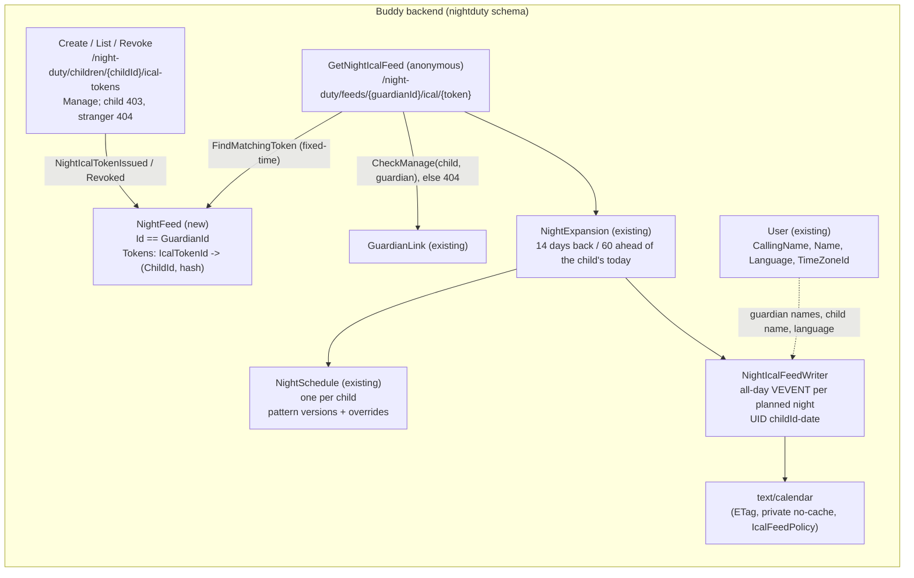

# Night Duty iCal Feed

Status: Implemented. `NightFeed` (one stream per guardian in the `nightduty` schema,
`NightFeedStarted`, `NightIcalTokenIssued`, `NightIcalTokenRevoked`), the slices
`CreateNightIcalToken`, `ListNightIcalTokens`, `RevokeNightIcalToken`
(`/night-duty/children/{childId}/ical-tokens`) and the anonymous `GetNightIcalFeed`
(`/night-duty/feeds/{guardianId}/ical/{token}`), rendered by `NightIcalFeedWriter`; the
"{child}'s nights in my calendar" card on `/guardian/night-duty`. Follow-up to
[night-duty.md](night-duty.md) (GitHub issue #67).

## Context

Guardians plan who is on duty at night for each child on `/guardian/night-duty`
([night-duty.md](night-duty.md)): a fixed schedule in versions, per-night overrides and a short
note such as "Screen night". The plan lives only inside Buddy, so a guardian who lives in their
phone's calendar has to open Buddy to see "who has Emil tonight?". Issue #67 asks for a
subscribable iCal feed of a child's nights, so guardians see who has which night in Google, Apple or
Outlook Calendar.

Buddy already has three subscription feeds with the same mechanics: calendars, meal plans
([mealplan-ical-feed.md](mealplan-ical-feed.md)) and, closest to this one, pickups
([pickup-ical-feed.md](pickup-ical-feed.md)). All share
[`ShareSecret`](../../../src/backend/buddy/Common/Security/ShareSecret.cs) (random token, only the
hash stored), [`IcalSubscription.Describe`](../../../src/backend/buddy/Common/Ical/IcalSubscription.cs)
and `RateLimitingFeature.IcalFeedPolicy`. The issue asks to reuse the pickup feed's token model:
per-guardian tokens that can be created, listed and revoked, with an unauthenticated `GET` keyed by
the token.

What differs from pickups is the scope. The pickup feed answers "what do _I_ have to do" across all
my children. The night feed answers "who has which night" for one child, whoever is on duty.

This document answers five questions: where the tokens live and what one covers, which nights are in
the feed, how a night becomes an event, what happens when access is lost, and where the UI goes.

## Question 1: where do the tokens live, and what does one cover?

**Decision: a new small aggregate in `Features/NightDuty`, `NightFeed`, one per guardian with the
deterministic id `NightFeedId.ForGuardian(UserId)`. Each token names one child.**

```text
NightFeed(
    NightFeedId Id,                                            // == GuardianId.Value
    UserId GuardianId,
    ImmutableDictionary<IcalTokenId, NightIcalTokenInfo> Tokens)

NightIcalTokenInfo(UserId ChildId, string Hash, DateTimeOffset IssuedAt)
```

- **Per guardian, like `PickupFeed`** ([PickupFeed.cs](../../../src/backend/buddy/Features/Pickups/Types/PickupFeed.cs)).
  The issue asks for per-guardian tokens. Putting the tokens on the child's `NightSchedule` was
  considered and rejected: that stream is shared by every guardian of the child, so each token
  would need an owner, every list and revoke would filter by it, and erasing a guardian would mean
  masking a shared stream rather than deleting their own.
- **One child per token.** A guardian with two children subscribes twice. Considered and rejected:
  one feed of all my children's nights (the pickup shape). Siblings usually follow the same rhythm,
  so one calendar would show two events per night ("Emil's night: Dad", "Ida's night: Dad"), and the
  title would need the child's name. A per-child calendar keeps the issue's title ("Night: Dad ·
  Screen night") and lets the guardian colour each child's calendar.
- **Deterministic id, no index document**, as `PickupFeedId` and `NightScheduleId`. Both stream
  types live in the `nightduty` Marten store; a feed's id is a guardian's `UserId` and a schedule's
  is a child's, so they don't collide.
- **Lazy creation**: the first `CreateNightIcalToken` appends `NightFeedStarted` and the first
  `NightIcalTokenIssued` in one `CreateAsync`.
- **Token types stay feature-local.** `IcalTokenId` is copied into `Features/NightDuty/Types/`, the
  fourth copy. pickup-ical-feed.md said to extract at a fourth feed; see "Remaining open questions".

### Events

```text
NightFeedStarted(NightFeedId Id, UserId GuardianId, DateTimeOffset OccurredAt)
    // appended with the first token; never on its own
NightIcalTokenIssued(NightFeedId Id, IcalTokenId TokenId, UserId ChildId, string Hash, DateTimeOffset OccurredAt)
NightIcalTokenRevoked(NightFeedId Id, IcalTokenId TokenId, DateTimeOffset OccurredAt)
```

No `IssuedBy`/`RevokedBy`: only the owner writes the stream. `NightFeed.FindMatchingToken(hash)`
compares with `CryptographicOperations.FixedTimeEquals` and returns the token's info, so the feed
knows the child. `NightFeedSnapshotProjection` is registered inline next to
`NightScheduleSnapshotProjection`, with its own `NightFeedEvent` union and `INightFeedEventStore`.

## Question 2: which nights are in the feed?

**Decision: every planned night of the token's child, resolved by
[`NightExpansion`](../../../src/backend/buddy/Features/NightDuty/NightExpansion.cs), from 14 days
behind to 60 days ahead of the child's today.**

- **Resolved, not raw.** The feed is built from the same `NightExpansion.ExpandAsync` as
  `ListNights`: override → the pattern version in effect → nothing. So an override shows on the next
  poll, and past nights keep the version they had (night-duty.md, Question 4, the "frozen past").
  There is no separate read model to keep in sync.
- **Only planned nights.** `NightUnplanned` and `NightCleared` produce no event (the issue's
  "nothing for empty nights"). A note-only night (`Unassigned` + "Screen night") is planned, so it
  is in the feed.
- **The window is the pickup and meal-plan feeds' one**, centred on the child's today
  (`UserLocalDate.TodayAsync`), because night dates are the child's wall-clock dates.

## Question 3: how does a night become an event?

**Decision: one all-day `VEVENT` per planned night, titled in the guardian's language.**

| Field          | Value                                                                                                                                                                              |
| -------------- | ---------------------------------------------------------------------------------------------------------------------------------------------------------------------------------- |
| `SUMMARY`      | "Night: {who}", plus " · {note}" when there is one. A sleepover is "Sleepover: {host}". A note-only night is "Night: {note}". Danish: "Nat: …", "Overnatning: …"                   |
| `{who}`        | A guardian's `CallingName` ("Dad"), else their given name; "a former guardian" when the account is gone. A babysitter's resolved name, else "Babysitter"                           |
| `DTSTART`      | `VALUE=DATE`, the night's date; `DTEND` the next day                                                                                                                               |
| `LOCATION`     | A sleepover's `Location`, omitted when `""`                                                                                                                                        |
| `DESCRIPTION`  | A sleepover's `ContactInfo`, omitted when `""`                                                                                                                                     |
| `UID`          | `{childId:N}-{date:yyyyMMdd}@buddy-night`, stable per child and date, so a changed night updates the event in place and a cleared night removes it                                 |
| `DTSTAMP`      | Start of the UTC day, as the other writers, so an unchanged feed renders byte-identically within a day and its ETag matches ([conditional-get-etags.md](conditional-get-etags.md)) |
| `X-WR-CALNAME` | "Night duty: {child}" / "Nattevagt: {child}"                                                                                                                                       |

- **All-day, no times.** Night duty has no bedtime or handover time in v1 (night-duty.md,
  requirement 6; times are issue #69). The night of D is shown on D.
- **No `VALARM`.** An all-day alarm would be relative to midnight. The pickup feed has none on its
  all-day events for the same reason.
- **The calling name, not the given name.** The frontend shows guardians by calling name to the
  child and on the print sheet ([guardian-calling-names.md](guardian-calling-names.md)), and the
  issue's example title is "Night: Dad". The feed is read by a calendar app, so the handler looks
  each named guardian up through `IUserEventStore` (one read per distinct guardian).
- **Language.** A two-entry table in `NightIcalFeedWriter`, keyed by the guardian's `User.Language`
  with English as the fallback, as `PickupIcalFeedWriter` does. The words match the frontend's
  `nightDuty` dictionary.

## Question 4: revocation and lost access

**Decision: the pickup token lifecycle on child-scoped routes, `Manage` tier. A feed whose guardian
lost access to the child is `404`.**

- **Create** returns the plaintext token once, the `SubscriptionPath` and `IssuedAt`. Several tokens
  per child may be live at once.
- **List** returns the caller's own tokens for that child (`TokenId`, `IssuedAt`), newest first. A
  co-guardian's tokens for the same child are theirs and aren't listed.
- **Revoke** appends `NightIcalTokenRevoked`. An unknown, already revoked or other-child token is an
  idempotent `204`, as `RevokePickupIcalToken`.
- **Access** reuses `NightDutyAuthorization.CheckManage`: an active guardian of the child. The child
  themself gets `403`, anyone else `404`. Routes are under `/night-duty/children/{childId}` rather
  than `/me`, because a token belongs to a child.
- **The feed** is anonymous (`.AllowAnonymous()`), rate-limited with `IcalFeedPolicy` and
  `Cache-Control: private, no-cache`. It re-checks on every request that the token's guardian still
  holds an active `GuardianLink` to the child and that both accounts exist. Any failure, as a wrong
  or revoked token, is `404`. Considered and rejected: an empty `200` calendar (what the pickup feed
  does for an unlinked child). A per-child feed with no child behind it is a dead link, and `404`
  shows the guardian that clearly.
- **After losing access** the guardian can't list or revoke the dead token (the routes are `404`
  for them too). It stays in their stream, inert, until they delete their account.
- **Account deletion.** `NightDutyPersonalDataEraser.EraseGuardianAsync` (until now a no-op)
  deletes the guardian's `NightFeed` stream and snapshot. Erasing a child needs nothing: the feed's
  access check fails. The personal data export leaves the tokens out, like every other feed.

## Command slices (`Features/NightDuty/`)

| Slice                  | Tier      | Notes                                                                                                                      |
| ---------------------- | --------- | -------------------------------------------------------------------------------------------------------------------------- |
| `CreateNightIcalToken` | Manage    | Lazily starts the stream. Emits `NightFeedStarted` (first time) + `NightIcalTokenIssued`. Returns the plaintext token once |
| `ListNightIcalTokens`  | Manage    | The caller's tokens for the child. Empty list when there is no stream                                                      |
| `RevokeNightIcalToken` | Manage    | Emits `NightIcalTokenRevoked`; `204` no-op for an unknown token or one of another child                                    |
| `GetNightIcalFeed`     | Anonymous | Token check, access re-check, then `NightExpansion` → guardian names → `NightIcalFeedWriter`                               |

## Routes

| Route                                                  | Method   | Auth                    | Purpose                                                    |
| ------------------------------------------------------ | -------- | ----------------------- | ---------------------------------------------------------- |
| `/night-duty/children/{childId}/ical-tokens`           | `POST`   | Manage                  | Mint a token; returns the plaintext once and the feed path |
| `/night-duty/children/{childId}/ical-tokens`           | `GET`    | Manage                  | List the caller's tokens for the child                     |
| `/night-duty/children/{childId}/ical-tokens/{tokenId}` | `DELETE` | Manage                  | Revoke a token                                             |
| `/night-duty/feeds/{guardianId}/ical/{token}`          | `GET`    | Anonymous, token in URL | The `.ics` feed                                            |

All four sit in the `/night-duty` group, so the `nightDuty` feature flag turns them off with the
rest of the feature.

## Frontend

- **Where.** A `night-ical` card below the fixed-schedule editor on
  [`/guardian/night-duty`](../../../src/frontend/buddy/src/app/features/guardian/night-duty/night-duty.html),
  in `features/guardian/night-duty/night-ical/`, for the child picked at the top of the page. It is
  a copy of [`pickup-ical`](../../../src/frontend/buddy/src/app/features/guardian/pickup/pickup-ical/pickup-ical.ts)
  with `childId`/`childName` inputs; picking another child reloads the list and hides a one-time URL
  shown for the previous child.
- **Service.** `listIcalTokens`, `createIcalToken` (through `postIdempotent`), `revokeIcalToken` and
  `icalFeedUrl` on `core/night-duty.service.ts`.
- **i18n.** A `nightDuty.ical` block in `translations/{en,da}/night-duty.ts`; the subscribe links
  reuse `common.ical`.
- **Screenshots.** No new route. The seed issues a token for demo.sara on Emil, so
  [`guardian-night-duty.png`](../../screenshots/guardian-night-duty.png) shows an issued link.

## Testing

- Integration tests in `buddy.IntegrationTests/Features/NightDuty/{CreateNightIcalToken,
ListNightIcalTokens,RevokeNightIcalToken,GetNightIcalFeed}/`: the Manage matrix (guardian `200`,
  child `403`, stranger `404`), the list scoped to caller and child, idempotent and child-scoped
  revoke; the feed with every responsible kind, calling name and given-name fallback, an override
  under the same `UID`, Danish titles, the window edges, `404` after unlinking, for a wrong token or
  an unknown feed, and after erasing the guardian; the ETag `304`.
- `EventShapeTests` golden files for the three events, `NightFeedSnapshotTests`.
- Vitest: `night-ical.spec.ts`, the service spec, the page spec. Playwright:
  `e2e/night-duty-ical-feed.spec.ts` (plan a screen night, create a link, read the feed, revoke).

## Failure and edge-case behavior

| Case                                            | Behavior                                                            |
| ----------------------------------------------- | ------------------------------------------------------------------- |
| Child has no nights planned                     | Valid empty `VCALENDAR` (name and refresh hint, no events), `200`   |
| A night is overridden                           | Same `UID`, new `SUMMARY` on the next poll                          |
| A night is cleared                              | Its `UID` disappears; the calendar app removes the event            |
| Schedule saved from a later date                | Earlier nights keep the old version's entries (frozen past)         |
| Guardian renames their calling name             | New titles on the next poll                                         |
| Guardian named on a night deletes their account | "Night: a former guardian"                                          |
| Token's guardian is unlinked from the child     | Feed `404`; their token routes for that child `404`                 |
| Child is erased                                 | Feed `404` (link revoked, account gone)                             |
| Token's guardian deletes their account          | Feed stream erased; every token `404`                               |
| Revoke an already revoked token                 | `204` no-op                                                         |
| Child account calls the token routes            | `403`                                                               |
| `nightDuty` feature flag off                    | Routes not mapped: `404`                                            |
| Feed polled very often                          | `IcalFeedPolicy` rate limit; ETag lets unchanged polls return `304` |

## Estimate

|                  |                                                                                                                                                    |
| ---------------- | -------------------------------------------------------------------------------------------------------------------------------------------------- |
| Complexity       | Medium -- a small new aggregate with 3 events in an existing feature, 4 slices, an en/da feed writer, 1 new card on an existing page, no new route |
| Single developer | 2-4 days                                                                                                                                           |
| AI agent         | 1.5-2.5 hours, plus about 1 hour of human review                                                                                                   |

## Decisions made

| Question            | Decision                                                                                      |
| ------------------- | --------------------------------------------------------------------------------------------- |
| Where tokens live   | A new `NightFeed` per guardian in `Features/NightDuty`, id `== GuardianId`, like `PickupFeed` |
| What a token covers | One child; a guardian subscribes once per child                                               |
| Which nights        | Every planned night of the child (override → version in effect), 14 days back to 60 ahead     |
| Empty nights        | Unplanned and cleared nights have no event                                                    |
| Event shape         | All-day, "Night: Dad · Screen night", stable `UID` per child and date, no alarm               |
| Guardian name       | `CallingName`, else the given name; "a former guardian" for a deleted account                 |
| Sleepover details   | `LOCATION` = location, `DESCRIPTION` = contact info                                           |
| Language            | The guardian's `User.Language` (en/da), English fallback                                      |
| Lost access         | Feed `404`, not an empty calendar                                                             |
| Routes and tier     | `/night-duty/children/{childId}/ical-tokens`, Manage; child `403`, stranger `404`             |
| Account deletion    | The eraser deletes the guardian's feed stream                                                 |
| UI placement        | A card on `/guardian/night-duty` for the selected child, copied from `pickup-ical`            |

## Remaining open questions

- **Extract the iCal token types.** This is the fourth feature-local `IcalTokenId`. Lean: extract
  `IcalTokenId` and a `FindMatchingToken` helper to `Common/Ical` in a separate refactor; it touches
  persisted event types in four features, so it needs its own golden-file check.
- **A family feed of every child's nights.** Lean: not until asked; it would be a second token kind
  on `NightFeed` with child names in the titles.
- **Bedtime and handover times** (issue #69) would turn all-day events into timed ones with
  alarms, as the pickup feed does for timed slots.

## Diagram


