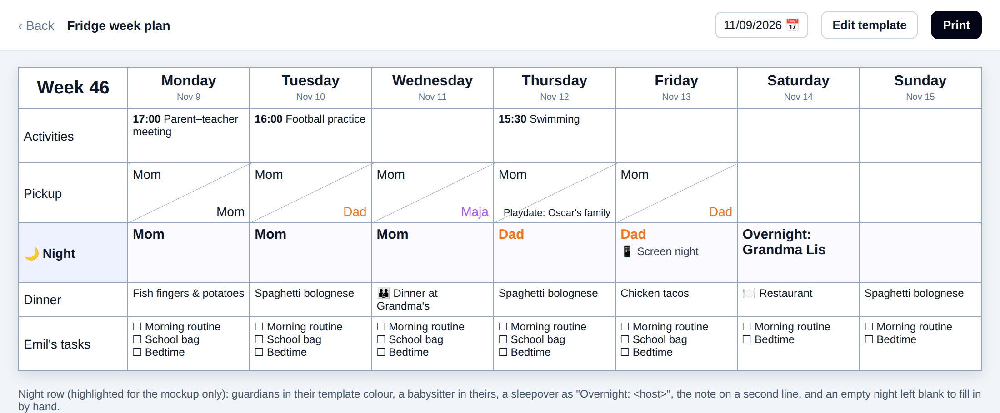
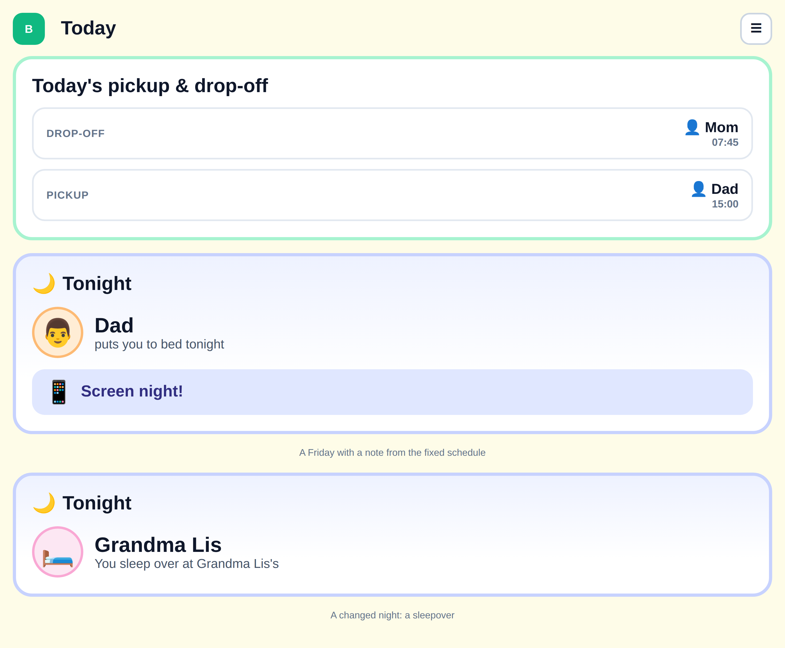
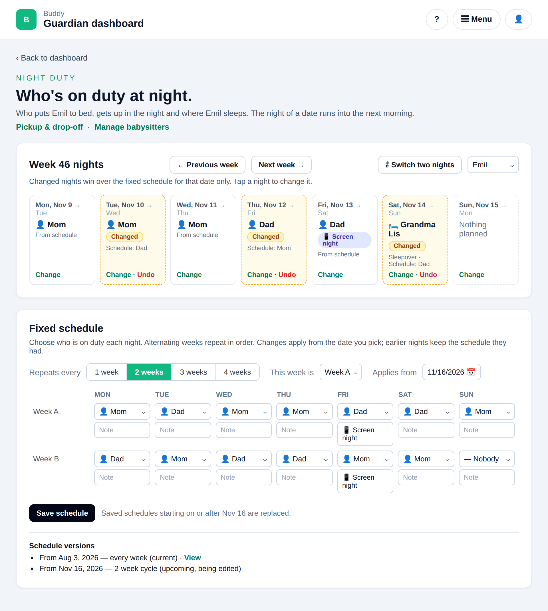
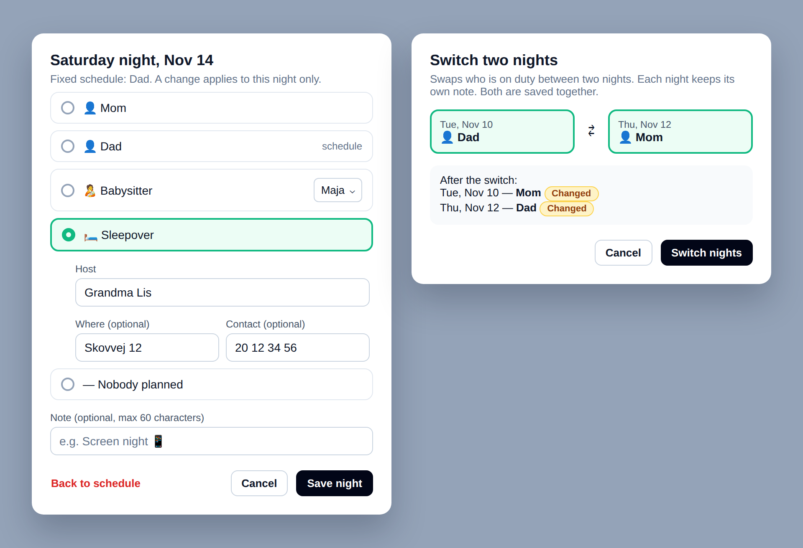
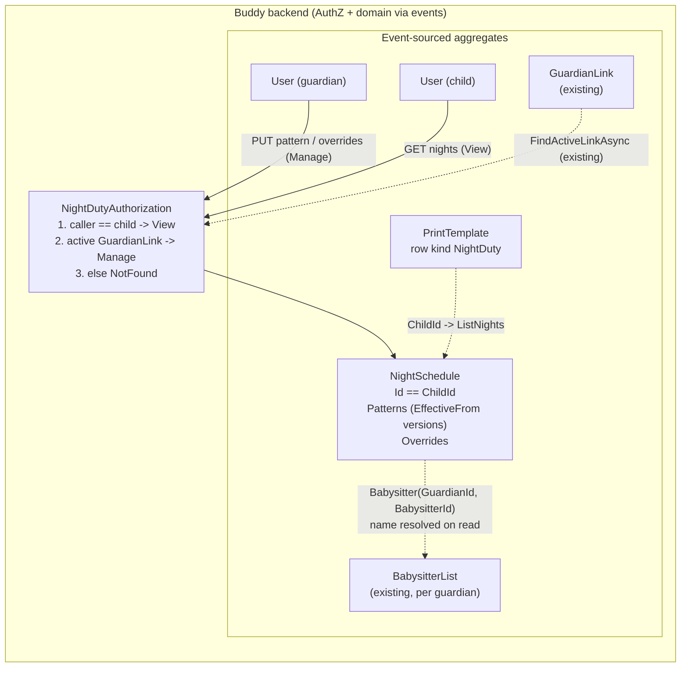

# Night Duty

Status: Proposed (not yet implemented)

## Context

Guardians want to plan **who is on duty at night** for each child: who puts the child to bed, who
gets up when the child wakes, and where the child sleeps (GitHub issue #66). Most families follow
the same rhythm every week, or an A/B rhythm across two homes, with the odd exception ("Mom and Dad
switch Tuesday and Thursday this week", "Grandma has her this Saturday"). So the plan is set up once
and only adjusted when something changes. It isn't filled in date by date.

A night can also carry a short free-text note. The motivating example is a weekly **screen
night**, the one night a week the children may use a screen at bedtime. It belongs on the same plan
so the child sees it on the printed week plan and on their own day view.

Requirements settled in the issue:

1. **A fixed schedule** that repeats every week, or in a cycle of up to 4 weeks, with one
   responsible person per night.
2. **Per-night overrides** that win over the fixed schedule for that date only, and can be removed
   again. A switch between two guardians is two overrides saved together.
3. **A free-text note** on a night, in the fixed schedule or as a one-off, with or without a
   responsible person.
4. **Past nights are frozen.** A change to the fixed schedule takes effect from a date, and earlier
   nights keep the schedule they had.
5. **Visible to the child** as a "Tonight" card on the child's day dashboard, and **printable** as a
   Night row in a week plan print template.
6. **Dates only.** There are no bedtime or handover times in v1. A time can go in the note.

Out of scope, with their own issues: an iCal feed of night duty (#67), showing the responsible
guardian next to a logged night in the sleep diary (#68), and bedtime and handover times (#69).

Nothing like this exists in Buddy today. The closest precedents are:

- [work-locations.md](work-locations.md) (`Features/WorkLocations`): a 1–4 week **pattern**
  anchored on a Monday, plus a sparse per-date **override** map, resolved as override → pattern →
  nothing. Night duty has the same shape, applied to a child rather than a guardian.
- [pickup-schedules.md](pickup-schedules.md) (`Features/Pickups`): the **per-child** scope, the
  guardian/child authorization tiers and the **assignee** union (`Guardian`, `Babysitter`,
  `Playdate`, ...). Night duty reuses its assignee shapes, but not its "every date filled in by
  hand" model.
- [babysitters.md](babysitters.md): a babysitter is referenced by `(GuardianId, BabysitterId)` and
  its name is resolved on read.

This document answers seven questions: whether this extends `Pickups`, the aggregate's shape and
identity, how a responsible person and a note are modelled, how versioned fixed schedules work, how
overrides and switches work, who can see and change the data, and how the print sheet and the child
view use it.

## Question 1: a third pickup slot, or a new feature?

**Decision: a new feature, `Features/NightDuty`, with its own `NightSchedule` aggregate.**
`Pickups` stays untouched.

- **Pickups have no fixed schedule.** A `PickupSchedule` is a sparse map of hand-filled
  `(Date, Slot)` assignments
  ([PickupSchedule.cs](../../../src/backend/buddy/Features/Pickups/Types/PickupSchedule.cs)). Adding
  a pattern and versioning to it for one slot would change how the two existing slots expand, and
  every pickup reader with them.
- **A night isn't a time-of-day slot.** `PickupSlot` is `DropOff | PickUp` with an optional time;
  a night runs from date D into D+1 and has no time in v1 (requirement 6). The printed pickup cell
  is split diagonally into two triangles, one per slot, and has no room for a third value.
- **The assignee cases differ.** `SelfEscort` and `Sibling` make sense for getting to school, not
  for being responsible at night. A night needs a `Sleepover` (the child sleeps somewhere else) and
  an `Unassigned` case that still carries a note.
- This is the same call [work-locations.md, Question 1](work-locations.md#question-1-calendar-items-or-a-new-feature)
  made: a distinct concept with its own resolution rules gets a distinct aggregate.

Considered and rejected: a `CalendarItem` recurrence per guardian (calendar recurrence has no
weekday lists or exceptions, see the same work-locations question), and a third `PickupSlot.Night`
(above).

## Question 2: aggregate shape and identity

**Decision: one `NightSchedule` stream per child, whose id equals the child's `UserId`, created
lazily by the first write. No index document.**

```text
NightSchedule(
    NightScheduleId Id,                                   // == ChildId.Value
    UserId ChildId,
    ImmutableList<NightPattern> Patterns,                 // fixed-schedule versions, ordered by EffectiveFrom, see Question 4
    ImmutableDictionary<DateOnly, NightOverride> Overrides) // sparse, see Question 5
```

- **Per child, like `PickupSchedule` and `MedicineSchedule`.** Siblings can sleep in different
  homes on the same night, so a family-wide schedule (the `MealPlan` shape) doesn't fit.
- **Deterministic id, like `WorkLocationScheduleId.ForGuardian` and `ProgressId.ForChild`.**
  `NightScheduleId.ForChild(UserId)` returns `new(childId.Value)`, so "this child's schedule" is a
  direct stream lookup
  ([WorkLocationScheduleId.cs](../../../src/backend/buddy/Features/WorkLocations/Types/WorkLocationScheduleId.cs)).
  `PickupSchedule` needs `PickupScheduleIndexDocument` only because its id is random; that
  precedent is deliberately not followed.
- **Lazy creation.** `NightScheduleStarted` is appended together with the first real write, like
  `WorkLocationScheduleStarted` and `PickupScheduleCreated`. A child whose guardians never open the
  feature has no stream, and reads return an empty schedule.
- **Dates are the child's wall-clock dates.** The night of `D` is the night that starts on the
  evening of `D`. As in work locations, `DateOnly` carries no time zone, so DST never comes into it.
  "Today" (for the "Tonight" card and for the `EffectiveFrom` check) is resolved in the child's
  time zone with the existing `MedicineEffectNotes.ChildTodayAsync`
  ([MedicineEffectNotes.cs:46](../../../src/backend/buddy/Features/Medicines/MedicineEffectNotes.cs)),
  which a shared helper should take over rather than duplicate.

## Question 3: the responsible person and the note

**Decision: a night holds a `NightEntry` of a responsible person and a note, where the
responsible person is a union of four cases.**

```text
NightEntry(NightResponsible Responsible, string Note)   // Note "" = none; never Unassigned with ""

NightResponsible =
    Guardian(UserId GuardianId)                                    // an active guardian of the child
  | Babysitter(UserId GuardianId, BabysitterId BabysitterId)       // on that guardian's BabysitterList
  | Sleepover(string HostName, string Location, string ContactInfo) // Location, ContactInfo "" = not given
  | Unassigned                                                     // a note on its own, e.g. "Screen night 📱"
```

- **The cases copy `PickupAssignee`'s shapes** (`Guardian`, `Babysitter`, and `Playdate` renamed to
  `Sleepover`) ([PickupAssignee.cs](../../../src/backend/buddy/Features/Pickups/Types/PickupAssignee.cs)).
  It is a separate union, not `PickupAssignee` itself, because the case sets differ (Question 1),
  and a shared union would let a pickup carry `Unassigned` or a night carry `SelfEscort`.
- **Persisted with an explicit discriminator.** `Guardian` and `Babysitter` both carry a bare
  guid, so System.Text.Json's shape-based union classifier can't tell them apart. A
  `NightResponsibleJsonConverter` writes `{"Kind":"Guardian","GuardianId":...}` and so on, the same
  fix as `PickupAssigneeJsonConverter` and `WorkDayOverrideJsonConverter`. On the wire,
  `NightResponsibleDto` is a `KindDiscriminatedJsonConverter` with a numeric `kind`, like
  `PickupAssigneeDto`.
- **Names are resolved on read, not stored.** A guardian's display name comes from the existing
  guardian list the frontend already loads (the pickup page does the same). A babysitter's name is
  resolved through `BabysitterNames`
  ([BabysitterNames.cs](../../../src/backend/buddy/Features/Pickups/BabysitterNames.cs)), so a
  rename reaches every night. `BabysitterNames` takes `PickupAssignee`s today. It should be
  generalised to take `(GuardianId, BabysitterId)` pairs and move to `Features/Babysitters`; see
  "Refactors" below.
- **The note is short free text.** It has a 60-character maximum, is trimmed with
  `FreeText.Normalize`, and may contain emoji. It is not a separate field on the night, so an
  override replaces the whole entry; see Question 5 for how the editor keeps a scheduled note.
- **`Unassigned` with an empty note is not an entry.** In a pattern that day is simply left out;
  as an override it is the `Cleared` case (Question 5). The validator rejects it.

## Question 4: the fixed schedule, versioned from a date

**Decision: the fixed schedule is a list of `NightPattern` versions, each with an `EffectiveFrom`
date. Saving a version replaces every version that starts on or after its date. A date resolves
against the latest version that starts on or before it.**

```text
NightPattern(
    DateOnly EffectiveFrom,                // first night this version applies to
    int CycleWeeks,                        // 1–4, as WorkPattern
    DateOnly AnchorMonday,                 // the Monday that starts cycle week 0, as WorkPattern
    IReadOnlyList<NightPatternDay> Days)   // days not listed have no entry

NightPatternDay(int Week, DayOfWeek Day, NightEntry Entry)   // Week 0-based, < CycleWeeks
```

- **Cycle arithmetic is `WorkPattern`'s, unchanged.** The cycle week of a date is the whole weeks
  from `AnchorMonday`, floored modulo `CycleWeeks`, so dates before the anchor and ISO week 53 years
  resolve correctly ([WorkPattern.cs](../../../src/backend/buddy/Features/WorkLocations/Types/WorkPattern.cs);
  [work-locations.md, Question 4](work-locations.md#question-4-alternating-weekly-patterns) explains
  why it's an anchor and not ISO parity). `MondayOnOrBefore` and `CycleWeekOf` move to a small
  shared `WeekCycle` helper that both features call; see "Refactors".
- **Versioned, unlike work locations v1.** Work locations explicitly left "pattern effective-from
  dates" as an open question, because printing looks forward. Night duty is shown to the child,
  printed on the fridge, and will be read by the sleep diary (#68), so a schedule change must not
  rewrite who was on duty last month (requirement 4).
- **`EffectiveFrom` can't be in the past.** It defaults to today in the child's time zone, and the
  handler rejects an earlier date with a validation error. The past is therefore never rewritten
  by a schedule save. Only overrides can touch a past date (Question 5).
- **"From this date on, this is the schedule".** Saving a version with `EffectiveFrom = X` drops
  every stored version with `EffectiveFrom >= X` and appends the new one. This covers the cases
  without a separate delete:
  - editing the upcoming version again replaces it (same date);
  - saving an earlier date than an upcoming version replaces that upcoming version too, so there is
    never a stale future version the guardian can't see;
  - stopping the schedule from a date is a save of an empty `Days` list.

  Considered and rejected: keeping later versions when an earlier one is saved. It's more
  expressive ("change from Monday, and again from January"), but the editor would need a version
  timeline, and an upcoming change could silently override what a guardian just saved.

- **Before the first version, there's nothing.** A date earlier than every `EffectiveFrom`
  resolves to "no entry", as a child with no stream does.
- **The anchor stays per version.** Each version carries its own `AnchorMonday`, so an A/B rhythm
  can be re-phased from a date ("from Monday, week A starts again") without touching the past.
- **Replaced wholesale.** The editor edits the whole grid of one version, and one
  `NightPatternReplaced` event per save keeps the edit atomic, as `WorkPatternReplaced` and
  `PrintTemplateRowsReplaced` do.

## Question 5: overrides and switching nights

**Decision: a sparse per-date override map, where an override is either an entry or `Cleared`.
Resolution is override → the pattern version in effect → nothing. Writes take a list of dates,
so a switch is one request and one append.**

```text
NightOverride = Entry(NightEntry Entry) | Cleared   // Cleared = "the schedule says Dad, but nothing is planned this night"
```

- **"No override" is not "override to nothing",** as in work locations. No override means "follow
  the fixed schedule", and `Cleared` blanks a night the schedule would fill.
- **`SetNightOverrides` takes a list of `(date, override)` pairs,** not a `[from, to]` range with
  one value as `SetWorkLocationOverrides` does. A switch sets two dates to two different values, so
  a single-value range can't express it, while a holiday is still easy to send as a list. At most 31
  dates per request (the `ValidDateRange` cap), with no duplicates.
- **One event per date that changes, in a single append.** This copies `WorkLocationOverridden` /
  `WorkLocationOverrideCleared`, not the `NightOverridesSet` / `NightOverridesCleared` batch events
  the issue sketched. Per-date events keep the fold a one-key `SetItem`/`Remove`, match the precedent
  and the golden files, and make "who changed this night" a simple stream filter later. Atomicity
  comes from the single `SaveChangesAsync`, not from one event. Dates whose value wouldn't change
  emit nothing.
- **Switching is a frontend action.** "Switch two nights" reads both resolved nights and sends one
  `SetNightOverrides` with the **responsible persons swapped and each night's note kept**. A screen
  night stays on Friday when Mom and Dad trade Friday for Tuesday. The server sees two ordinary
  overrides, so there is no switch-specific rule to test or version.
- **The editor keeps a scheduled note by default.** When a guardian changes only the person on a
  screen night, the dialog pre-fills the note from the schedule, so the override doesn't drop it by
  accident (an override replaces the whole entry, Question 3).
- **Overrides may be in the past.** Unlike the schedule, a guardian can correct a past night ("Dad
  did it after all"). That is the record being corrected, not the rules being rewritten, and the
  override is visible in the history.
- **`ClearNightOverrides` takes `from` and `to`** (the shared range rule), like
  `ClearWorkLocationOverrides`. It is idempotent: dates without an override emit nothing.
- **Always overwrite**, with no confirmation step, as `PickupAssigned` and `WorkLocationOverridden`
  do.

## Question 6: who can see and change this

**Decision: the `Pickups` tiers. Manage = an active guardian of the child. View = the child
themself. Everyone else gets `NotFound`.**

| Tier       | Who                                    | Actions                                     |
| ---------- | -------------------------------------- | ------------------------------------------- |
| **Manage** | An active `GuardianLink` to the child  | Everything                                  |
| **View**   | The child themself                     | `ListNights` only (the "Tonight" card)      |
| —          | Everyone else, a revoked link included | `NotFound`; a child calling a write → `403` |

- **Same helper shape as `PickupAuthorization`**
  ([PickupAuthorization.cs](../../../src/backend/buddy/Features/Pickups/PickupAuthorization.cs)),
  as a `NightDutyAuthorization` in the feature. Copying ~40 lines rather than reaching into
  `Pickups` keeps the features independent, the same trade-off `WorkLocationAuthorization` made.
- **Any active guardian can write, and every guardian sees every change.** There is no
  per-guardian ownership of a night: the schedule is the child's (requirement "a change by one
  guardian is visible to the other guardians"). Concurrent saves use expected-version appends via
  `StreamVersionTracker`; a true race is `409 concurrency_conflict`.
- **The child can't read `GetNightSchedule`.** The child sees resolved nights, not the editor's
  versions and notes for weeks ahead. `GetNightSchedule` is Manage only; a child calling it gets
  `403`, as a child calling a pickup write does.
- **Referenced people are checked on write.** A `Guardian` must hold an active link to the child,
  and a `Babysitter`'s `GuardianId` must too, with the babysitter active on that guardian's list.
  These are the `AssignPickup` relationship checks
  ([AssignPickup.Handler.cs:84](../../../src/backend/buddy/Features/Pickups/AssignPickup/AssignPickup.Handler.cs)),
  run for each pattern day and override, and reported as `400 validation_error`.
- **No group sharing in v1**, as pickups. A grandparent in the family group who isn't a guardian
  can't see the schedule.

## Question 7: the print sheet and the child's "Tonight" card

**Decision: a new `PrintRowKind.NightDuty` row and a child dashboard card, both reading
`ListNights`.**

### Print

- `PrintRowKind.NightDuty` is **appended at the end** of the enum, after `CalendarAgenda`, because
  the ordinal is the wire value ([PrintRowKind.cs](../../../src/backend/buddy/Features/PrintTemplates/Types/PrintRowKind.cs)).
- The row needs `ChildId` (an existing optional `PrintTemplateRow` field) and nothing else. The
  template's write-time checks extend as for a `Pickup` row: the caller must be a guardian of that
  child.
- `WeekPlanLoader` calls `ListNights(childId, monday, sunday)` once per Night row, behind the same
  `unlessOff` feature switch as the other sources
  ([week-plan-loader.ts:87](../../../src/frontend/buddy/src/app/features/guardian/print/week-plan-loader.ts)).
- `assembleWeekPlan` gets a `nightCells` case next to `workLocationCells`
  ([assemble-week-plan.ts:124](../../../src/frontend/buddy/src/app/features/guardian/print/assemble-week-plan.ts)).
  A guardian prints in their template `GuardianColor`, a babysitter in their `BabysitterColor`, a
  sleepover as "Overnight: Grandma Lis" / "Overnatning: Grandma Lis", and the note goes on a second
  line. An empty night is left blank so it can be written in by hand. A4 and A3 must still print
  as one landscape page.

A mockup of the printed week plan with a Night row (demo data, not a screenshot of built code):



### Child view

- A "Tonight" card on the child's day dashboard (`features/child/home/home.html`), below the
  "Today's pickup & drop-off" card, reading `ListNights(me, today, today)` with the child's own View
  access. "Today" comes from the child's time zone on the server, so the card doesn't depend on the
  device clock.
- It shows the responsible person large (the guardian's calling name and avatar, a babysitter's
  name, or the sleepover host) and the note as its own chip ("📱 Screen night!"). An empty night
  shows no card, as an empty pickup day shows none.

A mockup of the "Tonight" card on the child's phone (demo data, not a screenshot of built code):



## Events

```text
NightScheduleStarted(NightScheduleId Id, UserId ChildId, DateTimeOffset OccurredAt)
    // appended lazily with the first write, never on its own

NightPatternReplaced(NightScheduleId Id, NightPattern Pattern, UserId ModifiedBy, DateTimeOffset OccurredAt)
    // Pattern.EffectiveFrom says which versions it replaces (all with EffectiveFrom >= it)

NightOverridden(NightScheduleId Id, DateOnly Date, NightOverride Override, UserId ModifiedBy, DateTimeOffset OccurredAt)

NightOverrideCleared(NightScheduleId Id, DateOnly Date, NightOverride Before, UserId ModifiedBy, DateTimeOffset OccurredAt)
```

- **`ModifiedBy` is carried,** unlike the work-location events. Any guardian of the child can
  write (Question 6), so the writer isn't implied by the stream, as `PickupCleared.ModifiedBy`
  already shows.
- **No `Before` on `NightPatternReplaced`.** The replaced versions are already in the stream and
  nothing reads them from the event (the eliminate-nulls.md Phase 6 stance on `WorkLocationOverridden`).
- `NightResponsible` and `NightOverride` get explicit-discriminator Marten converters (Question 3).
- All four events get golden-file coverage in `buddy.IntegrationTests/EventShapeTests`.

### Rehydration

`NightSchedule.Start` / `Advance`, as `WorkLocationSchedule`'s:

- `NightScheduleStarted` seeds an empty schedule (no versions, no overrides).
- `NightPatternReplaced` sets
  `Patterns = Patterns.Where(p => p.EffectiveFrom < e.Pattern.EffectiveFrom).Append(e.Pattern)`,
  which stays sorted because nothing later survives.
- `NightOverridden` and `NightOverrideCleared` set or remove one key in `Overrides`.

An inline `NightScheduleSnapshotProjection` writes the snapshot to the shared `snapshots` schema
([event-stream-snapshots.md](event-stream-snapshots.md)), with a `NightScheduleSnapshot(Guid Id,
NightSchedule NightSchedule)` wrapper like `WorkLocationScheduleSnapshot`. The events live in a new
Marten schema, `nightduty`.

## Read models

There are no index documents (Question 2). `NightExpansion.Expand(schedule, from, to)` is a pure,
recomputed-on-every-call helper with `WorkLocationExpansion`'s contract:

```text
Night(DateOnly Date, NightStatus Status)

NightStatus =
    Unplanned                                                // no override, no entry in the version in effect
  | Cleared(NightEntry? Scheduled)                           // override to nothing; what the schedule would have said
  | Planned(NightEntry Entry, NightSource Source, NightEntry? Scheduled)
    // Source = Pattern | Override; Scheduled is set only for an override, so the editor can show "Schedule: Dad"
```

The wire shape is `{ "kind": 0 } | { "kind": 1, "scheduled" } | { "kind": 2, "entry", "source",
"scheduled" }`, with `NightResponsibleDto` inside `entry`, a babysitter's `name` resolved, as
`WorkDayStatus` and `PickupAssigneeDto` do. Carrying the scheduled entry costs one extra lookup
per overridden date and saves the week view a second request. It is how the mockup shows
"Changed · Schedule: Dad".

## Command slices (`Features/NightDuty/`, same vertical-slice shape as `WorkLocations`)

| Slice                 | Tier         | Notes                                                                                                                                                                                                  |
| --------------------- | ------------ | ------------------------------------------------------------------------------------------------------------------------------------------------------------------------------------------------------ |
| `ReplaceNightPattern` | Manage       | `effectiveFrom` (default today in the child's zone, not in the past), `cycleWeeks`, `anchorMonday`, `days`. No-op when equal to the version already stored for that date. Emits `NightPatternReplaced` |
| `SetNightOverrides`   | Manage       | `nights: [{ date, override }]`, 1–31 distinct dates. One `NightOverridden` per date that changes                                                                                                       |
| `ClearNightOverrides` | Manage       | `from`, `to`. One `NightOverrideCleared` per date that had an override; idempotent                                                                                                                     |
| `GetNightSchedule`    | Manage       | All pattern versions (flagged past / current / upcoming) for the editor; overrides are read resolved, via `ListNights`                                                                                 |
| `ListNights`          | Manage, View | Resolved `Night`s for `[from, to]`, with names resolved                                                                                                                                                |

### Validation limits

Structural rules go in each slice's validator. Rules that need other aggregates (guardian links,
babysitter lists) or the child's time zone are handler checks, as
[validation-rules.md](validation-rules.md) prescribes:

| Field                      | Rule                                                                                           |
| -------------------------- | ---------------------------------------------------------------------------------------------- |
| `EffectiveFrom`            | today or later, in the child's time zone (handler)                                             |
| `CycleWeeks`               | 1–4                                                                                            |
| `AnchorMonday`             | must be a Monday                                                                               |
| `Days`                     | no null entries; 0 ≤ `Week` < `CycleWeeks`; at most one entry per (`Week`, `Day`)              |
| `Note`                     | trimmed, ≤ 60 characters                                                                       |
| Entry                      | not `Unassigned` with an empty note                                                            |
| `Sleepover.HostName`       | required, ≤ 200 (as `Playdate`); `Location` ≤ 200, `ContactInfo` ≤ 2000                        |
| `Guardian.GuardianId`      | an active guardian of the child (handler)                                                      |
| `Babysitter`               | its `GuardianId` an active guardian of the child, the babysitter active on that list (handler) |
| Override `nights`          | 1–31 entries, distinct dates                                                                   |
| `ListNights`, clear ranges | `from ≤ to`, `to - from` ≤ 31 (shared `ValidDateRange`)                                        |

## Routes

```text
PUT    /night-duty/children/{childId}/pattern     ReplaceNightPattern
PUT    /night-duty/children/{childId}/overrides   SetNightOverrides
DELETE /night-duty/children/{childId}/overrides   ClearNightOverrides (from, to as query params)
GET    /night-duty/children/{childId}             GetNightSchedule
GET    /night-duty/children/{childId}/nights      ListNights          (from, to as query params)
```

Status codes follow [http-status-codes.md](../http-status-codes.md): `NotFound` for no relationship
to the child, `Forbidden` for a child calling a Manage route, `BadRequest` with an `ErrorEnvelope`
for validation failures. After the endpoints exist: a `NightDuty.http` file, `task docs:openapi`
and `task codegen:backend`.

## Refactors

Two small extractions, so the second user of each doesn't copy it:

1. **Week cycle arithmetic.** Today it lives on `WorkPattern`
   ([WorkPattern.cs:16-25](../../../src/backend/buddy/Features/WorkLocations/Types/WorkPattern.cs)):

   ```csharp
   public static DateOnly MondayOnOrBefore(DateOnly date) =>
       date.AddDays(-(((int)date.DayOfWeek + 6) % 7));

   public int CycleWeekOf(DateOnly date) { /* floored modulo from AnchorMonday */ }
   ```

   It becomes a static `Common/WeekCycle` with `MondayOnOrBefore(date)` and
   `CycleWeekOf(anchorMonday, cycleWeeks, date)`. `WorkPattern` keeps its instance methods as
   one-line delegates, so no work-locations caller or snapshot changes.

2. **Babysitter name resolution.** `BabysitterNames.LoadAsync` takes `IEnumerable<PickupAssignee>`
   and `NameOf` takes a `PickupAssignee.Babysitter`
   ([BabysitterNames.cs:20-27](../../../src/backend/buddy/Features/Pickups/BabysitterNames.cs)):

   ```csharp
   // before
   public string NameOf(PickupAssignee.Babysitter babysitter) => ...;
   public static Task<BabysitterNames> LoadAsync(IEnumerable<PickupAssignee> assignees, ...);

   // after (Features/Babysitters)
   public string NameOf(BabysitterId babysitterId) => ...;
   public static Task<BabysitterNames> LoadAsync(IEnumerable<(UserId GuardianId, BabysitterId BabysitterId)> refs, ...);
   ```

   Its `Pickups` callers pass the pairs instead. That is 4 call sites (`LoadAsync` in
   `AssignPickup.Handler`, `PickupScheduleExpansion` and `PickupsPersonalDataExport`, `NameOf` in
   `PickupAssigneeDto.FromDomain`) and no event or wire change.

## Frontend

A mockup of the guardian page: the resolved week with three changed nights and a screen night, and
the fixed-schedule editor preparing a 2-week cycle from Nov 16 (demo data, not a screenshot of built
code):



A mockup of changing one night and of switching two nights (demo data, not a screenshot of built
code):



- **Service:** `core/night-duty.service.ts`, following `work-locations.service.ts`, with
  `postIdempotent`-style idempotency keys on the writes as the other services do.
- **Route:** `/guardian/night-duty` under `features/guardian/night-duty/`, behind a new
  `nightDuty` feature flag (`features.service.ts`, `FeatureOptions.cs`), with a guardian menu
  entry and a help topic. The pickup page gets a "Night duty" link next to "Manage babysitters",
  and the night duty page links back. This puts the two schedules next to each other without
  growing the pickup page further.
- **Week card:** a child picker, week paging, seven night tiles. Each tile shows the resolved
  person, the note chip, and whether it is from the schedule or changed (with "Schedule: Dad"
  underneath). Tapping a tile opens the edit dialog (person, babysitter picker, sleepover fields,
  "Nobody planned", note pre-filled from the schedule, "Back to schedule" to clear). A "Switch two
  nights" action picks two tiles and saves one `SetNightOverrides`.
- **Fixed schedule card:** the work-location pattern editor's layout (`segmented-control` for the
  cycle length, "this week is week A/B" anchor picker, a cycle-weeks × 7 grid), with a person
  select and a note input per cell, an "Applies from" date (default today, min today), and a short
  list of versions (current, upcoming).
- **Child card:** in `features/child/home/home.html`, as described in Question 7.
- **Print:** `PRINT_ROW_KIND.nightDuty` in the template editor (child picker only) and the sheet.
- **i18n:** `core/i18n/translations/{en,da}/night-duty.ts` ("Night duty" / "Nattevagt"), plus
  `child.home.tonight.*` and the print row label ("Night" / "Nat").
- **Screenshots:** `guardian-night-duty` in `screenshots/pages.ts`, and a Night row and a screen
  night in `demo-family.ts`, so the child home and print sheet screenshots change too. The demo
  family gets a second guardian, Jonas Holm (calling name "Dad"), as a co-guardian of Emil and
  Ida, so the seeded schedule shows the Mom/Dad rhythm of the mockups. The seed also adds a
  babysitter night and a sleepover. Dad's demo Keycloak user is created the same way as the
  existing demo users, and the pickup screenshots can use him too.

## Testing

Alba integration tests mirror `WorkLocations`' folder, with the usual per-status cases plus:

- cycle resolution for dates before the anchor, across a year boundary and across ISO week 53
  (2026-12-28 to 2027-01-03);
- versioning: a save from `X` leaves nights before `X` resolving against the older version; an
  `EffectiveFrom` in the past is `400`; a save from `X` drops an upcoming version from `Y > X`; a
  date before the first version is `Unplanned`;
- override beats pattern; `Cleared` blanks a scheduled night; clearing reverts; a two-date
  `SetNightOverrides` appends exactly two events in one append; an unchanged date emits nothing;
- a note alone (`Unassigned` + note) is accepted in both a pattern and an override; `Unassigned`
  with no note, and a 61-character note, are `400`;
- a guardian who isn't an active guardian of the child, and an unknown or archived babysitter, are
  `400`; a non-guardian gets `404`; a child gets `200` on `ListNights` and `403` on writes and on
  `GetNightSchedule`; a revoked link drops to `404`;
- a write by one guardian is visible to the other through `ListNights`;
- a babysitter rename shows on the next `ListNights`.

Plus `EventShapeTests` golden files, a `SnapshotTests` entry, Vitest specs for the service, the
page, the dialogs, the child card and `nightCells`, and a Playwright journey: save a fixed schedule,
switch two nights, see the change marked, open the print sheet and see the Night row.

## GDPR

`NightDutyPersonalData` (eraser and exporter), registered like `PickupsPersonalData`
([PickupsPersonalData.cs](../../../src/backend/buddy/Features/Pickups/PickupsPersonalData.cs)):

- erasing the **child** deletes the stream and its snapshot (sleepover hosts' names and contact
  details are the child's data, like playdate hosts);
- erasing a **guardian** leaves the child's schedule alone, as pickups do. Nights that referred to
  them stop resolving a name and show "a former guardian";
- the export includes each child's versions and overrides in the guardian's and the child's export.

## Failure and edge-case behavior

| Case                                                     | Behavior                                                                                               |
| -------------------------------------------------------- | ------------------------------------------------------------------------------------------------------ |
| Child's guardians have never used the feature            | No stream; reads return no versions and `Unplanned` for every night; no "Tonight" card                 |
| Date before the first version's `EffectiveFrom`          | `Unplanned` (or the override, if any)                                                                  |
| Schedule saved with `EffectiveFrom` in the past          | `400 validation_error`; the past is never rewritten by a schedule save                                 |
| Schedule saved from `X` while an upcoming `Y > X` exists | The upcoming version is dropped; the new one applies from `X`                                          |
| Same version saved again                                 | No-op, no event                                                                                        |
| Override to the value it already has                     | No-op, no event                                                                                        |
| Clear a range with no overrides                          | Idempotent no-op (`Success`, no event)                                                                 |
| Override on a past date                                  | Allowed (correcting the record); shown as changed                                                      |
| Guardian's `GuardianLink` is revoked                     | Their reads and writes drop to `404`; existing nights naming them still resolve, the editor flags them |
| Babysitter archived or renamed                           | Existing nights keep resolving the (new) name; new entries can't pick an archived babysitter           |
| Guardian deletes their account                           | Nights naming them show "a former guardian"; the schedule is untouched                                 |
| Child opens the app after midnight                       | "Tonight" is the night of the child's current date, i.e. the coming evening, not the night in progress |
| Week 53 years                                            | No effect; cycle weeks count from the anchor                                                           |
| Concurrent saves by two guardians                        | Expected-version append; the loser gets `409 concurrency_conflict` and reloads                         |

## Estimate

|                  |                                                                                                                                                                                                   |
| ---------------- | ------------------------------------------------------------------------------------------------------------------------------------------------------------------------------------------------- |
| Complexity       | High -- a new aggregate with versioned patterns, 4 events and 2 persisted unions, 5 routes, 2 small refactors, a guardian page with 2 dialogs, a child card, a print row kind, GDPR and demo data |
| Single developer | 8-12 days                                                                                                                                                                                         |
| AI agent         | 5-8 hours, plus about 2 hours of human review                                                                                                                                                     |

## Decisions made

| Question                   | Decision                                                                                                  |
| -------------------------- | --------------------------------------------------------------------------------------------------------- |
| Pickup slot or new feature | New feature `Features/NightDuty`, because pickups have no fixed schedule and a different set of assignees |
| Identity                   | One stream per child, id equal to the child's `UserId`, created lazily; no index document                 |
| Responsible person         | `Guardian \| Babysitter \| Sleepover \| Unassigned`, plus a note of at most 60 characters                 |
| Fixed schedule             | 1–4 week cycle from an anchor Monday, as work locations, in versions with an `EffectiveFrom`              |
| Past nights                | Frozen: `EffectiveFrom` can't be in the past; a save replaces all versions from its date on               |
| Overrides                  | Sparse per-date `Entry \| Cleared`; override → version in effect → nothing                                |
| Override writes            | A list of `(date, override)` pairs, one event per changed date in one append                              |
| Switching nights           | A frontend action: swap the responsible persons, keep each night's note, one `SetNightOverrides`          |
| Events                     | Per-date `NightOverridden` / `NightOverrideCleared` (the work-locations precedent), not batch events      |
| Who sees it                | Guardians Manage, the child Views resolved nights only, everyone else `NotFound`                          |
| Print                      | `PrintRowKind.NightDuty`, appended last; blank cell for an empty night                                    |
| Child view                 | A "Tonight" card on the day dashboard; no card for an empty night                                         |
| Page placement             | Its own page `/guardian/night-duty`, linked from and to the pickup page                                   |
| Demo data                  | A second demo guardian, Jonas Holm ("Dad"), seeded in `demo-family.ts`                                    |
| "Tonight" after midnight   | Follows the child's date, so after midnight the card shows the coming evening                             |
| "Changed by" history       | Stored (`ModifiedBy` on every event) but not shown in v1                                                  |
| Group visibility           | None in v1: guardians and the child only, as pickups and work locations                                   |

## Remaining open questions

None for v1. The questions raised in review are settled in the table above. The ones deferred
there can be added later without a redesign:

- **"Tonight" after midnight.** A rule that shows the previous date's night until a cut-off
  hour is a change to the child card only.
- **"Changed by" history.** `ModifiedBy` is already on every event, so showing it means adding a
  field to `ListNights` and a line in the dialog.
- **Group visibility.** A View tier for group members goes in `NightDutyAuthorization`, as it
  would for pickups and work locations.

## Diagram


