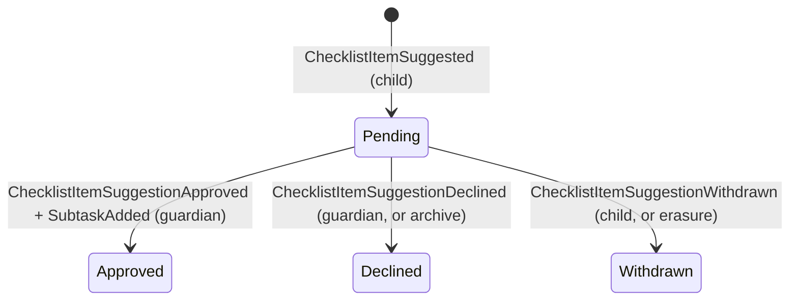
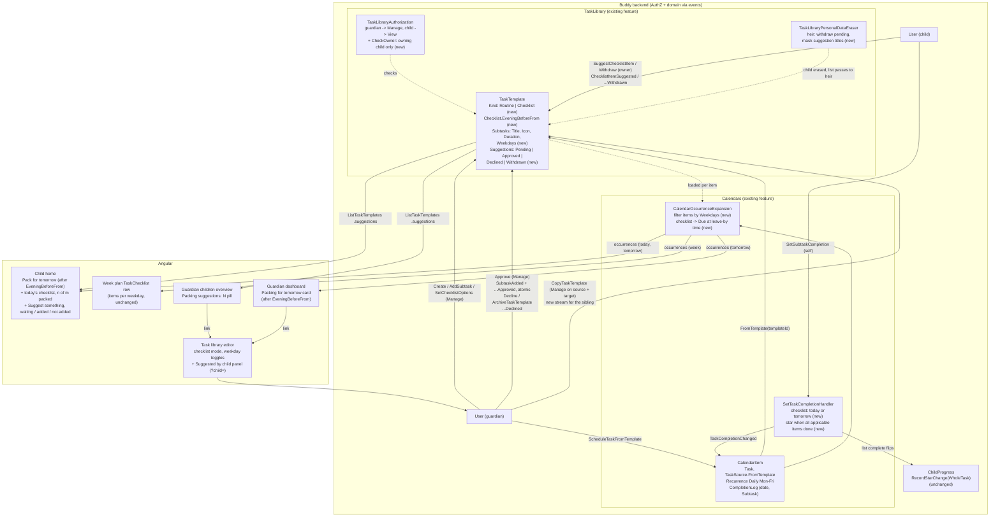

# Packing Checklists

Status: Implemented. `TaskTemplateKind` (`Routine | Checklist`) with `ChecklistOptions.EveningBeforeFrom`,
per-item `Subtask.Weekdays`, `Due` occurrences with `routine.checklist`, ticks one day ahead for
packing lists, one `WholeTask` star per packed list; slices `SetChecklistOptions`,
`CopyTaskTemplate`, `SuggestChecklistItem`, `WithdrawChecklistSuggestion`,
`ApproveChecklistSuggestion`, `DeclineChecklistSuggestion` (`ChecklistSuggestionOutcome`), archive
declining pending suggestions, eraser/exporter changes; frontend: the packing-list mode, suggestion
panel and "Copy to…" in the task library, "Pack for tomorrow" and "Suggest something" on the child
home, the "Packing suggestions" pill and the "Packing for tomorrow" dashboard card.

## Context

Forgetting things is one of the most common daily ADHD struggles. The gym bag stays on the hook
on Tuesday, the swimming kit is missing on Thursday, and the glasses are on the bedside table
every other day. Many families tape a list by the front door:

| Day              | Pack                                             |
| ---------------- | ------------------------------------------------ |
| Every school day | Lunchbox, water bottle, glasses, homework folder |
| Tuesday          | Gym clothes, indoor shoes                        |
| Wednesday        | Football boots, shin pads                        |
| Thursday         | Swimming kit, towel                              |
| Friday           | Library book                                     |

Guardians want that list in Buddy:

- **Weekday-bound items.** One school-bag list per child where some items apply every day and
  others only on some weekdays.
- **Shown at the right time.** On the child's day view **the evening before** (packing the bag
  at night is the usual ADHD advice) and/or **the morning of**, until it's done.
- **Ticked off by the child**, item by item, so the child (and a guardian glancing at the
  dashboard) can see what is still missing.
- **Printable** on the fridge week plan.

Nothing called a "packing list" exists yet, but almost every piece does:

- The **task library** ([task-library.md](../../frontend/analysis/task-library.md),
  [task-library/flow.md](../task-library/flow.md)) gives a guardian per-child
  [`TaskTemplate`](../../../src/backend/buddy/Features/TaskLibrary/Types/TaskTemplate.cs)s with
  an **ordered list of subtasks**, edited with add/update/remove/reorder slices.
- [`ScheduleTaskFromTemplate`](../../../src/backend/buddy/Features/Calendars/ScheduleTaskFromTemplate/ScheduleTaskFromTemplate.Handler.cs)
  puts a template on a calendar as one task with a `Recurrence`, assigned to the child, and
  [recurrence-weekdays.md](recurrence-weekdays.md) lets that recurrence run on chosen weekdays.
- [`CalendarItem.CompletionLog`](../../../src/backend/buddy/Features/Calendars/Types/CalendarItem.cs)
  already stores **per-occurrence, per-subtask tick-off state**:
  `CompletionKey(DateOnly OccurrenceDate, CompletionTarget Target)` with
  `CompletionTarget.Subtask(Guid SubtaskId)`
  ([CompletionTarget.cs](../../../src/backend/buddy/Features/Calendars/Types/CompletionTarget.cs)).
  The child can tick their own assigned task even as a calendar `Viewer`
  ([SetTaskCompletion.Handler.cs](../../../src/backend/buddy/Features/Calendars/SetTaskCompletion/SetTaskCompletion.Handler.cs)).
- Ticking a subtask already **awards a star** through `RecordStarChange`
  ([gamified-progress.md](gamified-progress.md)).
- The child home already **groups a template's subtasks** under the parent title
  (`groupTaskRuns()` in [task-run.ts](../../../src/frontend/buddy/src/app/core/task-run.ts),
  [child-day-dashboard.md](../../frontend/analysis/child-day-dashboard.md#tasks)), and the week
  plan's `TaskChecklist` row already **prints a routine's subtasks under its title**
  (`includeSubtasks` in [week-plan-model.ts](../../../src/frontend/buddy/src/app/features/guardian/print/week-plan-model.ts),
  [assemble-week-plan.ts](../../../src/frontend/buddy/src/app/features/guardian/print/assemble-week-plan.ts)).

So the key design question is whether a packing list is a task template, or a new small
aggregate. This document answers ten questions: reuse or new aggregate (1), how the template
model has to change (2), per-item weekdays (3), the "evening before" timing (4), stars (5), who
edits and who sees (6), linking to calendar events (7), child-suggested items (8), copying a
template to a sibling (9) and the guardian dashboard's evening card (10), followed by printing,
the feature flag and the frontend.

The user settled two product questions on 2026-10-11: **a child can suggest items for their own
packing list, and a guardian approves or declines each suggestion -- in v1** (Question 8), and
**one star per fully packed list** (Question 5). On 2026-10-13 the user settled the rest: **copy a
template to a sibling, in this feature** (Question 9), **a guardian dashboard card for lists not
packed by the evening** (Question 10), no reason on a declined suggestion, and the doc's leans for
everything else (see "Decisions made").

## Question 1: reuse the task library, or a new aggregate?

**Decision: reuse. A packing list is a `TaskTemplate` of a new kind, `Checklist`, whose subtasks
are the items. It is scheduled with the existing `ScheduleTaskFromTemplate` and ticked with the
existing `SetSubtaskCompletion` route. Four gaps are filled in place (Questions 2--5); no new
aggregate, schema, event store or snapshot.**

Map each requirement onto the code that exists:

| Requirement                            | Existing mechanism                                                                                     | Gap                                                                                         |
| -------------------------------------- | ------------------------------------------------------------------------------------------------------ | ------------------------------------------------------------------------------------------- |
| Ordered list of items, guardian-edited | `TaskTemplate.Subtasks` + `AddSubtask`/`UpdateSubtask`/`RemoveSubtask`/`ReorderSubtasks`               | Items have no duration; `AddSubtaskValidator` requires `Duration > 0` (Question 2)          |
| One list per child                     | `TaskTemplateIndexDocument(Id, ChildId)`, `TaskLibraryAuthorization` (guardian `Manage`, child `View`) | None                                                                                        |
| "Every school day"                     | `Recurrence.Repeating(Daily, 1, ..., Weekdays: Mon--Fri)` on the scheduled item                        | None                                                                                        |
| "Tuesday: gym clothes"                 | --                                                                                                     | Per-item weekday filter (Question 3)                                                        |
| Child ticks items, per day             | `CompletionLog` keyed by `(OccurrenceDate, Subtask(id))`, self-completion for the assignee             | None for the morning of                                                                     |
| Shown and tickable the evening before  | --                                                                                                     | `ValidateNotFuture` rejects tomorrow's occurrence; child home loads today only (Question 4) |
| Stars                                  | `RecordStarChange` per subtask                                                                         | One star per item is inflation for a packing list (Question 5)                              |
| Child home rendering                   | `groupTaskRuns()`                                                                                      | Render as a checklist rather than a timed run (Frontend)                                    |
| Fridge print                           | `TaskChecklist` row with `includeSubtasks`                                                             | None, once expansion filters items by weekday                                               |

Every row in the right-hand column is a small change to code that exists. A new aggregate would
re-create every row in the middle column instead:

- **A new `PackingList` aggregate** (`Features/PackingLists`, an ordered `Items` list with a
  `Weekdays` each, a `TickLog` keyed by `(DateOnly, ItemId)`). Considered and rejected,
  because it would need its own completion slice and child self-tick authorization (which
  `SetTaskCompletionHandler` already has), its own `RecordStarChange` call and a new
  `OccurrenceKey` source in Progress, its own read path into the child home and the guardian
  "tasks today" card, its own week-plan row kind (`PrintRowKind` would grow), its own GDPR
  eraser/exporter, a new Marten schema and snapshot, and its own editor screen duplicating
  `ManageTasks`. The one thing it does more naturally -- per-item weekdays -- is a single
  `Weekdays` field either way (Question 3).
- **Plain task templates as they are today** (one "Tuesday bag" template per weekday, each
  scheduled weekly). Considered and rejected as the design, though it works as a stop-gap
  today: every-day items are duplicated into five templates, items get fake 1-minute
  durations that the agenda renders as a 07:00--07:06 timed run, the list can't be ticked the
  evening before, and each item earns a star.
- **A new `TaskSource.Checklist` on `CalendarItem`** (items stored on the calendar item, like a
  freeform task with children). Rejected: the list would be edited from the calendar rather
  than the library, and two items scheduled from one list would drift apart. Keeping the items
  on the template keeps the property the task library already has: _later edits to the
  template affect every scheduled occurrence_ ([task-library.md, Calendar integration](../../frontend/analysis/task-library.md#calendar-integration-scheduling-from-a-template)).

This is the same "extend before you add" call [reward-redemption.md, Question 1](reward-redemption.md#question-1-a-new-aggregate-or-the-childprogress-stream)
made for the progress stream, and the opposite of [house-rules.md, Question 1](house-rules.md#question-1-extend-an-existing-feature-or-a-new-feature),
where no existing aggregate had the shape. Here one does.

## Question 2: a template kind, and items without a duration

**Decision: `TaskTemplate` gains a `Kind` (`Routine | Checklist`) fixed at creation, and
`ChecklistOptions` that only a checklist uses. A checklist's subtasks have `Duration ==
TimeSpan.Zero`; a routine's still need a positive duration. The duration rule moves from the
validators into the handlers, because it now depends on the loaded template.**

A routine and a checklist differ in exactly one way at expansion time: a routine's subtasks are
laid out back to back from the scheduled start (`offset += subtask.Duration` in
[`CalendarOccurrenceExpansion.AddTemplateTaskOccurrences`](../../../src/backend/buddy/Features/Calendars/CalendarOccurrenceExpansion.cs)),
while a checklist's items are all due at the same moment -- the time the child leaves the house.

```csharp
public enum TaskTemplateKind { Routine = 0, Checklist = 1 }

public sealed record ChecklistOptions(TimeOnly? EveningBeforeFrom);   // Question 4

TaskTemplate(
    TaskTemplateId Id,
    UserId CreatedBy,
    string Name,
    Icon Icon,
    Color Color,
    TaskTemplateKind Kind,            // new; Routine for every existing stream
    ChecklistOptions Checklist,       // new; ChecklistOptions.None for a routine
    ImmutableList<Subtask> Subtasks,
    bool IsArchived,
    UserId LastModifiedBy)
```

- **Why an explicit kind, not "all durations are zero".** An implicit kind would flip the
  moment a guardian sets one item's duration, silently changing how every scheduled occurrence
  expands. The kind is fixed at creation and never changes, for the same reason: converting a
  routine with a 07:00--07:25 timed run into a checklist would rewrite occurrences the child has
  already ticked. A guardian who wants the other kind creates a new template.
- **Why not a `Kind` on the scheduled `CalendarItem`.** The same list scheduled twice must
  behave the same way. The template is where the items live, so it is where their meaning lives.
- **Backward compatibility.** `TaskTemplateCreated` gains `TaskTemplateKind Kind =
TaskTemplateKind.Routine` as its last positional parameter. Existing events have no `Kind`
  property and deserialize to `Routine`, the same "new trailing parameter with a default"
  approach `Recurrence.Repeating` used for `Weekdays = Weekdays.None`
  ([recurrence-weekdays.md, Persistence](recurrence-weekdays.md#persistence)). The golden files
  in [TaskLibraryEventShapeTests.cs](../../../src/backend/buddy.IntegrationTests/EventShapeTests/TaskLibraryEventShapeTests.cs)
  are regenerated, and a new test replays a stored pre-change `TaskTemplateCreated` JSON to prove
  it still folds to `Routine`.

Before ([TaskTemplateEvents.cs:46](../../../src/backend/buddy/Features/TaskLibrary/Types/TaskTemplateEvents.cs)):

```csharp
public sealed record TaskTemplateCreated(
    TaskTemplateId Id, UserId ChildId, UserId CreatedBy, string Name, Icon Icon, Color Color, DateTimeOffset OccurredAt);
```

After:

```csharp
public sealed record TaskTemplateCreated(
    TaskTemplateId Id, UserId ChildId, UserId CreatedBy, string Name, Icon Icon, Color Color, DateTimeOffset OccurredAt,
    TaskTemplateKind Kind = TaskTemplateKind.Routine);

// New: a checklist's display options. Before/After like TaskTemplateDetailsUpdated.
public sealed record ChecklistOptionsChanged(
    TaskTemplateId Id, ChecklistOptions Before, ChecklistOptions After, UserId ModifiedBy, DateTimeOffset OccurredAt);
```

Blast radius: `TaskTemplateCreated` is constructed in 1 handler (`CreateTaskTemplateHandler`)
and 2 test files (`CalendarOccurrenceExpansionTests`, `TaskLibraryEventShapeTests`); the
default parameter keeps all three compiling. `TaskTemplate.Start`/`Advance` and
`TaskTemplateSnapshotProjection` gain one case each for the new event.

Duration rule, before ([AddSubtask.Validator.cs:10](../../../src/backend/buddy/Features/TaskLibrary/AddSubtask/AddSubtask.Validator.cs),
same line in `UpdateSubtaskValidator`):

```csharp
RuleFor(x => x.Duration).GreaterThan(TimeSpan.Zero);
```

After (validator keeps `GreaterThanOrEqualTo(TimeSpan.Zero)`; the handler, after loading the
template, adds):

```csharp
if ((loaded.Template.Kind, command.Duration) is (TaskTemplateKind.Routine, var d) && d == TimeSpan.Zero)
    return Validation("A routine step needs a duration.");
if ((loaded.Template.Kind, command.Duration) is (TaskTemplateKind.Checklist, var c) && c != TimeSpan.Zero)
    return Validation("A checklist item has no duration.");
```

That is a handler-level `validation_error`, as `ScheduleTaskFromTemplateHandler` already does
for "This task template has no subtasks yet." The wire keeps `duration` required for routines;
for checklists the client sends `"00:00:00"` (or omits it -- `AddSubtaskRequest.Duration`
becomes `TimeSpan Duration = default`). Blast radius: 2 validators, 2 handlers, their
integration tests.

## Question 3: items that apply on only some weekdays

**Decision: `Subtask` gains `Weekdays Weekdays = Weekdays.None`, reusing the `[Flags]` type from
[Weekdays.cs](../../../src/backend/buddy/Features/Calendars/Types/Weekdays.cs). `None` means
"whenever the list occurs". Expansion emits a subtask occurrence only on dates its weekdays
include. The field exists for both kinds; the UI offers it only for checklists in v1.**

One school-bag list scheduled Monday--Friday, with "Gym clothes" on `Tuesday` and "Swimming
kit" on `Thursday`, is exactly the paper list above. The alternatives:

- **One template per weekday** -- rejected in Question 1 (every-day items duplicated five
  times, and five runs on the child home instead of one).
- **An "everyday" template plus one small template per weekday** -- works without any change,
  but the child sees two or three separate checklists each morning and gets no single "bag
  packed" moment, which is what Question 5's star hangs on. Kept as the documented workaround
  for a family that wants a separate "Football bag" (see Question 7).

Before ([Subtask.cs:5](../../../src/backend/buddy/Features/TaskLibrary/Types/Subtask.cs)):

```csharp
public sealed record Subtask(SubtaskId Id, string Title, Icon? Icon, TimeSpan Duration);
```

After:

```csharp
public sealed record Subtask(SubtaskId Id, string Title, Icon? Icon, TimeSpan Duration, Weekdays Weekdays = Weekdays.None)
{
    public bool AppliesOn(DateOnly date) => Weekdays == Weekdays.None || Weekdays.Includes(date);
}
```

Expansion, before ([CalendarOccurrenceExpansion.cs:114](../../../src/backend/buddy/Features/Calendars/CalendarOccurrenceExpansion.cs)):

```csharp
foreach (var subtask in template.Subtasks)
{
    var startLocal = date.ToDateTime(due.Time) + offset;
    var endLocal = startLocal + subtask.Duration;
    ...
    occurrences.Add(new CalendarItemOccurrence(..., new OccurrenceTiming.Timed(startsAt, endsAt), ...,
        new Routine(subtask.Id.Value, item.Title, item.Icon?.Value ?? calendarIcon.Value)));
    offset += subtask.Duration;
}
```

After:

```csharp
foreach (var subtask in template.Subtasks.Where(s => s.AppliesOn(date)))
{
    // A routine lays its steps out back to back; a checklist's items are all due at the
    // scheduled time (the "leave the house" time).
    OccurrenceTiming timing = template.Kind switch
    {
        TaskTemplateKind.Routine => new OccurrenceTiming.Timed(Resolve(startLocal), Resolve(startLocal + subtask.Duration)),
        TaskTemplateKind.Checklist => new OccurrenceTiming.Due(Resolve(date.ToDateTime(due.Time))),
    };
    occurrences.Add(new CalendarItemOccurrence(..., timing, ...,
        new Routine(subtask.Id.Value, item.Title, item.Icon?.Value ?? calendarIcon.Value, RoutineChecklist.From(template))));
    offset += subtask.Duration;   // zero for a checklist
}
```

- A date where no item applies (a list whose only item is "Swimming kit (Thu)", scheduled
  daily) produces no occurrences at all, so nothing shows and no star is possible that day.
- The iCal feed needs no change: a task occurrence is already written as a `VTODO` due at
  `SortAt`, whatever its timing case ([IcalFeedWriter.cs](../../../src/backend/buddy/Features/Calendars/IcalFeedWriter.cs)).
- `SetTaskCompletionHandler.ValidateSubtaskAsync` already loads the template; it additionally
  rejects **marking complete** a subtask whose weekdays exclude `OccurrenceDate` (`400`). It
  still allows un-ticking one, so a tick recorded before a guardian narrowed the weekdays can
  be cleared.

Blast radius: `new Subtask(` appears in 2 handlers and 6 test call sites, all of which keep
compiling thanks to the default; `AddSubtaskRequest`/`UpdateSubtaskRequest` gain an optional
`IReadOnlyList<DayOfWeek>? Weekdays`, parsed exactly like `RecurrenceRuleRequest.Weekdays`
([CreateItem.Endpoint.cs](../../../src/backend/buddy/Features/Calendars/CreateItem/CreateItem.Endpoint.cs)).
`Routine` is constructed in 1 place and read by 6 frontend files (via `task docs:openapi`; the
new field is additive).

## Question 4: "the evening before" -- display and ticking

**Decision: `ChecklistOptions.EveningBeforeFrom` (a local `TimeOnly`, e.g. `17:00`, or null) is
set per checklist template. When it is set, the child home shows _tomorrow's_ checklist
occurrence from that time today, and `SetTaskCompletion` accepts ticks on a checklist subtask
for **today or tomorrow** (in the calendar's time zone). Today's occurrence is always shown on the
day, as every task already is. The occurrence date stays the school day.**

The tick-off state needs no new shape: Monday evening's tick on Tuesday's gym clothes is
`CompletionKey(2026-10-13, Subtask(gym))`, which is exactly what Tuesday morning reads. What
blocks it today is the future-date guard.

Before ([SetTaskCompletion.Handler.cs:126](../../../src/backend/buddy/Features/Calendars/SetTaskCompletion/SetTaskCompletion.Handler.cs)):

```csharp
private static Result<CalendarItem>? ValidateNotFuture(SetTaskCompletion command, Calendar calendar)
{
    if (!command.IsCompleted) return null;
    var today = ...;
    if (command.OccurrenceDate > today)
        return Validation("Cannot mark a future occurrence as complete.");
    return null;
}
```

After:

```csharp
// A checklist can be packed the evening before; everything else still can't be done ahead.
private static Result<CalendarItem>? ValidateNotFuture(SetTaskCompletion command, Calendar calendar, TaskTemplate? template)
{
    if (!command.IsCompleted) return null;
    var today = ...;
    var latest = template is { Kind: TaskTemplateKind.Checklist } ? today.AddDays(1) : today;
    if (command.OccurrenceDate > latest)
        return Validation("Cannot mark a future occurrence as complete.");
    return null;
}
```

`ValidateSubtaskAsync` already rehydrates the template for a `FromTemplate` task, so it returns
it for reuse instead of reading the stream a second time. One handler changes; its existing
"future occurrence" test gains a checklist counterpart.

- **Why the server allows "tomorrow" regardless of the clock.** Enforcing "only after 17:00"
  server-side would add a time-of-day rule to an authorization-free validation for no safety
  gain: a child ticking Tuesday's list at 14:00 on Monday harms nothing. The window is a
  display choice, so it lives in the client. Allowing only one day ahead keeps the guard's
  purpose ("you can't have done next week's chore").
- **Why on the template, not on the scheduled item.** It is a property of the list ("our school
  bag is packed at night"), and the template is already loaded by both readers (expansion and
  `SetTaskCompletion`). Putting it on `CalendarItem` would need a new `CalendarItemEvent` and a
  change to `TemplateTaskItemCreated`.
- **Morning of only.** `EveningBeforeFrom = null` shows the list only on the day, which is
  today's behaviour.
- **The occurrence carries the option.** `Routine` gains `RoutineChecklist? Checklist`
  (`RoutineChecklist(TimeOnly? EveningBeforeFrom)`, null for a routine), so the child home needs
  no extra call to the task library to know which runs to show early.

## Question 5: do ticks award stars?

**Decision (settled by the user 2026-10-11): a checklist awards one star per occurrence, when
its last applicable item is ticked, and revokes it if an item is un-ticked. Individual checklist
items award nothing. Routines keep one star per subtask.**

Today every subtask completion calls `RecordStarChange` with `CompletionTarget.Subtask`
([SetTaskCompletion.Handler.cs:148](../../../src/backend/buddy/Features/Calendars/SetTaskCompletion/SetTaskCompletion.Handler.cs)).
A six-item school bag ticked five days a week would earn 30 stars a week, swamping the goal
posts a guardian configured for chores and routines
([configurable-goal-posts.md](configurable-goal-posts.md)) and the reward prices
([reward-redemption.md](reward-redemption.md)). "Bag packed" is one achievement.

The award needs no change in Progress: `RecordStarChange` is already keyed by
`OccurrenceKey(ItemId, OccurrenceDate, CompletionTarget)` and already accepts
`CompletionTarget.WholeTask`. `SetTaskCompletionHandler` computes "all applicable items done"
for the occurrence after the append and sends
`RecordStarChange(childId, itemId, date, isCompleted: allDone, new CompletionTarget.WholeTask())` on
every completion change. As built, on every change rather than only when "all done" flips (the
first design): `RecordStarChange` is idempotent (it appends nothing when the star is already in that
state), so a star change whose call failed earlier is caught up by the child's next tick, which
keeps the existing "the next successful completion change catches it up" rule true.

```csharp
// SetTaskCompletionHandler.StarChangeFor, checklist branch
var allPacked = template.Subtasks
    .Where(s => s.AppliesOn(command.OccurrenceDate))
    .All(s => updated.CompletionLog.Contains(new CompletionKey(command.OccurrenceDate, new CompletionTarget.Subtask(s.Id.Value))));
return new StarChange(allPacked, new CompletionTarget.WholeTask());
```

- **A guardian adds an item after the child finished.** The star stays: Progress never
  re-evaluates awarded occurrences, the same rule as a deleted calendar item. The new item
  shows unticked; ticking it changes nothing, un-ticking another item revokes the star.
- **A per-template "stars per item" switch** was considered and rejected: the user chose one
  star per list. Adding a `ChecklistOptions.StarPerItem` later would still be additive.
- **An item approved from a child's suggestion** (Question 8) is an ordinary item: it joins the
  "all applicable items done" check from its approval on, and earns nothing on its own.
- `Features:Progress` off: `RecordStarChange` is already skipped the way it is for every task.

## Question 6: who edits, who ticks, per child or shared?

**Decision: the task library's existing rules, unchanged. Any active guardian of the child edits
the list (`TaskLibraryAuthorization.CheckManage`); the child can read it (`View`) and tick
their own assigned occurrence (`SetTaskCompletion`'s self-completion rule). Lists are per
child, like every template. The child can't edit the list directly, but can suggest items for a
guardian to approve (Question 8).**

- **Per child, not per group.** A template is owned by exactly one child through
  `TaskTemplateIndexDocument(Id, ChildId)`, and `ScheduleTaskFromTemplate` refuses to schedule
  it for anyone else ([ScheduleTaskFromTemplate.Handler.cs](../../../src/backend/buddy/Features/Calendars/ScheduleTaskFromTemplate/ScheduleTaskFromTemplate.Handler.cs),
  `templateOwnerId != owningChildPivot`). That is correct for packing: siblings go to
  different classes with different gym days, and each child ticks their own bag. The scheduled
  item can still live on a group-owned calendar, so the other home sees it.
- **Siblings sharing a list.** The guardian copies a list to a sibling with `CopyTaskTemplate`
  (Question 9, settled by the user 2026-10-13); the copy is the sibling's own list from then on.
- **Child adds items directly** ("I need my recorder on Friday"). Rejected: it would give the
  child the `Manage` tier on a template the guardian owns. Instead the child _suggests_ and a
  guardian approves, the same request/approve shape as reward requests (Question 8, settled by
  the user 2026-10-11).
- **A guardian ticking on the child's behalf** works today: a guardian is a calendar
  contributor and `SetTaskCompletion` lets contributors complete any task.

## Question 7: linking items to calendar events (football, swimming)

**Decision: no event link in v1. Weekday-bound items cover fixed weekly activities ("Football
boots (Wed)"); an irregular activity gets its own one-off or recurring checklist scheduled
alongside it.**

A real link -- "show the football bag whenever a _Football_ event occurs on the child's
calendar" -- would be a new `TaskSource`/schedule kind whose occurrence dates come from another
item's expansion rather than from its own `Recurrence`. That couples two `CalendarItem` streams
inside `CalendarOccurrenceExpansion`, needs a rule for an event moved or deleted after items
were ticked, and has to work across calendars with different access. The per-item `Weekdays`
handles the stated examples. If families ask for it, the additive path is an optional
`AnchorItemId` on `TemplateTaskItemCreated` whose dates replace the recurrence; nothing in this
design blocks it (settled by the user 2026-10-13: not in v1).

## Question 8: child-suggested items

**Decision (settled by the user 2026-10-11, in v1): the child suggests an item (a title, and
optionally the weekdays they need it) for one of their own packing lists; a guardian approves it,
which adds it as an ordinary checklist item with the title and weekdays the guardian confirms, or
declines it. Suggestions live on the `TaskTemplate` stream as four new events, the same way
reward requests live on the `ChildProgress` stream. The lifecycle, the status codes, the
`409`s in a feature-specific outcome union and the dashboard hint all copy
[reward-redemption.md](reward-redemption.md).**

The paper-list version of this is the child saying "I need my recorder on Friday" and a parent
writing it on the list. The point is that the child notices what they need, which is the
executive-function skill the list is meant to train, while the list stays the guardian's.

### Where pending suggestions live

**Decision: on the `TaskTemplate` stream, as events, with a `Suggestions` list on the aggregate.
No new stream, store, snapshot or index document.**

[reward-redemption.md, Question 1](reward-redemption.md#question-1-a-new-aggregate-or-the-childprogress-stream)
made this call for reward requests, and every reason it gives holds here:

- **Approval must be atomic with the item it adds.** Approving appends `SubtaskAdded` _and_
  `ChecklistItemSuggestionApproved` in one `AppendAsync` on one stream. The handler decides on a
  `ReadAsync` of that stream, so `StreamVersionTracker`'s expected-version append
  ([MartenTaskTemplateEventStore.cs](../../../src/backend/buddy/Features/TaskLibrary/MartenTaskTemplateEventStore.cs),
  surfaced as `409 concurrency_conflict` by `ConcurrencyConflictMiddleware`) covers two guardians
  approving the same suggestion, an approval racing an archive, and a suggestion racing a
  guardian's edit, with no new code. The decisions themselves ("is the template archived?", "is
  this title already an item?", "how many are pending?") all read state on the same stream.
- **Suggestions are only ever read with their template.** The guardian sees them inside the
  checklist editor and the child next to the list; `ListTaskTemplates` already loads every
  template snapshot for the child, so the suggestions arrive with no extra query.
- **Erasure and export already iterate templates.** `TaskLibraryPersonalDataEraser` and
  `TaskLibraryPersonalDataExporter` walk `ListIdsForChildAsync`; a suggestion travels with its
  template (deleted with it, or masked when it passes to an heir; see "GDPR" below).
- **Zero migration.** Existing streams have no suggestion events and fold to an empty list.

Alternatives considered and rejected:

- **One `ChecklistSuggestions` stream per child** (deterministic id, like `ProgressId.ForChild`).
  Rejected: approval becomes a two-stream write (`SubtaskAdded` on the template, the approval on
  the suggestion stream). Marten could commit both in one session, but the cap ("five pending
  per list"), the duplicate check and the archive check would span two streams, which this
  codebase has no invariant mechanism for. It would also need its own event store, snapshot,
  `SnapshotTests`, eraser/exporter registrations and a Marten schema entry.
- **One stream per suggestion.** Rejected for the reason reward-redemption rejected one stream
  per request: each suggestion is a title and a status, it is never read alone, and "this
  list's pending suggestions" would need an index document.
- **A plain Marten document** (`ChecklistSuggestionDocument`, not event-sourced). Rejected: it
  breaks the house rule that domain state is events with an inline snapshot
  ([event-stream-snapshots.md](event-stream-snapshots.md)), loses the who-decided-when history,
  and an approval would write a document and an event in one session with no version check on
  the document.

The one cost is that the child now writes events to a stream a guardian manages, a first for the
task library. It is contained: suggestion events never change `Subtasks`, `Name`, `Kind` or
`LastModifiedBy`; only the guardian's `SubtaskAdded` changes the list.

### Aggregate shape

```text
TaskTemplate(
    ...,                                              // as in Question 2
    ImmutableList<ChecklistSuggestion> Suggestions)   // new; oldest first; empty for routines

ChecklistSuggestion(
    ChecklistSuggestionId Id,          // new strongly-typed id, Guid.CreateVersion7()
    string Title,                      // the child's text, 1-200 chars
    Weekdays Weekdays,                 // the child's proposal; None = "whenever the list occurs"
    UserId SuggestedBy,                // always the owning child at suggestion time
    ChecklistSuggestionStatus Status,  // Pending | Approved | Declined | Withdrawn
    DateTimeOffset SuggestedAt,
    DateTimeOffset? ResolvedAt,
    UserId? ResolvedBy,                // the guardian; the child for Withdrawn
    SubtaskId? SubtaskId)              // the item approval created; null otherwise
```

- **The approved item records where it came from** through `SubtaskId` on the suggestion, not a
  new field on `Subtask`: the item is the guardian's from then on (they can rename, re-day or
  remove it like any other), and `Subtask` stays the shape Question 3 gives it.
- **Old snapshots** stored before this change have no `Suggestions` property; the aggregate reads
  a missing list as empty, as `ChildProgress` does for `Rewards`/`RewardRequests`
  (`RewardHistoryTests` is the test to copy).

### Lifecycle



- **Suggest (child).** The template must exist, be a `Checklist` (`400` "Only packing lists take
  suggestions." on a routine) and not be archived (`404`, as every TaskLibrary write past
  creation treats an archived template). Title rules match `AddSubtaskValidator`
  ([AddSubtask.Validator.cs:9](../../../src/backend/buddy/Features/TaskLibrary/AddSubtask/AddSubtask.Validator.cs)):
  `NotEmpty().MaximumLength(200)`, trimmed before comparison and storage. `weekdays` is optional
  and parsed exactly like `AddSubtaskRequest.Weekdays` (Question 3); an empty list is `400`.
- **Cap.** At most **5** pending suggestions per list; a sixth is
  `409 too_many_pending_suggestions`. Per list rather than per child (reward-redemption caps at
  10 per child) because the stream is the list, and a child has one or two lists, so the
  effective limit is about the same while the check stays on one stream.
- **Duplicates.** The title is compared trimmed and case-insensitively
  (`StringComparison.OrdinalIgnoreCase`):
  - same as a **pending** suggestion: `200`, no new event, the existing suggestion stands (the
    "repeat is idempotent" rule reward-redemption uses for resolutions, and what a double tap
    needs);
  - same as an **existing item**: `409 checklist_item_exists`, so the child sees "That's already
    on your list" instead of a request the guardian has to decline;
  - same as an earlier **declined or withdrawn** suggestion: allowed, a new suggestion. The cap
    bounds nagging; a child asking again a week later is legitimate.
- **Approve (guardian).** The body carries the guardian's final `title` (required, same rules)
  and `weekdays` (optional; absent means `None`), plus an optional `position` (absent appends).
  The client pre-fills the form from the suggestion, so the guardian confirms or adjusts the
  child's wording and days; the server does not silently fall back to the child's weekdays, so
  what the guardian saw is what is saved. The handler appends
  `SubtaskAdded(Subtask(SubtaskId.New(), title, Icon: null, Duration: Zero, weekdays), position, guardian)`
  and `ChecklistItemSuggestionApproved(..., SubtaskId, guardian)` together. The icon inherits the
  template's, like a blank icon on `AddSubtask`; the guardian can change it afterwards with
  `UpdateSubtask`. A title equal to an existing item is allowed here: the guardian decides.
- **Decline (guardian).** No reason field in v1 (a guardian's free text to a child would be a new
  masking target and a new UI); the guardian can tell the child in person. Settled by the user 2026-10-13: no reason in v1.
- **Withdraw (child, own pending suggestion only).**
- **Repeats and conflicts.** Approving an `Approved` suggestion, declining a `Declined` one or
  withdrawing a `Withdrawn` one returns `200` with no new event (an approve repeat ignores its
  body). Any other transition out of a resolved state is `409 suggestion_resolved`. An unknown
  `suggestionId` is `404`.
- **Archiving a list closes its pending suggestions.** Once archived, every write past creation is
  `404`, so a pending suggestion could never be approved, declined or withdrawn again and would
  sit as "waiting" forever. `ArchiveTaskTemplate` therefore declines each pending suggestion in
  the same append, with the archiving guardian as `DeclinedBy`. Explicit events rather than an
  implicit "archived means closed" rule in the fold, so the child's "Not added this time" and the
  export show what happened.

  Before ([ArchiveTaskTemplate.Handler.cs:23](../../../src/backend/buddy/Features/TaskLibrary/ArchiveTaskTemplate/ArchiveTaskTemplate.Handler.cs)):

  ```csharp
  await templates.AppendAsync(command.TemplateId, [new TaskTemplateArchived(command.TemplateId, userId, DateTimeOffset.UtcNow)], cancellationToken);
  ```

  After:

  ```csharp
  var now = DateTimeOffset.UtcNow;
  TaskTemplateEvent[] events =
  [
      .. loaded.Template.Suggestions
          .Where(s => s.Status == ChecklistSuggestionStatus.Pending)
          .Select(s => (TaskTemplateEvent)new ChecklistItemSuggestionDeclined(command.TemplateId, s.Id, userId, now)),
      new TaskTemplateArchived(command.TemplateId, userId, now),
  ];
  await templates.AppendAsync(command.TemplateId, events, cancellationToken);
  ```

  Blast radius: one handler and its tests. Templates are never hard-deleted outside erasure (no
  delete slice exists), so archive and erasure are the only two ways a list disappears.

- **Outcome type.** The three `409`s only happen here, so they go in a feature-specific union,
  `ChecklistSuggestionOutcome(Success(TaskTemplate), NotFound, Forbidden, Validation,
TooManyPending, ItemExists, AlreadyResolved)`, with a `ToHttpResult`, as
  [RewardRequestOutcome.cs](../../../src/backend/buddy/Features/Progress/Types/RewardRequestOutcome.cs)
  does, not as new `Result<T>` cases. Each endpoint declares its codes with `.ProducesErrorCode`.

### Who can do what

| Action            | Allowed                                               | Active guardian of the owner | Owning child | Anyone else (incl. a sibling) |
| ----------------- | ----------------------------------------------------- | ---------------------------- | ------------ | ----------------------------- |
| Suggest, withdraw | the owning child                                      | `403`                        | allowed      | `404`                         |
| Approve, decline  | `Manage` (`TaskTemplateAccess.ResolveForManageAsync`) | allowed                      | `403`        | `404`                         |
| Read suggestions  | `View` (`ListTaskTemplates`)                          | allowed                      | allowed      | `404`                         |

This is the feature's existing matrix (relationship with the wrong tier is `403`, no
relationship is `404`), turned around for the child-only actions. A new
`TaskTemplateAccess.ResolveForOwnerAsync` mirrors `ResolveForManageAsync`
([TaskTemplateAccess.cs](../../../src/backend/buddy/Features/TaskLibrary/TaskTemplateAccess.cs)):
load and rehydrate, `404` when missing or archived, resolve the owner from
`TaskTemplateIndexDocument`, then caller == owner is allowed, an active `GuardianLink` to the
owner is `403`, anything else `404`. `TaskLibraryAuthorization` gains a `CheckOwner` next to
`CheckView`/`CheckManage`; the tier enum is unchanged, because "suggest" is not a tier above
`View` but a self-only action, like `RequestReward` is in Progress.

**Why not `/me` routes like reward requests.** `RequestReward` hangs off `/progress/me` because
the progress stream is keyed by the child and the child has no id to send. Here the template id
in the path already names the stream and, through the index, its owner, so `/me` would add
nothing; it would also turn a guardian's call into `404` ("not your template") instead of the
feature's `403`. The child-only slices therefore sit under `/task-templates/{templateId}` like the
rest of the library, and the handler enforces "self only".

**Guardian link revoked.** Approve and decline drop to `404` immediately, as every Manage route
does. The child's pending suggestions stay pending for the remaining guardians; nothing is
resolved on the revoked guardian's behalf.

### What the child sees

- **Where.** On the child home's checklist card ("Pack for tomorrow" and today's list, see
  Frontend), a "Suggest something" button opens a small sheet: a title input and an optional
  row of seven day chips. Hidden when the template is archived or `Features:TaskLibrary` is off.
- **Status.** `TaskTemplateResponse` gains `suggestions` (pending first, oldest first; then the
  10 most recently resolved, newest first), so the child home reads them from one
  `ListTaskTemplates(selfId)` call, made only when a checklist run is on screen. Under the list
  the child sees "Waiting for a grown-up" chips for pending ones (with a withdraw "x"), and for
  three days after resolution "Added to your list" or "Not added this time". The three-day window
  is a client-side filter on `resolvedAt`; there is no "dismiss" event, considered and rejected
  as server state for a purely cosmetic choice.
- **Wording.** "Not added this time", not "Declined" or "Rejected": a child with ADHD hears
  rejection loudly, and the app's tone elsewhere avoids it.

### What the guardian sees

- **Dashboard hint.** The children overview already loads each child's progress summary and
  shows "Rewards waiting: N"
  ([children-overview.html:36](../../../src/frontend/buddy/src/app/features/guardian/children-overview/children-overview.html)).
  It gets a sibling pill, "Packing suggestions: N", from `ListTaskTemplates(childId)` (one more
  request per child, only when `Features:TaskLibrary` is on), linking to
  `/guardian/task-library?child=<id>`. There is still no notification infrastructure, so this is
  how a guardian notices, exactly as for rewards.
- **Task library.** `/guardian/task-library` learns the `?child=` preselect that
  `ManageRewards` already has. A checklist template with pending suggestions shows a "Suggested
  by {child}" panel above its items: each suggestion with Approve (expands an inline form,
  title and weekday toggles pre-filled) and "Not now" (decline).

### GDPR

- **Export.** Suggestions are the child's own text, so they belong in the "taskLibrary" section.
  The exporter currently emits `TaskTemplateResponse`, whose suggestion list is capped; it switches
  to an `ExportedTaskTemplate` that carries _every_ suggestion, the same split reward-redemption
  made (`AllRewardRequests` in the export, a capped list in the summary).
- **Erasure, no heir.** The template stream is deleted, suggestions with it; unchanged.
- **Erasure, template passes to an heir.** The erased child's text must not stay in a stream a
  sibling now owns, and their pending suggestions must not become approvable onto the sibling's
  list. `TaskLibraryPersonalDataEraser.EraseChildAsync` first appends
  `ChecklistItemSuggestionWithdrawn` for each pending suggestion, then calls
  `MaskStreamAsync<TaskTemplateSnapshot>` with a masking rule (new `ConfigureMasking` on the
  TaskLibrary store) that sets `ChecklistItemSuggested.Title` to `Erased.Text`. That is the
  `CalendarsPersonalDataEraser` pattern (append `ItemDeleted`, then mask). Titles of items a
  guardian approved are left alone: they are the family's list now, the same rule Calendars
  applies to items a guardian created.
- **Erasure of a guardian.** Nothing: `ResolvedBy` is a pseudonym once the user is erased, as
  `ModifiedBy` already is.

## Question 9: copying a template to a sibling

**Decision (settled by the user 2026-10-13, in this feature): a new `CopyTaskTemplate` slice,
`POST /task-templates/{templateId}/copy` `{ childId }`, creates a new template for the target
child with the source's name, icon, colour, kind, checklist options and items (titles, icons,
durations, weekdays, order). It works for routines and checklists alike. Schedules, completion
state and suggestions are not copied. The response is the new template.**

Siblings usually share most of a school-bag list or a bedtime routine, and retyping six items for
the second child is the chore that makes a guardian give up. The copy is a plain new stream, built
from events that already exist:

```csharp
// CopyTaskTemplateHandler, after both authorization checks
var newId = TaskTemplateId.New();
var now = DateTimeOffset.UtcNow;
TaskTemplateEvent[] events =
[
    new TaskTemplateCreated(newId, command.ChildId, userId, source.Name, source.Icon, source.Color, now, source.Kind),
    .. source.Checklist == ChecklistOptions.None
        ? []
        : new TaskTemplateEvent[] { new ChecklistOptionsChanged(newId, ChecklistOptions.None, source.Checklist, userId, now) },
    .. source.Subtasks.Select((s, i) => (TaskTemplateEvent)new SubtaskAdded(newId, s with { Id = SubtaskId.New() }, i, userId, now)),
];
await templates.CreateAsync(newId, events, cancellationToken);
```

- **Fresh subtask ids.** Every copied item gets a new `SubtaskId`, so the two lists never share a
  `CompletionTarget.Subtask` key and an edit to one never looks like an edit to the other.
- **No new event and no "copied from" field.** A `TaskTemplateCopied` creation event, or a
  `CopiedFrom` trailing parameter on `TaskTemplateCreated`, was considered and rejected: nothing
  reads the link (the two lists drift apart on purpose from the first edit), and it would point
  into a stream that erasure may delete. The audit trail is the new stream's own
  `TaskTemplateCreated` by the copying guardian.
- **What is not copied.** Schedules live on `CalendarItem`s and are per child
  (`ScheduleTaskFromTemplate` refuses another child's template), so the guardian schedules the copy
  for the sibling as usual. Completion state lives on the scheduled item. Suggestions are the
  source child's own words and stay with the source (Question 8, GDPR).
- **Archived source.** `404`, as for every TaskLibrary write past creation
  (`TaskTemplateAccess.ResolveForManageAsync`). A guardian who wants an archived list back for a
  sibling recreates it.
- **Same child as the source.** Allowed: it is a "duplicate" (a "Weekend bag" from the "School
  bag"). Rejecting it would need a rule and buys nothing.

**Access and status codes**, the feature's existing matrix applied to both ends:

| Case                                                                       | Status                  |
| -------------------------------------------------------------------------- | ----------------------- |
| Guardian of both the source's owner and the target child                   | `200`, the new template |
| Source missing or archived, or the caller has no relationship to its owner | `404`                   |
| Caller is the source's owning child (`View` tier)                          | `403`                   |
| Target child unknown, or the caller has no active `GuardianLink` to them   | `404`                   |
| Target is a user the caller relates to only at `View` (themself)           | `403`                   |
| `childId` missing or empty                                                 | `400`                   |

No `409`: the copy is a new stream (no expected-version append to lose), and the library allows two
templates with the same name, so there is no conflict rule to break. A double tap is covered by
the `Idempotency-Key` the frontend sends with `postIdempotent`, like every create-style POST.

**Frontend.** In `manage-tasks`, each template row gets a "Copy to..." action, offered only when
the guardian has another child. It opens a small picker of the guardian's other children
(`GuardiansService.listMyChildren()`, the list `ManageTasks` already loads for its child selector),
and on success shows "Copied to {name}" without switching the selected child. Copying to the
selected child itself is not offered in the UI (the API allows it).

## Question 10: the guardian dashboard's evening card

**Decision (settled by the user 2026-10-13): a "Packing for tomorrow" card on the guardian
dashboard lists, from a list's `EveningBeforeFrom` time until midnight, each linked child's packing
lists for tomorrow that aren't fully ticked ("Emil hasn't packed for tomorrow: 2 of 5 items"),
linking to `/guardian/task-library?child=<id>`. It is computed in the frontend from the existing
occurrence endpoint; no new query.**

Why the frontend, argued from the cards that exist:

- **`tasks-today` already does the same job for today.** It calls
  `CalendarsService.listTodayOccurrences()` (one `ListOccurrences` request per calendar the guardian
  belongs to, bounded by `mapWithConcurrency`), keeps the `Task` occurrences and folds a routine's
  subtask occurrences into "N of M done" with `groupTaskRuns()`
  ([tasks-today.ts](../../../src/frontend/buddy/src/app/features/guardian/tasks-today/tasks-today.ts)).
  The evening card needs exactly that, for tomorrow: `listOccurrencesInRange(tomorrow, tomorrow)`.
  Every field it needs is already on each occurrence after this feature: `assignedTo` (whose list),
  `isCompleted` per item, and `routine.checklist.eveningBeforeFrom` (when to start showing it).
- **`doses-today` and `children-overview` show the per-child pattern.** They join a per-child
  result to `GuardiansService.listMyChildren()` for names; the evening card does the same join on
  `assignedTo`, so only the guardian's own children appear (a list assigned to someone else on a
  shared calendar is dropped).
- **A server query would duplicate access rules.** A `GET /task-templates/packing-status` would
  have to walk the guardian's children, their templates, the calendar items scheduled from them
  (there is no template-to-item index; the link is `TaskSource.FromTemplate` on the item) and the
  calendar access checks that `ListOccurrences` already applies. No existing card has its own
  backend query; the dashboard is built from the domains' list endpoints.
- **Cost.** One extra fan-out of `ListOccurrences` for one day, only when `Features:TaskLibrary` is
  on (checklists can't exist otherwise). That is the request count `tasks-today` already pays.

Display rules:

- A list appears when it is a checklist run for tomorrow, assigned to one of the guardian's
  children, with `eveningBeforeFrom` set and passed in the browser's local time today, and with at
  least one applicable item unticked. A list without `eveningBeforeFrom` is "morning of" only, so it
  never shows here.
- "Until midnight" falls out of the date arithmetic: after midnight the list is today's, and
  `tasks-today` shows it. The card re-evaluates on a one-minute tick, as the child home does, so it
  appears at 17:00 without a reload; the occurrences themselves load once per dashboard visit.
- The whole card is hidden when nothing is unpacked, rather than showing an empty state: unlike
  "tasks today" it is a nudge for one part of the day, and an empty card would sit there from
  morning to evening.
- The row reads "{name} hasn't packed for tomorrow: {packed} of {total} items" and links to
  `/guardian/task-library?child=<childId>` (the `?child=` preselect Question 8 adds), where the
  guardian sees the list's items.
- Each family hosts its own instance and prefers few oversight screens, so the card is passive
  (no notification, no count in the menu).

## Events

```text
TaskTemplateCreated(..., TaskTemplateKind Kind = Routine)      // changed: trailing parameter
ChecklistOptionsChanged(TaskTemplateId Id, ChecklistOptions Before, ChecklistOptions After,
    UserId ModifiedBy, DateTimeOffset OccurredAt)              // new; checklist templates only
SubtaskAdded(..., Subtask Subtask, ...)                        // Subtask gains Weekdays
SubtaskUpdated(..., Subtask Before, Subtask After, ...)        // same

// Question 8 -- child suggestions, all new, checklist templates only
ChecklistItemSuggested(TaskTemplateId Id, ChecklistSuggestionId SuggestionId, string Title,
    Weekdays Weekdays, UserId SuggestedBy, DateTimeOffset OccurredAt)
ChecklistItemSuggestionApproved(TaskTemplateId Id, ChecklistSuggestionId SuggestionId,
    SubtaskId SubtaskId, UserId ApprovedBy, DateTimeOffset OccurredAt)
    // always appended together with the SubtaskAdded that creates SubtaskId
ChecklistItemSuggestionDeclined(TaskTemplateId Id, ChecklistSuggestionId SuggestionId,
    UserId DeclinedBy, DateTimeOffset OccurredAt)
    // also appended by ArchiveTaskTemplate for each pending suggestion
ChecklistItemSuggestionWithdrawn(TaskTemplateId Id, ChecklistSuggestionId SuggestionId,
    UserId WithdrawnBy, DateTimeOffset OccurredAt)
    // the child; also appended by the eraser when the template passes to an heir
```

No `CalendarItemEvent` changes: ticks are `TaskCompletionChanged` with `CompletionTarget.Subtask`
as today. `ChecklistOptionsChanged` with identical options appends nothing, as
`UpdateTaskTemplate` does for unchanged details. A repeated suggestion, approval, decline or
withdrawal appends nothing (Question 8). The four suggestion events join the union,
`FromPayload`, `EventType`, `TaskLibraryFeature.EventTypes` and get a golden file each;
`ChecklistItemSuggested.Title` gets a masking rule.

### Rehydration

`TaskTemplate.Start` sets `Kind` from `TaskTemplateCreated`, `Checklist` to
`ChecklistOptions.None` (`EveningBeforeFrom: null`) and `Suggestions` to empty. `Advance` folds
`ChecklistOptionsChanged`; `TaskTemplateSnapshotProjection` gets one `Apply` overload.
`Subtask.Weekdays` is carried by the existing `SubtaskAdded`/`SubtaskUpdated` folds untouched.
`ChecklistItemSuggested` appends a `Pending` suggestion; the three resolution events set
`Status`, `ResolvedAt`, `ResolvedBy` (and `SubtaskId` on approval) on the matching suggestion
and leave `LastModifiedBy` alone. Four more `Apply` overloads on the projection.

## Read models

None new. `TaskTemplateIndexDocument` is unchanged. The checklist information reaches readers
through the template the expansion already loads, and through `Routine.Checklist` on
`CalendarItemOccurrence`. Suggestions reach readers through `TaskTemplateResponse.Suggestions`:

```text
ChecklistSuggestionResponse(Guid Id, string Title, IReadOnlyList<DayOfWeek> Weekdays,
    Guid SuggestedBy, string Status, DateTimeOffset SuggestedAt, DateTimeOffset? ResolvedAt,
    Guid? SubtaskId)
// pending first (oldest first), then the 10 most recently resolved (newest first);
// always empty for a routine
```

The cap keeps `ListTaskTemplates` bounded; the export uses the full aggregate.

## Command slices (`Features/TaskLibrary/` and `Features/Calendars/`)

| Slice                               | Change                                                                                                                                                                                                                                | Tier                                         |
| ----------------------------------- | ------------------------------------------------------------------------------------------------------------------------------------------------------------------------------------------------------------------------------------- | -------------------------------------------- |
| `CreateTaskTemplate`                | Request gains `kind` (`routine` default) and, for a checklist, `eveningBeforeFrom`. A checklist created with options appends `TaskTemplateCreated` + `ChecklistOptionsChanged`                                                        | Manage                                       |
| `SetChecklistOptions` (new)         | `PUT /task-templates/{templateId}/checklist-options` `{ eveningBeforeFrom }`. `400` on a routine template. Returns the template                                                                                                       | Manage                                       |
| `AddSubtask` / `UpdateSubtask`      | Optional `weekdays`; duration rule by kind (Question 2)                                                                                                                                                                               | Manage                                       |
| `ListTaskTemplates`                 | Response gains `kind`, `checklist`, `weekdays` per subtask, and `suggestions` (Question 8)                                                                                                                                            | View                                         |
| `ArchiveTaskTemplate`               | Declines every pending suggestion in the same append (Question 8)                                                                                                                                                                     | Manage                                       |
| `SuggestChecklistItem` (new)        | `{ title, weekdays? }`. Emits `ChecklistItemSuggested`; `200` repeat on a pending duplicate; `400` routine / invalid title or weekdays; `409 too_many_pending_suggestions`, `409 checklist_item_exists`; covered by `Idempotency-Key` | Owning child (guardian `403`, other `404`)   |
| `WithdrawChecklistSuggestion` (new) | Emits `ChecklistItemSuggestionWithdrawn`; `200` repeat; `409 suggestion_resolved`                                                                                                                                                     | Owning child (guardian `403`, other `404`)   |
| `ApproveChecklistSuggestion` (new)  | `{ title, weekdays?, position? }`. Emits `SubtaskAdded` + `ChecklistItemSuggestionApproved`; `200` repeat; `400` invalid title/weekdays; `409 suggestion_resolved`                                                                    | Manage (child `403`, other `404`)            |
| `DeclineChecklistSuggestion` (new)  | Emits `ChecklistItemSuggestionDeclined`; `200` repeat; `409 suggestion_resolved`                                                                                                                                                      | Manage (child `403`, other `404`)            |
| `CopyTaskTemplate` (new)            | `{ childId }`. Creates a new stream: `TaskTemplateCreated` (+ `ChecklistOptionsChanged`) + one `SubtaskAdded` per item with fresh ids (Question 9); `400` empty `childId`; covered by `Idempotency-Key`                               | Manage on the source and on the target child |
| `ScheduleTaskFromTemplate`          | None. `startTime` is the "leave by" time for a checklist                                                                                                                                                                              | Contribute                                   |
| `SetTaskCompletion`                 | Tomorrow allowed for checklists; weekday check; one star per completed list                                                                                                                                                           | Contribute / self                            |
| `ListOccurrences`                   | `Due` timing and `routine.checklist` for checklist items; items filtered by weekday                                                                                                                                                   | View                                         |

The four suggestion slices return `200 TaskTemplateResponse` (the updated template, so the
editor and the child card redraw from the response), map `ChecklistSuggestionOutcome` with its
`ToHttpResult`, and answer `404` for a missing or archived template or an unknown
`suggestionId`. Every new slice gets a `TaskLibrary.http` entry.

`task docs:openapi` regenerates `buddy.json` and `buddy-api.ts` after these DTO changes.

## Routes

```text
POST   /task-templates/children/{childId}                         CreateTaskTemplate   (+ kind, eveningBeforeFrom)
PUT    /task-templates/{templateId}/checklist-options             SetChecklistOptions  (new)
POST   /task-templates/{templateId}/subtasks                      AddSubtask           (+ weekdays, duration optional)
PATCH  /task-templates/{templateId}/subtasks/{subtaskId}          UpdateSubtask        (+ weekdays)
PATCH  /calendars/{calendarId}/items/{itemId}/subtasks/{subtaskId}/completion   SetSubtaskCompletion (unchanged route)

POST   /task-templates/{templateId}/suggestions                               SuggestChecklistItem        (owning child, new)
POST   /task-templates/{templateId}/suggestions/{suggestionId}/withdraw       WithdrawChecklistSuggestion (owning child, new)
POST   /task-templates/{templateId}/suggestions/{suggestionId}/approve        ApproveChecklistSuggestion  (Manage, new)
POST   /task-templates/{templateId}/suggestions/{suggestionId}/decline        DeclineChecklistSuggestion  (Manage, new)
POST   /task-templates/{templateId}/copy                                      CopyTaskTemplate            (Manage on both, new)
```

The `/approve`, `/decline`, `/withdraw` action routes copy the reward-request routes' shape.

## Printing

**Decision: no new row kind.** A packing list is a template-scheduled task, so the week plan's
existing `TaskChecklist` row prints it under its title with each day's applicable items as tick
boxes when "include subtasks" is on (`assemble-week-plan.ts` groups `routine` occurrences by
item). Because expansion now filters items by weekday, Tuesday's column shows gym clothes and
Thursday's the swimming kit with no frontend change. Rejected: a dedicated `PackingList` row
kind in [week-plan-print-templates.md](week-plan-print-templates.md), which would duplicate
`TaskChecklist`. A guardian who wants the bag list on its own row adds a second
`TaskChecklist` row filtered to the child; a title filter on `TaskChecklist` is left until a
family asks (settled by the user 2026-10-13).

## Feature flag

**Decision: no new flag. Checklists are part of the task library and ride on
`Features:TaskLibrary`** ([FeatureOptions.cs](../../../src/backend/buddy/Common/FeatureFlags/FeatureOptions.cs),
[feature-flags.md](feature-flags.md)). With the flag off, the library routes are unmapped and
the template picker is hidden, so no checklist can be created or scheduled; already-scheduled
ones keep expanding exactly as already-scheduled routines do today. A `PackingChecklists`
sub-flag was considered and rejected: there is no endpoint of its own to unmap (the change is a
`kind` value on existing endpoints), so a sub-flag would mean a handler-level kind check plus a
frontend toggle for little operator value. Revisit if an installation asks to hide it
(settled by the user 2026-10-13: no sub-flag). The four suggestion routes and the copy route are
mapped in the same `/task-templates` group, so
they are unmapped with the rest of the library when the flag is off, and the child's "Suggest
something" button and the dashboard pill sit behind the same `taskLibrary` frontend flag.

## Frontend

- **Task library (`features/guardian/task-library/manage-tasks/`).** The create form gets a
  Routine / Packing list `segmented-control`. A checklist template's editor hides the duration
  input, shows a seven-day weekday toggle per item (the same toggle component the agenda create
  form uses for recurrence weekdays), and a "Show the evening before from [time]" switch plus
  time input bound to `SetChecklistOptions` (a new packing list starts with it on, from 17:00).
  The total-duration badge is hidden for checklists.
  `TaskPicker` shows an item count instead of a duration for checklists.
- **Scheduling.** Unchanged `agenda.ts` flow. For a checklist the time label reads "Leave by"
  instead of "Starts at"; the guardian picks Daily + Mon--Fri.
- **Child home (`features/child/home/home.ts`).** Today's tasks keep the shared, memoized
  `listTodayOccurrences()`; a separate, best-effort `listOccurrencesInRange(tomorrow, tomorrow)`
  (one more request per calendar) keeps tomorrow's checklist runs. As built, a separate request
  rather than one `today..tomorrow` range: splitting one range by local date would be fragile, and
  a failure leaves only the evening section out. Runs whose `routine.checklist.eveningBeforeFrom`
  has passed in the device's local time render in a "Pack for tomorrow" section above today's
  tasks. A checklist run renders as a checklist with
  a progress count ("4 of 6 packed") rather than as timed steps. Ticks call the existing
  `setSubtaskCompletion` with the occurrence's own date. The once-a-minute view-state tick
  already in the component reveals the section when the time passes.
- **Child suggestions on the child home.** The checklist card gets "Suggest something" (a sheet
  with a title input and optional day chips, `postIdempotent` to `SuggestChecklistItem`), the
  pending chips with a withdraw button, and the three-day "Added to your list" / "Not added this
  time" lines (Question 8). The home calls `TaskLibraryService.listTaskTemplates(selfId)` only
  when a checklist run is on screen, behind the `taskLibrary` feature flag. A `409
checklist_item_exists` shows "That's already on your list"; `409 too_many_pending_suggestions`
  shows "Wait for a grown-up to look at your ideas first".
- **`TaskLibraryService`** gains `suggestChecklistItem` (`postIdempotent`),
  `withdrawChecklistSuggestion`, `approveChecklistSuggestion`, `declineChecklistSuggestion`,
  `copyTaskTemplate` (`postIdempotent`) and `fetchTaskTemplates(childId)`, a read that doesn't
  overwrite the service's shared `templates` signal (the dashboard reads several children's
  libraries; the editor's state must not flip to the last one loaded).
- **Copy to a sibling (`manage-tasks/`).** A "Copy to..." action per template, listing the
  guardian's other children; success shows "Copied to {name}" (Question 9).
- **Evening card (`features/guardian/packing-tomorrow/`).** A dashboard card, behind the
  `taskLibrary` flag, hidden when empty, listing tomorrow's unpacked checklist runs per child once
  their `eveningBeforeFrom` has passed (Question 10).
- **Guardian suggestion panel (`manage-tasks/`).** A "Suggested by {child}" panel on a checklist
  template with pending suggestions: Approve opens an inline form (title, weekday toggles,
  pre-filled from the suggestion) and "Not now" declines. `task-library.ts` reads `?child=` to
  preselect the child, as `ManageRewards` does.
- **Dashboard hint (`children-overview/`).** A "Packing suggestions: {count}" pill next to
  "Rewards waiting: {count}", linking to `/guardian/task-library?child=<id>`; the count comes from
  `listTaskTemplates(childId)` (pending suggestions over all the child's templates), loaded only
  when `taskLibrary` is enabled.
- **Guardian "tasks today" card (`features/guardian/tasks-today/`).** Shows checklist runs with
  the same "n of m" count; no evening section in v1.
- **Child calendar.** No change beyond the checklist rendering of a run.
- **i18n.** New keys in `core/i18n/translations/{en,da}/task-library.ts` (kind labels "Routine"
  / "Rutine", "Packing list" / "Pakkeliste", "Days" / "Dage", "Every day" / "Hver dag", "Show
  the evening before from" / "Vis aftenen før fra", "Leave by" / "Afgang kl.") and
  `{en,da}/child.ts` ("Pack for tomorrow" / "Pak til i morgen", "{packed} of {total} packed" /
  "{packed} af {total} pakket"). Item titles are the guardian's own text and are never
  translated. Suggestions add, in `{en,da}/child.ts`: "Suggest something" / "Foreslå noget",
  "What do you need to bring?" / "Hvad skal du have med?", "Which days? (optional)" / "Hvilke
  dage? (valgfrit)", "Send to a grown-up" / "Send til en voksen", "Waiting for a grown-up" /
  "Venter på en voksen", "Take back" / "Tag tilbage", "Added to your list" / "Kom på din liste",
  "Not added this time" / "Ikke med denne gang", "That's already on your list" / "Det står
  allerede på din liste", "Wait for a grown-up to look at your ideas first" / "Vent til en voksen
  har set på dine idéer først"; in `{en,da}/task-library.ts`: "Suggested by {name}" / "Foreslået
  af {name}", "Approve" / "Godkend", "Not now" / "Ikke nu", "Add to list" / "Tilføj til listen",
  "Unable to resolve this suggestion." / "Forslaget kunne ikke behandles."; in
  `{en,da}/dashboard.ts`: `children.pendingSuggestions` "Packing suggestions: {count}" /
  "Pakkeforslag: {count}". The copy action adds "Copy to..." / "Kopiér til...", "Copied to
  {name}" / "Kopieret til {name}" and "Unable to copy this task." / "Opgaven kunne ikke
  kopieres." in `task-library.ts`; the evening card adds `packing.title` "Packing for tomorrow" /
  "Pakning til i morgen" and `packing.row` "{name} hasn't packed for tomorrow: {packed} of
  {total} items" / "{name} har ikke pakket til i morgen: {packed} af {total} ting" in
  `dashboard.ts`. Suggestion titles are the child's own text, never translated. Run
  `check-parity.mjs`.
- **Help and onboarding.** Extend the task library help topic with a packing-list paragraph; no
  onboarding step.
- **Screenshots.** No new route, but visible changes to the task library and the child home:
  seed a "School bag" checklist for `demo.emil` in `screenshots/demo-family.ts` (lunchbox,
  glasses every day; gym clothes Tuesday), scheduled Mon--Fri with `eveningBeforeFrom` 17:00,
  and re-run `task docs:screenshots`. For suggestions, seed one pending suggestion from
  `demo.emil` ("Recorder", Friday) so the child card, the guardian panel and the dashboard pill
  all show it. The guardian dashboard screenshot shows the evening card when the capture runs
  after 17:00 in the demo time zone with Emil's list for tomorrow unticked.

## Testing

Backend integration tests next to the existing ones in
`buddy.IntegrationTests/Features/TaskLibrary` and `Features/Calendars`:

- `CreateTaskTemplate` with `kind: checklist`; a routine rejects `SetChecklistOptions` (`400`);
  a child calling `SetChecklistOptions` gets `403`, a stranger `404`.
- `AddSubtask`: zero duration on a routine and non-zero on a checklist are both `400`;
  weekday list round-trips; an empty weekday list is `400` (as for recurrence).
- `CalendarOccurrenceExpansionTests`: a checklist yields `Due` timings at the scheduled time;
  a Tuesday-only item appears on Tuesdays only; a day with no applicable item yields nothing;
  a routine with a weekday-filtered step closes the gap.
- `SetTaskCompletion`: a checklist item for tomorrow succeeds, for the day after is `400`, a
  routine subtask for tomorrow is still `400`; ticking an item on an excluded weekday is `400`,
  un-ticking it succeeds.
- Stars: ticking five of six items awards nothing, the sixth awards one `WholeTask` star,
  un-ticking any item revokes it, re-ticking re-awards it.
- Replay of a stored pre-change `TaskTemplateCreated` and `SubtaskAdded` (no `Kind`, no
  `Weekdays`) folds to `Routine` / `None`; golden files and `SnapshotTests` updated.
- Suggestions, one test class per slice under `Features/TaskLibrary/<Slice>/`, each with
  `[CoversEndpoint]`, modelled on `RequestRewardTests` / `ApproveRewardRequestTests`:
  - `SuggestChecklistItem`: the owning child gets `200` with a pending suggestion; a guardian of
    the child `403`; a sibling and a stranger `404`; a routine template `400`; an archived
    template `404`; empty and 201-char titles `400`; an empty weekday list `400`; a sixth pending
    suggestion `409 too_many_pending_suggestions`; a title matching an item (different case and
    padding) `409 checklist_item_exists`; a pending duplicate `200` with no new event; a title of
    a declined suggestion is accepted as a new one; replay with the same `Idempotency-Key`.
  - `ApproveChecklistSuggestion`: `200`, the template has a new zero-duration item with the
    guardian's title and weekdays (not the child's), the suggestion is `Approved` with its
    `SubtaskId`; `position` honoured; approve twice `200` with one `SubtaskAdded` in the stream;
    approve a declined/withdrawn one `409 suggestion_resolved`; unknown id `404`; child `403`;
    stranger `404`; revoked `GuardianLink` `404`.
  - `DeclineChecklistSuggestion` and `WithdrawChecklistSuggestion`: the same status matrix.
  - `ArchiveTaskTemplate`: pending suggestions become `Declined` in the same append; resolved
    ones are untouched.
  - Stars: after approval, a completed occurrence stays starred; ticking the new item changes
    nothing; the next day's star needs the new item too.
  - `TaskLibraryPersonalDataEraser`: with an heir, pending suggestions are `Withdrawn` and every
    `ChecklistItemSuggested.Title` is `Erased.Text` in the stream and the rebuilt snapshot;
    approved items keep their titles. Without an heir, the stream is gone. Exporter: lists every
    suggestion, beyond the response's cap of 10.
  - Golden files for the four events; `TaskTemplateSnapshotTests` extended with a suggested,
    approved and declined history; an old snapshot JSON without `Suggestions` loads as empty.
- `CopyTaskTemplate`: a guardian of both children copies a checklist (kind, options, items with
  weekdays, order) and a routine (durations) to a sibling; the copy has fresh subtask ids and no
  suggestions; the source is unchanged; copying to the same child works; the source's child
  `403`; a stranger `404`; an archived source `404`; a target child the guardian isn't linked to
  `404`; an empty `childId` `400`; the copy shows in the target child's `ListTaskTemplates`.

Frontend specs for the manage-tasks checklist editor, the child home's evening window (time
before and after `eveningBeforeFrom`, via the fake clock), and the "n of m" count. Suggestion
specs: the `TaskLibraryService` methods (exact URLs and bodies, `Idempotency-Key` on suggest),
the child suggestion sheet (validation, the two `409` messages, withdraw, the three-day window
via the fake clock), the guardian panel (pre-filled approve form, decline), the dashboard pill
count, and `?child=` preselect. Copy: the service call, the action hidden with one child, the
picker and the success message. Evening card: hidden before `eveningBeforeFrom` and when every
item is ticked, a row per unpacked list after it, lists of other people's children dropped. Two e2e journeys: (1) a guardian creates a "School bag"
checklist with a Tuesday-only item, schedules it Mon--Fri, and the child ticks every item and
sees the star count go up by one; (2) the child suggests "Recorder" for Friday, the guardian
sees the pill, approves it from the task library, and the child sees "Added to your list" and
the new item on the list.

## Failure and edge-case behavior

| Case                                                               | Behavior                                                                                                                       |
| ------------------------------------------------------------------ | ------------------------------------------------------------------------------------------------------------------------------ |
| Checklist with no items                                            | `ScheduleTaskFromTemplate` already refuses an empty template (`400`)                                                           |
| Checklist with only weekday-filtered items, scheduled daily        | Only the matching days show anything; other days produce no occurrences and no star                                            |
| Child ticks Tuesday's list on Monday evening                       | Allowed (`OccurrenceDate` = Tuesday, one day ahead); Tuesday morning shows it packed                                           |
| Child ticks Wednesday's list on Monday                             | `400`, same message as today                                                                                                   |
| Tick on an item whose weekdays exclude the date                    | `400` when marking complete; un-ticking always allowed                                                                         |
| Guardian narrows an item's weekdays after it was ticked            | The tick stays in the log but the item no longer expands on that date; star state is not recomputed                            |
| Guardian adds an item after the list was completed                 | New item shows unticked; the star already awarded stays                                                                        |
| Guardian removes the last unticked item                            | The list now reads complete but no star is awarded until a tick changes (stars are only recomputed on a tick); accepted for v1 |
| Template archived                                                  | Already-scheduled checklists keep expanding (same as routines); can't be newly scheduled                                       |
| Routine template given `eveningBeforeFrom`                         | `400` from `SetChecklistOptions`                                                                                               |
| Changing a template's kind                                         | Not possible; no slice changes `Kind`                                                                                          |
| Guardian's `GuardianLink` revoked                                  | Library access drops to `NotFound` immediately, as today                                                                       |
| Child crosses midnight with the evening list open                  | The next refresh treats it as today's occurrence; the same `CompletionKey`                                                     |
| `Features:TaskLibrary = false`                                     | No creation or scheduling; existing scheduled checklists still show, as routines do                                            |
| `Features:Progress = false`                                        | Ticking works; no star call, as for every task                                                                                 |
| Child suggests on a routine template                               | `400` "Only packing lists take suggestions."                                                                                   |
| Child suggests on a sibling's list, or a stranger on anyone's      | `404` (no relationship)                                                                                                        |
| Guardian calls suggest or withdraw                                 | `403`; the guardian adds the item with `AddSubtask` instead                                                                    |
| Child calls approve or decline                                     | `403`                                                                                                                          |
| Sixth pending suggestion on one list                               | `409 too_many_pending_suggestions`                                                                                             |
| Same title as a pending suggestion                                 | `200`, no new event; the first suggestion (and its weekdays) stands                                                            |
| Same title as an existing item                                     | `409 checklist_item_exists`                                                                                                    |
| Same title as a declined or withdrawn suggestion                   | Accepted as a new suggestion                                                                                                   |
| Approve, decline or withdraw repeated                              | `200`, idempotent, no new event                                                                                                |
| Approve a declined/withdrawn suggestion (or vice versa)            | `409 suggestion_resolved`                                                                                                      |
| Two guardians resolve the same suggestion at once                  | One wins; the other gets the existing `409 concurrency_conflict`, and a reload shows the outcome                               |
| Child suggests while a guardian edits the list                     | One append gets `409 concurrency_conflict`; the client retries (suggest is idempotent by key and by duplicate title)           |
| Guardian approves with a title already on the list                 | Allowed; the guardian decides                                                                                                  |
| List archived with suggestions pending                             | `ArchiveTaskTemplate` declines them in the same append; afterwards every suggestion route is `404`                             |
| List erased with the child, no heir                                | Stream deleted, suggestions with it                                                                                            |
| List passes to an heir on the child's erasure                      | Pending suggestions withdrawn, suggestion titles masked; approved items stay                                                   |
| Guardian's `GuardianLink` revoked with suggestions pending         | Approve/decline `404` for that guardian immediately; suggestions stay pending for the others                                   |
| Child has no remaining active guardian                             | Suggestions stay pending; nothing expires them in v1                                                                           |
| Approved item while today's list was already complete              | Star stays (same rule as a guardian adding an item); the new item counts from the next tick                                    |
| Copy a template to a sibling                                       | New stream for the sibling: same kind, options and items with fresh ids; no schedule, ticks or suggestions                     |
| Copy an archived template                                          | `404`                                                                                                                          |
| Copy to a child the guardian isn't linked to                       | `404`                                                                                                                          |
| Copy by the source's child                                         | `403`                                                                                                                          |
| Evening card before `eveningBeforeFrom`, or with every item ticked | The list doesn't appear; the card is hidden when no list does                                                                  |
| Evening card after midnight                                        | Tomorrow's list is now today's; it leaves the card and shows under "tasks today"                                               |

## Estimate

|                  |                                                                                                                                                                                                                                                                                                                                                                                                                                                                                                                                                                                                                                                                                                     |
| ---------------- | --------------------------------------------------------------------------------------------------------------------------------------------------------------------------------------------------------------------------------------------------------------------------------------------------------------------------------------------------------------------------------------------------------------------------------------------------------------------------------------------------------------------------------------------------------------------------------------------------------------------------------------------------------------------------------------------------- |
| Complexity       | High -- no new aggregate or schema, but five new events and six new slices (one checklist-options slice, four suggestion slices with their own outcome union and three `409` codes, and a copy slice), additive fields on two events (`TaskTemplateCreated`, `Subtask`), behaviour changes in two shared hot paths (`CalendarOccurrenceExpansion`, `SetTaskCompletionHandler` incl. the star rule) plus `ArchiveTaskTemplate` and the TaskLibrary eraser/exporter (first masking rule in the store), a checklist mode, a suggestion panel and a copy action in the task library editor, an evening section and a suggestion sheet on the child home, a dashboard pill and an evening dashboard card |
| Single developer | 11-15 days (6-9 for the checklist itself, 3-4 for suggestions, about the size of reward redemption's request/approve half, 1 for the copy slice and its picker, 1 for the evening card)                                                                                                                                                                                                                                                                                                                                                                                                                                                                                                             |
| AI agent         | 6-9 hours, plus about 3.5 hours of human review (the expansion and completion changes touch every routine; the erasure path for an inherited list needs a careful read)                                                                                                                                                                                                                                                                                                                                                                                                                                                                                                                             |

## Decisions made

| Question                                                   | Decision                                                                                                                                                                                                                                                                                                                 |
| ---------------------------------------------------------- | ------------------------------------------------------------------------------------------------------------------------------------------------------------------------------------------------------------------------------------------------------------------------------------------------------------------------ |
| Reuse or new aggregate?                                    | Reuse: a `Checklist` kind of `TaskTemplate`, scheduled and ticked with the existing calendar slices                                                                                                                                                                                                                      |
| How is a checklist told apart?                             | Explicit `TaskTemplateKind`, fixed at creation, trailing default parameter on `TaskTemplateCreated`                                                                                                                                                                                                                      |
| Item durations                                             | Zero for checklist items, positive for routine steps; rule moves into the handlers                                                                                                                                                                                                                                       |
| Items on some weekdays                                     | `Subtask.Weekdays` (reused `[Flags] Weekdays`), filtered at expansion; offered in the UI for checklists                                                                                                                                                                                                                  |
| Timing of a checklist occurrence                           | All items `Due` at the scheduled "leave by" time                                                                                                                                                                                                                                                                         |
| Evening before                                             | `ChecklistOptions.EveningBeforeFrom` on the template; client shows tomorrow's list from then; server allows ticks up to one day ahead for checklists only                                                                                                                                                                |
| Tick-off state                                             | Existing `CompletionLog` per `(date, subtask)`; no new storage                                                                                                                                                                                                                                                           |
| Stars                                                      | One `WholeTask` star per fully packed occurrence, revoked on un-tick; no per-item stars (settled by the user 2026-10-11)                                                                                                                                                                                                 |
| Per-item stars as a per-template option?                   | No; one star per list (settled by the user 2026-10-11). A `ChecklistOptions.StarPerItem` would still be additive                                                                                                                                                                                                         |
| Who edits / ticks                                          | Guardian manages (existing `Manage`); child reads and ticks their own; the child suggests, a guardian approves                                                                                                                                                                                                           |
| Can a child suggest items?                                 | Yes, in v1: the child suggests, a guardian approves or declines, modelled on reward requests (settled by the user 2026-10-11)                                                                                                                                                                                            |
| Where suggestions live                                     | On the `TaskTemplate` stream as four events; approval appends `SubtaskAdded` + the approval atomically under the existing optimistic concurrency. A per-child stream, a per-suggestion stream and a plain document were rejected                                                                                         |
| Suggestion routes and access                               | `POST /task-templates/{templateId}/suggestions[/{id}/withdraw\|approve\|decline]`; suggest/withdraw owning child only, approve/decline `Manage`; wrong tier `403`, no relationship `404`; no `/me` routes, because the template id already names the owner                                                               |
| Suggestion limits                                          | Title 1-200 chars like `AddSubtaskValidator`; optional weekdays; at most 5 pending per list (`409 too_many_pending_suggestions`); pending duplicate is an idempotent `200`; existing item is `409 checklist_item_exists`                                                                                                 |
| What approval does                                         | Adds a zero-duration item with the guardian's confirmed title and weekdays (pre-filled from the child's proposal, no server fallback), icon inherited                                                                                                                                                                    |
| Resolutions                                                | Repeat is idempotent `200`; a different one is `409 suggestion_resolved`; outcomes in a `ChecklistSuggestionOutcome` union                                                                                                                                                                                               |
| Archive with suggestions pending                           | `ArchiveTaskTemplate` declines them in the same append                                                                                                                                                                                                                                                                   |
| Child's view                                               | Pending chips with withdraw, then "Added to your list" / "Not added this time" for three days (client-side); no decline reason in v1                                                                                                                                                                                     |
| Guardian's view                                            | "Packing suggestions: N" pill on the children overview, and a panel in the task library (`?child=` preselect)                                                                                                                                                                                                            |
| GDPR for suggestions                                       | Exported in full under "taskLibrary"; deleted with the stream, or withdrawn and title-masked when the list passes to an heir                                                                                                                                                                                             |
| Per child or shared                                        | Per child (template ownership); scheduled item may sit on a group calendar                                                                                                                                                                                                                                               |
| Link to calendar events                                    | Not in v1; weekday items cover fixed activities (settled by the user 2026-10-13)                                                                                                                                                                                                                                         |
| Printing                                                   | Existing `TaskChecklist` row with subtasks; no new row kind                                                                                                                                                                                                                                                              |
| Feature flag                                               | None new; under `Features:TaskLibrary`                                                                                                                                                                                                                                                                                   |
| i18n                                                       | New en+da keys in `task-library.ts`, `child.ts` and `dashboard.ts`; item titles untranslated                                                                                                                                                                                                                             |
| Copy a template to a sibling?                              | Yes, in this feature: `CopyTaskTemplate`, `POST /task-templates/{templateId}/copy` `{ childId }`, for routines and checklists; Manage on the source and the target child; copies title, kind, items and checklist options with fresh ids, not schedules, ticks or suggestions; no `409` (settled by the user 2026-10-13) |
| Evening card on the guardian dashboard?                    | Yes: "Packing for tomorrow" from `EveningBeforeFrom` until midnight, per child, linking to the task library; computed in the frontend from `ListOccurrences` like "tasks today", no new query (settled by the user 2026-10-13)                                                                                           |
| Reason on a declined suggestion?                           | No, not in v1; an optional `Note` on `ChecklistItemSuggestionDeclined` would be additive (settled by the user 2026-10-13)                                                                                                                                                                                                |
| Per-step weekdays for routines in the UI?                  | Hidden for routines in v1; the backend accepts them for both kinds (settled by the user 2026-10-13)                                                                                                                                                                                                                      |
| Title filter on the `TaskChecklist` print row?             | Not in v1; add if a family asks (settled by the user 2026-10-13)                                                                                                                                                                                                                                                         |
| Sub-flag for packing lists?                                | No; `Features:TaskLibrary` covers them (settled by the user 2026-10-13)                                                                                                                                                                                                                                                  |
| Star when a guardian edit completes a list without a tick? | Accepted gap: stars are recomputed only on a tick (settled by the user 2026-10-13)                                                                                                                                                                                                                                       |
| Expiry for pending suggestions?                            | No; the cap of five bounds them (settled by the user 2026-10-13)                                                                                                                                                                                                                                                         |

## Remaining open questions

None.

## Diagram


