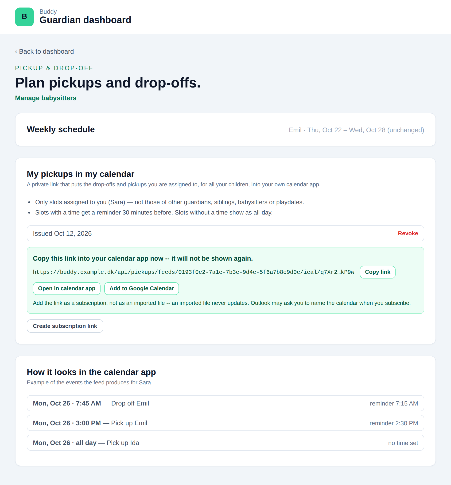
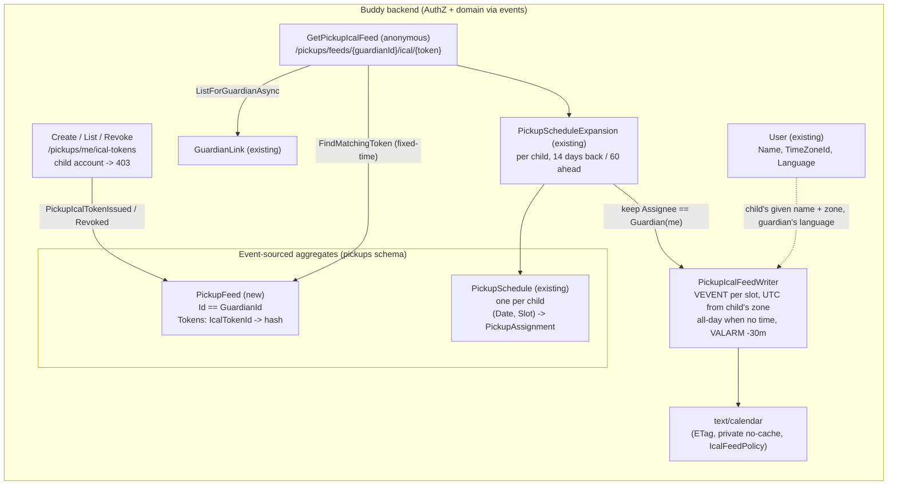

# Pickup iCal Feed

Status: Proposed (not yet implemented)

## Context

A guardian plans who takes each child to school and who collects them on the pickup page
([pickup-schedules.md](pickup-schedules.md)), but the slots they are assigned to live only inside
Buddy. A guardian who lives in their phone's calendar app has to open Buddy to check "am I doing
Emil's pickup on Thursday?". The ask ([TODO.md](../../../TODO.md)) is a private iCal subscription
link per guardian that holds the drop-offs and pickups that guardian is assigned to, across all
their children.

Buddy already has two subscription feeds with the same mechanics:

- [Calendars](../calendars/flow.md): token create/list/revoke slices and the anonymous
  [`GetIcalFeed`](../../../src/backend/buddy/Features/Calendars/GetIcalFeed/GetIcalFeed.Handler.cs),
  rendered by
  [`IcalFeedWriter`](../../../src/backend/buddy/Features/Calendars/IcalFeedWriter.cs), which also
  writes `VALARM`s ([calendar-item-alarms.md](calendar-item-alarms.md)).
- Meal plans ([mealplan-ical-feed.md](mealplan-ical-feed.md)): the same four slices in
  `Features/Mealplans`, a feature-local `IcalTokenId`/`IcalTokenInfo`, and
  [`MealPlanIcalFeedWriter`](../../../src/backend/buddy/Features/Mealplans/MealPlanIcalFeedWriter.cs).

Both share [`ShareSecret`](../../../src/backend/buddy/Common/Security/ShareSecret.cs) (random token,
only the hash stored), [`IcalSubscription.Describe`](../../../src/backend/buddy/Common/Ical/IcalSubscription.cs)
(feed name, refresh hint, `Cache-Control`) and the `RateLimitingFeature.IcalFeedPolicy`. The
frontend has a shared
[`IcalSubscribeLinks`](../../../src/frontend/buddy/src/app/shared/ical-subscribe-links/ical-subscribe-links.ts)
component and a token card to copy from,
[`mealplan-ical`](../../../src/frontend/buddy/src/app/features/guardian/mealplan/mealplan-ical/mealplan-ical.html).

What doesn't carry over is the scope. Both existing feeds hang off one aggregate (a `Calendar`, the
family `MealPlan`) and store their tokens on it. A pickup feed spans every child of one guardian, and
`PickupSchedule` is one stream per child
([PickupSchedule.cs](../../../src/backend/buddy/Features/Pickups/Types/PickupSchedule.cs)), so there
is no existing aggregate to put the tokens on.

This document answers six questions: where the tokens live, which slots the feed includes, how a
slot becomes a calendar event (title, time zone, time-less slots, location), whether to use
recurrence, alarms, and revocation.

## Question 1: where do the tokens live?

**Decision: a new small aggregate in `Features/Pickups`, `PickupFeed`, one per guardian, with the
deterministic id `PickupFeedId.ForGuardian(UserId)`.**

```text
PickupFeed(
    PickupFeedId Id,                                        // == GuardianId.Value
    UserId GuardianId,
    ImmutableDictionary<IcalTokenId, IcalTokenInfo> Tokens)
```

- **Per guardian, not per child.** The TODO is explicit, and a per-child token would mean a guardian
  with three children subscribes three times to get one answer to "what am I doing this week".
  Putting tokens on each `PickupSchedule` was considered and rejected for that reason, and because a
  child's schedule has several guardians, so it would need an owner on every token.
- **Deterministic id, no index document.** A guardian has exactly one feed, the 1:1 shape
  [`WorkLocationScheduleId.ForGuardian`](../../../src/backend/buddy/Features/WorkLocations/Types/WorkLocationScheduleId.cs)
  and [`BabysitterListId.ForGuardian`](../../../src/backend/buddy/Features/Babysitters/Types/BabysitterListId.cs)
  already use. `PickupSchedule`'s random id plus `PickupScheduleIndexDocument` is deliberately not
  followed.
- **The feed URL then carries the guardian's `UserId`** (`/pickups/feeds/{guardianId}/ical/{token}`).
  That id is already in API responses (`AssignedBy`, `GuardianId` on every pickup), and it isn't a
  credential: the token is. A leaked URL exposes the feed whether or not the id is random. A random
  id with an index document was considered and rejected as an extra document for no security gain
  (see "Remaining open questions" if this should still change).
- **Not on the `User` aggregate.** That would make `Users` own a pickup concept and add a
  cross-feature write. Keeping it in `Features/Pickups` (schema `pickups`, snapshot in `snapshots`)
  keeps the feature self-contained, the same call
  [work-locations.md](work-locations.md#question-1-calendar-items-or-a-new-feature) made.
- **Lazy creation**, like `PickupScheduleCreated` and `MealPlanCreated`: the first
  `CreatePickupIcalToken` appends `PickupFeedStarted` and the first `PickupIcalTokenIssued` in one
  `CreateAsync`. A guardian who never subscribes has no stream.
- **Token types stay feature-local.** `IcalTokenId`/`IcalTokenInfo` are copied into
  `Features/Pickups/Types/`, as [mealplan-ical-feed.md](mealplan-ical-feed.md#token-issuancemanagement-a-fourth-feature-local-token-type)
  did. This is the third copy; see "Remaining open questions" for extracting them.

### Events

```text
PickupFeedStarted(PickupFeedId Id, UserId GuardianId, DateTimeOffset OccurredAt)
    // appended with the first token; never on its own
PickupIcalTokenIssued(PickupFeedId Id, IcalTokenId TokenId, string Hash, DateTimeOffset OccurredAt)
PickupIcalTokenRevoked(PickupFeedId Id, IcalTokenId TokenId, DateTimeOffset OccurredAt)
```

No `IssuedBy`/`RevokedBy`: only the owner can write the stream, so it is always `GuardianId`.
`Rehydrate` folds `Tokens.SetItem` / `Tokens.Remove`. `PickupFeed.FindMatchingToken(hash)` mirrors
[`MealPlan.FindMatchingToken`](../../../src/backend/buddy/Features/Mealplans/Types/MealPlan.cs)
(`CryptographicOperations.FixedTimeEquals` over the stored hashes). `PickupFeedSnapshotProjection`
follows `PickupScheduleSnapshotProjection` (a `PickupFeedSnapshot(Guid Id, PickupFeed PickupFeed)`
wrapper, registered with `Register(..., Inline)`). `PickupEvent` stays the schedule's union; the feed
gets its own `PickupFeedEvent` union and `IPickupFeedEventStore`, since one Marten store can hold two
stream types (`Features/Mealplans` already holds `Meal` and `MealPlan`).

## Question 2: which slots are in the feed?

**Decision: only slots whose assignee is `PickupAssignee.Guardian` with `GuardianId` == the feed's
guardian, for every child the guardian has an active `GuardianLink` to at the time of the request.**

- **Not "every slot of my children".** The feed answers "what do _I_ have to do". Slots assigned to a
  co-guardian, a sibling, a babysitter, a playdate or `SelfEscort` are left out. A family overview
  feed is a different product (see "Remaining open questions").
- **`Babysitter` slots on my own babysitter list are left out too.** `PickupAssignee.Babysitter`
  carries a `GuardianId` ([PickupAssignee.cs](../../../src/backend/buddy/Features/Pickups/Types/PickupAssignee.cs)),
  but that is the list's owner, not the person doing the pickup.
- **Children are resolved per request**, from
  `IGuardianLinkEventStore.ListForGuardianAsync` ([IGuardianLinkEventStore.cs](../../../src/backend/buddy/Features/Guardians/IGuardianLinkEventStore.cs)).
  When a link is revoked, that child's slots drop out of the feed on the next poll. Nothing is
  stored per child.
- **Built on `PickupScheduleExpansion`.** For each child,
  [`PickupScheduleExpansion.ExpandAsync`](../../../src/backend/buddy/Features/Pickups/PickupScheduleExpansion.cs)
  returns the window's occurrences; the handler keeps those whose `Assignee` is a
  `GuardianAssigneeDto` with the guardian's id. The 31-day cap is the `ListPickupSchedule`
  validator's, not the expansion's, so the feed window below doesn't hit it.
- **Window: 14 days behind, 60 days ahead**, the meal-plan feed's window. Pickups are planned a week
  or two out, like meals, not a year out like calendar events.

## Question 3: how does a slot become an event?

**Decision: one `VEVENT` per slot, titled "Drop off Emil" / "Pick up Emil" in the guardian's
language, anchored to the child's time zone; a slot with no time becomes an all-day event.**

| Field         | Value                                                                                                                                                                                                                                     |
| ------------- | ----------------------------------------------------------------------------------------------------------------------------------------------------------------------------------------------------------------------------------------- |
| `SUMMARY`     | "Drop off {child}" / "Pick up {child}" (da: "Aflever {child}" / "Hent {child}"), `{child}` = the child's `Name.GivenName`                                                                                                                 |
| `DESCRIPTION` | The slot's `Notes`, omitted when `""` (same rule as `MealPlanIcalFeedWriter`)                                                                                                                                                             |
| `DTSTART`     | `Date` + `Time` in the child's `User.TimeZoneId`, written in UTC like `IcalFeedWriter`; `VALUE=DATE` when `Time` is unset                                                                                                                 |
| `DTEND`       | `DTSTART` + 15 minutes; the next day for an all-day event                                                                                                                                                                                 |
| `LOCATION`    | Not set (see below)                                                                                                                                                                                                                       |
| `UID`         | `{childId:N}-{date:yyyyMMdd}-{slot}@buddy-pickup`, stable for a `(child, date, slot)`, so a changed time updates the event and a reassignment removes it                                                                                  |
| `DTSTAMP`     | Start of the UTC day, as both existing writers do, so an unchanged feed renders byte-identically within a day and its ETag matches ([conditional-get-etags.md](conditional-get-etags.md)); the `/pickups` group already has `.WithETag()` |

- **The child's name comes from `IUserEventStore.FindSnapshotAsync`**, one read per child, the
  dependency `Guardians` already takes on `Users`. The feed is read by a calendar app, so the
  frontend can't resolve names as it does for `ListPickupSchedule`.
- **Language.** There is no server-side text in Buddy yet; every UI string is in the frontend's
  dictionaries. The feed has no frontend, so the writer gets a two-entry table (en, da) for the two
  verbs and the feed name ("My pickups" / "Mine afhentninger"), chosen by the guardian's
  `User.Language` with `en` as the fallback. Rejected: English only, as the meal-plan feed's
  `"{Slot}: {MealName}"` is. A Danish guardian would see "Pick up Emil" in a Danish calendar, and
  `User.Language` now exists ([child-language-settings.md](child-language-settings.md)).
- **Time zone.** `Time` is the child's local wall-clock value
  ([PickupScheduleExpansion.cs](../../../src/backend/buddy/Features/Pickups/PickupScheduleExpansion.cs)).
  Since [eliminate-nulls.md](eliminate-nulls.md) Phase 5.6, `User.TimeZoneId` is required, so the
  writer converts with the child's zone and writes UTC, the `IcalFeedWriter` way. The meal-plan
  feed's floating time was chosen only because `MealPlan` has no zone; a pickup has one, and a
  guardian travelling while the child is at home should see the pickup at the child's 15:00.
- **A slot without a time is an all-day event**, rather than a made-up default time per slot (the
  `MealSlotDefaultTimes` approach). An invented 08:00 would put a reminder at the wrong moment; an
  all-day "Pick up Ida" is true. The slot order (`DropOff` before `PickUp`) is visible in the title.
- **No `LOCATION`.** A guardian slot has no place: Buddy stores no school or activity address. A
  playdate's location is on playdate slots, which aren't in this feed.
- **15-minute duration**, fixed. A drop-off or pickup is a moment, not a block; 15 minutes reads as a
  point in day and week views. The meal plan's 30 minutes was for a meal.

## Question 4: recurrence, or expanded occurrences?

**Decision: expanded occurrences, one `VEVENT` per assigned slot, no `RRULE`.**

There is nothing to recur. `PickupSchedule` has no recurrence: every assignment is an explicit
`(Date, Slot)` ([pickup-schedules.md, Decisions made](pickup-schedules.md#decisions-made)), so the
feed writes exactly what the schedule holds. If weekly templates are added later (an open question
in that doc), they would expand into the same `(Date, Slot)` occurrences before the writer sees
them, and the feed would need no change. Collapsing "Sara does Monday drop-off every week" into an
`RRULE` was considered and rejected: it would have to detect patterns and then break them with
`EXDATE`s whenever one week differs, and a 60-day window is small.

## Question 5: alarms

**Decision: a fixed `VALARM` (DISPLAY, 30 minutes before `DTSTART`) on timed events, none on all-day
events.**

- The value of the feed is a nudge before leaving to pick up a child. A guardian with ADHD is the
  target user, and calendar apps don't add reminders to subscribed calendars by default.
- Written the way `IcalFeedWriter.AddAlarms` writes them: `Action = Display`, `Description` = the
  summary, a relative `Trigger` of `-PT30M`
  ([calendar-item-alarms.md, Question 3](calendar-item-alarms.md)).
- No alarm on an all-day event: its trigger would be relative to midnight.
- Not configurable in v1. A per-token or per-guardian offset is additive (a field on
  `PickupIcalTokenIssued` or a `PickupFeed` setting) if anyone asks. Some calendar apps (Google)
  ignore alarms in subscribed feeds; the guardian can add a default notification there instead.

## Question 6: revocation and access

**Decision: the meal-plan token lifecycle, on `/me` routes, guardian accounts only.**

- **Create** returns the plaintext token once, plus a ready `SubscriptionPath`. Several tokens may
  be live at once (phone, work laptop), as with both existing feeds.
- **List** returns `TokenId` and `IssuedAt`, never the hash.
- **Revoke** appends `PickupIcalTokenRevoked`; the next feed request with that token gets `404`.
  Revoking an unknown or already revoked token is `404`, matching `RevokeMealPlanIcalToken`.
- **Access.** All three management routes act on the caller's own feed, so there is no id to check.
  A child account is `403`, the
  [`WorkLocationAuthorization.CheckManage`](../../../src/backend/buddy/Features/WorkLocations/WorkLocationAuthorization.cs)
  check (`ListForChildAsync` is non-empty). A guardian with no children may create a token; the feed
  is just empty.
- **The feed** is anonymous (`.AllowAnonymous()` over the group's `.RequireAuthorization()`),
  rate-limited with `IcalFeedPolicy`, and `Cache-Control: private, no-cache`. A missing stream and a
  wrong or revoked token are the same `404`.
- **Losing access to a child** (revoked `GuardianLink`) needs no token change: the child is no
  longer in `ListForGuardianAsync`, so its slots leave the feed.
- **Account deletion.** `PickupsPersonalDataEraser.EraseGuardianAsync` (today a no-op) deletes the
  `PickupFeed` stream and snapshot, so the URL stops working.
  `PickupsPersonalDataExporter` adds the guardian's tokens (id, issued date; no hash) to the export
  ([gdpr-data-protection.md](gdpr-data-protection.md)).

## Command slices (`Features/Pickups/`, same shape as the meal-plan iCal slices)

| Slice                   | Tier            | Notes                                                                                                                                      |
| ----------------------- | --------------- | ------------------------------------------------------------------------------------------------------------------------------------------ |
| `CreatePickupIcalToken` | Guardian (self) | Lazily starts the stream. Emits `PickupFeedStarted` (first time) + `PickupIcalTokenIssued`. Returns `TokenId`, `Token`, `SubscriptionPath` |
| `ListPickupIcalTokens`  | Guardian (self) | `TokenId`, `IssuedAt`, sorted newest first. Empty list when there is no stream                                                             |
| `RevokePickupIcalToken` | Guardian (self) | Emits `PickupIcalTokenRevoked`; `404` for an unknown token                                                                                 |
| `GetPickupIcalFeed`     | Anonymous       | Token check, then active children → `PickupScheduleExpansion` per child → filter to the guardian → `PickupIcalFeedWriter`                  |

New supporting types: `PickupFeed`, `PickupFeedId`, `PickupFeedEvent`, `IPickupFeedEventStore` +
`MartenPickupFeedEventStore`, `PickupFeedSnapshotProjection`, `IcalTokenId`, `IcalTokenInfo`,
`PickupIcalFeedWriter`. `AddPickupsFeature` registers the three new event types and the second
projection.

## Routes

| Route                                      | Method   | Auth                    | Purpose                                                    |
| ------------------------------------------ | -------- | ----------------------- | ---------------------------------------------------------- |
| `/pickups/me/ical-tokens`                  | `POST`   | Guardian (self)         | Mint a token; returns the plaintext once and the feed path |
| `/pickups/me/ical-tokens`                  | `GET`    | Guardian (self)         | List issued tokens                                         |
| `/pickups/me/ical-tokens/{tokenId}`        | `DELETE` | Guardian (self)         | Revoke a token                                             |
| `/pickups/feeds/{guardianId}/ical/{token}` | `GET`    | Anonymous, token in URL | The `.ics` feed                                            |

`/me` follows `Features/WorkLocations`' guardian-scoped routes. The feed route is keyed by the
`PickupFeedId`, which equals the guardian's id (Question 1).

## Frontend

A mockup of the new card on the pickup page (demo data, not a screenshot of built code; the weekly
schedule card is collapsed here only to save space):



- **Where.** A new `pickup-ical` card below `app-manage-pickups` on
  [`/guardian/pickup`](../../../src/frontend/buddy/src/app/features/guardian/pickup/pickup.html),
  in `features/guardian/pickup/pickup-ical/`. It is a copy of
  [`mealplan-ical`](../../../src/frontend/buddy/src/app/features/guardian/mealplan/mealplan-ical/mealplan-ical.ts)
  (token list, revoke, create, the one-time URL with copy button and `app-ical-subscribe-links`),
  without the child picker: the feed is the guardian's, across children. The card states what is in
  the feed (only your own slots; reminder 30 minutes before; time-less slots are all-day).
- **Service.** Three methods on the existing `core/pickups.service.ts` (`createIcalToken` through
  `postIdempotent`, `listIcalTokens`, `revokeIcalToken`), with the types from the regenerated
  `buddy-api.ts` (`task docs:openapi`).
- **i18n.** A `pickup.ical` block in `translations/{en,da}/pickup.ts`, mirroring `mealplan.ical`'s
  keys; the subscribe links reuse `common.ical`.
- **Screenshots.** No new route, but a visible change to `/guardian/pickup`: seed one token for
  demo.sara in `screenshots/demo-family.ts` and re-run `task docs:screenshots`. The one-time URL box
  isn't shown after a reload, so the screenshot shows the issued token row.

## Testing

Integration tests under `buddy.IntegrationTests/Features/Pickups/`, mirroring
[`GetMealPlanIcalFeedTests.cs`](../../../src/backend/buddy.IntegrationTests/Features/Mealplans/GetMealPlanIcalFeed/GetMealPlanIcalFeedTests.cs)
and the three meal-plan token test folders:

- Create/list/revoke: `200` for a guardian, `403` for a child, revoke of an unknown token `404`,
  a second create keeps the first token working.
- Feed: valid token returns `text/calendar` with the guardian's slots for two children; a slot
  assigned to a co-guardian, a sibling, a babysitter, a playdate and `SelfEscort` is absent; revoked
  or wrong token and an unknown guardian id are `404`; a timed slot has `DTSTART` in UTC from the
  child's zone and a `-PT30M` `VALARM`; a time-less slot is `VALUE=DATE` with no alarm; a Danish
  guardian gets "Hent"; after the guardian's link to a child is revoked, that child's slots are gone;
  slots outside the 14/60-day window are absent; two requests on the same day give the same ETag.
- Eraser: deleting the guardian removes the feed (`404`).
- `EventShapeTests` golden files for the three new events, and a `SnapshotTests` case for
  `PickupFeed`.
- Frontend: `pickup-ical.spec.ts` copied from `mealplan-ical.spec.ts`, service spec cases for the
  three URLs. One Playwright journey: create a link, see the token row, revoke it.

## Failure and edge-case behavior

| Case                                                   | Behavior                                                                                       |
| ------------------------------------------------------ | ---------------------------------------------------------------------------------------------- |
| Guardian has no children, or no slots assigned to them | Valid empty `VCALENDAR` (name and refresh hint, no events), `200`                              |
| Slot reassigned from me to a co-guardian               | Leaves my feed on the next poll (same `UID` no longer present); appears in theirs              |
| Slot's time changed                                    | Same `UID`, new `DTSTART`: the calendar app moves the event                                    |
| Slot's time removed                                    | Same `UID`, becomes all-day and loses its alarm                                                |
| My `GuardianLink` to a child is revoked                | That child's slots leave the feed; the token stays valid for the other children                |
| A child is deleted (erased)                            | Their `PickupSchedule` is erased and their link revoked, so their slots leave the feed         |
| Child changes time zone                                | Future and past events in the window shift to the new zone's wall-clock times on the next poll |
| Guardian account deleted                               | Feed stream erased; every token `404`                                                          |
| Revoke an already revoked token                        | `404`, as `RevokeMealPlanIcalToken`                                                            |
| Child account calls the management routes              | `403`                                                                                          |
| Feed polled very often                                 | `IcalFeedPolicy` rate limit; ETag lets unchanged polls return `304`                            |

## Estimate

|                  |                                                                                                                                                                |
| ---------------- | -------------------------------------------------------------------------------------------------------------------------------------------------------------- |
| Complexity       | Medium -- a new small aggregate with 3 events in an existing feature, 4 slices, the first server-side en/da text, 1 new card on an existing page, no new route |
| Single developer | 3-5 days                                                                                                                                                       |
| AI agent         | 2-3 hours, plus about 1 hour of human review                                                                                                                   |

## Decisions made

| Question                          | Decision                                                                                                       |
| --------------------------------- | -------------------------------------------------------------------------------------------------------------- |
| Token per guardian or per child   | Per guardian, on a new `PickupFeed` aggregate in `Features/Pickups`                                            |
| Feed id                           | Deterministic, `== GuardianId`, no index document (`WorkLocationScheduleId` precedent)                         |
| Token types                       | Feature-local copies of `IcalTokenId`/`IcalTokenInfo`, as Mealplans did                                        |
| Which slots                       | Only `PickupAssignee.Guardian` slots naming the feed's guardian, across children with an active link right now |
| Babysitter slots from my own list | Excluded: I arranged them, I don't do them                                                                     |
| Window                            | 14 days behind, 60 ahead, as the meal-plan feed                                                                |
| Title                             | "Drop off / Pick up {child's given name}", in the guardian's `User.Language` (en/da)                           |
| Time zone                         | The child's `User.TimeZoneId`, written as UTC                                                                  |
| Slot without a time               | All-day event, no alarm                                                                                        |
| Duration                          | Fixed 15 minutes                                                                                               |
| Location                          | None (no address is stored for a guardian slot)                                                                |
| Recurrence                        | None; one `VEVENT` per assigned slot, since assignments don't recur                                            |
| Alarm                             | Fixed DISPLAY `VALARM` 30 minutes before timed events                                                          |
| Revocation                        | Meal-plan lifecycle: create (token shown once), list, revoke; several live tokens allowed                      |
| Who manages                       | The guardian themself, `/me` routes; child accounts `403`                                                      |
| Account deletion                  | The eraser deletes the feed stream                                                                             |
| UI placement                      | A card on `/guardian/pickup`, copied from `mealplan-ical`                                                      |

## Remaining open questions

- **Server-side language table.** Lean: a two-entry table in `PickupIcalFeedWriter`. It is the first
  backend text in Buddy; if a second feed or email needs translation, move it to a small shared
  `Common/Localization` helper then, not now. The alternative is English-only titles, like the
  meal-plan feed.
- **Guardian id in the feed URL.** Lean: accept it (Question 1). If it is unwanted, swap to a random
  `PickupFeedId` with a `PickupFeedIndexDocument(Id, GuardianId)`; the routes and frontend don't
  change.
- **Extract the iCal token types.** This would be the third `IcalTokenId`/`IcalTokenInfo`. Lean: copy
  again, as mealplan-ical-feed.md argued, and extract to `Common/Ical` if a fourth feed appears.
- **Include babysitter slots from my own list?** Lean: no. A guardian who books a babysitter may want
  to see it, which would be a per-token "include slots I arranged" option.
- **A family overview feed** (every slot of my children, whoever does it, titled "Sara picks up
  Emil"). Lean: not now; it is a second token kind with a different filter, additive on `PickupFeed`.
- **Configurable alarm offset**, or no alarm. Lean: fixed 30 minutes until someone asks.
- **Should the child get their own feed** ("who picks me up")? Lean: no; children use Buddy's own
  views and rarely have a calendar app.

## Diagram


