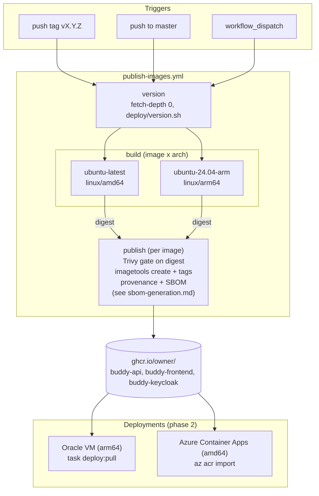

# Publishing Docker images on GitHub

Status: Implemented. [`publish-images.yml`](../../../.github/workflows/publish-images.yml)
publishes the three images to GHCR on release tags, `master` pushes and manual runs (first
published release: `v1.5.3`), and the frontend reads its URLs at container start. Phase 2 is in
too: `task deploy:pull` ([`deploy/deploy-pull.sh`](../../../deploy/deploy-pull.sh)) runs the
published images on the Oracle VM, and `BUDDY_IMAGE_VERSION` makes `deploy/azure/deploy.sh`
`az acr import` them. Details that changed from the proposal: Trivy scans each architecture's
digest in its build job; the compose image names take a `BUDDY_IMAGE_PREFIX` set only by
`deploy:pull`, so `task deploy` keeps its local names; and there is no retention job yet (see
[Retention](#retention)), which is still open in `TODO.md`.

## Context

Buddy ships as three container images: the API, the frontend (the Angular build served by Caddy)
and Keycloak with the Buddy theme baked in. Today nothing publishes them. Every deployment builds
its own images from a checkout:

- **Oracle VM.** `task deploy` runs `docker compose build` on the VM itself
  ([`docker-compose.prod.yml`](../../../deploy/docker-compose.prod.yml)) and tags the result
  `buddy-{api,frontend,keycloak}:<git sha>` so a rollback can restart an older build. The VM is the
  Always Free ARM shape `VM.Standard.A1.Flex` ([deploy/README.md](../../../deploy/README.md)), so
  these are `linux/arm64` builds.
- **Azure Container Apps.** [`deploy/azure/deploy.sh`](../../../deploy/azure/deploy.sh) builds all
  three with `az acr build` into the deployment's own registry, as `linux/amd64`.
- **CI.** The `image` job in [`security-scan.yml`](../../../.github/workflows/security-scan.yml)
  builds the same three images on every PR, on every push to `master` and daily, scans them with
  Trivy and throws them away.

The goal is a single set of versioned, scanned, multi-arch images in the GitHub Container Registry
(GHCR), so a release is built once and a deployment pulls it, rather than every operator compiling
.NET and Angular on their own host.

What already exists:

- **Dockerfiles** for all three images:
  [`src/backend/buddy/Dockerfile`](../../../src/backend/buddy/Dockerfile),
  [`src/frontend/buddy/Dockerfile`](../../../src/frontend/buddy/Dockerfile) and
  [`deploy/azure/keycloak/Dockerfile`](../../../deploy/azure/keycloak/Dockerfile). Every base image
  is pinned by tag and digest, and [Dependabot](../../../.github/dependabot.yml) keeps the digests
  current. Each pinned digest is a multi-arch index that includes `linux/amd64` and `linux/arm64`
  (checked with `docker buildx imagetools inspect` on 2026-10-19), so the Dockerfiles build for both
  architectures unchanged.
- **Versions from git tags.** [`deploy/version.sh`](../../../deploy/version.sh) computes the MinVer
  version (`1.5.2`, `1.5.3-alpha.0.4`) that both deploy paths pass in as the `BUDDY_VERSION` and
  `BUDDY_COMMIT` build args ([docs/versioning.md](../../versioning.md)). Releases are annotated
  `vX.Y.Z` tags made by `task release`; the newest is `v1.5.2`.
- **A vulnerability gate.** security-scan fails on fixable high and critical findings, with
  accepted ones in `.trivyignore`.

What stops a published image from working today:

- **The frontend image is specific to one deployment.** `API_BASE_URL` and `KEYCLOAK_AUTHORITY` are
  build args, and the Dockerfile writes them into `config/runtime-config.json` during the build
  ([Dockerfile](../../../src/frontend/buddy/Dockerfile)). An image built for one family's domains
  is useless to anyone else. The Caddyfile's Content-Security-Policy already reads the same two
  values as `{$API_BASE_URL}` / `{$KEYCLOAK_AUTHORITY}`
  ([`src/frontend/buddy/Caddyfile`](../../../src/frontend/buddy/Caddyfile)). Caddy substitutes
  those when it parses the Caddyfile at container start, so only the JSON file is a real
  build-time dependency.
- **CI clones are shallow.** `actions/checkout` fetches one commit, so `version.sh` would compute
  the wrong height (docs/versioning.md already warns about this).
- **The two deployments need different architectures.** One image tag has to serve both.

## Decision: publish to GHCR from a new `publish-images.yml` workflow

**Decision: a new workflow, `.github/workflows/publish-images.yml`, builds the three images and
pushes them to `ghcr.io/<owner>/buddy-api`, `buddy-frontend` and `buddy-keycloak`.**

- GHCR sits next to the code and the releases, needs no extra account (it authenticates with the
  workflow's `GITHUB_TOKEN` with `packages: write`), and the
  `org.opencontainers.image.source` label links each package to the repository.
- It runs when a `v*.*.*` tag is pushed (releases), on every push to `master` (a moving `edge`
  image), and on `workflow_dispatch`. It doesn't run on pull requests: security-scan already builds
  and scans PR images, and a PR from a fork can't get a token that may push.
- Least-privilege permissions as in the other workflows: `contents: read` at the top, and the
  publishing jobs add `packages: write`, `id-token: write` and `attestations: write`. Actions are
  pinned by commit SHA with a version comment, and Dependabot's `github-actions` group covers them.

Considered and rejected:

- **Docker Hub.** It needs a separate account and secret, and anonymous pulls are rate-limited.
- **Extending `security-scan.yml`.** It runs daily and on PRs, so it would need conditions on
  every step to keep from publishing. A separate workflow keeps "scan" and "ship" independent. The
  Trivy gate is duplicated in one step, which is acceptable.
- **Publishing from the Azure ACR.** It's per deployment and private, so it isn't a distribution
  channel.

## Decision: the frontend reads its URLs at container start

**Decision: the frontend's Caddyfile serves `/config/runtime-config.json` itself, from environment
variables, and the `API_BASE_URL` / `KEYCLOAK_AUTHORITY` build args go away.**

```caddyfile
handle /config/runtime-config.json {
  header Content-Type application/json
  header Cache-Control no-cache
  respond `{"keycloak":{"authority":"{$KEYCLOAK_AUTHORITY}","realm":"buddy","clientId":"buddy-frontend","redirectPath":"/dashboard"},"apiBaseUrl":"{$API_BASE_URL}","version":"{$BUDDY_VERSION}","repositoryUrl":"{$REPOSITORY_URL}"}`
}
```

- Caddy already substitutes these variables into the CSP when it starts, so the JSON and the CSP
  can't disagree. The container needs no entrypoint script and still runs as the non-root `caddy`
  user. The file served from `public/config/` in local development is untouched.
- `BUDDY_VERSION` stays a build arg, baked into the image as an `ENV`: the version belongs to the
  image, not the deployment. `REPOSITORY_URL` becomes a runtime variable with an empty default.
- A missing variable produces an empty string, not an absent field. Today `isRuntimeConfig` in
  [`runtime-config.service.ts`](../../../src/frontend/buddy/src/app/core/runtime-config.service.ts)
  only checks that the fields are strings, and the `version` / `repositoryUrl` getters fall back
  with `??`, so empty values would pass. The frontend change: `isRuntimeConfig` rejects an empty
  `apiBaseUrl` or `keycloak.authority` (so a container started without them fails loudly with
  "Runtime config is missing ..."), and the two getters treat an empty string as missing (the
  profile menu hides the version; the source link keeps the `kimipsen/buddy` default). Spec cases
  for each go in `runtime-config.service.spec.ts`.
- The workflow smoke-tests the result: start the image with test URLs and check that the JSON
  `/config/runtime-config.json` returns has them.
- Compose and `deploy.sh` pass the two URLs as container environment instead of build args. That
  removes a small inconsistency along the way: compose passes the bare `https://${AUTH_DOMAIN}` as
  the authority (correct, because the realm is a separate field), while security-scan passes
  `.../realms/buddy`.

Considered and rejected:

- **An entrypoint that rewrites the JSON file with `sed`/`jq` before starting Caddy.** It works,
  but it needs a writable web root (or a copy at start), an extra script to maintain, and `jq` isn't
  in `caddy:2-alpine`.
- **Keep the build args and publish only the API and Keycloak images.** Then every operator still
  builds the frontend with Node, which defeats the point.

## Decision: multi-arch images, each architecture built on its own runner

**Decision: build `linux/amd64` on `ubuntu-latest` and `linux/arm64` on `ubuntu-24.04-arm`, push
each by digest, then join them into one multi-arch tag with `docker buildx imagetools create`.**

- The Oracle VM needs arm64 and Azure needs amd64, and both pull the same tag.
- Emulating arm64 with QEMU on an amd64 runner makes `dotnet publish` and `ng build` several times
  slower. Native arm64 runners are free for public repositories.
- Buildx caches with `type=gha`, one scope per image and architecture, so an unchanged `npm ci` or
  `dotnet restore` layer is reused.

Considered and rejected: **amd64 only.** The VM would still have to build its own images, and it
is the main deployment.

## Decision: tags follow the release tags

**Decision: tags come from `docker/metadata-action`, with the version from `deploy/version.sh` on
a full clone (`fetch-depth: 0`).**

| Trigger             | Image tags                                                 |
| ------------------- | ---------------------------------------------------------- |
| tag `v1.5.3`        | `1.5.3`, `1.5`, `1`, `latest`, `sha-<12-character commit>` |
| tag `v1.6.0-rc.1`   | `1.6.0-rc.1`, `sha-<12-character commit>` (no `latest`)    |
| push to `master`    | `edge`, `sha-<12-character commit>`                        |
| `workflow_dispatch` | `sha-<12-character commit>`                                |

- The images carry the same `BUDDY_VERSION` / `BUDDY_COMMIT` build args as today, so `GET /version`
  and the profile menu report the same thing whether an image was built by CI or on the host.
- The `sha-` tags match the commit tags `task deploy` uses today, so a rollback by commit still
  works.
- OCI labels (`source`, `revision`, `version`, `created`) come from metadata-action.

## Decision: scan before tagging, then attest

**Decision: each build job pushes its architecture's image as an untagged digest and runs the
Trivy gate on it, on the same runner. The `publish` job per image joins and tags the digests only
when every build job has passed.**

- It's the same gate as security-scan (fixable high and critical findings, `.trivyignore`), so a
  release can't publish an image that the daily scan would fail.
- After tagging: build provenance with `actions/attest-build-provenance`, and an SBOM through
  Buildx (`sbom: true`, `provenance: mode=max`). Operators can check an image with
  `gh attestation verify`.
- Keyless cosign signing is left out for now. The GitHub attestation covers the same need, and
  cosign can be added later without changing anything else.
- Untagged digests from failed scans are removed by the clean-up job below.

## Decision: deployments switch to pulling in a second step

**Decision: phase 1 only publishes. Phase 2 changes `task deploy` and `deploy/azure/deploy.sh` to
pull the published images.**

- Phase 2 for compose: image names become `${BUDDY_IMAGE_PREFIX:-}buddy-api:${BUDDY_IMAGE_TAG}`.
  The `build:` sections stay, so building on the host keeps working for forks and unreleased
  changes. A new `task deploy:pull VERSION=1.5.3` runs `docker compose pull` and
  `up -d --no-build`, and a rollback becomes "deploy the previous tag".
- Phase 2 for Azure: `az acr import` copies the release images from GHCR into the existing registry.
  This keeps the current Container Apps wiring and digest pinning (`deploy.sh` already deploys by
  digest). Pointing Container Apps straight at GHCR is the alternative, if the images are public.
- Splitting the work means the images can be pulled and checked by hand for a release or two
  before either deploy depends on them.

## Retention

Not implemented yet. The proposal was a weekly `actions/delete-package-versions` job, but GHCR
stores each architecture's image (and its attestations) inside a multi-arch image as an
_untagged_ package version, and that action can't tell those apart from leftovers. Deleting
untagged versions would break published releases, and its `ignore-versions` filter matches
digests, not tags. Public GHCR storage is free, so retention can wait until a tool that
understands image indexes (for example `dataaxiom/ghcr-cleanup-action`) has been tried on a test
package. Digests from builds that failed the scan stay behind untagged until then.

## Docs to update

- [deploy/README.md](../../../deploy/README.md) and
  [deploy/README-azure.md](../../../deploy/README-azure.md): where the images come from, and
  `API_BASE_URL` / `KEYCLOAK_AUTHORITY` now being runtime environment.
- [docs/versioning.md](../../versioning.md): the image tags and how they map to release tags.
- Root `README.md` Platform feature item, and `TODO.md`.

## Estimate

|                  |                                                                                                                               |
| ---------------- | ----------------------------------------------------------------------------------------------------------------------------- |
| Complexity       | Low to Medium. One new workflow, a Caddyfile change and a small `RuntimeConfigService` change. The risk is in iterating on CI |
| Single developer | 1.5-2 days for phase 1, plus 1 day for phase 2                                                                                |
| AI agent         | 1-2 hours for phase 1 plus CI round-trips, and about 1 hour of human review (package visibility, first release run)           |

## Decisions made

| Question      | Decision                                                                                      |
| ------------- | --------------------------------------------------------------------------------------------- |
| Registry      | GHCR, authenticated with `GITHUB_TOKEN`; no extra account                                     |
| Workflow      | A new `publish-images.yml`, on release tags, `master` pushes and manual runs, never on PRs    |
| Frontend URLs | Read at container start: Caddy serves `runtime-config.json` from env; build args removed      |
| Architectures | `linux/amd64` and `linux/arm64`, each on a native runner, joined into one tag                 |
| Tags          | SemVer from release tags plus `latest`; `edge` and `sha-*` from `master`                      |
| Gate          | Trivy on the pushed digest before tagging, same rules as security-scan                        |
| Supply chain  | GitHub build provenance and SBOMs ([sbom-generation.md](sbom-generation.md)); cosign deferred |
| Deploys       | Phase 2, after publishing has worked for a release or two                                     |

## Remaining open questions

- **Which repository publishes?** `origin` pushes to both `kimipsen/buddy` and
  `kim-ipsen_kit/buddy`, so the workflow would run, and publish, in both. Lean: guard the jobs with
  `if: github.repository == 'kimipsen/buddy'`, the repository that `repositoryUrl` and
  `release-check.sh` already treat as upstream. A fork that wants its own images removes the guard.
- **Public or private packages?** GHCR packages start private. Lean: public, because the repository
  and its releases are public, and then the VM and Azure can pull without credentials. Private
  means a `read:packages` token on each host and a registry credential in Container Apps. Either
  way, visibility is set once in the package settings after the first run.
- **Should a release wait for the tests?** A tag is cut from `master`, which has normally passed
  the backend, frontend and e2e workflows, but nothing enforces that. Lean: not in phase 1. If it's
  wanted, make the test workflows `workflow_call`-able and have `publish-images.yml` call them for
  tag pushes.

## Diagram


