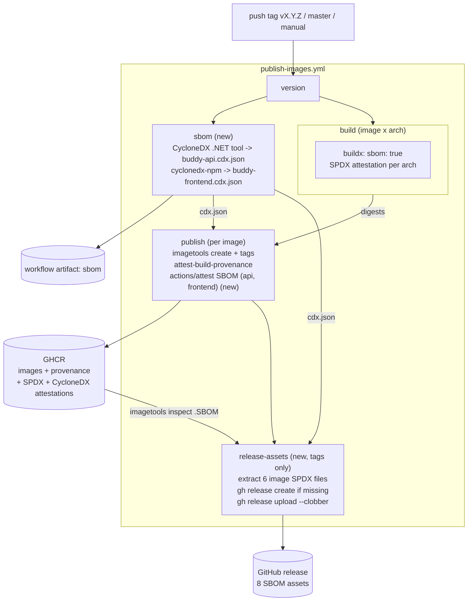

# SBOM generation for builds

Status: Implemented, not yet run on a release. In
[`publish-images.yml`](../../../.github/workflows/publish-images.yml), a new `sbom` job makes
`buddy-api.cdx.json` (CycloneDX .NET tool 6.3.1, pinned in `dotnet-tools.json`) and
`buddy-frontend.cdx.json` (`cyclonedx-npm` 6.0.1) and uploads them as the `sbom` workflow artifact.
The `publish` job attests them against the api and frontend images, and a tag-only
`release-assets` job attaches them and the six BuildKit SPDX image SBOMs to the GitHub release,
creating the release when it's missing. Changes from the proposal: `actions/attest` instead of the
deprecated `actions/attest-sbom`; `release-assets` logs in to GHCR with `packages: read`; the
frontend SBOM gets its name and version from `npm pkg set` in the CI checkout; and both SBOMs are
pinned to CycloneDX 1.6 (the .NET tool defaults to 1.7).

## Context

`TODO.md` ("SBOM generation", 2026-10-20) asks for a software bill of materials for every build,
uploaded to GitHub next to the build output: one per Docker image, a CycloneDX SBOM of the backend's
NuGet packages and of the frontend's npm packages, and all of them attached to the GitHub release.

Part of this already exists, which the TODO doesn't say.
[`publish-images.yml`](../../../.github/workflows/publish-images.yml) builds every image with
`sbom: true` and `provenance: mode=max`, so BuildKit runs Syft on each image and pushes an SPDX
SBOM into GHCR as an in-toto attestation next to each architecture's image
([publish-docker-images.md, scan before tagging](publish-docker-images.md#decision-scan-before-tagging-then-attest)).
The published `1.6.1` images, checked with
`docker buildx imagetools inspect ghcr.io/kimipsen/buddy-<image>:1.6.1 --format '{{json .SBOM}}'`
on 2026-10-23:

| Image      | Platforms         | Packages in the SBOM (amd64)      | Size   |
| ---------- | ----------------- | --------------------------------- | ------ |
| `api`      | `amd64` + `arm64` | 71 NuGet, 92 deb, 11 Go           | 5.1 MB |
| `frontend` | `amd64` + `arm64` | 32 apk, 149 Go (Caddy), **0 npm** | 0.4 MB |
| `keycloak` | `amd64` + `arm64` | 520 Maven, 44 rpm                 | 4.8 MB |

What's missing:

- **The frontend's npm dependencies are in no SBOM at all.** The runtime stage of
  [`src/frontend/buddy/Dockerfile`](../../../src/frontend/buddy/Dockerfile) copies only
  `dist/buddy/browser` into `caddy:2-alpine`. Angular, RxJS and the other 11 runtime dependencies
  in `package.json` are bundled into hashed `.js` files without a `package-lock.json`, so Syft has
  nothing to read. The API is fine: Syft reads `buddy.deps.json` and the DLLs in `/app`, so Marten,
  WolverineFx and the rest are listed with versions.
- **The image SBOMs aren't signed by GitHub.** `actions/attest-build-provenance` attests only the
  provenance. The BuildKit SBOM sits in the registry unsigned, so
  `gh attestation verify --predicate-type https://spdx.dev/Document/v2.3` finds nothing.
- **Nothing reaches the GitHub release.** Releases (`v1.5.1` to `v1.6.1`) are created by hand in
  the GitHub UI after `task release` pushes the tag. They have generated notes ("Full Changelog")
  and no assets. Someone who wants the SBOM has to know about `imagetools inspect`.
- **Nothing is a workflow artifact.** The SBOMs exist only inside GHCR.

Out of scope: `task deploy` and `deploy/azure/deploy.sh` still build images on the host or with
`az acr build`, without SBOMs. Those builds are for forks and unreleased changes; the published
images are the ones a release is about. The Keycloak theme's npm tooling
(`themes/buddy/build`) only compiles CSS and doesn't ship, and the theme JAR is already in the
Keycloak image's SBOM as Maven packages.

## Decision: generate SBOMs in `publish-images.yml`, not in the test workflows

**Decision: a new `sbom` job in `publish-images.yml` makes the backend and frontend SBOMs on every
run of that workflow (release tags, `master` pushes, manual runs) and uploads them as a workflow
artifact.**

- That workflow is the build that ships something. `backend-tests.yml` and `frontend-tests.yml`
  build to test and throw the output away, so an SBOM there describes nothing anyone runs.
- It runs once per commit rather than once per PR push, and doesn't slow the test jobs down.
- The job needs only `version` and runs in parallel with the six `build` jobs, so the workflow
  doesn't take longer.

Considered and rejected:

- **In every test workflow, on PRs too.** It matches "every build" in the TODO literally, but
  produces SBOMs of code that may never be merged. Dependency changes in PRs are already checked by
  `security-scan.yml` (`dotnet list package --vulnerable`, `audit-ci`).
- **A separate `sbom.yml` workflow.** It would have to compute the same version and wait for the
  images to know their digests. Inside `publish-images.yml` it gets both from existing jobs.
- **GitHub's dependency graph export** (`/dependency-graph/sbom`). One SPDX for the whole
  repository's manifests, not for a release, with the keycloak theme's build tooling and every
  test package mixed in. It returns 404 for this repository today.

## Decision: CycloneDX for the source SBOMs, keep BuildKit's SPDX for the images

**Decision: the backend SBOM comes from the CycloneDX .NET tool, the frontend SBOM from
`@cyclonedx/cyclonedx-npm`, both as CycloneDX 1.6 JSON. The image SBOMs stay the SPDX that
BuildKit already writes.**

Backend, with the tool pinned in [`dotnet-tools.json`](../../../src/backend/dotnet-tools.json)
next to `dotnet-stryker` (Dependabot's `nuget` entry for `/src/backend` keeps local tools current):

```bash
cd src/backend
dotnet tool restore
dotnet CycloneDX buddy/buddy.csproj --configuration Release \
  --output-format Json --spec-version 1.6 \
  --set-name buddy-api --set-version "$VERSION" \
  --output ../../sbom --filename buddy-api.cdx.json
```

Frontend, pinned with `npx --yes` the same way `security-scan.yml` pins `audit-ci@7.1.0`:

```bash
cd src/frontend/buddy
npm pkg set name=buddy-frontend version="$VERSION"
npx --yes @cyclonedx/cyclonedx-npm@6.0.1 --package-lock-only --omit dev \
  --spec-version 1.6 --output-format JSON \
  --output-file ../../../sbom/buddy-frontend.cdx.json
```

- **Only `buddy.csproj`**, not `backend.slnx`: the integration tests (xunit, Alba,
  Testcontainers) don't ship. Pointing the tool at the project rather than the `.slnx` also avoids
  depending on its support for the new solution format.
- **`--omit dev`** for the frontend: the Angular CLI, Vitest, Playwright, ESLint and Stryker are
  build tooling, not part of what the browser runs. They are still covered by `audit-ci`, which
  deliberately includes dev dependencies.
- **`--package-lock-only`** reads `package-lock.json` without `npm ci`, so the job needs no
  `node_modules`. The lock file is the same one the Dockerfile's `npm ci --ignore-scripts` installs
  from, so the versions match the image.
- Checked in the devcontainer on 2026-10-23: the .NET tool runs under the `11.0.100-rc` SDK from
  [`global.json`](../../../global.json) and lists 91 packages (Marten and WolverineFx with
  `pkg:nuget` PURLs; analyzers with scope `excluded`), and the npm SBOM lists the 15 runtime
  packages (`@angular/core` 22.2.1, `rxjs` 7.8.2, ...) and no dev tooling. Each takes 2-3
  seconds. Without `npm pkg set` the frontend SBOM would describe `buddy@0.0.0`.

Considered and rejected:

- **Syft (`anchore/sbom-action`) for all three.** One tool and one format, but Syft doesn't read
  `project.assets.json`, so the backend would need a `dotnet publish` in the job (that output is
  what the image SBOM already describes), and for npm it can't omit dev dependencies as cleanly.
  It stays the fallback for the backend.
- **Converting the image SBOMs to CycloneDX.** BuildKit only writes SPDX. Both formats are
  standard, and Trivy, Grype and GitHub read both. Converting would add a step and a second copy
  with no consumer asking for it.
- **Scanning the frontend's build stage** (`BUILDKIT_SBOM_SCAN_STAGE=true` in the Dockerfile).
  The build stage has the full `node_modules`, so the image SBOM would list hundreds of dev
  packages that aren't in the image.

## Decision: attest the source SBOMs against their images

**Decision: in the `publish` job, after `attest-build-provenance`, the `api` and `frontend`
matrix entries also run `actions/attest` with their CycloneDX file as the predicate and the
multi-arch image digest as the subject, pushed to the registry.**

```yaml
# needs: [version, build, sbom]
- uses: actions/download-artifact@9000827ccba6bdab643e8b6fd33ac0654aef8333 # v8.0.2
  if: matrix.image != 'keycloak'
  with:
    name: sbom
    path: ${{ runner.temp }}/sbom

# Verifiable with: gh attestation verify oci://<image>:<tag> --repo kimipsen/buddy
#   --predicate-type https://cyclonedx.org/bom
- uses: actions/attest@1e69f48acb82d1966a394da916b4c1698aa569d6 # v4.2.2
  if: matrix.image != 'keycloak'
  with:
    subject-name: ${{ env.IMAGE }}
    subject-digest: ${{ steps.digest.outputs.digest }}
    sbom-path: ${{ runner.temp }}/sbom/buddy-${{ matrix.image }}.cdx.json
    push-to-registry: true
```

- This closes the frontend gap where it matters: someone holding
  `ghcr.io/kimipsen/buddy-frontend:1.7.0` can get a signed list of the npm packages compiled into
  it, without needing to know about the release page.
- It reuses the permissions the `publish` job already has (`id-token: write`,
  `attestations: write`, `packages: write`).
- Keycloak has no source SBOM; its BuildKit SBOM is complete.
- `actions/attest-sbom` is deprecated in favour of `actions/attest`, which creates an SBOM
  attestation when it's given `sbom-path`.

The unsigned BuildKit SBOMs stay as they are. Signing them too would mean extracting each
architecture's SPDX and attesting it against the per-architecture digest, which is more work than
the result is worth while the release assets (below) carry the same files.

## Decision: a release job attaches every SBOM to the GitHub release

**Decision: a new `release-assets` job runs only for tag pushes, after `publish` and `sbom`. It
extracts each image's BuildKit SBOM per architecture, creates the GitHub release if it doesn't
exist yet, and uploads all the SBOMs as assets.**

```yaml
release-assets:
  if: github.ref_type == 'tag'
  needs: [version, publish]
  runs-on: ubuntu-latest
  permissions:
    contents: write
    packages: read
  steps:
    - uses: actions/download-artifact@... # the sbom artifact
    - name: Image SBOMs
      env:
        REGISTRY: ${{ needs.version.outputs.registry }}
        VERSION: ${{ needs.version.outputs.version }}
      run: |
        for image in api frontend keycloak; do
          docker buildx imagetools inspect "$REGISTRY/buddy-$image:$VERSION" \
            --format '{{json .SBOM}}' > all.json
          for arch in amd64 arm64; do
            jq ".\"linux/$arch\".SPDX" all.json > "sbom/buddy-$image-linux-$arch.spdx.json"
          done
        done
    - name: Attach to the release
      env:
        GH_TOKEN: ${{ github.token }}
        TAG: ${{ github.ref_name }}
      run: |
        gh release view "$TAG" >/dev/null 2>&1 \
          || gh release create "$TAG" --verify-tag --generate-notes
        gh release upload "$TAG" sbom/* --clobber
```

Each release gets eight files, about 27 MB in total:

| Asset                                                         | Format         | Source              |
| ------------------------------------------------------------- | -------------- | ------------------- |
| `buddy-api.cdx.json`                                          | CycloneDX JSON | CycloneDX .NET tool |
| `buddy-frontend.cdx.json`                                     | CycloneDX JSON | `cyclonedx-npm`     |
| `buddy-{api,frontend,keycloak}-linux-{amd64,arm64}.spdx.json` | SPDX 2.3 JSON  | BuildKit (Syft)     |

- **The workflow creates the release when it's missing.** Today the release is made by hand after
  the tag is pushed, and the image build takes several minutes, so the release normally exists by
  the time the job runs. But if it doesn't, an upload would fail, and waiting in a loop for a human
  is fragile. `--generate-notes` produces the same "Full Changelog" body the hand-made releases
  have, and editing the notes afterwards still works. A pre-release tag (`v1.6.0-rc.1`) should get
  `--prerelease`, the same rule metadata-action uses to withhold `latest`.
- **`--clobber`** makes a re-run of the workflow (`gh run rerun`) replace the files instead of
  failing.
- `contents: write` (and `packages: read`, for the GHCR login) is granted to this job only, keeping the workflow's least-privilege default.
- Only after `publish`: a release whose images failed the Trivy gate gets no SBOMs, because there
  is nothing to describe.

Considered and rejected:

- **A separate workflow on `release: published`.** It would fire on the hand-made release, but
  then needs to find the images by tag and download the source SBOMs from another workflow's run,
  which `download-artifact` can only do with a run id and an extra token permission.
- **Have `task release` create the release with `gh release create`.** It would put the release
  in place before CI runs, but makes `task release` depend on `gh` being logged in, and pushes to
  the mirror remote too, where there is no matching release.

## Docs to update

- [docs/versioning.md](../../versioning.md): next to the `gh attestation verify` line, how to get
  an SBOM (the release assets, `imagetools inspect --format '{{json .SBOM}}'` and
  `gh attestation verify --predicate-type https://cyclonedx.org/bom`), and that the workflow
  creates the release if it doesn't exist.
- [publish-docker-images.md](publish-docker-images.md): the `sbom` and `release-assets` jobs in
  its diagram, and "Supply chain" in its decisions table.
- The comment at the top of `publish-images.yml`.
- `TODO.md`: point the SBOM section at this doc and tick its items when they ship. Root
  `README.md` Platform feature item.

## Estimate

|                  |                                                                                                                                                       |
| ---------------- | ----------------------------------------------------------------------------------------------------------------------------------------------------- |
| Complexity       | Low. No application code changes: two new jobs and two steps in one workflow, one local tool, docs. The risk is in CI round-trips and the preview SDK |
| Single developer | 1-1.5 days, including a test release (`v1.6.2-rc.1`) to see the assets and attestations end to end                                                    |
| AI agent         | 1-2 hours plus CI round-trips, and about 30 minutes of human review (cut the test tag, check the release page and `gh attestation verify`)            |

## Decisions made

| Question             | Decision                                                                                                      |
| -------------------- | ------------------------------------------------------------------------------------------------------------- |
| Where SBOMs are made | `publish-images.yml` only (tags, `master`, manual runs); not in PR test workflows                             |
| Image SBOMs          | Keep BuildKit's `sbom: true` SPDX attestations per architecture, unchanged                                    |
| Backend SBOM         | CycloneDX .NET tool on `buddy.csproj` only, pinned in `dotnet-tools.json`; Syft on publish output as fallback |
| Frontend SBOM        | `cyclonedx-npm --package-lock-only --omit dev`, so it lists what's bundled into the image                     |
| Format               | CycloneDX JSON for source SBOMs, SPDX JSON (as BuildKit writes it) for images; no conversion                  |
| Signing              | `actions/attest` attests the api and frontend CycloneDX SBOMs against their multi-arch image digests          |
| Workflow artifacts   | One `sbom` artifact per run with the two CycloneDX files                                                      |
| Release assets       | A tag-only `release-assets` job uploads all eight SBOMs, creating the release if it's missing                 |

## Remaining open questions

- **Should CI create the GitHub release?** Lean: yes, only when it's missing, with generated notes,
  so releases stop depending on a manual step that can come after the job runs. The alternative is
  to keep releases manual and have the job fail (and be re-run) when the release doesn't exist yet.
  Either way the hand-written notes can still be edited afterwards.
- **"Every build" or "every published build"?** The TODO says every build. Lean: every run of
  `publish-images.yml`. Adding the two generation steps to `backend-tests.yml` and
  `frontend-tests.yml` later is additive if PR-level SBOMs turn out to be wanted.
- **Artifact retention.** The GitHub default is 90 days. Lean: keep the default; releases keep
  their SBOMs as assets forever, and `master` builds are superseded quickly. 30 days would be fine
  too.
- **Scan the SBOMs.** `security-scan.yml` already rescans the images daily. Feeding the release
  SBOMs to a tracker (Dependency-Track, `trivy sbom`) is a separate follow-up and needs somewhere
  to run it.

## Diagram


