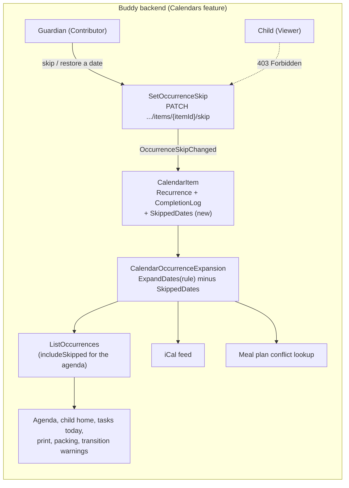

# Skipping Single Occurrences

Status: Implemented. `OccurrenceSkipChanged` and `CalendarItem.SkippedDates`, the
`SetOccurrenceSkip` slice (`PATCH /calendars/{calendarId}/items/{itemId}/skip`), skipped dates
dropped in `CalendarOccurrenceExpansion` (so from every screen, the iCal feed and the meal plan
assistant), `includeSkipped` plus `isSkipped`/`isRepeating` on `GET .../occurrences`, a refusal to
complete a skipped occurrence, and "Skip day"/"Restore" in the guardian agenda. No deploy step
is needed (see "Existing snapshots").

## Context

A guardian has a repeating appointment or task, such as football every Tuesday or "pack the school
bag" every weekday, and one day it doesn't happen: training is cancelled, it's a school holiday,
the child is ill. Today the guardian can only change the whole series:

- **Delete the item.** This ends every past and future occurrence.
- **Change the recurrence.** An `until` before the day ends the series. A new item has to be
  created to start it again, and its completion history is not carried over.
- **Ignore it.** The occurrence still shows on the child's home screen, in today's tasks and the
  print-out, and still triggers a transition warning. A task that the child can't complete stays
  open.

The ask ([TODO.md](../../../TODO.md), 2026-10-14): let a guardian skip one occurrence of a
repeating appointment or task on a single day, without changing or ending the series.

What exists today:

- A repeating item is one
  [`CalendarItem`](../../../src/backend/buddy/Features/Calendars/Types/CalendarItem.cs) with a
  [`Recurrence`](../../../src/backend/buddy/Features/Calendars/Types/Recurrence.cs). Occurrences
  are never stored. They are recomputed on every read by
  [`CalendarOccurrenceExpansion.ExpandAsync`](../../../src/backend/buddy/Features/Calendars/CalendarOccurrenceExpansion.cs)
  on top of
  [`RecurrenceExpansion.ExpandDates`](../../../src/backend/buddy/Features/Calendars/RecurrenceExpansion.cs).
  That one function feeds `ListOccurrences` (the guardian agenda, the child home and calendar,
  tasks today, packing tomorrow, print, and the client-side transition warnings), the iCal feed
  ([`GetIcalFeed`](../../../src/backend/buddy/Features/Calendars/GetIcalFeed/GetIcalFeed.Handler.cs))
  and the meal plan assistant's
  [`CalendarConflictLookup`](../../../src/backend/buddy/Features/Mealplans/AiAssistant/CalendarConflictLookup.cs).
- One occurrence already has per-date state: `CalendarItem.CompletionLog`, a sparse
  `ImmutableHashSet<CompletionKey>` keyed by `(OccurrenceDate, Target)` and written by
  `TaskCompletionChanged`
  ([`SetTaskCompletion`](../../../src/backend/buddy/Features/Calendars/SetTaskCompletion/SetTaskCompletion.Handler.cs)).
- [transition-warnings.md, Question 4](transition-warnings.md#question-4-where-do-per-item-overrides-live)
  left "override a single occurrence" open. It noted that it would key by
  `(CalendarItemId, DateOnly)` and be additive.
- [medicine-schedules.md](medicine-schedules.md) argued that `Calendars` has no addressable
  occurrence to attach state to. `CompletionLog` has since become exactly that. This design uses
  the same date key.

This document answers five questions: where a skip is stored, how it changes the expansion, what
can be skipped, who can skip, and how a guardian sees and undoes a skip.

Out of scope: moving one occurrence to another time or day ("Tuesday's training is on Wednesday
this week"), and pickups, medicines and work locations, which have their own schedules and
aggregates.

## Question 1: where does a skip live?

**Decision: on `CalendarItem`, as a sparse `ImmutableHashSet<DateOnly> SkippedDates`, written by
one new event, `OccurrenceSkipChanged`. No new aggregate or feature.**

- **Same shape as `CompletionLog`.** A skip is per-occurrence state of one item, keyed by the
  occurrence date, and absence is the default ("not skipped"). `CompletionLog` already models
  exactly that on the same aggregate, so this adds a sibling field rather than a new pattern.
- **It must change what the item expands to.** Every read path goes through
  `CalendarOccurrenceExpansion`, which already has the rehydrated `CalendarItem` in hand. With the
  skips on the item, the filter costs nothing extra. A separate aggregate (as transition warnings
  did for its per-child overrides) would need a second stream read per item in every expansion.
- **Not per child.** Transition warnings kept overrides off `CalendarItem` because one shared
  event can need different warnings for different children. A skip isn't like that: training is
  cancelled for everyone on the calendar. Per-child skips are listed under open questions.
- **Not a `Recurrence` change.** Putting an `ExceptDates` list inside `Recurrence.Repeating` (an
  RFC 5545 `EXDATE`) was considered and rejected. Every skip would be a `RecurrenceUpdated` with
  the whole rule in `Before`/`After`, so the "re-sending the stored recurrence is a no-op" check in
  `UpdateItemRecurrenceHandler` and the edit form's request would have to carry every skip.
  Editing the rule could also silently drop them. Buddy never writes an `RRULE` to the iCal feed,
  so it gains nothing from the RFC shape either.

```text
CalendarItem(
    ...
    ImmutableHashSet<CompletionKey> CompletionLog,
    // Skipped occurrences only -- "not skipped" is the implicit default, so it is absence.
    ImmutableHashSet<DateOnly> SkippedDates,
    UserId LastModifiedBy,
    bool IsDeleted)
```

Before ([CalendarItem.cs:12](../../../src/backend/buddy/Features/Calendars/Types/CalendarItem.cs#L12)):

```csharp
public sealed record CalendarItem(
    CalendarItemId Id, CalendarId CalendarId, UserId CreatedBy, string Title, Icon? Icon, Color Color,
    ItemSchedule Schedule, Recurrence Recurrence,
    ImmutableHashSet<CompletionKey> CompletionLog,
    UserId LastModifiedBy, bool IsDeleted)
```

After: the same record with `ImmutableHashSet<DateOnly> SkippedDates` after `CompletionLog`,
`New(...)` starting it as `ImmutableHashSet<DateOnly>.Empty`, and one new `Advance` arm. The
blast radius is small: the record is constructed only in `CalendarItem.New`. Test code builds
items through the API, and the `CalendarItemSnapshotTests` equivalence check picks up the new
field without changes.

### Events

```text
OccurrenceSkipChanged(CalendarItemId Id, DateOnly OccurrenceDate, bool Before, bool After,
    UserId ModifiedBy, DateTimeOffset OccurredAt)
```

- **One event with `Before`/`After`, like `TaskCompletionChanged`.** Skipping and restoring are the
  same toggle on one key, and the completion event already established this shape on this
  aggregate. Two events (`OccurrenceSkipped`/`OccurrenceRestored`) were considered and rejected:
  they mean two union cases, two snapshot `Apply` methods and two golden files for what is one bit.
- **Idempotent.** Skipping a date that is already skipped, or restoring one that isn't, returns
  `Success` with no event, the same as `SetTaskCompletion`.
- **Whole occurrence.** There is no `Target`. A template-scheduled task skips the whole run (every
  subtask of that day); skipping one step of a routine isn't asked for.

### Rehydration

```csharp
OccurrenceSkipChanged skip => item with
{
    SkippedDates = skip.After ? item.SkippedDates.Add(skip.OccurrenceDate) : item.SkippedDates.Remove(skip.OccurrenceDate),
    LastModifiedBy = skip.ModifiedBy
},
```

`CalendarItemSnapshotProjection` gets the matching `Apply(CalendarItemSnapshot, OccurrenceSkipChanged)`.

### Existing snapshots

A `CalendarItemSnapshot` row written before this ships has no `SkippedDates` property. It would
deserialize to `null`, and the next `OccurrenceSkipChanged` applied to that row would throw.
Today's read paths only touch the snapshot for the personal-data export (`IsDeleted`), but the
inline projection runs on every append. So:

- **The fold treats a missing set as empty** (`item.SkippedDates ?? []` in the
  `OccurrenceSkipChanged` arm), so the first skip on an old row works without any deploy step.
  This was planned as a mandatory rebuild at deploy; review found that one missed manual step
  would make every skip on an existing item a 500, so the code tolerates it instead
  (`CalendarItemSnapshotTests` covers an old row).
- **Optional:** rebuild the calendar item snapshots once
  (`task db:snapshots:rebuild STORE=marten://icalendarsstore/`, see
  [event-stream-snapshots.md, Backfilling existing streams](event-stream-snapshots.md#backfilling-existing-streams)),
  with the API stopped, so no row carries a `null` set at all.
- No upcaster is needed. No existing event changes shape, so existing golden files stay as they
  are. New golden file: `OccurrenceSkipChanged.json`.

## Question 2: how does a skip change the occurrences?

**Decision: `CalendarOccurrenceExpansion` drops every expanded date in `item.SkippedDates` before
it builds occurrences. `RecurrenceExpansion.ExpandDates` stays a pure rule expander.**

- **One choke point.** All three `Add*Occurrences` methods loop over
  `RecurrenceExpansion.ExpandDates(...)`. Filtering there removes a skipped occurrence from every
  consumer at once: the agenda, child home and calendar, tasks today, packing tomorrow, print,
  transition warnings (computed in the child's browser from the same occurrences), the iCal feed
  and the meal plan assistant's conflict check. None of those consumers change.
- **Not in `ExpandDates`.** `RecurrenceRules` uses `ExpandDates` to check that an `until` leaves at
  least one occurrence. That check is about the rule, and skips must not affect it (see the edge
  cases below).
- **iCal.** The feed writes one `VEVENT`/`VTODO` per occurrence, and each one's UID is item id plus
  instant ([IcalFeedWriter.cs:71](../../../src/backend/buddy/Features/Calendars/IcalFeedWriter.cs#L71)).
  So a skipped day disappears from a subscribed calendar on its next refresh. No `EXDATE` and no
  `STATUS:CANCELLED` are needed.

Before ([CalendarOccurrenceExpansion.cs:88](../../../src/backend/buddy/Features/Calendars/CalendarOccurrenceExpansion.cs#L88)):

```csharp
foreach (var date in RecurrenceExpansion.ExpandDates(due.Date, item.Recurrence, from, to))
```

After (a helper on `CalendarItem` or in the expansion, used by all three loops):

```csharp
foreach (var date in OccurringDates(item, due.Date, from, to, includeSkipped))
```

```csharp
private static IEnumerable<(DateOnly Date, bool IsSkipped)> OccurringDates(
    CalendarItem item, DateOnly seed, DateOnly from, DateOnly to, bool includeSkipped) =>
    RecurrenceExpansion.ExpandDates(seed, item.Recurrence, from, to)
        .Select(date => (date, item.SkippedDates.Contains(date)))
        .Where(d => includeSkipped || !d.IsSkipped);
```

Blast radius: three loops in one file, plus `ExpandAsync` and its three callers, which gain an
`includeSkipped` argument (`false` for the iCal feed and the meal plan assistant).

## Question 3: what can be skipped?

**Decision: any date that the item's current rule actually produces, for both events and tasks.
That includes past dates. One-off items and dates outside the rule are rejected.**

| Rule                                                                                                                              | Why                                                                                                                                                                                                                                                                                                                                          |
| --------------------------------------------------------------------------------------------------------------------------------- | -------------------------------------------------------------------------------------------------------------------------------------------------------------------------------------------------------------------------------------------------------------------------------------------------------------------------------------------- |
| The item must be `Recurrence.Repeating` (400 otherwise)                                                                           | Skipping the only occurrence of a one-off item means deleting it, and `DeleteItem` already does that.                                                                                                                                                                                                                                        |
| `OccurrenceDate` must be a date that the rule expands to: `ExpandDates(seed, recurrence, date, date)` isn't empty (400 otherwise) | It stops a stale client from storing a skip for a day the item doesn't run. Restoring is exempt: un-skipping a date the rule no longer produces is allowed, so an orphaned skip can always be cleared. This is the same asymmetry as `SetTaskCompletion`'s "can't tick an item that isn't on the packing list that day, can always un-tick". |
| Past dates are allowed                                                                                                            | A guardian tidying up yesterday ("we didn't go") should not be left with an open, uncompletable task. Completion refuses future dates because something can't have been done yet; skipping has no such constraint.                                                                                                                           |
| A completed occurrence can be skipped                                                                                             | The completion entry stays in `CompletionLog` and comes back if the skip is restored. Stars are not touched, see the open questions.                                                                                                                                                                                                         |

A skip is keyed by the date the rule produced, not the current time. Rescheduling the item to a
different time of day keeps every skip. Changing the rule so that a date is no longer produced
leaves that skip orphaned, which is harmless: it matches nothing, and it applies again if the
rule produces that date again. `CompletionLog` behaves the same way today.

## Question 4: who can skip?

**Decision: `CalendarAuthorization.CheckContribute`, the same tier as editing, rescheduling,
changing the recurrence of and deleting an item. A missing, deleted or other-calendar item is
`NotFound`. A Viewer (a child by default) is `Forbidden`, even for their own assigned task.**

- Skipping changes what everyone on the calendar sees, which makes it an edit of the item, not of
  a single person's progress. `SetTaskCompletion`'s self-completion exception for a Viewer's own
  task doesn't carry over: a child skipping their own chores is exactly the case it must not
  allow.
- The handler follows `SetTaskCompletionHandler`'s order: calendar, access, item, then rules.

## Question 5: how does a guardian see and undo a skip?

**Decision: `GET .../occurrences` gains `includeSkipped` (default `false`). With it set, skipped
occurrences come back with `isSkipped: true`. The guardian agenda sets it, shows a skipped
occurrence muted with a "Restore" action, and offers "Skip this day" on every occurrence of a
repeating item.**

- **Default off.** Every existing consumer (child home, tasks today, print, packing tomorrow,
  warnings) keeps calling `listOccurrences` unchanged and simply stops seeing skipped days. Only
  the agenda opts in. Returning skips in `GET .../items` instead was considered and rejected: the
  agenda renders occurrences, not items, so it would have to re-expand the rule client-side to
  place each skip on a day.
- **`CalendarItemOccurrence` gains `bool IsSkipped`.** It is always `false` unless the caller
  opted in. That is one new field on the wire type and in `buddy-api.ts` (regenerated with
  `task docs:openapi`).
- **And `bool IsRepeating`** (added during implementation). The agenda only offers "Skip day" on
  an occurrence of a repeating item, and occurrences carried nothing that told it which ones
  were. One flag from `item.Recurrence is Recurrence.Repeating` in the expansion was cheaper
  than having the agenda load every item next to the occurrences.

## Command slices (`Features/Calendars/`, same vertical-slice shape as `SetTaskCompletion`)

| Slice                       | Tier       | Notes                                                                                                                                   |
| --------------------------- | ---------- | --------------------------------------------------------------------------------------------------------------------------------------- |
| `SetOccurrenceSkip`         | Contribute | Skips or restores one date of a repeating item. Emits `OccurrenceSkipChanged`, or nothing if the date is already in the requested state |
| `ListOccurrences` (changed) | View       | New `includeSkipped` query parameter; occurrences carry `isSkipped`                                                                     |

## Routes

```text
PATCH  /calendars/{calendarId}/items/{itemId}/skip          SetOccurrenceSkip   { date, isSkipped }
GET    /calendars/{calendarId}/occurrences?from&to&includeSkipped=true          (changed)
```

The `PATCH` mirrors `.../completion`: the date goes in the body and the response is
`{ itemId, occurrenceDate, isSkipped }`. Status codes: `200`, `400` (a one-off item, or a date the
rule doesn't produce when skipping), `403` (Viewer), `404` (calendar or item missing, deleted, or
on another calendar). Add a `Calendars.http` entry and a row to the endpoint table in
[calendars/flow.md](../calendars/flow.md).

## Frontend

- **`core/calendars.service.ts`:** `setOccurrenceSkip(calendarId, itemId, date, isSkipped)` (a
  `PATCH`, no idempotency key, like `setTaskCompletion`), and an `includeSkipped` option on
  `listOccurrences`/`listOccurrencesInRange`.
- **Guardian agenda
  ([agenda.html](../../../src/frontend/buddy/src/app/features/guardian/calendar/agenda/agenda.html)):**
  every occurrence (and task run) of a repeating item (`isRepeating`) gets a "Skip day" action
  next to Delete, with the same inline confirm pattern (a sibling `confirmingSkipKey` keyed by
  item and agenda day). A skipped occurrence stays in its day, muted and struck through, with a
  "Skipped" label and a "Restore" button; its completion toggles, Edit, Skip and Delete are
  hidden. The month grid counts only occurrences that still happen (`happeningByDate`).
  The Delete confirm on a repeating item asks "Delete every day of this?".
- **Child screens:** no change. Skipped occurrences never reach them.
- **i18n:** `calendar.agenda.skip.{button,confirmPrompt,confirmButton,cancelButton,skippedLabel,restoreButton,error,restoreError}`
  and `calendar.agenda.delete.confirmSeriesPrompt`, in `translations/{en,da}/calendar.ts`
  (Danish: "Spring dag over", "Sprunget over", "Gendan").
- **Screenshots:** the agenda changes visibly. Seed one skipped occurrence in `demo-family.ts` so
  the agenda screenshot shows the muted row, and run `task docs:screenshots`.

## Testing

- `SetOccurrenceSkipTests` mirroring
  [SetTaskCompletion](../../../src/backend/buddy.IntegrationTests/Features/Calendars/SetTaskCompletion):
  one test per status (200 skip, 200 restore, 200 idempotent with no event appended, 400 one-off,
  400 date not produced, 403 Viewer even on their own task, 404 missing/deleted/other calendar).
- `ListOccurrencesTests`: a skipped date is omitted by default and returned with `isSkipped` when
  `includeSkipped=true`. This covers an event, a plain task and a template-scheduled task (every
  subtask of the day is dropped). Restoring brings back an earlier completion.
- `GetIcalFeedTests`: a skipped occurrence has no `VEVENT`/`VTODO`.
- `RecurrenceRules`: an `until` check ignores skips. No test of its own: the rule only sees the
  `Recurrence`, never the item's `SkippedDates`.
- `CalendarOccurrenceExpansionTests`: a skipped day drops every subtask of that day's run, and
  only that day; with `includeSkipped` it comes back flagged.
- Event shape golden file and `CalendarItemSnapshotTests` (skip then restore, equivalence with a
  full replay).
- Frontend: service spec (URL, body, `includeSkipped` param), agenda spec (skip confirm flow,
  muted row, restore, no skip action on a one-off item).
- e2e (`calendar-skip-occurrence.spec.ts`): a guardian creates a daily task, skips today in the
  agenda, and the dashboard's tasks-today widget no longer shows it; restoring brings it back. A
  child can't log in through the UI in e2e, so the dashboard stands in for the child's screens
  (both list occurrences without `includeSkipped`).

## Failure and edge-case behavior

| Case                                                          | Behavior                                                                                                                                                       |
| ------------------------------------------------------------- | -------------------------------------------------------------------------------------------------------------------------------------------------------------- |
| Skip an already skipped date / restore one that isn't skipped | Idempotent no-op (`Success`, no event)                                                                                                                         |
| Skip a date the rule doesn't produce                          | `400`; restoring such a date is allowed                                                                                                                        |
| Skip on a one-off item                                        | `400`; use delete (restoring is still allowed, see below)                                                                                                      |
| Rule edited so that a skipped date no longer occurs           | The skip stays in the stream and matches nothing; it applies again if the rule produces the date again                                                         |
| Item rescheduled to another time of day                       | Skips keep applying (keyed by date)                                                                                                                            |
| Item rescheduled so the seed date moves (series shifts)       | Old skips are orphaned; the guardian skips the new dates again. Called out in the open questions                                                               |
| `until` validation                                            | Ignores skips: a rule whose only occurrences are all skipped is still valid                                                                                    |
| Skipping every occurrence in a window                         | Allowed; the agenda shows only muted rows                                                                                                                      |
| Skip a completed task occurrence                              | Allowed; completion kept and visible again after a restore; stars unchanged                                                                                    |
| Mark a skipped occurrence complete                            | `SetTaskCompletion` rejects it with `400` ("This occurrence is skipped."), the same as a packing-list item that isn't on that day. Un-completing stays allowed |
| Item deleted                                                  | Skips go with it (`IsDeleted` filters the whole item)                                                                                                          |
| Concurrent skip and restore                                   | Last write wins, both kept in history                                                                                                                          |
| Existing snapshot rows without `SkippedDates`                 | The fold treats the missing set as empty; a rebuild is optional                                                                                                |
| Restore after the item stopped repeating                      | Allowed: restoring skips both the repeating and the date check, so a skip can never hide a one-off item's only occurrence for good                             |

## Estimate

|                  |                                                                                                                                           |
| ---------------- | ----------------------------------------------------------------------------------------------------------------------------------------- |
| Complexity       | Low to Medium -- one new event and aggregate field, one new route, a query flag through one shared expansion, one changed screen (agenda) |
| Single developer | 2-3 days                                                                                                                                  |
| AI agent         | 1.5-2.5 hours, plus about 45 minutes of human review                                                                                      |

## Decisions made

| Question                                       | Decision                                                                                                                                                                |
| ---------------------------------------------- | ----------------------------------------------------------------------------------------------------------------------------------------------------------------------- |
| Where a skip lives                             | `SkippedDates` on `CalendarItem`, sparse, like `CompletionLog`                                                                                                          |
| Event                                          | One `OccurrenceSkipChanged(Before, After)`, like `TaskCompletionChanged`                                                                                                |
| Recurrence `EXDATE`                            | Rejected: it would tie every skip to `RecurrenceUpdated`                                                                                                                |
| Where it's applied                             | `CalendarOccurrenceExpansion`, not `RecurrenceExpansion.ExpandDates`                                                                                                    |
| What can be skipped                            | Any date the current rule produces, past or future, events and tasks; not one-off items                                                                                 |
| Template-scheduled tasks                       | The whole day's run; no per-subtask skip                                                                                                                                |
| Who                                            | Contribute tier; no Viewer self-skip                                                                                                                                    |
| Undo                                           | Same route with `isSkipped: false`; agenda shows skipped rows via `includeSkipped`                                                                                      |
| Completion on a skipped day                    | Kept but hidden; marking complete is refused while skipped                                                                                                              |
| iCal                                           | The occurrence is just omitted                                                                                                                                          |
| Which occurrences offer Skip                   | Those with `isRepeating` on the occurrence, added during implementation                                                                                                 |
| Stars for a completed occurrence later skipped | Kept; the skip is about the schedule, not the child. Revoking would be a `RecordStarChange` call from the skip handler, additive later (settled by the user 2026-10-15) |
| Reason or note on a skip                       | Not in v1; an optional `Reason` on the event is additive (settled by the user 2026-10-15)                                                                               |
| What the child sees on a skipped day           | Nothing, the occurrence disappears. A "cancelled" card on the child home would need only `includeSkipped` and frontend work (settled by the user 2026-10-15)            |

## Remaining open questions

- **Moving one occurrence** (another time or day, "this one only"). Lean: a separate design. It
  would add an `OccurrenceOverrides` dictionary next to `SkippedDates` with the same date key, and
  the expansion would substitute the override.
- **Skips after a seed-date reschedule.** Lean: leave them orphaned, as completions are today.
  Shifting them along with the series is ambiguous for anything other than a simple whole-day
  move.
- **Per-child skips** (only Emil skips football). Lean: no. Unassigned shared events have no
  child dimension, and the transition-warnings per-child overrides already cover "don't warn this
  child".

## Diagram


