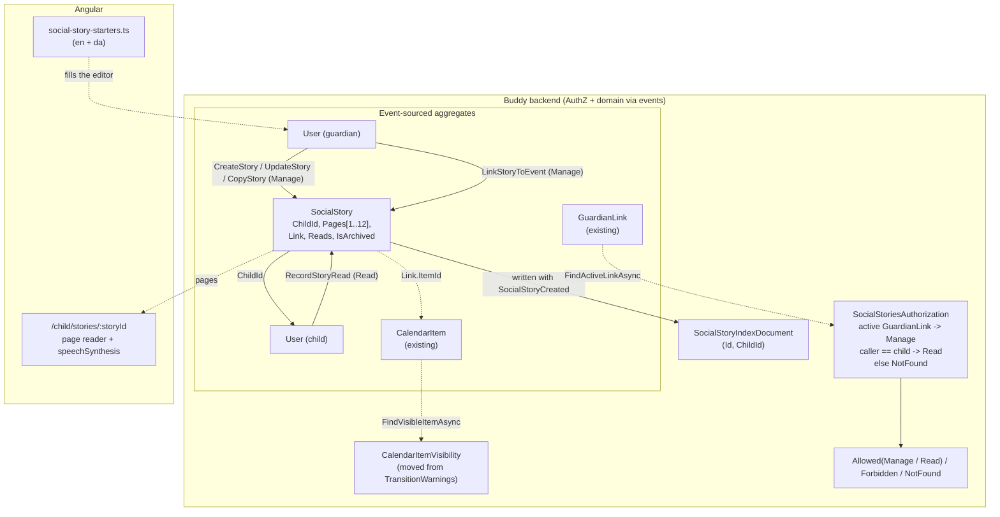

# Social Stories

Status: Proposed (not yet implemented)

## Context

A social story is a short, concrete story that tells a child what will happen at a new or
difficult event, before it happens. Typical topics are going to the dentist, getting a haircut,
a substitute teacher, a first flight or a night at grandma's. Children with ADHD or autism often
find an unfamiliar situation easier when they have "seen" it beforehand, step by step, in calm
and predictable words. The format comes from Carol Gray's work. A good story is told from the
child's point of view, mostly describes ("The waiting room has chairs and some toys"), says
how other people feel or think ("The dentist wants my teeth to be healthy"), and sets only a few
gentle expectations ("I can hold my teddy while I wait").

Families make these today as homemade booklets: one sentence and one picture per page,
read together several times in the days before the event. In the app, a guardian should be able
to:

- write a story of a few pages for one child, each page with a short sentence and a picture,
  or start from a ready-made story and adapt it;
- tie the story to the calendar event it prepares for, so the child is reminded to read it in
  the days before;
- print it as a booklet.

The child should be able to:

- read it page by page on their own device, in large type, with a "read it to me" button for
  non-readers;
- find their stories again later on a shelf.

Nothing like this exists in Buddy today. The closest existing precedents are:

- [house-rules.md](house-rules.md), where guardians write text that a child reads, with a child
  page, a child home card and a print page;
- the TaskLibrary's `TaskTemplate`
  ([TaskTemplate.cs](../../../src/backend/buddy/Features/TaskLibrary/Types/TaskTemplate.cs)), a
  per-child stream with an ordered list of items, an emoji icon, an index document per child,
  archiving and [copy to a sibling](packing-checklists.md#question-9-copying-a-template-to-a-sibling);
- `TransitionWarnings`, the only feature that stores a reference to a `CalendarItemId`
  ([TransitionWarningSettings.cs](../../../src/backend/buddy/Features/TransitionWarnings/Types/TransitionWarningSettings.cs)).

The app has **no image or file storage of any kind**. Every "picture" today is an emoji string
(`Icon`, reward and goal-post icons), and the CSP only allows `img-src 'self' data:`
([Caddyfile](../../../src/frontend/buddy/Caddyfile)). Question 4 is therefore the biggest
decision in this doc.

This document answers eight questions: new feature or extension, the aggregate's shape, how a
page is modelled, where pictures come from, ready-made stories, linking to calendar events, who
can see and change stories, and how the child reads them.

## Question 1: extend an existing feature, or a new feature?

**Decision: a new feature, `Features/SocialStories`, with one new aggregate, `SocialStory`, its
own Marten schema `socialstories` and its own flag `Features:SocialStories`.**

- **House rules.** A rule is a standing agreement that the child acknowledges per revision. A
  story is read for an upcoming event and then shelved. Its pages, pictures, calendar link and
  read history have no counterpart on `RuleBook`, and rules are owned by a child *or* a group,
  which stories don't need (Question 7).
- **TaskLibrary.** A `TaskTemplate` has the right shape (per child, ordered items, an icon,
  archive, copy), but every one of its items is something to *do*, with a duration, weekdays and
  completion state that a calendar item schedules. A story page has none of these. Adding a
  `TaskTemplateKind.Story` would make every TaskLibrary handler and the scheduling code skip a
  kind that never schedules. Packing checklists could ride on TaskLibrary because a checklist
  *is* a list of things to do ([packing-checklists.md, Question 1](packing-checklists.md#question-1-reuse-the-task-library-or-a-new-aggregate)).
  A story isn't.
- **Feature flag.** The feature gets its own top-level flag, wired like `Features:HouseRules`
  ([feature-flags.md](feature-flags.md), [house-rules.md, Feature flag](house-rules.md#feature-flag)).

## Question 2: aggregate shape and identity

**Decision: one stream per story, with a UUIDv7 `SocialStoryId`, owned by exactly one child. A
`SocialStoryIndexDocument(Guid Id, Guid ChildId)` lists a child's stories, written in the same
`SaveChangesAsync` as the creation event, exactly like `TaskTemplateIndexDocument`.**

```
SocialStory(
    SocialStoryId Id,                 // UUIDv7, like TaskTemplateId
    UserId ChildId,                   // the one child the story is for
    string Title,                     // 1--100 chars, plain text
    Icon Icon,                        // cover emoji, the existing Calendars Icon type
    ImmutableList<StoryPage> Pages,   // 1--12, in reading order
    StoryEventLink Link,              // Question 6; StoryEventLink.None when unlinked
    ImmutableList<StoryRead> Reads,   // Question 8; newest last, capped at 50
    bool IsArchived,
    UserId LastModifiedBy,
    DateTimeOffset LastModifiedAt)
```

**Why one stream per story, and not one shelf per child.** `RuleBook` puts all of a scope's
rules in one stream because a book holds a few dozen short rules that are ordered against each
other ([house-rules.md, Question 2](house-rules.md#question-2-rule-book-scope-and-identity)).
Stories are not ordered against each other, each one is edited, linked, archived and read on its
own, and a family that uses the feature for a year collects dozens of stories with up to twelve
pages each. One shelf stream would grow without bound and make two guardians editing two
different stories conflict. That is the reason `TaskTemplate` and `MedicineSchedule` are a
stream per item with a per-child index document, and stories follow them.

**Why owned by one child, not a group.** A story is written *for* one child's worries, in their
words ("I can hold Bamse"). Siblings going to the same dentist get a copy (Question 7), the way
packing lists do. A group-owned story would bring house rules' two scopes, dual routes and
three-tier group authorization for a case that copying covers.

**Archive, not delete.** `SocialStoryArchived` hides the story from the child and from the
calendar, like `TaskTemplateArchived`. Unlike task templates, stories come back: the dentist
story is useful again next year. `SocialStoryRestored` therefore exists from v1.

## Question 3: modelling one page

**Decision: a page is one short plain-text passage plus one picture. The editor saves the whole
story at once, so pages have no slices of their own: `UpdateStory` replaces the page list, and
the event carries `Before`/`After`.**

```
StoryPage(
    StoryPageId Id,          // UUIDv7, so the frontend can track pages across edits
    string Text,             // 1--300 chars, plain text, line breaks kept
    StoryPicture Picture)    // Question 4
```

- **Plain text, not markdown.** House rules needed lists and tables. A story page is one or two
  sentences in large type, read aloud by the speech engine (Question 8). Bold, lists and
  headings get in the way of both. The 300-character limit keeps a page to what fits next to
  a picture on a phone and on half an A4 sheet.
- **At most twelve pages.** Guidance on social stories puts most of them at five to ten pages;
  twelve leaves room without turning a story into a book. At least one page, because an
  empty story has nothing to read.
- **Whole-list overwrite, not per-page slices.** `TaskTemplate` has `AddSubtask`,
  `UpdateSubtask`, `RemoveSubtask` and `ReorderSubtasks` because subtasks are edited one at a
  time on the manage page and are referenced by completion state. Story pages are referenced by
  nothing. They are written together in one editor and saved with one button. Four page slices
  plus a reorder rule would add code and tests and buy nothing. The full overwrite is the
  `MealAssignedToSlot` rule ([mealplans.md](mealplans.md)), and `Before`/`After` keeps every
  earlier wording, as `RuleEdited` does.
- **No sentence-type model.** Carol Gray's descriptive / perspective / directive / affirmative
  sentence types are guidance for the writer. They appear as hints in the editor and in the
  help topic, not as a field on the page.

## Question 4: where the pictures come from

**Decision (lean, to confirm with the user): v1 pictures are emoji, one to three per page
(for example "🦷🪥" or "🧑‍⚕️💺"), stored as a picture value with a kind discriminator so that
photos can be added later without changing existing events. Photo upload waits for a shared
"pictures" design that the Pictogram support item in `TODO.md` also needs.**

```
StoryPicture(StoryPictureKind Kind, string Emoji)
    // v1: Kind = Emoji, Emoji 1--32 chars (the reward-icon limit, ConfigureRewards.Validator.cs:21)
    // later: Kind = Photo, plus a PictureId field added as a trailing parameter

enum StoryPictureKind { Emoji }   // Photo added later
```

The kind is a flat discriminator rather than a union for the replay reason found in
[pickup-schedules.md, Question 3](pickup-schedules.md#question-3-modeling-who-a-flat-kind-discriminator-not-a-union)
and reused by `RuleBookScopeKind`.

**Why emoji first.** Emoji is already the child-facing picture vocabulary
([visual-specification.md](../../frontend/analysis/visual-specification.md)): pre-readers can
read it, it themes in dark mode, it needs no storage and it prints. A page is shown with
the emoji scene very large (about 6rem) above the text, which works better than one would
expect for the common topics: 🦷 dentist, ✂️ hairdresser, ✈️ airport, 🏫 school, 🎂 party.

**Why not photos in v1, even though real photos are the stronger form** (a photo of the actual
dentist's waiting room prepares a child better than 🪑). They would be the app's first binary
data, and each part is a decision of its own:

- **Storage.** Postgres `bytea` documents in Marten, the file system of a per-family VM, or Azure
  Blob Storage for the Container Apps deployment. Each installation is run by one family,
  so whatever is chosen has to work in both `task deploy`
  and `task deploy:azure` with backups.
- **Size and format.** A request body limit (none is configured today), image resizing and
  EXIF stripping (phone photos carry GPS positions of the family's home).
- **Serving.** The API is on a different origin from the frontend (`connect-src` lists
  `{$API_BASE_URL}`), and images need the bearer token. The frontend would fetch them as blobs
  and show `blob:` URLs, which needs `blob:` added to `img-src`.
- **GDPR.** Photos may show the child or other people. They need an eraser and an exporter that
  handle binary data, which the current `IPersonalDataExporter` (JSON sections) doesn't.

Pictograms on tasks and meals, the caregiver handover card and maybe guardian avatars would all
use the same storage, so it deserves its own analysis rather than being decided inside this
feature. Adding `StoryPictureKind.Photo` afterwards is additive.

Rejected:

- **Image URLs typed by the guardian.** The CSP blocks remote images on purpose (no tracking
  pixels, [house-rules.md, Question 4](house-rules.md#question-4-markdown-stored-raw-and-rendered-safely)),
  and links to someone else's site break.
- **A bundled pictogram set (ARASAAC, Mulberry) in `public/`.** Attractive for non-readers, but it
  adds a licence to track (ARASAAC is CC BY-NC-SA), a few MB to the frontend image and a picker
  to build. It belongs with the Pictogram support item, and would become a third
  `StoryPictureKind`.
- **`data:` URLs in the event.** The CSP would allow them, but base64 photos in event payloads
  bloat the event store and every snapshot, and can't be erased without masking whole events.

## Question 5: ready-made stories

**Decision: the frontend ships a small set of starter stories in English and Danish. Choosing
one fills the editor, and saving creates an ordinary story through `CreateStory`. The backend
knows nothing about starters.**

Starter set for v1 (six to eight pages each): the dentist, the doctor, the hairdresser, a
substitute teacher, a trip by plane, sleeping at someone else's house, a birthday party, and
starting in a new class.

- **Starters are UI text, so they live in the i18n dictionaries**
  (`core/i18n/translations/{en,da}/social-story-starters.ts`) and pass the parity check. They are
  written in the child's first person and follow the sentence-type guidance (mostly descriptive,
  at most one directive sentence per story).
- **Once saved, the text is the guardian's own.** It is stored in the language it was copied
  in and is never translated again, the same rule as rule bodies. Editing a starter after
  release never changes a family's saved stories.
- **The editor opens on the starter so the guardian makes it personal** (the dentist's name, the
  teddy's name). A note in the editor says so; nothing enforces it.

Rejected: a backend starter catalog (an aggregate or seed data). It would need a translation
model for stored content, which Buddy doesn't have, to offer what a static TypeScript file
offers.

## Question 6: linking a story to a calendar event

**Decision: a story can be linked to one calendar item. The child sees a "read this before
Thursday" card on their home page from three days before the item's next occurrence until the
occurrence has passed. The link is set and cleared by its own slices, which check that the
guardian can see the item.**

```
StoryEventLink(StoryLinkKind Kind, CalendarItemId ItemId)
enum StoryLinkKind { None, CalendarItem }
    // Kind = None with ItemId = default, following eliminate-nulls.md instead of a nullable id
```

- **Preparing for an event is the point of the feature**, so the link is in v1, unlike packing
  checklists' calendar link ([packing-checklists.md, Question 7](packing-checklists.md#question-7-linking-items-to-calendar-events-football-swimming)).
  That one was deferred because the link would have *generated* occurrences for another stream.
  Here it only reads the linked item's dates and never changes what the calendar shows.
- **Which occurrence.** For a one-off item, the item itself. For a recurring item (weekly
  swimming), the next occurrence from today, through `RecurrenceExpansion.ExpandDates`
  ([RecurrenceExpansion.cs](../../../src/backend/buddy/Features/Calendars/RecurrenceExpansion.cs)).
  The read model returns that date as `UpcomingOn`. When the next occurrence is more than three
  days away, the story is just on the shelf.
- **Access check.** `LinkStoryToEvent` requires the item to exist, not be deleted, and sit in a
  calendar the guardian can view, otherwise `404`.
  `ChildTransitionWarningsView.FindVisibleItemAsync`
  ([TransitionWarningsResponses.cs:93](../../../src/backend/buddy/Features/TransitionWarnings/TransitionWarningsResponses.cs))
  already does exactly this. It moves to `Features/Calendars/CalendarItemVisibility.cs` so two
  features can share it (see the refactor below). The child doesn't need calendar access to the
  item: the story says what it's about, and the card only shows the date.
- **Deleted or moved items.** A deleted item, or one whose calendar the child can no longer see,
  makes the link dormant: no card, no date, and the guardian page shows "linked event was
  removed". The link isn't cleared automatically, so nothing is written on another feature's
  behalf (the same choice TransitionWarnings makes for overrides on deleted items). A moved item
  just moves the card.
- **Calendar badge.** The child's calendar agenda shows a 📖 on an occurrence that has a linked
  story, opening the reader. The agenda already loads the child's occurrences, so the frontend
  matches them against `ListStories`' links; no calendar endpoint changes.

**Refactor: share the visible-item check.** Today it is a public static on a TransitionWarnings
response class:

```csharp
// Features/TransitionWarnings/TransitionWarningsResponses.cs:93
public static async Task<(CalendarItem Item, Calendar Calendar)?> FindVisibleItemAsync(
    CalendarItemId itemId, UserId guardianId,
    ICalendarItemEventStore items, ICalendarEventStore calendars, IGroupEventStore groups,
    CancellationToken cancellationToken)
```

Proposed: the same method, moved unchanged to
`Features/Calendars/CalendarItemVisibility.FindVisibleItemAsync`, with its private
`FindVisibleCalendarAsync` helper. Blast radius: one call site
(`SetItemWarningOverride.Handler.cs:36`) plus any internal uses in
`TransitionWarningsResponses.cs`; no events or routes change.

## Question 7: who can see and change stories

**Decision: two tiers. `Manage` is any active guardian of the story's child. `Read` is the child
themself. Everyone else gets `NotFound`, and a child calling a write gets `Forbidden`, except
recording their own read.**

```
enum SocialStoryAccessTier { None, Read, Manage }
enum SocialStoryAccess { Allowed, NotFound, Forbidden }
```

| Tier | Who | Actions |
|---|---|---|
| **Manage** | An active guardian of the child (`FindActiveLinkAsync`) | Create, edit, link, archive, restore, copy; see read history; list archived stories |
| **Read** | The child (`callerId == ChildId`) | List and read non-archived stories; record a read |

- **Structure.** `SocialStoriesAuthorization` mirrors
  [TaskLibraryAuthorization.cs](../../../src/backend/buddy/Features/TaskLibrary/TaskLibraryAuthorization.cs)
  with a `ToDeniedResult<T>()` extension. Separated parents share the child's stories, as for
  every per-child feature.
- **An archived story is `NotFound` for the child**, so an old link in the browser history
  doesn't show a story the guardian put away.
- **Copying to a sibling.** `CopyStory` creates a new story for another child from the source's
  title, icon and pages, with fresh page ids. The link and read history are not copied. Access
  and status codes are the `CopyTaskTemplate` matrix
  ([packing-checklists.md, Question 9](packing-checklists.md#question-9-copying-a-template-to-a-sibling)):
  `Manage` on both ends, `404` for an unknown target, `403` for a child caller.
- **Babysitters and grandparents** get the printout (Question 8), as for house rules.

## Question 8: how the child reads a story

**Decision: a full-screen reader with one page per screen, very large picture and text, back
and next buttons and swipe, plus a "read it to me" button that uses the browser's speech
synthesis. Reaching the last page records a read, at most once per story per day.**

- **Reader.** `/child/stories/:storyId`. The page counter is shown as dots, not "3 / 8". The last
  page ends with a calm "The end" and a button back to the shelf, without stars or confetti; a
  story isn't a task.
- **Read it to me.** `speechSynthesis.speak()` with a `SpeechSynthesisUtterance` whose `lang`
  is the child's language (`da-DK` or `en-GB`, [child-language-settings.md](child-language-settings.md)).
  This is the app's first use of the Web Speech API. The button is only shown when
  `speechSynthesis.getVoices()` has a voice for that language; iPads and Android ship Danish
  voices, some desktop Linux browsers have none. Speech stops on page change. A guardian
  reading aloud stays the main path, and the help topic says so.
- **Read history.** `RecordStoryRead` is a `PUT` keyed by the child's local date, so a re-read on
  the same day is an idempotent no-op ([http-status-codes.md](../http-status-codes.md)). The
  guardian sees "Read 3 times, last yesterday", which tells them whether the preparation is
  happening. `Reads` keeps the latest 50 in the snapshot; the events keep all of them. A guardian
  paging through the story on the child's device counts as a read, which is fine: they read it
  together.
- **Shelf.** `/child/stories` lists non-archived stories, upcoming ones first (by `UpcomingOn`),
  then by title. A 📖 link pill on the child home leads there.
- **Child home card.** "📖 Read before Thursday: At the dentist" for each story with
  `UpcomingOn` within three days, built like the "rules to read" card
  ([home.ts](../../../src/frontend/buddy/src/app/features/child/home/home.ts)): a `resource`
  over `ListStories`, hidden on error, skipped when the flag is off.
- **Printing.** `/guardian/stories/print/:storyId`, outside the shell like the house-rules print
  pages. A4 portrait with two story pages per sheet (big emoji, text below), cut and stapled
  into an A5 booklet, and a cover with the title and icon.

### Events

```
SocialStoryCreated(SocialStoryId Id, UserId ChildId, string Title, Icon Icon,
    ImmutableList<StoryPage> Pages, UserId CreatedBy, DateTimeOffset OccurredAt)
    // also used by CopyStory; a starter story arrives here as ordinary pages
SocialStoryDetailsUpdated(SocialStoryId Id, StoryDetails Before, StoryDetails After,
    UserId ModifiedBy, DateTimeOffset OccurredAt)
StoryPagesReplaced(SocialStoryId Id, ImmutableList<StoryPage> Before,
    ImmutableList<StoryPage> After, UserId ModifiedBy, DateTimeOffset OccurredAt)
StoryLinkedToEvent(SocialStoryId Id, StoryEventLink Before, StoryEventLink After,
    UserId ModifiedBy, DateTimeOffset OccurredAt)
StoryLinkCleared(SocialStoryId Id, StoryEventLink Before, UserId ModifiedBy, DateTimeOffset OccurredAt)
SocialStoryArchived(SocialStoryId Id, UserId ModifiedBy, DateTimeOffset OccurredAt)
SocialStoryRestored(SocialStoryId Id, UserId ModifiedBy, DateTimeOffset OccurredAt)
StoryRead(SocialStoryId Id, UserId ChildId, DateOnly LocalDate, UserId RecordedBy,
    DateTimeOffset OccurredAt)

StoryDetails(string Title, Icon Icon)
```

- **`UpdateStory`** takes title, icon and pages together. It appends `SocialStoryDetailsUpdated`
  when the title or icon changed and `StoryPagesReplaced` when the pages changed, both, or
  neither. Identical content appends nothing, the rule `EditRule` and `LogSleepEntry` follow.
- **Archive and restore** are idempotent: archiving an archived story succeeds without an event.
  Editing an archived story is `404`, as TaskLibrary writes past creation are
  (`TaskTemplateAccess.ResolveForManageAsync`); restore first.
- **Linking** to the item it is already linked to appends nothing. Clearing an unlinked story
  succeeds without an event.

### Rehydration

`SocialStory.Start` handles `SocialStoryCreated`. `SocialStory.Advance` folds the other seven,
with the `Start`/`Advance` split `RuleBook` and `TaskTemplate` use, so
`SocialStorySnapshotProjection` drives the same code as an inline snapshot in the `snapshots`
schema ([event-stream-snapshots.md](event-stream-snapshots.md)). `StoryRead` appends to `Reads`
and drops the oldest entry past 50.

## Read models

`SocialStoryIndexDocument(Guid Id, Guid ChildId)`, written with `SocialStoryCreated` (also by
`CopyStory`) in the same `SaveChangesAsync`, as `TaskTemplateIndexDocument` is. It serves "list
this child's stories". Everything else is a direct snapshot load. `UpcomingOn` is computed in
`ListStories` from the linked item's snapshot, never stored, because the item can move at any
time.

## Command slices (`Features/SocialStories/`, same vertical-slice shape as `TaskLibrary`)

| Slice | Tier | Notes |
|---|---|---|
| `CreateStory` | Manage | `{ title, icon, pages[] }`. Writes the index document. `postIdempotent` from the client. Returns the story |
| `UpdateStory` | Manage | `{ title, icon, pages[] }`, full overwrite. Archived → `404`. Returns the story |
| `LinkStoryToEvent` | Manage | `{ itemId }`. Item not visible to the guardian → `404` |
| `ClearStoryLink` | Manage | Idempotent |
| `ArchiveStory` / `RestoreStory` | Manage | Idempotent |
| `CopyStory` | Manage (both children) | `{ childId }`. The `CopyTaskTemplate` matrix |
| `ListStories` | Read / Manage | Per child. Each entry has `upcomingOn` and the linked item's title for `Manage`. `?includeArchived=true` for `Manage` only; the child never sees archived stories or read history |
| `GetStory` | Read / Manage | Full pages; reads and link details for `Manage` |
| `RecordStoryRead` | Read (self) / Manage | Idempotent per local date. A date more than a day away from the server's date in the child's time zone → `400` |

## Routes

```
POST   /social-stories/children/{childId}/stories          CreateStory
GET    /social-stories/children/{childId}/stories          ListStories   (?includeArchived)
GET    /social-stories/stories/{storyId}                   GetStory
PUT    /social-stories/stories/{storyId}                   UpdateStory
PUT    /social-stories/stories/{storyId}/link              LinkStoryToEvent
DELETE /social-stories/stories/{storyId}/link              ClearStoryLink
POST   /social-stories/stories/{storyId}/archive           ArchiveStory
POST   /social-stories/stories/{storyId}/restore           RestoreStory
POST   /social-stories/stories/{storyId}/copy              CopyStory
PUT    /social-stories/stories/{storyId}/reads/{date}      RecordStoryRead
```

Story routes take the story id alone, as `/task-templates/{templateId}` does; the handler loads
the snapshot and authorizes against its `ChildId`. All routes use the default per-user rate limit
([rate-limiting.md](rate-limiting.md)), and the two `GET`s take part in conditional GET
([conditional-get-etags.md](conditional-get-etags.md)), since the child home loads `ListStories`.

## Privacy (GDPR)

Stories are written about a child's worries and sometimes mention a diagnosis or a treatment
("the doctor checks my medicine"), so they are personal data and may be health data.
`SocialStoriesPersonalData` registers an `IPersonalDataEraser` and an `IPersonalDataExporter`
([IPersonalDataEraser.cs](../../../src/backend/buddy/Common/Erasure/IPersonalDataEraser.cs)),
which `PersonalDataEraserCoverageTests` and `PersonalDataExporterCoverageTests` require.

- **Child erased.** Every story stream of the child is deleted with
  `DeleteStreamAsync<SocialStorySnapshot>`, together with its index document, as
  `TaskLibraryPersonalData` does for templates.
- **Guardian erased.** Stories stay, because they belong to the child. `CreatedBy`,
  `ModifiedBy` and `RecordedBy` become pseudonyms, as on calendar items and rules.
- **Export.** A `socialStories` section with the current stories of the guardian's children
  (title, pages, link, archived flag, read dates), through the response DTOs.

## Feature flag

`Features:SocialStories`, on by default, wired like `Features:HouseRules`:

- **Backend.** A property, `Effective()` argument and `InstallationFeatures` field in
  [FeatureOptions.cs](../../../src/backend/buddy/Common/FeatureFlags/FeatureOptions.cs);
  `AddSocialStoriesFeature` always runs and `MapSocialStoriesFeature` sits behind
  `if (features.SocialStories)` in [Program.cs](../../../src/backend/buddy/Program.cs);
  `FeatureFlagsTests` gets a `404` case; `task docs:openapi` regenerates the types.
- **Frontend.** `socialStories: true` in `ALL_ON`, `featureGuard('socialStories')` on all five
  routes (checked by `feature-routes.spec.ts`), `feature: 'socialStories'` on the nav item and
  help topic, and the child home pill and card skip their load when off.

## Frontend

- **Service.** `core/social-stories.service.ts`, types from OpenAPI.
- **Guardian list `/guardian/stories`.** A child selector (the one `ManageTasks` uses), the
  child's stories as cards (icon, title, page count, linked event and date, "read 2×"), an
  "Archived" toggle, and "New story" with a starter gallery: "Blank story" plus the starters from
  Question 5. Under `features/guardian/social-stories/`.
- **Editor `/guardian/stories/:storyId` and `/guardian/stories/new`.** Title and cover-icon
  inputs, then the pages as `repeatable-row`s with move up/down, each with an emoji input, a
  textarea with a 300-character counter and a small live preview of the page as the child sees
  it. A "Link to event" picker lists the child's upcoming calendar items for the next 60 days
  (the calendar agenda service). Writing hints from the sentence-type guidance sit in a
  collapsible panel.
- **Print** `/guardian/stories/print/:storyId`, outside the shell.
- **Child.** `/child/stories` (shelf) and `/child/stories/:storyId` (reader) under
  `features/child/stories/`, the 📖 pill and the "read before" card on child home, and the 📖
  badge in the child calendar agenda.
- **i18n.** `translations/{en,da}/social-stories.ts` for the UI (Danish name: "Sociale
  historier") and `social-story-starters.ts` for the starters.
- **Help.** A `socialStories` topic: what a social story is, how to write a good one, linking,
  reading together, printing.
- **Screenshots.** `pages.ts` gets the guardian list, the editor, the print page, the child shelf
  and one reader page. `demo-family.ts` seeds "At the dentist" for `demo.emil`, linked to a
  dentist appointment two days ahead (so the home card shows) and read once, and an archived
  "Haircut" story.

## Testing

Integration tests follow TaskLibrary's (`CreateTaskTemplate`, `CopyTaskTemplate`,
`ArchiveTaskTemplate`). Feature-specific cases:

- every slice × guardian, child, unrelated guardian (`404`), revoked link (`404`);
- `UpdateStory` with identical content appends nothing; with only new pages appends only
  `StoryPagesReplaced`;
- page limits: 0 and 13 pages, 301-character text, blank text and emoji → `400`;
- `LinkStoryToEvent` to an item in a calendar the guardian can't view → `404`; `ListStories`
  returns `upcomingOn` for a recurring item's next occurrence, and none for a deleted item;
- `RecordStoryRead` twice on one day → one event; the child reading an archived story → `404`;
- `CopyStory` gives fresh page ids and no link or reads;
- erasure deletes the child's story streams and index documents; export contains them;
- golden-file `EventShapeTests` for the eight events and a `SnapshotTests` entry.

Frontend specs cover the reader's paging and the speech button (hidden without a voice; `speak`
called with the child's `lang`, using a stubbed `speechSynthesis`), the editor's limits and
reorder, the home card window, and the starters' en/da parity. e2e: a guardian creates a story
from the dentist starter, links it to an appointment the day after tomorrow, the child logs in,
sees the card, reads to the end, and the guardian sees "read 1×".

## Failure and edge-case behavior

| Case | Behavior |
|---|---|
| Story with no pages | `400`; at least one page |
| Page with an emoji but no text, or text but no emoji | `400` for both in v1; every page has words and a picture |
| `UpdateStory` with unchanged content | `Success`, no event |
| Editing an archived story | `404`; restore first |
| Archive an archived story, restore an active one | `Success`, no event |
| Linked item deleted, or its calendar no longer visible to the guardian | Link kept but dormant: no card, no `upcomingOn`, guardian sees "linked event was removed" |
| Linked item moved to another date | The card follows the new date |
| Recurring linked item | The card shows before each occurrence |
| Child opens an archived story's old URL | `404`, the reader shows "This story isn't available" |
| Child records the same read twice in a day | `Success`, one event |
| No speech voice for the child's language | The "read it to me" button is hidden |
| Guardian's `GuardianLink` is revoked | `NotFound` on all of that child's stories immediately |
| Two guardians edit the same story | Last write wins; both versions are in the events (`Before`/`After`) |
| `Features:SocialStories = false` | Routes not mapped; data and GDPR coverage stay |

## Estimate

| | |
|---|---|
| Complexity | High -- a new aggregate, schema and index document with eight events, ten slices, a calendar link that expands recurrences, GDPR erasure and export, a small refactor of the visible-item check, the app's first speech synthesis, eight bilingual starter stories, and six new pages (guardian list, editor, print, child shelf, child reader) plus a home card and a calendar badge |
| Single developer | 10-15 days, plus 1-2 days to write and review the starter stories in both languages |
| AI agent | 5-8 hours, plus 3-4 hours of human review (the starters' wording deserves a careful read by someone who knows social stories) and settling the open questions |

## Decisions made

| Question | Decision |
|---|---|
| New feature or extend? | New `Features/SocialStories` with a `SocialStory` aggregate, schema `socialstories` and flag `Features:SocialStories` |
| Stream shape | One stream per story, UUIDv7 id, `SocialStoryIndexDocument` per child, like `TaskTemplate` |
| Owner | One child; siblings get a copy, no group scope |
| Page | Plain text (1--300) plus one picture; 1--12 pages; whole-list overwrite with `Before`/`After` |
| Pictures | Emoji in v1 behind a `StoryPictureKind` discriminator; photos wait for a shared pictures design (lean, to confirm) |
| Starters | Frontend i18n files, copied into an ordinary story; no backend catalog |
| Calendar link | One optional linked item; card from three days before its next occurrence; dormant when the item disappears |
| Visible-item check | Moved from TransitionWarnings to `Features/Calendars/CalendarItemVisibility` |
| Who | Active guardians manage; the child reads and records reads; others `NotFound` |
| Archive | Archive and restore, both idempotent; archived stories are invisible to the child |
| Reading | Page-per-screen reader, browser speech synthesis when a voice exists, one recorded read per day |
| Printing | A5 booklet on A4 portrait, outside the shell |

## Remaining open questions

- **Are emoji pictures enough for v1, or are photos a must?** Lean: emoji now, and a separate
  "pictures and file storage" analysis that serves social stories, Pictogram support and the
  caregiver handover card together. Adding photos later is additive (`StoryPictureKind.Photo`).
  If photos are a must for v1, that analysis comes first and this feature's estimate grows by
  roughly a week.
- **Is a three-day window right?** Lean: a fixed three days in v1. A per-story "remind me N days
  before" would be a trailing field on `StoryEventLink`.
- **Should a guardian be able to record audio** of themselves reading each page, instead of
  the synthetic voice? Lean: later; it needs the same binary storage as photos.
- **Should the child be able to write or suggest stories?** Lean: no. The child may only record
  reads. Child suggestions would follow the packing-checklist suggestion model
  ([packing-checklists.md, Question 8](packing-checklists.md#question-8-child-suggested-items)).
- **Should stories be shareable with a household group** (one story for all children going on
  the family trip)? Lean: no; `CopyStory` covers it. House rules' child/group scope could be
  added later if families ask.
- **Who writes and reviews the starter stories?** They are the part most visible to families and
  should be checked by someone with professional experience of social stories (a
  pædagog or an occupational therapist) before release.

## Diagram


