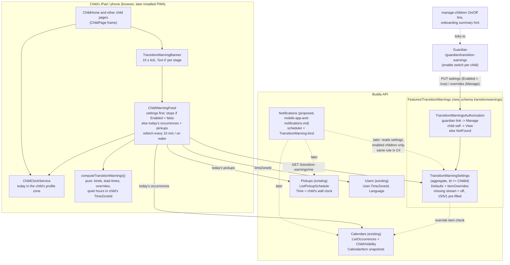

# Transition Warnings

Status: Implemented. `Features/TransitionWarnings` (schema `transitionwarnings`, flag
`Features:TransitionWarnings`) with the `TransitionWarningSettings` aggregate, four events and five
slices (`GetMyTransitionWarnings`, `GetChildTransitionWarnings`, `ConfigureTransitionWarnings`,
`SetItemWarningOverride`, `ClearItemWarningOverride`) under `/transition-warnings`; the pure
`computeTransitionWarnings` in `core/transition-warnings.ts`, the `ChildWarningFeed` and the
`TransitionWarningBanner` in the `ChildPage` frame of every child page; the guardian page
`/guardian/transition-warnings` with exceptions; the On/Off line on `manage-children`, the hint in the
onboarding summary and a help topic. The same build moved every child page's "today" to the child's
profile time zone through `ChildClockService` (Question 9).

## Context

Sudden transitions are one of the most reliable triggers for children with ADHD or autism. "We're
leaving for football _now_" lands as an interruption; "10 minutes until we leave for football",
then "5 minutes", then "1 minute" gives the child time to finish what they're doing, put it down
and switch. Occupational therapists and parents do this by hand with kitchen timers and shouted
countdowns. A guardian wants Buddy to do it for them: a heads-up on the child's screen before the
things Buddy already knows are coming.

The things that count as a transition, all of which Buddy already stores:

- **Calendar events** ("Football 16:30-17:30"): a timed window with a start instant.
- **Tasks** ("Pack your bag", due 07:30) and **routines** scheduled from the task library ("Go to
  bed": brush teeth, pyjamas, ...), whose subtasks each have a window.
- **Drop-offs and pickups** ("Dad picks you up at 15:00"), when the assignment has a time.

What a guardian wants to control, per child:

- **Lead times** -- when the heads-ups come, e.g. 15, 5 and 1 minutes before.
- **Which kinds** of item warn. A child may cope fine with tasks but need warnings before leaving
  the house.
- **Quiet hours** -- no warnings at all in a window, e.g. during school when the iPad is in the bag,
  or after bedtime.
- **Per-item exceptions** -- football needs 30 minutes' notice because of the kit; the 07:30 "pack
  your bag" task should not warn at all.

What exists today:

- **The child day view already has the data.** [`ChildHome`](../../../src/frontend/buddy/src/app/features/child/home/home.ts)
  loads today's calendar occurrences (`CalendarsService.listTodayOccurrences()`, split into tasks
  and events) and today's pickups (`PickupsService.listSchedule(me, today, today)`), and already
  runs a `now` signal on a 60-second interval
  ([home.ts:114](../../../src/frontend/buddy/src/app/features/child/home/home.ts),
  [home.ts:284](../../../src/frontend/buddy/src/app/features/child/home/home.ts)) to fill in the
  progress of an ongoing event. It shows what is happening, but not what is _about to_ happen.
- **Occurrences are resolved instants.** [`CalendarItemOccurrence`](../../../src/backend/buddy/Features/Calendars/Types/CalendarItemOccurrence.cs)
  carries `OccurrenceTiming.Timed(StartsAt, EndsAt)` or `OccurrenceTiming.Due(DueAt)` as
  `DateTimeOffset`s, resolved through the calendar's `TimeZoneId` by `CalendarOccurrenceExpansion`.
  A countdown to an occurrence needs no time-zone arithmetic at all.
- **Pickup times are wall-clock values.** [`PickupOccurrence`](../../../src/backend/buddy/Features/Pickups/Types/PickupOccurrence.cs)
  has `TimeOnly? Time`, "the child's own local wall-clock value"
  ([PickupScheduleExpansion.cs](../../../src/backend/buddy/Features/Pickups/PickupScheduleExpansion.cs),
  [pickup-schedules.md](pickup-schedules.md)). Since
  [child-timezone-settings.md](child-timezone-settings.md) every child has a required
  `User.TimeZoneId`, which is what that wall clock means.
- **What the child sees is already filtered.** [`ChildVisibility`](../../../src/backend/buddy/Features/Calendars/ChildVisibility.cs)
  gives a child every event in their calendars but only the tasks assigned to them.
- **No notification infrastructure.** [mobile-app-and-notifications.md](mobile-app-and-notifications.md)
  proposes a PWA, Web Push, a `NotificationPreferences` aggregate and a per-minute
  `NotificationSchedulerService` that sends a `TaskReminder` _at_ a task's due time. Its last open
  question is exactly this feature's core: "Reminder lead time (5 or 15 minutes before a task
  instead of at its time) ... a per-child `ReminderLeadMinutes` is an additive preference." None
  of it is built.
- **Guardian-set child settings** have a precedent: language and time zone
  ([child-language-settings.md](child-language-settings.md), [child-timezone-settings.md](child-timezone-settings.md))
  are set by any active guardian, never by the child. Per-child configuration that a guardian
  writes and a child reads is `ChildProgress`'s goal posts
  ([configurable-goal-posts.md](configurable-goal-posts.md)).

This document answers nine questions: whether this is its own feature, where the settings live,
how they are modelled, where per-item exceptions live, where warnings are computed, how they are
delivered now and how they plug into push later, how time zones apply, who can see and change
the settings, and whose "today" the child pages use.

## Question 1: extend an existing feature, or a new one?

**Decision: a new feature, `Features/TransitionWarnings`, with its own Marten schema
`transitionwarnings` and its own feature flag `Features:TransitionWarnings`.**

- **Not `Calendars`.** Warnings cover pickups too, which live in their own feature
  ([pickup-schedules.md, Question 1](pickup-schedules.md#question-1-extend-calendars-or-a-new-feature)).
  And a warning preference belongs to a _child_, while a calendar item belongs to a calendar that
  several children (and adults) share. Football in the family calendar needs 30 minutes' notice for
  Emil and none for his sister. That is a per-child fact about an item, not a fact about the item.
- **Not fields on `User`.** Language and time zone are on `User` because every page reads them.
  The Users feature shouldn't know about lead times and item kinds, and the flag must be able to
  remove the whole feature -- the same argument [mobile-app-and-notifications.md, Question 3](mobile-app-and-notifications.md#question-3-where-do-subscriptions-and-preferences-live)
  makes for keeping `NotificationPreferences` off `User`.
- **Not `NotificationPreferences`.** That aggregate doesn't exist yet, and making it a prerequisite
  would tie a frontend-mostly feature to the whole PWA/Web Push project (12-17 developer days by
  its own estimate). The two are also different things: notification preferences say _which
  channels_ a user hears on; transition warnings say _what a child is warned about and when_,
  which holds whether the warning shows in the app or as a push. Question 6 has how push reads
  these settings later.
- **Its own flag**, for the same reason every optional domain has one
  ([feature-flags.md, Question 2](feature-flags.md#question-2-which-features-get-a-flag)): a family
  whose child finds countdowns stressful rather than helpful can remove the feature outright.
  Calendars, which it reads, is core and can't be off; pickups can be, and then pickup warnings
  simply have nothing to warn about.

## Question 2: aggregate shape and identity

**Decision: one `TransitionWarningSettings` stream per child, with
`TransitionWarningSettingsId.Value == ChildId.Value`, no index document. The stream is started
lazily by the first write; reading a missing stream returns the defaults, which are switched off
(Question 3).**

A child has exactly one set of warning settings -- the same 1:1 shape as `ChildProgress`
([gamified-progress.md](gamified-progress.md#why-progressidvalue--childidvalue-with-no-index-document)),
`SleepDiary` ([sleep-diary.md, Question 2](sleep-diary.md#question-2-aggregate-shape-and-identity))
and the proposed `NotificationPreferences`. "Find this child's settings" is a direct stream load.
`mealplans.md`'s argument against deterministic ids (it needed an index anyway) doesn't apply: there
is no sharing axis and no "which one" to resolve.

```text
TransitionWarningSettings(
    TransitionWarningSettingsId Id,     // Id.Value == ChildId.Value -- 1:1, no index document
    UserId ChildId,
    WarningDefaults Defaults,           // Question 3
    ImmutableDictionary<CalendarItemId, ItemWarningOverride> ItemOverrides)  // Question 4
```

Who changed what is on the events (`ModifiedBy`). The aggregate keeps no `LastModifiedBy`, because
nothing reads it (dropped while building; the history needs only the events).

`Initial(id, childId)` returns the defaults (`Enabled = false`, the suggested lead times and kinds
filled in), the same "one non-null state" helper `ChildProgress` has, so the reader for a child no
guardian has configured yet and the first writer work from the same value. A child no guardian has
configured therefore gets no warnings.

Snapshot: an inline `TransitionWarningSettingsSnapshotProjection` in the shared `snapshots` schema,
like every aggregate ([event-stream-snapshots.md](event-stream-snapshots.md)), with a `SnapshotTests`
case and golden-file `EventShapeTests` for the new events.

## Question 3: modelling the per-child settings

**Decision: a small `WarningDefaults` value -- master switch (off by default), up to three lead
times (15/5/1 suggested), a set of item kinds, optional quiet hours -- replaced as a whole on every
save.**

```text
WarningDefaults(
    bool Enabled,                                  // master switch for this child; default false
    ImmutableArray<int> LeadMinutes,               // 1..120, 1-3 distinct values, largest first; default [15, 5, 1]
    ImmutableArray<WarningKind> Kinds,             // distinct, in enum order; default: all four
    QuietHours? QuietHours)                        // default null (none)

enum WarningKind { Event, Task, DropOff, PickUp }

QuietHours(TimeOnly From, TimeOnly To)             // in the child's TimeZoneId; From > To wraps midnight
```

- **Off by default; 15/5/1 suggested** (settled by the user 2026-10-11). Some children find
  countdowns stressful rather than helpful, so a guardian opts each child in rather than having to
  notice the banner and opt out. `Enabled = false` in `Initial`, and a child with no stream sees
  nothing. The rest of the defaults are still filled in: when a guardian flips the switch on, the
  form already shows 15, 5 and 1 minutes and all four kinds -- the example from the request and the
  "long notice, short notice, now" pattern therapists recommend -- so turning warnings on is one tap
  and a save. Turning them off again keeps the lead times, kinds, quiet hours and overrides, so
  switching back on restores the guardian's last choices. Because the per-child default is off, the
  feature needs to be findable; the Frontend section has where it is surfaced. Considered and
  rejected: default on, which makes the feature discoverable but means the first a guardian hears
  of it may be a child upset by a countdown nobody chose.
- **At most three lead times.** More stages read as nagging, and the banner (Question 6) gets one
  visual step per stage. `0` is not a lead time: "it's starting now" is what the day view's
  ongoing-event fill already shows.
- **Routines count as `Task`.** A template-scheduled routine is a task whose subtasks each have a
  window ([`Routine`](../../../src/backend/buddy/Features/Calendars/Types/CalendarItemOccurrence.cs)).
  The transition is _into_ the routine, so only its first subtask warns ("10 minutes until: Go to
  bed"), not each of "brush teeth", "pyjamas", "story". Moving from one subtask to the next is the
  routine itself, not a transition.
- **Packing lists count as `Task` too, and warn before their "leave by" time** (decided while
  building, 2026-10-13). Since this doc was written, [packing checklists](packing-checklists.md)
  shipped: a `TaskTemplateKind.Checklist` scheduled as a task whose items all have the same `Due`
  instant (the "leave by" time), with `Routine.Checklist` set on each occurrence. A packing list
  warns exactly like a routine: once per list (not per item), titled by the list ("5 minutes until
  Football bag"), counting down to the "leave by" time, under the `Task` kind and any override on its
  item. A list whose items are all packed no longer warns, as a completed task doesn't. Its
  "evening before" option is about _showing_ tomorrow's list, not a transition, so it never warns:
  the leave-by time tomorrow is tomorrow's warning. Considered: a separate `Leaving` kind, rejected
  because the guardian already chose the time and an override covers a list that needs more notice.
- **`DropOff` and `PickUp` separately**, mirroring [`PickupSlot`](../../../src/backend/buddy/Features/Pickups/Types/PickupSlot.cs).
  The morning drop-off ("leaving for school") is the classic hard transition; an afternoon pickup at
  school may need no warning at all, since the child isn't in the middle of anything at home.
- **Quiet hours drop, they don't delay.** A warning that would fall in quiet hours is not shown,
  and isn't shown late either -- "5 minutes until football" after football has started is noise.
  This is the same rule the notifications doc uses for its own quiet hours. Default none: every
  item that warns was put in the calendar by a guardian, so in-app there is little to be quiet
  about. Quiet hours start to matter with push (a phone buzzing in class), which is why they are
  modelled now rather than bolted on later.
- **Full replace**, like `GoalPostsConfigured`. The settings form is small and saved as one unit;
  patch semantics would add events without adding meaning.

Rejected: **per-kind lead times** (15/5/1 for events, 5 for tasks). It triples the form for a
distinction a per-item override (Question 4) covers where it actually matters. Additive later as an
optional `LeadMinutesByKind` map.

## Question 4: where do per-item overrides live?

**Decision: in the child's `TransitionWarningSettings`, keyed by `CalendarItemId` -- not on
`CalendarItem`. An override is either "no warnings for this item" or its own lead times. Pickups
get no per-assignment override in v1; the `DropOff`/`PickUp` kinds cover them.**

```text
ItemWarningOverride
    | Off                                   // never warn for this item
    | LeadTimes(ImmutableArray<int>)        // same rules as WarningDefaults.LeadMinutes
```

- **Per child, per item.** As argued in Question 1, one event in a shared calendar can need
  different treatment for different children. A field on `CalendarItem` could hold only one answer.
- **Keyed by item, so it covers every occurrence.** "Football needs 30 minutes" is about the
  recurring item, not one Tuesday. Overriding a single occurrence is an open question; it would key
  by `(CalendarItemId, DateOnly)` and is additive.
- **`Calendars` stays untouched.** Putting the override on `CalendarItem` would mean a new
  `ItemWarningsUpdated` event, a new `CalendarItem` field, its snapshot and golden files, new
  fields on `CreateItemRequest`/`UpdateItemDetailsRequest` and `CalendarItemOccurrence`, and a
  child-dimension inside an aggregate that has none. Keeping it in this feature means the flag
  removes it completely, and the Calendars wire shape doesn't change.
- **Validated against the item.** `SetItemWarningOverride` loads the item through
  `ICalendarItemEventStore` and checks that the guardian can view its calendar
  (`CalendarAuthorization`), so a guardian can't store overrides for items they can't see. A
  missing, deleted or invisible item is `NotFound`, the same "can't tell private from missing"
  collapse the rest of the codebase uses. This is a cross-feature read in the direction pickups
  already read babysitters (`IBabysitterListEventStore`), so `AddTransitionWarningsFeature`
  registers after `AddCalendarsFeature`.
- **Orphans are harmless.** When an item is deleted, its override stays in the stream but matches
  nothing. `GetChildTransitionWarnings` resolves each override's title from the `CalendarItem`
  snapshot for the guardian's list and leaves out deleted items. A cap of 100 overrides per child
  stops the map growing forever; at the cap the handler returns `409` with an error code and the
  guardian removes old exceptions. Exceptions for deleted items don't count towards the cap (found
  in review): the guardian's list leaves them out, so they could never be removed to make room.
- **Task-library templates** get no default warning of their own in v1. A routine scheduled from a
  template is a normal `CalendarItem`, so an override on it works. A template-level default
  ("bedtime always 20/5") is an open question.
- **Pickups.** A pickup assignment is one date and slot, re-assigned day by day, so a
  per-assignment override would have to be set every day. The kinds switch and, if needed later, a
  `LeadMinutes` per `PickupSlot` cover the real cases. A field on `PickupAssignment` is rejected for
  the same reason as on `CalendarItem`.

## Question 5: are warnings computed on the client or the server?

**Decision: on the client, in v1. A pure function `computeTransitionWarnings` in
`core/transition-warnings.ts` takes today's occurrences, today's pickups, the child's settings, the
child's `TimeZoneId` and `now`, and returns the active warning (if any). The server only stores and
serves the settings.**

```ts
// core/transition-warnings.ts -- pure, no Angular, same style as core/task-run.ts
export interface TransitionWarning {
  key: string;                // `${source}:${id}:${date}:${leadMinutes}` -- stage identity, for "Got it"
  kind: WarningKind;          // 'Event' | 'Task' | 'DropOff' | 'PickUp'
  title: string;              // occurrence title, or the translated pickup label
  icon: string;
  slot: PickupSlot | null;    // a pickup's slot, which the banner translates into its title
  startsAtMs: number;         // what the countdown counts down to
  leadMinutes: number;        // which stage this is (15, 5, 1 ...)
  firstLeadMinutes: number;   // the item's largest lead time -- where the draining bar starts
  isFinalStage: boolean;      // the smallest lead time -- styled more urgently
}

export function computeTransitionWarnings(input: {
  occurrences: CalendarOccurrence[];
  pickups: PickupOccurrence[];
  settings: TransitionWarningSettings;
  timeZone: string;
  nowMs: number;
}): TransitionWarning[];      // sorted by startsAt; the banner shows the first, "+N more" for the rest
```

The rule, per candidate (an event, a not-completed task assigned to the child, a routine counting
down to its first subtask, a packing list counting down to its "leave by" time, or a timed pickup):

1. Skip all-day items, completed tasks, and anything whose start is not after `now`.
2. If `Enabled` is off, nothing warns -- overrides included; they are kept but inactive. Otherwise
   its lead times are the override's (if `LeadTimes`), none (if `Off`), else the defaults' -- if
   its kind is in `Kinds`. An override wins whatever the kinds (decided while building): it is the
   guardian's specific choice for that item, so "football 30 minutes" still warns when events are
   otherwise off.
3. The active stage is the smallest lead `L` with `startsAt - L minutes <= now`. None means not yet.
4. Drop it if `now`, in the child's time zone, is inside quiet hours.

Why the client:

- **The data is already there.** `ChildHome` loads exactly these occurrences and pickups, already
  filtered to what the child may see by `ChildVisibility` on the server. A server endpoint would
  re-run `CalendarOccurrenceExpansion` and `PickupScheduleExpansion` to return a subset of what the
  client just fetched.
- **The countdown is client-side anyway.** "4 minutes" has to tick on the device. A server
  endpoint would only move step 3 to the server and add polling to keep it current.
- **Cheap and testable.** The rule is a few dozen lines of filtering and subtraction, testable in
  Vitest with a fixed `now` -- easier than the first `TimeProvider` the server would need
  (the notifications doc notes none exists yet).

When push arrives, the server _does_ need the same rule, because a push has to fire with the app
closed. The scheduler then implements it in C# (Question 6). To keep the two implementations from
drifting, the cases live in one JSON fixture (`docs/backend/transition-warnings/cases.json` or
similar: inputs, `now`, expected warnings) that both the Vitest spec and an xunit test load. That
cost is paid only when push is built.

Rejected for v1:

- **A server endpoint `GET /transition-warnings/me/upcoming`.** One implementation for in-app and
  push, but a new cross-feature query over Calendars and Pickups, a polling loop, and no benefit
  until push exists. It can still be added then if the shared fixture turns out to be more work
  than one endpoint.
- **Computing on the server and pushing to the open app** (SignalR/SSE). Buddy has no real-time
  channel, and a child's day view is a single tab.

## Question 6: how are warnings delivered -- now, and with push later?

**Decision: ship in-app first, with no dependency on
[mobile-app-and-notifications.md](mobile-app-and-notifications.md). A banner with a countdown sits
in the `ChildPage` frame, so it shows on every child page. When push is built, transition warnings
become one more `NotificationKind` that reads these settings; nothing here changes shape.**

### In-app (v1)

- **Where.** [`ChildPage`](../../../src/frontend/buddy/src/app/features/child/child-page/child-page.ts)
  is the frame every child page shares, so a `<app-transition-warning-banner />` placed between its
  header and content shows on home, calendar, meal plan, rules and rewards alike -- a child who is
  rating dinner still sees that football is in 5 minutes. A child who isn't in Buddy at all sees
  nothing; that is the gap push closes.
- **Data.** A root-provided `ChildWarningFeed` (the HTTP calls are in `TransitionWarningsService`)
  loads the child's settings
  (`GET /transition-warnings/me`) first. When `Enabled` is off -- the default, so the normal case
  for a child no guardian has set up -- it stops there: no banner, no occurrence refetches, no
  tick, and the day view looks and behaves exactly as it does today. Otherwise it loads today's
  occurrences and today's pickups. It uses
  `CalendarsService.listTodayOccurrences()`, whose same-day cache `ChildHome` already fills, so on
  the home page the calendar isn't fetched twice. Because that cache is only invalidated by the
  client's own writes, the service refetches with `listOccurrencesInRange(today, today)` every 10
  minutes and on `visibilitychange` to visible, so a guardian moving football while the iPad sits
  open is picked up. The same refetch re-reads the settings, so a guardian switching warnings on
  or off reaches an open iPad within 10 minutes or on its next wake. The banner asks the feed once a
  minute whether its data is older than 10 minutes, also while warnings are off (that is the only
  timer a child with warnings off has; it costs one `GET /transition-warnings/me` per 10 minutes).
  "Today" is the child's own (Question 9).
- **Tick.** The banner has its own 15-second tick (the home page's 60-second tick is too coarse for
  a 1-minute stage) and recomputes immediately on `visibilitychange`, so an iPad woken from sleep
  doesn't show a stale stage. It runs only while the feature flag is on and the child's settings
  are enabled; a child with warnings off has no countdown tick, and the banner renders nothing at
  all, not even its live region.
- **What it looks like.** One card, large text, the item's icon and title, "in 5 min", and a ring
  or bar that drains from the first lead time to the start. The first stages use the calm emerald
  of the child pages; the final stage switches to the amber the "rules to read" card uses, never
  red. `role="status"` with `aria-live="polite"` so screen readers announce a new stage, not every
  tick. The draining animation is off under `prefers-reduced-motion`.
- **"Got it."** A button dismisses the current stage; the next stage still appears. Dismissals are
  kept in memory in the service (keyed by `TransitionWarning.key`), not persisted: a reload showing
  the warning again is harmless, and nobody needs a record of it.
- **Several at once.** The soonest warning is shown, with "+1 more" opening a short list. Overlaps
  are rare (a child has a few transitions a day).
- **No sound or vibration in v1** (settled by the user 2026-10-11). `navigator.vibrate` doesn't
  exist on iOS, and an iPad chiming in a classroom is a worse failure than a silent banner. An
  opt-in "play a sound" per child would be an additive `bool` on `WarningDefaults` later.
- **Guardians get nothing in-app in v1.** A guardian's dashboard already shows today's pickups and
  events; the guardian case that matters ("you pick up Emil in 15 minutes") is a guardian who is
  not looking at Buddy, which only push solves.

### Push (later, via mobile-app-and-notifications.md)

When that design is built:

- A new `NotificationKind.TransitionWarning` (recipient: the child; default on as a channel) is
  added to its kinds table. Being on as a channel sends nothing by itself: the scheduler (Question 5
  there) gains a pass that, for each child whose `TransitionWarningSettings` are enabled, applies the same rule as `computeTransitionWarnings` to the
  occurrences and pickups it already expands. Dedup key:
  `TransitionWarning:{source}:{id}:{date}:{leadMinutes}:{childId}`, so each stage sends once.
- **`TaskReminder` is subsumed.** "At the due time" is what the day view shows; "before" is what
  helps. The notifications doc's open question on reminder lead time is answered by this doc: lead
  times come from `TransitionWarningSettings`, not a `ReminderLeadMinutes` on
  `NotificationPreferences`. Its `TaskReminder` kind becomes `TransitionWarning` before it ships.
- **Guardian copies** ("Emil leaves for football in 15 minutes", or "you pick up Emil at 15:00 in
  15 minutes" for the assigned guardian) are a separate guardian kind, `TransitionHeadsUp`, whose
  on/off lives in each guardian's own `NotificationPreferences` -- a guardian chooses what they
  hear about, the same split as every other guardian kind there. The child's settings decide
  _when_; the guardian's preferences decide _whether that guardian hears too_.
- **Quiet hours.** This doc's per-child quiet hours apply to `TransitionWarning`. The notifications
  doc exempts reminders from its quiet hours because they are "timed by the guardian's own plan";
  transition warnings keep their own, because a child-facing push during school is exactly what
  the guardian set them for.
- **Payload.** Title and item name only ("10 minutes: Football"), in the child's language, with a
  deep link to `/child`. Calendar titles are not health data, unlike doses, so the notifications
  doc's lock-screen rule doesn't restrict them -- but a guardian who names an item "Psychiatrist"
  will see it on the lock screen; the push settings page should say so.
- **The in-app banner stays.** With the app open, the push service worker suppresses the system
  notification (`ngsw-worker` shows it, so the banner and push would double up). The open-app
  check is the client's: when `document.visibilityState === 'visible'`, the service worker's
  `push` handler can be told to skip. Exact mechanics are left to that build.

Rejected: **waiting for push** (the in-app banner is most of the value for a child who uses Buddy
on a family iPad, and it needs none of the PWA work), and **local notifications scheduled by the
page** (`Notification` + `setTimeout`): they die with the tab, need the same permission prompt as
push, and on iOS work only in an installed PWA, so they buy nothing over the banner until push
exists.

## Question 7: time zones

**Decision: calendar warnings count down to resolved instants and need no time zone. Pickup times
and quiet hours are interpreted in the child's `User.TimeZoneId`, which the frontend already has
as `UsersService.timeZoneId()`.**

- **Calendar items**: `startsAt`/`dueAt` are `DateTimeOffset`s resolved through the calendar's own
  `TimeZoneId`. `startsAt - 10 minutes` is an instant; comparing it with `Date.now()` is correct
  wherever the device is.
- **Pickups**: `Time` is a wall-clock `TimeOnly` meaning the child's local time
  ([pickup-schedules.md](pickup-schedules.md)). `computeTransitionWarnings` resolves
  `date + time` in the child's `TimeZoneId` to an instant. A small `instantInTimeZone(date, time,
zone)` helper goes next to `toIsoDateInTimeZone`/`toTimeInTimeZone` in
  [date-utils.ts](../../../src/frontend/buddy/src/app/core/date-utils.ts). On the DST changeover
  day, a nonexistent or ambiguous time (02:30) is rare for a pickup; the helper documents whatever
  `Intl`-based resolution it uses, as
  [TimeZoneResolution.cs](../../../src/backend/buddy/Features/Calendars/TimeZoneResolution.cs)
  accepts .NET's default resolution on the server rather than surfacing an error.
- **Quiet hours**: `now` is converted with `toTimeInTimeZone(now, childZone)` and compared with
  `From`/`To`, wrapping midnight when `From > To`.
- **"Today"**: the child's profile zone, the same as the day view, through `ChildClockService`
  (Question 9, settled by the user 2026-10-13 and built with this feature). Warnings for an item just
  after midnight, seen before midnight, are not shown: the next day isn't loaded until it is today.
  Accepted.
- **Server side**: the settings themselves hold no instants. `QuietHours` is two `TimeOnly`s
  without a zone, read in the child's zone at evaluation time, so changing a child's time zone
  needs no migration of these settings.

## Question 8: who can see and change the settings?

**Decision: `Manage` = any active `GuardianLink` to the child (read and write, including
overrides). `View` = the child themself (read only, via `/me`). Anyone else gets `NotFound`; a
child writing gets `Forbidden`. A `TransitionWarningsAuthorization` with the same tier shape as
[`ProgressAuthorization`](../../../src/backend/buddy/Features/Progress/ProgressAuthorization.cs).**

- **The child can't change them**, for the same reason the notifications doc gives for task
  reminders and child-language-settings gives for language: a child switching off the warnings
  defeats their purpose. The child's view only _uses_ the settings.
- **Any guardian**, regardless of `GuardianKind`, like language and time zone. Two guardians who
  disagree see each other's change, and `Before`/`After` on the events keeps the history.
- **Group members and babysitters** have no access. They don't manage the child, and babysitters
  have no account ([babysitters.md](babysitters.md)).
- **A revoked `GuardianLink`** drops to `NotFound` immediately, as everywhere else.
- **The child on `/children/{their own id}`** gets `Forbidden`, reads included (decided while
  building): the guardian view names each exception's item, which can be a sibling's task the child
  can't see. The child reads their settings through `/me`, which carries item ids only.

### Events

```text
TransitionWarningsStarted(TransitionWarningSettingsId Id, UserId ChildId, DateTimeOffset OccurredAt)
    // appended together with the first write; reads of a missing stream return Initial(...)
TransitionWarningDefaultsConfigured(TransitionWarningSettingsId Id, WarningDefaults Before,
    WarningDefaults After, UserId ModifiedBy, DateTimeOffset OccurredAt)
    // full replace; an identical save is a no-op (Success, no event)
ItemWarningOverrideSet(TransitionWarningSettingsId Id, CalendarItemId ItemId,
    ItemWarningOverride? Before, ItemWarningOverride After, UserId ModifiedBy, DateTimeOffset OccurredAt)
ItemWarningOverrideCleared(TransitionWarningSettingsId Id, CalendarItemId ItemId,
    ItemWarningOverride Before, UserId ModifiedBy, DateTimeOffset OccurredAt)
    // clearing a missing override is an idempotent no-op (Success, no event)
```

`ItemWarningOverride` needs a kind-discriminated JSON converter (`{ "kind": 0 }` for `Off`,
`{ "kind": 1, "leadMinutes": [...] }`), the same `KindDiscriminatedJsonConverter` shape as
`OccurrenceTimingJsonConverter` in
[CalendarItemOccurrence.cs](../../../src/backend/buddy/Features/Calendars/Types/CalendarItemOccurrence.cs).

### Rehydration

`Start` folds `TransitionWarningsStarted` to `Initial(id, childId)`. `Advance` replaces `Defaults`
on `TransitionWarningDefaultsConfigured`, sets or removes one `ItemOverrides` entry on the two
override events, and sets `LastModifiedBy`. Same `EventReplay.Rehydrate(events, Start, Advance)`
shape as [`User`](../../../src/backend/buddy/Features/Users/Types/User.cs) and `ChildProgress`.

## Question 9: whose "today" do the child pages use?

**Decision: the child's profile time zone (`User.TimeZoneId`,
[child-timezone-settings.md](child-timezone-settings.md)), through one root `ChildClockService` that
every child page asks for "today", "tomorrow" and the minutes since midnight, falling back to the
device's zone until the signed-in user has loaded. Settled by the user 2026-10-13 and built with this
feature (the doc's earlier lean was a separate change).**

Before this build every child page decided "today" from the device's clock (`todayIsoDate()`,
`new Date().getHours()`), while the times on those same pages render in the profile zone
(`UserDatePipe`, and the child calendar already grouped occurrences by the profile zone). A family
iPad left on another zone, or a trip abroad with the profile unchanged, then loaded the wrong day:
at 23:30 in New York on the 12th, a device on UTC asked for the 13th's tasks, meals, doses and
pickups, ticked tasks as done on the 13th, dropped the visual timer the child had just started, and
hid "Pack for tomorrow" because 03:30 was before the list's 18:00. The banner computes "today" too,
so building it on the device clock would have added one more page with the bug.

```ts
// Before -- features/child/home/home.ts (and the same pattern on the other child pages)
const today = todayIsoDate();                                   // the device's date
const minutesNow = now.getHours() * 60 + now.getMinutes();      // the device's clock
await completeChildTask(this.calendars, task, isCompleted);     // defaulted to todayIsoDate()

// After
private readonly clock = inject(ChildClockService);             // the child's profile zone
const today = this.clock.today();
const minutesNow = this.clock.minutesOfDay(now);
await completeChildTask(this.calendars, task, isCompleted, this.clock.today());
```

```ts
// core/child-clock.service.ts
readonly timeZone = computed(() => this.users.profileTimeZoneId() ?? browserTimeZoneId());
today(nowMs = Date.now()): string { return toIsoDateInTimeZone(new Date(nowMs), this.timeZone()); }
tomorrow(nowMs = Date.now()): string { return addDaysIso(this.today(nowMs), 1); }
minutesOfDay(nowMs = Date.now()): number { return minutesOfDayInTimeZone(new Date(nowMs), this.timeZone()); }
```

The size of the change: **17 call sites in 5 files** moved to the clock -- `ChildHome` 8 (meals,
doses, pickups, today's occurrences, tomorrow's date, the packing list's tomorrow check and its
"evening before" minutes, and ticking a task), `ChildTimerService` 3 (the visual timer's "is this
today's timer"), `ChildCalendar` 2 (the opening week and which tasks may be ticked), `ChildMealplan`
2 (the opening week and which meals may be rated) and `ChildFocus` 2 -- plus the warning feed's own 2.
Two shared helpers changed shape: `CalendarsService.listTodayOccurrences(today)` takes the date (the
guardian pages keep the device's today as the default), and `completeChildTask`'s date is required.
`UsersService` gained `profileTimeZoneId`, null until the user loads, which is what tells the clock
to fall back. Guardian pages are unchanged: a guardian's "today" is their own device's.

- **Why one service, not per-page fixes.** Five pages and a service made the same decision; a shared
  clock keeps them from drifting and gives specs one thing to set (`profileTimeZoneId`).
- **Why the profile zone and not the device.** The profile zone is what every time on the child's
  screen already uses, what pickups' wall-clock times mean (Question 7) and what a guardian set on
  purpose. A guardian who wants the device's zone sets the profile to it.
- **A profile still on UTC** (a child created before a guardian set a zone) now switches day at
  UTC midnight rather than local midnight. That matches the times the child's pages already show in
  UTC; the guardian fixes both by setting the child's time zone on `manage-children`.
- **Deterministic e2e and screenshots.** The screenshot run sets the demo children's profile zone to
  the browser's zone and fixes the clock at 07:10, so device and profile agree; the e2e journey reads
  the child's profile zone from `/users/me` and builds its times in it.

## Read models

None. The stream id is the child id, overrides live inside the aggregate, and override titles for
the guardian list are read from the `CalendarItem` snapshots by id (a `LoadManyAsync`, not an
index).

## Command slices (`Features/TransitionWarnings/`, same vertical-slice shape as `Progress`)

| Slice                         | Tier        | Notes                                                                                                                                                                                             |
| ----------------------------- | ----------- | ------------------------------------------------------------------------------------------------------------------------------------------------------------------------------------------------- |
| `GetMyTransitionWarnings`     | View (self) | The caller's settings, or the defaults when the stream doesn't exist. Overrides as `{ itemId, leadMinutes }` (empty: never warn), no titles (the child's client already has the occurrences)      |
| `GetChildTransitionWarnings`  | Manage      | Defaults plus overrides with the item's title, effective icon and kind; deleted items, and items the guardian can no longer see, left out                                                         |
| `ConfigureTransitionWarnings` | Manage      | Full replace of `WarningDefaults`. Emits `TransitionWarningDefaultsConfigured` (plus `TransitionWarningsStarted` on first write)                                                                  |
| `SetItemWarningOverride`      | Manage      | Body `{ leadMinutes }`, an empty list meaning `Off`. Item must exist and be visible to the guardian, else `NotFound`; `409` (`too_many_warning_overrides`) at 100. Emits `ItemWarningOverrideSet` |
| `ClearItemWarningOverride`    | Manage      | Idempotent. Emits `ItemWarningOverrideCleared`                                                                                                                                                    |

Validators: `LeadMinutes` 1-120, 1-3 distinct values (an empty set is "use `Enabled = false`"
instead, so the form has one way to say "off"; on an override, empty means `Off`); `Kinds` non-empty
when `Enabled`, each a known kind; quiet hours `From != To`. On the wire the override is a flat
`leadMinutes` list both ways; the kind-discriminated `ItemWarningOverride` is the stored shape only.

## Routes

```text
GET    /transition-warnings/me                                    GetMyTransitionWarnings
GET    /transition-warnings/children/{childId}                    GetChildTransitionWarnings
PUT    /transition-warnings/children/{childId}                    ConfigureTransitionWarnings
PUT    /transition-warnings/children/{childId}/items/{itemId}     SetItemWarningOverride
DELETE /transition-warnings/children/{childId}/items/{itemId}     ClearItemWarningOverride
```

Same `/me` versus `/children/{childId}` split as `/progress`. A `TransitionWarnings.http` file
covers all five. `task docs:openapi` regenerates the contract and `buddy-api.ts`.

## Privacy (GDPR)

The settings are about a child, so `TransitionWarningsPersonalData` registers an
`IPersonalDataEraser` (child erased: delete the stream, as `SleepDiariesPersonalData` deletes the
diary; guardian erased: `LastModifiedBy`/`ModifiedBy` stay as pseudonyms, as `CreatedBy` does on
calendar items) and an `IPersonalDataExporter` (a guardian's export includes each of their
children's settings). `PersonalDataEraserCoverageTests` enforces both. No health data is stored:
lead times and kinds say nothing about a diagnosis, though the feature's existence in a family's
installation might -- one more reason it has its own flag.

## Feature flag

`Features:TransitionWarnings` (default `true`), following [feature-flags.md](feature-flags.md) like
`HouseRules` did ([house-rules.md, Feature flag](house-rules.md#feature-flag)):

- Backend: a `TransitionWarnings` property and `InstallationFeatures` field in
  [FeatureOptions.cs](../../../src/backend/buddy/Common/FeatureFlags/FeatureOptions.cs), and
  `if (features.TransitionWarnings) { app.MapTransitionWarningsFeature(); }` in `Program.cs`.
  `AddTransitionWarningsFeature` always runs, so data and GDPR coverage stay when it is off.
- Frontend: `transitionWarnings: true` in `ALL_ON` in `features.service.ts`, `featureGuard` on the
  guardian route, the banner not rendered and `GET /transition-warnings/me` not called when off,
  the menu link and help topic hidden. `feature-routes.spec.ts` gets the route.
- On means the settings page and the banner exist, not that any child is warned: each child stays
  off until a guardian enables them (Question 3).
- Off means no banner anywhere. Pickup warnings also stop when `Features:Pickups` is off, because
  `ChildHome` doesn't load pickups then.

## Frontend

- `core/transition-warnings.service.ts`: settings calls (`getMine`, `getForChild`, `configure`,
  `setOverride`, `clearOverride`). PUTs and a DELETE, so no `postIdempotent`.
- `core/child-warning-feed.service.ts`: the root-level state for the banner described in
  Question 6 (settings, today's occurrences and pickups, staleness, dismissals).
- `core/child-clock.service.ts`: the child's "today" (Question 9).
- `core/transition-warnings.ts`: `computeTransitionWarnings` and its spec, the largest spec in the
  feature (each rule in Question 5, quiet hours across midnight, routines, DST, overrides).
- `features/child/transition-warning-banner/`: the banner, placed in `child-page.html`.
- `features/guardian/transition-warnings/` at `/guardian/transition-warnings`, with the child
  picker the sleep diary page uses (`selectedChildId` as a `linkedSignal` over the child list,
  [sleep-diary.ts](../../../src/frontend/buddy/src/app/features/guardian/sleep-diary/sleep-diary.ts)):
  the "Warn {{name}} before changes" switch (`shared/toggle`) at the top. While it is off (the
  default), the page shows only the switch, a one-line explanation of what warnings do, and an
  example ("Emil would see: 15 min, 5 min and 1 min before football"); the form below is hidden.
  Turning the switch on reveals the form already filled with the defaults the server returned
  (15/5/1, all kinds, no quiet hours), so a guardian who accepts the suggestion just saves. The
  switch is part of the form, saved with the same `PUT`, not an immediate toggle, so the guardian
  sees what they are switching on before it reaches the child. The form: lead-time chips (choose
  one to three of 30/20/15/10/5/2/1), a checkbox per kind, quiet hours with two
  `shared/time-select`s, and an "Exceptions" list with "Add exception" picking from the child's
  items in the next 14 days. A live preview line ("Emil sees: 15 min, 5 min and 1 min before
  football") makes the setting concrete. Linked from the profile menu next to the sleep diary.
- **Finding it, given the default is off.** Three small hints, no new screens:
  - [`manage-children`](../../../src/frontend/buddy/src/app/features/guardian/admin/manage-children/manage-children.ts)
    shows a "Heads-up before changes: Off / On" line per child, linking to the settings page with
    that child selected. It reads `GET /transition-warnings/children/{childId}` per child (a family
    has a handful), and hides the line when the request fails or the flag is off.
  - The onboarding [summary step](../../../src/frontend/buddy/src/app/features/guardian/onboarding/summary-step/summary-step.ts)
    gets one line among its next-step suggestions: "Want Buddy to warn your child before changes?
    Turn on heads-ups", linking to the settings page. Not a new onboarding step: the choice needs
    a child, its calendar and some thought, and onboarding already asks a lot.
  - The help topic says warnings are off for each child until a guardian turns them on.

  Considered and rejected: a dashboard card nagging until every child is configured. A guardian
  who decided a child shouldn't have warnings would have to dismiss it, and the dashboard is busy.

- i18n: `translations/{en,da}/transition-warnings.ts` with the banner strings
  ("{{minutes}} minutes until {{title}}" / "Om {{minutes}} minutter: {{title}}", "1 minute until
  ..." / "Om 1 minut: ...", pickup lines such as "Dad picks you up in 5 minutes" / "Far henter dig
  om 5 minutter", "Got it" / "Okay"), the settings page (switch label, off-state explanation and
  example), the `manage-children` status line and the onboarding hint. Singular/plural for one minute is two
  keys, as elsewhere in the dictionaries. A help topic ("Heads-up before changes") in `help.ts`.
  Danish wording gets the native review the `i18n` skill asks for; the banner is read by children,
  so short words matter more than usual.
- Screenshots: `/guardian/transition-warnings` in `screenshots/pages.ts`. Because warnings are off
  by default, `demo-family.ts` must switch them on explicitly: it calls
  `PUT /transition-warnings/children/{childId}` for demo.emil with `Enabled = true` and the
  suggested 15/5/1, plus one override, so the settings page screenshot shows the filled-in form and
  the banner appears at all. demo.ida stays at the default (off), which also gives the
  `manage-children` screenshot one "On" and one "Off" line. For the banner, the child home
  screenshot (as demo.emil) needs an item starting a few minutes after capture time; the seeder
  creates a one-off event relative to "now", and the screenshot run freezes the clock with
  Playwright's `page.clock` so the PNG is stable. The settings page's off state isn't captured
  separately: `pages.ts` lists routes, and the route opens on the first child.

## Testing

- Integration tests per slice, mirroring `ConfigureGoalPostsTests`: every status (`200`, `400`,
  `403` for a child writing, `404` across families and after a revoked link, `409` at the override
  cap), defaults for a child with no stream (`Enabled = false` with lead times 15/5/1 and all four
  kinds, for both `/me` and `/children/{childId}`), a first save with `Enabled = true` starting the
  stream, a save with `Enabled = false` keeping the lead times, kinds and overrides, a no-op save appending nothing, an override on an item
  in a calendar the guardian can't see returning `404`, and a deleted item left out of the list.
- `SnapshotTests` and `EventShapeTests` golden files for the four events.
- Frontend: the pure function's spec (above, plus: `Enabled = false` yields nothing even with a
  `LeadTimes` override); the banner spec with a stubbed service and a fake clock (stage changes,
  "Got it", final-stage styling, `+N more`, nothing when disabled or flag off); the service spec
  with `HttpTestingController` (with settings disabled, no occurrence or pickup requests and no
  timer); the settings page spec (off state shows only the switch, explanation and example;
  switching on reveals the form pre-filled with 15/5/1 and all kinds; nothing is sent until Save;
  switching off and saving keeps the other values); the `manage-children` spec for the On/Off line;
  the onboarding summary spec for the hint link.
- The today fix (Question 9): `ChildClockService` specs with a profile zone whose date differs from
  the device's around midnight, and specs on `ChildHome` (today's loads, ticking, "Pack for
  tomorrow"), `ChildTimerService`, `ChildCalendar` and `ChildMealplan` with the device on the 13th
  and the profile still on the 12th.
- e2e (`e2e/transition-warnings.spec.ts`): two events are created 8 and 9 minutes ahead on the real
  clock (a fake browser clock ahead of real time would expire the session), with the child's profile
  zone set to the calendar's. The child sees no banner; a guardian follows the `manage-children`
  "Off" link, turns warnings on with 10 minutes instead of 15 and a "No heads-up" exception for the
  second event; the child then sees "<n> minutes until ..." for the first only, on the home page and
  the calendar page, and "Got it" hides it. The spec skips itself when the events would start after
  midnight. The documentation screenshots use the fixed 07:10 clock and a seeded 07:20 event.

## Failure and edge-case behavior

| Case                                                              | Behavior                                                                                                                                                          |
| ----------------------------------------------------------------- | ----------------------------------------------------------------------------------------------------------------------------------------------------------------- |
| No settings stream yet                                            | Defaults: off (`Enabled = false`), with 15/5/1, all kinds and no quiet hours pre-filled for when a guardian turns them on. No banner, no tick, day view unchanged |
| Guardian turns warnings off                                       | No warnings, overrides included; lead times, kinds, quiet hours and overrides are kept for when they are turned back on                                           |
| Guardian turns warnings on while the child's iPad is open         | Picked up by the 10-minute settings refetch or on wake                                                                                                            |
| Settings fail to load on the child's device                       | No banner; the day view itself is unaffected (supplementary, like progress)                                                                                       |
| Item moved while the iPad sits open                               | Picked up by the 10-minute refetch or on wake; a stage may show up to 10 minutes late or early in between                                                         |
| Task completed before its time                                    | No further warnings (completed tasks are skipped)                                                                                                                 |
| Pickup without a `Time`                                           | No warning; there is nothing to count down to                                                                                                                     |
| All-day event                                                     | Never warns                                                                                                                                                       |
| Routine                                                           | Only its first subtask warns                                                                                                                                      |
| Packing list                                                      | Warns once before its "leave by" time; not once every item is packed                                                                                              |
| Device zone differs from the child's profile zone                 | "Today", pickup times and quiet hours follow the profile zone (Question 9)                                                                                        |
| Two items within the same window                                  | Soonest shown, "+1 more"                                                                                                                                          |
| Lead time longer than the gap since the previous item             | Shown anyway; overlapping warnings are expected (football right after school pickup)                                                                              |
| Device asleep through a stage                                     | On wake, the current stage is computed fresh; skipped stages aren't replayed                                                                                      |
| Now in quiet hours                                                | Dropped, not delayed                                                                                                                                              |
| Override for a deleted item                                       | Ignored; left out of the guardian list                                                                                                                            |
| Item visible to the guardian but not the child (a sibling's task) | Override can be stored, never matches, harmless                                                                                                                   |
| Guardian's `GuardianLink` revoked                                 | `NotFound` immediately                                                                                                                                            |
| Child changes time zone                                           | Pickup times and quiet hours follow the new zone on next load; no migration                                                                                       |
| Concurrent saves by two guardians                                 | Last write wins; both in the event history                                                                                                                        |
| `Features:TransitionWarnings = false`                             | Routes not mapped, no banner, data and GDPR coverage stay                                                                                                         |
| `Features:Pickups = false`                                        | No pickup warnings; the `DropOff`/`PickUp` checkboxes are hidden                                                                                                  |

## Estimate

|                  |                                                                                                                                                                                                                                                                                                                                                                                                                                                                                                                            |
| ---------------- | -------------------------------------------------------------------------------------------------------------------------------------------------------------------------------------------------------------------------------------------------------------------------------------------------------------------------------------------------------------------------------------------------------------------------------------------------------------------------------------------------------------------------- |
| Complexity       | Medium -- a new 1:1 aggregate and schema with 4 events, 5 routes, a cross-feature item check, GDPR eraser/exporter, a feature flag, a pure warning function with time-zone edge cases, a banner in the shared child frame, one guardian settings page with an off state, small hints on `manage-children` and the onboarding summary, en+da strings, clock-controlled e2e and screenshots, and the child pages' "today" moved to the profile zone (17 call sites in 5 files, Question 9). Push integration is not included |
| Single developer | 8-11 days (backend 2-3, warning function and banner 2-3, settings page 1-2, the today fix 1, e2e, screenshots and docs 1-2)                                                                                                                                                                                                                                                                                                                                                                                                |
| AI agent         | 5-7 hours (the today fix about 1 of them), plus 2-3 hours of human time for the Danish wording and trying the banner on a real iPad with a child                                                                                                                                                                                                                                                                                                                                                                           |

## Decisions made

| Question                                    | Decision                                                                                                                                                                                                                                                                                                   |
| ------------------------------------------- | ---------------------------------------------------------------------------------------------------------------------------------------------------------------------------------------------------------------------------------------------------------------------------------------------------------- |
| New feature or extend?                      | New `Features/TransitionWarnings`, schema `transitionwarnings`, flag `Features:TransitionWarnings`                                                                                                                                                                                                         |
| Settings aggregate                          | `TransitionWarningSettings`, 1:1 with the child (`Id.Value == ChildId.Value`), lazily started, defaults when missing                                                                                                                                                                                       |
| Settings shape                              | Master switch, 1-3 lead times (suggested 15/5/1), kinds Event/Task/DropOff/PickUp, optional quiet hours; full replace                                                                                                                                                                                      |
| Default for a child with no settings        | Off; a guardian must enable warnings per child. 15/5/1 and all kinds are pre-filled when they do, and kept when switched off again. Surfaced through the settings page, a status line per child on `manage-children`, a hint in the onboarding summary and the help topic (settled by the user 2026-10-11) |
| Per-item overrides                          | In the child's settings, keyed by `CalendarItemId`, `Off` or own lead times; `Calendars` unchanged; max 100                                                                                                                                                                                                |
| Pickup overrides                            | None per assignment; the `DropOff`/`PickUp` kinds cover them                                                                                                                                                                                                                                               |
| Routines                                    | Only the first subtask warns                                                                                                                                                                                                                                                                               |
| Where warnings are computed                 | Client-side pure function over data the day view already loads; server stores settings only                                                                                                                                                                                                                |
| Delivery now                                | In-app banner with countdown in `ChildPage`, on every child page, only for children whose warnings are enabled                                                                                                                                                                                             |
| Sound or vibration                          | None in v1: no vibration on iOS, and a chime in a classroom is worse than silence; an opt-in sound is additive (settled by the user 2026-10-11)                                                                                                                                                            |
| Relation to push                            | Ship in-app first, no dependency; push later adds `TransitionWarning` (replacing `TaskReminder`) and a guardian `TransitionHeadsUp` kind, reading these settings                                                                                                                                           |
| Guardian warnings                           | None in-app; via push and the guardian's own notification preferences later                                                                                                                                                                                                                                |
| Time zones                                  | Calendar instants need none; pickup times and quiet hours in the child's `TimeZoneId`                                                                                                                                                                                                                      |
| Quiet hours                                 | Drop, don't delay                                                                                                                                                                                                                                                                                          |
| Who changes settings                        | Any active guardian; the child reads only                                                                                                                                                                                                                                                                  |
| Dismissal                                   | "Got it" per stage, in memory only                                                                                                                                                                                                                                                                         |
| Packing lists (shipped after this doc)      | Warn like a task: once per list, before its "leave by" time, under the `Task` kind; not once fully packed; the "evening before" option never warns (decided while building 2026-10-13, as the user leaned)                                                                                                 |
| Finding the feature                         | All three reminders: an On/Off line per child on `manage-children` linking to the settings page, one line in onboarding's summary, a note in the help topic; no dashboard nag card (settled by the user 2026-10-13)                                                                                        |
| Override a single occurrence                | Not in v1; a `(CalendarItemId, DateOnly)` key is additive (settled by the user 2026-10-13)                                                                                                                                                                                                                 |
| Template-level defaults in the task library | None; the override on the scheduled item covers it (settled by the user 2026-10-13)                                                                                                                                                                                                                        |
| Per-kind lead times                         | None; per-item overrides cover the known case, `LeadMinutesByKind` is additive (settled by the user 2026-10-13)                                                                                                                                                                                            |
| Guardian "is being warned" line             | None in-app (settled by the user 2026-10-13)                                                                                                                                                                                                                                                               |
| Recording "Got it" taps                     | Not recorded (settled by the user 2026-10-13)                                                                                                                                                                                                                                                              |
| Sharing the rule between browser and server | Deferred to when push is built; the shared JSON fixture is the lean (settled by the user 2026-10-13)                                                                                                                                                                                                       |
| "Today" on the child pages                  | The child's profile time zone through `ChildClockService`, device zone until the user loads; fixed in this build (settled by the user 2026-10-13, Question 9)                                                                                                                                              |
| An override and the kinds                   | An item's override wins even when its kind is switched off (decided while building)                                                                                                                                                                                                                        |
| The child on `/children/{own id}`           | `Forbidden`, reads included; the child reads through `/me` (decided while building)                                                                                                                                                                                                                        |

## Remaining open questions

None. Every question above was settled by the user (2026-10-11 and 2026-10-13).

## Diagram


