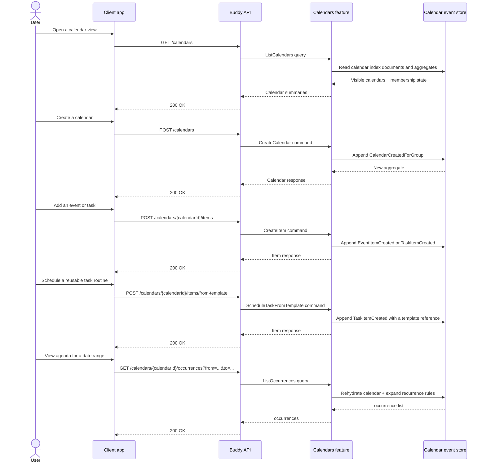

# Calendars Flow

The calendars feature manages the shared scheduling model used by Buddy. A user creates a calendar, adds events and tasks, lists occurrences for a date range, and can share or revoke access when a calendar belongs to a group.

## Endpoints

| Method   | Route                                                                    | Behavior                                                                                                                                                                                                                                                                                                |
| -------- | ------------------------------------------------------------------------ | ------------------------------------------------------------------------------------------------------------------------------------------------------------------------------------------------------------------------------------------------------------------------------------------------------- |
| `POST`   | `/calendars`                                                             | Creates a calendar for the current user or for an owned group.                                                                                                                                                                                                                                          |
| `GET`    | `/calendars`                                                             | Lists calendars visible to the current user.                                                                                                                                                                                                                                                            |
| `GET`    | `/calendars/{calendarId}`                                                | Loads one calendar aggregate and its member state, including its owning `groupId`.                                                                                                                                                                                                                      |
| `DELETE` | `/calendars/{calendarId}`                                                | Deletes the calendar if the caller is authorized.                                                                                                                                                                                                                                                       |
| `PUT`    | `/calendars/{calendarId}/members/{memberId}`                             | Grants or revokes a member role on the calendar.                                                                                                                                                                                                                                                        |
| `DELETE` | `/calendars/{calendarId}/members/{memberId}`                             | Removes a member from the calendar.                                                                                                                                                                                                                                                                     |
| `GET`    | `/calendars/{calendarId}/assignable-members`                             | Lists members who can be assigned a task on the calendar.                                                                                                                                                                                                                                               |
| `PATCH`  | `/calendars/{calendarId}/icon`                                           | Updates the calendar's icon.                                                                                                                                                                                                                                                                            |
| `PUT`    | `/calendars/{calendarId}/group/{groupId}`                                | Moves a calendar to another group.                                                                                                                                                                                                                                                                      |
| `POST`   | `/calendars/{calendarId}/items`                                          | Creates an event or task item.                                                                                                                                                                                                                                                                          |
| `POST`   | `/calendars/{calendarId}/items/from-template`                            | Schedules a non-empty, active task template owned by the assignee at a specific time.                                                                                                                                                                                                                   |
| `GET`    | `/calendars/{calendarId}/items`                                          | Lists items in a calendar.                                                                                                                                                                                                                                                                              |
| `GET`    | `/calendars/{calendarId}/occurrences`                                    | Recomputes occurrences for a date range; template tasks produce one timed occurrence per current subtask. Skipped occurrences are left out unless `includeSkipped=true`, which returns them with `isSkipped: true` (the guardian agenda uses it to offer Restore).                                      |
| `PATCH`  | `/calendars/{calendarId}/items/{itemId}/details`                         | Updates an item's name, description, or visual metadata.                                                                                                                                                                                                                                                |
| `PATCH`  | `/calendars/{calendarId}/items/{itemId}/schedule`                        | Reschedules an item or changes time/date placement.                                                                                                                                                                                                                                                     |
| `PATCH`  | `/calendars/{calendarId}/items/{itemId}/recurrence`                      | Updates recurrence settings; `recurrence: null` makes the item one-off again.                                                                                                                                                                                                                           |
| `PATCH`  | `/calendars/{calendarId}/items/{itemId}/alarms`                          | Replaces the item's alarms for subscribed calendar apps (`{ "alarms": [-120, -1440] }`, signed minutes from the start or due time; `[]` clears them). Contributor tier (`403` for a Viewer). Re-sending the stored alarms appends nothing.                                                              |
| `PATCH`  | `/calendars/{calendarId}/items/{itemId}/completion`                      | Marks a plain task occurrence complete or incomplete. A template-scheduled task is rejected (400): it is completed one subtask at a time. Rejects marking a future occurrence complete.                                                                                                                 |
| `PATCH`  | `/calendars/{calendarId}/items/{itemId}/subtasks/{subtaskId}/completion` | Marks one subtask of a template-scheduled task occurrence complete or incomplete; each subtask is tracked independently. A plain task is rejected (400); an unknown subtask is 404. Rejects marking a future occurrence complete.                                                                       |
| `PATCH`  | `/calendars/{calendarId}/items/{itemId}/skip`                            | Skips (`isSkipped: true`) or restores one occurrence (`date`) of a repeating item without changing the series; a template-scheduled task skips the whole day's run. Contributor tier with no Viewer exception (`403`). Restoring any date is allowed, even one the rule no longer produces. Idempotent. |
| `DELETE` | `/calendars/{calendarId}/items/{itemId}`                                 | Soft-deletes an item.                                                                                                                                                                                                                                                                                   |
| `POST`   | `/calendars/{calendarId}/ical-tokens`                                    | Creates an iCal feed token.                                                                                                                                                                                                                                                                             |
| `GET`    | `/calendars/{calendarId}/ical-tokens`                                    | Lists active iCal token metadata.                                                                                                                                                                                                                                                                       |
| `DELETE` | `/calendars/{calendarId}/ical-tokens/{tokenId}`                          | Revokes an iCal token.                                                                                                                                                                                                                                                                                  |
| `GET`    | `/calendars/{calendarId}/ical/{token}`                                   | Streams the iCal feed for the calendar.                                                                                                                                                                                                                                                                 |

## Validation

Every rule the endpoints enforce, validator rules first, then the handler's own checks.
A `400 validation_error` carries the message in the `ErrorEnvelope`'s `details` under the
key in the Field column, `""` for a check that isn't tied to one field (see
[HTTP status codes](../http-status-codes.md#error-response-shape-implemented)). A body
that can't be bound is rejected before these rules run, with the same envelope.

| Endpoint                                                                         | Field                      | Rule                                                                                                                                                                                                                                                                                                   | Code               | Status |
| -------------------------------------------------------------------------------- | -------------------------- | ------------------------------------------------------------------------------------------------------------------------------------------------------------------------------------------------------------------------------------------------------------------------------------------------------ | ------------------ | ------ |
| `CreateCalendar`                                                                 | `name`                     | Required: not empty or whitespace. At most 200 characters after trimming; stored trimmed.                                                                                                                                                                                                              | `validation_error` | 400    |
| `CreateCalendar`                                                                 | `icon`                     | Optional: a blank or missing icon becomes the default `📅`. Otherwise at most 64 characters, an emoji at most 16, and a value starting with `pictogram:` must continue with a lowercase, hyphenated name (`[a-z0-9]+(-[a-z0-9]+)*`).                                                                   | `validation_error` | 400    |
| `CreateCalendar`                                                                 | `timeZoneId`               | A time zone identifier the server's time zone database recognizes, such as `Europe/Copenhagen`.                                                                                                                                                                                                        | `validation_error` | 400    |
| `SetCalendarMemberRole`                                                          | `role`                     | A defined `CalendarRole`; an unknown name already fails binding, an undefined number fails here.                                                                                                                                                                                                       | `validation_error` | 400    |
| `SetCalendarMemberRole`                                                          | `role`                     | Not `Owner`: ownership comes only from the owning group.                                                                                                                                                                                                                                               | `validation_error` | 400    |
| `UpdateCalendarIcon`                                                             | `icon`                     | Required: not empty or whitespace. At most 64 characters, an emoji at most 16, and a value starting with `pictogram:` must continue with a lowercase, hyphenated name (`[a-z0-9]+(-[a-z0-9]+)*`).                                                                                                      | `validation_error` | 400    |
| `CreateCalendarItem`, `ScheduleTaskFromTemplate`, `UpdateCalendarItemDetails`    | `title`                    | At most 200 characters. May be empty.                                                                                                                                                                                                                                                                  | `validation_error` | 400    |
| `CreateCalendarItem`, `ScheduleTaskFromTemplate`, `UpdateCalendarItemDetails`    | `icon`                     | Optional: a blank icon means no override (the item inherits the calendar's icon). Otherwise at most 64 characters, and a value starting with `pictogram:` must continue with a lowercase, hyphenated name (`[a-z0-9]+(-[a-z0-9]+)*`).                                                                  | `validation_error` | 400    |
| `CreateCalendarItem`, `ScheduleTaskFromTemplate`, `UpdateCalendarItemDetails`    | `color`                    | Optional (`""` allowed). At most 32 characters after trimming; stored trimmed.                                                                                                                                                                                                                         | `validation_error` | 400    |
| `CreateCalendarItem`, `ScheduleTaskFromTemplate`, `UpdateCalendarItemAlarms`     | `alarms`                   | At most 3 alarms, counted after repeated offsets are merged.                                                                                                                                                                                                                                           | `validation_error` | 400    |
| `CreateCalendarItem`, `ScheduleTaskFromTemplate`, `UpdateCalendarItemAlarms`     | `alarms`                   | Each offset between `-40320` (4 weeks before) and `1440` (1 day after) minutes, inclusive.                                                                                                                                                                                                             | `validation_error` | 400    |
| `CreateCalendarItem`, `ScheduleTaskFromTemplate`, `UpdateCalendarItemRecurrence` | `recurrence.frequency`     | A defined frequency (`Daily`, `Weekly`, `Monthly`, `Yearly`), when a recurrence is given; an unknown name already fails binding, an undefined number fails here.                                                                                                                                       | `validation_error` | 400    |
| `CreateCalendarItem`, `ScheduleTaskFromTemplate`, `UpdateCalendarItemRecurrence` | `recurrence.intervalCount` | At least 1, when a recurrence is given.                                                                                                                                                                                                                                                                | `validation_error` | 400    |
| `CreateCalendarItem`, `ScheduleTaskFromTemplate`, `UpdateCalendarItemRecurrence` | `recurrence.until`         | Optional. Not before the item's first date: the event's start date, the task's due date or the template task's `startDate`. For `UpdateCalendarItemRecurrence` the handler checks it against the stored item's first date, after loading it, and only when the recurrence differs from the stored one. | `validation_error` | 400    |
| `CreateCalendarItem`, `ScheduleTaskFromTemplate`, `UpdateCalendarItemRecurrence` | `recurrence.weekdays`      | Optional (`null` for no filter). When given: a non-empty list of days `0` (Sunday) to `6` (Saturday).                                                                                                                                                                                                  | `validation_error` | 400    |
| `CreateCalendarItem`, `ScheduleTaskFromTemplate`, `UpdateCalendarItemRecurrence` | `recurrence.weekdays`      | Weekdays only for a `Daily` or `Weekly` frequency.                                                                                                                                                                                                                                                     | `validation_error` | 400    |
| `CreateCalendarItem`, `ScheduleTaskFromTemplate`, `UpdateCalendarItemRecurrence` | `recurrence.intervalCount` | Must be 1 when weekdays are chosen for a `Daily` frequency.                                                                                                                                                                                                                                            | `validation_error` | 400    |
| `CreateCalendarItem`, `ScheduleTaskFromTemplate`, `UpdateCalendarItemRecurrence` | `recurrence.weekdays`      | With weekdays and an `until`, at least one occurrence must fall between the first date and `until`. For `UpdateCalendarItemRecurrence`, checked by the handler against the stored item's first date, as for `until`.                                                                                   | `validation_error` | 400    |
| `CreateCalendarItem`                                                             | `schedule`                 | An event's `endsAt` must be after its `startsAt` (date and time compared, all-day events too).                                                                                                                                                                                                         | `validation_error` | 400    |
| `CreateCalendarItem`, `ScheduleTaskFromTemplate`                                 | `""`                       | A task's `assignedTo`, when given, must be able to view the calendar.                                                                                                                                                                                                                                  | `validation_error` | 400    |
| `ScheduleTaskFromTemplate`                                                       | `taskTemplateId`           | Required: not the empty GUID.                                                                                                                                                                                                                                                                          | `validation_error` | 400    |
| `ScheduleTaskFromTemplate`                                                       | `""`                       | The task template is not archived.                                                                                                                                                                                                                                                                     | `validation_error` | 400    |
| `ScheduleTaskFromTemplate`                                                       | `""`                       | The task template has at least one subtask.                                                                                                                                                                                                                                                            | `validation_error` | 400    |
| `ListCalendarOccurrences`                                                        | `to`                       | `to` is not before `from`.                                                                                                                                                                                                                                                                             | `validation_error` | 400    |
| `ListCalendarOccurrences`                                                        | `to`                       | `to` - `from` is at most 366 days.                                                                                                                                                                                                                                                                     | `validation_error` | 400    |
| `RescheduleCalendarItem`                                                         | `""`                       | For an event, `endsAt` must be after `startsAt` (date and time compared, all-day events too).                                                                                                                                                                                                          | `validation_error` | 400    |
| `RescheduleCalendarItem`                                                         | `""`                       | The schedule's `kind` matches the item's: an event item takes an event schedule (`kind` 0).                                                                                                                                                                                                            | `validation_error` | 400    |
| `RescheduleCalendarItem`                                                         | `""`                       | The schedule's `kind` matches the item's: a task item takes a task schedule (`kind` 1).                                                                                                                                                                                                                | `validation_error` | 400    |
| `SetTaskCompletion`, `SetSubtaskCompletion`                                      | `""`                       | The item is a task, not an event.                                                                                                                                                                                                                                                                      | `validation_error` | 400    |
| `SetTaskCompletion`                                                              | `""`                       | The task is not template-scheduled: those complete one subtask at a time.                                                                                                                                                                                                                              | `validation_error` | 400    |
| `SetSubtaskCompletion`                                                           | `""`                       | The task is template-scheduled: only those have subtasks.                                                                                                                                                                                                                                              | `validation_error` | 400    |
| `SetSubtaskCompletion`                                                           | `""`                       | When completing (`isCompleted: true`), the subtask applies on `date` (a packing-list item's weekdays include it).                                                                                                                                                                                      | `validation_error` | 400    |
| `SetTaskCompletion`, `SetSubtaskCompletion`                                      | `""`                       | When completing, `date` is not after today in the calendar's time zone, or tomorrow for a packing list.                                                                                                                                                                                                | `validation_error` | 400    |
| `SetTaskCompletion`, `SetSubtaskCompletion`                                      | `""`                       | When completing, `date` is not a skipped occurrence.                                                                                                                                                                                                                                                   | `validation_error` | 400    |
| `SetOccurrenceSkip`                                                              | `""`                       | When skipping (`isSkipped: true`), the item repeats; a one-off item can't skip.                                                                                                                                                                                                                        | `validation_error` | 400    |
| `SetOccurrenceSkip`                                                              | `""`                       | When skipping, the item's rule produces an occurrence on `date`. Restoring any date is allowed.                                                                                                                                                                                                        | `validation_error` | 400    |

## Core lifecycle

The aggregate is event-sourced and uses a sparse stream of calendar mutations. The create flow appends a `CalendarCreatedForGroup` event (carrying the calendar's icon, `📅` by default), then later event and task endpoints append item-creation events: `EventItemCreated`, `TaskItemCreated`, or `TemplateTaskItemCreated` for a task scheduled from a template.

An item's schedule is a union (`ItemSchedule`): an event has a `Period`; a task has a `DueDate`, an optional assignee and a source (entered by hand, or from a template). On the wire, `POST .../items` and `PATCH .../schedule` take a `schedule` object discriminated by numeric `kind` (`0` = event: `startsAt`, `endsAt`, `isAllDay`; `1` = task: `dueDate`, `isAllDay`, plus `assignedTo` on create). A reschedule must match the item's own kind. An event schedule (create or reschedule) and a task reschedule reject fields they don't have, such as `assignedTo` on an event.

A recurrence on the wire is `{ frequency, intervalCount, until, weekdays }`. `weekdays` is `null` for no filter (a daily rule every day, a weekly one on the start date's weekday), or a list of day numbers (`0` = Sunday ... `6` = Saturday). A daily rule then runs only on those days and needs `intervalCount` 1; a weekly rule runs on each of them every `intervalCount` Monday-start weeks from the start date's week. Days before the start date, and the start date itself when its weekday isn't listed, are skipped. Monthly and yearly rules don't take `weekdays`, and an `until` must leave at least one occurrence. See [Weekday recurrence rules](../analysis/recurrence-weekdays.md).

A task scheduled from the Task Library stores a template reference rather than
a copy of its subtasks. Occurrence and iCal reads load the template's current
ordered subtasks and expand each one into a consecutive timed occurrence. An
archived template cannot be scheduled again, but existing scheduled items keep
expanding; edits to the template also affect those existing items.

The read model for listing belongs to the calendar index: the API loads calendar membership and permissions to decide whether the current principal can view or mutate the calendar. When a caller asks for occurrences, the system rehydrates the relevant aggregate and expands the calendar graph into a date-window view rather than persisting every computed occurrence.

An occurrence's `Timing` is `{ kind: 0, startsAt, endsAt }` for an event and for each subtask of a template-scheduled task, or `{ kind: 1, dueAt }` for a plain task; `SortAt` is the start or due instant, which is what lists sort and date occurrences by. A task-item occurrence expanded from a template carries a `Routine` (`SubtaskId`, `ParentTitle`, `ParentIcon`), so a client can group same-item, same-day subtask occurrences into one visual "task run" without a second lookup. The frontend does exactly this (`task-run.ts`), and keys each run by an `occurrenceKey`/`dateKeyOf` pair that includes the occurrence date, so completing one day's instance of a recurring task only toggles that day.

A guardian can skip one occurrence of a repeating item: `OccurrenceSkipChanged` adds the date to the item's `SkippedDates`, and `CalendarOccurrenceExpansion` drops it for every reader (the agenda, the child's screens, print, transition warnings, the iCal feed and the meal plan assistant). The rule itself is untouched, so a skip survives a recurrence edit and can be restored. A skipped task occurrence can't be marked complete; an earlier completion is kept and shows again after a restore. See [Skipping single occurrences](../analysis/skip-occurrences.md).

An item can carry up to three alarms (`ItemAlarms`, set on create, on schedule-from-template or through `ItemAlarmsUpdated`): signed whole-minute offsets from an occurrence's start or due time, local midnight for an all-day item. They exist only for subscribed calendar apps: `IcalFeedWriter` writes one `VALARM` (`ACTION:DISPLAY`, the title as `DESCRIPTION`, a relative `TRIGGER` such as `-PT2H` or `-P1D`) per offset on every occurrence, and a routine or packing list carries them on the first subtask of each run only, so it alerts once. Occurrences return them as `alarms`. They are unrelated to transition warnings. See [Calendar item alarms](../analysis/calendar-item-alarms.md).

## Authorization model

Calendar access is resolved against the calendar's member list and, where relevant, group-owned calendar policies. In practice, this means the caller must be authorized for the specific calendar before they can create items, update recurrence, or delete calendar content. The feature keeps the permission decision central to the aggregate rather than each endpoint reimplementing the policy.

## Key event types

- `CalendarCreatedForGroup`
- `CalendarDeleted`
- `MemberRoleGranted`
- `MemberRoleRevoked`
- `CalendarIconChanged`
- `CalendarTransferredToGroup`
- `EventItemCreated`
- `TaskItemCreated`
- `TemplateTaskItemCreated`
- `TaskCompletionChanged`
- `OccurrenceSkipChanged`
- `ItemDetailsUpdated`
- `EventRescheduled`
- `TaskRescheduled`
- `RecurrenceUpdated`
- `ItemDeleted`
- `IcalTokenIssued`
- `IcalTokenRevoked`

The day-to-day workflow is mostly: create the calendar, create or edit items, expand occurrences for display, and optionally publish an iCal feed for external consumers.
