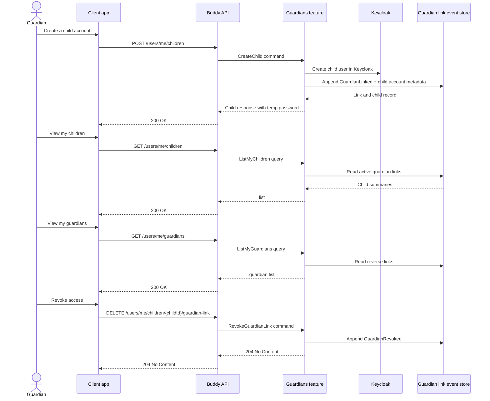

# Guardians Flow

The guardians feature handles child-account provisioning, guardian links, and the resulting authority relationship between a guardian and a child. It is the main feature behind child-specific user management and access control.

## Endpoints

| Method   | Route                                                      | Behavior                                                                                                                                                                                                                                                                                                                                    |
| -------- | ---------------------------------------------------------- | ------------------------------------------------------------------------------------------------------------------------------------------------------------------------------------------------------------------------------------------------------------------------------------------------------------------------------------------- |
| `POST`   | `/users/me/children`                                       | Creates an account for a child and establishes the guardian relationship.                                                                                                                                                                                                                                                                   |
| `GET`    | `/users/me/children`                                       | Lists the current guardian's child accounts, ordered by when the guardian was linked to each child (oldest link first; links without a recorded time last), then by child id. The order is stable, so a client can use the first entry as a default family scope.                                                                           |
| `GET`    | `/users/me/children/{childId}/guardians`                   | Lists the active guardians linked to a specific child.                                                                                                                                                                                                                                                                                      |
| `DELETE` | `/users/me/children/{childId}/guardian-link`               | Revokes the guardian-child relationship.                                                                                                                                                                                                                                                                                                    |
| `DELETE` | `/users/me/children/{childId}`                             | Erases the child's account and all its data, Keycloak account included. Only the child's sole active guardian may: `404` without an active link, `409 child_has_other_guardians` while another guardian remains. Family data anchored to the child passes to a sibling. See [gdpr-data-protection.md](../analysis/gdpr-data-protection.md). |
| `POST`   | `/users/me/children/{childId}/password-reset`              | An active guardian gives the child a new one-time password, returned once like `POST /users/me/children`'s, and signs the child out of every session. A child has no email, so Keycloak's own reset flow can't reach them. `404` without an active link.                                                                                    |
| `PATCH`  | `/users/me/children/{childId}/language`                    | An active guardian updates the child's language.                                                                                                                                                                                                                                                                                            |
| `PATCH`  | `/users/me/children/{childId}/timezone`                    | An active guardian updates the child's time zone.                                                                                                                                                                                                                                                                                           |
| `PATCH`  | `/users/me/children/{childId}/visual-timers`               | An active guardian turns the child's visual time-left timers on or off (`ShowVisualTimersUpdated` on the child's `User` stream; no event when unchanged).                                                                                                                                                                                   |
| `PATCH`  | `/users/me/children/{childId}/homework-chunks`             | An active guardian sets the child's homework focus and break minutes (`HomeworkChunksUpdated` on the child's `User` stream; no event when unchanged). Unmapped when the `Homework` flag is off.                                                                                                                                             |
| `GET`    | `/users/me/guardians`                                      | Lists guardians linked to the current authenticated user.                                                                                                                                                                                                                                                                                   |
| `GET`    | `/users/me/siblings`                                       | Lists the caller's siblings, resolved via shared guardians.                                                                                                                                                                                                                                                                                 |
| `POST`   | `/users/me/children/{childId}/guardian-invites`            | An active guardian invites another adult, by email, to co-manage this child. Re-inviting the same email within a minute returns `409 resend_cooldown`.                                                                                                                                                                                      |
| `GET`    | `/users/me/children/{childId}/guardian-invites`            | Lists this child's pending guardian invites.                                                                                                                                                                                                                                                                                                |
| `DELETE` | `/users/me/children/{childId}/guardian-invites/{inviteId}` | Revokes a pending guardian invite.                                                                                                                                                                                                                                                                                                          |
| `GET`    | `/guardian-invites/{token}/preview`                        | Unauthenticated preview of who a guardian-invite link is for.                                                                                                                                                                                                                                                                               |
| `POST`   | `/guardian-invites/{token}/accept`                         | Authenticated; accepts an invite and creates a new `GuardianLink`, only if the caller has verified their email address and it matches the invited address; otherwise `403 Forbidden` (`403 email_not_verified` when only verification is missing).                                                                                          |

## Validation

Every rule the endpoints enforce, validator rules first, then the handler's own checks.
A `400 validation_error` carries the message in the `ErrorEnvelope`'s `details` under the
key in the Field column, `""` for a check that isn't tied to one field (see
[HTTP status codes](../http-status-codes.md#error-response-shape-implemented)). A body
that can't be bound is rejected before these rules run, with the same envelope.

| Endpoint                    | Field          | Rule                                                                                                                                                                                             | Code                        | Status |
| --------------------------- | -------------- | ------------------------------------------------------------------------------------------------------------------------------------------------------------------------------------------------ | --------------------------- | ------ |
| `CreateChild`               | `givenName`    | Required: not empty after trimming. At most 200 characters after trimming.                                                                                                                       | `validation_error`          | 400    |
| `CreateChild`               | `familyName`   | Required: not empty after trimming. At most 200 characters after trimming.                                                                                                                       | `validation_error`          | 400    |
| `CreateChild`               | `username`     | Required: not empty after trimming. At most 200 characters after trimming.                                                                                                                       | `validation_error`          | 400    |
| `CreateChild`               | `kind`         | A defined `GuardianKind`: `Parent` or `Guardian` (an out-of-range number is rejected). Optional, `Guardian` by default.                                                                          | `validation_error`          | 400    |
| `CreateChild`               | —              | The username isn't already taken in Keycloak.                                                                                                                                                    | `username_unavailable`      | 409    |
| `DeleteChild`               | —              | The caller is the child's only active guardian.                                                                                                                                                  | `child_has_other_guardians` | 409    |
| `UpdateChildLanguage`       | `language`     | A supported language: `en` or `da` (exact, case-sensitive).                                                                                                                                      | `validation_error`          | 400    |
| `UpdateChildTimeZone`       | `timeZoneId`   | A time zone id the server recognizes (IANA, e.g. `Europe/Copenhagen`).                                                                                                                           | `validation_error`          | 400    |
| `UpdateChildVisualTimers`   | —              | No rules beyond binding the body (`showVisualTimers`, a boolean).                                                                                                                                | `validation_error`          | 400    |
| `UpdateChildHomeworkChunks` | `focusMinutes` | 5 to 45, inclusive.                                                                                                                                                                              | `validation_error`          | 400    |
| `UpdateChildHomeworkChunks` | `breakMinutes` | 1 to 15, inclusive.                                                                                                                                                                              | `validation_error`          | 400    |
| `InviteGuardian`            | `email`        | Required: not empty after trimming. A valid email address: exactly one `@`, neither first nor last character. At most 254 characters after trimming. Stored and emailed trimmed and lower-cased. | `validation_error`          | 400    |
| `InviteGuardian`            | `kind`         | A defined `GuardianKind`: `Parent` or `Guardian` (an out-of-range number is rejected).                                                                                                           | `validation_error`          | 400    |
| `InviteGuardian`            | —              | No pending invite for this child to the same email (trimmed, lower-cased) was sent less than a minute ago.                                                                                       | `resend_cooldown`           | 409    |
| `AcceptGuardianInvite`      | —              | The caller's email, which matches the invited address, is verified. A different address is a plain `403`.                                                                                        | `email_not_verified`        | 403    |

## Core lifecycle

The create-child flow is intentionally more than a normal profile creation. The backend creates the child in Keycloak, records the guardian link in the domain event store, and returns a one-time temporary credential that is shown to the guardian out-of-band. That credential is not persisted and is not retrievable later.

This feature is key because it defines who can act on behalf of a child in other features such as medicines, calendars, and scheduling. The access checks are not free-form; they resolve from the guardian-link data model and the child identity model rather than from a role system on the schedule itself.

## Key domain points

- `GuardianLink` is the relationship record between a guardian and a child.
- A child may have multiple guardian links, but the active relationship is the thing used by authorization.
- Guardian access is intentionally narrower than full administrative access; it is scoped to the guardian-child relationship and the permissions granted by that relation.
- The feature also supports read-model queries that allow the API to answer "what children do I manage?" and "who manages me?" without rehydrating the full user graph each time.

## Inviting a co-guardian

`CreateChild` only ever produces the _first_ `GuardianLink` for a new child. To bring in a second adult (a co-parent, grandparent, etc.) for a child that already exists, any active guardian can invite one by email via `InviteGuardian`, mirroring the Groups feature's invite/accept/revoke triad: a token is emailed (never the raw token stored, only its hash), the invite lives on its own dedicated event stream (there's no pre-existing aggregate to attach it to, unlike a `Group`), and `AcceptGuardianInvite` requires the accepting caller's own verified email to match the invite before it appends a new `GuardianLinked` event. The inviter chooses the `GuardianKind` (Parent/Guardian) up front; it carries straight through to the resulting link and, as elsewhere in this feature, never gates access.

**The invitee must verify their email address before accepting.** `AcceptGuardianInvite` returns `403` with the `email_not_verified` error code when the caller's email matches the invited address but is unverified (a different address is a plain `403`), for the same reason as group invites: an unverified address could belong to someone else, and accepting grants guardian authority over a child. The invite stays pending, so the invitee can verify their email (see [users/flow.md](../users/flow.md)) and then accept the same link before it expires.

Because "family" for shared meal plans (and any future guardian-derived calendar access) is resolved transitively from the live `GuardianLink` graph, accepting an invite immediately widens the new guardian's own other children into this child's shared family too — a direct consequence of the existing authority model, not a separate feature to build.

## Related behavior

The guardians feature is the source of authority used by the medicines feature, especially for child schedule creation and dose authorization. If a guardian link is revoked, the API must stop allowing the former guardian to modify or view the child-related schedule state.
