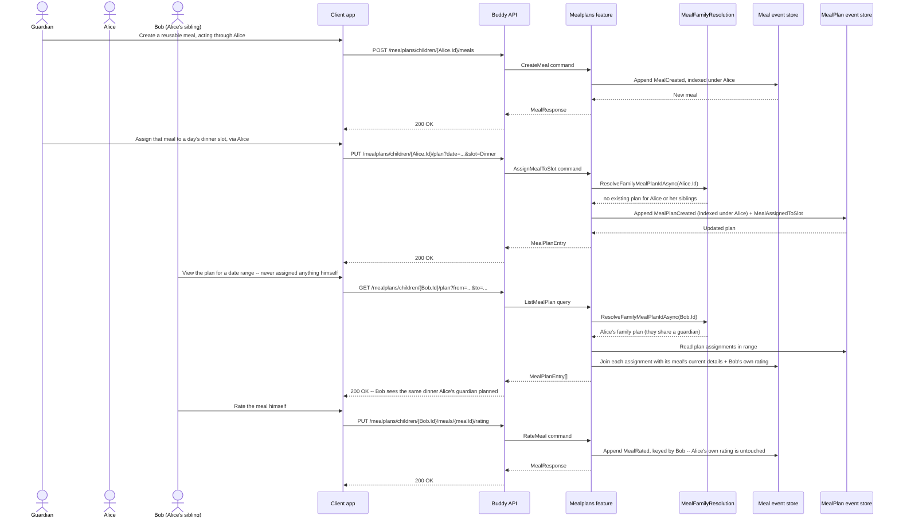

# Mealplans Flow

The mealplans feature lets a guardian build a reusable library of meals and
assign them to dated slots (breakfast/lunch/dinner/snack) on a plan. Both the
meal library and the plan are shared across every sibling in a family — a
guardian creates "Tacos" and plans Tuesday's dinner once, and it shows up for
every child who shares a guardian with the child the request was made
through, with no need to repeat the setup per child. Each child rates meals
independently; only guardians can write meals or the plan itself.

## Endpoints

| Method   | Route                                                                   | Behavior                                                                                                                                                                                                                                                                                                                                                                                                                                                                                                                                                                     |
| -------- | ----------------------------------------------------------------------- | ---------------------------------------------------------------------------------------------------------------------------------------------------------------------------------------------------------------------------------------------------------------------------------------------------------------------------------------------------------------------------------------------------------------------------------------------------------------------------------------------------------------------------------------------------------------------------- |
| `POST`   | `/mealplans/children/{childId}/meals`                                   | Creates a reusable meal, indexed under `childId`, visible to their whole family. `eatingOut` (`None`/`FriendsAndFamily`/`Restaurant`) marks a meal eaten away from home: never offered to the AI assistant (see [eating-out-meals.md](../analysis/eating-out-meals.md)).                                                                                                                                                                                                                                                                                                     |
| `GET`    | `/mealplans/children/{childId}/meals`                                   | Lists `childId`'s family's meal library, including archived meals, with every sibling's rating.                                                                                                                                                                                                                                                                                                                                                                                                                                                                              |
| `PATCH`  | `/mealplans/children/{childId}/meals/{mealId}/details`                  | Updates a meal's name, description, icon, color, or eating-out kind (a full replace: an omitted `eatingOut` is `None`).                                                                                                                                                                                                                                                                                                                                                                                                                                                      |
| `DELETE` | `/mealplans/children/{childId}/meals/{mealId}`                          | Archives a meal (soft delete; blocks new assignments).                                                                                                                                                                                                                                                                                                                                                                                                                                                                                                                       |
| `PUT`    | `/mealplans/children/{childId}/meals/{mealId}/rating`                   | `childId` rates a meal (1-5 stars, optional comment) — their own opinion only.                                                                                                                                                                                                                                                                                                                                                                                                                                                                                               |
| `PUT`    | `/mealplans/children/{childId}/plan?date=...&slot=...`                  | Assigns (or reassigns) a meal to a date/slot on the family's shared plan.                                                                                                                                                                                                                                                                                                                                                                                                                                                                                                    |
| `DELETE` | `/mealplans/children/{childId}/plan?date=...&slot=...`                  | Clears a planned slot on the family's shared plan (idempotent).                                                                                                                                                                                                                                                                                                                                                                                                                                                                                                              |
| `GET`    | `/mealplans/children/{childId}/plan?from=...&to=...`                    | Lists the family's plan entries in a date range, joined with each meal's current details and `childId`'s own rating.                                                                                                                                                                                                                                                                                                                                                                                                                                                         |
| `GET`    | `/mealplans/children/{childId}/ai/providers`                            | Lists the family's configured AI provider entries (provider, last 4 of the key, added date), the active provider and when data sharing was acknowledged, never the key itself.                                                                                                                                                                                                                                                                                                                                                                                               |
| `PUT`    | `/mealplans/children/{childId}/ai/data-sharing-acknowledgement`         | Records that a guardian has read what the assistant sends to the provider (`AiDataSharingAcknowledged`, once per family; idempotent).                                                                                                                                                                                                                                                                                                                                                                                                                                        |
| `PUT`    | `/mealplans/children/{childId}/ai/providers/{provider}/key`             | Adds or replaces the family's API key for `provider` (BYOK). The first key added for a family becomes the active provider automatically.                                                                                                                                                                                                                                                                                                                                                                                                                                     |
| `DELETE` | `/mealplans/children/{childId}/ai/providers/{provider}/key`             | Removes the family's key for `provider` (idempotent). If `provider` was active, the family is left with no active provider.                                                                                                                                                                                                                                                                                                                                                                                                                                                  |
| `PUT`    | `/mealplans/children/{childId}/ai/active-provider/{provider}`           | Switches the family's active provider to one that already has a key configured.                                                                                                                                                                                                                                                                                                                                                                                                                                                                                              |
| `POST`   | `/mealplans/children/{childId}/ai/providers/{provider}/test-connection` | Sends a minimal request through `provider` to confirm a key works, either the family's already-stored key or one supplied in the request body before it's ever saved.                                                                                                                                                                                                                                                                                                                                                                                                        |
| `GET`    | `/mealplans/children/{childId}/ai/sessions/current`                     | Returns the family's current AI assistant session (transcript + draft), if one exists.                                                                                                                                                                                                                                                                                                                                                                                                                                                                                       |
| `POST`   | `/mealplans/children/{childId}/ai/sessions`                             | Starts a new AI assistant session for a date range/slot selection, optionally limited to rated meals (`ratedOnly`) and/or meals served in the 30/60/90 days before `from` (`servedWithin`; see [ai-assistant-meal-filter.md](../analysis/ai-assistant-meal-filter.md)), discarding whatever session was previously current for the family. `400` keyed on `ServedWithin` when the filter matches no meals, or on `MustIncludeMealIds` when a must-include meal is an eating-out meal; `409 ai_data_sharing_not_acknowledged` until the family has acknowledged data sharing. |
| `POST`   | `/mealplans/children/{childId}/ai/sessions/current/messages`            | Sends a guardian chat message to the current session and runs the provider's tool-calling loop to update the draft. Only the meals that pass the session's filter (never eating-out meals) are listed in the prompt and accepted by `propose_assignment`, which also rejects slots that already hold an eating-out meal; `400` keyed on `ServedWithin` if none do any more. `409 ai_data_sharing_not_acknowledged` like starting a session.                                                                                                                                  |
| `POST`   | `/mealplans/children/{childId}/ai/sessions/current/apply`               | Commits the current session's draft assignments to the real family plan and marks the session applied, skipping slots that hold an eating-out meal at apply time.                                                                                                                                                                                                                                                                                                                                                                                                            |
| `POST`   | `/mealplans/children/{childId}/ai/sessions/current/discard`             | Discards the current session without touching the real plan (idempotent).                                                                                                                                                                                                                                                                                                                                                                                                                                                                                                    |
| `POST`   | `/mealplans/children/{childId}/imports/preview`                         | Parses pasted text (`weekly-note` or `csv`, auto-detected) and matches it against the family's meal library; returns a review draft and writes nothing.                                                                                                                                                                                                                                                                                                                                                                                                                      |
| `POST`   | `/mealplans/children/{childId}/imports`                                 | Writes a reviewed import: creates the new meals and appends one `MealPlanEntriesImported`, skipping slots that are already planned.                                                                                                                                                                                                                                                                                                                                                                                                                                          |
| `GET`    | `/mealplans/children/{childId}/imports`                                 | Lists the family's imports (date range, entry count, reverted or not).                                                                                                                                                                                                                                                                                                                                                                                                                                                                                                       |
| `DELETE` | `/mealplans/children/{childId}/imports/{importId}`                      | Undoes an import in one transaction: clears the slots it was the last to write and archives the meals it created that nothing uses any more (idempotent).                                                                                                                                                                                                                                                                                                                                                                                                                    |

## Validation

Every rule the endpoints enforce, validator rules first, then the handler's own checks.
A `400 validation_error` carries the message in the `ErrorEnvelope`'s `details` under the
key in the Field column, `""` for a check that isn't tied to one field (see
[HTTP status codes](../http-status-codes.md#error-response-shape-implemented)). A body
that can't be bound is rejected before these rules run, with the same envelope.

| Endpoint                                                                             | Field                    | Rule                                                                                                              | Code                               | Status |
| ------------------------------------------------------------------------------------ | ------------------------ | ----------------------------------------------------------------------------------------------------------------- | ---------------------------------- | ------ |
| `CreateMeal`, `CreateMealForGroup`, `UpdateMealDetails`, `UpdateMealDetailsForGroup` | `name`                   | Required: not empty or whitespace. At most 200 characters (not trimmed).                                          | `validation_error`                 | 400    |
| `CreateMeal`, `CreateMealForGroup`, `UpdateMealDetails`, `UpdateMealDetailsForGroup` | `description`            | At most 2000 characters after trimming. Optional.                                                                 | `validation_error`                 | 400    |
| `CreateMeal`, `CreateMealForGroup`, `UpdateMealDetails`, `UpdateMealDetailsForGroup` | `eatingOut`              | One of `None`, `FriendsAndFamily`, `Restaurant` (or 0–2). Optional, defaults to `None`.                           | `validation_error`                 | 400    |
| `RateMeal`                                                                           | `stars`                  | Between 1 and 5 inclusive.                                                                                        | `validation_error`                 | 400    |
| `RateMeal`                                                                           | `comment`                | At most 2000 characters after trimming. Optional.                                                                 | `validation_error`                 | 400    |
| `AssignMealToSlot`, `AssignMealToSlotForGroup`                                       | `notes`                  | At most 2000 characters after trimming. Optional.                                                                 | `validation_error`                 | 400    |
| `AssignMealToSlot`, `AssignMealToSlotForGroup`                                       | `""`                     | The meal isn't archived.                                                                                          | `validation_error`                 | 400    |
| `ClearMealSlot`, `ClearMealSlotForGroup`                                             | —                        | No rules beyond binding the `date` and `slot` query parameters.                                                   | `validation_error`                 | 400    |
| `ListMealPlan`, `ListMealPlanForGroup`                                               | `to`                     | Not before `from`.                                                                                                | `validation_error`                 | 400    |
| `ListMealPlan`, `ListMealPlanForGroup`                                               | `to`                     | At most 31 days after `from`.                                                                                     | `validation_error`                 | 400    |
| `UpdateMealSlotTimes`                                                                | —                        | No rules beyond binding the body (a map of slot to time of day).                                                  | `validation_error`                 | 400    |
| `SetProviderApiKey`                                                                  | `provider`               | One of `Anthropic`, `OpenAi`, `Gemini` (or 0–2).                                                                  | `validation_error`                 | 400    |
| `SetProviderApiKey`                                                                  | `apiKey`                 | Required: not empty or whitespace. At most 500 characters (not trimmed).                                          | `validation_error`                 | 400    |
| `AcknowledgeAiDataSharing`                                                           | `""`                     | The family has an AI provider key configured.                                                                     | `validation_error`                 | 400    |
| `SetActiveProvider`                                                                  | `""`                     | The family has an AI provider key configured.                                                                     | `validation_error`                 | 400    |
| `SetActiveProvider`                                                                  | `""`                     | The family has a key for this `provider`.                                                                         | `validation_error`                 | 400    |
| `TestProviderConnection`                                                             | `apiKey`                 | At most 500 characters. Optional: when empty, the family's stored key is tested.                                  | `validation_error`                 | 400    |
| `TestProviderConnection`                                                             | `""`                     | Without an `apiKey` in the body, the family has a stored key for this `provider`.                                 | `validation_error`                 | 400    |
| `TestProviderConnection`                                                             | `""`                     | `provider` is a supported provider (an out-of-range number binds but isn't).                                      | `validation_error`                 | 400    |
| `StartAiSession`                                                                     | `to`                     | Not before `from`.                                                                                                | `validation_error`                 | 400    |
| `StartAiSession`                                                                     | `to`                     | At most 31 days after `from`.                                                                                     | `validation_error`                 | 400    |
| `StartAiSession`                                                                     | `slots`                  | At least one slot in `slots`.                                                                                     | `validation_error`                 | 400    |
| `StartAiSession`                                                                     | `notes`                  | At most 2000 characters after trimming. Optional.                                                                 | `validation_error`                 | 400    |
| `StartAiSession`                                                                     | `servedWithin`           | One of 0, 30, 60, 90 (`Any`, `Last30Days`, `Last60Days`, `Last90Days`). Optional, defaults to 0.                  | `validation_error`                 | 400    |
| `StartAiSession`                                                                     | `""`                     | The family has an AI provider key configured.                                                                     | `validation_error`                 | 400    |
| `StartAiSession`                                                                     | `""`                     | The family has an active provider.                                                                                | `validation_error`                 | 400    |
| `StartAiSession`, `SendAiSessionMessage`                                             | —                        | A guardian has acknowledged the family's AI data sharing.                                                         | `ai_data_sharing_not_acknowledged` | 409    |
| `StartAiSession`                                                                     | `mustIncludeMealIds`     | No must-include meal is an eating-out meal.                                                                       | `validation_error`                 | 400    |
| `StartAiSession`                                                                     | `servedWithin`           | When `ratedOnly` or `servedWithin` filters, at least one meal passes the filter (must-include meals don't count). | `validation_error`                 | 400    |
| `SendAiSessionMessage`                                                               | `text`                   | Required: not empty or whitespace. At most 4000 characters.                                                       | `validation_error`                 | 400    |
| `SendAiSessionMessage`                                                               | `""`                     | The current session is still drafting (not applied or discarded).                                                 | `validation_error`                 | 400    |
| `SendAiSessionMessage`                                                               | `""`                     | The family has an active provider with a stored key.                                                              | `validation_error`                 | 400    |
| `SendAiSessionMessage`                                                               | `""`                     | The active provider is a supported provider.                                                                      | `validation_error`                 | 400    |
| `SendAiSessionMessage`                                                               | `servedWithin`           | When the session filters by rating or serving window, at least one meal still passes the filter.                  | `validation_error`                 | 400    |
| `SendAiSessionMessage`                                                               | `""`                     | The provider accepts the request; a provider error comes back as `The AI provider request failed: …`.             | `validation_error`                 | 400    |
| `ApplyAiSessionDraft`                                                                | `""`                     | The current session is still drafting (not applied or discarded).                                                 | `validation_error`                 | 400    |
| `ApplyAiSessionDraft`                                                                | `""`                     | No drafted meal has been archived since it was drafted.                                                           | `validation_error`                 | 400    |
| `PreviewMealPlanImport`, `PreviewMealPlanImportForGroup`                             | `text`                   | Required: not empty or whitespace. At most 262,144 characters (256 KiB).                                          | `validation_error`                 | 400    |
| `PreviewMealPlanImport`, `PreviewMealPlanImportForGroup`                             | `format`                 | `auto`, `weekly-note` or `csv`, case-insensitive, after trimming. Optional: empty means `auto`.                   | `validation_error`                 | 400    |
| `PreviewMealPlanImport`, `PreviewMealPlanImportForGroup`                             | `weekStart`              | `weekStart` is `Sunday` or `Monday` (or 0–1). Optional, defaults to `Sunday`.                                     | `validation_error`                 | 400    |
| `PreviewMealPlanImport`, `PreviewMealPlanImportForGroup`                             | `slot`                   | `slot` is `Breakfast`, `Lunch`, `Dinner` or `Snack` (or 0–3). Optional, defaults to `Dinner`.                     | `validation_error`                 | 400    |
| `PreviewMealPlanImport`, `PreviewMealPlanImportForGroup`                             | `""`                     | With `auto`, the text is recognised as one of the formats.                                                        | `validation_error`                 | 400    |
| `PreviewMealPlanImport`, `PreviewMealPlanImportForGroup`                             | `""`                     | `weekly-note`: no week or day line comes before the first year line (`Madplan` followed by the year).             | `validation_error`                 | 400    |
| `PreviewMealPlanImport`, `PreviewMealPlanImportForGroup`                             | `""`                     | `csv`: at least one line starts with a date followed by a meal.                                                   | `validation_error`                 | 400    |
| `CommitMealPlanImport`, `CommitMealPlanImportForGroup`                               | `""`                     | `entries` holds no `null` element (checked by the endpoint, before the validator).                                | `validation_error`                 | 400    |
| `CommitMealPlanImport`, `CommitMealPlanImportForGroup`                               | `format`                 | `weekly-note` or `csv`, case-insensitive (`auto` isn't accepted).                                                 | `validation_error`                 | 400    |
| `CommitMealPlanImport`, `CommitMealPlanImportForGroup`                               | `entries`                | Not empty.                                                                                                        | `validation_error`                 | 400    |
| `CommitMealPlanImport`, `CommitMealPlanImportForGroup`                               | `entries`                | At most 5000 entries.                                                                                             | `validation_error`                 | 400    |
| `CommitMealPlanImport`, `CommitMealPlanImportForGroup`                               | `entries`                | Each date and slot pair appears at most once.                                                                     | `validation_error`                 | 400    |
| `CommitMealPlanImport`, `CommitMealPlanImportForGroup`                               | `entries[n].slot`        | `Breakfast`, `Lunch`, `Dinner` or `Snack` (or 0–3).                                                               | `validation_error`                 | 400    |
| `CommitMealPlanImport`, `CommitMealPlanImportForGroup`                               | `entries[n].notes`       | At most 2000 characters after trimming. Optional.                                                                 | `validation_error`                 | 400    |
| `CommitMealPlanImport`, `CommitMealPlanImportForGroup`                               | `entries[n].newMealName` | At most 200 characters after trimming.                                                                            | `validation_error`                 | 400    |
| `CommitMealPlanImport`, `CommitMealPlanImportForGroup`                               | `entries[n].newMealName` | Exactly one of `mealId` and a non-blank `newMealName`.                                                            | `validation_error`                 | 400    |
| `CommitMealPlanImport`, `CommitMealPlanImportForGroup`                               | `""`                     | Every `mealId` is in the family's meal library (archived meals count).                                            | `validation_error`                 | 400    |

## Core lifecycle

`Meal` and `MealPlan` are separate event-sourced aggregates, each with its own
stream, and neither carries a `ChildId` — see
[docs/backend/analysis/mealplans.md](../analysis/mealplans.md#question-3-sharing-a-mealmealplan-across-siblings).
A `Meal`'s stream starts with `MealCreated` and accumulates
`MealDetailsUpdated`, `MealArchived`, and `MealRated` events as it's edited,
retired, and rated (independently, per child) over time. A `MealPlan` is a
singleton stream per _family_, holding a sparse dictionary of
`(Date, Slot) -> assignment`; it starts lazily with `MealPlanCreated` on the
first `AssignMealToSlot` call for a family with no plan yet, then accumulates
`MealAssignedToSlot`/`MealSlotCleared` events per slot. No slot is ever
required to be filled, which is what makes "usually just dinner" work with no
special-casing.

Each `Meal`/`MealPlan` is still indexed under the single `ChildId` a guardian
happened to be acting through when it was created — sharing with siblings
isn't written at creation time. `MealFamilyResolution` widens every read (and
every membership check on a write) to the whole family by walking the
existing `GuardianLink` graph fresh on each call, so a newly added sibling
sees the shared library/plan immediately, with no backfill step.

For display, `ListMealPlan` does not persist a generated view — it reads the
family's current assignments for the requested range and joins each one with
its referenced meal's current name/icon/color and the _viewing_ child's own
rating, recomputed on every call, the same as `ListTodaysDoses` does for
medicine schedules.

`AiProviderCredential` is a separate family-wide stream (one credential set
shared by every guardian in the family, indexed in
`mealplans.mt_doc_aicredentialindexdocument` under whichever child a guardian
happened to be acting through when the first key was added; see "AI credential
resolution" below for how a request finds it). It's provisioned lazily on the
first `SetProviderApiKey` call that resolves no credential, with
`AiCredentialsInitialized`, then accumulates
`ProviderApiKeySet`/`ProviderApiKeyRemoved`/`ActiveProviderChanged`/`ActiveProviderCleared`
events (the latter appended alongside `ProviderApiKeyRemoved` when the removed
provider was the active one).
Provider API keys (BYOK — bring your own key, for Anthropic, OpenAI, or
Gemini) are encrypted at rest via the ASP.NET Core Data Protection API before
being stored. The Data Protection key ring is itself kept in Postgres (the
`dataprotection` schema, `Common/DataProtection/DataProtectionFeature.cs`), so
stored keys stay decryptable across redeploys and replicas; only the encrypted ciphertext and the key's last 4 characters
are persisted, and every read-facing response returns the masked
`AiProviderSettings` shape rather than the credential itself. `TestProviderConnection`
sends a one-word "OK" round trip through the resolved provider client to confirm a
key works, either the family's already-stored key or a not-yet-saved one from the
request body, and never surfaces the provider's raw error body — only a short,
best-effort message extracted from it.

### AI credential resolution

`MealFamilyResolution.ResolveFamilyAiCredentialIdAsync(childId, guardianId, ...)`
is used by every AI handler (`ListProviders`, `SetProviderApiKey`,
`RemoveProviderApiKey`, `SetActiveProvider`, `TestProviderConnection`,
`StartAiSession`, `SendAiSessionMessage`). The data model is unchanged (one
index row per credential, naming one child); only the lookup is wide:

1. **Candidates.** Credentials indexed under any child in the requested
   child's family (every child of every active guardian of that child, which
   includes every child the calling guardian is linked to), plus credentials
   indexed under a child the _calling guardian_ has since unlinked (a revoked
   `GuardianLink`), the latter only if the caller contributed to that
   credential (added a key, removed one, or changed the active provider).
   Unlinking the child that happens to hold the index row therefore keeps the
   key for the guardian's remaining children, and the credential keeps
   serving the unlinked child's remaining family too. A key set up entirely
   by someone else in a family the caller has left is not inherited.
2. **Winner: the most recently activated credential.** "Activated" is the
   `OccurredAt` of the credential's latest `ActiveProviderChanged` event, unless
   an `ActiveProviderCleared` came after it (i.e. the credential currently has
   an active provider). Re-setting the key of the already-active
   provider is not an activation. Credentials with no active provider rank
   below every activated one; ties and the order among non-activated
   credentials fall back to the larger (newer, UUIDv7) credential id.

This makes merged families (two guardians who each set up a credential, then
became co-guardians) resolve to the same credential from every sibling and on
every call. The losing credential's events are kept; it becomes reachable
again only if it is activated more recently (which can't happen through the
API while it isn't the resolved one) or the families split again.

`MealplanAiSession` is a separate stream per session (not a family-wide singleton
like `MealPlan`/`AiProviderCredential`): starting a new session always creates a
fresh stream, and `AiSessionResolution` treats the family's "current" session as
whichever session was started most recently across every sibling, discarding
(`AiSessionDiscarded`) whatever was previously current if it was still
`Drafting`. A session starts with `AiSessionStarted` (the requested date range,
slots, must-include meals, and free-text notes) and accumulates
`AiUserMessageSent`, `AiToolInvocationRecorded`, `AiDraftAssignmentSet`/
`AiDraftAssignmentCleared`, and `AiAssistantMessageRecorded` events as the
guardian chats with the assistant, ending in exactly one of `AiSessionApplied` or
`AiSessionDiscarded`. `SendAiSessionMessage` runs a bounded tool-calling loop
(`SendAiSessionMessageHandler.MaxToolLoopIterations`, currently 20) against the
family's active provider: the model's only way to affect state is
`propose_assignment`/`clear_draft_assignment` (each validated against the
session's requested range/slots and the family's actual meal library before
touching the draft), plus a read-only `get_calendar_conflicts` tool that looks up
the caller's visible calendar occurrences — the one place Mealplans reads from
Calendars, never the reverse (see
[docs/backend/analysis/mealplans.md](../analysis/mealplans.md)). Only items in
the session child's family calendars that are assigned to that child or to nobody
keep their title; everything else is sent as `"busy"` with its time, and the
prompt names children "child 1", "child 2" rather than by id. `AiSessionRetention`
masks a session's notes, chat and tool calls 30 days after its last event, closing
a session nobody closed with `AiSessionExpired` first (see
[gdpr-data-protection.md](../analysis/gdpr-data-protection.md), Question 6). `ApplyAiSessionDraft`
commits the session's draft by replaying each entry through the same
`AssignMealToSlot` write path a manual assignment uses, so authorization and
domain rules apply identically whether a slot was filled by a guardian or the AI
assistant. `DiscardAiSession` is idempotent — discarding an already-applied or
already-discarded session is a no-op that just returns the current view.

## Authorization model

Access is scoped to the guardian-child relationship for the specific
`childId` in the URL, the same narrow two-principal shape medicine schedules
use — no calendar-style membership or roles. The two tiers are asymmetric: a
guardian can create/edit/archive meals and write the plan, but can never rate
a meal; the child can view everything and rate a meal, but can never write a
meal or the plan, even for themselves. This check is unaffected by sibling
sharing — it answers "is the caller allowed to act as `childId`," not "whose
meal is this."

Every AI provider-management and AI session endpoint requires the same guardian
"manage" access as writing the plan — there is no child-facing view of provider
credentials or AI sessions.

## Calendar integration

A mealplan entry does not appear in `Calendar`/`ListOccurrences` — the same
decision already made for medicine doses. `ListMealPlan` is a fully separate
read surface; a combined agenda view is a frontend concern that interleaves
`ListOccurrences` and `ListMealPlan` results by date, not a backend
data-model change. See
[docs/backend/analysis/mealplans.md](../analysis/mealplans.md) for the full
design rationale.
