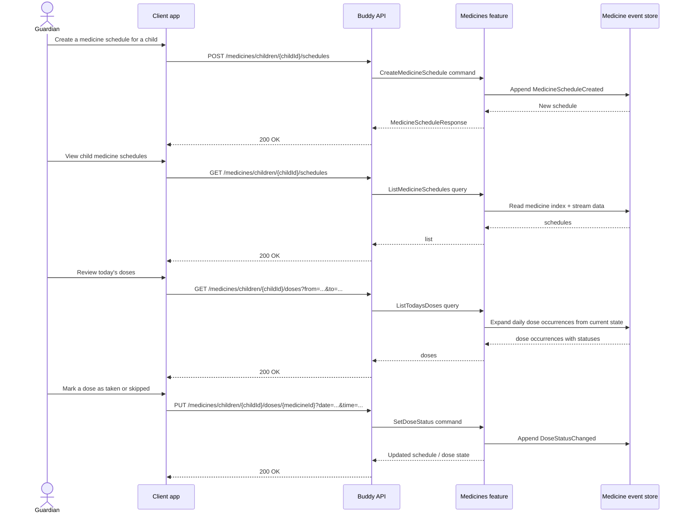

# Medicines Flow

The medicines feature tracks child medication schedules and dose status. It is designed around a daily schedule with multiple times per day, and records the child's actual taken/skipped state for each scheduled dose.

## Endpoints

| Method   | Route                                                                            | Behavior                                                                                               |
| -------- | -------------------------------------------------------------------------------- | ------------------------------------------------------------------------------------------------------ |
| `POST`   | `/medicines/children/{childId}/schedules`                                        | Creates a medicine schedule for the child.                                                             |
| `GET`    | `/medicines/children/{childId}/schedules`                                        | Lists active or stopped schedules for the child.                                                       |
| `PATCH`  | `/medicines/children/{childId}/schedules/{medicineId}/details`                   | Updates medicine details such as name, dosage, icon, or color.                                         |
| `PATCH`  | `/medicines/children/{childId}/schedules/{medicineId}/schedule`                  | Reschedules the windows or time list for a medicine.                                                   |
| `DELETE` | `/medicines/children/{childId}/schedules/{medicineId}`                           | Stops a medicine schedule.                                                                             |
| `GET`    | `/medicines/children/{childId}/doses`                                            | Lists dose occurrences for a `from`/`to` date range.                                                   |
| `PUT`    | `/medicines/children/{childId}/doses/{medicineId}?date=...&time=...`             | Marks a dose as `Taken`, `Skipped`, or `Pending`.                                                      |
| `PUT`    | `/medicines/children/{childId}/group-share/{groupId}`                            | Shares the child's medicine schedules with a group.                                                    |
| `DELETE` | `/medicines/children/{childId}/group-share/{groupId}`                            | Unshares the child's medicine schedules from a group.                                                  |
| `PUT`    | `/medicines/children/{childId}/effect-notes/{date}`                              | Logs or overwrites one day's effect and side-effect note (guardians only).                             |
| `DELETE` | `/medicines/children/{childId}/effect-notes/{date}`                              | Clears one day's note; a day without one is a no-op (guardians only).                                  |
| `GET`    | `/medicines/children/{childId}/effect-notes`                                     | Lists notes for a `from`/`to` range of at most 92 days, each with live dose statuses (guardians only). |
| `PUT`    | `/medicines/children/{childId}/schedules/{medicineId}/effect-inclusion`          | Leaves a medicine out of, or back in, the effect summaries; stopped schedules too (guardians only).    |
| `GET`    | `/medicines/children/{childId}/group-share`                                      | Returns the group the child's medicine schedules are currently shared with, if any.                    |
| `POST`   | `/medicines/groups/{groupId}/children/{childId}/schedules`                       | Creates a medicine schedule for a shared child via group access.                                       |
| `GET`    | `/medicines/groups/{groupId}/children/{childId}/schedules`                       | Lists a shared child's schedules via group access.                                                     |
| `PATCH`  | `/medicines/groups/{groupId}/children/{childId}/schedules/{medicineId}/details`  | Updates schedule details via group access.                                                             |
| `PATCH`  | `/medicines/groups/{groupId}/children/{childId}/schedules/{medicineId}/schedule` | Reschedules via group access.                                                                          |
| `DELETE` | `/medicines/groups/{groupId}/children/{childId}/schedules/{medicineId}`          | Stops a schedule via group access.                                                                     |
| `GET`    | `/medicines/groups/{groupId}/children/{childId}/doses`                           | Lists dose occurrences via group access.                                                               |
| `PUT`    | `/medicines/groups/{groupId}/children/{childId}/doses/{medicineId}`              | Sets dose status via group access.                                                                     |

## Validation

Every rule the endpoints enforce, validator rules first, then the handler's own checks.
A `400 validation_error` carries the message in the `ErrorEnvelope`'s `details` under the
key in the Field column, `""` for a check that isn't tied to one field (see
[HTTP status codes](../http-status-codes.md#error-response-shape-implemented)). A body
that can't be bound is rejected before these rules run, with the same envelope.

| Endpoint                                                                                                             | Field                     | Rule                                                                                                                                                                                                                    | Code               | Status |
| -------------------------------------------------------------------------------------------------------------------- | ------------------------- | ----------------------------------------------------------------------------------------------------------------------------------------------------------------------------------------------------------------------- | ------------------ | ------ |
| `CreateMedicineSchedule`, `CreateMedicineScheduleForGroup`, `UpdateMedicineDetails`, `UpdateMedicineDetailsForGroup` | `name`                    | Required: not empty or whitespace. At most 200 characters after trimming; stored trimmed.                                                                                                                               | `validation_error` | 400    |
| `CreateMedicineSchedule`, `CreateMedicineScheduleForGroup`, `UpdateMedicineDetails`, `UpdateMedicineDetailsForGroup` | `dosage`                  | At most 200 characters after trimming; stored trimmed. Optional (`""` allowed).                                                                                                                                         | `validation_error` | 400    |
| `CreateMedicineSchedule`, `CreateMedicineScheduleForGroup`, `UpdateMedicineDetails`, `UpdateMedicineDetailsForGroup` | `icon`                    | Optional (`""` allowed; trimmed). Otherwise at most 64 characters, an emoji at most 16, and a value starting with `pictogram:` must continue with a lowercase, hyphenated name (`[a-z0-9]+(-[a-z0-9]+)*`).              | `validation_error` | 400    |
| `CreateMedicineSchedule`, `CreateMedicineScheduleForGroup`, `UpdateMedicineDetails`, `UpdateMedicineDetailsForGroup` | `color`                   | Optional (`""` allowed). At most 32 characters after trimming; stored trimmed.                                                                                                                                          | `validation_error` | 400    |
| `CreateMedicineSchedule`, `CreateMedicineScheduleForGroup`, `RescheduleMedicine`, `RescheduleMedicineForGroup`       | `times`                   | At least one dose time.                                                                                                                                                                                                 | `validation_error` | 400    |
| `CreateMedicineSchedule`, `CreateMedicineScheduleForGroup`, `RescheduleMedicine`, `RescheduleMedicineForGroup`       | `endDate`                 | Optional; when given, not before `startDate`.                                                                                                                                                                           | `validation_error` | 400    |
| `ListTodaysDoses`, `ListTodaysDosesForGroup`                                                                         | `to`                      | `to` not before `from`.                                                                                                                                                                                                 | `validation_error` | 400    |
| `ListTodaysDoses`, `ListTodaysDosesForGroup`                                                                         | `to`                      | `to` at most 31 days after `from`.                                                                                                                                                                                      | `validation_error` | 400    |
| `SetDoseStatus`, `SetDoseStatusForGroup`                                                                             | `status`                  | A defined `DoseStatus` (`Pending`, `Taken`, `Skipped`); an unknown name already fails binding, an undefined number fails here.                                                                                          | `validation_error` | 400    |
| `SetDoseStatus`, `SetDoseStatusForGroup`                                                                             | `""`                      | The `time` query value is one of the schedule's dose times. Checked after authorization and the schedule lookup.                                                                                                        | `validation_error` | 400    |
| `LogMedicineEffectNote`                                                                                              | `""`                      | `effects` and `sideEffects` contain no `null` entries. Checked by the endpoint, before the validator.                                                                                                                   | `validation_error` | 400    |
| `LogMedicineEffectNote`                                                                                              | `effects[n].area`         | A defined `EffectArea` (`Focus`, `Calm`, `ImpulseControl`, `Mood`); an unknown name already fails binding, an undefined number fails here. `n` indexes the ratings sorted by area.                                      | `validation_error` | 400    |
| `LogMedicineEffectNote`                                                                                              | `effects[n].level`        | A defined `EffectLevel` (`Poor`, `Okay`, `Good`).                                                                                                                                                                       | `validation_error` | 400    |
| `LogMedicineEffectNote`                                                                                              | `effects`                 | Each area rated at most once.                                                                                                                                                                                           | `validation_error` | 400    |
| `LogMedicineEffectNote`                                                                                              | `sideEffects[n].kind`     | A defined `SideEffect` (`ReducedAppetite`, `TroubleFallingAsleep`, `Stomachache`, `Headache`, `Irritability`, `ReboundWhenWearingOff`, `Tics`, `FlatOrNotThemselves`, `Other`). `n` indexes the ratings sorted by kind. | `validation_error` | 400    |
| `LogMedicineEffectNote`                                                                                              | `sideEffects[n].severity` | A defined `SideEffectSeverity` (`None`, `Mild`, `Moderate`, `Severe`).                                                                                                                                                  | `validation_error` | 400    |
| `LogMedicineEffectNote`                                                                                              | `sideEffects`             | Each side effect rated at most once.                                                                                                                                                                                    | `validation_error` | 400    |
| `LogMedicineEffectNote`                                                                                              | `note`                    | At most 500 characters after trimming. Optional.                                                                                                                                                                        | `validation_error` | 400    |
| `LogMedicineEffectNote`                                                                                              | `note`                    | Not empty: at least one effect or side-effect rating, a `woreOffAt` time or a non-blank note.                                                                                                                           | `validation_error` | 400    |
| `LogMedicineEffectNote`                                                                                              | `""`                      | The `date` is not after today in the child's time zone; no lower bound. Checked after authorization.                                                                                                                    | `validation_error` | 400    |
| `ListMedicineEffectNotes`                                                                                            | `to`                      | `to` not before `from`.                                                                                                                                                                                                 | `validation_error` | 400    |
| `ListMedicineEffectNotes`                                                                                            | `to`                      | `to` at most 92 days after `from`.                                                                                                                                                                                      | `validation_error` | 400    |
| `SetMedicineEffectInclusion`                                                                                         | —                         | No rules beyond binding the body (`included`, a boolean).                                                                                                                                                               | `validation_error` | 400    |

## Group sharing

A guardian can share a child's medicine schedules with a group, granting members access under that group's `MedicinePermissionPolicy` (`None` or `Manage` — there is no `View` tier) instead of the guardian-child relationship alone. See [Medicine schedules](../analysis/medicine-schedules.md) for the full authorization model and the `MedicineGroupAccess` resolution rules.

## Core lifecycle

A medicine schedule is an event-sourced aggregate with its own stream. The timeline starts with `MedicineScheduleCreated`, then uses events such as `MedicineDetailsUpdated`, `MedicineScheduleRescheduled`, `MedicineScheduleStopped`, and `DoseStatusChanged` to track changes. Unlike a generic calendar item, the medicine model deliberately carries domain state that is specific to dosing workflows.

For listing and display, the backend does not persist a generated occurrence list forever. Instead, it recomputes dose occurrences from the aggregate and the dose log for the requested date range. This keeps the schedule state authoritative while allowing the user-facing dose listing to reflect the current schedule and statuses.

## Effect notes

A second per-child aggregate, `MedicineEffectLog` (stream id equal to the child's id, no index document), holds at most one `MedicineEffectNote` per local date: effect ratings, side-effect severities, a wear-off time, a free note, and the regimen (medicine name and dosage) resolved from the child's active schedules when the day is first logged. Edits keep that regimen; dose statuses are joined live from each schedule's dose log on every read. Only guardians can read or write notes; the child gets `403`. Every list is audit-logged (event 9003). See [Medicine effect and side-effect notes](../analysis/medicine-effect-notes.md).

A guardian can leave a medicine (vitamin D, say) out of the effect summaries with `SetMedicineEffectInclusion`, which sets `IsExcludedFromEffects` on the schedule (`MedicineEffectInclusionChanged`). Notes keep their full regimen; each regimen entry carries the schedule's live flag, the dose-period summary ignores flagged entries, and the doctor visit summary's medicine section drops them on the server, keeping only `ExcludedMedicineCount`. See [Leaving medicines out of the effect summary](../analysis/medicine-effect-inclusion.md).

## Authorization model

Medicine access is tightly scoped to the guardian-child relationship. The API expects the caller to be authorized as a guardian or child in the relevant relationship before they can create or modify schedules. This is distinct from the more general calendar membership model and prevents medicine schedule data from being treated as a generic shared calendar item.

## Status model

Each dose can resolve to a status of:

- `Pending`
- `Taken`
- `Skipped`

The underlying event log stores only changes from the default. A dose that is effectively pending is implied by absence from the sparse dose log, while any explicit deviation is captured in `DoseStatusChanged` events.
