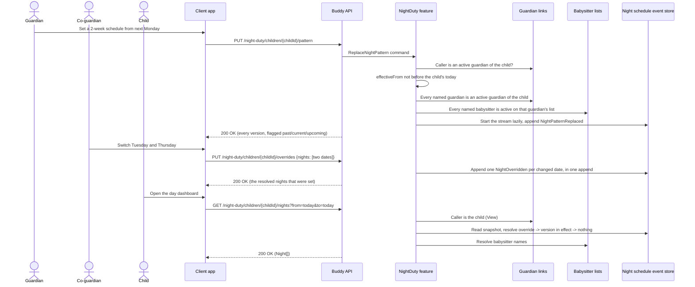

# Night Duty Flow

The night duty feature records who is responsible for a child at night (who puts the child to
bed, gets up when they wake, and where they sleep), plus an optional short note such as a weekly
screen night. Guardians set a fixed schedule once (a cycle of 1–4 weeks), versioned from a date
so earlier nights keep the schedule they had, and override single nights. The child sees
tonight's entry on their day dashboard, and a print template can include a Night row. The design
is in [night-duty.md](../analysis/night-duty.md).

## Endpoints

| Method   | Route                                                      | Behavior                                                                                                                                                                                                                                                                                                                      |
| -------- | ---------------------------------------------------------- | ----------------------------------------------------------------------------------------------------------------------------------------------------------------------------------------------------------------------------------------------------------------------------------------------------------------------------- |
| `PUT`    | `/night-duty/children/{childId}/pattern`                   | Saves a fixed-schedule version: `effectiveFrom` (optional, default the child's today, never in the past), `cycleWeeks` (1–4), `anchorMonday`, and `days` of `{week, day, entry}`. Replaces every version starting on or after `effectiveFrom`. Saving the last version again appends nothing. Returns the same body as `GET`. |
| `PUT`    | `/night-duty/children/{childId}/overrides`                 | Sets single nights: `nights` of `{date, entry}`, 1–31 distinct dates; `entry: null` clears a night ("nothing planned"). A switch is two dates in one request. Returns the resolved nights that were set.                                                                                                                      |
| `DELETE` | `/night-duty/children/{childId}/overrides?from=...&to=...` | Removes overrides in the range so those nights follow the fixed schedule again. Idempotent.                                                                                                                                                                                                                                   |
| `GET`    | `/night-duty/children/{childId}`                           | The child's `today` and every version, oldest first, with `status` `Past`, `Current` or `Upcoming`. Guardians only. No stream yet reads as no versions.                                                                                                                                                                       |
| `GET`    | `/night-duty/children/{childId}/nights?from=...&to=...`    | One `Night` per date with a `status`: `{ kind: 0 }` unplanned, `{ kind: 1, scheduled }` cleared by an override, or `{ kind: 2, entry, source, scheduled }` planned, with `source` `Pattern` or `Override`. `scheduled` is what the fixed schedule says for an overridden night. Guardians and the child themself.             |

An `entry` is `{ responsible, note }`. `responsible` is `{ kind: 0, guardianId }` (a guardian),
`{ kind: 1, guardianId, babysitterId, name }` (a babysitter on that guardian's list; `name` is
output only), `{ kind: 2, hostName, location, contactInfo }` (a sleepover) or `{ kind: 3 }`
(nobody named, only with a note). Date ranges are inclusive, and the night of a date runs into the
next morning.

## Validation

Every rule the endpoints enforce, validator rules first, then the handler's own checks.
A `400 validation_error` carries the message in the `ErrorEnvelope`'s `details` under the
key in the Field column, `""` for a check that isn't tied to one field (see
[HTTP status codes](../http-status-codes.md#error-response-shape-implemented)). A body
that can't be bound is rejected before these rules run, with the same envelope.

| Endpoint                                   | Field                         | Rule                                                                                                                                                | Code               | Status |
| ------------------------------------------ | ----------------------------- | --------------------------------------------------------------------------------------------------------------------------------------------------- | ------------------ | ------ |
| `ReplaceNightPattern`                      | `""`                          | `days` has no `null` entries. Checked by the endpoint before the validator runs.                                                                    | `validation_error` | 400    |
| `ReplaceNightPattern`                      | `cycleWeeks`                  | Between 1 and 4, inclusive.                                                                                                                         | `validation_error` | 400    |
| `ReplaceNightPattern`                      | `anchorMonday`                | A Monday.                                                                                                                                           | `validation_error` | 400    |
| `ReplaceNightPattern`                      | `days[n]`                     | `week` between 0 and `cycleWeeks` - 1.                                                                                                              | `validation_error` | 400    |
| `ReplaceNightPattern`                      | `days[n]`                     | `day` a valid weekday.                                                                                                                              | `validation_error` | 400    |
| `ReplaceNightPattern`                      | `days`                        | At most one entry per `week` and `day`.                                                                                                             | `validation_error` | 400    |
| `ReplaceNightPattern`                      | `days[n].entry.note`          | At most 60 characters after trimming.                                                                                                               | `validation_error` | 400    |
| `ReplaceNightPattern`                      | `days[n].entry.responsible`   | A responsible person, a note, or both. A sleepover needs a `hostName` (at most 200 characters); `location` at most 200, `contactInfo` at most 2000. | `validation_error` | 400    |
| `ReplaceNightPattern`                      | `""`                          | `effectiveFrom` is not before the child's today.                                                                                                    | `validation_error` | 400    |
| `ReplaceNightPattern`, `SetNightOverrides` | `""`                          | A named guardian is an active guardian of the child; a named babysitter is active on the list of an active guardian of the child.                   | `validation_error` | 400    |
| `SetNightOverrides`                        | `""`                          | `nights` has no `null` entries. Checked by the endpoint before the validator runs.                                                                  | `validation_error` | 400    |
| `SetNightOverrides`                        | `nights`                      | 1–31 entries, each date at most once.                                                                                                               | `validation_error` | 400    |
| `SetNightOverrides`                        | `nights[n].entry.note`        | At most 60 characters after trimming.                                                                                                               | `validation_error` | 400    |
| `SetNightOverrides`                        | `nights[n].entry.responsible` | As for `ReplaceNightPattern`.                                                                                                                       | `validation_error` | 400    |
| `ClearNightOverrides`, `ListNights`        | `to`                          | `to` is not before `from`.                                                                                                                          | `validation_error` | 400    |
| `ClearNightOverrides`, `ListNights`        | `to`                          | `to` - `from` is at most 31 days.                                                                                                                   | `validation_error` | 400    |

## Authorization model

- **Manage** is any active guardian of the child: every write and `GET /night-duty/children/{childId}`.
  The child calling one of these gets `403`.
- **View** is the child themself: `ListNights` only, the "Tonight" card.
- Everyone else gets `404`. Access is computed on every request, so revoking a `GuardianLink`
  removes access immediately.

## Data protection

Erasing the child deletes the stream and its snapshot (sleepover hosts' details are the child's
data). Erasing a guardian leaves the child's schedule in place; nights naming them stop
resolving a name. The `nightDuty` section of the personal-data export holds each child's
versions and overrides.
