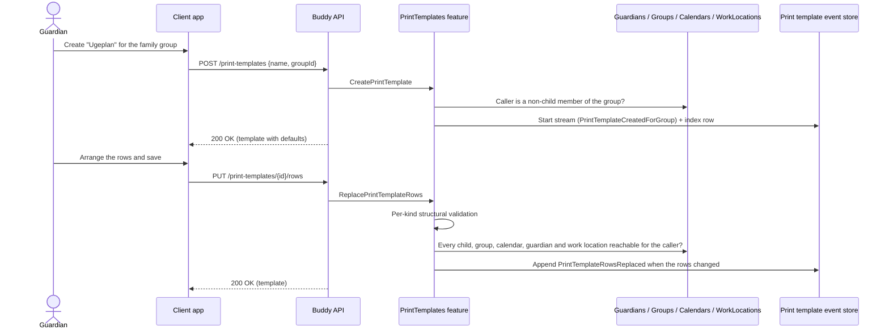

# Print Templates Flow

A print template is the saved layout of a printable week plan: paper size (A4
or A3, always landscape), the default start weekday, and an ordered list of
rows, each with a kind (meal, pickup, work location, calendar marker,
calendar events, task checklist, blank) and what it reads from. The design is in
[week-plan-print-templates.md](../analysis/week-plan-print-templates.md).

A template stores references, never data. At print time the frontend fetches
every row through that feature's own endpoint, which authorizes whoever is
printing; a row they can't read degrades to "not available".

## Endpoints

| Method   | Route                                             | Behavior                                                                                           |
| -------- | ------------------------------------------------- | -------------------------------------------------------------------------------------------------- |
| `POST`   | `/print-templates`                                | Creates a template owned by the caller, or by `groupId` when given.                                |
| `GET`    | `/print-templates`                                | Lists the caller's own and their groups' templates, ordered by name.                               |
| `GET`    | `/print-templates/{templateId}`                   | The full template.                                                                                 |
| `PATCH`  | `/print-templates/{templateId}/name`              | Renames it (also updates the list index).                                                          |
| `PATCH`  | `/print-templates/{templateId}/layout`            | `paperSize` (`0` A4, `1` A3), `defaultStartWeekday` (`0` Sunday … `6` Saturday), `showWeekNumber`. |
| `PUT`    | `/print-templates/{templateId}/rows`              | Replaces the whole ordered row list (1–12 rows).                                                   |
| `PUT`    | `/print-templates/{templateId}/colors`            | Replaces the guardian name colors.                                                                 |
| `PUT`    | `/print-templates/{templateId}/babysitter-colors` | Replaces the babysitter name colors (`guardianId` + `babysitterId` per entry).                     |
| `DELETE` | `/print-templates/{templateId}`                   | Deletes it; it then reads as missing everywhere.                                                   |

Row kinds travel as `PrintRowKind` names: `Meal`, `Pickup`, `WorkLocation`,
`CalendarMarker`, `CalendarEvents`, `TaskChecklist`, `Blank`, `CalendarAgenda`. A row only sets the fields its kind uses; see the table in the
design doc's Question 3.

## Validation

Every rule the endpoints enforce, validator rules first, then the handler's own checks.
A `400 validation_error` carries the message in the `ErrorEnvelope`'s `details` under the
key in the Field column, `""` for a check that isn't tied to one field (see
[HTTP status codes](../http-status-codes.md#error-response-shape-implemented)). A body
that can't be bound is rejected before these rules run, with the same envelope.

| Endpoint                                                                     | Field                  | Rule                                                                                                                                                                                                                                                                                                                                                                                                                                                 | Code               | Status |
| ---------------------------------------------------------------------------- | ---------------------- | ---------------------------------------------------------------------------------------------------------------------------------------------------------------------------------------------------------------------------------------------------------------------------------------------------------------------------------------------------------------------------------------------------------------------------------------------------- | ------------------ | ------ |
| `CreatePrintTemplate`, `RenamePrintTemplate`                                 | `name`                 | Required: not empty or whitespace. At most 80 characters after trimming.                                                                                                                                                                                                                                                                                                                                                                             | `validation_error` | 400    |
| `UpdatePrintTemplateLayout`                                                  | `PaperSize`            | A defined `PaperSize`: `0` (A4) or `1` (A3).                                                                                                                                                                                                                                                                                                                                                                                                         | `validation_error` | 400    |
| `UpdatePrintTemplateLayout`                                                  | `DefaultStartWeekday`  | A defined `DayOfWeek`: `0` (Sunday) to `6` (Saturday).                                                                                                                                                                                                                                                                                                                                                                                               | `validation_error` | 400    |
| `ReplacePrintTemplateRows`                                                   | `""`                   | `rows` contains no `null` entry. Checked by the endpoint, before the validator.                                                                                                                                                                                                                                                                                                                                                                      | `validation_error` | 400    |
| `ReplacePrintTemplateRows`                                                   | `rows`                 | 1–12 rows.                                                                                                                                                                                                                                                                                                                                                                                                                                           | `validation_error` | 400    |
| `ReplacePrintTemplateRows`                                                   | `rows[n].kind`         | A defined `PrintRowKind`.                                                                                                                                                                                                                                                                                                                                                                                                                            | `validation_error` | 400    |
| `ReplacePrintTemplateRows`                                                   | `rows[n].label`        | At most 40 characters after trimming. Required (not empty or whitespace) unless the kind is `Blank`.                                                                                                                                                                                                                                                                                                                                                 | `validation_error` | 400    |
| `ReplacePrintTemplateRows`                                                   | `rows[n].heightWeight` | 1–5.                                                                                                                                                                                                                                                                                                                                                                                                                                                 | `validation_error` | 400    |
| `ReplacePrintTemplateRows`                                                   | `rows[n].childId`      | `Meal` rows: exactly one of `childId` and `mealGroupId`.                                                                                                                                                                                                                                                                                                                                                                                             | `validation_error` | 400    |
| `ReplacePrintTemplateRows`                                                   | `rows[n].mealSlot`     | `Meal` rows: required, a defined `MealSlot`.                                                                                                                                                                                                                                                                                                                                                                                                         | `validation_error` | 400    |
| `ReplacePrintTemplateRows`                                                   | `rows[n].childId`      | `Pickup` rows: required.                                                                                                                                                                                                                                                                                                                                                                                                                             | `validation_error` | 400    |
| `ReplacePrintTemplateRows`                                                   | `rows[n].guardianId`   | `WorkLocation` rows: required.                                                                                                                                                                                                                                                                                                                                                                                                                       | `validation_error` | 400    |
| `ReplacePrintTemplateRows`                                                   | `rows[n].calendarIds`  | `CalendarMarker`, `CalendarEvents`, `TaskChecklist` and `CalendarAgenda` rows: 1–10 ids, no `null`, no duplicates.                                                                                                                                                                                                                                                                                                                                   | `validation_error` | 400    |
| `ReplacePrintTemplateRows`                                                   | `rows[n].titleFilter`  | When given: not empty or whitespace, at most 60 characters after trimming. Optional.                                                                                                                                                                                                                                                                                                                                                                 | `validation_error` | 400    |
| `ReplacePrintTemplateRows`                                                   | `rows[n].maxItems`     | When given: 1–8. Optional.                                                                                                                                                                                                                                                                                                                                                                                                                           | `validation_error` | 400    |
| `ReplacePrintTemplateRows`                                                   | `rows[n].kind`         | No field the kind doesn't use (`showTime`/`showAssignee` count when `true`). `Meal`: `childId`, `mealGroupId`, `mealSlot`. `Pickup`: `childId`. `WorkLocation`: `guardianId`, `workLocationId`. `CalendarMarker`: `calendarIds`, `titleFilter`. `CalendarEvents`: `calendarIds`, `assignedToId`, `titleFilter`, `maxItems`, `showTime`, `showAssignee`. `TaskChecklist`, `CalendarAgenda`: `calendarIds`, `assignedToId`, `maxItems`. `Blank`: none. | `validation_error` | 400    |
| `ReplacePrintTemplateRows`                                                   | `""`                   | Every `childId` new to the template is a child the caller is an active guardian of. The reference checks run only when the trimmed rows differ from the stored ones, and only over references the stored rows don't already hold.                                                                                                                                                                                                                    | `validation_error` | 400    |
| `ReplacePrintTemplateRows`                                                   | `""`                   | Every new `mealGroupId` is a group the caller is a non-child member of.                                                                                                                                                                                                                                                                                                                                                                              | `validation_error` | 400    |
| `ReplacePrintTemplateRows`                                                   | `""`                   | Every new calendar id is a calendar the caller can currently view.                                                                                                                                                                                                                                                                                                                                                                                   | `validation_error` | 400    |
| `ReplacePrintTemplateRows`                                                   | `""`                   | A new `WorkLocation` row's `guardianId` is the caller or a co-guardian of one of the caller's children.                                                                                                                                                                                                                                                                                                                                              | `validation_error` | 400    |
| `ReplacePrintTemplateRows`                                                   | `""`                   | A new `WorkLocation` row's `workLocationId`, when given, is an active work location of that guardian.                                                                                                                                                                                                                                                                                                                                                | `validation_error` | 400    |
| `ReplacePrintTemplateGuardianColors`, `ReplacePrintTemplateBabysitterColors` | `""`                   | `colors` contains no `null` entry. Checked by the endpoint, before the validator.                                                                                                                                                                                                                                                                                                                                                                    | `validation_error` | 400    |
| `ReplacePrintTemplateGuardianColors`                                         | `colors`               | At most 12 entries.                                                                                                                                                                                                                                                                                                                                                                                                                                  | `validation_error` | 400    |
| `ReplacePrintTemplateGuardianColors`                                         | `colors`               | Each `guardianId` at most once.                                                                                                                                                                                                                                                                                                                                                                                                                      | `validation_error` | 400    |
| `ReplacePrintTemplateBabysitterColors`                                       | `colors`               | At most 24 entries.                                                                                                                                                                                                                                                                                                                                                                                                                                  | `validation_error` | 400    |
| `ReplacePrintTemplateBabysitterColors`                                       | `colors`               | Each `guardianId` + `babysitterId` pair at most once.                                                                                                                                                                                                                                                                                                                                                                                                | `validation_error` | 400    |
| `ReplacePrintTemplateGuardianColors`, `ReplacePrintTemplateBabysitterColors` | `colors[n]`            | `color` is 1–32 characters after trimming (the endpoint trims it).                                                                                                                                                                                                                                                                                                                                                                                   | `validation_error` | 400    |
| `ReplacePrintTemplateGuardianColors`, `ReplacePrintTemplateBabysitterColors` | `""`                   | Every `guardianId` new to the template is the caller or a co-guardian of one of the caller's children. Checked only when the colors differ from the stored ones.                                                                                                                                                                                                                                                                                     | `validation_error` | 400    |
| `ReplacePrintTemplateBabysitterColors`                                       | `""`                   | A new entry's `babysitterId` is an active babysitter on that guardian's list.                                                                                                                                                                                                                                                                                                                                                                        | `validation_error` | 400    |

## Authorization model

- One tier, **Manage**: the owner of a personal template, or any non-child
  member of the owning group. Everyone else gets `404`.
- Children can't create templates (`403`) and see none.
- Write-time reference checks run as the caller and only catch mistakes; they
  grant nothing.
