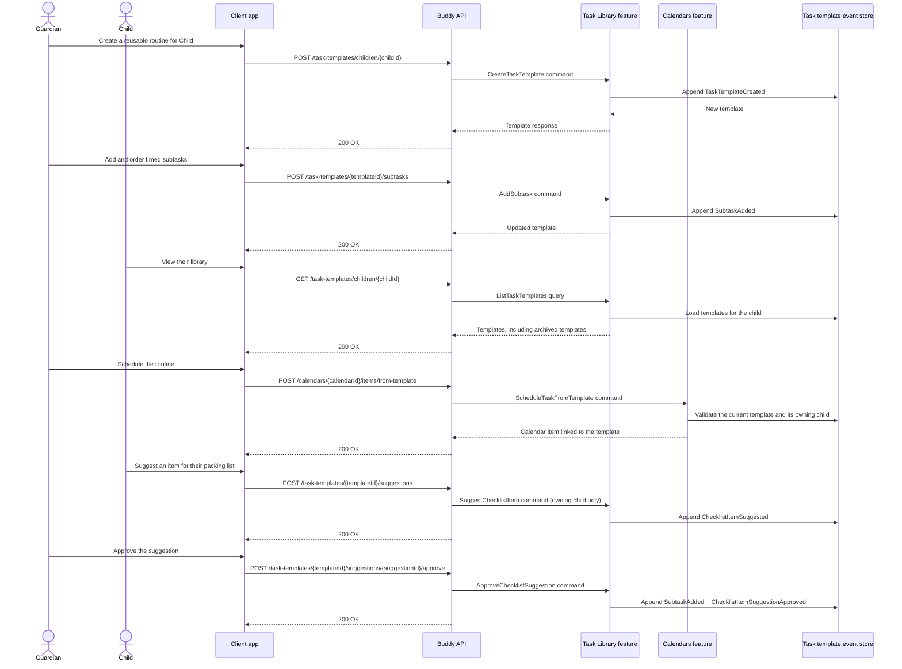

# Task Library Flow

The task library lets a guardian define reusable routines as ordered task
templates with timed subtasks, and packing lists (`Checklist` templates) whose
items have no duration and may apply on some weekdays only. Each template
belongs to exactly one child. A child can view their own library and suggest
items for their own packing lists, while only an active guardian can create or
change it. See [Packing checklists](../analysis/packing-checklists.md).

## Endpoints

| Method   | Route                                                              | Behavior                                                                                                                                                                                                                  |
| -------- | ------------------------------------------------------------------ | ------------------------------------------------------------------------------------------------------------------------------------------------------------------------------------------------------------------------- |
| `POST`   | `/task-templates/children/{childId}`                               | Creates a template owned by the child: a `Routine` (default) or a `Checklist` (packing list), optionally with `eveningBeforeFrom`.                                                                                        |
| `GET`    | `/task-templates/children/{childId}`                               | Lists the child's own templates by name, including archived templates and their subtasks.                                                                                                                                 |
| `PATCH`  | `/task-templates/{templateId}`                                     | Updates a template's name, icon, and color.                                                                                                                                                                               |
| `DELETE` | `/task-templates/{templateId}`                                     | Archives a template and blocks new scheduling.                                                                                                                                                                            |
| `POST`   | `/task-templates/{templateId}/subtasks`                            | Adds a timed subtask, optionally at a requested position.                                                                                                                                                                 |
| `PATCH`  | `/task-templates/{templateId}/subtasks/{subtaskId}`                | Updates a subtask's title, optional icon, and duration.                                                                                                                                                                   |
| `DELETE` | `/task-templates/{templateId}/subtasks/{subtaskId}`                | Removes a subtask.                                                                                                                                                                                                        |
| `PUT`    | `/task-templates/{templateId}/subtasks/order`                      | Reorders subtasks; the new order must contain each current subtask ID exactly once.                                                                                                                                       |
| `PUT`    | `/task-templates/{templateId}/checklist-options`                   | Sets a packing list's "show the evening before from" time (or null); `400` on a routine.                                                                                                                                  |
| `POST`   | `/task-templates/{templateId}/copy`                                | Copies a template (kind, options, items with fresh ids) into another child's library; Manage on both children. Schedules, ticks and suggestions are not copied.                                                           |
| `POST`   | `/task-templates/{templateId}/suggestions`                         | The owning child suggests an item for their packing list (`409 too_many_pending_suggestions` past five pending, `409 checklist_item_exists` for an item already on the list; a pending duplicate is an idempotent `200`). |
| `POST`   | `/task-templates/{templateId}/suggestions/{suggestionId}/withdraw` | The owning child takes back a pending suggestion.                                                                                                                                                                         |
| `POST`   | `/task-templates/{templateId}/suggestions/{suggestionId}/approve`  | A guardian approves with a final title and weekdays; adds a zero-duration item.                                                                                                                                           |
| `POST`   | `/task-templates/{templateId}/suggestions/{suggestionId}/decline`  | A guardian declines. A repeated resolution is `200`; a different one `409 suggestion_resolved`.                                                                                                                           |
| `POST`   | `/calendars/{calendarId}/items/from-template`                      | Schedules a non-empty, active template owned by the assignee as a specific-time calendar task.                                                                                                                            |

An item's optional `weekdays` limits it to those days. Each template response includes the ordered
subtasks, their total duration, archive state, and creator/modifier IDs; there
is no separate endpoint for loading one template.

## Validation

Every rule the endpoints enforce, validator rules first, then the handler's own checks.
A `400 validation_error` carries the message in the `ErrorEnvelope`'s `details` under the
key in the Field column, `""` for a check that isn't tied to one field (see
[HTTP status codes](../http-status-codes.md#error-response-shape-implemented)). A body
that can't be bound is rejected before these rules run, with the same envelope.

| Endpoint                                                                                  | Field               | Rule                                                                                                                                                                                         | Code                           | Status |
| ----------------------------------------------------------------------------------------- | ------------------- | -------------------------------------------------------------------------------------------------------------------------------------------------------------------------------------------- | ------------------------------ | ------ |
| `CreateTaskTemplate`, `UpdateTaskTemplate`                                                | `name`              | Required: not empty or whitespace. At most 200 characters (not trimmed).                                                                                                                     | `validation_error`             | 400    |
| `CreateTaskTemplate`, `UpdateTaskTemplate`                                                | `icon`              | Required: not empty or whitespace.                                                                                                                                                           | `validation_error`             | 400    |
| `CreateTaskTemplate`, `UpdateTaskTemplate`                                                | `icon`              | At most 64 characters; a value starting with `pictogram:` must continue with a lowercase, hyphenated slug (`[a-z0-9]+(-[a-z0-9]+)*`). Any other value (an emoji) passes.                     | `validation_error`             | 400    |
| `CreateTaskTemplate`                                                                      | `kind`              | A defined `TaskTemplateKind` (`Routine`, `Checklist`). Optional, defaults to `Routine`.                                                                                                      | `validation_error`             | 400    |
| `CreateTaskTemplate`                                                                      | `eveningBeforeFrom` | Must be null unless `Kind` is `Checklist`.                                                                                                                                                   | `validation_error`             | 400    |
| `AddSubtask`, `UpdateSubtask`                                                             | `title`             | Required: not empty or whitespace. At most 200 characters (not trimmed).                                                                                                                     | `validation_error`             | 400    |
| `AddSubtask`, `UpdateSubtask`                                                             | `icon`              | Only when an icon is given (blank or whitespace means "inherit the template's icon"): at most 64 characters; a `pictogram:` value must continue with a lowercase, hyphenated slug. Optional. | `validation_error`             | 400    |
| `AddSubtask`, `UpdateSubtask`                                                             | `duration`          | Not negative. Optional, defaults to zero.                                                                                                                                                    | `validation_error`             | 400    |
| `AddSubtask`, `UpdateSubtask`                                                             | `weekdays`          | Null (every day) or a non-empty list of defined days (`Sunday`–`Saturday`); an empty list or an undefined day number is rejected. All seven days are stored as "every day".                  | `validation_error`             | 400    |
| `AddSubtask`, `UpdateSubtask`                                                             | `duration`          | Depends on the template's kind: a routine step's duration must be positive, a checklist item's must be zero. Checked after the template is loaded.                                           | `validation_error`             | 400    |
| `ReorderSubtasks`                                                                         | `""`                | `NewOrder` must contain exactly the template's current subtask ids, each exactly once.                                                                                                       | `validation_error`             | 400    |
| `SetChecklistOptions`                                                                     | `""`                | The template must be a `Checklist` (packing list).                                                                                                                                           | `validation_error`             | 400    |
| `CopyTaskTemplate`                                                                        | `childId`           | The target `ChildId` must not be the empty GUID.                                                                                                                                             | `validation_error`             | 400    |
| `SuggestChecklistItem`, `ApproveChecklistSuggestion`                                      | `title`             | Required: not empty after trimming. At most 200 characters after trimming.                                                                                                                   | `validation_error`             | 400    |
| `SuggestChecklistItem`, `ApproveChecklistSuggestion`                                      | `weekdays`          | Null (every day) or a non-empty list of defined days; an empty list or an undefined day number is rejected.                                                                                  | `validation_error`             | 400    |
| `SuggestChecklistItem`                                                                    | `""`                | The template must be a `Checklist` (packing list). Checked after the template is loaded.                                                                                                     | `validation_error`             | 400    |
| `SuggestChecklistItem`                                                                    | —                   | The title (trimmed, case-insensitive) is already an item on the list. A pending suggestion with the same title is an idempotent `200` instead, checked first.                                | `checklist_item_exists`        | 409    |
| `SuggestChecklistItem`                                                                    | —                   | At most 5 pending suggestions per list.                                                                                                                                                      | `too_many_pending_suggestions` | 409    |
| `WithdrawChecklistSuggestion`, `ApproveChecklistSuggestion`, `DeclineChecklistSuggestion` | —                   | The suggestion must still be pending; repeating the same resolution is an idempotent `200`, a different one is rejected.                                                                     | `suggestion_resolved`          | 409    |

`ApproveChecklistSuggestion` validates its body only for an approval that will happen: a repeated
approval is an idempotent `200` that ignores the body, so a retry needn't resend it.

## Core lifecycle

`TaskTemplate` is event-sourced. Its stream begins with
`TaskTemplateCreated`, then records detail updates, subtask additions, updates,
removals and reordering. `TaskTemplateArchived` is a soft delete. Archived
templates remain visible in library listings and cannot be edited or scheduled
again.

A template is indexed under the child it was created for, and that ownership
never changes. Listing and lookup both resolve directly against that index
row -- there is no sharing across siblings.

Scheduling stores the template ID on the calendar item rather than copying the
subtasks. Occurrence listing and iCal generation load the current template and
produce one consecutive timed occurrence per subtask that applies on the date,
starting at the scheduled time; a packing list's items are all due at the
scheduled ("leave by") time and carry `routine.checklist`. A packing-list item
can be ticked for tomorrow (packing the evening before), and the whole list
earns one star when its last applicable item is ticked. Later subtask edits therefore affect existing scheduled routines.
Archiving a template only prevents new schedules; already scheduled routines
continue to expand.

## Authorization model

The child named by `childId` and their active guardians can view that child's
library. Only an active guardian can create, update, archive, reorder, add, or
remove template content. Suggesting and withdrawing are for the owning child
only (a guardian gets `403`, anyone else `404`); approving and declining need
`Manage`. Scheduling also requires contributor access to the
target calendar, and the selected template must be owned by the assignee, or
by the caller when the task is unassigned.

## Key event types

- `TaskTemplateCreated`
- `TaskTemplateDetailsUpdated`
- `SubtaskAdded`
- `SubtaskUpdated`
- `SubtaskRemoved`
- `SubtasksReordered`
- `TaskTemplateArchived` (declines every pending suggestion in the same append)
- `ChecklistOptionsChanged`
- `ChecklistItemSuggested`
- `ChecklistItemSuggestionApproved`
- `ChecklistItemSuggestionDeclined`
- `ChecklistItemSuggestionWithdrawn`
