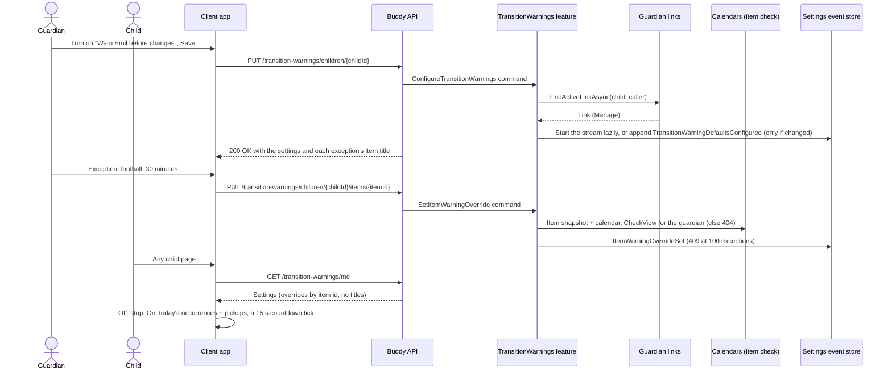

# Transition Warnings Flow

Transition warnings are a countdown on a child's screen before the events, tasks, routines, packing
lists and timed pickups Buddy already knows about ("10 minutes until football"). They are off for
every child until a guardian turns them on. Design:
[transition-warnings.md](../analysis/transition-warnings.md).

The server stores and serves the settings only. The child's browser computes the warnings from the
day it already loads (`computeTransitionWarnings`), in the child's profile time zone.

One aggregate in the `transitionwarnings` schema:

- `TransitionWarningSettings`: one stream per child, with
  `TransitionWarningSettingsId.Value == ChildId.Value` (no index document, same as `ChildProgress`).
  It is started lazily by the first save; a child with no stream reads the initial settings: off,
  with 15/5/1 minutes and every kind pre-filled. `Defaults` is replaced whole on every save;
  `ItemOverrides` maps a `CalendarItemId` to its own lead times or to "never".

Any active guardian of the child manages the settings. The child reads their own through `/me`
only; on a `/children/{childId}` route the child gets `403`, and anyone else `404`.

## Endpoints

| Method   | Route                                                    | Behavior                                                                                                                                                                           |
| -------- | -------------------------------------------------------- | ---------------------------------------------------------------------------------------------------------------------------------------------------------------------------------- |
| `GET`    | `/transition-warnings/me`                                | The caller's own settings, or the initial (off) ones. Overrides as `{ itemId, leadMinutes }`.                                                                                      |
| `GET`    | `/transition-warnings/children/{childId}`                | Guardian only. The settings plus each exception's item title, icon and kind; deleted items and items the guardian can't see are left out.                                          |
| `PUT`    | `/transition-warnings/children/{childId}`                | Guardian only. Full replace of `enabled`, `leadMinutes` (1-3 of 1-120), `kinds` and optional `quietHours`. An identical save appends nothing; switching off keeps everything else. |
| `PUT`    | `/transition-warnings/children/{childId}/items/{itemId}` | Guardian only. The item's own `leadMinutes`, or `[]` for "never". `404` for an item the guardian can't see, `409 too_many_warning_overrides` at 100.                               |
| `DELETE` | `/transition-warnings/children/{childId}/items/{itemId}` | Guardian only. Removes an exception. Idempotent: `204` when there was none.                                                                                                        |

All routes are mapped only while `Features:TransitionWarnings` is on. Erasing a child deletes the
stream; a guardian's export lists each child's settings.

## Validation

Every rule the endpoints enforce, validator rules first, then the handler's own checks.
A `400 validation_error` carries the message in the `ErrorEnvelope`'s `details` under the
key in the Field column, `""` for a check that isn't tied to one field (see
[HTTP status codes](../http-status-codes.md#error-response-shape-implemented)). A body
that can't be bound is rejected before these rules run, with the same envelope.

| Endpoint                                                | Field         | Rule                                                                                                            | Code                         | Status |
| ------------------------------------------------------- | ------------- | --------------------------------------------------------------------------------------------------------------- | ---------------------------- | ------ |
| `ConfigureTransitionWarnings`                           | `leadMinutes` | At least one lead time, also when `enabled` is false (the switch turns warnings off).                           | `validation_error`           | 400    |
| `ConfigureTransitionWarnings`, `SetItemWarningOverride` | `leadMinutes` | At most 3 lead times, all different, each 1–120 minutes. An override may be empty (never warn for that item).   | `validation_error`           | 400    |
| `ConfigureTransitionWarnings`                           | `kinds`       | At least one kind when `enabled` is true.                                                                       | `validation_error`           | 400    |
| `ConfigureTransitionWarnings`                           | `kinds[n]`    | One of `Event`, `Task`, `DropOff`, `PickUp`.                                                                    | `validation_error`           | 400    |
| `ConfigureTransitionWarnings`                           | `quietHours`  | `from` and `to` differ. Optional.                                                                               | `validation_error`           | 400    |
| `SetItemWarningOverride`                                | —             | A new exception when the child already has 100 for items that still exist; changing an existing one is allowed. | `too_many_warning_overrides` | 409    |
