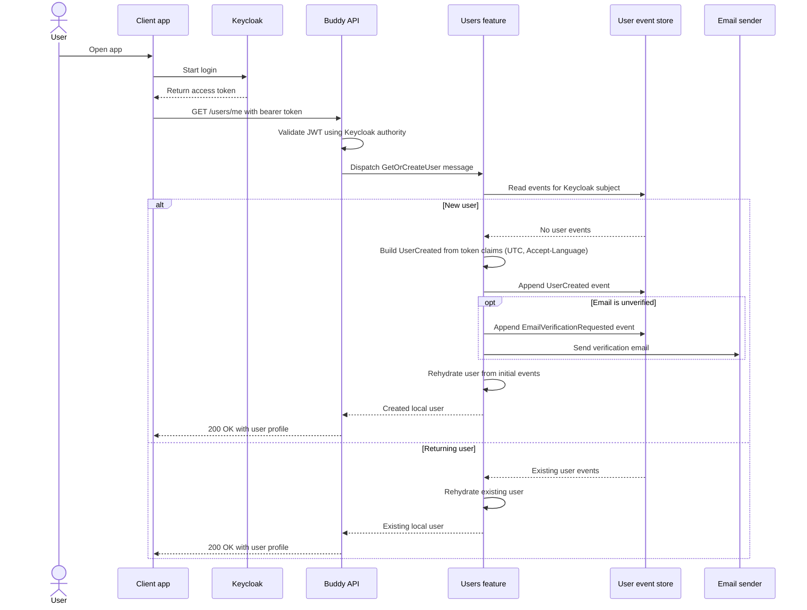

# Users Flow

The users feature authenticates requests with Keycloak and uses the authenticated Keycloak subject as the stable identity for a local, event-sourced user. The first request for a subject creates a local user from the token claims. Later requests rehydrate that user from its event stream.

## Endpoints

All users endpoints require a bearer token issued by the configured Keycloak authority and are included in the `users` OpenAPI document.

| Method   | Route                           | Behavior                                                                                                                                                                                                                                                                                                                                                                                                                                                                                                                                                                                             |
| -------- | ------------------------------- | ---------------------------------------------------------------------------------------------------------------------------------------------------------------------------------------------------------------------------------------------------------------------------------------------------------------------------------------------------------------------------------------------------------------------------------------------------------------------------------------------------------------------------------------------------------------------------------------------------- |
| `GET`    | `/users/me`                     | Gets or creates the local user for the authenticated Keycloak subject. Returns `404 Not Found` when the user has been deleted.                                                                                                                                                                                                                                                                                                                                                                                                                                                                       |
| `PATCH`  | `/users/me/name`                | Updates the authenticated user's given and family name. Returns the updated profile, or `404 Not Found` when no local user exists.                                                                                                                                                                                                                                                                                                                                                                                                                                                                   |
| `PATCH`  | `/users/me/email`               | Changes the authenticated user's email and starts email verification; submitting the current email is a no-op. Returns the updated profile, or `404 Not Found` when no local user exists.                                                                                                                                                                                                                                                                                                                                                                                                            |
| `PATCH`  | `/users/me/timezone`            | Sets the authenticated user's preferred IANA time zone, used to format timestamps for them. Returns the updated profile, `404 Not Found` when no local user exists, or `400 Bad Request` (see [Validation](#validation)).                                                                                                                                                                                                                                                                                                                                                                            |
| `PATCH`  | `/users/me/calling-name`        | Sets what the authenticated user's children call them (for example "Mor"), trimmed; an empty value clears it. Children see it instead of the given name. Returns the updated profile, `404 Not Found` when no local user exists, or `400 Bad Request` (see [Validation](#validation)).                                                                                                                                                                                                                                                                                                               |
| `PATCH`  | `/users/me/language`            | Sets the authenticated user's preferred display language. Returns the updated profile, `404 Not Found` when no local user exists, or `400 Bad Request` (see [Validation](#validation)).                                                                                                                                                                                                                                                                                                                                                                                                              |
| `POST`   | `/users/me/email/verify/resend` | Sends another verification email for an unverified address. Returns `204 No Content` for a sent email or an already verified address, `404 Not Found` when no local user exists, or `409 Conflict` during the resend cooldown.                                                                                                                                                                                                                                                                                                                                                                       |
| `POST`   | `/users/me/email/verify`        | Verifies the email using the submitted token. When the Keycloak account has the same email, it is also marked verified in Keycloak. Returns the updated profile, `404 Not Found`, or `400 Bad Request` (see [Validation](#validation)).                                                                                                                                                                                                                                                                                                                                                              |
| `GET`    | `/users/me/export`              | Everything Buddy holds about the caller and the children they guard, as a JSON file (`buddy-export-<date>.json`): one section per feature, current state rather than events, no secrets. A child gets its `account` section only. Rate-limited to one per 10 minutes per user (`429 rate_limited`).                                                                                                                                                                                                                                                                                                  |
| `GET`    | `/users/me/deletion-preview`    | What `DELETE /users/me` would also take with it: children with no other guardian (`childrenErased`), owned groups that pass to another member (`groupsHandedOver`, with the new owner), and owned groups nobody else is in (`groupsDeleted`). Changes nothing.                                                                                                                                                                                                                                                                                                                                       |
| `GET`    | `/users/me/onboarding`          | The guided setup's progress ([guardian-onboarding.md](../../frontend/analysis/guardian-onboarding.md)): status (NotStarted/Active/Deferred/Completed), the setup group, whether invitations were skipped, and the version. A plain `OnboardingProgressDocument` in the Users store, not an event stream; NotStarted (version 0) when there is none.                                                                                                                                                                                                                                                  |
| `PUT`    | `/users/me/onboarding`          | Saves that progress against the version the caller read (Marten numeric revisions; a stale version is `409 concurrency_conflict`). A changed setup group must be one the caller owns or administers; a completed guide can't change. Erasure deletes the document, the export includes it (`onboarding` section).                                                                                                                                                                                                                                                                                    |
| `DELETE` | `/users/me`                     | Locks the user out (`UserDeleted` plus the `KeycloakIdentity`'s `Deleted` flag, in one transaction), then erases them across Buddy and cascades: children with no other guardian are erased too, owned groups pass to the longest-standing admin, the Keycloak account is deleted, the user stream is masked and `UserErased` appended ([gdpr-data-protection.md](../analysis/gdpr-data-protection.md)). From then on the token gets `403 user_not_provisioned` everywhere (a repeated `DELETE` included) and `GET /users/me` answers `404`. Returns `204 No Content`, or `403` for a child account. |

The API passes work to Wolverine handlers rather than accessing the event store directly from the endpoint. The handlers are responsible for looking up the user stream, creating or rehydrating the aggregate, and appending deletion events.

## Validation

Every rule the endpoints enforce, validator rules first, then the handler's own checks.
A `400 validation_error` carries the message in the `ErrorEnvelope`'s `details` under the
key in the Field column, `""` for a check that isn't tied to one field (see
[HTTP status codes](../http-status-codes.md#error-response-shape-implemented)). A body
that can't be bound is rejected before these rules run, with the same envelope.

| Endpoint                             | Field             | Rule                                                                                                                                | Code               | Status |
| ------------------------------------ | ----------------- | ----------------------------------------------------------------------------------------------------------------------------------- | ------------------ | ------ |
| `UpdateCurrentName`                  | —                 | No rules beyond binding the body: neither name is trimmed or length-checked.                                                        | `validation_error` | 400    |
| `UpdateCurrentEmail`                 | `Value`           | Required: not empty. A valid email address: exactly one `@`, neither first nor last character. At most 200 characters. Not trimmed. | `validation_error` | 400    |
| `UpdateCurrentTimeZone`              | `TimeZoneId`      | A time zone id the server recognizes (IANA, e.g. `Europe/Copenhagen`).                                                              | `validation_error` | 400    |
| `UpdateCurrentCallingName`           | `CallingName`     | At most 50 characters after trimming. Optional: empty or whitespace clears it.                                                      | `validation_error` | 400    |
| `UpdateCurrentLanguage`              | `Language`        | A supported language: `en` or `da` (exact, case-sensitive).                                                                         | `validation_error` | 400    |
| `ResendCurrentUserEmailVerification` | —                 | The last verification email was requested at least one minute ago. An already verified address answers `204` without sending.       | `resend_cooldown`  | 409    |
| `VerifyCurrentEmail`                 | `Token`           | Required: not empty.                                                                                                                | `validation_error` | 400    |
| `VerifyCurrentEmail`                 | `""`              | A verification is pending (an already verified address answers `200` unchanged).                                                    | `validation_error` | 400    |
| `VerifyCurrentEmail`                 | `""`              | The pending verification hasn't expired.                                                                                            | `validation_error` | 400    |
| `VerifyCurrentEmail`                 | `""`              | The token matches the pending verification's (compared by hash).                                                                    | `validation_error` | 400    |
| `UpdateOnboardingProgress`           | `Status`          | `Active`, `Deferred` or `Completed`; not `NotStarted` or an undefined value.                                                        | `validation_error` | 400    |
| `UpdateOnboardingProgress`           | `ExpectedVersion` | The body's `version`: at least 0.                                                                                                   | `validation_error` | 400    |
| `UpdateOnboardingProgress`           | `SetupGroupId`    | Not the empty GUID. Optional.                                                                                                       | `validation_error` | 400    |
| `UpdateOnboardingProgress`           | `SetupGroupId`    | Required when `status` is `Completed`.                                                                                              | `validation_error` | 400    |
| `UpdateOnboardingProgress`           | `""`              | A `Completed` guide can't change (resubmitting the stored progress answers `200`).                                                  | `validation_error` | 400    |
| `UpdateOnboardingProgress`           | `""`              | A set setup group can be replaced but not cleared.                                                                                  | `validation_error` | 400    |
| `UpdateOnboardingProgress`           | `""`              | A changed setup group exists and the caller manages it (Owner or Admin).                                                            | `validation_error` | 400    |

## User Events

The user stream currently supports these event types:

- `UserCreated`
- `UserDeleted`
- `UserErased`
- `NameUpdated`
- `EmailUpdated`
- `EmailVerificationRequested`
- `EmailVerified`
- `TimeZoneUpdated`
- `LanguageUpdated`
- `ShowVisualTimersUpdated`

The user profile is built from `UserCreated`; `UserDeleted` marks the rehydrated user as deleted. Changing an email appends `EmailUpdated` and starts a new verification request; submitting the existing email leaves the stream unchanged. Verification requests store only a hash of the token in the event stream; the plaintext token is sent through the configured email sender. The user's `EmailVerification` is `None` or `Pending` (token hash, requested-at, expires-at); `EmailVerificationRequested` sets it, and `EmailVerified` and `EmailUpdated` clear it. `UserCreated` carries the user's starting `TimeZoneId` and `Language`: on first sign-in, `GetOrCreateUserHandler` uses UTC and resolves the browser's `Accept-Language` header against the supported language set (English, Danish, defaulting to English); a child created by a guardian starts on that guardian's time zone and language. `TimeZoneUpdated` and `LanguageUpdated` record later changes. `CallingNameUpdated` records the user setting or clearing their calling name (`User.CallingName`, default `""`, so older snapshots read as unset); it is returned as `callingName` on `GET /users/me` and on `GuardianSummary`. `ShowVisualTimersUpdated` records a guardian turning a child's visual time-left timers off or on (`User.ShowVisualTimers`, default `true`, so older snapshots and new users read as on); `GET /users/me` returns it as `showVisualTimers`. `UserName` is the `preferred_username` claim, or the Keycloak subject when the token has none. All event types are registered for persistence.

After appending `EmailVerified`, `VerifyEmail` calls `IKeycloakAdminClient.MarkEmailVerifiedAsync` so Keycloak (and the `email_verified` claim in later tokens) agrees with Buddy. It only changes the Keycloak account when its email matches the verified address (case-insensitively, since Keycloak lowercases emails) and isn't verified yet: `UpdateEmail` doesn't change the Keycloak email, so after an email change the two can differ, and then Keycloak is left alone. The client re-sends the full user representation it just read with only `emailVerified` changed, because with Keycloak's user profile feature an update can drop attributes missing from the body. It needs only the service account's existing `manage-users` role. The sync is best effort: Buddy's event is the source of truth, so a Keycloak failure is logged (`UsersLog` 1007) and the verification still succeeds.
