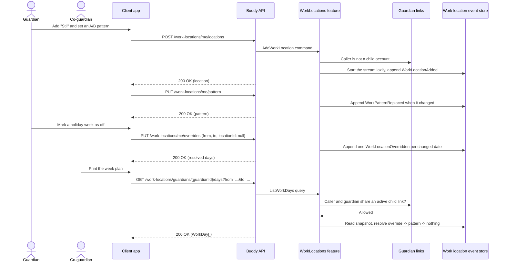

# Work Locations Flow

The work locations feature records where a guardian works on each day, so the
printable week plan can fill rows like "Far på Stil" and "Mor i Randers". Each
guardian keeps their own customizable locations (name, icon, color), a
repeating weekly pattern of 1–4 weeks, and per-date overrides. The design is in
[work-locations.md](../analysis/work-locations.md).

Work locations are never visible to children and never appear in calendars or
iCal feeds.

## Endpoints

| Method   | Route                                                         | Behavior                                                                                                                                                                                                 |
| -------- | ------------------------------------------------------------- | -------------------------------------------------------------------------------------------------------------------------------------------------------------------------------------------------------- |
| `POST`   | `/work-locations/me/locations`                                | Adds a location (name, icon, color).                                                                                                                                                                     |
| `PATCH`  | `/work-locations/me/locations/{locationId}`                   | Changes name, icon and color together. Unchanged details append nothing.                                                                                                                                 |
| `DELETE` | `/work-locations/me/locations/{locationId}`                   | Archives the location and removes it from the pattern in the same append. Overrides that use it keep resolving with `isArchived: true`.                                                                  |
| `PUT`    | `/work-locations/me/pattern`                                  | Replaces the whole pattern: `cycleWeeks` (1–4), `anchorMonday`, and `days` of `{week, day, locationId}`. Stored sorted by week and weekday.                                                              |
| `PUT`    | `/work-locations/me/overrides`                                | Sets `[from, to]` to one location, or to "off" with `locationId: null`. Returns the resolved days.                                                                                                       |
| `DELETE` | `/work-locations/me/overrides?from=...&to=...`                | Clears overrides in the range so those days follow the pattern again. Idempotent.                                                                                                                        |
| `GET`    | `/work-locations/guardians/{guardianId}`                      | Locations (archived included) and the pattern. No stream yet reads as an empty one-week pattern.                                                                                                         |
| `GET`    | `/work-locations/guardians/{guardianId}/days?from=...&to=...` | One `WorkDay` per date with a `status`: `{ kind: 0 }` unplanned, `{ kind: 1 }` off (an override), or `{ kind: 2, location, source }` with the location inlined and `source` `0` pattern or `1` override. |

Date ranges are inclusive.

## Validation

Every rule the endpoints enforce, validator rules first, then the handler's own checks.
A `400 validation_error` carries the message in the `ErrorEnvelope`'s `details` under the
key in the Field column, `""` for a check that isn't tied to one field (see
[HTTP status codes](../http-status-codes.md#error-response-shape-implemented)). A body
that can't be bound is rejected before these rules run, with the same envelope.

| Endpoint                                                                 | Field          | Rule                                                                                                                                                                                  | Code               | Status |
| ------------------------------------------------------------------------ | -------------- | ------------------------------------------------------------------------------------------------------------------------------------------------------------------------------------- | ------------------ | ------ |
| `AddWorkLocation`, `UpdateWorkLocation`                                  | `name`         | Required: not empty or whitespace. At most 40 characters after trimming.                                                                                                              | `validation_error` | 400    |
| `AddWorkLocation`, `UpdateWorkLocation`                                  | `icon`         | Required: not empty or whitespace. At most 16 characters.                                                                                                                             | `validation_error` | 400    |
| `AddWorkLocation`, `UpdateWorkLocation`                                  | `color`        | Required: not empty or whitespace. At most 32 characters.                                                                                                                             | `validation_error` | 400    |
| `AddWorkLocation`                                                        | `""`           | At most 12 active locations per guardian.                                                                                                                                             | `validation_error` | 400    |
| `AddWorkLocation`, `UpdateWorkLocation`                                  | `""`           | Name unique, case-insensitive, among the guardian's active locations; an archived location's name can be reused. `UpdateWorkLocation` skips the check when the details are unchanged. | `validation_error` | 400    |
| `ReplaceWorkPattern`                                                     | `""`           | `days` has no `null` entries. Checked by the endpoint before the validator runs.                                                                                                      | `validation_error` | 400    |
| `ReplaceWorkPattern`                                                     | `cycleWeeks`   | Between 1 and 4, inclusive.                                                                                                                                                           | `validation_error` | 400    |
| `ReplaceWorkPattern`                                                     | `anchorMonday` | A Monday.                                                                                                                                                                             | `validation_error` | 400    |
| `ReplaceWorkPattern`                                                     | `days[n]`      | `week` between 0 and `cycleWeeks` - 1.                                                                                                                                                | `validation_error` | 400    |
| `ReplaceWorkPattern`                                                     | `days[n]`      | `day` a valid weekday, `0` (Sunday) to `6` (Saturday).                                                                                                                                | `validation_error` | 400    |
| `ReplaceWorkPattern`                                                     | `days`         | At most one entry per `week` and `day`.                                                                                                                                               | `validation_error` | 400    |
| `ReplaceWorkPattern`                                                     | `""`           | Every `locationId` is one of the guardian's active locations.                                                                                                                         | `validation_error` | 400    |
| `SetWorkLocationOverrides`, `ClearWorkLocationOverrides`, `ListWorkDays` | `to`           | `to` is not before `from`.                                                                                                                                                            | `validation_error` | 400    |
| `SetWorkLocationOverrides`, `ClearWorkLocationOverrides`, `ListWorkDays` | `to`           | `to` - `from` is at most 31 days.                                                                                                                                                     | `validation_error` | 400    |
| `SetWorkLocationOverrides`                                               | `""`           | `locationId`, when not `null`, is one of the guardian's active locations.                                                                                                             | `validation_error` | 400    |

## Authorization model

- **Manage** is always the caller: every write route is a `/me` route. Child
  accounts get `403`.
- **View** is the guardian themself or a co-guardian, meaning anyone with an
  active `GuardianLink` to at least one of the same children. It is computed
  on every request, so revoking a link removes access immediately.
- Everyone else, children included, gets `404`.
