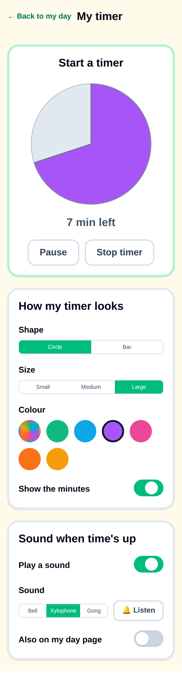
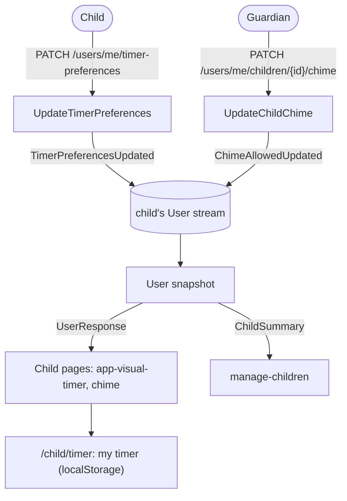

# Child timer preferences and a timer of my own

Status: Implemented. Backend: `TimerPreferences` and `User.AllowChime` on the `User` stream, the `TimerPreferencesUpdated` and `ChimeAllowedUpdated` events, `PATCH /users/me/timer-preferences` (`UpdateTimerPreferences`) and `PATCH /users/me/children/{childId}/chime` (`UpdateChildChime`), with `timerPreferences` and `allowChime` on `UserResponse` and `ChildSummary`. Frontend: `core/timer-preferences.ts`, `core/own-timer.ts`, `core/own-timer-storage.ts`, `core/chime-when-time-runs-out.ts`, `UsersService.currentUser`, three sounds in `TimeUpChimeService`, the preferences in `shared/visual-timer`, the `/child/timer` page linked from the child menu, the chime on the child home, and the "Allow timer sound" switch and choices summary on `manage-children`.

GitHub issue: [#50 Let children customize their own visual timers](https://github.com/kimipsen/buddy/issues/50).

## Context

The [visual time-left timer](visual-time-left-timer.md) shows a child how long is left of the
current routine step, as a shrinking disc (one step) or bar (the whole run). The timer has one look:
the routine's own colour, the minutes as text, and a disc on the focus view. Since
[#51](https://github.com/kimipsen/buddy/pull/51) the focus view also plays a two-note chime when a
step's time runs out ([`time-up-chime.service.ts`](../../../src/frontend/buddy/src/app/core/time-up-chime.service.ts)).
The chime is always on, and the child home's timer stays silent.

The only setting is the guardian's per-child "Show time-left timers" switch
(`User.ShowVisualTimers`, `PATCH /users/me/children/{childId}/visual-timers`, see
[`UpdateChildVisualTimers.Command.cs`](../../../src/backend/buddy/Features/Guardians/UpdateChildVisualTimers/UpdateChildVisualTimers.Command.cs)).

Children with ADHD differ a lot in what helps. One child calms down with a big disc, another finds the
numbers stressful, a third wants a sound and a fourth is startled by one. Letting the child pick
gives them ownership of the timer, which is part of what makes it work. This belongs with the other
things a child does on their own: ticking off tasks, feelings check-ins, splitting homework and
suggesting packing items.

The issue also asks for a free-standing timer: "5 more minutes of Lego", tidying up, brushing teeth
when no routine is scheduled. Today the only timers are the ones a guardian schedules.

Most of the work is frontend, so this doc lives in `docs/frontend/analysis` like the timer doc. The
backend part is two small `User` stream settings, shaped like the existing child settings.

## Question 1: which settings can the child change?

**Decision: six choices, grouped as "look" and "sound".**

| Setting       | Values                                                                                  | Default    | Applies to                                                  |
| ------------- | --------------------------------------------------------------------------------------- | ---------- | ----------------------------------------------------------- |
| Shape         | `Disc`, `Bar`                                                                           | `Disc`     | the big timers (focus view, homework, First-Then, my timer) |
| Size          | `Small`, `Medium`, `Large`                                                              | `Large`    | the big timers                                              |
| Colour        | `Routine` (the run's own colour), `Green`, `Blue`, `Purple`, `Pink`, `Orange`, `Yellow` | `Routine`  | every timer except homework (see below)                     |
| Show minutes  | on / off                                                                                | on         | every timer                                                 |
| Chime         | on / off, and a sound: `Bell`, `Xylophone`, `Gong`                                      | on, `Bell` | the focus view and my timer                                 |
| Chime on home | on / off                                                                                | off        | the child home's run                                        |

- **The defaults are today's behaviour.** A child who never opens the settings sees exactly what
  they see now: a large disc in the routine colour with minutes, and the #51 bell on the focus view
  only.
- **Shape and size only change the big timers.** The child home shows a thin bar for the run and a
  small disc next to each step. Those are a list layout, not a timer the child watches, and a bar
  in a step row or a big disc in the run strip would break the layout. The big timers are the ones
  marked `[large]="true"` in [`visual-timer.ts`](../../../src/frontend/buddy/src/app/shared/visual-timer/visual-timer.ts).
- **Size scales the given size** (`Large` = 100 %, `Medium` = 80 %, `Small` = 60 %), so each page
  keeps the size its layout needs as the upper bound. A size above today's is rejected: the focus
  view's disc already fills `min(70vw, 60vh)`.
- **Colour is a fixed palette.** Seven named colours, not a colour picker, so every choice keeps
  the contrast the timer doc requires against the slate track in light and dark mode. The value is
  a name, not a hex code, so the palette can be retuned without migrating events. Shape plus text
  still carries the meaning; colour only says "this is mine".
- **Homework keeps its own colours.** The homework splitter colours a focus chunk and a break
  differently ([`child-homework.ts`](../../../src/frontend/buddy/src/app/features/child/homework/child-homework.ts),
  `timerColor()`); a single chosen colour would hide that difference. Shape, size and minutes still
  apply there.
- **"Show minutes" hides only the number.** With it off, the visible "7 min left" text goes, but
  words that aren't a count stay ("Time's up", "Paused", "Starts at 07:30"), and the timer's
  accessible name still says the minutes for a screen reader.
- **Three generated sounds.** The chime service already synthesises the bell with Web Audio, so new
  sounds are new note recipes, not audio files: `Bell` (today's 784 Hz → 1047 Hz ding-dong),
  `Xylophone` (three short rising triangle-wave notes) and `Gong` (one low, long sine). Each choice
  has a play button so the child can hear it first; that tap also unlocks audio.
- **Chime on home is a separate switch, off by default.** The home is where the guardian is often
  nearby and other things happen; turning sound on there by default would change today's behaviour
  for every family.

Considered and rejected:

- _A free colour picker_: no contrast guarantee, and children pick a colour that matches the track.
- _Uploading or recording a sound_: an asset store for a nice-to-have, and a loud sound defeats the
  point of a calm time's up.
- _Per-routine preferences_ ("a bar for the morning, a disc for homework"): many more settings to
  understand for a child; one look for "my timer" is the point.
- _Letting the child add time to a running step_ (an open question in the issue): that changes the
  schedule the guardian built and affects the next routine. Out of scope; the child can already
  start the timer late with _Start_, which gives the step its full length from that tap.

## Question 2: where are the choices stored?

**Decision: per child, on the child's own `User` stream, as one `TimerPreferences` value.**

This is how every child setting is stored today (`ShowVisualTimers`, `HomeworkChunks`,
`Language`), so the preferences follow the child between the family iPad and their phone, the
guardian can see them, and the personal-data export and erasure already cover the stream.

- `TimerPreferences` is a record next to `HomeworkChunks` in `Features/Users/Types/`:

  ```csharp
  public sealed record TimerPreferences(
      TimerShape Shape, TimerSize Size, TimerColor Color, bool ShowMinutes,
      bool Chime, ChimeSound ChimeSound, bool ChimeOnHome)
  {
      public static readonly TimerPreferences Default =
          new(TimerShape.Disc, TimerSize.Large, TimerColor.Routine, true, true, ChimeSound.Bell, false);
  }
  ```

- One `TimerPreferencesUpdated(UserId, Before, After, OccurredAt)` event replaces the whole value,
  the same way `HomeworkChunksUpdated` does. It isn't appended when nothing changed.
- `User` gets `TimerPreferences? TimerPreferences = null` with the same
  `{ get; init; } = TimerPreferences ?? TimerPreferences.Default` trick as `HomeworkChunks`, so
  snapshot rows written before the field existed read as the default.
- The enums are stored as strings (the Users store already uses `EnumStorage.AsString`).

Considered and rejected:

- _Per device (`localStorage`)_: no backend, but lost on another device and invisible to the
  guardian, who needs to know why the timer looks different.
- _One event per setting_: seven events for one settings screen. The screen saves the whole value,
  and the history of "what did the child pick" reads fine from before/after pairs.

## Question 3: who can change them?

**Decision: the signed-in user changes their own preferences through
`PATCH /users/me/timer-preferences`, like `PATCH /users/me/language`. A guardian can see a child's
choices and can turn the chime off for that child, but can't change the look.**

- The route sits on the `/users/me` group, so no `GuardianLink` lookup is needed: a user can only
  ever write their own stream. A guardian account could call it too, as with the language route,
  but no guardian screen does; the preferences only mean something for a child.
- **Guardian control is the mute switch** that #51 named as a follow-up: `User.AllowChime`
  (default `true`), set with `PATCH /users/me/children/{childId}/chime` (`UpdateChildChime`,
  shaped like `UpdateChildVisualTimers`, one `ChimeAllowedUpdated` event). When it's off, no timer
  plays a sound, whatever the child picked, and the child's settings screen shows the sound section
  as "A grown-up has turned the sound off" instead of the switches.
- The master switch stays: when `ShowVisualTimers` is off the child sees no timers, and so no timer
  menu entry, settings or own timer either (the `visualTimersGuard` sends them home).
- On `manage-children`, the child's card shows the choices read-only ("Disc · Large · Green ·
  minutes shown · Bell") under the timer switch, plus the "Allow timer sound" switch.

Considered and rejected:

- _Guardian approval of the child's choices_ (like packing suggestions): it's the child's own
  timer, nothing in it affects anyone else, and an approval round-trip for a colour is the opposite
  of ownership.
- _A guardian cap on every setting_: the only setting that affects others in the room, or can upset
  the child, is the sound. The rest are harmless to try.

## Question 4: a timer of my own

**Decision: a `/child/timer` page where the child starts a timer from four preset lengths (2, 5, 10
and 15 minutes), with _Pause_, _Keep going_ and _Stop timer_. It lives only on the device.**

- Presets instead of a number input, because a child who can't read numbers yet can still tap
  "the 5" with its small disc preview, and four sizes cover what families use a kitchen timer for.
- The running timer is stored in `localStorage` (date-stamped, like
  [`child-timer-storage.ts`](../../../src/frontend/buddy/src/app/core/child-timer-storage.ts)), so a
  reload or switching to another page and back keeps it running. It's dropped on a new day.
- No stars, no event, nothing on the guardian dashboard. It's a tool, not a task; rewarding a timer
  would reward starting timers.
- It uses the same `app-visual-timer` with the child's preferences, plays the chosen chime when time
  runs out (if allowed), and keeps the screen awake while it runs (`keepAwakeWhile`, see
  [keep-screen-awake.md](keep-screen-awake.md)).
- The same page holds the "How my timer looks" settings under the timer, so trying a look is
  immediate: change the colour and the timer above changes.
- The page is reached from a "My timer" entry in the child menu, which only shows when timers are on.

Considered and rejected:

- _A separate settings route_: two screens to find; on one page the child sees the effect of every
  choice on a real timer.
- _Saving own timers on the server_: nobody else needs them, and a server timer would add a slice,
  an aggregate and cleanup for no reader.

## Read models

No new read models. `UserResponse` (`GET /users/me` and the `/users/me/*` PATCH responses) and
`ChildSummary` (the Guardians routes) each gain `timerPreferences` and `allowChime`. `ChildSummary`
is built in five handlers; each gets the two new arguments.

## Command slices

| Slice                    | Feature   | Route                                      | Returns        |
| ------------------------ | --------- | ------------------------------------------ | -------------- |
| `UpdateTimerPreferences` | Users     | `PATCH /users/me/timer-preferences`        | `UserResponse` |
| `UpdateChildChime`       | Guardians | `PATCH /users/me/children/{childId}/chime` | `ChildSummary` |

`UpdateTimerPreferences` validates each enum with `IsInEnum()` (`JsonStringEnumConverter` also
binds integers, so an undefined value would get through otherwise). `UpdateChildChime` takes a
boolean and has no validator, like `UpdateChildVisualTimers`.

## Frontend

The "My timer" page as built, on a phone (demo data; no mockup was drawn before it was built):



- `core/timer-preferences.ts`: the types, defaults, the colour palette (name → hex for light and
  dark), the size factors, and `timerPreferencesOf(user)` / `chimeAllowed(user, place)`.
- `UsersService.updateTimerPreferences()` and `GuardiansService.updateChildChime()`.
- `shared/visual-timer`: reads the current user's preferences and applies colour (unless the page
  passes `[keepColor]="true"`), "show minutes", and on `[large]` timers shape and size. A large bar
  is a new layout: a tall rounded bar with the label underneath, counting down the step, not the run.
- `TimeUpChimeService.play(sound)` with three note recipes.
- `ChildFocus` chimes only if the chime is allowed and on; `ChildHome` chimes on a step running out
  when "chime on home" is on, and unlocks audio on any tap, like the focus view.
- `features/child/timer/child-timer-page.{ts,html}` plus `core/own-timer.ts` (pure state functions)
  and `core/own-timer-storage.ts`.
- `ChildMenu`: a "My timer" link when timers are on.
- `manage-children`: the "Allow timer sound" switch and the read-only summary.
- i18n: `translations/{en,da}/child-timer.ts` for the page and settings, plus a few keys in
  `admin.ts` for `manage-children`.
- Screenshots: `/child/timer` in `screenshots/pages.ts`, with a preference set seeded for
  demo.emil so the page isn't all defaults.

## Testing

- Backend: Alba tests per slice, mirroring
  [`UpdateChildVisualTimersTests.cs`](../../../src/backend/buddy.IntegrationTests/Features/Guardians/UpdateChildVisualTimers/UpdateChildVisualTimersTests.cs)
  and the `UpdateLanguage` tests, golden event-shape files for the two events, and a snapshot test
  that a row without the new fields reads as the defaults.
- Frontend: Vitest specs for the pure own-timer functions, the storage, the chime recipes, the
  visual timer's preference handling, the page, the menu link and `manage-children`.
- e2e: a child opens "My timer", picks a bar and a colour, starts a 2-minute timer, reloads and sees
  it still running; a guardian turns the sound off and the child's page says so.

## Failure and edge-case behavior

| Case                                                                   | Behavior                                                                                                               |
| ---------------------------------------------------------------------- | ---------------------------------------------------------------------------------------------------------------------- |
| Same preferences saved again                                           | `200` with the user, no event appended                                                                                 |
| An undefined enum value (`"shape": "Star"` or `7`)                     | `400` validation error on that field                                                                                   |
| Snapshot row from before the feature                                   | Reads as `TimerPreferences.Default` and `AllowChime = true`                                                            |
| Guardian turns timers off                                              | No timers, no menu entry; `/child/timer` redirects to `/child`                                                         |
| Guardian turns the chime off                                           | No sound anywhere; the settings show the "turned off" note; the child's own choice is kept for when it's allowed again |
| `UpdateChildChime` with a revoked `GuardianLink` or a stranger's child | `404`, like `UpdateChildVisualTimers`                                                                                  |
| Own timer left running past midnight                                   | Dropped on the next day's first read                                                                                   |
| Browser without Web Audio, or audio still locked                       | No sound; the disc still shows time's up                                                                               |
| Saving a preference fails (offline)                                    | The control snaps back and a short error shows, like the guardian switches                                             |

## Estimate

|                  |                                                                                                                                                                        |
| ---------------- | ---------------------------------------------------------------------------------------------------------------------------------------------------------------------- |
| Complexity       | Medium -- two small `User` settings (2 events, 2 routes), one new child page with a pure timer model, and preference handling in a shared component used on four pages |
| Single developer | 4-6 days                                                                                                                                                               |
| AI agent         | 4-6 hours, plus about 1-2 hours of human review and a listen on a real iPad                                                                                            |

## Decisions made

| Question                      | Decision                                                                                                 |
| ----------------------------- | -------------------------------------------------------------------------------------------------------- |
| Settings in v1                | Shape, size, colour, show minutes, chime on/off + sound, chime on home -- settled by the user 2026-11-05 |
| Defaults                      | Today's look and today's focus-view bell, so nothing changes until the child picks                       |
| Storage                       | Per child on the `User` stream, one `TimerPreferences` value -- settled by the user 2026-11-05           |
| Who changes them              | The child, via `PATCH /users/me/timer-preferences`; no guardian approval                                 |
| Guardian control              | See the choices; turn the sound off per child (`AllowChime`) -- settled by the user 2026-11-05           |
| Own timer                     | In v1, presets 2/5/10/15 min, device-only, no stars -- settled by the user 2026-11-05                    |
| Homework colours              | Kept; the colour preference doesn't apply there                                                          |
| Adding time to a running step | Out of scope                                                                                             |
| Transition-warning countdown  | Out of scope; it's a banner countdown, not an `app-visual-timer`                                         |

## Remaining open questions

- Whether "Xylophone" and "Gong" sound right on an iPad speaker needs a real listen; the recipes
  are easy to retune.

## Diagram


