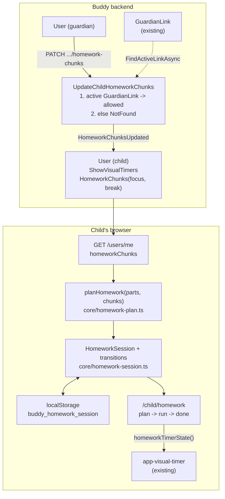

# Homework splitter

Status: Implemented. Backend: `User.HomeworkChunks` (default 15/5), the `HomeworkChunksUpdated` event and `PATCH /users/me/children/{childId}/homework-chunks` (`UpdateChildHomeworkChunks`), with `homeworkChunks` on `UserResponse` and `ChildSummary`, behind the new `Homework` installation flag. Frontend: `core/homework-plan.ts`, `core/homework-session.ts`, `core/homework-storage.ts`, the `/child/homework` page (plan, run with the shared visual timer and break ideas, done), the "Homework" link and in-progress card on `/child`, and the focus and break selects on `manage-children`.

## Context

Homework is one of the hardest parts of the day for many children with ADHD. A worksheet that
"takes 40 minutes" feels endless, and starting it is the hardest part. The standard advice is to
make the work smaller and the end visible: split the assignment into short, timed focus blocks
(10--20 minutes, depending on the child), with a short break between them. Some families do this
with a kitchen timer and a sticky note listing "Maths -- Reading -- Spelling".

Guardians want that in Buddy:

- The child (or a guardian sitting next to them) enters tonight's homework as one or more parts
  ("Maths p. 12", "Reading", "Spelling words"), each with a rough estimate.
- Buddy splits it into focus chunks with breaks between them, using lengths a guardian has chosen
  for this child.
- The child works through the chunks one by one, with a big time-left disc, and can say "I'm done
  with this part" early or "I need more time".

Nothing like this exists in Buddy yet, but the parts it needs do:

- The **visual time-left timer** ([visual-time-left-timer.md](visual-time-left-timer.md)) gives
  the child a shrinking disc and bar
  ([`shared/visual-timer`](../../../src/frontend/buddy/src/app/shared/visual-timer/visual-timer.ts)),
  driven by a pure `TimerState`
  ([`core/visual-timer.ts`](../../../src/frontend/buddy/src/app/core/visual-timer.ts)), with
  Start / Pause / Keep going, and a distraction-free focus view at `/child/focus/:itemId`
  ([`child-focus.ts`](../../../src/frontend/buddy/src/app/features/child/focus/child-focus.ts)).
- That doc settled that **timer progress stays in the browser**: no events, no GDPR entry, and no
  "how slow was my child" tracking
  ([Question 1](visual-time-left-timer.md#question-1-frontend-only-or-new-backend-state)). A
  child-started timer survives a reload through `localStorage`
  ([`core/child-timer-storage.ts`](../../../src/frontend/buddy/src/app/core/child-timer-storage.ts)).
- A **guardian-managed per-child setting** already exists for timers:
  `User.ShowVisualTimers`, set by `PATCH /users/me/children/{childId}/visual-timers`
  ([`UpdateChildVisualTimers.Handler.cs`](../../../src/backend/buddy/Features/Guardians/UpdateChildVisualTimers/UpdateChildVisualTimers.Handler.cs)),
  with its switch on `manage-children`.

The user settled the product questions on 2026-10-14: **the child sets up a session on their own
screen, and a guardian can use the same screen with them** (no guardian-side planning); **sessions
live in the browser only**; **a guardian sets per-child focus and break lengths**; **no stars in
v1**; and **a fixed list of break ideas in v1**.

This document answers seven questions: what is stored where (1), how focus and break lengths are
configured (2), how an assignment is split (3), how a session runs (4), where it appears (5), how
it relates to the visual-timers switch and feature flags (6), and how a session survives a reload
(7).

## Question 1: a new aggregate, the task library, or the browser?

**Decision: a homework session lives entirely in the child's browser. The only server state is
the guardian's per-child chunk lengths (Question 2). No new aggregate, schema, event store or
snapshot.**

- **Homework changes every day.** A task-library `TaskTemplate` is a reusable routine edited by a
  guardian ([`TaskTemplate.cs`](../../../src/backend/buddy/Features/TaskLibrary/Types/TaskTemplate.cs)).
  Tonight's "Maths p. 12" is used once. Making the child create, schedule and archive a template
  every evening is the wrong tool. Rejected.
- **A calendar task can't hold inline subtasks.** A task's subtasks come only from a template
  (`TaskSource.FromTemplate`,
  [`ItemSchedule.cs`](../../../src/backend/buddy/Features/Calendars/Types/ItemSchedule.cs)), and a
  child is a calendar `Viewer` who can only tick their own tasks. Guardian-planned homework on the
  calendar would need both changed. The user chose child-side setup instead, so this is rejected.
- **A server-side `HomeworkSession` aggregate with history** was offered and rejected by the user.
  It would add a GDPR export section and a record of how long each chunk took, which is the
  behavioural tracking that visual-time-left-timer.md Question 1 deliberately avoids. Each family
  runs its own instance and prefers logs to oversight screens.
- The consequence is accepted: a session started on the tablet doesn't continue on the phone, and
  a guardian can't see last week's homework. Both can be added later without a redesign (see
  "Remaining open questions").

## Question 2: per-child focus and break lengths

**Decision: `User` gains `HomeworkChunks(int FocusMinutes, int BreakMinutes)`, default 15/5,
set by a guardian through a new Guardians slice, `UpdateChildHomeworkChunks`, with the same shape
as `UpdateChildVisualTimers`. It is returned on `ChildSummary` (guardian side) and `UserResponse`
(`GET /users/me`, child side). Focus is 5--45 minutes, break 1--15 minutes.**

```
HomeworkChunks(int FocusMinutes, int BreakMinutes)   // Features/Users/Types
    static Default = new(15, 5)

HomeworkChunksUpdated(UserId UserId, HomeworkChunks Before, HomeworkChunks After,
    DateTimeOffset OccurredAt)
    // appended to the child's own User stream; never when the value doesn't change
```

- **Why the guardian sets it, not the child.** Lengths are a treatment decision ("Emil manages
  10 minutes, Ida 20"). A child who can always pick "45 minutes, no breaks" defeats the point. The
  user chose per-child defaults that the child can't change in the middle of a session.
- **Why on `User`.** It follows `ShowVisualTimers`, `Language` and `TimeZoneId`: a rarely changed,
  per-child setting that has to follow the child to every device they sign in on. A separate
  `HomeworkSettings` document would be a whole new store for two integers.
- **Whole minutes as integers, not `TimeSpan`.** The UI offers minutes only, the wire stays
  readable (`{ "focusMinutes": 15, "breakMinutes": 5 }`), and there is no sub-minute value to
  validate away. `Subtask.Duration` is a `TimeSpan` because routines can be scheduled down to the
  minute on a calendar; nothing here is scheduled.
- **The ranges.** Under 5 minutes of focus is too short to start anything, and over 45 is longer
  than any ADHD guidance suggests. A break under 1 minute isn't a break, and one over 15 turns
  into "stopped doing homework". `UpdateChildHomeworkChunksValidator` enforces both with
  `InclusiveBetween`.
- **Snapshot compatibility.** Snapshot rows written before the field have no property. `User`
  copies `TaskTemplate`'s pattern for `Checklist`: the constructor parameter is nullable with a
  `null` default, and the property reads a missing value as `HomeworkChunks.Default`.

The change to existing code:

[`User.cs:6-19`](../../../src/backend/buddy/Features/Users/Types/User.cs), today:

```csharp
public sealed record User(
    UserId Id,
    ...
    bool IsErased = false,
    bool ShowVisualTimers = true)
```

Proposed:

```csharp
public sealed record User(
    UserId Id,
    ...
    bool IsErased = false,
    bool ShowVisualTimers = true,
    // Guardian-managed (UpdateChildHomeworkChunks); meaningful for children only.
    HomeworkChunks? HomeworkChunks = null)
{
    // Snapshot rows written before homework chunks have no property; read them as the default.
    public HomeworkChunks HomeworkChunks { get; init; } = HomeworkChunks ?? HomeworkChunks.Default;
    ...
    HomeworkChunksUpdated updated => user with { HomeworkChunks = updated.After },
```

[`ListMyChildren.Handler.cs:30`](../../../src/backend/buddy/Features/Guardians/ListMyChildren/ListMyChildren.Handler.cs),
today:

```csharp
public sealed record ChildSummary(UserId Id, Name Name, GuardianLinkId GuardianLinkId, GuardianKind Kind,
    Language Language, TimeZoneId TimeZoneId, bool ShowVisualTimers);
```

Proposed: one more positional parameter, `HomeworkChunks HomeworkChunks`. Blast radius: four
handlers build a `ChildSummary` today (`ListMyChildren`, `UpdateChildLanguage`,
`UpdateChildTimeZone`, `UpdateChildVisualTimers`) and the new slice is the fifth.
`GetCurrentUser`'s `UserResponse.FromUser` gains one field. The `UserEvent` union,
`UsersFeature`'s event-type list and `UserSnapshotProjection` gain one case each, and the
EventShapeTests golden files gain one file. The GDPR export needs no change of its own: the
"account" section is `UserResponse.FromUser`
([`UsersPersonalDataExport.cs`](../../../src/backend/buddy/Features/Users/UsersPersonalDataExport.cs)).

## Question 3: how is an assignment split?

**Decision: a pure function `planHomework(parts, chunks)` in a new
`core/homework-plan.ts` turns parts with estimates into an ordered list of focus and break steps.
Each part gets `ceil(estimate / focus)` chunks of near-equal whole minutes, and a break goes
between every two focus chunks, never after the last one.**

```ts
export interface HomeworkPart {
  id: string;            // crypto.randomUUID(), stable across reloads
  title: string;         // 1-60 characters, trimmed
  estimateMinutes: number; // 5-120, in steps of 5
}

export type HomeworkStep =
  | { kind: 'focus'; partId: string; index: number; of: number; minutes: number }
  | { kind: 'break'; minutes: number };

export function planHomework(parts: HomeworkPart[], chunks: HomeworkChunks): HomeworkStep[];
```

Example with focus 15 / break 5:

| Part | Estimate | Chunks |
|---|---|---|
| Maths p. 12 | 40 min | 14 + 13 + 13 |
| Reading | 20 min | 10 + 10 |
| Spelling | 10 min | 10 |

The steps are Maths 1/3, break, Maths 2/3, break, Maths 3/3, break, Reading 1/2, break, Reading
2/2, break, Spelling 1/1: six focus chunks and five breaks, 70 minutes of work plus 25 minutes
of breaks.

- **Near-equal chunks rather than "15, 15, 10".** A short leftover chunk at the end feels like a
  mistake. Equal-ish chunks keep each block under the guardian's length and make "2 of 3" mean
  what it says. The larger chunks come first, as in the example.
- **Breaks between parts too.** Changing subject is a natural break, and a fixed rhythm is easier
  to follow than "sometimes a break, sometimes not".
- **No long break after N chunks in v1.** Pomodoro adds a long break every fourth chunk, but a
  typical evening's homework is two to six chunks. See "Remaining open questions".
- **Estimates in 5-minute steps, 5--120 minutes.** Children (and guardians) estimate badly, and
  finer steps pretend to a precision nobody has. A part longer than two hours isn't one evening's
  homework.
- **Up to 6 parts.** More than that is a different problem than splitting.
- **Rejected: the child picks the number of chunks.** It moves the arithmetic onto the child,
  which is what the feature exists to remove.

## Question 4: how does a session run?

**Decision: always child-started, step by step. A focus chunk counts down on the big disc. When
it reaches zero, the child taps *Take a break*. When the break ends, they tap *Back to work*.
Nothing advances by itself. During a focus chunk the child can tap *Pause*, *Done with this part*
(skip the rest of the part's chunks) or, when the time is up, *I need more time* (one more
chunk of this part, started at once). A session is finished when the last focus step is done.**

A session is pure state plus pure transitions in `core/homework-session.ts`, next to
`visual-timer.ts`, so every case is a plain Vitest test with no fake timers:

```ts
export interface HomeworkSession {
  date: string;              // yyyy-MM-dd, the child's local date it was started
  parts: HomeworkPart[];
  chunks: HomeworkChunks;    // copied in when the session starts (Question 2)
  steps: HomeworkStep[];     // planHomework(parts, chunks), changed by the transitions below
  currentIndex: number;      // steps.length when finished
  startedAtMs: number | null; // when the current step's clock started; null before the first Start
  pausedAtMs: number | null;
}

export function createSession(parts, chunks, date): HomeworkSession;
export function start(session, nowMs): HomeworkSession;         // the first step's Start
export function pause(session, nowMs): HomeworkSession;
export function resume(session, nowMs): HomeworkSession;
export function next(session, nowMs): HomeworkSession;          // Take a break / Back to work / I'm done
export function finishPart(session, nowMs): HomeworkSession;    // drops this part's later chunks
export function addChunk(session, nowMs): HomeworkSession;      // one more chunk of FocusMinutes
export function breaksBefore(session): number;                  // picks the break idea
export function homeworkTimerState(session, nowMs): TimerState; // feeds <app-visual-timer>
```

- **Nothing auto-advances.** Moving from work to a break and from a break back to work is the
  hard transition for these children. A tap makes it a choice the child made, as the visual
  timer does ([visual-time-left-timer.md, Question 5](visual-time-left-timer.md)). It also means a
  child who walked away doesn't come back to find three chunks "used up".
- **Time's up isn't failure.** At zero the disc is empty and the page says "Time for a break!",
  with *Take a break*, *I need more time* and *Done with this part*. No red, no sound, nothing
  counted against the child, following the "progress never punishes" principle of
  [gamified-progress.md](../../backend/analysis/gamified-progress.md).
- **A break can be ended early** (*Back to work*), and a break that has run out simply waits.
- **Each break shows one idea** from a fixed, translated list (`homework.breakIdeas`, about eight:
  "Drink some water", "Jump 10 times", "Stretch up high" ...), the next one in turn, chosen by
  the break's position in the session so a reload shows the same idea. Guardians can't edit the
  list in v1.
- **`finishPart` removes the remaining chunks of the current part and the breaks between them**,
  then moves on to the break before the next part, or finishes the session if this was the last
  part. Finishing faster than estimated is the best outcome and should feel like it.
- **`next` starts the step it moves to at the moment of the tap**, so only the very first step
  waits for *Start*.
- **`addChunk` inserts one more `FocusMinutes` chunk right after the current step and starts it at
  once, with no break in between**, and renumbers the part's "n of m". (The first draft of this doc
  put a break before the extra chunk; while building it, a child who has just said "I need more
  time" being sent on a break read wrong, so the extra chunk follows straight on.)
- **Reusing `<app-visual-timer>`.** `homeworkTimerState` maps the current step to the existing
  `TimerState` (`budgetMs` = the step's minutes, `runBudgetMs` = the whole session, `deadlineMs`
  while running, `phase` `upcoming`/`running`/`paused`/`timesUp`/`done`). `current` and `next`
  stay `null`, because they are calendar occurrences. The homework page passes
  `[announce]="false"` and owns its own live region, which announces "Break", "Back to work: Maths
  2 of 3" and "All done!". The disc's colour is emerald for focus and sky for breaks, and the label
  always says which one it is, so colour never carries the meaning alone.

## Question 5: where does it appear?

**Decision: one new child page, `/child/homework`, with three states: *plan* (enter parts),
*run* (the focus view for the current step) and *done*. A "Homework" link joins the row of links
on the child home. There is no guardian page. A guardian helps on the child's screen, and only
sets the lengths on `manage-children`.**

- **Plan.** A list of parts (title + estimate in a `segmented-control`-style picker of 5-minute
  steps, add/remove a part), then a live preview of the split ("3 chunks · 2 chunks · 1 chunk --
  about 1 h 35 min with breaks"), using the child's lengths from `GET /users/me`. *Start* begins
  the first focus chunk.
- **Run.** It is laid out like the existing focus view
  ([`child-focus.html`](../../../src/frontend/buddy/src/app/features/child/focus/child-focus.html)):
  one large disc, the step's title ("Maths p. 12 -- 2 of 3", or "Break"), the next step underneath,
  a slim bar for the whole session, and the buttons from Question 4. The page has no navigation
  other than *Stop homework* (with a confirm), which clears the session.
- **Done.** "All done!" with the parts ticked, and a *Back home* link. Opening the page again
  starts a new plan.
- **The child home** shows "Homework" in the link row. While a session is in progress, it shows a
  slim card instead ("Homework: Maths 2 of 3 -- continue"), so a child who went back home can find
  their way back.
- **Guardian side**: on `manage-children`, under the "Show time-left timers" switch, two small
  number selects, "Homework focus (minutes)" and "Break (minutes)". Each saves on change, like
  the timer switch (`changeVisualTimers` in
  [`manage-children.ts:284`](../../../src/frontend/buddy/src/app/features/guardian/admin/manage-children/manage-children.ts)).

Rejected: putting homework on the calendar as a run of the existing focus view. It would need the
calendar task with inline subtasks that Question 1 rejected.

## Question 6: the visual-timers switch and feature flags

**Decision: a new installation flag, `Homework`, default on, following
[feature-flags.md](../../backend/analysis/feature-flags.md). With it off, `/child/homework`, the
home link and the guardian's length selects are hidden, and `PATCH .../homework-chunks` is not
mapped. A child whose `ShowVisualTimers` is off still gets the homework splitter, but the run view
shows the step, "n of m" and the buttons without a disc or minutes left.**

- **One flag per optional domain** is the rule in feature-flags.md, Question 2. The homework
  splitter doesn't need the task library, so it gets its own flag instead of riding on
  `TaskLibrary` as the focus view does. `MapGuardiansFeature` takes the flags and maps the slice
  conditionally, as `MapCalendarsFeature` already does for `ScheduleTaskFromTemplate`
  ([`CalendarsFeature.cs:126-130`](../../../src/backend/buddy/Features/Calendars/CalendarsFeature.cs)).
  The `HomeworkChunks` field stays on the `User` and in the responses whatever the flag says,
  because data outlives flags (feature-flags.md, Question 3).
- **Why the timers switch doesn't hide the whole feature.** A guardian turns timers off for a
  child who finds a countdown stressful. Splitting work into parts with breaks still helps that
  child. The guardian's lengths still decide when the "Time for a break" prompt appears, but the
  page doesn't show the time running out. This is the same respect for the switch that `ChildHome`
  shows (`home.ts:349`).

## Question 7: surviving a reload

**Decision: the whole `HomeworkSession` is stored in `localStorage` under `buddy_homework_session`
by `core/homework-storage.ts`, on every transition, the same guarded way as
`child-timer-storage.ts`. A stored session from another date, or one that fails validation, is
thrown away. Stopping or finishing a session clears it.**

- One session at a time per device. The child's tablet is the child's.
- Wall-clock instants (`startedAtMs`, `pausedAtMs`) make a reload exact: a running chunk keeps
  counting while the tab is closed, as a real kitchen timer would.
- Same storage caveats as the timer: a private window or blocked storage means a reload starts
  over, and the page still works.

## API surface

| Route | Method | Auth | Purpose |
|---|---|---|---|
| `/users/me/children/{childId}/homework-chunks` | PATCH | guardian with an active `GuardianLink` (else `404`) | `UpdateChildHomeworkChunks`: body `{ focusMinutes, breakMinutes }`, returns `ChildSummary`; `400` outside the ranges |
| `/users/me` | GET | any user | `UserResponse` gains `homeworkChunks` |
| `/users/me/children` | GET | guardian | `ChildSummary` gains `homeworkChunks` |
| `/features` | GET | anonymous | `InstallationFeatures` gains `homework` |

`task docs:openapi` regenerates the contract and `buddy-api.ts`.

## Frontend

- `core/homework-plan.ts`, `core/homework-session.ts`, `core/homework-storage.ts`, each with a spec.
- `features/child/homework/child-homework.{ts,html,spec.ts}` with the route
  `{ path: 'homework', component: ChildHomework, canActivate: [featureGuard('homework')] }` in
  [`child.routes.ts`](../../../src/frontend/buddy/src/app/features/child/child.routes.ts).
- The link and the in-progress card on
  [`home.html`](../../../src/frontend/buddy/src/app/features/child/home/home.html).
- `GuardiansService.updateChildHomeworkChunks(childId, chunks)` and the selects on
  `manage-children`.
- i18n: `translations/{en,da}/homework.ts` for the child page, plus
  `admin.manageChildren.homework.*` keys.
- Screenshots: `/child/homework` in its run state in `screenshots/pages.ts`. The screenshot seeds
  the browser session through `localStorage`, because there is no server data to seed. Re-run
  `manage-children` and the child home for the new controls.

## Testing

- **Backend**: `UpdateChildHomeworkChunksTests`, mirroring
  [`UpdateChildVisualTimers`'s tests](../../../src/backend/buddy.IntegrationTests/Features/Guardians/UpdateChildVisualTimers):
  `200` with the new values on `ChildSummary` and `GET /users/me` as the child; an unchanged value
  appends no event; `400` for each range edge (4/46 focus, 0/16 break); `404` for a stranger, for
  a revoked link and for a deleted child; `404` (unmapped) with `Features:Homework=false`. Add a
  `UserSnapshot` test showing that an old snapshot without the property reads 15/5. Add the
  `HomeworkChunksUpdated` golden file to EventShapeTests.
- **Frontend unit**: `planHomework` (rounding, larger chunks first, one-chunk parts, breaks only
  between steps); every transition in `homework-session.ts` (`finishPart` on the last part,
  `addChunk` renumbering, pause/resume arithmetic, `homeworkTimerState` phases); storage
  (another date, junk, unavailable storage); the page states; manage-children's selects.
- **e2e**: a guardian sets 10/2 for a child; the child plans two parts, starts, finishes a part
  early, takes and ends a break, and reaches "All done!".

## Failure and edge-case behavior

| Case | Behavior |
|---|---|
| Guardian changes lengths during a session | The running session keeps the lengths it was started with (copied into `HomeworkSession.chunks`); the next session uses the new ones |
| Estimate shorter than the focus length | One chunk of the estimate's length |
| Child reloads mid-chunk | The chunk continues from the stored `startedAtMs`; a chunk whose time ran out while closed shows "Time for a break!" |
| Session from yesterday in storage | Thrown away; the plan state opens |
| Same child signs in on a second device | That device has no session (accepted, Question 1) |
| `ShowVisualTimers` off | Steps and buttons, no disc or minutes (Question 6) |
| `Features:Homework=false` | Page, link and selects hidden; `PATCH` unmapped (`404`); the field stays in responses |
| PATCH with an unchanged value | `200`, no event, the same idempotence as `UpdateChildVisualTimers` |
| Guardian's `GuardianLink` revoked | `404` on the PATCH, the "can't tell missing from not yours" collapse |
| Old snapshot without `HomeworkChunks` | Reads as 15/5 |

## Estimate

| | |
|---|---|
| Complexity | Medium -- one event and one slice on the existing `User` stream (five `ChildSummary` call sites), one feature flag, three pure frontend modules, one new three-state child page, two controls on manage-children |
| Single developer | 4-6 days |
| AI agent | 3-4 hours, plus about 1 hour of human review |

## Decisions made

| Question | Decision |
|---|---|
| Who sets up a session | The child on `/child/homework`; a guardian helps on the same screen (user, 2026-10-14) |
| Where a session lives | The child's browser only, no history (user, 2026-10-14) |
| Focus/break lengths | Guardian-set per child, `User.HomeworkChunks`, default 15/5, focus 5--45, break 1--15 (user, 2026-10-14) |
| Stars | None in v1 (user, 2026-10-14) |
| Splitting | `ceil(estimate / focus)` near-equal chunks per part, larger first, breaks between every two focus chunks |
| Advancing | Always a tap; nothing auto-advances; time's up is never failure |
| Early finish / overrun | *Done with this part* drops its remaining chunks; *I need more time* adds one chunk, started at once |
| Flag | New `Homework` installation flag |
| Timers switch off | Feature stays, without disc or minutes |
| Break ideas | A fixed, translated list of short ideas ("Drink some water", "Jump 10 times"); each break shows the next one in turn (user, 2026-10-14) |

## Remaining open questions

- **A long break after every N chunks.** Lean: not in v1. If wanted, add `LongBreakEvery` and
  `LongBreakMinutes` to `HomeworkChunks`, which is additive (a new event field defaulting to "off").
- **Stars for finished homework.** Lean: later, as one star per finished session through
  `RecordStarChange`, with a once-per-day cap, since sessions are child-created and unverified.
  That needs a small backend endpoint and makes the session's *finish* (not its progress) visible
  to the server.
- **History for guardians.** Lean: no. If families ask, a `HomeworkLog` aggregate recording
  finished sessions (parts and planned minutes, never per-chunk timing) can be added without
  changing anything here.
## Diagram


