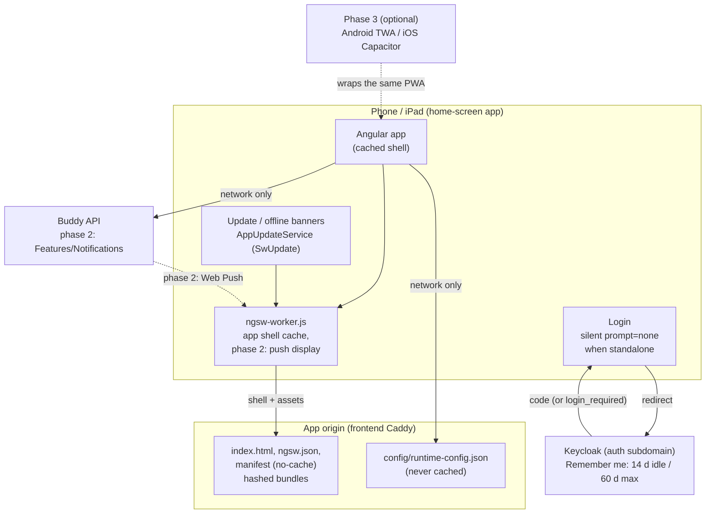

# Buddy as a mobile app

Status: Proposed (not yet implemented)

## Context

Guardians use Buddy on their phones and children use it on an iPad or a phone. Since
[responsive-layout.md](responsive-layout.md) every page fits a phone, but Buddy is still a browser
tab. There's no home-screen icon, closing the tab ends the session, and nothing reaches the user
unless they open the app. The [TODO](../../../TODO.md) item "Mobile app" asks for a decision on the
approach (PWA, a wrapper such as Capacitor, or native) that covers Keycloak login, push
notifications and app-store distribution, written here before anything is built.

Two documents already cover part of this:

- [ipad-installation.md](ipad-installation.md) compares a PWA, a Capacitor shell and a native
  rewrite, and recommends the installed web app.
- [mobile-app-and-notifications.md](../../backend/analysis/mobile-app-and-notifications.md) is the
  backend design. It confirms "PWA first" as a user decision, specifies Web Push end to end
  (VAPID, `Features/Notifications`, the scheduler, payloads, settings screens) and outlines the PWA
  shell in its Question 1.

This document doesn't reopen those decisions. It covers what they leave open on the frontend:

- how the app is split into phases that can ship on their own;
- what the installable shell needs in this codebase, file by file;
- how sign-in behaves in standalone mode, which turns out to be the largest gap (Question 4);
- the safe-area and theme details of the shell;
- how users are guided to install it;
- whether and how Buddy goes into the app stores.

What exists today, checked against the code:

- No manifest, no service worker and no `@angular/service-worker` in
  [package.json](../../../src/frontend/buddy/package.json). [index.html](../../../src/frontend/buddy/src/index.html)
  has `width=device-width, initial-scale=1` without `viewport-fit=cover`, a `favicon.ico` and no
  touch icon or `theme-color`.
- Tokens live in `sessionStorage`
  ([auth.service.ts:21](../../../src/frontend/buddy/src/app/core/auth.service.ts#L21)). Without
  tokens, [auth.guard.ts](../../../src/frontend/buddy/src/app/core/auth.guard.ts) sends the user to
  `/login`, which shows a "Sign in" button
  ([login.ts](../../../src/frontend/buddy/src/app/features/login/login.ts)). Nothing signs in
  silently.
- The realm export [buddy-realm.json](../../../.devcontainer/keycloak/buddy-realm.json) sets no
  session lifetimes and doesn't enable "Remember me", so Keycloak's defaults apply: SSO Session
  Idle 30 minutes and SSO Session Max 10 hours. Production realms are copied from the dev realm by
  hand ([deploy/README.md, step 5](../../../deploy/README.md)).
- Keycloak runs on its own subdomain in production (`{$AUTH_DOMAIN}` in
  [deploy/Caddyfile](../../../deploy/Caddyfile)), so the sign-in page is outside the app's origin.
- The guardian tab bar already pads for the home indicator
  (`pb-[env(safe-area-inset-bottom)]` in
  [tab-bar.html](../../../src/frontend/buddy/src/app/features/guardian/shell/tab-bar/tab-bar.html)).
  The sticky header in [guardian-shell.html](../../../src/frontend/buddy/src/app/features/guardian/shell/guardian-shell.html)
  and the child page have no top inset. The bottom inset only takes effect once `viewport-fit=cover`
  is set.
- The CSP in the [frontend Caddyfile](../../../src/frontend/buddy/Caddyfile) is enforced and has
  no `worker-src` or `manifest-src`. Both fall back to `'self'`, so a same-origin worker and
  manifest need no change.
- The in-app help ([help-topics.ts](../../../src/frontend/buddy/src/app/core/help/help-topics.ts),
  [in-app-help.md](in-app-help.md)) is implemented, so an install guide can be a help topic.

This document answers seven questions: the phases, the installable shell, updates and offline,
sign-in in standalone mode, the shell layout, install guidance, and store distribution.

## Question 1: what gets built, in what order?

**Decision: three phases. Each phase ships on its own and is useful without the next one.**

| Phase                            | What the user gets                                                                                                                                                                 | Backend change                                   |
| -------------------------------- | ---------------------------------------------------------------------------------------------------------------------------------------------------------------------------------- | ------------------------------------------------ |
| 1. Installable app               | Home-screen icon, full screen with no browser chrome, stays signed in, update banner, install guide                                                                                | Realm settings and a Caddyfile header block only |
| 2. Push notifications            | The seven notification kinds from [mobile-app-and-notifications.md](../../backend/analysis/mobile-app-and-notifications.md#question-3-where-do-subscriptions-and-preferences-live) | The whole `Features/Notifications` design        |
| 3. Store distribution (optional) | Play Store listing or sideloaded APK on Android; a TestFlight build on iOS only if Web Push proves unreliable                                                                      | None for Android; a second `IPushSender` for iOS |

- **Phase 1 first**, because it fixes the most frequent problem (signing in again, Question 4)
  and has none of push's risks. Push also needs it: on iOS, Web Push only works for a web app that
  has been added to the home screen.
- **Phase 2** follows the backend doc as written. Its "Frontend" section lists the pages and
  services. This document only changes where the shell work goes: the backend doc's estimate
  includes 2-3 days of "PWA shell", which moves to phase 1 here.
- **Phase 3** is optional and may never be needed (Question 7).

Rejected: **shipping push first**. It's what the user wants most, but it's the riskiest phase
(Web Push encryption, a scheduler, device testing that CI can't do). It also can't work on iOS
until phase 1's manifest and install guide exist.

## Question 2: what makes the app installable?

**Decision: `ng add @angular/pwa`, then trim what it generates. That gives a manifest, icons, an
`ngsw-config.json` that caches only the app shell, and `provideServiceWorker` in production
builds only.**

### Files

| File                                                               | Change                                                                                                                                                                                                                                                                                                                   |
| ------------------------------------------------------------------ | ------------------------------------------------------------------------------------------------------------------------------------------------------------------------------------------------------------------------------------------------------------------------------------------------------------------------ |
| `public/manifest.webmanifest` (new)                                | `name` "Buddy", `short_name` "Buddy", `display: "standalone"`, `start_url: "/"`, `scope: "/"`, `id: "/"`, `background_color` and `theme_color` from the light theme (emerald-400 is the brand mark in the header), `icons` 192, 512 and a 512 maskable. No `orientation`: the child's iPad is used in both orientations. |
| `public/icons/` (new)                                              | `icon-192.png`, `icon-512.png`, `icon-maskable-512.png`, `apple-touch-icon.png` (180 px; iOS ignores manifest icons), `badge-72.png` (monochrome, for phase 2). There's no logo file today, only the "B" tile drawn in the header, so the icons need drawing first (open question).                                      |
| [index.html](../../../src/frontend/buddy/src/index.html)           | `viewport-fit=cover`, `<link rel="manifest">`, `<link rel="apple-touch-icon">`, `<meta name="theme-color">` per colour scheme, and `apple-mobile-web-app-title`                                                                                                                                                          |
| `ngsw-config.json` (new)                                           | `assetGroups`: `app` (prefetch: `index.html`, JS, CSS, `theme-init.js`), `assets` (lazy: icons, fonts). `dataGroups`: none.                                                                                                                                                                                              |
| [app.config.ts](../../../src/frontend/buddy/src/app/app.config.ts) | `provideServiceWorker('ngsw-worker.js', { enabled: !isDevMode(), registrationStrategy: 'registerWhenStable:30000' })`                                                                                                                                                                                                    |
| [angular.json](../../../src/frontend/buddy/angular.json)           | `"serviceWorker": "ngsw-config.json"` in the production configuration only                                                                                                                                                                                                                                               |
| [Caddyfile](../../../src/frontend/buddy/Caddyfile)                 | `Cache-Control: no-cache` for `/index.html`, `/ngsw.json`, `/ngsw-worker.js`, `/manifest.webmanifest` and `/config/*`                                                                                                                                                                                                    |

`index.html` before and after:

```html
<!-- today -->
<meta name="viewport" content="width=device-width, initial-scale=1" />
<link rel="icon" type="image/x-icon" href="favicon.ico" />

<!-- after -->
<meta name="viewport" content="width=device-width, initial-scale=1, viewport-fit=cover" />
<link rel="icon" type="image/x-icon" href="favicon.ico" />
<link rel="manifest" href="manifest.webmanifest" />
<link rel="apple-touch-icon" href="icons/apple-touch-icon.png" />
<meta name="apple-mobile-web-app-title" content="Buddy" />
<meta name="theme-color" content="#ffffff" media="(prefers-color-scheme: light)" />
<meta name="theme-color" content="#0f172a" media="(prefers-color-scheme: dark)" />
```

### What the service worker must not cache

- **`config/runtime-config.json`.** It's per installation and the same image is deployed with a
  different config ([runtime-config.service.ts](../../../src/frontend/buddy/src/app/core/runtime-config.service.ts)).
  A cached copy would point the app at an old API or Keycloak after a move. It stays out of
  `assetGroups`, so `ngsw` sends it to the network.
- **Any API call, including `GET /features`.** They go to another origin (`apiBaseUrl`), which
  `ngsw` doesn't intercept for caching unless a `dataGroup` names it. The rule is written down
  anyway, because stale medicine or pickup data is worse than a spinner. This is the same call the
  backend doc makes.

### Why only production builds

`ng serve`, the Vitest specs, the Playwright e2e suite and `task docs:screenshots` all run
development builds. A worker there would serve stale bundles between runs, and the e2e suite
would need to bypass it. With `enabled: !isDevMode()`, nothing in today's test setup changes. The
worker is tested with a smoke test against `ng build` output (Testing).

Rejected:

- **A hand-written service worker.** `ngsw-worker.js` already does shell caching, hash-checked
  updates and the push display and click handling the backend doc's payload format targets
  ([Question 7 there](../../backend/analysis/mobile-app-and-notifications.md#question-7-what-goes-in-a-notification)).
- **Workbox.** Another build step for the same result.

## Question 3: how do updates and offline work?

**Decision: an update banner driven by `SwUpdate`, and an offline banner. Nothing is readable or
writable offline. Both banners sit in the app root, so the guardian and child pages share them.**

- **Updates.** With a cached shell, a deploy no longer reaches an open app on refresh. A new
  `core/app-update.service.ts` calls `SwUpdate.checkForUpdate()` at start, every 30 minutes, and
  when the page becomes visible again (the existing
  [visible-poll.ts](../../../src/frontend/buddy/src/app/core/visible-poll.ts) helper fits). On
  `VERSION_READY` it raises a signal, and a `shared/update-banner` shows "A new version of Buddy is
  ready" with a "Reload" button that calls `activateUpdate()` and then `location.reload()`.
- **No automatic reload.** A child in the middle of a homework timer or a first-then board would
  lose their place. The guardian's half-filled form would be lost too.
- **Unrecoverable state.** On `SwUpdate.unrecoverable` (the cached version's files are gone from
  the server), the banner says so and reloads on tap. This is Angular's documented handling.
- **Offline.** The shell opens without a network connection. A `shared/offline-banner` shows
  "You're offline -- Buddy needs a connection" while `navigator.onLine` is false. Pages then show
  their usual load errors underneath. Offline reading and queued writes are out of scope, for the
  reason the backend doc gives: event streams use optimistic concurrency, and a dose marked on the
  bus would need conflict handling.

## Question 4: how does sign-in work in an installed app?

This is the part the other two docs don't settle, and it decides whether the app is usable at all.

### The problem

Three things combine:

1. **Tokens are in `sessionStorage`.** iOS clears it when a standalone app is swiped away or
   evicted from memory, which happens several times a day on a child's iPad. Android does the same
   when the task is removed.
2. **No tokens means the `/login` page.** The user has to tap "Sign in" and then go through
   Keycloak.
3. **Keycloak's session lasts at most 10 hours, and 30 minutes when idle** (realm defaults, since
   `buddy-realm.json` sets neither). The refresh token expires along with it.

So a child who opens the app after school sees the sign-in page and has to type a password every
day. The backend doc's answer, "rely on Keycloak's SSO session cookie", only works if (2) and (3)
change too.

### Decision

**Keep tokens in `sessionStorage`. Turn on "Remember me" with long remembered-session lifetimes
in the realm. When the app starts with no tokens, try a silent sign-in (`prompt=none`) before
showing the "Sign in" button.**

**Realm** (`buddy-realm.json`, and step 5 of [deploy/README.md](../../../deploy/README.md) for
production):

```json
"rememberMe": true,
"ssoSessionIdleTimeout": 1800,
"ssoSessionMaxLifespan": 36000,
"ssoSessionIdleTimeoutRememberMe": 1209600,
"ssoSessionMaxLifespanRememberMe": 5184000
```

Without "Remember me" ticked, nothing changes: 30 minutes idle and 10 hours max. With it ticked,
the session lasts 14 days idle and 60 days max. A guardian on a shared computer leaves the box
unticked. A guardian setting up a child's iPad ticks it once. The Buddy login theme only
overrides `template.ftl` ([themes/buddy/login](../../../themes/buddy/login)), so the checkbox comes
from Keycloak's own login form, with Keycloak's built-in en and da labels.

**Frontend.** `AuthService.login()` gets a `silent` option, today:

```ts
// auth.service.ts:64
async login(): Promise<void> {
  ...
  loginUrl.searchParams.set('scope', 'openid profile email');
  loginUrl.searchParams.set('code_challenge', codeChallenge);
```

After:

```ts
async login(options: { silent?: boolean } = {}): Promise<void> {
  ...
  loginUrl.searchParams.set('scope', 'openid profile email');
  if (options.silent) {
    loginUrl.searchParams.set('prompt', 'none');
    sessionStorage.setItem(SILENT_ATTEMPT_KEY, '1');
  }
```

- `completeLoginRedirect()` also handles `?error=login_required` (Keycloak's answer to
  `prompt=none` when there is no session): it clears the URL and returns, and the guard sends the
  user to `/login` as today.
- `Login` calls `auth.login({ silent: true })` on init when the app runs standalone
  (`matchMedia('(display-mode: standalone)')`), the URL has no `reason=session-expired`, and no
  silent attempt has been made in this page session (`SILENT_ATTEMPT_KEY`, cleared on a successful
  login). The flag prevents a redirect loop. When no Keycloak session exists, the user sees the
  "Sign in" button after a brief redirect, as today.
- In a browser tab nothing changes. The button stays, because a silent redirect on every visit
  would surprise a guardian who signed out on purpose.
- `logout()` already ends the Keycloak session, so the next person on a shared iPad gets the
  sign-in form, not the previous user's session.

Blast radius: `AuthService.login` and `completeLoginRedirect`, the `Login` component, and their
two specs. The guard, the interceptor and `token-storage.ts` don't change.

### What has to be checked on a device

- **Keycloak is on another origin.** In an iOS standalone app, navigating to an out-of-scope
  origin opens it in an in-app browser sheet, and the redirect back to the app's origin returns to
  the app. Android opens a Custom Tab and returns the same way. Both should keep the cookie that
  Keycloak sets for the next silent sign-in: an iOS home-screen app has its own cookie store,
  separate from Safari's, and it is exempt from Safari's 7-day storage cap. This is the open
  question the backend doc already lists, and the design depends on it.
- **`prompt=none` with a top-level redirect** (not an iframe) works with third-party cookies
  blocked, because the cookie is first-party on the Keycloak page. That's why this design uses a
  redirect rather than Keycloak's iframe-based silent check.

Rejected:

- **Refresh token in `localStorage`.** It survives the app being killed without any realm
  change, but it leaves a credential valid for weeks where any script on the origin can read it.
  The strict CSP reduces that risk but doesn't remove it. It's the fallback if the device check
  fails, limited to standalone mode, as the backend doc says.
- **`offline_access` tokens.** They don't expire with the session, so signing out on one device
  doesn't sign out the others, and a revoked guardian keeps access until the token is revoked by
  hand.
- **Raising the session lifetime for everyone** (no "Remember me"). A guardian signing in on a
  shared or public computer would stay signed in for weeks.

## Question 5: what changes in the shell layout?

**Decision: top safe-area padding on the two shells, a `theme-color` that follows Buddy's theme,
and nothing else.**

- `viewport-fit=cover` (Question 2) lets content extend under the notch and the home indicator.
  The guardian header and the child page get `pt-[env(safe-area-inset-top)]`. The tab bar already
  has its bottom inset, and full-width pages get `px-[max(1rem,env(safe-area-inset-left))]` only
  where landscape iPhones need it. The screenshot run checks this
  ([doc-screenshots](../../screenshots/README.md) captures an iPhone 15).
- **Theme colour.** The status bar takes `theme-color`. Buddy has its own light/dark/system
  setting ([theme.service.ts](../../../src/frontend/buddy/src/app/core/theme.service.ts)), so the
  `media` pair in `index.html` covers "system", and `ThemeService` overwrites the meta tag's
  content when the user picks light or dark explicitly. [theme-init.js](../../../src/frontend/buddy/public/theme-init.js)
  does the same before boot, so there's no flash.
- **Rubber-band scrolling** is left as is. Disabling it (`overscroll-behavior: none` on `body`)
  makes the app feel more native, but it also disables pull-to-refresh on Android, which is the
  only manual refresh a standalone app has.

## Question 6: how do people install it?

**Decision: a help topic for every platform, an "Install app" item in the guardian profile menu
when the browser offers a prompt, and no install banner.**

- **Help topic** "Install Buddy on a phone or iPad" in [help-topics.ts](../../../src/frontend/buddy/src/app/core/help/help-topics.ts),
  en and da, with steps for iOS/iPadOS Safari (Share, then Add to Home Screen), Android Chrome and
  desktop Chrome/Edge. It also covers a child's iPad: sign in as the child, tick "Remember me", add
  to the home screen, and optionally set up Guided Access
  ([ipad-installation.md, Locking it down](ipad-installation.md#locking-it-down-for-a-kid)).
  `help-coverage.spec.ts` keeps it in both languages.
- **`core/install.service.ts`** keeps the `beforeinstallprompt` event (Chromium only) and exposes
  `canPrompt`, `isStandalone` and `isIosSafari` signals. When `canPrompt` is true, the guardian
  profile menu shows "Install app", which calls `prompt()`. On iOS that item links to the help
  topic instead, because iOS has no prompt.
- **The child gets no install UI.** A guardian sets up the child's device. An install button on a
  child's page would be one more thing to tap by mistake.
- **No banner** on the dashboard. A banner about installing competes with the day's tasks on the
  page a guardian opens most. The onboarding checklist
  ([guardian-onboarding.md](guardian-onboarding.md)) could get an optional "Install Buddy on your
  phone" step later.

## Question 7: does Buddy go into the app stores?

**Decision: not in phases 1 and 2. Android can get a Trusted Web Activity later if a family
wants a Play Store listing. iOS goes to TestFlight through Capacitor only if Web Push turns out to
be unreliable in practice.**

Buddy is self-hosted per family ([feature-flags.md](../../backend/analysis/feature-flags.md#context)),
and every store route ties the app to one domain and one signing identity:

| Route                          | What it takes                                                                                                                                                                                                                                  | Fits per-family hosting?                                                                                                                            |
| ------------------------------ | ---------------------------------------------------------------------------------------------------------------------------------------------------------------------------------------------------------------------------------------------- | --------------------------------------------------------------------------------------------------------------------------------------------------- |
| **Android TWA** (Bubblewrap)   | The PWA wrapped in a thin APK. `/.well-known/assetlinks.json` on the app domain names the signing key's fingerprint. Install by sideloading or through Play ($25 once). A listing aimed at children falls under Google Play's Families policy. | One APK per installation, built and signed by that family. Workable for one technical family member; nobody can publish one APK for everyone.       |
| **iOS App Store**              | Apple rejects apps that only wrap a website (App Review guideline 4.2, minimum functionality), so this route means Capacitor with native features such as APNs. A Kids Category listing adds COPPA-style rules.                                | No. One bundle id and one APNs key per listing; see the backend doc's rejection of Capacitor.                                                       |
| **iOS TestFlight** (Capacitor) | $99 a year, a Mac to build, builds that expire after 90 days, and an APNs key for a second `IPushSender`.                                                                                                                                      | For one family only, as the fallback [ipad-installation.md](ipad-installation.md#2-native-shell-around-the-same-app-capacitor--fallback) describes. |

- The PWA reaches the same devices without any of this. What a store adds is discoverability,
  which a family tool doesn't need.
- The TWA is cheap to add later and changes nothing in the app: the Caddyfile serves one more
  static file, and the build is a `bubblewrap build` from the live manifest. It's listed as an
  open question rather than a phase-3 commitment.
- **Capacitor** would need code changes the PWA doesn't. Sign-in would move to the system browser
  with a custom-scheme redirect (`buddy://callback`) registered as a Keycloak redirect URI.
  `IPushSender` would gain an APNs implementation. CSP and CORS would need the `capacitor://`
  origin. None of this is designed further until the trigger in `ipad-installation.md` is met.

## Testing

- **Unit specs** (Vitest, existing patterns): `AppUpdateService` with `SwUpdate` stubbed
  (version ready, unrecoverable, disabled worker); `InstallService` with `matchMedia` and a fake
  `beforeinstallprompt`; `AuthService` for the silent flag, `prompt=none` in the URL, and
  `error=login_required` handling; `Login` for silent attempt only once and only in standalone
  mode; the two banners; the profile menu item.
- **Production-build smoke test.** A Playwright spec against `ng build` output served by Caddy
  (or `npx http-server`) checks that the manifest is linked and valid, that
  `navigator.serviceWorker.controller` is set after a reload, that `runtime-config.json` is not in
  the cache (`caches.keys()`/`match`), and that the page loads with the network offline and shows
  the offline banner. The normal e2e suite stays on the dev server.
- **Lighthouse "installable" check** in that same run or by hand once.
- **Device checklist** in the PR, because CI can't test it: install on an iPhone, an iPad and an
  Android phone. Then: sign in with "Remember me", kill the app, reopen it and arrive signed in;
  sign out and arrive at the sign-in form; deploy a change and see the banner; check that the
  notch and the home indicator don't cover the header or the tab bar in either orientation.
- **Screenshots.** No new route. The update and offline banners aren't captured (transient
  states). `task docs:screenshots` re-runs to confirm the safe-area padding has no effect on
  desktop.

## Failure and edge-case behavior

| Case                                                | Behavior                                                                                       |
| --------------------------------------------------- | ---------------------------------------------------------------------------------------------- |
| Browser without service-worker support              | `provideServiceWorker` does nothing; Buddy works as a website                                  |
| Deploy while the app is open                        | Old shell keeps working; banner offers a reload                                                |
| Old shell's lazy chunk removed from the server      | `unrecoverable` event; banner asks for a reload                                                |
| API changed incompatibly while an old shell is open | Same as today for an open tab; the 30-minute check and the on-visible check shorten the window |
| App opened offline                                  | Shell loads; offline banner; pages show their load errors                                      |
| Standalone app opened with no Keycloak session      | One silent redirect, `login_required`, then the "Sign in" button                               |
| "Remember me" not ticked                            | 30 minutes idle as today; the help topic says to tick it on a child's device                   |
| Session expires while the app is open               | Unchanged: [expired-session-handling.md](expired-session-handling.md)                          |
| Guardian signs out on a shared iPad                 | Keycloak session ended; the next user gets the form, no silent sign-in                         |
| Runtime config changed (API moved)                  | Not cached, so the next start picks it up                                                      |
| iOS evicts the home-screen app's storage            | Rare for home-screen apps; the user signs in again                                             |

## Estimate

|                  |                                                                                                                                                                                                                                                                                                                                                                                        |
| ---------------- | -------------------------------------------------------------------------------------------------------------------------------------------------------------------------------------------------------------------------------------------------------------------------------------------------------------------------------------------------------------------------------------- |
| Complexity       | Medium (phase 1) -- no new route, ~6 new files (manifest, icons, `ngsw-config.json`, 3 services/banners), a change to `AuthService.login` and `Login` with their specs, realm settings, a help topic in en+da, a production-build smoke test, and device testing CI can't do                                                                                                           |
| Single developer | Phase 1: 3-5 days (shell and caching 1, update/offline banners 0.5-1, silent sign-in and realm 1-1.5, safe areas and theme colour 0.5, install help and menu 0.5-1, device testing and docs 0.5). Phase 2: 10-14 days per [mobile-app-and-notifications.md](../../backend/analysis/mobile-app-and-notifications.md#estimate) without its shell part. Android TWA, if wanted: 1-2 days. |
| AI agent         | Phase 1: 3-5 hours, plus about half a day of human time: drawing the icons, testing on an iPhone, an iPad and an Android phone, updating the production realm, and Danish review                                                                                                                                                                                                       |

## Decisions made

| Question                                        | Decision                                                                                                                                                           |
| ----------------------------------------------- | ------------------------------------------------------------------------------------------------------------------------------------------------------------------ |
| Approach                                        | The existing Angular app as a PWA (user decision in the backend doc); Capacitor stays the iOS fallback                                                             |
| Order                                           | Phase 1 installable shell, phase 2 push, phase 3 optional store builds; each ships alone                                                                           |
| Service worker                                  | `@angular/service-worker`, production builds only, app shell only, no data groups, runtime config never cached                                                     |
| Updates                                         | Banner with a reload button; no automatic reload                                                                                                                   |
| Offline                                         | Shell and an offline banner only                                                                                                                                   |
| Session in standalone mode                      | Tokens stay in `sessionStorage`; realm "Remember me" with 14 days idle / 60 days max; silent `prompt=none` sign-in on launch in standalone mode                    |
| Safe areas                                      | `viewport-fit=cover`, top inset on both shells; `theme-color` follows Buddy's theme                                                                                |
| Install guidance                                | Help topic for every platform, "Install app" in the guardian menu where a prompt exists, nothing for the child, no banner                                          |
| App stores                                      | None in phases 1-2; Android TWA on request; iOS only through Capacitor/TestFlight if Web Push fails                                                                |
| iOS session fallback (user, 2026-10-15)         | If the device test shows the Keycloak cookie doesn't survive, keep the refresh token in `localStorage` in standalone mode only; browser tabs keep `sessionStorage` |
| Remembered-session lifetimes (user, 2026-10-15) | 14 days idle, 60 days max; a "sign out everywhere" button would be additive                                                                                        |
| App icon (user, 2026-10-15)                     | Emerald tile with a white "B", as in the header, exported at each size; a designed logo can replace it without code changes                                        |
| Production realm settings (user, 2026-10-15)    | Documented in step 5 of `deploy/README.md`; scripting the realm import is a separate change                                                                        |
| Android TWA (user, 2026-10-15)                  | Only when a family asks for a Play Store listing; needs `assetlinks.json` and a Bubblewrap build, no app changes                                                   |
| Install step in onboarding (user, 2026-10-15)   | Added to the onboarding checklist after phase 2, when push makes installing worth more                                                                             |

## Remaining open questions

- **Does the Keycloak cookie survive in an iOS standalone app?** No longer a design question (the
  fallback is decided above), but it needs a device test before phase 1 is called done. The
  backend doc lists the same check.

## Diagram


