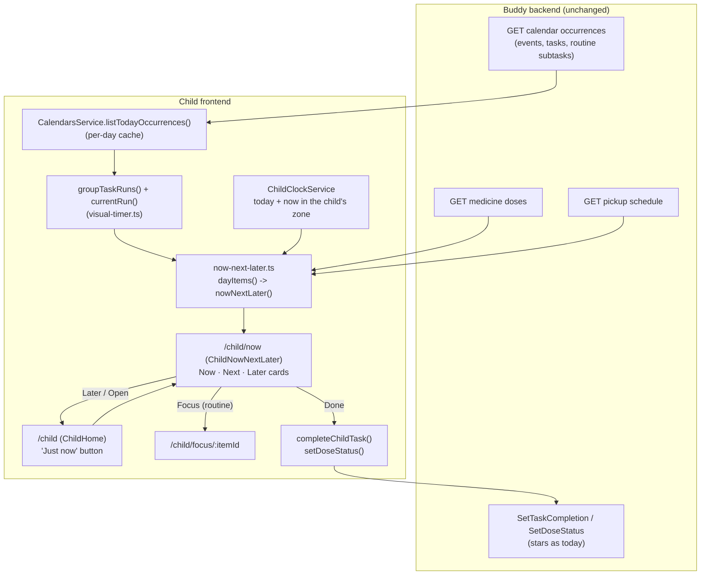

# Now / Next / Later strip for the child

Status: Proposed (not yet implemented)

## Context

A child with ADHD or autism who is overwhelmed can't use a full day view. The child home at
`/child` lists today's packing lists, tasks and routines, events, meals, medicine doses and
pickups in separate sections, with a link row, a progress badge, a feelings card and a menu above
them ([child-day-dashboard.md](child-day-dashboard.md)). On a calm morning that is a useful
overview. In a meltdown, or on a chaotic afternoon, it is a wall of things. What helps then is the
"now / next / later" board that occupational therapists and special-needs teachers use: three
cards, one thing on each, so the child only has to hold on to what is happening now and what
comes after it.

The TODO entry (`TODO.md`, "In-the-moment help for the child") asks for "a reduced day view with
three cards, for overwhelmed moments".

Buddy already has everything the strip shows. Nothing new needs to be stored:

- **Calendar occurrences for today**, from `CalendarsService.listTodayOccurrences()` with its
  per-day cache ([`calendars.service.ts:284`](../../../src/frontend/buddy/src/app/core/calendars.service.ts)):
  events with a `Timed` window, plain tasks with a `Due` instant, and routines (template-scheduled
  tasks) that `groupTaskRuns()` folds into a `TaskRun`
  ([`task-run.ts`](../../../src/frontend/buddy/src/app/core/task-run.ts)).
- **The current routine and its current step**, from `currentRun()` and `timerState()` in
  [`visual-timer.ts`](../../../src/frontend/buddy/src/app/core/visual-timer.ts) (30 minutes of
  grace after a routine's end, 15 minutes of look-ahead, the first incomplete subtask is current).
- **Medicine doses** (`MedicinesService.listDoses()`, a wall-clock `time` and a status) and
  **pickups** (`PickupsService.listSchedule()`, with an optional `time`), both loaded by `ChildHome`
  ([`home.ts:655-756`](../../../src/frontend/buddy/src/app/features/child/home/home.ts)).
- **One timeline of "things that start at an instant"** already exists in
  [`transition-warnings.ts`](../../../src/frontend/buddy/src/app/core/transition-warnings.ts)
  (`occurrenceCandidates` and `pickupCandidates`): events, plain tasks, one candidate per routine,
  and timed pickups, each with a `startsAtMs`, a title and an icon.
- **The child's clock**: `ChildClockService` decides "today" and "now" in the child's profile time
  zone ([`child-clock.service.ts`](../../../src/frontend/buddy/src/app/core/child-clock.service.ts)).

The closest precedent is the focus view `/child/focus/:itemId`
([`child-focus.ts`](../../../src/frontend/buddy/src/app/features/child/focus/child-focus.ts)): a
reduced page that shows one routine step at a time, built only from today's cached occurrences.
The strip is the same idea for the whole day instead of one routine.

This document answers seven questions: does it need backend state; which items it shows; how Now,
Next and Later are picked; where it appears; what the cards show and allow; how it looks and stays
accessible; and whether a guardian controls it.

## Question 1: frontend-only, or new backend state?

**Decision: frontend-only. A pure `core/now-next-later.ts` derives the three cards from data the
child pages already load. No endpoint, event, field or feature flag.**

- Every input is already on the wire for the signed-in child (see Context). The strip is a
  different way of presenting it, as the child home and the focus view are.
- Nothing needs to persist. Which card is Now follows from the clock and from completion, both of
  which already exist. Recording when a child opened the strip would be behavioural tracking of
  the overwhelmed moments themselves, which the visual timer rejected for the same reason
  ([visual-time-left-timer.md, Question 1](visual-time-left-timer.md#question-1-frontend-only-or-new-backend-state)).
- **No feature flag.** [feature-flags.md](../../backend/analysis/feature-flags.md) gives one flag
  per optional _domain_. The strip is a view over domains that already have flags; each source
  respects its own (`medicines`, `pickups`; the calendar has none), as `ChildHome` does. The child
  calendar agenda, another view, has no flag either
  ([`child.routes.ts`](../../../src/frontend/buddy/src/app/features/child/child.routes.ts)).
- **No guardian setting in v1** (Question 7).

## Question 2: which items does the strip show?

**Decision: anything on today's schedule that has a time of day and isn't done yet: timed and
ongoing events, plain tasks with a due time, routines and packing lists (one item each), pending
medicine doses, and timed pickups/drop-offs. Meals, all-day events, untimed pickups, finished
tasks, taken or skipped doses and past events are left out.**

| Source                               | Becomes an item           | Starts at                   | Ends at                 | Drops out when                                                   |
| ------------------------------------ | ------------------------- | --------------------------- | ----------------------- | ---------------------------------------------------------------- |
| Event, `Timed`                       | yes                       | `startsAt`                  | `endsAt`                | `endsAt` has passed                                              |
| Event, all-day                       | no                        | --                          | --                      | --                                                               |
| Plain task, `Due`                    | yes                       | `dueAt`                     | --                      | completed                                                        |
| Routine (`TaskRun`, not a checklist) | yes, one item             | first subtask's `startsAt`  | last subtask's `endsAt` | every subtask is completed, or `currentRun()`'s grace has passed |
| Packing list (checklist `TaskRun`)   | yes, one item             | its "leave by" due time     | --                      | every item is packed                                             |
| Medicine dose                        | yes, when `Pending`       | `time` on the child's clock | --                      | `Taken` or `Skipped`                                             |
| Pickup / drop-off                    | yes, when it has a `time` | `time` on the child's clock | --                      | 30 minutes after `time`                                          |
| Meal                                 | no                        | --                          | --                      | --                                                               |

- **Times only.** The strip is about order in time, so anything that can't be placed at an instant
  stays on `/child`. Meals use named slots (breakfast, lunch, ...) with no time
  ([child-day-dashboard.md, Meals and ratings](child-day-dashboard.md#meals-and-ratings)); giving
  slots default times would invent a schedule the family never set. Considered and rejected.
- **A routine is one item, not one per step.** Steps are the focus view's job. Showing "Get
  dressed / Eat breakfast / Brush teeth" as Now / Next / Later would push the rest of the day off
  the strip and turn it into a second, worse focus view. The Now card shows the current step
  inside the routine instead (Question 5).
- **Doses are included**, because "take your medicine at 07:30" is a transition the child has to
  make, and the child can already mark doses on `/child`. Pickups are included for the same
  reason the transition warnings include them: "Dad picks you up at 15:00" is the transition most
  likely to cause a meltdown when it comes as a surprise.
- **Ordering** reuses `compareOccurrences()` for calendar items (start time, then name) and
  places doses and pickups by their instant, with ties broken by title, the same tie-break
  `computeTransitionWarnings()` uses.
- The normaliser is new code rather than a refactor of `transition-warnings.ts`. The warnings
  candidates skip anything already started, skip finished items with different rules and carry
  lead-time overrides; the strip needs ongoing items and an end time. Sharing the two small
  `startOf`/`instantInTimeZone` conversions is enough. A shared "day items" module for both was
  considered and rejected for v1: it would change a shipped, well-tested pure function for a
  saving of about 40 lines.

The normalised item:

```ts
export interface DayItem {
  key: string;                    // occurrenceKey(), `dose:<scheduleId>:<time>` or `pickup:<slot>`
  kind: 'event' | 'task' | 'routine' | 'checklist' | 'dose' | 'pickup';
  title: string;                  // empty for a pickup and a dose: the card translates them
  icon: string;
  color: string | null;           // the calendar or run colour; null for doses and pickups
  startsAtMs: number;
  endsAtMs: number | null;        // events and routines only
  source: CalendarOccurrence | TaskRun | MedicineDoseOccurrence | PickupOccurrence;
}

export function dayItems(input: {
  occurrences: readonly CalendarOccurrence[];
  doses: readonly MedicineDoseOccurrence[];
  pickups: readonly PickupOccurrence[];
  date: string;
  timeZone: string;
  nowMs: number;
}): DayItem[];   // sorted, finished items removed
```

## Question 3: how are Now, Next and Later picked?

**Decision: Now is the one thing the child should be doing at this moment; Next is the first item
after it; Later is everything after Next, shown as a single card. All three come from one pure
function `nowNextLater(items, nowMs, anchoredItemId)`.**

```ts
export interface NowNextLater {
  now: DayItem | null;            // null: nothing is happening -- "Free time"
  next: DayItem | null;           // null: nothing more today
  later: { first: DayItem; more: number } | null;
}
```

**Now**, in priority order:

1. The current routine from `currentRun()`, including a child-started one (`anchoredItemId`, so
   a running timer never loses its place) and its 15-minute look-ahead. Reusing it means the
   strip, the run bar on `/child` and the focus view always agree on which routine is current.
2. Otherwise an ongoing event (`startsAt <= now < endsAt`), the earliest-starting one if two
   overlap.
3. Otherwise a task, packing list, dose or pickup whose time came less than 30 minutes ago and
   that isn't done (`CURRENT_RUN_GRACE_MS`, the routine's grace window, so one constant rules
   "how long something stays current").
4. Otherwise nothing: the Now card reads "Free time".

**Next** is the earliest remaining item that isn't Now and starts at or after Now's start (or
after `nowMs` when Now is empty). An item that overlaps Now still counts: "Leave for school" at
07:20 is Next while the morning routine runs to 07:28. **Later** is the item after Next, plus a
count of the rest of the day.

- **Completion moves the strip, not only the clock.** Ticking off the Now task drops it out of
  the items, so Next becomes Now at once, as finishing a step early moves the visual timer on
  ([visual-time-left-timer.md, Question 3](visual-time-left-timer.md#question-3-which-task-and-subtask-are-current)).
- **Falling behind never skips anything.** An undone task stays Now for its 30-minute grace. After
  that it drops off the strip (it is still on `/child`). A strip that kept every missed item on
  Now would trap an overwhelmed child on the thing they couldn't manage.
- **The day ends quietly.** With nothing left, Now is "Free time" and Next reads "That's all for
  today". Tomorrow's first item is not shown: "later" means later today, and the evening "Pack for
  tomorrow" card already lives on `/child`.
- **Rejected: Later as a list.** Three cards are the point. A list of everything else is the full
  day view again. The count ("and 3 more later today") tells the child there is more without
  asking them to read it, and a tap on the card opens `/child`.
- **Rejected: Next as "the next routine step".** See Question 2.

## Question 4: where does it appear?

**Decision: a new child page, `/child/now`, opened from a large "Just now" button at the top of
the child home. The page uses the `ChildPage` frame with a back link to `/child`, and nothing
else: no link row, badge, feelings card or menu.**

- **A route, not a toggle on `/child`.** The same reasons as the focus view: the back button
  closes it, a guardian can bookmark it on the kitchen iPad for a hard week, and it gets a
  screenshot like every other page ([visual-time-left-timer.md, Question 4](visual-time-left-timer.md#question-4-where-does-it-appear)).
  Rejected: swapping `/child` between "full" and "reduced" layouts in place. It would double the
  branches in a 670-line template, and a child who switched by accident would not know how to get
  back.
- **The button sits above everything else on `/child`**, next to where the progress badge is
  rendered ([`home.html:4`](../../../src/frontend/buddy/src/app/features/child/home/home.html)), at
  least 44x44px and labelled with text and an icon. An overwhelmed child should not have to scroll
  to find the way out. It is not placed in the link row, where it would be one of five equal links.
- **The transition-warning banner stays.** `ChildPage` renders it on every child page
  ([`child-page.ts`](../../../src/frontend/buddy/src/app/features/child/child-page/child-page.ts)),
  and a guardian turned warnings on for this child on purpose. A warning about the Next card says
  the same thing as the card, so it reinforces rather than adds. See the open question.
- **Not on guardian screens.** A guardian already sees the child's day on the guardian dashboard
  and the calendars.
- **Not the default home in v1** (Question 7).

## Question 5: what does each card show, and what can the child do?

**Decision: each card shows an icon, a title and a time phrase. Only the Now card has actions:
_Done_ for a task, packing list or dose, _Open_ for a routine (the focus view) or packing list
(`/child`), with the visual-timer disc for a routine when timers are on. Next and Later are
read-only.**

| Card                  | Shows                                                                                                                              | Actions                                                         |
| --------------------- | ---------------------------------------------------------------------------------------------------------------------------------- | --------------------------------------------------------------- |
| Now -- routine        | run icon and title, the current step ("Eat breakfast · step 2 of 4"), the `shared/visual-timer` disc when `showVisualTimers` is on | _Focus_ → `/child/focus/:itemId`; _Done_ ticks the current step |
| Now -- task / dose    | icon, title (a dose reads "Medicine: {name}"), "Now"                                                                               | _Done_ (task completion or dose `Taken`)                        |
| Now -- packing list   | icon, title, "{packed} of {total} packed"                                                                                          | _Open_ → `/child` (packing happens there, with the suggestions) |
| Now -- event / pickup | icon, title (a pickup reads "Dad picks you up"), "until 17:30" for an event                                                        | none                                                            |
| Now -- empty          | a calm icon, "Free time"                                                                                                           | none                                                            |
| Next                  | icon, title, "in 12 min" (under an hour) or "at 15:30"                                                                             | none                                                            |
| Later                 | icon, title, "at 15:30", "and 3 more later today"                                                                                  | the whole card links to `/child`                                |

- **Completion goes through the existing paths**, so stars work as before: tasks and routine steps
  through `completeChildTask()`
  ([`child-task-completion.ts`](../../../src/frontend/buddy/src/app/core/child-task-completion.ts),
  shared by `ChildHome` and `ChildFocus`), doses through `MedicinesService.setDoseStatus()`. There
  is no _Skip_ or _Undo_. Undoing belongs to `/child`, where the whole list is visible; a strip for
  overwhelmed moments should not offer a choice that can be made by mistake.
- **Dose and pickup wording reuses `/child`'s labels.** `playdateHostName`/`babysitterName`
  already live in [`pickups.service.ts:21-26`](../../../src/frontend/buddy/src/app/core/pickups.service.ts).
  The guardian/sibling lookup is a method on `ChildHome` today; it moves to a pure function both
  pages call:

  ```ts
  // before (home.ts:477) -- reads ChildHome's own guardianList/siblingList resources
  protected assigneeName(occurrence: PickupOccurrence): string | null { ... }

  // after -- core/pickups.service.ts, next to playdateHostName
  export function assigneeGivenName(
    assignee: PickupAssignee,
    guardians: readonly GuardianSummary[],
    siblings: readonly SiblingSummary[],
  ): string | null;
  ```

  Blast radius: one method in `home.ts` (which keeps a one-line wrapper for its template) and its
  cases in `home.spec.ts`.

- **Times are words a child can act on.** "in 12 min" rounds up, as `minutesUntil()` does for the
  warnings; past an hour, the clock time reads better than "in 94 min".
- **Pictograms later.** The TODO's "Pictogram support" item would replace the emoji icon with a
  picture on the card. The card takes its icon from `DayItem.icon`, so that is additive.

## Question 6: look, motion and accessibility

**Decision: three stacked cards on a phone, three side by side on a tablet in landscape, with Now
visibly largest. Each card has a visible heading (_Now_, _Next_, _Later_) so position and colour
never carry the meaning alone. The page recalculates every minute and at Now's deadline, and
announces only a change of Now.**

- **Layout.** Portrait phone: a single column, Now first and about twice the height of the other
  two. Landscape tablet (`lg:`): a row, Now about half the width. Tailwind's class-based `dark:`
  variant as everywhere else ([`styles.css`](../../../src/frontend/buddy/src/styles.css)). The run
  or calendar colour is a left stripe on the card, never the only cue, per
  [visual-specification.md](visual-specification.md).
- **Calm.** No animation when the cards move on, and nothing flashes. Under
  `prefers-reduced-motion` this changes nothing, because there is no motion to remove; the visual
  timer's own disc already steps by the minute ([visual-time-left-timer.md, Question 6](visual-time-left-timer.md#question-6-look-motion-colour-and-accessibility)).
- **Ticking.** The same pattern as `ChildFocus`: a `now` signal on a one-minute interval, plus a
  `setTimeout` at the earliest moment something changes (an event's end, a grace expiring, a
  routine's deadline), so the cards don't wait up to a minute to move on.
- **Screen readers.** Each card is a `section` with an `h2` (_Now_, _Next_, _Later_). One visually
  hidden `aria-live="polite"` span announces "Now: {title}" when Now changes, and nothing else. The
  timer disc on the Now card is passed `announce: false`, so the page speaks once.
- **Touch targets** for _Done_, _Focus_, _Open_ and the Later card: at least 44x44px, with the
  emerald focus ring.

## Question 7: does a guardian control it?

**Decision: not in v1. The strip is always available to every child, and `/child` stays the
home. The `showVisualTimers` switch is respected: with timers off, the Now card shows no disc.**

- There is nothing to protect a child from here: the strip shows less than `/child`, never more.
  The visual timer needed a switch because some children find a countdown stressful; the strip
  only reuses the countdown when that switch is on.
- **Strip as the default home for one child** is the likely follow-up ("for a few weeks, open
  straight into Now/Next/Later"). It is additive and has an exact template:
  `User.ShowVisualTimers` and `UpdateChildVisualTimers`
  ([visual-time-left-timer.md, Question 9](visual-time-left-timer.md#question-9-can-a-guardian-turn-timers-off-for-a-child)).
  See the open questions.

## Frontend plan

All paths are under `src/frontend/buddy/src/app/`.

| File                                                 | Change                                                                                                                                                                                                                                                                                |
| ---------------------------------------------------- | ------------------------------------------------------------------------------------------------------------------------------------------------------------------------------------------------------------------------------------------------------------------------------------- |
| `core/now-next-later.ts` + spec                      | **New.** `DayItem`, `dayItems()`, `nowNextLater()`, `nextChangeAt()` (when the cards next move). Pure functions only                                                                                                                                                                  |
| `core/pickups.service.ts` + spec                     | `assigneeGivenName()` moved out of `ChildHome.assigneeName` (Question 5)                                                                                                                                                                                                              |
| `features/child/home/home.{ts,html}` + spec          | `assigneeName` delegates to the moved function; add the "Just now" button at the top                                                                                                                                                                                                  |
| `features/child/now/child-now.{ts,html}` + spec      | **New page** `ChildNowNextLater`: loads today's occurrences (cached), doses, pickups and the guardian/sibling names; computes the strip from `ChildClockService`; renders the three cards; _Done_/_Focus_/_Open_                                                                      |
| `features/child/child.routes.ts`                     | `{ path: 'now', component: ChildNowNextLater }`, no guard                                                                                                                                                                                                                             |
| `core/i18n/translations/{en,da}/child.ts`            | `child.now.*` keys (below) and `child.home.nowButton`                                                                                                                                                                                                                                 |
| `screenshots/pages.ts`, `screenshots/demo-family.ts` | A `child-now` entry with the fixed `clock: '07:10'` the `child-home` entry uses. The existing demo day then reads: Now = Morning routine on _Eat breakfast_, Next = Leave for school (07:20), Later = Medicine (07:30) with the count of the rest of the day. No new seed data needed |
| `e2e/now-next-later.spec.ts`                         | **New.** Fixed clock inside a routine: the three cards show the routine, the next event and the dose. Tick the current step from the Now card; the step text moves on. Mark the dose done after moving the clock; Next becomes Now                                                    |

### i18n

| Key                                 | en                                  | da                                  |
| ----------------------------------- | ----------------------------------- | ----------------------------------- |
| `child.home.nowButton`              | `Just now`                          | `Lige nu`                           |
| `child.now.title`                   | `Now, next, later`                  | `Nu, så, senere`                    |
| `child.now.now` / `next` / `later`  | `Now` / `Next` / `Later`            | `Nu` / `Så` / `Senere`              |
| `child.now.freeTime`                | `Free time`                         | `Fritid`                            |
| `child.now.allDone`                 | `That's all for today`              | `Det var alt for i dag`             |
| `child.now.inMinutes`               | `in {count} min`                    | `om {count} min`                    |
| `child.now.at`                      | `at {time}`                         | `kl. {time}`                        |
| `child.now.until`                   | `until {time}`                      | `indtil kl. {time}`                 |
| `child.now.step`                    | `{title} · step {index} of {count}` | `{title} · trin {index} af {count}` |
| `child.now.packed`                  | `{packed} of {total} packed`        | `{packed} af {total} pakket`        |
| `child.now.more`                    | `and {count} more later today`      | `og {count} mere senere i dag`      |
| `child.now.medicine`                | `Medicine: {name}`                  | `Medicin: {name}`                   |
| `child.now.done` / `focus` / `open` | `Done` / `Focus` / `Open`           | `Færdig` / `Fokus` / `Åbn`          |
| `child.now.announce`                | `Now: {title}`                      | `Nu: {title}`                       |
| `child.now.back`                    | `Back to today`                     | `Tilbage til i dag`                 |

Pickup labels reuse the existing `child.home` pickup keys. Check parity with
`node .claude/skills/i18n/check-parity.mjs`.

## Testing

- `now-next-later.spec.ts` (pure, fixed `nowMs`):
  - each source becomes an item with the right start and end; meals, all-day events, untimed
    pickups, completed tasks and taken/skipped doses don't;
  - Now priority: the current routine beats an ongoing event, which beats a recent undone task;
  - a child-started (anchored) routine stays Now past its grace;
  - an undone task leaves Now after 30 minutes;
  - an item overlapping Now can be Next;
  - Later's count; an empty day; the end of the day;
  - ties ordered by title;
  - DST: a dose time on a spring-forward morning resolves through `instantInTimeZone`.
- `child-now.spec.ts`: the three cards render from stubbed services; _Done_ calls
  `completeChildTask()` or `setDoseStatus()` and the strip moves on; no disc when
  `showVisualTimers` is false; the medicines and pickups flags off leave those items out; a failed
  doses or pickups load leaves them out without an error (as on `/child`); the live region speaks
  only when Now changes; intervals are cleared on destroy.
- `pickups.service.spec.ts`: the moved `assigneeGivenName` cases from `home.spec.ts`.
- `home.spec.ts`: the button links to `/child/now`.
- `screenshot-coverage.spec.ts` passes once the `child-now` entry exists.
- One e2e journey (above).

## Failure and edge-case behavior

| Case                                                 | Behavior                                                                                                                                                        |
| ---------------------------------------------------- | --------------------------------------------------------------------------------------------------------------------------------------------------------------- |
| Nothing timed today                                  | Now "Free time", Next "That's all for today", no Later card                                                                                                     |
| Doses or pickups fail to load                        | Left out, no error; the calendar items still show (same as `/child`)                                                                                            |
| Calendar fails to load                               | The shared translated load error, as on `/child`                                                                                                                |
| Two events overlap                                   | The earlier-starting one is Now; the other is Next                                                                                                              |
| Child ticks the Now task                             | It drops out, Next becomes Now at once                                                                                                                          |
| Undone task 30 minutes after its time                | Drops off the strip; still on `/child`                                                                                                                          |
| Child-started routine timer                          | The routine stays Now until it is done, even past its grace                                                                                                     |
| Guardian moves or deletes an item                    | Seen on the next load of today's occurrences (the per-day cache is cleared by any calendar write in this browser; another device's change shows after a reload) |
| App left open past midnight                          | `ChildClockService.today()` changes; the page reloads today's data on the next tick                                                                             |
| Device on another time zone than the child's profile | Times follow the child's profile zone, as on every child page                                                                                                   |
| `taskLibrary` flag off                               | No routines or packing lists; everything else works                                                                                                             |
| Timers switched off for the child                    | No disc on the Now card; everything else is unchanged                                                                                                           |

## Estimate

|                  |                                                                                                                                                                                                                                                                                                                            |
| ---------------- | -------------------------------------------------------------------------------------------------------------------------------------------------------------------------------------------------------------------------------------------------------------------------------------------------------------------------- |
| Complexity       | Low-Medium -- frontend-only: one pure module (normaliser and selection), one new child page and route, a button on `/child`, a one-method extraction of the pickup assignee lookup out of `home.ts`, about 20 en+da keys, one screenshot entry on existing demo data and one e2e spec. No backend, contract or flag change |
| Single developer | 2-3 days                                                                                                                                                                                                                                                                                                                   |
| AI agent         | 1.5-2.5 hours, plus about 1 hour of human review (look at it on a phone and an iPad in both themes, try it at a few fixed times of day) and settling the open questions                                                                                                                                                    |

## Decisions made

| Question                  | Decision                                                                                                                                   |
| ------------------------- | ------------------------------------------------------------------------------------------------------------------------------------------ |
| Backend state             | None; a pure view over today's occurrences, doses and pickups                                                                              |
| Feature flag              | None; each source keeps its own flag                                                                                                       |
| Which items               | Timed, not-done items: events, tasks, routines and packing lists (one item each), pending doses, timed pickups. No meals or all-day events |
| Now                       | Current routine (`currentRun()`), else ongoing event, else an undone item within 30 minutes of its time, else "Free time"                  |
| Next / Later              | First item after Now (overlaps allowed); Later is one card with the following item and a count                                             |
| Where                     | New page `/child/now`, opened from a "Just now" button at the top of `/child`                                                              |
| Actions                   | Only on Now: _Done_, _Focus_ for a routine, _Open_ for a packing list. No skip or undo                                                     |
| Routine steps             | Shown inside the Now card, never as separate cards                                                                                         |
| Guardian control          | None in v1; respects `showVisualTimers`                                                                                                    |
| Transition-warning banner | Stays (lean; see open questions)                                                                                                           |

## Remaining open questions

- **Strip as a child's default home.** Lean: not in v1. If guardians ask, add
  `User.StartInNowNextLater` (default `false`) with an `UpdateChildStartView` slice and a switch on
  `manage-children`, copying `ShowVisualTimers` exactly, and make `/child` redirect to `/child/now`
  once per session. Additive.
- **Hide the transition-warning banner on this page.** Lean: keep it, because the guardian chose
  warnings for this child. If it proves noisy, `ChildPage` gains a `showWarnings` input set to
  `false` here, and the Next card shows the countdown stage instead.
- **Meals with a time.** Lean: leave meals out. If families want "Dinner" on the strip, it needs
  per-slot default times, which is a mealplan setting, not a strip decision.
- **Wording of the entry button.** "Just now" / "Lige nu" is a placeholder. Families may prefer
  "One thing at a time" or an icon-only button for non-readers (ties in with pictogram support).

## Diagram


