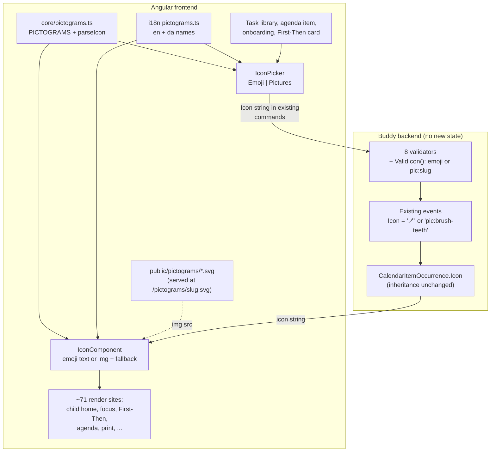

# Pictogram support

Status: Proposed (not yet implemented)

## Context

Many children who use Buddy don't read yet, or read slowly under stress. Today every task,
routine step and First-Then card carries an emoji next to its title (`🪥 Brush teeth`). Emoji
work, but they are small, they look different on every platform, and many everyday concepts
have no good emoji ("pack the school bag", "put pyjamas on", "wash face and hands"). Special-needs
teachers and occupational therapists use _pictograms_ instead: one simple, consistent drawing per
action, large enough to recognise at a glance.

`TODO.md` lists it as "**Pictogram support.** An optional icon or photo on tasks, routine steps
and meals, for younger or non-reading children." Two analyses already defer to it:
[first-then-board.md](../../backend/analysis/first-then-board.md) reuses `Icon` "so pictogram
support upgrades boards along with tasks and routine steps", and
[social-stories.md, Question 4](../../backend/analysis/social-stories.md#question-4-where-the-pictures-come-from)
rejected a bundled ARASAAC/Mulberry set because of the licence and left pictograms and photos to
this item.

What exists today:

- **A first set of 24 pictograms**, drawn in-house, in
  [public/pictograms/](../../../src/frontend/buddy/public/pictograms/) (commit `0a8c182c`): bath,
  brush-teeth, dinner, drink-water, eat-breakfast, get-dressed, go-to-bed, homework, leave-home,
  lunch, pack-school-bag, play, put-on-shoes, pyjamas-on, read-story, school, screen-time, shower,
  snack, take-medicine, tidy-room, use-toilet, wake-up, wash-face-hands. 96 KB in total. They
  follow one style guide (96×96 tile, fixed palette, 4px outlines, no text) in
  [.agents/skills/pictogram/SKILL.md](../../../.agents/skills/pictogram/SKILL.md), and the
  `codex-pictogram` skill draws more on demand. Nothing in the app references them yet.
- **`Icon` is a bare string wrapper** with no rules of its own
  ([Icon.cs](../../../src/backend/buddy/Features/Calendars/Types/Icon.cs)). It is serialized as a
  plain string by `StronglyTypedIdJsonConverterFactory`, in events and on the wire. 17 events
  carry an `Icon` and 3 more (rewards, goal posts) carry a `string` icon.
- **No icon picker.** Every icon field is a plain `<input type="text">`, written separately in each
  form. The closest thing to a picker is the First-Then
  [card-picker](../../../src/frontend/buddy/src/app/features/guardian/first-then/card-picker/card-picker.html)
  with its starter chips from
  [core/first-then.ts:103](../../../src/frontend/buddy/src/app/core/first-then.ts).
- **About 71 template sites render an icon as text**, usually
  `<span aria-hidden="true">{{ x.icon }}</span>`, on child and guardian screens and the printed
  week plan.
- **The CSP allows them already.** The Caddyfile sets `img-src 'self' data:`
  ([Caddyfile:17](../../../src/frontend/buddy/Caddyfile)), and `angular.json` copies `public/`
  to the web root, so `` works with no config change.
- **No binary storage anywhere in the backend.** No uploads, blobs or attachments.

Scope settled with the user (2026-10-15): pictograms only, no photos; stored in the existing
`Icon` string with a prefix; offered on tasks, routine steps and First-Then boards; no
picture-only child mode in v1.

This document answers six questions: where pictograms come from, how a chosen pictogram is
stored, how it is rendered, how a guardian picks one, which surfaces offer it, and how the set
grows.

## Question 1: a bundled set, uploaded photos, or a third-party library?

**Decision: the in-house SVG set in `public/pictograms/`, shipped with the frontend. No photos and
no third-party pictogram library in v1.**

- **The licence objection is gone.** social-stories.md rejected a bundled set because ARASAAC is
  CC BY-NC-SA. These pictograms are drawn for Buddy, so there's no licence to track.
- **The size objection is small.** 24 files are 96 KB. A hundred would be about 400 KB, and the
  browser fetches only the ones on screen, because they are separate `` files and not part
  of the JS bundle.
- **One style.** Every pictogram follows the same style guide, so a board with "homework" then
  "screen time" looks like one set, which mixed emoji don't.
- **It themes.** Each SVG has its own light tile (`#F8FAFC`), so it reads on both light and dark
  backgrounds without recolouring, and it prints.

Considered and rejected:

- **Guardian-uploaded photos.** A photo of the child's own toothbrush is the strongest cue, but it
  would be the app's first binary data. That raises storage on both deployments, EXIF/GPS
  stripping, an authenticated `blob:` image path through the CSP, and GDPR export/erase of
  images. Those questions are listed in social-stories.md Question 4. They belong in a separate
  "pictures and file storage" analysis that social stories and the caregiver handover card also
  need.
- **ARASAAC or Mulberry.** ARASAAC's licence conflicts with a possible paid deployment, and
  neither set matches the app's visual style. Mulberry (CC BY-SA) is closer, but at 3,000+
  symbols it needs a search UI and a few MB of assets for a family that uses twenty.
- **An SVG sprite or inlined SVG in the bundle.** Inlining makes the pictograms themeable through
  `currentColor`, but they are multi-colour by design and gain nothing. A sprite needs `<use>`,
  which the pictogram lint forbids inside the files themselves, and it adds a build step.

## Question 2: how is a chosen pictogram stored?

**Decision: in the existing `Icon` string, as `pic:<slug>` (for example `pic:brush-teeth`). Events,
aggregates, snapshots, DTOs and the OpenAPI wire type don't change. The backend validates the
format, not the catalogue.**

```
Icon.Value
    "🪥"                 // emoji, as today
    "pic:brush-teeth"    // pictogram: prefix + kebab-case slug = file name without .svg
```

- **No event migration.** Every existing event already holds a valid emoji `Icon`, and a new event
  holding `pic:...` replays with the same code. A separate field would have to be added to 17
  events, their records (`ItemDetails`, `Subtask`, `TaskTemplateDetails`, `FirstThenCard`, ...),
  20 request DTOs and the golden files, with a "which one wins" rule. The prefixed string touches
  none of these.
- **Inheritance keeps working.** A subtask with a `null` icon inherits its template's icon, and an
  occurrence's `Icon` falls back to the calendar's
  ([CalendarItemOccurrence.cs:21](../../../src/backend/buddy/Features/Calendars/Types/CalendarItemOccurrence.cs)).
  Both are string fallbacks, so an inherited pictogram needs no new code.
- **It mirrors `StoryPictureKind`, flattened.** social-stories.md planned a kind discriminator for
  emoji vs photo. A prefix is the same discriminator in a type that is already a plain string on
  the wire. If photos arrive later, `photo:<id>` is a third prefix, and nothing changes for
  existing values.
- **The slug is the file name.** `pic:brush-teeth` maps to `/pictograms/brush-teeth.svg`. Slugs are
  English kebab-case, as the pictogram skill already names them.

The backend checks the shape and doesn't keep the list. The files live in the frontend image, so a
backend copy of the catalogue would be a second source of truth that drifts. An unknown slug
renders a fallback (Question 3), which the frontend needs anyway for a pictogram removed in a
future release. The rule:

```csharp
// Features/Calendars/Types/Icon.cs (proposed)
public sealed record Icon(string Value)
{
    public const string PictogramPrefix = "pic:";
    public const int MaxEmojiLength = 16;      // one emoji with skin-tone/ZWJ modifiers
    public const int MaxPictogramLength = 64;

    public static Icon New(string value) => new(value);

    public bool IsPictogram => Value.StartsWith(PictogramPrefix, StringComparison.Ordinal);
}

// Features/Calendars/Types/IconValidation.cs (new)
public static IRuleBuilderOptions<T, string> ValidIcon<T>(this IRuleBuilder<T, string> rule) =>
    rule.Must(v => !v.StartsWith(Icon.PictogramPrefix, StringComparison.Ordinal)
                   || SlugPattern().IsMatch(v[Icon.PictogramPrefix.Length..]))
        .WithMessage("A pictogram icon must be 'pic:' followed by a kebab-case name.")
        .MaximumLength(Icon.MaxPictogramLength);
// SlugPattern: ^[a-z0-9]+(-[a-z0-9]+)*$
```

The First-Then validator is the one place where the new value is rejected today:
`pic:wash-face-hands` is 19 characters.

```csharp
// Before: SetFirstThenBoard.Validator.cs:34
RuleFor(c => c.Icon.Value).NotEmpty().MaximumLength(MaxIconLength).OverridePropertyName($"{card}.icon");

// After
RuleFor(c => c.Icon.Value).NotEmpty().ValidIcon()
    .MaximumLength(Icon.MaxEmojiLength).When(c => !c.Icon.IsPictogram)
    .OverridePropertyName($"{card}.icon");
```

Blast radius: `SetFirstThenBoard` plus the seven slices that offer pictograms (`CreateItem`,
`UpdateItemDetails`, `ScheduleTaskFromTemplate`, `CreateTaskTemplate`, `UpdateTaskTemplate`,
`AddSubtask`, `UpdateSubtask`) get one `ValidIcon()` line each. Today four of those have no icon
rule at all. `SetFirstThenBoardValidator.MaxIconLength` moves to `Icon.MaxEmojiLength`.

Considered and rejected:

- **An `IconKind` field next to `Icon`.** It is explicit, but it brings the whole migration above,
  and it lets the two fields disagree.
- **A full URL (`/pictograms/x.svg`) as the value.** It stores a deployment detail in the events,
  and it invites guardians to paste other URLs, which the CSP blocks on purpose
  ([house-rules.md, Question 4](../../backend/analysis/house-rules.md#question-4-markdown-stored-raw-and-rendered-safely)).
- **Validating slugs against a backend catalogue.** See above. It would also block a deploy where
  the frontend ships a new pictogram before the backend.

## Question 3: how is it rendered?

**Decision: one shared `IconComponent` (`shared/icon/`) renders any icon value: an emoji as text,
or a pictogram as ``. All ~71 icon render sites switch to it, not only the surfaces that
offer the picker.**

```html
<!-- Before: features/child/home/home.html:138 (one of ~71 sites) -->
<span aria-hidden="true">{{ entry.icon }}</span>

<!-- After -->
<app-icon [value]="entry.icon" />
```

```ts
// core/pictograms.ts (new)
export const PICTOGRAM_PREFIX = "pic:";
export const PICTOGRAMS = ["bath", "brush-teeth", /* ... */ "wash-face-hands"] as const;
export type PictogramSlug = (typeof PICTOGRAMS)[number];

export type ParsedIcon = { kind: "emoji"; text: string } | { kind: "pictogram"; slug: string; src: string };

export function parseIcon(value: string | null | undefined): ParsedIcon | null;
```

- **Every site, because the value travels.** A pictogram set on a task reaches the child home, the
  child calendar, the focus page, the transition-warning banner, the guardian agenda, "tasks
  today", warning exceptions, the task picker and the printed week plan through
  `CalendarItemOccurrence.Icon`. A site that still prints `{{ icon }}` would show the text
  `pic:brush-teeth`. Switching every site removes that risk once. It also means a later meals
  or rewards picker is a form change only. Each switch is a one-line template edit.
- **Size follows the text.** In its default `inline` size the image is `1.25em` square, so it
  takes the place of the emoji it replaces without per-site styling. Child surfaces where the
  picture _is_ the cue pass `size="tile"` (3rem, 48px, the size the style guide is designed for):
  child home task and routine rows, child calendar task rows, the focus page, the First-Then card
  and board, and the transition-warning banner.
- **Accessibility follows the
  [visual specification](visual-specification.md#accessibility-baseline).** Next to a visible
  title the icon is decorative: `alt=""` for an image, `aria-hidden="true"` for an emoji, as
  today. Where it stands alone (an icon-only First-Then card face, the picker grid), it takes a
  `label` input, and the image gets the translated pictogram name as `alt`. The SVG's own English
  `<title>` is ignored inside ``, so Danish users never hear English.
- **Fallback.** An unknown slug (bad data, or a pictogram removed in a later release) fires the
  `` `error` event, and the component shows 🖼️ instead of a broken image.
  `loading="lazy"` and explicit width/height keep layouts stable while it loads.
- **Print.** The week-plan sheet renders through the same component. SVGs print sharply and
  include their own tile, so no print-specific CSS is needed.
- **iCal feeds stay title-only.** Neither feed writes icons today: the calendar feed sets
  `Summary` (and the alarm `Description`) to the title only
  ([IcalFeedWriter.cs](../../../src/backend/buddy/Features/Calendars/IcalFeedWriter.cs)), and the
  meal-plan feed writes `"{slot}: {meal}"`
  ([MealPlanIcalFeedWriter.cs](../../../src/backend/buddy/Features/Mealplans/MealPlanIcalFeedWriter.cs)).
  So a task with a pictogram shows up in a subscriber's calendar app exactly as it does with an
  emoji: by its title, with no `pic:` text.

Considered and rejected:

- **A pipe that returns HTML.** It needs `innerHTML` and sanitizer exceptions, and the alt-text
  and fallback logic belong in a component anyway.
- **The icon in the iCal `SUMMARY`** ("🪥 Brush teeth"). This works for emoji only. A pictogram has
  no text form, so it would have to be dropped or mapped to an emoji, and two icon kinds would
  look different in the same feed. That would also be a separate change to the feeds, which
  aren't in scope here.
- **RFC 7986 `IMAGE` on each `VEVENT`/`VTODO`**, pointing at `/pictograms/<slug>.svg`. Few
  calendar apps display it, and the backend would need the frontend's public URL, which it doesn't
  know today. Possible later, and additive if apps start supporting it.

## Question 4: how does a guardian pick one?

**Decision: a shared `IconPicker` (`shared/icon-picker/`) with two modes, _Emoji_ (today's text
input) and _Pictures_ (a grid of every pictogram with its translated name and a search box). It
replaces the plain icon inputs on the surfaces in Question 5.**

```
[ Emoji | Pictures ]                       segmented-control (shared/segmented-control)
  Emoji:    [ 🪥        ]                  today's text input, unchanged
  Pictures: [ search "teeth"       ]
            [img] [img] [img] [img] ...    48px buttons, aria-pressed, aria-label = name
            Brush teeth  Bath  ...
```

- **Two-way bound like `card-picker`**: `model<string>()` for the value. The mode opens on
  _Pictures_ when the current value is a pictogram.
- **Names are translated** in `core/i18n/translations/{en,da}/pictograms.ts`, keyed by slug
  (`pictograms.brush-teeth: 'Brush teeth' / 'Børste tænder'`). The search matches the name in the
  current language and the slug.
- **The catalogue is a TS constant** (`PICTOGRAMS` in `core/pictograms.ts`), not a runtime fetch
  of the folder: Angular can't list `public/` at runtime, and a constant gives the slug type. A
  spec reads `public/pictograms/` with `node:fs` and fails when the constant and the folder
  differ, as `screenshot-coverage.spec.ts` does for routes.

Considered and rejected: **a full emoji picker grid** as part of this work. The visual
specification mentions one, but it's a separate improvement, and the text input works on every
platform's emoji keyboard.

## Question 5: which surfaces offer it?

**Decision (settled by the user, 2026-10-15): tasks, routine steps and First-Then boards. Meals,
medicines, rewards, goal posts, calendars and work locations keep the plain emoji input in v1.**

| Form                        | File                                                                     | Change                                         |
| --------------------------- | ------------------------------------------------------------------------ | ---------------------------------------------- |
| Task template, edit and new | `features/guardian/task-library/manage-tasks/manage-tasks.html:75, :572` | `IconPicker`                                   |
| Routine step, edit and new  | `manage-tasks.html:349, :493`                                            | `IconPicker`                                   |
| Onboarding first routine    | `features/guardian/onboarding/task-step/task-step.html:99`               | `IconPicker`                                   |
| Calendar item, edit and new | `features/guardian/calendar/agenda/agenda.html:278, :636`                | `IconPicker` (events and tasks share the form) |
| First-Then card             | `features/guardian/first-then/card-picker/card-picker.html`              | Embeds `IconPicker` in place of its text input |

Eight inputs in five templates. The First-Then starter suggestions in
[core/first-then.ts:103](../../../src/frontend/buddy/src/app/core/first-then.ts) switch to a
pictogram where one exists: homework, tidy-room, shower, brush-teeth, get-dressed,
put-on-shoes and dinner for _First_, and screen-time (iPad, TV), play (Lego), snack and read-story
for _Then_. "Play outside" and "game" keep their emoji until those pictograms are drawn. A
First-Then board is the surface where a pre-reader most needs the picture.

**Authorization doesn't change.** Whoever can edit the item, template or board today can choose
a pictogram. The child can't. The value is a string inside existing commands, so no new tier,
route or exporter is involved.

## Question 6: how does the set grow?

**Decision: new pictograms are added with the `codex-pictogram` skill. They go through its lint and
contact-sheet check, then get an entry in `PICTOGRAMS` plus en and da names. A published slug is
never renamed or deleted.**

- Slugs live on in events forever. Renaming one means adding a file under the new slug and
  keeping the old file. The fallback in Question 3 covers the case where that rule is broken
  anyway.
- The parity spec (Question 4) and the i18n parity check catch a file without a catalogue entry,
  or an entry without names.
- Likely next drawings, from the starters and common routine steps: play outside, video game,
  pack sports bag, feed the pet, set the table, swimming. They're additive and need no design
  work.

## Frontend plan

- `core/pictograms.ts`: prefix, catalogue, `parseIcon`, `pictogramIcon(slug)`. Spec for parsing
  (emoji, pictogram, unknown slug, empty, `null`) and the folder parity spec.
- `shared/icon/`: `IconComponent` (`value`, `size: 'inline' | 'tile'`, optional `label`), with a
  spec for emoji vs image, decorative vs labelled, and the `error` fallback.
- `shared/icon-picker/`: `IconPicker`, with a spec for mode switching, search in en and da,
  selecting a pictogram (`pic:<slug>`) and typing an emoji.
- Switch the ~71 render sites to `<app-icon>`. Update the specs that assert icon text (for example
  `child-first-then.spec.ts`), keeping emoji fixtures and adding one pictogram case per
  child-facing screen.
- Switch the eight inputs in Question 5 to `IconPicker`, and update the First-Then starters.
- i18n: `translations/{en,da}/pictograms.ts` (24 names) and the picker labels (_Emoji_,
  _Pictures_, _Search pictures_, _No pictures match_), checked with
  `node .claude/skills/i18n/check-parity.mjs`.
- Screenshots: give the demo family's morning routine and First-Then board pictograms in
  `screenshots/demo-family.ts`, then run `task docs:screenshots`. No new route, so `pages.ts`
  is unchanged.

## Backend

- `Icon`: `PictogramPrefix`, `MaxEmojiLength`, `MaxPictogramLength`, `IsPictogram`.
- `IconValidation.ValidIcon()`, applied in the eight validators listed in Question 2.
- Optional: a description on the `Icon` schema in `WireSchemaTransformer` ("an emoji, or
  `pic:<slug>`"), then `task docs:openapi`. The wire type stays `string`.
- No new events, aggregates, routes, schemas or exporters. The golden event files don't change.

## Testing

- **Backend** (alongside the existing validator cases in each slice's integration tests):
  `pic:brush-teeth` is accepted on create and update of an item, template and subtask, and on a
  First-Then card. `pic:` alone, `pic:Brush Teeth` and `pic:../x` return `400`. A 19-character
  pictogram passes First-Then while a 17-character emoji string still fails. A template with a
  pictogram and a subtask with a `null` icon yields an occurrence whose `Icon` is the
  pictogram.
- **Frontend**: the specs in the frontend plan.
- **e2e**: a guardian gives a routine step the _Brush teeth_ pictogram in the task library and
  schedules the routine for today. The child home then shows an `img` named "Brush teeth" in that
  row (`getByRole('img', { name: 'Brush teeth' })` on the labelled tile, or the row's image).
  Second journey: a First-Then board built from pictogram starters shows both pictures on
  `/child/first-then`.

## Failure and edge-case behavior

| Case                                                             | Behavior                                                                                                                                    |
| ---------------------------------------------------------------- | ------------------------------------------------------------------------------------------------------------------------------------------- |
| Existing emoji icons                                             | Unchanged. No migration, and they render as before through `IconComponent`                                                                  |
| Unknown slug (`pic:unicorn`)                                     | Accepted by the backend (format is valid), rendered as 🖼️ fallback                                                                          |
| Malformed pictogram (`pic:`, upper case, spaces, `/`, `..`)      | `400` from `ValidIcon()`                                                                                                                    |
| Guardian types `pic:brush-teeth` by hand in a meal's emoji input | Not offered, but stored and rendered as the pictogram, because meals have no icon rule and every render site uses `IconComponent`. Harmless |
| Subtask with no icon under a pictogram template                  | Inherits the pictogram, as with emoji                                                                                                       |
| Pictogram on a calendar item, seen in the iCal feed              | Not visible. The feed doesn't write icons                                                                                                   |
| Print                                                            | Rendered as SVG, sharp at any scale                                                                                                         |
| Dark mode                                                        | The pictogram keeps its light tile, which is intended (style guide)                                                                         |
| Image fails to load (offline)                                    | Fallback emoji. There is no service worker, so this matches how the rest of the app behaves offline                                         |
| GDPR export                                                      | The `pic:<slug>` string appears where the emoji did. It's not personal data, and erasure is unaffected                                      |

## Estimate

|                  |                                                                                                                                                                                        |
| ---------------- | -------------------------------------------------------------------------------------------------------------------------------------------------------------------------------------- |
| Complexity       | Medium -- no new backend state, but a shared component replaces ~71 render sites and 8 inputs, plus a new picker, 24 translated names, and screenshots of every page that shows a task |
| Single developer | 4-6 days                                                                                                                                                                               |
| AI agent         | 3-5 hours, plus about 1-2 hours of human review (mostly checking child screens and the regenerated screenshots)                                                                        |

## Decisions made

| Question                | Decision                                                                                                                     |
| ----------------------- | ---------------------------------------------------------------------------------------------------------------------------- |
| Source of pictures      | The in-house SVG set in `public/pictograms/`, with no licence and one style. Photos and third-party sets are rejected for v1 |
| Storage                 | `Icon.Value = "pic:<slug>"`, so there are no event, DTO or wire changes and inheritance keeps working                        |
| Backend validation      | Format only (`ValidIcon()`), not the catalogue, because the frontend owns the files                                          |
| Rendering               | Shared `IconComponent` at every render site, so `pic:` text can't leak anywhere                                              |
| Size                    | `1.25em` inline by default, 48px `tile` on child task, routine and First-Then surfaces                                       |
| Accessibility           | Decorative next to a title. Translated `alt` where it stands alone. The SVG's English `<title>` is not used                  |
| Picker                  | Shared `IconPicker` with Emoji and Pictures modes, searchable by translated name                                             |
| Surfaces in v1          | Tasks, routine steps and First-Then boards, including the starters (user, 2026-10-15)                                        |
| Picture-only child mode | Not in v1 (user, 2026-10-15)                                                                                                 |
| Growing the set         | `codex-pictogram`, a catalogue entry and names. Slugs are permanent                                                          |

## Remaining open questions

- **Meals, medicines and rewards.** Lean: a follow-up that only swaps their inputs for
  `IconPicker`. The render side is already done by this work. Meals need food pictograms first
  (breakfast, lunch, dinner and snack exist; dishes don't).
- **Picture-only mode for non-readers.** Lean: a per-child setting, like
  [child-language-settings.md](../../backend/analysis/child-language-settings.md), that hides
  titles where a pictogram exists and makes tiles larger. It's additive, a new child setting plus
  template branches. Revisit once families have used pictograms.
- **Photos.** Lean: a shared "pictures and file storage" analysis (social stories, handover card,
  pictograms), and then a `photo:<id>` prefix here.
- **Suggest a pictogram from the title.** When a guardian types "Brush teeth", should the picker
  pre-select `brush-teeth`? Lean: later. A name match in en/da is cheap, but a wrong guess is
  worse than none.
- **Now / Next / Later entry button.** [now-next-later.md](now-next-later.md) considers an icon-only
  button for non-readers. If that ships, it should use a pictogram from this set.

## Diagram


