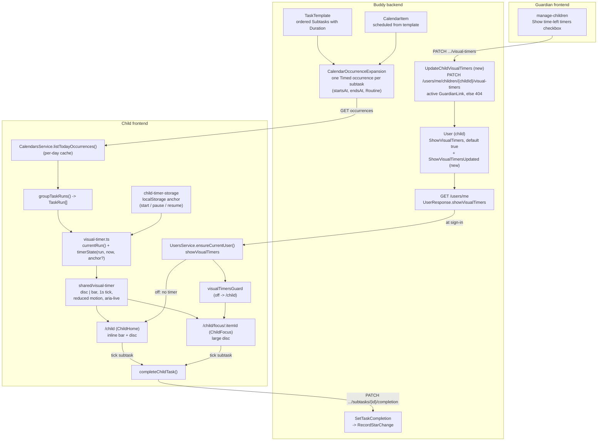

# Visual time-left timer for the child

Status: Implemented. Backend: `User.ShowVisualTimers` (default on), the `ShowVisualTimersUpdated` event and `PATCH /users/me/children/{childId}/visual-timers` (`UpdateChildVisualTimers`), with `showVisualTimers` on `UserResponse` and `ChildSummary`. Frontend: `core/visual-timer.ts`, `core/child-timer-storage.ts`, `core/child-timer.service.ts`, `core/child-task-completion.ts`, the `shared/visual-timer` disc/bar component, the run bar and current-step disc with Start / Pause / Keep going / Stop timer / Focus on `/child`, the `/child/focus/:itemId` page behind `visualTimersGuard`, and the per-child "Show time-left timers" switch on `manage-children`.

## Context

Children with ADHD often have trouble feeling how much time has passed or is left ("time
blindness"). Many autistic children cope better when they can see what comes next and when it
ends. A clock face showing `07:12` helps neither group much. What helps is the physical
"time timer" that families already put on the kitchen table: a coloured disc that shrinks as time
runs out, so "how long is left" can be read at a glance without reading a clock.

Buddy already has the data such a timer needs. A guardian builds a routine in the task library
as an ordered list of subtasks, each with a positive duration
([`Subtask.cs`](../../../src/backend/buddy/Features/TaskLibrary/Types/Subtask.cs):
`Subtask(SubtaskId Id, string Title, Icon? Icon, TimeSpan Duration)`, validated
`GreaterThan(TimeSpan.Zero)` in
[`AddSubtask.Validator.cs`](../../../src/backend/buddy/Features/TaskLibrary/AddSubtask/AddSubtask.Validator.cs)).
The guardian then schedules it on a calendar at a start time (`ScheduleTaskFromTemplate`, see
[task-library.md, Calendar integration](task-library.md#calendar-integration-scheduling-from-a-template)).
Today the child home at `/child` lists that routine as a run of checkboxes
([`home.html:277-322`](../../../src/frontend/buddy/src/app/features/child/home/home.html)).
The durations are not visible anywhere on the child's screen: a subtask row shows its icon,
title and a done toggle, nothing more.

The closest precedent is the ongoing-event fill on the same page. `ChildHome` keeps a `now`
signal that ticks every minute
([`home.ts:111-114`](../../../src/frontend/buddy/src/app/features/child/home/home.ts),
[`home.ts:284-309`](../../../src/frontend/buddy/src/app/features/child/home/home.ts)). It
derives `isPast`/`isOngoing`/`progressPercent` for each event from its `startsAt`/`endsAt`
(`eventProgress`, [`home.ts:532-559`](../../../src/frontend/buddy/src/app/features/child/home/home.ts))
and paints that as a left-to-right gradient on the event card
([child-day-dashboard.md, Events](child-day-dashboard.md#events)). The timer is the task-side
counterpart of that fill, made larger and easier to read for a child.

Most of the feature is frontend work, which is why this doc lives in `docs/frontend/analysis`.
It also has a small backend part: a guardian-managed per-child switch that turns timers off for
one child (Question 9). That switch is one boolean on the child's `User`, set through one new
Guardians slice, shaped like
[child-language-settings.md](../../backend/analysis/child-language-settings.md) and
[child-timezone-settings.md](../../backend/analysis/child-timezone-settings.md). The timer itself
and its progress stay in the browser.

This document answers nine questions: does the timer need backend state; what drives it;
which task and subtask are "current"; where it appears; what happens when time runs out; how it
looks and stays accessible; how it interacts with completion and stars; how a running timer
survives a reload; and how a guardian turns timers off for a child.

## Question 1: frontend-only, or new backend state?

**Decision: the timer and its progress are frontend-only. No endpoint, event, aggregate or field
records timer state. The timer is derived from occurrences the child home already loads, and a
child-started timer lives in the browser that started it. The one backend addition is the
guardian's per-child on/off switch (Question 9), which is configuration, not timer state.**

- **The schedule is already on the wire, per subtask.** `CalendarOccurrenceExpansion` expands a
  template-scheduled item into one occurrence per subtask. Each occurrence has its own
  `OccurrenceTiming.Timed(StartsAt, EndsAt)` window, chained by adding up the subtask durations
  ([`CalendarOccurrenceExpansion.cs:100-130`](../../../src/backend/buddy/Features/Calendars/CalendarOccurrenceExpansion.cs)).
  It also has a `Routine(SubtaskId, ParentTitle, ParentIcon)` marker
  ([`CalendarItemOccurrence.cs`](../../../src/backend/buddy/Features/Calendars/Types/CalendarItemOccurrence.cs)).
  The expansion resolves every wall-clock boundary through the calendar's time zone, subtask by
  subtask, so DST is already handled where it should be. A frontend timer only has to compare
  those instants with `Date.now()`, exactly as `eventProgress` does for events.
- **The subtask's duration doesn't need its own field.** It is `endsAt - startsAt` of its
  occurrence. The only exception is a window that crosses a DST change; see the edge-case table.
- **The loading is already done.** `ChildHome` loads today through
  `CalendarsService.listTodayOccurrences()`, which keeps a per-day cache
  ([`calendars.service.ts:282-295`](../../../src/frontend/buddy/src/app/core/calendars.service.ts)),
  and groups the results into `TaskRun`s with `groupTaskRuns()`
  ([`task-run.ts:56-91`](../../../src/frontend/buddy/src/app/core/task-run.ts)). The timer takes a
  `TaskRun` as input, so it needs no new request.
- **Persisting timer progress isn't required by anything.** No guardian screen, star rule or
  report reads "when the child pressed start" or "how long they paused". Persisting it would mean
  new events on `CalendarItem` next to `CompletionLog` (or a new aggregate), a GDPR export entry
  (the house rule in [gdpr-data-protection.md](../../backend/analysis/gdpr-data-protection.md)),
  and a new kind of moment-to-moment behavioural tracking of the child. That last point is the
  biggest cost: guardians could later read it as "how slow was my child this morning", which goes
  against the "progress never punishes" principle of
  [gamified-progress.md](../../backend/analysis/gamified-progress.md) (Context). Each family runs
  its own instance, and the project prefers that oversight not be built into the app.
- **Rejected: a `TimerStarted`/`TimerPaused` event pair on `CalendarItem`**, for the reasons
  above. It would also put a high-frequency, low-value write (every pause) on an aggregate whose
  stream otherwise records deliberate guardian edits and completions.
- **Rejected: a backend `Duration` field on `Routine`.** It duplicates what `Timed` already
  says, and it would need a contract change (`task docs:openapi`) for nothing.

The per-child switch is different from timer progress: a guardian sets it deliberately and rarely,
it says nothing about how the child behaves, and it has to follow the child to every device they
sign in on. So it belongs on the server, next to the child's language and time zone. Question 9
designs it; nothing in Questions 2-8 depends on it beyond "show no timer when it is off".

## Question 2: what drives the countdown -- the schedule, or the child?

**Decision: both, in two modes over the same pure calculation. By default the timer is
_schedule-anchored_ and needs no interaction. The child can tap _Start_ on the current subtask to
switch the run to a _child-started_ timer. That timer gives each subtask its full duration from
the moment the child begins, and only that mode can pause and resume.**

The schedule alone isn't enough. Routines rarely start on the minute. If the morning routine is
scheduled at 07:00 and Emil opens the tablet at 07:08, a schedule-anchored timer has already used
up "Get dressed" (5 min) and most of "Eat breakfast". He would arrive to empty discs, and that is
exactly the "you're already behind" feeling the feature should avoid. A purely child-started
timer has the opposite problem: it shows nothing until someone taps, so it doesn't help the child
who hasn't noticed the routine has started.

So:

| Mode                        | Anchor                                             | Shown when                                                      | Pause                           |
| --------------------------- | -------------------------------------------------- | --------------------------------------------------------------- | ------------------------------- |
| Schedule-anchored (default) | the subtask occurrence's own `startsAt`/`endsAt`   | always, for the current run (Question 3)                        | no -- the clock can't be paused |
| Child-started               | the instant the child tapped _Start_ (or _Resume_) | after a tap, until the run is complete or the child taps _Stop_ | yes                             |

In child-started mode, the current subtask's budget is `endsAt - startsAt` of its occurrence,
counted from the tap. When the child marks that subtask done, the next incomplete subtask starts
its own full budget immediately (an auto-chain). They don't have to tap _Start_ again on every
step, which matches how the expansion chains subtasks one after another on the server.

Both modes are one pure function in a new `core/visual-timer.ts`, next to `task-run.ts`:

```ts
export interface TimerAnchor {          // undefined => schedule-anchored
  subtaskKey: string;                    // occurrenceKey() of the subtask the tap started
  startedAtMs: number;
  pausedAtMs: number | null;
}

export interface TimerState {
  current: CalendarOccurrence | null;    // first incomplete subtask, null when the run is done
  next: CalendarOccurrence | null;       // the incomplete subtask after `current` (focus view)
  remainingMs: number;                   // clamped to [0, budgetMs]
  budgetMs: number;                      // endsAt - startsAt of `current`
  runRemainingMs: number;                // current remaining + budgets of later incomplete subtasks
  runBudgetMs: number;                   // sum of all subtask budgets
  deadlineMs: number | null;             // when remainingMs hits zero, while `running`
  startsAtMs: number | null;             // `current`'s scheduled start ("Starts at ...")
  phase: 'upcoming' | 'running' | 'paused' | 'timesUp' | 'done';
  childStarted: boolean;
}

export function timerState(run: TaskRun, nowMs: number, anchor?: TimerAnchor): TimerState;
```

Keeping it a pure function of `(run, now, anchor)` follows `eventProgress` and `groupTaskRuns`:
it is easy to test with plain Vitest cases, with no fake timers. The same module holds the anchor
transitions as pure functions too (`startAnchor`, `pauseAnchor`, `resumeAnchor`, and `reanchor`,
which gives the new current subtask a fresh budget after a tick or untick in child-started mode).
`deadlineMs` lets the timer component count down by itself between the page's once-a-minute
recalculations, without knowing which mode it is in.

Rejected alternatives:

- **Schedule-anchored only.** A late start produces empty discs (see above), and there is
  nothing for a child who wants to "race the timer".
- **Child-started only.** It's invisible until tapped, and the routine's scheduled time, which
  the guardian chose on purpose, carries no meaning.
- **Re-anchoring the schedule automatically to the first completion.** It's guesswork. The first
  completion might be a misclick or a catch-up of a step done earlier, and the child can't see
  why the timer jumped.

## Question 3: which task and subtask are "current"?

**Decision: the current run is the earliest run of today that has started (`now >=` its first
subtask's `startsAt`), still has an incomplete subtask, and whose last subtask ended no more than
30 minutes ago. If no run qualifies, the next run starting within 15 minutes counts, in the
`upcoming` phase. The current subtask is the first _incomplete_ subtask in run order, not the
subtask whose window contains `now`.**

- Completion drives which subtask is current, not the clock. The checkbox is something the child
  does, so finishing "Get dressed" early moves the disc on to "Eat breakfast" right away. In
  schedule-anchored mode, if the next subtask's window hasn't opened yet, its disc shows full and
  doesn't move (`upcoming`, with "Starts at 07:05"). In child-started mode it starts at once.
- Falling behind the schedule never skips a step. If 07:12 is inside "Eat breakfast"'s window
  but "Get dressed" isn't ticked, the current subtask is still "Get dressed". Its disc is empty
  (`timesUp`, Question 5) until the child ticks it or taps _Start_ to get a fresh budget.
- The 30-minute grace window keeps an unfinished morning routine from staying "current" all day.
  15 minutes of look-ahead lets a child see that the bedtime routine is coming. Both are constants
  in `visual-timer.ts` (`CURRENT_RUN_GRACE_MS`, `CURRENT_RUN_LOOK_AHEAD_MS`). The user settled
  on 2026-10-11 to keep these values.
- A run the child started a timer for stays current until it is finished, even past the grace
  window, so a timer the child is using never disappears under them (`currentRun(runs, now,
anchoredItemId)`).
- Only template-scheduled runs get a timer. A plain hand-entered task is `OccurrenceTiming.Due`:
  one instant with no duration
  ([`CalendarItemOccurrence.cs`](../../../src/backend/buddy/Features/Calendars/Types/CalendarItemOccurrence.cs)),
  so there is nothing to count down. Events already have their own fill. A template-scheduled
  task is never all-day
  ([`ScheduleTaskFromTemplate.Handler.cs:86-89`](../../../src/backend/buddy/Features/Calendars/ScheduleTaskFromTemplate/ScheduleTaskFromTemplate.Handler.cs)),
  so `isAllDay` never has to be handled.
- When two runs overlap (a guardian scheduled them on top of each other), the earlier one is
  current. The other run's rows look as they do today.

## Question 4: where does it appear?

**Decision: in two places. (a) Inline on `/child`: a slim bar for the whole run under the
current run's header, and a small disc on the current subtask's row. (b) A focus view at
`/child/focus/:itemId` with one large disc, the current subtask's icon and title, the next step,
the _Done_/_Start_/_Pause_ controls, and nothing else.**

- **Inline** adds no new navigation. The child sees the timer where they already tick subtasks
  off ([`home.html:277-322`](../../../src/frontend/buddy/src/app/features/child/home/home.html)).
  Only the current run and subtask get the timer. Putting a disc on every row would turn the list
  into a wall of clocks, and the point is to show one thing at a time.
- **Focus view.** A full home screen holding meals, doses, pickups and events next to the routine
  is busy, and it is the opposite of what a child with ADHD needs mid-routine. The focus view is
  the "time timer on the table" version: the disc fills most of a tablet screen, which suits
  families who leave an iPad on the counter
  ([ipad-installation.md](ipad-installation.md)). A _Focus_ button on the current run's header
  opens it.
  - It is a real route rather than an overlay inside `ChildHome`. The back button closes it, a
    guardian can bookmark it on the kitchen iPad, and it gets a screenshot like every other page
    (see the Frontend plan). Rejected: a `<dialog>` overlay. It is hard to deep-link, and on a phone a
    dialog that covers the whole screen behaves like a page anyway.
  - `:itemId` names the run. The date is always today, like the rest of the child home
    ([child-day-dashboard.md, Deliberate boundaries](child-day-dashboard.md#deliberate-boundaries)).
    The page reads the cached `listTodayOccurrences()`, so it costs nothing to open it from
    `/child`. When the run is done, or isn't today's, the page shows a friendly "All done" card
    with a link back to `/child`, not an error.
  - Fullscreen API, Wake Lock and similar are left out of v1. Buddy uses none of them today, and
    iOS Safari's support for them is uneven. **No wake lock or fullscreen in v1 was settled by the
    user on 2026-10-11**; Guided Access and the iPad's own Auto-Lock setting cover the dedicated
    device, and the Screen Wake Lock API can come later as progressive enhancement.
- **Neither place shows anything when the guardian has turned timers off for this child**
  (Question 9). The inline bar, the disc and the _Start_/_Pause_/_Focus_ buttons are not rendered,
  and the subtask rows look exactly as they do today. `/child/focus/:itemId` redirects to `/child`.
- **Not on `/child/calendar`.** The agenda is for browsing days, not for doing them
  ([child-calendar-agenda-plan.md](child-calendar-agenda-plan.md)). **Not on guardian screens
  either.** A guardian watching a child's countdown is the oversight Question 1 argues against.

## Question 5: what happens when time runs out?

**Decision: quietly. The disc empties, the colour fades to a neutral slate, and a short line
reads "Time's up. Finish when you're ready." No sound, no vibration, no flashing, no red, no
overtime counter. Nothing is completed, skipped or moved forward on the child's behalf.**

- Children with ADHD or autism often react badly to sudden alarms. A buzzer can turn "time to
  move on" into a meltdown, which is the opposite of the point. A disc that empties already says
  everything a sound would say.
- There is no audio anywhere in the app today. A sound would need assets, a settings toggle and
  the browser's autoplay rules (iOS blocks audio that isn't started by a gesture). **No sound in
  v1 was settled by the user on 2026-10-11.** If a chime is added later, it is opt-in and off by
  default, started from the _Start_ tap (so iOS allows it), with one short, gentle sound.
- "Not red" follows [visual-specification.md](visual-specification.md): colour is never the only
  signal, and red means _error_ in the rest of Buddy. Running out of time isn't an error.
- **No overtime counter** (`+3 min`). Counting how late you are is the punishing streak mechanic
  [gamified-progress.md](../../backend/analysis/gamified-progress.md) deliberately avoids. **Settled
  by the user on 2026-10-11**: the disc empties to grey with "Time's up. Finish when you're ready."
  and nothing counts on.
- **The timer never completes a subtask.** Completion means the child (or guardian) says the step
  is done, and it awards a star (Question 7). Auto-completing on timeout would award stars for
  nothing. Auto-advancing without completing would leave unticked steps behind and hide them.
- `aria-live="polite"` announces the `timesUp` change exactly once (Question 6).

## Question 6: look, motion, colour and accessibility

**Decision: a new presentational component `shared/visual-timer` with a `disc` and a `bar`
variant. It draws an SVG pie wedge (a `path`, clockwise from 12 o'clock) on a slate circle (disc)
or a `div` with a width (bar). The remaining time is filled with the run's own colour on a neutral
slate track. A text label ("4 min left") always sits next to it. Under `prefers-reduced-motion` the
disc moves in whole-minute steps.**

- **Shape before colour.** The remaining time is readable from the _size of the wedge_ and from
  the text. The colour only identifies which run this is. That makes the timer safe for
  colour-blind children, as [visual-specification.md](visual-specification.md) requires ("Color
  never carries meaning alone"). There is no green/amber/red scale, because the most common
  colour-blindness is red/green.
- **Colour.** The fill is the run's `color` (the guardian picked it in the task library and the
  run header already shows it, [`task-run.ts:75-85`](../../../src/frontend/buddy/src/app/core/task-run.ts)).
  The track is `slate-200` in light mode and `slate-700` in dark mode. Dark mode uses the
  class-based `dark:` variant, as everywhere else
  ([`styles.css:5-8`](../../../src/frontend/buddy/src/styles.css)). A guardian-chosen colour can
  have poor contrast against the track (a pale yellow, for example). The component therefore adds
  a 2px `slate-500`/`slate-300` outline around the wedge, so the shape stays visible whatever the
  colour.
- **Tick.** `ChildHome`'s one-minute `now` is too coarse for a 3-minute "Brush teeth". The timer
  component has its own `now` signal that ticks every second while a timer is shown and stops
  when it is destroyed or its phase is `paused`/`done`. That is the same `setInterval`/
  `clearInterval` pattern as [`home.ts:303-309`](../../../src/frontend/buddy/src/app/features/child/home/home.ts),
  scoped to the component, so the rest of the dashboard doesn't re-render every second.
- **Reduced motion.** The component reads `matchMedia('(prefers-reduced-motion: reduce)')`.
  With the preference, the disc still shows the remaining time (it carries information, so it
  can't just disappear), but it redraws only on whole minutes. Without it, the wedge is redrawn
  every second, which reads as a smooth shrink; there is no CSS transition in either mode (a wedge
  `path` can't be transitioned portably, unlike the `stroke-dashoffset` first planned here).
  Nothing flashes or pulses in either mode, and that includes `timesUp`.
- **Text and screen readers.**
  - The visible label rounds _up_ to whole minutes ("4 min left", "Less than a minute left").
    Children don't need seconds, and a seconds counter adds pressure.
  - The disc's SVG is `aria-hidden`. The label is the accessible name.
  - The wrapper is `role="timer"`, which is not live by default. A separate visually hidden
    `aria-live="polite"` span announces only the changes in phase (started, paused, time's up,
    next step). If it read out every minute, it would keep talking over the child. Only one timer
    per run speaks (`announce` input): on `/child` it is the run bar, because the step's disc is
    re-created in the next row when a step is ticked and would lose "Next step"; in the focus view
    it is the one big disc.
- **Sizes.** The inline disc is 28px and sits at the end of the subtask row. It isn't a control, so
  the 44x44px touch-target rule doesn't apply to it. _Start_, _Pause_, _Resume_, _Stop_ and
  _Focus_ are buttons of at least 44x44px with visible emerald focus rings, per
  [visual-specification.md](visual-specification.md). The focus view's disc is
  `min(70vw, 60vh)`, so it fits a phone and an iPad in landscape alike.

## Question 7: interaction with task completion and progress stars

**Decision: no change to completion or stars. The timer reads `isCompleted` and never writes it.
Ticking a subtask still goes through `ChildHome.toggleTask()` →
`CalendarsService.setTaskCompletion(..., subtaskId)` → `SetTaskCompletionHandler`, which awards
or revokes that subtask's star. Finishing within the time earns no bonus.**

- Completion and stars stay exactly as they are
  ([`home.ts:379-409`](../../../src/frontend/buddy/src/app/features/child/home/home.ts),
  [`SetTaskCompletion.Handler.cs:88`](../../../src/backend/buddy/Features/Calendars/SetTaskCompletion/SetTaskCompletion.Handler.cs)).
  Each subtask already earns its own star
  ([gamified-progress.md](../../backend/analysis/gamified-progress.md), "Revoking a star").
- **Rejected: a "beat the timer" bonus star.** It needs exactly the backend timing state that
  Question 1 rejects. The server can't verify it (the browser could lie about when _Start_ was
  tapped). And it rewards speed over doing the routine, which penalises the slowest children, who
  need the support most.
- Un-ticking a subtask brings it back as the current one (it is the first incomplete again). In
  child-started mode it gets a fresh full budget, counted from the un-tick.
- The focus view needs the same toggle and the same `progress.reload()` as the home page. Rather
  than copy `toggleTask`, the occurrence patching and star refresh move out of `ChildHome` into a
  small shared helper. That helper can use the `occurrenceKey()` patching both pages already rely
  on ([`task-run.ts:105-109`](../../../src/frontend/buddy/src/app/core/task-run.ts)). The
  refactor:

  ```ts
  // before (home.ts:379) -- private to ChildHome, patches its own `occurrences` resource
  protected async toggleTask(task: CalendarOccurrence): Promise<void> { ... }

  // after -- core/child-task-completion.ts, used by ChildHome and ChildFocus
  export async function completeChildTask(
    calendars: CalendarsService, task: CalendarOccurrence, isCompleted: boolean,
  ): Promise<void>;   // calls setTaskCompletion with todayIsoDate() and routine?.subtaskId
  ```

  The blast radius is one method in `home.ts` and its specs in `home.spec.ts`. The local
  occurrence patching stays in each page, because each page owns its own resource.

## Question 8: how does a running child-started timer survive a reload?

**Decision: the `TimerAnchor` from Question 2 goes to `localStorage` under one key
(`buddy_child_timer`), as `{ itemId, date, anchor }`. It is read and written inside `try/catch`.
An entry for a different date is thrown away. A root `ChildTimerService` holds the stored timer in
a signal on top of it, so the child home and the focus view share one timer within a session. The
storage helper follows
[`ai-meal-filter-storage.ts`](../../../src/frontend/buddy/src/app/features/guardian/mealplan/ai-assistant/ai-meal-filter-storage.ts)
and [`last-template-storage.ts`](../../../src/frontend/buddy/src/app/features/guardian/print/last-template-storage.ts).**

- A child bumping the tablet, a token refresh or a trip between `/child` and the focus view
  should keep the timer going. Signals in one component don't survive that. A paused timer has to
  stay paused across navigation too.
- The precedent says _device conveniences_ belong in local storage: the AI meal filter is "a
  convenience, not configuration ... so it isn't synced", and the theme mode is kept the same way
  ([`theme.service.ts`](../../../src/frontend/buddy/src/app/core/theme.service.ts)). A running
  timer is that kind of state.
- Only one run can be child-started at a time. Starting another run replaces the entry, which
  keeps the stored shape trivial.
- If storage is unavailable, it degrades as before (no anchor, so the timer is
  schedule-anchored), never with an error.
- Not synced across devices. Starting on the iPad and continuing on a phone shows the
  schedule-anchored timer on the phone. That is fine, and Question 1 explains why syncing it
  would cost more than it gives.
- When timers are off for the child (Question 9), the stored anchor is cleared and never read, so
  turning timers back on later starts from schedule mode rather than a stale _Start_.

## Question 9: can a guardian turn timers off for a child?

**Decision (settled by the user 2026-10-11): yes, per child, in v1. A new boolean
`ShowVisualTimers` on the child's `User`, default `true`, set by any active guardian through
`PATCH /users/me/children/{childId}/visual-timers` and changed by a new `ShowVisualTimersUpdated`
event. The child reads it from `GET /users/me`; the guardian reads and edits it on
`manage-children`, next to language and time zone. The child cannot change it.**

Some autistic children find any countdown stressful, and the guardian is the one who knows that.
The design copies the two existing guardian-managed child settings,
[child-language-settings.md](../../backend/analysis/child-language-settings.md) and
[child-timezone-settings.md](../../backend/analysis/child-timezone-settings.md), almost decision
for decision:

- **Who can set it: any active `GuardianLink`**, regardless of `GuardianKind`, the same rule as
  language and time zone (and `MedicineAuthorization`). Co-guardians who disagree get last write
  wins, with both writes in the stream.
- **Where it lives: a field on `User`, a slice in the Guardians feature.** The setting describes the
  child, follows them to every device and is read at sign-in, exactly like `Language`. The
  slice goes in `Features/Guardians/UpdateChildVisualTimers/`, next to `UpdateChildLanguage` and
  `UpdateChildTimeZone`, because all guardian-acts-on-a-child authorization lives there.
- **Default: on.** Every existing user and every new child starts with timers shown, so the
  feature is visible without setup. Guardians opt a child _out_.
- **Not on `TaskTemplate` or `CalendarItem`.** The need comes from the child, not from one routine.
  A per-template switch would make the guardian repeat the choice for every routine, and a new
  routine would still show a timer to a child who can't cope with one. Considered and rejected.
- **Not a family-wide feature flag** (`features.service.ts`, `featureGuard`). Those are
  instance-level switches for whole features. Turning timers off for one sibling must not turn
  them off for the other. Considered and rejected.
- **Not device-local** (`localStorage`). A guardian's decision has to hold on the kitchen iPad and
  the child's phone alike, and the guardian sets it from their own device. Considered and rejected.

### Domain change

A new event, following the `Before`/`After` shape of `LanguageUpdated`
([`UserEvents.cs`](../../../src/backend/buddy/Features/Users/Types/UserEvents.cs)):

```text
ShowVisualTimersUpdated(UserId UserId, bool Before, bool After, DateTimeOffset OccurredAt)
    // appended to the child's own User stream by UpdateChildVisualTimersHandler;
    // no event when the value doesn't change (idempotent no-op, like UpdateChildLanguage)
```

`User` gains one field with a default, the same way `IsErased` was added
([`User.cs`](../../../src/backend/buddy/Features/Users/Types/User.cs)):

```csharp
// before (User.cs)
public sealed record User(
    UserId Id, KeycloakSubject KeycloakSubject, Email Email, string UserName, Name Name,
    TimeZoneId TimeZoneId, Language Language, EmailVerification EmailVerification,
    bool IsDeleted,
    bool IsErased = false)

// after
public sealed record User(
    ..., bool IsDeleted,
    bool IsErased = false,
    bool ShowVisualTimers = true)   // guardian-managed; meaningful for children only

// User.Advance gains one arm
ShowVisualTimersUpdated updated => user with { ShowVisualTimers = updated.After },
```

- `UserCreated` is unchanged. A new user gets `true` from the default in `User.Start`, so there is
  no migration and no new field on the creation event.
- Existing snapshot rows in the `snapshots` schema have no `showVisualTimers` property. Marten
  deserializes them with System.Text.Json (`UsersFeature.cs`), which uses the constructor
  parameter's default for a missing property, so they read as `true` with no rebuild. That is the
  same path `IsErased` relied on.
- The `UserEvent` union gets a tenth case (`FromPayload` and `EventType` arms), `UsersFeature`'s
  `EventTypes` list registers it, and `UserSnapshotProjection` gets an `Apply` overload like the
  one for `LanguageUpdated`.
- An adult's `User` carries the field too, always `true`, and nothing reads it. A separate child
  profile document was considered and rejected: `Language` and `TimeZoneId` already set the
  precedent of child settings on `User`.

Blast radius: `User.cs`, `UserEvents.cs`, `UsersFeature.cs`, `UserSnapshotProjection.cs`; the
three `new ChildSummary(...)` call sites (`ListMyChildrenHandler`, `UpdateChildLanguageHandler`,
`UpdateChildTimeZoneHandler`); `UserResponse.FromUser`. No existing event changes shape.

### Command slice and route

`Features/Guardians/UpdateChildVisualTimers/`, the same four-file shape as
[`UpdateChildLanguage`](../../../src/backend/buddy/Features/Guardians/UpdateChildLanguage/)
minus the validator:

```csharp
public sealed record UpdateChildVisualTimers(UserId GuardianId, UserId ChildId, bool ShowVisualTimers)
{
    public static UpdateChildVisualTimers FromClaims(ClaimsPrincipal principal, UserId childId, bool show) =>
        new(principal.GetRequiredUserId(), childId, show);
}

public sealed record UpdateChildVisualTimersRequest(bool ShowVisualTimers);
```

Handler steps, identical to `UpdateChildLanguageHandler` apart from the field:

1. `guardianLinks.FindActiveLinkAsync(childId, guardianId, ...)`; `null` ⇒ `Result.NotFound`
   (the "can't tell no-such-child from not-your-child" collapse).
2. Rehydrate the child's `User`; `null` or `IsDeleted` ⇒ `Result.NotFound`.
3. If `child.ShowVisualTimers != command.ShowVisualTimers`, append `ShowVisualTimersUpdated`;
   otherwise append nothing.
4. Return the updated `ChildSummary`.

There is no `Validator.cs`: a boolean has no invalid value. A missing body, a missing
`showVisualTimers` or a non-boolean value fails binding, and `RequestBindingFailureMiddleware`
renders it as the usual `ErrorEnvelope` 400 (`RespectRequiredConstructorParameters` and
`RespectNullableAnnotations` in `Program.cs`).

```text
PATCH /users/me/children/{childId:guid}/visual-timers   UpdateChildVisualTimers
      body { "showVisualTimers": false }
      200 ChildSummary | 400 ErrorEnvelope (unbindable body) | 401 | 404 (no active link, or child deleted)
```

Mapped in [`GuardiansFeature.cs`](../../../src/backend/buddy/Features/Guardians/GuardiansFeature.cs)
next to `MapUpdateChildTimeZone`. The Guardians feature has no `.http` file; the request goes in
[`Users.http`](../../../src/backend/buddy/Features/Users/Users.http), which already holds
`DELETE /users/me/children/{childId}`. `task docs:openapi` regenerates `buddy.json` and
`buddy-api.ts`.

### Read paths

- **Child:** `UserResponse` (`GET /users/me`,
  [`GetCurrentUser.Endpoint.cs`](../../../src/backend/buddy/Features/Users/GetCurrentUser/GetCurrentUser.Endpoint.cs))
  gains `bool ShowVisualTimers`. The child frontend already calls it at sign-in through
  `UsersService.ensureCurrentUser()`, so knowing whether to show timers costs no new request.
- **Guardian:** `ChildSummary`
  ([`ListMyChildren.Handler.cs`](../../../src/backend/buddy/Features/Guardians/ListMyChildren/ListMyChildren.Handler.cs))
  gains `bool ShowVisualTimers` next to `Language` and `TimeZoneId`, so `manage-children` shows
  the current value without a second request.

```csharp
// before
public sealed record ChildSummary(UserId Id, Name Name, GuardianLinkId GuardianLinkId, GuardianKind Kind, Language Language, TimeZoneId TimeZoneId);
// after
public sealed record ChildSummary(..., Language Language, TimeZoneId TimeZoneId, bool ShowVisualTimers);
```

### GDPR

- **Export:** the "account" section is `UserResponse.FromUser`
  ([`UsersPersonalDataExport.cs`](../../../src/backend/buddy/Features/Users/UsersPersonalDataExport.cs)),
  so adding the field to `UserResponse` puts it in the child's export with no extra exporter. That
  satisfies the house rule in
  [gdpr-data-protection.md](../../backend/analysis/gdpr-data-protection.md) that new personal data
  appears in the export.
- **Erasure:** no masking rule. The event holds two booleans and the ids already in the stream;
  it identifies no one, like `LanguageUpdated` and `TimeZoneUpdated`, which have no rule in
  [`UsersPersonalData.cs`](../../../src/backend/buddy/Features/Users/UsersPersonalData.cs) either.
- It records a guardian's choice about the child, not the child's behaviour, so the tracking
  concern from Question 1 doesn't apply.

### Frontend

- **Guardian UI:** a per-child checkbox (toggle) "Show time-left timers" on
  [`manage-children.html`](../../../src/frontend/buddy/src/app/features/guardian/admin/manage-children/manage-children.html),
  in each child's row below the language and time zone selects. It saves on change with a
  per-child saving/error signal, the `savingLanguageChildId`/`languageErrorByChildId` pattern in
  [`manage-children.ts:68-72`](../../../src/frontend/buddy/src/app/features/guardian/admin/manage-children/manage-children.ts).
  A short hint under it explains what the child sees. `GuardiansService` gains
  `updateChildVisualTimers(childId, show)`, mirroring `updateChildLanguage`
  ([`guardians.service.ts:107`](../../../src/frontend/buddy/src/app/core/guardians.service.ts)).
  A new per-child settings page was considered and rejected for the same reason as in
  child-language-settings.md: a third field doesn't justify new navigation.
- **Child UI:** `ChildHome` and `ChildFocus` read `showVisualTimers` from the resolved
  `CurrentUser` and render no timer when it is `false`. A small `visualTimersGuard` on the
  `focus/:itemId` route sends the child to `/child` instead.
- **Freshness:** `ensureCurrentUser()` caches the user for the session
  ([`users.service.ts:41-55`](../../../src/frontend/buddy/src/app/core/users.service.ts)), so a
  guardian's change reaches an already-open child app on the next reload or sign-in. Language
  changes behave the same way today. Live push was considered and rejected: no profile field
  pushes changes today, and a timer showing for a few more minutes is harmless.

### Child-side hiding

**Settled by the user 2026-10-11: no child-side "hide timers" toggle. The guardian setting covers
it.** A child who finds the timer stressful tells a guardian, who turns it off for every device at
once. A second, device-local switch would let the two disagree silently.

## Backend plan

Only the per-child switch from Question 9. Code paths are under `src/backend/buddy/Features/`; the last two rows are docs.

| File                                                                                      | Change                                                                                                                                                     |
| ----------------------------------------------------------------------------------------- | ---------------------------------------------------------------------------------------------------------------------------------------------------------- |
| `Users/Types/UserEvents.cs`                                                               | **New case** `ShowVisualTimersUpdated(UserId, bool Before, bool After, DateTimeOffset OccurredAt)` in the `UserEvent` union, `FromPayload` and `EventType` |
| `Users/Types/User.cs`                                                                     | `bool ShowVisualTimers = true` parameter; one `Advance` arm                                                                                                |
| `Users/Types/UserSnapshotProjection.cs`                                                   | `Apply(UserSnapshot, ShowVisualTimersUpdated)`                                                                                                             |
| `Users/UsersFeature.cs`                                                                   | Register the event type in `EventTypes`                                                                                                                    |
| `Users/GetCurrentUser/GetCurrentUser.Endpoint.cs`                                         | `UserResponse` gains `ShowVisualTimers` (also reaches the GDPR "account" export)                                                                           |
| `Guardians/UpdateChildVisualTimers/UpdateChildVisualTimers.{Command,Endpoint,Handler}.cs` | **New slice**: `PATCH /users/me/children/{childId:guid}/visual-timers`, 200/400/401/404                                                                    |
| `Guardians/GuardiansFeature.cs`                                                           | `children.MapUpdateChildVisualTimers()`                                                                                                                    |
| `Guardians/ListMyChildren/ListMyChildren.Handler.cs`                                      | `ChildSummary` gains `ShowVisualTimers`; the three constructor call sites pass it                                                                          |
| `Users/Users.http`                                                                        | The new `PATCH` request                                                                                                                                    |
| `docs/backend/openapi/buddy.json`                                                         | Regenerated by `task docs:openapi`                                                                                                                         |
| `docs/backend/guardians/flow.md`                                                          | The new route next to the language and time zone ones                                                                                                      |

## Frontend plan

| File                                                                       | Change                                                                                                                                                                                                                                                                                                                                                                                                                                                                                                                                                                                                                                                                                                                                                           |
| -------------------------------------------------------------------------- | ---------------------------------------------------------------------------------------------------------------------------------------------------------------------------------------------------------------------------------------------------------------------------------------------------------------------------------------------------------------------------------------------------------------------------------------------------------------------------------------------------------------------------------------------------------------------------------------------------------------------------------------------------------------------------------------------------------------------------------------------------------------- |
| `core/api/buddy-api.ts`                                                    | Regenerated: `UserResponse.showVisualTimers`, `ChildSummary.showVisualTimers`                                                                                                                                                                                                                                                                                                                                                                                                                                                                                                                                                                                                                                                                                    |
| `core/guardians.service.ts` + spec                                         | `updateChildVisualTimers(childId, show)` → `PATCH .../visual-timers`, like `updateChildLanguage`                                                                                                                                                                                                                                                                                                                                                                                                                                                                                                                                                                                                                                                                 |
| `features/guardian/admin/manage-children/manage-children.{ts,html}` + spec | Per-child "Show time-left timers" checkbox with saving/error signals (Question 9)                                                                                                                                                                                                                                                                                                                                                                                                                                                                                                                                                                                                                                                                                |
| `features/child/visual-timers.guard.ts` + spec                             | **New.** Resolves `ensureCurrentUser()`; `showVisualTimers === false` ⇒ `UrlTree` to `/child`                                                                                                                                                                                                                                                                                                                                                                                                                                                                                                                                                                                                                                                                    |
| `core/visual-timer.ts` + spec                                              | **New.** `TimerAnchor`, `TimerState`, `timerState()`, `currentRun(runs, nowMs)`, the grace and look-ahead constants. Pure functions only.                                                                                                                                                                                                                                                                                                                                                                                                                                                                                                                                                                                                                        |
| `core/child-timer-storage.ts` + spec                                       | **New.** `readTimerAnchor(date)` (returns `{ itemId, anchor }`), `writeTimerAnchor(itemId, date, anchor)`, `clearTimerAnchor()`, guarded like `ai-meal-filter-storage.ts`.                                                                                                                                                                                                                                                                                                                                                                                                                                                                                                                                                                                       |
| `core/child-timer.service.ts` + spec                                       | **New.** Root service over the storage helper: `stored` signal, `anchorFor(itemId)`, `start`, `pause`, `resume`, `afterCompletionChange(run)`, `stop`. Shared by the home page and the focus view.                                                                                                                                                                                                                                                                                                                                                                                                                                                                                                                                                               |
| `core/child-task-completion.ts` + spec                                     | **New.** The completion helper from Question 7.                                                                                                                                                                                                                                                                                                                                                                                                                                                                                                                                                                                                                                                                                                                  |
| `shared/visual-timer/visual-timer.{ts,html}` + spec                        | **New.** Presentational. Inputs `state: TimerState`, `color`, `variant: 'disc' \| 'bar'`, `size` (a CSS length), `large` (the focus view), `title` (the bar's label) and `announce` (whether it owns the live region). Owns the one-second tick (only while running), `role="timer"`, the live region and the reduced-motion handling.                                                                                                                                                                                                                                                                                                                                                                                                                           |
| `features/child/home/home.{ts,html}` + spec                                | Compute `currentRun`/`timerState` from `groupedTasks()`. Render the bar under the current run's header and the disc on its current subtask. Add _Start_/_Pause_/_Focus_ buttons. `toggleTask` delegates to the helper. Render none of it, and clear the stored anchor, when the current user's `showVisualTimers` is `false`.                                                                                                                                                                                                                                                                                                                                                                                                                                    |
| `features/child/focus/child-focus.{ts,html}` + spec                        | **New page** `ChildFocus`: a large disc, current and next subtask, controls, an "All done" card, a back link. Only reachable when timers are on (the guard).                                                                                                                                                                                                                                                                                                                                                                                                                                                                                                                                                                                                     |
| `features/child/child.routes.ts`                                           | `{ path: 'focus/:itemId', component: ChildFocus, canActivate: [featureGuard('taskLibrary'), visualTimersGuard] }`, the same guard style as `rewards`/`rules` ([`child.routes.ts`](../../../src/frontend/buddy/src/app/features/child/child.routes.ts)). No new feature flag: without the task library there are no template runs.                                                                                                                                                                                                                                                                                                                                                                                                                                |
| `core/i18n/translations/{en,da}/child.ts`, `{en,da}/admin.ts`              | `child.home.timer.*`, `child.focus.*` and `admin.manageChildren.visualTimers.*` (below).                                                                                                                                                                                                                                                                                                                                                                                                                                                                                                                                                                                                                                                                         |
| `screenshots/pages.ts`, `screenshots/capture.spec.ts`                      | A `child-focus` page entry. The capture runner gets an optional fixed clock (`clock: '07:10'`, applied with `page.clock.setFixedTime`, the API family that [`session-expiry.spec.ts`](../../../src/frontend/buddy/e2e/session-expiry.spec.ts) already uses), so `child-home` and `child-focus` show the morning routine mid-way instead of whatever the time is when the screenshots run. It is only applied once 07:10 has passed in the demo time zone: a browser clock ahead of real time would make the 5-minute access token look expired. `demo-family.ts` seeds that routine at 07:00 daily (`Get dressed` 5 min, `Eat breakfast` 15, `Brush teeth` 3, `Pack school bag` 5) and now ticks only `Get dressed` today, so the timer sits on `Eat breakfast`. |
| `screenshots/pages.ts` (`/guardian/admin`)                                 | No new entry, but the admin screenshot changes because `manage-children` gains the checkbox; rerun `task docs:screenshots`. The demo children keep the default (on)                                                                                                                                                                                                                                                                                                                                                                                                                                                                                                                                                                                              |
| `e2e/visual-timer.spec.ts`                                                 | **New.** Fixed clock inside a run. The disc and "min left" are visible. Tick the current subtask and the timer moves to the next. _Start_ → _Pause_ → reload → still paused. A guardian unticks "Show time-left timers" on `/guardian/admin`; the child, after a reload, sees no timer and `/child/focus/:itemId` lands on `/child`.                                                                                                                                                                                                                                                                                                                                                                                                                             |

The backend part is the one slice in the Backend plan, followed by a `task docs:openapi` run.

### i18n

Danish alongside English, checked with `node .claude/skills/i18n/check-parity.mjs`:

| Key                                                    | en                                                                   | da                                                                                           |
| ------------------------------------------------------ | -------------------------------------------------------------------- | -------------------------------------------------------------------------------------------- |
| `child.home.timer.minutesLeft`                         | `{count} min left`                                                   | `{count} min tilbage`                                                                        |
| `child.home.timer.underAMinute`                        | `Less than a minute left`                                            | `Under et minut tilbage`                                                                     |
| `child.home.timer.runLeft`                             | `{count} min left of {title}`                                        | `{count} min tilbage af {title}`                                                             |
| `child.home.timer.startsAt`                            | `Starts at {time}`                                                   | `Starter kl. {time}`                                                                         |
| `child.home.timer.timesUp`                             | `Time's up. Finish when you're ready.`                               | `Tiden er gået. Gør det færdigt i dit eget tempo.`                                           |
| `child.home.timer.paused`                              | `Paused`                                                             | `På pause`                                                                                   |
| `child.home.timer.start` / `pause` / `resume` / `stop` | `Start` / `Pause` / `Keep going` / `Stop timer`                      | `Start` / `Pause` / `Fortsæt` / `Stop uret`                                                  |
| `child.home.timer.focus`                               | `Focus`                                                              | `Fokus`                                                                                      |
| `child.focus.title`                                    | `One step at a time`                                                 | `Et trin ad gangen`                                                                          |
| `child.focus.next`                                     | `Next: {title}`                                                      | `Bagefter: {title}`                                                                          |
| `child.focus.done`                                     | `I'm done`                                                           | `Jeg er færdig`                                                                              |
| `child.focus.allDone`                                  | `All done! Great job.`                                               | `Færdig! Godt gået.`                                                                         |
| `child.focus.back`                                     | `Back to today`                                                      | `Tilbage til i dag`                                                                          |
| `child.home.timer.announce.*`                          | live-region phrasing for started / paused / time's up / next step    | same                                                                                         |
| `admin.manageChildren.visualTimers.label`              | `Show time-left timers`                                              | `Vis nedtællingsure`                                                                         |
| `admin.manageChildren.visualTimers.hint`               | `A shrinking disc shows how long is left of each step in a routine.` | `En skive, der bliver mindre, viser hvor lang tid der er tilbage af hvert trin i en rutine.` |
| `admin.manageChildren.visualTimers.error`              | `Unable to update this child's timer setting.`                       | `Kunne ikke opdatere barnets indstilling for nedtællingsure.`                                |

The translation files have no plural forms (they use flat `{count}` strings, as in
`progress.ts`), so "min" is used for both singular and plural.

## Testing

Backend (`buddy.IntegrationTests`, Alba + Testcontainers):

- `Features/Guardians/UpdateChildVisualTimers/UpdateChildVisualTimersTests.cs`, mirroring
  [`UpdateChildLanguageTests.cs`](../../../src/backend/buddy.IntegrationTests/Features/Guardians/UpdateChildLanguage/UpdateChildLanguageTests.cs):
  - turns timers off and back on (200, `ChildSummary.showVisualTimers` follows);
  - a co-guardian (`GuardianKind.Guardian`) can change it too;
  - setting the current value appends no event;
  - a missing body or a non-boolean `showVisualTimers` is a 400 `ErrorEnvelope`;
  - a child the caller doesn't guard, a revoked link and a deleted child are 404;
  - no token is 401.
- `GetCurrentUserTests`: a new child reports `showVisualTimers: true`; after the guardian turns it
  off, the child's own `GET /users/me` reports `false`.
- `ListMyChildren` tests: the summary carries the field. `GuardianTestDtos.ChildSummaryDto` gains it.
- `ExportPersonalDataTests`: the child's "account" section includes `showVisualTimers`.
- `EventShapeTests/UserEventShapeTests.cs` plus golden file
  `GoldenFiles/Users/ShowVisualTimersUpdated.json`.
- `SnapshotTests/UserSnapshotTests.cs`: the snapshot matches a full replay after the new command,
  and a snapshot row without the property reads as `true`.

Frontend:

- `visual-timer.spec.ts` (pure):
  - every phase: upcoming, running, paused, time's up, done;
  - first incomplete beats the clock window;
  - the grace and look-ahead boundaries;
  - a child-started anchor chaining to the next subtask;
  - pause → resume keeps the remaining time;
  - un-tick restores a subtask;
  - overlapping runs.
- `visual-timer` component spec:
  - the label rounds up;
  - `aria-hidden` SVG, a live region that updates on phase changes only;
  - reduced motion steps by the minute (stub `matchMedia`);
  - the interval is cleared on destroy (the existing `ChildHome` spec pattern for `now`).
- `home.spec.ts` and `child-focus.spec.ts`:
  - the timer only appears on the current run;
  - plain tasks and events get no timer;
  - the toggle still calls `setTaskCompletion` with `subtaskId` and reloads progress;
  - with `showVisualTimers: false`, no bar, disc or timer buttons render and the anchor is cleared.
- `visual-timers.guard.spec.ts`: on ⇒ `true`, off ⇒ `UrlTree` to `/child`.
- `manage-children.spec.ts`: the checkbox shows each child's value, a change calls
  `updateChildVisualTimers`, saving disables it, a failure shows the per-child error.
- `guardians.service.spec.ts`: the `PATCH` URL and body (`HttpTestingController`).
- i18n parity: `node .claude/skills/i18n/check-parity.mjs`.
- Storage spec: storage that throws, a stale date, garbage JSON.
- One e2e journey with `page.clock`, including the guardian turning timers off (above).
- `screenshot-coverage.spec.ts` passes once the `child-focus` entry exists.

## Failure and edge-case behavior

| Case                                                                   | Behavior                                                                                                                                                                                                                                                     |
| ---------------------------------------------------------------------- | ------------------------------------------------------------------------------------------------------------------------------------------------------------------------------------------------------------------------------------------------------------ |
| Child opens `/child` after the routine's scheduled end                 | Current for 30 more minutes, shown as time's up on the first unticked subtask. _Start_ gives a fresh budget. After that it is no longer current, and the rows look as they do today                                                                          |
| Child finishes a subtask before its window opens                       | Schedule mode: the next subtask shows `upcoming` with a full disc and "Starts at ...". Child-started mode: it starts at once                                                                                                                                 |
| All subtasks ticked                                                    | `done`: the timer disappears from `/child`, and the focus view shows "All done"                                                                                                                                                                              |
| Guardian edits the template mid-routine                                | The next load of today's occurrences reflects it (the backend re-expands from the current template, [task-library flow](../../backend/task-library/flow.md#core-lifecycle)). A stored anchor whose `subtaskKey` no longer exists falls back to schedule mode |
| Guardian deletes or reschedules the item while the focus view is open  | The next load no longer has the run, so the page shows "All done" with a link back. No error                                                                                                                                                                 |
| Subtask window crosses a DST change                                    | The budget is `endsAt - startsAt` in real time, so a 60-minute step across spring-forward shows 0 or 120 minutes. This only affects routines scheduled at night during a DST change. Accepted for v1 by the user (2026-10-11)                                |
| Child taps Pause just after the step's time ran out                    | Both pages also recalculate at the step's `deadlineMs`, so Pause disappears when the disc empties; an anchor paused after its budget is used up still reads as time's up, not paused                                                                         |
| App left open past midnight with a started timer                       | `ChildTimerService` checks the stored date on every read, so yesterday's timer (recurring routines reuse their `itemId`) is ignored the next morning                                                                                                         |
| Tab in the background or device asleep                                 | Timer state is always recomputed from `Date.now()` and the anchor, never from ticks counted, so the disc is correct as soon as the page wakes up                                                                                                             |
| Device clock is wrong                                                  | The disc is wrong by the same amount. The schedule-anchored timer has no way around that, and the event fill has the same limitation today                                                                                                                   |
| `localStorage` unavailable                                             | Child-started mode works until the page reloads. After the reload the timer goes back to schedule mode                                                                                                                                                       |
| `taskLibrary` feature off                                              | No template runs, so no timer. `/child/focus/*` is blocked by `featureGuard`                                                                                                                                                                                 |
| Guardian turns timers off while the child's app is open                | The child keeps seeing the timer until the next reload or sign-in (`ensureCurrentUser()` caches the user), the same as a language change today. Then it disappears and the stored anchor is cleared                                                          |
| Guardian turns timers off while the child is on `/child/focus/:itemId` | The page stays until the next navigation or reload; then `visualTimersGuard` sends the child to `/child`                                                                                                                                                     |
| Two guardians disagree                                                 | Last write wins; both `ShowVisualTimersUpdated` events stay in the child's stream                                                                                                                                                                            |
| Guardian sets the value the child already has                          | `200` with the summary, no event (idempotent, like `UpdateChildLanguage`)                                                                                                                                                                                    |
| Guardian's `GuardianLink` is revoked, or the child is deleted          | `404` from the `PATCH`, the same collapse as the other child settings                                                                                                                                                                                        |
| Snapshot row written before this change                                | No `showVisualTimers` property; System.Text.Json uses the parameter default, so it reads as `true` without a rebuild                                                                                                                                         |
| Child bookmarks `/child/focus/:itemId` with timers off                 | The guard redirects to `/child`                                                                                                                                                                                                                              |
| Two children on one shared iPad                                        | Each child signs in separately. The anchor key includes `itemId`, and one child's items aren't in another child's list, so a stale anchor is ignored                                                                                                         |

## Estimate

|                  |                                                                                                                                                                                                                                                                                                                                                                                                                                                                                                                                                                                         |
| ---------------- | --------------------------------------------------------------------------------------------------------------------------------------------------------------------------------------------------------------------------------------------------------------------------------------------------------------------------------------------------------------------------------------------------------------------------------------------------------------------------------------------------------------------------------------------------------------------------------------- |
| Complexity       | Medium -- mostly frontend: one pure timer module, one storage helper, one shared SVG component (the first reduced-motion handling in the app), one new child page, route and guard, a small extraction from `ChildHome.toggleTask`, about 18 en+da keys, a fixed clock in the screenshot runner and one e2e spec. The backend part is small and follows an existing template exactly: one new event on `User`, one new field with a default, one Guardians slice (`PATCH .../visual-timers`), two response DTOs gaining a field, a contract regeneration and about 10 integration tests |
| Single developer | 4-6 days (about 1 day of it for the backend switch, its tests and the `manage-children` checkbox)                                                                                                                                                                                                                                                                                                                                                                                                                                                                                       |
| AI agent         | 3-5 hours, plus about 1.5-2 hours of human review (look at the disc in light and dark mode, with reduced motion, and on a real iPad; try the switch as a guardian and as the child) and settling the remaining open questions                                                                                                                                                                                                                                                                                                                                                           |

## Decisions made

| Question                                   | Decision                                                                                                                                                                                                                                                                                |
| ------------------------------------------ | --------------------------------------------------------------------------------------------------------------------------------------------------------------------------------------------------------------------------------------------------------------------------------------- |
| Backend state                              | None for the timer or its progress. Subtask windows are already `Timed` occurrences, and persisting timer behaviour would add tracking with no reader. The only backend change is the per-child switch below                                                                            |
| What drives it                             | Schedule-anchored by default, child-started on _Start_, with pause and resume only when child-started                                                                                                                                                                                   |
| Current task/subtask                       | The earliest started, unfinished run within a 30-minute grace window (15-minute look-ahead). The current subtask is the first incomplete one, not the one whose clock window contains now                                                                                               |
| Where                                      | Inline bar and disc on `/child` for the current run only, plus a `/child/focus/:itemId` page                                                                                                                                                                                            |
| Time runs out                              | The disc empties to neutral with a calm line. No vibration, red, overtime or auto-complete                                                                                                                                                                                              |
| Sound                                      | No sound in v1; a later chime would be opt-in and off by default, started from the _Start_ tap -- settled by the user 2026-10-11                                                                                                                                                        |
| Look and accessibility                     | Shape plus text, never colour alone. Run colour on a slate track with an outline. Dark-mode track. Minute steps under reduced motion. Live region on phase changes only                                                                                                                 |
| Stars                                      | Unchanged. The timer never writes completion, and there is no speed bonus                                                                                                                                                                                                               |
| Reload survival                            | `localStorage` anchor per device, dropped on a date change, not synced. Cleared when timers are off                                                                                                                                                                                     |
| Can a guardian turn timers off for a child | Yes, per child, in v1: `User.ShowVisualTimers` (default on), `ShowVisualTimersUpdated` event, `PATCH /users/me/children/{childId}/visual-timers` by any active guardian, read via `GET /users/me` and `ChildSummary`, a checkbox on `manage-children` -- settled by the user 2026-10-11 |
| Child-side "hide timers" toggle            | No; the guardian setting covers it -- settled by the user 2026-10-11                                                                                                                                                                                                                    |
| Overtime display                           | None: the disc empties to grey with "Time's up. Finish when you're ready." -- settled by the user 2026-10-11                                                                                                                                                                            |
| Grace and look-ahead                       | Keep 30 minutes of grace and 15 minutes of look-ahead as constants in `visual-timer.ts` -- settled by the user 2026-10-11                                                                                                                                                               |
| Fullscreen and wake lock                   | Not in v1; Guided Access and Auto-Lock cover the kitchen iPad -- settled by the user 2026-10-11                                                                                                                                                                                         |
| DST-crossing subtask budgets               | Accept the rare wrong budget; no `duration` on `Routine` -- settled by the user 2026-10-11                                                                                                                                                                                              |
| Run bar and subtask disc on `/child`       | Both, checked at phone width -- settled by the user 2026-10-11                                                                                                                                                                                                                          |

## Remaining open questions

None. Every question was settled by the user on 2026-10-11 (see the table above).

## Diagram


